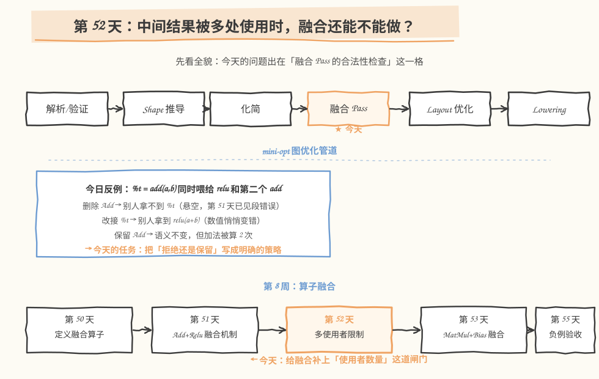
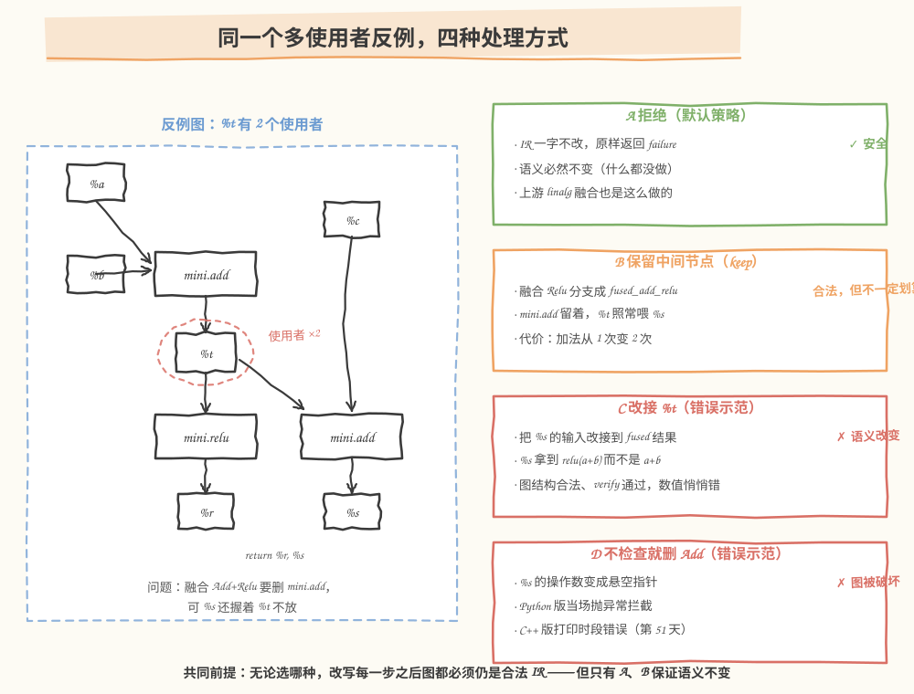
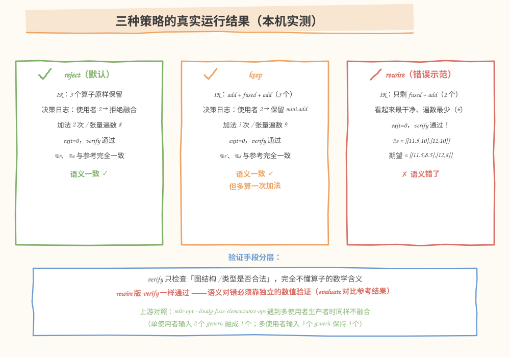
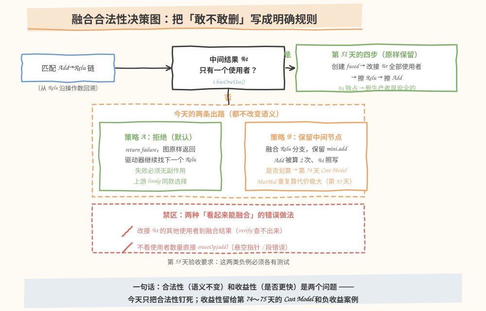

# 第 052 天：融合的多使用者限制——中间结果不止一个人用，还能删生产者吗？

> **今日目标**：能解释「中间结果被多处使用时，直接删除生产者为什么会坏、错在哪一步」；能在自己的融合工具里把策略写成明确规则（默认拒绝，或保留中间节点），并用多使用者反例和数值验证证明策略没改变语义。
> **预计时间**：学习 40 分钟＋实践 60 分钟（选做另加 25 分钟）
> **前置准备**：
> - 第 51 天的 `FuseAddReluPattern`（本文 §5.4 复用同款 ODS／Dialect 壳，可独立构建运行）
> - 回顾第 10 天的 use-def：每个值维护两张表——「谁定义我」和「谁在使用我」
> - 回顾第 51 天实验 C：去掉 `hasOneUse()` 检查后段错误、退出码 139
> - 热身需要 Python 3 + numpy；正餐需要 C++17 编译器与 MLIR 18
> **今日产出**：带策略的融合工具（Python 版 4 种策略 + MLIR 版 `mini-fuse-multi`）、6 个多使用者测试、5 组真实运行记录和一份融合合法性说明

## 1. 今天解决什么问题？

昨天我们给 `Add + Relu → fused_add_relu` 写了完整的融合 Pattern，但有一行代码是「先欠着账」的：

```cpp
// (2) 合法性前提：中间结果 %t 只被这一个 Relu 使用。
//     有多个使用者时直接删除 Add 会破坏别人的输入，处理策略留到第 52 天。
if (!t.hasOneUse())
  return failure();
```

今天就来还这笔账。看一个具体的多使用者反例，输入是三个 `2×2` 的 f32 张量（沿用第 51 天的 `a=[[1,-2],[3,-4]]`，`b=[[0.5,0.5],[-1,2]]`，再添一个 `c=[[10,10],[10,10]]`）：

```mlir
%t = mini.add %a, %b : tensor<2x2xf32>     // %t = [[1.5,-1.5],[2,-2]]
%r = mini.relu %t : tensor<2x2xf32>        // %r = [[1.5, 0],[2, 0]]
%s = mini.add %t, %c : tensor<2x2xf32>     // %s = [[11.5, 8.5],[12, 8]]
func.return %r, %s
```

`%t` 有**两个**使用者：`mini.relu` 和第二个 `mini.add`。融合 `Add+Relu` 的标准动作是「删两个节点、造一个新节点」，可第二个 `mini.add` 还握着 `%t` 不放——生产者 `mini.add` 到底敢不敢删？直觉上似乎有三个选项：照删不误、把别人也改接到新结果、或者留着生产者别删。**其中两个会出错，而且错的方式完全不同**：

- 照删不误：第二个 `mini.add` 的操作数变成悬空指针（dangling pointer，指向已销毁对象的指针）——第 51 天已经见过它段错误的样子；
- 改接 `%t`：第二个 `mini.add` 会拿到 `relu(a+b)` 而不是 `a+b`——图结构完全合法、`verify` 通过、**数值悄悄变错**，连崩溃都不会有。

今天的目标是把「拒绝还是保留」从一句注释变成明确的、可测试的策略，并且用真实运行证明：策略 A（拒绝）和策略 B（保留中间节点）语义都不变，而两个错误示范各自坏在哪一层。

## 2. 先看全貌：今天的内容位于哪里？



**图 1**：看两个位置——上排是 `mini-opt` 的图优化管道，问题出在「融合 Pass」这一格的合法性检查上：模式匹配只回答「长得像不像链」，**使用者数量**才是今天补上的第二道闸门；下排是第 8 周路线，昨天解决了融合的改写机制，今天解决它的边界条件，明天才把同样的机制推广到 `MatMul+Bias`。

今天的全貌可以概括成 4 步：

1. 构造反例：`%t` 被 `relu` 和第二个 `add` 同时使用（§1 的图）；
2. 讲清两种失败的机理：**改变语义**（改接）与**破坏图**（硬删）——它们坏在不同的层；
3. 把正确策略写成代码：默认拒绝，可选保留中间节点（`keep`），并给每个策略配测试；
4. 用数值验证（`evaluate` 对比参考结果）而不是 `verify` 来判定语义没变。

## 3. 核心概念：删除的前提、两种失败、策略

### 3.1 多使用者意味着什么：擦除的前提是 use 表为空

一句通俗的解释：**删除一个算子，等于销毁它结果的存储**；只有当这张结果没有任何使用者时，销毁才是安全的。类比：`%t` 像一份被两个同事引用的共享文档——你可以给其中一位单独写份新文档（新建融合算子），但不能把共享文档直接撕掉（删 `mini.add`），更不能在原稿上偷偷盖一层 relu 再发给第二位（改接 `%t`）——第二位要的恰恰是没盖 relu 的版本。

对应到技术上是：第 10 天的 use-def 里，每个值维护「定义者」和「使用者列表」两张表；`rewriter.eraseOp(add)` 合法的充要前提是 `add` 结果的 use 表为空。`hasOneUse()` 之所以能当闸门，是因为它同时回答了两件事：这个 Relu 是不是唯一使用者、以及删掉 Relu 之后 use 表会不会自然清空。

这个类比覆盖不到的边界：它说的是「文档」这种可以随便复印的东西，而 SSA 值是**一次定义、随后只读**的，且「再算一遍」是有计算代价的——这正是 §3.2 中 keep 策略的代价来源，类比里感觉不到。

### 3.2 「改变语义」和「增加重复计算」是两种不同的失败

`mini.fused_add_relu` 建出来之后，`%t` 的命运有四种处理，其中两种是**坏在不同层**的失败：

| 做法 | 改写后图合法吗 | 语义变了吗 | 额外代价 |
|---|---|---|---|
| A 拒绝（`return failure`） | 是 | 没变 | 0 |
| B 保留 `mini.add`（keep） | 是 | 没变 | 加法算 2 次 |
| C 把 `%t` 的其他使用者改接到融合结果 | 是（verify 过） | **变了** | — |
| D 不检查就 `eraseOp(add)` | **否**（悬空指针） | — | — |

关键是 C 这一行：融合结果 `%r' = relu(a+b)`，而 `%t = a+b`，两者**不是同一个值**。改接之后，第二个 `mini.add` 算出的 `%s` 在 `a+b<0` 的位置上悄悄变了：用今天的例子，期望 `[[11.5, 8.5],[12, 8]]`，实际 `[[11.5, 10],[12, 10]]`——恰好是 `-1.5` 和 `-2` 被 relu 钳成 0 的那两个位置。**它比 D 更危险**：D 会当场崩溃，容易被发现；C 什么都不报，`verify`、退出码、甚至 IR 长相都完全正常。

而 B 是合法的，但要付钱：`mini.add` 留着给第二个 `mini.add` 用，融合算子又把加法重算了一遍——**同一份加法，算 2 次**。语义没变，代价变了。所以「合法」和「划算」是两个独立的问题，后者要到第 74～75 天的 Cost Model（收益模型，评估「这次变换值不值」的组件）里才回答。

### 3.3 今天的策略：默认拒绝，keep 作为可选项

明确当前项目的选择：

- **默认策略 A（拒绝）**：`%t` 多使用者时 `return failure`，图原样返回。收益为零，但风险也为零，而且**失败必须无副作用**——没改过一笔，就谈不上改错；
- **可选策略 B（keep）**：融合 Relu 分支，保留 `mini.add`。它不是「更差」，而是「把要不要多算一次加法的决定权」交给未来的收益判断——对今天的逐元素加法，重算很便宜；换成第 53 天的 `MatMul`，重算一整次矩阵乘就贵得多，这正是 MatMul 融合对多使用者更保守的原因；
- **C、D 永远禁止**：一个坏语义、一个坏图，都必须有测试盯着（第 55 天负例验收的硬性要求）。

## 4. 图解机制：同一张反例图，四种处理



**图 2**：左边是贯穿今天的反例图，红圈标出的 `%t` 被两条边拽着——上面的 `mini.relu` 想融合它，下面的 `mini.add` 还要用它。右侧四个面板是同一次匹配的四种下场：A 原样返回；B 融合了 Relu 分支但保留 `mini.add`（加法算 2 次）；C 把 `%s` 的输入改接到融合结果，图合法但 `%s` 拿到的是 `relu(a+b)`；D 连图都保不住。

按图走一遍 B 的改写过程（`mini-fuse-multi.cpp --strategy=keep` 的实际动作）：

1. 匹配链：从 Relu 沿操作数回溯到 `mini.add`，和第 51 天完全一样；
2. **先记录** `singleUse` 和使用者数量——此刻 `%t` 有 2 个使用者，这个事实一旦开始改写就会变，必须先存下来（§6 错误 3 会看到不存的后果）；
3. 创建 `fused_add_relu`、改接 `%r` 的全部使用者、擦除 Relu——这三步与昨天一致；
4. 分岔：`singleUse` 为真 → 擦除 Add（昨天的原样行为）；为假 → **保留 Add**。`%t` 继续由它喂给第二个 `mini.add`，语义不变。

## 5. 动手实践：四种策略从 Python 到真实 MLIR

本日代码结构（均为可直接运行的完整文件）：

```text
tutorials/day-052/
├── README.md                    ← 本教程
├── images/                      ← 4 张手绘信息图（SVG）
└── code/
    ├── mini_fuse_multi.py       ← 热身：带 4 种策略的迷你 IR + Rewriter + 数值验证
    ├── test_multi_user.py       ← 6 个多使用者测试
    └── mlir-mini/               ← 正餐：真实 MLIR 里的策略化融合工具
        ├── MiniOps.td           ← ODS：三个算子（与第 51 天相同）
        ├── MiniDialect.h/.cpp   ← Dialect 壳（同款复用）
        ├── mini-fuse-multi.cpp ← 带 --strategy/--broken 的融合 Pass
        ├── CMakeLists.txt
        └── inputs/              ← multi_user / single_user / multi_user_output / multi_user_linalg
```

以下所有命令与输出均为 **2026-11-12 在本环境真实执行**的结果。环境：Linux aarch64，g++ 9.4.0，Ubuntu LLVM 18.1.8（含 `mlir-opt`、`mlir-tblgen`），Python 3.11.4，numpy 1.26.4。

### 5.1 热身（20 分钟）：用 Python 把四种策略跑出真数据

`code/mini_fuse_multi.py` 复用第 51 天的迷你 IR 和带完整性检查的 `Rewriter`，把 Pattern 的策略做成参数。核心变化在这一段：

```python
def fuse_add_relu_pattern(relu, rw, policy="reject"):
    t = relu.inputs[0]
    add = t.def_op
    if add is None or add.name != "mini.add":   # 不是 Add -> Relu 链
        return False
    single_use = t.has_one_use()                 # 先记录：改写之后会变

    if policy == "erase-anyway":
        # 错误示范：不看使用者数量就删生产者（Rewriter 会当场拦下）
        fused = rw.create("mini.fused_add_relu", add.inputs,
                          insert_before=relu, result_name=relu.result.name + "'")
        rw.replace_all_uses_with(relu.result, fused.result)
        rw.erase(relu)
        rw.erase(add)        # 多使用者时这里抛 RuntimeError
        return True

    if policy == "reject" and not single_use:
        return False         # 保守策略：这块图不归我管，保持原样

    fused = rw.create("mini.fused_add_relu", add.inputs,
                      insert_before=relu, result_name=relu.result.name + "'")
    rw.replace_all_uses_with(relu.result, fused.result)
    rw.erase(relu)          # 先擦消费者
    if single_use:
        rw.erase(add)       # 中间结果独占：生产者一并删除（第 51 天原样）
    elif policy == "keep":
        pass                # 多使用者：保留 mini.add，%t 继续喂给其他使用者
    else:                   # policy == "rewire-t"
        rw.replace_all_uses_with(t, fused.result)   # 其他使用者拿到 relu(a+b)！
        rw.erase(add)
    return True
```

注意两处与昨天不同的细节：`single_use` 在**任何改写之前**读取；多使用者在 `keep` 分支下只擦 Relu、不擦 Add。文件还带一个玩具代价模型：按「整张 tensor 读／写一次各计 1 遍」统计 `OP_COST`。运行：

```bash
cd tutorials/day-052/code
python3 mini_fuse_multi.py
```

真实输出（节选自完整输出，未改写 IR 的部分与 §1 相同）：

```text
===== 策略 reject =====
加法执行次数 = 2，张量读写遍数 = 8
%r = [[1.5, 0.0], [2.0, 0.0]]   期望 [[1.5, 0.0], [2.0, 0.0]]   一致
%s = [[11.5, 8.5], [12.0, 8.0]]   期望 [[11.5, 8.5], [12.0, 8.0]]   一致

===== 策略 keep =====
%t = mini.add %a, %b : tensor<2x2xf32>
%r' = mini.fused_add_relu %a, %b : tensor<2x2xf32>
%s = mini.add %t, %c : tensor<2x2xf32>
加法执行次数 = 3，张量读写遍数 = 9
%r' = [[1.5, 0.0], [2.0, 0.0]]   期望 [[1.5, 0.0], [2.0, 0.0]]   一致
%s = [[11.5, 8.5], [12.0, 8.0]]   期望 [[11.5, 8.5], [12.0, 8.0]]   一致

===== 策略 rewire-t =====
%r' = mini.fused_add_relu %a, %b : tensor<2x2xf32>
%s = mini.add %r', %c : tensor<2x2xf32>
加法执行次数 = 2，张量读写遍数 = 6
%r' = [[1.5, 0.0], [2.0, 0.0]]   期望 [[1.5, 0.0], [2.0, 0.0]]   一致
%s = [[11.5, 10.0], [12.0, 10.0]]   期望 [[11.5, 8.5], [12.0, 8.0]]   不一致!

===== 错误示范：不做检查直接删生产者（erase-anyway）=====
Rewriter 拦截：不能擦除 mini.add：结果 %t 仍有 1 处使用者

数值一致性：{'reject': True, 'keep': True, 'rewire-t': False}
```

三个观察，对应 §3.2 的表格：

- `reject`：IR、语义、代价三项都没动，是**恒等变换**；
- `keep`：`%s` 的输入仍然是 `%t`，两个输出都和参考一致——但加法 2→3 次、张量遍数 8→9 遍。细看这笔账：`%t` 反正要完整写给第二个 `mini.add`（一笔省不掉），融合只省下了 Relu 读 `%t` 的那 1 遍，却为融合算子多付了重读 `%a`、`%b` 的 2 遍——**净亏 1 遍，还搭进一遍加法**。在本玩具账本下 keep 纯属亏本，这就是它只配当「可选项」的原因；
- `rewire-t`：IR 最短、遍数最少、看起来「最优」——但 `%s` 在 `a+b<0` 的两个位置上从 8.5、8 变成了 10、10。**代价越好看，越要怀疑语义**。

`erase-anyway` 报错里的「仍有 1 处使用者」也值得读一遍：执行到那一行时 Relu 已被擦除，`%t` 剩下的 1 处使用者正是第二个 `mini.add`——Rewriter 的完整性检查把未定义行为（UB）变成了确定性报错。

再跑测试（覆盖两种正确策略、两个错误示范、单使用者回归、return 使用者）：

```bash
python3 test_multi_user.py
```

真实输出：

```text
test_multi_user_rejected_by_default 通过：默认拒绝，IR、语义、代价都不变
test_keep_strategy_preserves_semantics 通过：语义不变，但加法 2→3 次、张量遍数 8→9（合法 ≠ 有收益）
test_rewire_t_changes_semantics    通过：%s 被改接，[[11.5, 10.0], [12.0, 10.0]] != 期望 [[11.5, 8.5], [12.0, 8.0]]
test_erase_anyway_is_caught       通过：Rewriter 拦截，异常信息 = 不能擦除 mini.add：结果 %t 仍有 1 处使用者
test_single_user_fuses_under_all_policies 通过：单使用者图三种策略结果一致
test_multi_user_with_return_consumer 通过：return 也是使用者，keep 保留 %t 作输出

全部 6 个测试通过。
```

### 5.2 正餐（30 分钟）：真实 MLIR 里的 `mini-fuse-multi`

Dialect 壳和 ODS 与第 51 天完全相同（同三个算子，`MiniOps.td`、`MiniDialect.h/.cpp` 原样复制），新的只是驱动工具 `mini-fuse-multi.cpp`。Pattern 的关键段（与图 2 的四步对应）：

```cpp
LogicalResult matchAndRewrite(mini::ReluOp relu,
                              PatternRewriter &rewriter) const override {
    // (1) 沿操作数回溯：Relu 的输入必须由 mini.add 定义
    Value t = relu.getX();
    auto add = t.getDefiningOp<mini::AddOp>();
    if (!add)
      return failure();

    // (2) 先记录使用者数量 —— 后面的改写会改变它，必须先存下来
    bool singleUse = t.hasOneUse();
    unsigned numUses = std::distance(t.use_begin(), t.use_end());

    // (3) 默认策略：多使用者时拒绝融合，图保持原样（失败必须无副作用）
    if (!singleUse && strategy == Strategy::Reject) {
      llvm::errs() << "  [reject] 匹配 Relu(%t)：使用者 " << numUses
                   << " -> 拒绝融合，保留 mini.add 和 mini.relu\n";
      return failure();
    }

    // (4) 创建融合算子，改接 %r 的全部使用者，先擦消费者 Relu
    rewriter.setInsertionPoint(relu);
    auto fused = rewriter.create<mini::FusedAddReluOp>(
        relu.getLoc(), t.getType(), add.getLhs(), add.getRhs());
    rewriter.replaceAllUsesWith(relu.getResult(), fused.getResult());
    rewriter.eraseOp(relu);

    // (5) 生产者 Add：单使用者 -> 一并删除；多使用者 + keep -> 保留
    if (singleUse) {
      rewriter.eraseOp(add);
      llvm::errs() << "  [fuse] 匹配 Relu(%t)：使用者 1 -> 融合，删除 mini.add\n";
    } else {
      llvm::errs() << "  [keep] 匹配 Relu(%t)：使用者 " << numUses
                   << " -> 融合 Relu 分支，保留 mini.add（加法将执行 2 次）\n";
    }
    return success();
}
```

除了策略分岔，还有两处工程细节：每次匹配都向 stderr 打一行**决策日志**（「为什么融合／为什么不融合」必须说得出口，这也是本日「融合合法性说明」的可运行版本）；校验通过后额外提示 `verify: 通过（注意：这只代表结构合法，不代表语义没变）`。构建（约 1～2 分钟，路径按你的 MLIR 安装调整）：

```bash
cd tutorials/day-052/code/mlir-mini
cmake -G Ninja -B build -DCMAKE_CXX_COMPILER=g++ \
      -DMLIR_DIR=/usr/lib/llvm-18/lib/cmake/mlir -DCMAKE_BUILD_TYPE=Release
ninja -C build
```

**实验 A——默认策略遇到多使用者**（`inputs/multi_user.mlir` 就是 §1 的反例）：

```bash
./build/mini-fuse-multi inputs/multi_user.mlir
```

真实输出（`===== 融合前 =====` 与输入相同，略；决策日志走 stderr）：

```text
决策日志（策略 = reject）：
  [reject] 匹配 Relu(%t)：使用者 2 -> 拒绝融合，保留 mini.add 和 mini.relu
verify: 通过（注意：这只代表结构合法，不代表语义没变）
===== 融合后 =====
module {
  func.func @graph_multi(%arg0: tensor<2x2xf32>, %arg1: tensor<2x2xf32>, %arg2: tensor<2x2xf32>) -> (tensor<2x2xf32>, tensor<2x2xf32>) {
    %0 = mini.add %arg0, %arg1 : tensor<2x2xf32>
    %1 = mini.relu %0 : tensor<2x2xf32>
    %2 = mini.add %0, %arg2 : tensor<2x2xf32>
    return %1, %2 : tensor<2x2xf32>, tensor<2x2xf32>
  }
}
```

`exit=0`，IR 一字未动。拒绝不是错误，是「这块图不归我管」。

**实验 B——切换策略 `--strategy=keep`**（同一输入）：

```bash
./build/mini-fuse-multi inputs/multi_user.mlir --strategy=keep
```

真实输出（节选）：

```text
决策日志（策略 = keep）：
  [keep] 匹配 Relu(%t)：使用者 2 -> 融合 Relu 分支，保留 mini.add（加法将执行 2 次）
verify: 通过（注意：这只代表结构合法，不代表语义没变）
===== 融合后 =====
module {
  func.func @graph_multi(%arg0: tensor<2x2xf32>, %arg1: tensor<2x2xf32>, %arg2: tensor<2x2xf32>) -> (tensor<2x2xf32>, tensor<2x2xf32>) {
    %0 = mini.add %arg0, %arg1 : tensor<2x2xf32>
    %1 = mini.fused_add_relu %arg0, %arg1 : tensor<2x2xf32>
    %2 = mini.add %0, %arg2 : tensor<2x2xf32>
    return %1, %2 : tensor<2x2xf32>, tensor<2x2xf32>
  }
}
```

三个算子：`%0` 留着喂 `%2`，`%1` 融合了 Relu 分支。**注意 `%1` 不再消费 `%0`**——融合算子的输入回到源头 `%arg0, %arg1`，加法因此被算了两遍；`%0` 也仍然完整落盘（它还有别的使用者），这正是 Python 版算出「遍数 8→9」的 IR 版本。

### 5.3 修改一个参数再观察：`--broken=rewire` 与单使用者回归

**实验 C——错误示范 `--broken=rewire`**（同一输入）：

```bash
./build/mini-fuse-multi inputs/multi_user.mlir --broken=rewire
```

真实输出（节选）：

```text
决策日志（策略 = broken=rewire）：
  [broken=rewire] 匹配 Relu(%t)：使用者 2 -> 强行融合并改接 %t 的其他使用者（语义错误！）
verify: 通过（注意：这只代表结构合法，不代表语义没变）
===== 融合后 =====
module {
  func.func @graph_multi(%arg0: tensor<2x2xf32>, %arg1: tensor<2x2xf32>, %arg2: tensor<2x2xf32>) -> (tensor<2x2xf32>, tensor<2x2xf32>) {
    %0 = mini.fused_add_relu %arg0, %arg1 : tensor<2x2xf32>
    %1 = mini.add %0, %arg2 : tensor<2x2xf32>
    return %0, %1 : tensor<2x2xf32>, tensor<2x2xf32>
  }
}
```

`exit=0`、`verify` 通过、IR 最精简——**但 `%1` 现在算的是 `relu(a+b)+c`**。它每一笔改写都走 rewriter、每一步中间状态都合法、类型全对，IR 层面的所有检查都挑不出毛病。语义错没错，只有 Python 版那样的数值验证能回答（§5.1：`%s` 在两个位置 8.5→10、8→10）。



**图 3**：三列分别对应实验 A、B、C 的真实结果。最值得盯的是右列：verify 通过、遍数最少、IR 最短——「一切指标都好看」和「结果正确」没有必然关系。底部两行绿字是上游对照（§5.4）。

**实验 D——单使用者回归**：策略改成 keep 之后，昨天的正例还灵吗？

```bash
./build/mini-fuse-multi inputs/single_user.mlir --strategy=keep
```

真实输出（节选）：

```text
决策日志（策略 = keep）：
  [fuse] 匹配 Relu(%t)：使用者 1 -> 融合，删除 mini.add
verify: 通过（注意：这只代表结构合法，不代表语义没变）
===== 融合后 =====
module {
  func.func @graph_single(%arg0: tensor<2x2xf32>, %arg1: tensor<2x2xf32>) -> tensor<2x2xf32> {
    %0 = mini.fused_add_relu %arg0, %arg1 : tensor<2x2xf32>
    return %0 : tensor<2x2xf32>
  }
}
```

单使用者时 keep 退化成第 51 天的原样行为：删除生产者是安全的，留着它反而制造死代码（无使用者算子，要靠 DCE 打扫）。

**实验 E——`return` 也是使用者**（`inputs/multi_user_output.mlir`，`%t` 被 Relu 和函数返回值同时使用）：

```bash
./build/mini-fuse-multi inputs/multi_user_output.mlir --strategy=keep
```

真实输出（节选）：

```text
  [keep] 匹配 Relu(%t)：使用者 2 -> 融合 Relu 分支，保留 mini.add（加法将执行 2 次）
===== 融合后 =====
module {
  func.func @graph_multi_output(%arg0: tensor<2x2xf32>, %arg1: tensor<2x2xf32>) -> (tensor<2x2xf32>, tensor<2x2xf32>) {
    %0 = mini.add %arg0, %arg1 : tensor<2x2xf32>
    %1 = mini.fused_add_relu %arg0, %arg1 : tensor<2x2xf32>
    return %1, %0 : tensor<2x2xf32>, tensor<2x2xf32>
  }
}
```

`func.return` 在 use-def 表里就是一个普通使用者，所以它和实验 B 的第二个 `mini.add` 没有任何区别——不需要为「图输出」写特殊规则。

### 5.4 生产级对照：上游 linalg 遇到多使用者怎么办？

把同一张反例图用上游方言写出来（`inputs/multi_user_linalg.mlir`，`addf`＋`maximumf` 即 `relu`），跑上游的元素级融合：

```bash
/usr/lib/llvm-18/bin/mlir-opt inputs/multi_user_linalg.mlir \
    --convert-elementwise-to-linalg --linalg-fuse-elementwise-ops
```

真实输出（节选，`%1` 是 `addf` 的结果、被两处消费）：

```text
    %1 = linalg.generic {indexing_maps = [#map, #map, #map], ...} ins(%arg0, %arg1 : ...) ... {
      %6 = arith.addf %in, %in_0 : f32
      linalg.yield %6 : f32
    } -> tensor<2x2xf32>
    %3 = linalg.generic {indexing_maps = [#map, #map], ...} ins(%1 : ...) ... {
      %6 = arith.maximumf %in, %cst : f32
      linalg.yield %6 : f32
    } -> tensor<2x2xf32>
    %5 = linalg.generic {indexing_maps = [#map, #map, #map], ...} ins(%1, %arg2 : ...) ... {
      %6 = arith.addf %in, %in_0 : f32
      linalg.yield %6 : f32
    } -> tensor<2x2xf32>
```

**三个 `linalg.generic` 一个都没融合**。对照组（把 `%t` 的第二个使用者去掉，其余完全相同）：融合后只剩 1 个 `generic`，`addf` 和 `maximumf` 合并进同一个循环体——第 51 天的正例结果可以复现。也就是说，面对多使用者生产者，上游 MLIR 18 的 `--linalg-fuse-elementwise-ops` 选择了和我们默认策略一样的保守路线：**拒绝**。这为「策略 A 当默认」提供了一个上游佐证；至于「拒绝是否丢了收益」，是第 74～75 天用 Cost Model 才能回答的问题。

### 5.5 融合合法性说明（本日产出）



**图 4**：把今天的规则整理成一张决策图。`hasOneUse()` 为真走昨天的四步；为假时只有 A、B 两条出路，C、D 是画了红叉的禁区。用文字固定下来，供后面几天引用：

1. **匹配**（`Add → Relu` 链）只决定「这是一次候选融合」，不决定「能不能删生产者」；
2. **删除生产者的充要前提**：中间结果的 use 表为空（单使用者 + 已擦消费者，或永远不删）；
3. **改接中间值的使用者永远是语义错误**：融合结果 = `relu(中间值)` ≠ 中间值；`verify` 查不出来，必须有独立的数值验证；
4. **合法 ≠ 有收益**：keep 策略合法，但会复制计算；收益判断（做不做 keep）属于 Cost Model，当前项目默认拒绝；
5. **失败必须无副作用**：拒绝分支返回 `failure` 前不许动过图——这也是贪心驱动能安全迭代的前提（不动点，fixpoint：反复应用 Pattern 直到没有改动）。

## 6. 常见错误与排查

**错误 1：把 `%t` 的其他使用者改接到融合结果（今天最危险的写法）**
- **现象**：IR 更精简、`verify` 通过、`exit=0`，一切正常——直到某天数值对不上（§5.1 的 `rewire-t`：`%s` 期望 `[[11.5,8.5],[12,8]]`，实际 `[[11.5,10],[12,10]]`）。
- **原因**：融合结果 `relu(a+b)` 和中间值 `a+b` 是两个不同的值；改接让其他使用者拿错了值。
- **定位**：`verify` 和退出码都无能为力；用参考求值器对比每个输出的元素（Python 版的 `evaluate` 对比就是干这个的），出错位置恰好落在被 relu 钳为零的地方。
- **修复**：删除这条路径。多使用者的出路只有 A（拒绝）和 B（保留生产者）；第 55 天把这类负例固化为回归测试。

**错误 2：不看使用者数量就 `eraseOp(add)`**
- **现象**：Python 版当场抛 `RuntimeError: 不能擦除 mini.add：结果 %t 仍有 1 处使用者`；真实 MLIR 里表现为使用后释放（use-after-free）——第 51 天实验 C 的段错误、退出码 139。
- **原因**：`erase` 销毁 `%t` 的存储，仍在使用它的算子拿到悬空指针。
- **定位**：崩溃点通常在无关的打印/校验代码处（第 51 天已详细分析）；审 Pattern 时盯着每个 `eraseOp` 问一句「它的结果此刻还有使用者吗」。
- **修复**：`if (!t.hasOneUse()) return failure();`（策略 A）或保留生产者不删（策略 B）。

**错误 3：先改图、后查使用者数量**
- **现象**：多使用者图在 `keep` 策略下也把生产者删了，第二个消费者悬空；而且这种 bug 只在多使用者输入上发作，单使用者测试全绿。
- **原因**：擦掉 Relu 之后，`%t` 的 use 表已经变短——两个使用者只剩一个，此时再读 `hasOneUse()` 会得到「真」。检查被自己的改写污染了。
- **定位**：对照 `mini-fuse-multi.cpp` 的第 (2) 步——`singleUse` 必须在任何 `eraseOp`/`replaceAllUsesWith` 之前采样。
- **修复**：进入 Pattern 先把 `hasOneUse()` 和使用者数量存进局部变量，改写过程中只使用这份快照。

**错误 4：先创建算子、再返回 `failure`**
- **现象**：把单使用者检查写到了创建之后——多使用者输入被「拒绝」了，但 `fused_add_relu` 已经建进图里；用默认策略重跑，输出和输入**不再逐字相同**，图里多出一个游离的融合算子。
- **原因**：贪心驱动与 Pattern 的约定是「返回 `failure` == 本次一笔都没改」（第 45 天起反复强调的「失败必须无副作用」）；驱动器拿这个约定维护工作队列、判断不动点，它不会替失败的匹配收拾半个改写。
- **定位**：对拒绝路径做恒等性测试：同一输入、默认策略，融合后 IR 必须与输入完全一致（今天 `test_multi_user.py` 第 1 个测试做的就是这件事）。
- **修复**：所有检查（链匹配、单使用者）排在创建之前——图 4 决策图的顺序就是这个用意。

## 7. 今日练习

### 必做练习：三个使用者的预测与验证

基于 `inputs/multi_user.mlir` 构造一个新输入 `three_users.mlir`：让 `%t` 再被 `func.return` 使用一次（即 `%t` 同时被 `mini.relu`、第二个 `mini.add` 和 `return` 使用，共 3 处）。先**笔头预测**三件事再运行：

1. `./build/mini-fuse-multi inputs/three_users.mlir`（默认策略）的决策日志会显示使用者几个？融合后 IR 有几个算子？
2. 换 `--strategy=keep`，`%t` 还剩几个使用者、全图加法算几次？
3. 换 `--broken=rewire`，`return` 里那个 `%t` 会变成什么值？它和期望的 `a+b` 差在哪几个位置、为什么恰好是那些位置？

运行 `./build/mini-fuse-multi inputs/three_users.mlir [--strategy=keep|--broken=rewire]` 和 Python 版对照（给 `build_multi_user_graph` 加一行输出即可），检查预测与实际是否一致；不一致就回到图 2 逐边核对 use-def。

### 选做挑战：把代价账本换成字节流量

把 `mini_fuse_multi.py` 的 `OP_COST` 从「张量遍数」升级成字节流量：f32 每个元素 4 字节，读一张 `2×2` tensor 是 16 B，写也是 16 B；再把 shape 换成 `4096×4096` 估算——此时 `reject` 和 `keep` 各读写多少字节、keep 比 reject 多读多少？（这一步是第 71～72 天「计算量与访存量」的热身，不需要写新机制，只改计数函数。）

## 8. 今日验收

- [ ] 我能不看资料说出四种处理各自的结局：拒绝（恒等）、keep（合法但加法算 2 次）、改接（verify 通过但语义变）、硬删（悬空指针）；
- [ ] 我能独立运行 `python3 mini_fuse_multi.py` 和 `python3 test_multi_user.py`，并指出哪个测试守护「rewire 语义错误」、哪个守护「erase 拦截」；
- [ ] 我能构建并运行 `mini-fuse-multi`，让 `multi_user.mlir` 在默认策略下原样返回、在 `--strategy=keep` 下保留 `mini.add`，两者 `exit=0` 且 `verify` 通过；
- [ ] 我能解释为什么 `--broken=rewire` 的 `exit=0` 恰恰是最危险的结果，以及该用什么手段发现它（数值验证，而非 verify）；
- [ ] 我保存了今日代码、6 个测试和运行记录，能回答「删除生产者的充要前提是什么」「为什么说合法不等于有收益」。

## 9. 一句话总结与明天预告

今天我们直面了第 51 天欠下的账：中间结果被多处使用时，「删生产者」的前提（use 表为空）不再成立——硬删破坏图、改接悄悄改变语义，两条错误路线都在真实运行里见了分晓；正确的出路只有拒绝（默认，与上游 linalg 的保守选择一致）或保留生产者（合法但复制计算，收益交给未来的 Cost Model），并且「使用者数量」必须在改写前采样。至此 `Add+Relu` 融合在正例和反例上都站住了。明天（第 53 天）把同一套机制推广到 `MatMul+Bias`：Bias 的 Shape 与输出如何对齐、两算子融合的顺序怎么定——你会看到多使用者限制在那里为什么更加致命。