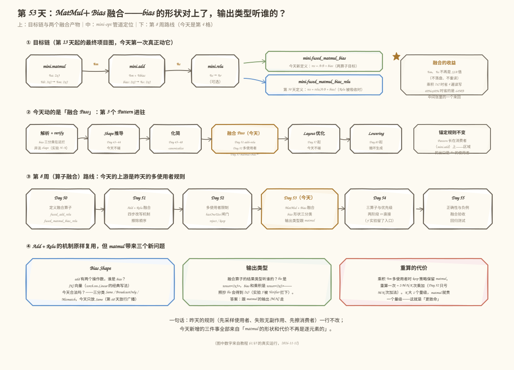
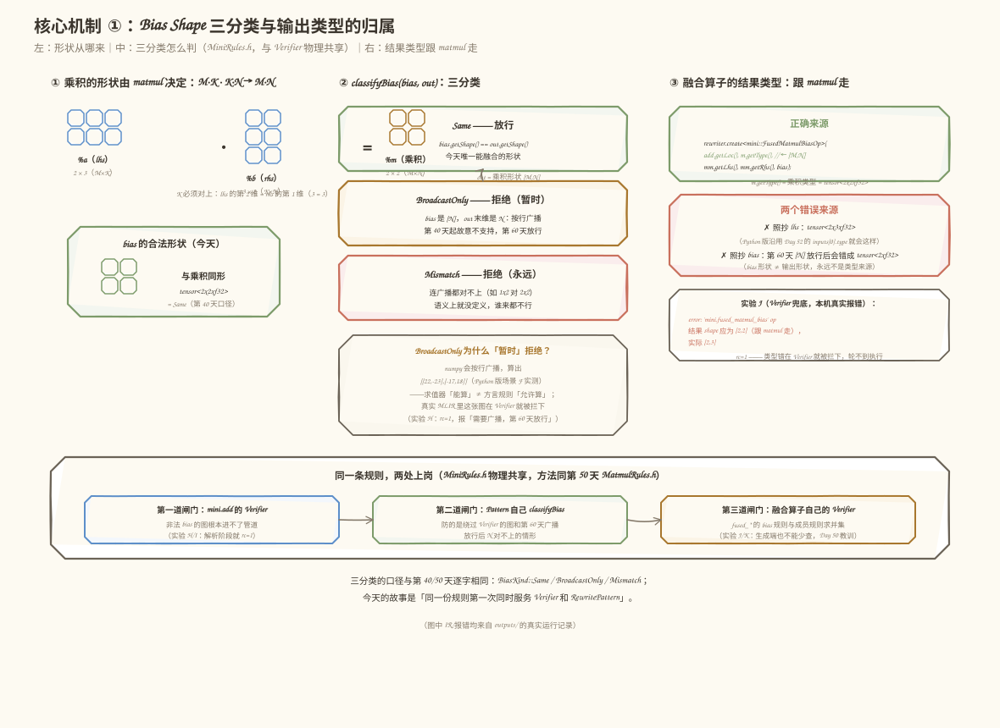
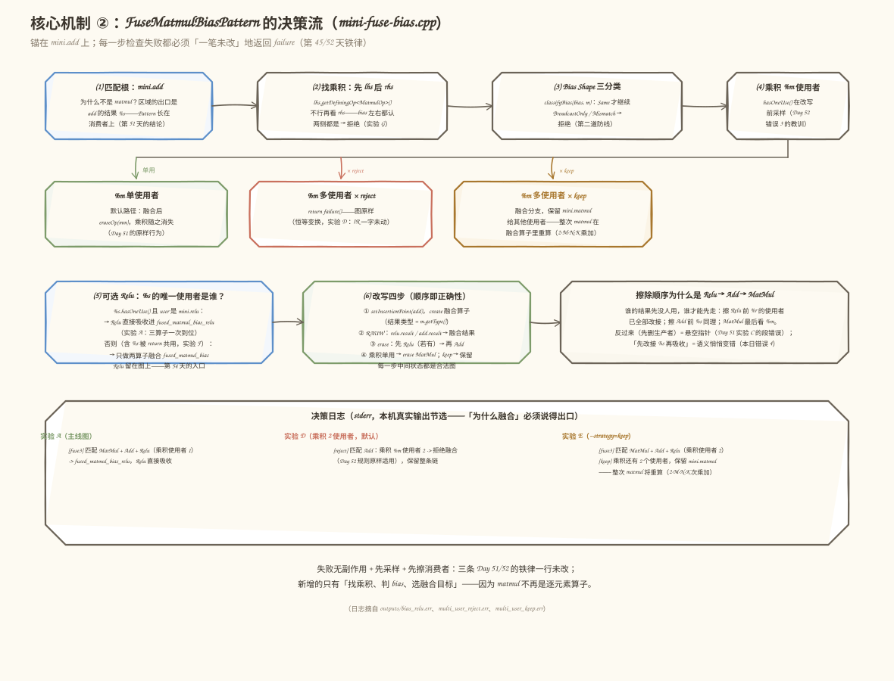
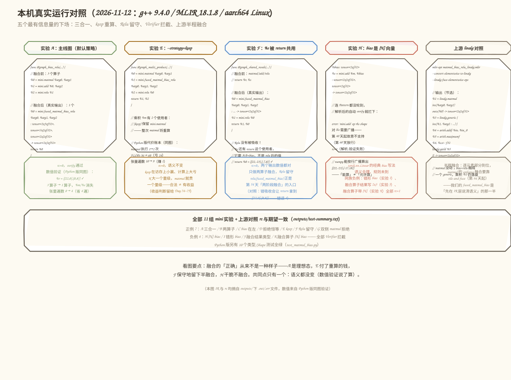

# 第 053 天：MatMul＋Bias 融合——bias 的形状对上了，输出类型听谁的？

> **今日目标**：能说出「今天合法的 bias 形状为什么只有『与乘积同形』一种、[N] 向量为什么被暂时拒绝」；能写出 `MatMul + Add`（可选吸收 Relu）的融合 Pattern，并解释**结果类型为什么必须从 matmul 拿**；能用 10 个 Python 类型/Shape 测试＋11 组 MLIR 实验证明融合没改变语义。
> **预计时间**：学习 40 分钟＋实践 60 分钟（选做另加 25 分钟）
> **前置准备**：
> - 第 51/52 天的融合四步与多使用者铁律（`hasOneUse()` 先采样、失败必须无副作用、先擦消费者——本文一行不改地复用）
> - 第 50 天定义的 `mini.fused_matmul_bias_relu`（本文 §5.3 提供等价最小壳，可独立构建运行）
> - 回顾第 40 天：`mini.add` 摘掉 `SameOperandsAndResultType`、改成手写三分类 Verifier 的原因
> - 热身需要 Python 3 + numpy；正餐需要 C++17 编译器与 MLIR 18
> **今日产出**：Python 版 `mini_fuse_bias.py`（带策略与代价账本）、`test_matmul_bias.py`（10 个类型/Shape 测试）、真实 MLIR 版 `mini-fuse-bias`（新增 `mini.fused_matmul_bias`、规则头 `MiniRules.h`）、11 组真实运行记录（7 正例＋4 负例）和 1 张上游 linalg 对照

## 1. 今天解决什么问题？

从第 13 天起，我们的最终项目图一直是这一张（第 8 周终于轮到动它）：

```mlir
%m = mini.matmul %a, %b      : 2x3 · 3x2 -> 2x2   // 乘积：中间张量
%s = mini.add     %m, %bias   : 2x2 + 2x2 -> 2x2   // bias 加法
%r = mini.relu    %s          : 2x2     -> 2x2     // 激活（可选）
```

今天用这一组数字贯穿全文：`A=[[1,-2,3],[-4,5,-6]]`，`B=[[1,0],[-1,2],[3,-3]]`，`bias=[[10,-10],[20,-20]]`。直算得 `%m=[[12,-13],[-27,28]]`，`%s=[[22,-23],[-7,8]]`，`%r=[[22,0],[0,8]]`——融合前后这三个值必须分毫不动。

为什么值得融合？`Add+Relu` 省的是**一次逐元素往返**；`MatMul+Bias` 省的是**最大的那个中间张量的往返**。在玩具尺寸 `2x2` 下，本日代价账本算出张量读写遍数 `8 → 4`；换成 `4096x4096`，乘积一张就是 64 MB，少一次「写回＋重读」就是 128 MB。真正的定量分析是第 71～72 天的任务，今天先把改写做对。

但把第 51/52 天的机制直接搬过来会立刻撞上三个新问题——它们全部来自「matmul 不再是逐元素算子」：

1. **Bias Shape**：`mini.add` 有两个操作数，哪边是乘积、哪边是 bias？`torch.nn.Linear` 那种 `[N]` 向量 bias（Broadcast，按行广播）今天能不能用？
2. **输出类型**：融合算子的结果类型听谁的？`lhs %a` 是 `tensor<2x3>`，乘积和 bias 是 `tensor<2x2>`——照抄「第一个操作数」会直接得到错的形状；
3. **重算的代价**：乘积 `%m` 被多处使用时，keep 策略保留的是 `mini.matmul`——重算它不再是「多算一次加法」（第 52 天，`M·N` 次加法），而是「多算一整次矩阵乘」（`2·M·N·K` 次乘加）。

第 52 天说过这条预告：「多使用者限制在 MatMul 上更致命」。今天用真实运行兑现它。

## 2. 先看全貌：今天的内容位于哪里？



**图 1**：上排是目标链与两个融合产物——没有 Relu 时融成 `mini.fused_matmul_bias`（今天新定义），Relu 被吸收时融成 `mini.fused_matmul_bias_relu`（第 50 天定义）；中排是 `mini-opt` 的优化管道，今天动的是「融合 Pass」这一格——第 51/52 天的 `add+relu` Pattern 之后，第 2 个 Pattern 进驻；下排是第 8 周路线，昨天的多使用者规则原样适用。底部三个色块就是 §1 的三个新问题。

整条主线可以概括成 5 步：

1. 讲清 bias 形状三分类（Same / BroadcastOnly / Mismatch）和输出类型的归属（§3.1、§3.2）；
2. 定义两算子融合目标 `mini.fused_matmul_bias`：语义公式＋规则求并集（§3.3）；
3. 写 Pattern：锚在 `mini.add`，找乘积、判 bias、采样使用者、可选吸收 Relu（§4 图 3）；
4. Python 热身＋10 个类型/Shape 测试跑出真数据（§5.1、§5.2）；
5. 真实 MLIR：构建 `mini-fuse-bias`，7 组正例＋4 组负例＋上游 linalg 对照（§5.3～§5.6）。

## 3. 核心概念：Bias 的形状、输出的类型、融合的语义

### 3.1 Bias Shape：三分类，今天只放行「与乘积同形」

一句通俗的解释：bias 是**浇在成品上的酱料**。它要么装成和成品同样大小的一整盒（每一口都有一份自己的酱，`[M,N]` 同形），要么是一小包、每一行浇同一份（`[N]` 按行广播）。对应到技术上是：**`mini.add` 的两个操作数里，不是乘积的那一个就是 bias；bias 的形状相对乘积形状做三分类**——沿用第 40 天的口径，今天写进共享头文件 `MiniRules.h`：

| 分类 | 判定 | 今天的处置 |
|---|---|---|
| **Same** | `bias.shape == 乘积.shape`（`[M,N]` 对 `[M,N]`） | 放行，唯一能融合的形状 |
| **BroadcastOnly** | bias 是 `[N]`，乘积末维是 N | 拒绝：「需要广播——第 40 天起故意不支持，第 60 天放行」 |
| **Mismatch** | 连广播都对不上（如 `[1,2]` 对 `[2,2]`） | 拒绝，语义上就没定义 |

这个类比覆盖不到的边界：酱料怎么浇是口味问题、两种都「能吃」；但 dialect 的合法性是**规则问题**——`[N]` bias 在语义上是经典写法（`torch.nn.Linear` 的 `bias` 就是 `[out_features]`），今天拒绝它不是因为它错，而是第 40 天定下的「broadcast 规则第 60 天才引入」的路线决定。numpy 会按行广播把 `[[12,-13],[-27,28]] + [10,-10]` 算成 `[[22,-23],[-17,18]]`（本日 Python 版场景 F 实测）——**求值器「能算」不等于方言规则「允许算」**，这条界线在 §5.4 的负例里会看得更清楚。

还有两个边角也归这一节管：

- **bias 在左还是右**：`add(%m, %bias)` 和 `add(%bias, %m)` 都是合法输入，Pattern 必须两侧都认（本日实验 C；融合算子的操作数固定归一成 `(lhs=A, rhs=B, bias)`）；
- **两侧都是乘积**：`add(matmul1, matmul2)` 里没有「bias 可言」——语义上把某一侧当 bias 也说得通，但 Pattern 只做它说得清的事，拒绝（实验 G）。

### 3.2 输出类型：跟 matmul 走，不跟 bias，更不跟「第一个操作数」

融合算子 `res = A·B + bias` 的结果形状是 `[M,N]`——**它是乘积的形状，而乘积的形状由 matmul 的规则决定**。所以改写时结果类型必须从乘积 `%m` 上取：

```cpp
rewriter.create<mini::FusedMatmulBiasOp>(
    add.getLoc(), /*resultType=*/m.getType(),   // ← tensor<2x2xf32>，跟 matmul 走
    mm.getLhs(), mm.getRhs(), bias);
```

一句类比：两家公司合并后公章用谁的？用**产出最终产品**那家的——matmul 决定成品的形状，bias 只是往成品上加东西，`A`（lhs，`[M,K]`）只是原料供应商。对应到技术上是：`m.getType()` 是这次改写里唯一**由规则推导出来的**输出类型来源；另外两个候选都会错——

- 照抄 `add` 的第一个操作数类型：得到 `tensor<2x3xf32>`。今天因为 `Same` 规则碰巧不会发生，但第 52 天的 Python 版 `create_op` 恰好就是这么偷懒的（`result_type = inputs[0].type`）——matmul 一来就露馅，所以本日把它改成显式传类型；
- 照抄 bias 类型：今天同形碰巧也对，**第 60 天 `[N]` 放行后就会错成 `tensor<Nxf32>`**——那时输出仍必须是 `[M,N]`。

类比的边界：公章的比喻说的是「谁负责谁盖章」，但 SSA 类型不是盖章而是**值的属性**——它还得通过 Verifier 的独立检查（本日实验 J：把融合算子结果写成 `tensor<2x3>`，Verifier 当场报 `结果 shape 应为 [2,2]（跟 matmul 走），实际 [2,3]`，rc=1）。写错类型的 IR 根本活不到执行。

### 3.3 融合语义：两个目标算子、一条可选的尾巴、不变的锚定规则

**两算子目标 `mini.fused_matmul_bias`（今天新定义）**。语义公式写进 ODS description：

```text
res[m,n] = sum_k lhs[m,k] * rhs[k,n] + bias[m,n]
```

Verifier 规则是「成员规则求并集」（第 50 天的方法原样）：matmul 的三条（rank-2、内维 `K` 匹配、结果 `[M,N]`）＋ bias 一条（与结果同形，三分类口径）。**三算子目标 `mini.fused_matmul_bias_relu`** 是第 50 天的老朋友：同一套规则再套一层 `relu`——relu 形状保持，不贡献新规则。今天它第一次被 Pattern 生成出来。

**可选 Relu 的组合**：Pattern 匹配到 `MatMul → Add` 之后，还要看一眼加法结果 `%s` 的使用者——当且仅当 `%s` 的**唯一**使用者是 `mini.relu` 时，Relu 直接吸收进 `fused_matmul_bias_relu`（三算子一次到位，实验 A）；否则只做两算子融合，Relu 留在图上（实验 F 的 `%s` 被 `return` 共用）。为什么这么保守？`%s` 的别的使用者要的是 `A·B+bias`，吸收 Relu 后融合结果变成 `relu(A·B+bias)`——**把人家的值悄悄换掉**，这正是第 52 天「改接中间值」错误的换皮版本（本日错误 4）。

**锚定与顺序**：Pattern 的匹配根仍是消费者端（`OpRewritePattern<mini::AddOp>`）——融合区域的**出口是 `%s` 的使用者**，从 add 出发一步回溯就能验证整条链；反过来以 matmul 为根则要遍历它全部的使用者。擦除顺序是「先消费者后生产者」的链条版：先 Relu（若有）→ 再 Add → 最后看 `%m` 决定 MatMul。这三条都是第 51/52 天的旧规则，今天一行不改。

## 4. 图解机制：形状怎么判、Pattern 怎么走



**图 2**：左上是形状的来源——`A(2x3)·B(3x2)` 得乘积 `%m(2x2)`，bias 必须与乘积同形；中列是三分类的判定和三种下场（绿色放行、橙色「第 60 天放行」、红色永久拒绝），下面那个框回答「BroadcastOnly 为什么只是暂时拒绝」——numpy 能算、规则未到；右列是输出类型的正确来源（`m.getType()`）和两个错误来源，附实验 J 的真实报错。最底部一条：**同一份 `MiniRules.h`，三处上岗**——`mini.add` 的 Verifier（第一道闸门）、Pattern 自己的 classifyBias（第二道）、融合算子的 Verifier（第三道，生成端也不能少查，第 50 天的教训）。



**图 3**：Pattern 的六步决策流，对照 `mini-fuse-bias.cpp` 的编号：

1. 匹配根是 `mini.add`（为什么不是 matmul：区域的出口是 `%s` 的使用者）；
2. 找乘积：先 lhs 后 rhs；两侧都是 → 拒绝（实验 G 的日志原文：「分不清谁是 bias」）；
3. Bias 三分类：不是 Same → 拒绝（输入图已过 add 的 Verifier，这是第二道防线）；
4. 乘积 `%m` 的使用者数量——**改写前采样**（第 52 天错误 3 的教训原样适用）：单用 → 融合后删 MatMul；多用 × reject → 恒等返回（实验 D）；多用 × keep → 保留 MatMul、整次 matmul 在融合算子里重算（实验 E）；
5. 可选 Relu：`%s` 唯一使用者是 relu → 吸收成 `fused_matmul_bias_relu`；否则 `fused_matmul_bias`；
6. 改写四步：insertionPoint 在 add、create（**结果类型 = `m.getType()`**）、RAUW（先 `relu.result` 再 `add.result`）、erase（Relu → Add → 视 `%m` 决定 MatMul）。

底下三个日志框是本机真实输出（实验 A/D/E 的 stderr 原文），每个决策都必须「说得出口为什么」。

## 5. 动手实践：从 Python 热身到真实 MLIR

本日代码结构（均为可直接运行的完整文件）：

```text
tutorials/day-053/
├── README.md                     ← 本教程
├── images/                       ← 4 张手绘信息图（SVG）
└── code/
    ├── mini_fuse_bias.py         ← 热身：迷你 IR + 三分类 + 带策略的融合 Pattern + 代价账本
    ├── test_matmul_bias.py       ← 10 个类型/Shape 测试
    ├── make_images.py            ← 插图生成器（手绘 sketch 风 SVG）
    └── mlir-mini/                ← 正餐：真实 MLIR 里的 MatMul+Bias 融合工具
        ├── MiniOps.td            ← ODS：5 个算子（matmul/add/relu/两个融合目标）
        ├── MiniRules.h           ← 共享规则头（三分类 + matmul 规则，方法同第 50 天）
        ├── MiniDialect.h/.cpp    ← Dialect 壳 + 4 个手写 Verifier
        ├── mini-fuse-bias.cpp    ← 融合 Pass（--strategy=reject|keep + 决策日志）
        ├── CMakeLists.txt
        ├── run_all.sh            ← 11 组实验一键复跑（写 outputs/）
        ├── inputs/              ← 11 个 .mlir（7 正例 + 4 负例 + 上游对照）
        └── outputs/             ← 全部真实运行记录
```

以下所有命令与输出均为 **2026-11-12 在本环境真实执行**的结果。环境：Linux aarch64，g++ 9.4.0，Ubuntu LLVM 18.1.8（含 `mlir-opt`、`mlir-tblgen`），Python 3.11.4，numpy 1.26.4。

### 5.1 热身（20 分钟）：用 Python 把五种场景跑出真数据

`code/mini_fuse_bias.py` 沿用第 51/52 天的迷你 IR 和带完整性检查的 `Rewriter`，三处升级对应今天的三个新问题。Pattern 的核心段：

```python
def fuse_matmul_bias_pattern(add, rw, policy="reject"):
    lhs, rhs = add.inputs
    lhs_mm = lhs.def_op is not None and lhs.def_op.name == "mini.matmul"
    rhs_mm = rhs.def_op is not None and rhs.def_op.name == "mini.matmul"
    if lhs_mm and rhs_mm:                      # 两侧都是乘积：分不清谁是 bias
        print("  [reject] 两侧操作数都是 mini.matmul —— 分不清谁是 bias，拒绝融合")
        return False
    if not lhs_mm and not rhs_mm:
        return False                            # 没有链，安静返回（不是错误）
    mm = lhs.def_op if lhs_mm else rhs.def_op   # 乘积；另一侧就是 bias，左右都认
    bias = rhs if lhs_mm else lhs
    m = mm.result

    kind = classify_bias_shape(bias.type, m.type)      # Bias Shape 三分类
    if kind != "Same":
        print(f"  [reject] bias {bias.type} 对乘积 {m.type}："
              + ("需要广播——第 40 天起故意不支持，第 60 天放行"
                 if kind == "BroadcastOnly" else "shape 连广播都对不上"))
        return False

    single_use = m.has_one_use()                # 乘积 %m：改写前采样（Day 52 规则）

    relu = None                                 # 可选 Relu：%s 的唯一使用者
    s = add.result
    if s.has_one_use() and s.uses[0][0].name == "mini.relu":
        relu = s.uses[0][0]
    if policy == "reject" and not single_use:
        return False

    fused_name = ("mini.fused_matmul_bias_relu" if relu is not None
                  else "mini.fused_matmul_bias")
    fused = rw.create(fused_name, [mm.inputs[0], mm.inputs[1], bias],
                      insert_before=add, result_name=s.name + "'",
                      result_type=m.type)        # ← 输出类型跟 matmul 走（§3.2）
    if relu is not None:
        rw.replace_all_uses_with(relu.result, fused.result)
        rw.erase(relu)                          # 先擦最上层消费者
    rw.replace_all_uses_with(s, fused.result)
    rw.erase(add)
    if single_use:
        rw.erase(mm)                            # 乘积独占 → 生产者一并删除
    else:                                       # keep：保留 matmul，整次重算
        print(f"  [keep] 乘积 {m.name} 还有别的使用者，保留 {mm.name}"
              "——整次 matmul 将在融合算子里重算（比第 52 天重算加法贵得多）")
    return True
```

注意三处与第 52 天不同的细节：乘积/bias 的左右判定、`classify_bias_shape` 在**任何改写之前**完成、`result_type=m.type` 显式传入（第 52 天的 `create` 用 `inputs[0].type` 偷懒，`A` 是 `2x3` 而结果是 `2x2`，一用就错）。运行：

```bash
cd tutorials/day-053/code
python3 mini_fuse_bias.py
```

真实输出（节选；参考数值一行先给直算结果）：

```text
===== 参考数值（numpy 直算）=====
%m = A·B        = [[12.0, -13.0], [-27.0, 28.0]]
%s = %m + bias  = [[22.0, -23.0], [-7.0, 8.0]]
%r = relu(%s)   = [[22.0, 0.0], [0.0, 8.0]]

===== 场景 A：主线图 MatMul -> Add(bias) -> Relu =====
  [fuse3] mini.matmul + mini.add + mini.relu -> mini.fused_matmul_bias_relu（Relu 直接吸收）
func @bias_relu(%a: tensor<2x3xf32>, %b: tensor<3x2xf32>, %bias: tensor<2x2xf32>) -> (tensor<2x2xf32>) {
  %s' = mini.fused_matmul_bias_relu %a, %b, %bias : tensor<2x2xf32>
  return %s'
}
matmul 执行 = 1，add 执行 = 1，FLOPs = 32，张量读写遍数 = 4
%s' = [[22.0, 0.0], [0.0, 8.0]]   期望 [[22.0, 0.0], [0.0, 8.0]]   一致

===== 场景 C：乘积 %m 多使用者（默认 reject）=====
  [reject] 乘积 %m 有 2 个使用者（第 52 天的规则原样适用）——拒绝融合
matmul 执行 = 1，add 执行 = 1，FLOPs = 36，张量读写遍数 = 10
%r = [[22.0, 0.0], [0.0, 8.0]]   期望 [[22.0, 0.0], [0.0, 8.0]]   一致
%t = [[12.0, 0.0], [0.0, 28.0]]   期望 [[12.0, 0.0], [0.0, 28.0]]   一致

===== 场景 D：同一张图换 --policy=keep（重算的代价）=====
  [keep] 乘积 %m 还有别的使用者，保留 mini.matmul——整次 matmul 将在融合算子里重算（比第 52 天重算加法贵得多）
matmul 执行 = 2，add 执行 = 1，FLOPs = 60，张量读写遍数 = 9
%s' = [[22.0, 0.0], [0.0, 8.0]]   期望 [[22.0, 0.0], [0.0, 8.0]]   一致
%t = [[12.0, 0.0], [0.0, 28.0]]   期望 [[12.0, 0.0], [0.0, 28.0]]   一致

===== 场景 E：%s 被 relu 和 return 共用 —— 不吸收 Relu =====
  [fuse2] mini.matmul + mini.add -> mini.fused_matmul_bias
func @shared_result(...) -> (tensor<2x2xf32>, tensor<2x2xf32>) {
  %s' = mini.fused_matmul_bias %a, %b, %bias : tensor<2x2xf32>
  %r = mini.relu %s' : tensor<2x2xf32>
  return %r, %s'
}
%r = [[22.0, 0.0], [0.0, 8.0]]   期望 [[22.0, 0.0], [0.0, 8.0]]   一致
%s' = [[22.0, -23.0], [-7.0, 8.0]]   期望 [[22.0, -23.0], [-7.0, 8.0]]   一致

===== 场景 F：bias 是 [N] 向量（BroadcastOnly）=====
  [reject] bias tensor<2xf32> 对乘积 tensor<2x2xf32>：需要广播——第 40 天起故意不支持，第 60 天放行
（对照：numpy 会按行广播算出 [[22.0, -23.0], [-17.0, 18.0]] —— 求值器「能算」
不等于 mini.add 的规则「允许算」；真实 MLIR 里这张图会在
Verifier 就被拦下，见教程 §5.4 实验 H。）
```

五个场景各自的看点：

- **场景 A**（主线图）：3 算子 → 1 算子，`%m`、`%s` 不再落盘——张量遍数 `8 → 4`，省下的 4 遍正是「`%m` 写＋读、`%s` 写＋读」；FLOPs `32 → 32` 不变（融合省的是访存，不是计算——第 71～72 天定量）；
- **场景 B**（无 Relu）：融成 `fused_matmul_bias`，FLOPs `28`（比 A 少一层 relu 的 `4`）；
- **场景 C**（乘积多使用者，默认）：IR、代价、数值三项原样——拒绝是恒等变换；
- **场景 D**（keep）：matmul 执行 `1 → 2` 次、FLOPs `36 → 60`。细看这笔账：keep 把逐元素分支融掉省了 1 遍（`10 → 9`），却多付了一整次 matmul 的 24 次乘加——**访存小赢、计算大亏**。`M=N=K=2` 时只是玩具数字；`4096` 尺度下多算的 matmul 是 `2·4096³ ≈ 1.37e11` 次乘加，而省的遍数还是那 1 遍。这就是「更致命」的定量版本（收益判断属于第 74～75 天的 Cost Model，当前默认拒绝）；
- **场景 E**（`%s` 共用）：只做两算子融合，`return %s'` 拿到 `[[22,-23],[-7,8]]` ✓、`%r` 也 ✓；留下的 `relu(fused_matmul_bias)` 是明天（第 54 天）两阶段融合与 Pattern 优先级的入口。

### 5.2 类型与 Shape 测试（10 个，全部真实运行）

```bash
python3 test_matmul_bias.py
```

真实输出（测试名后的决策日志已在前文出现，此处略去重复行）：

```text
[test_bias_relu_absorbed]
通过：三算子直接吸收成 fused_matmul_bias_relu，数值一致
[test_output_type_follows_matmul]
通过：融合结果类型 = matmul 的输出类型 [M,N]，不是 lhs 的 [M,K]
[test_bias_only_fuses_two_ops]
通过：MatMul+Add 融合成 fused_matmul_bias，数值一致
[test_bias_on_left]
通过：add(%bias, %m) 也正确融合，操作数归一成 (lhs=a, rhs=b, bias)
[test_multi_user_product_reject_is_identity]
通过：乘积 %m 有 2 个使用者时默认拒绝，IR、代价、数值全部原样
[test_multi_user_product_keep_recomputes_matmul]
通过：keep 语义不变，但 matmul 执行 1→2 次、FLOPs 60（第 52 天只亏一次加法）
[test_shared_result_does_not_absorb_relu]
通过：%s 共用时只做两算子融合；return 拿到的仍是 A·B+bias
[test_rank1_bias_rejected]
通过：bias tensor<2xf32> 分类为 BroadcastOnly，Pattern 今天不碰（第 60 天放行）
[test_mismatch_bias_rejected]
通过：bias tensor<1x2xf32> 分类为 Mismatch，拒绝融合
[test_both_matmul_rejected]
通过：add(%m1, %m2) 两侧都是乘积——没有 bias 可言，拒绝融合

全部 10 个测试通过。
```

其中第 2、8、9、10 个就是本日「类型和 Shape 测试」产出：输出类型来源、三分类的两个拒绝分支、双侧乘积的边界。

### 5.3 正餐（30 分钟）：真实 MLIR 里的 `mini-fuse-bias`

ODS 壳与第 51/52 天同族，两点升级写在 `MiniOps.td` 的注释里：`mini.matmul` 的汇编格式必须显式打印三个类型（`type($lhs), type($rhs) -> type($res)`——操作数和结果形状不再相同）；`mini.add` 摘掉了 `SameOperandsAndResultType`，因为 bias 的三分类必须在 Verifier 里自己开口（`mini.relu` 没有第二个操作数，trait 留着正合适）。共享规则头 `MiniRules.h` 是今天的新构件——方法照抄第 50 天的 `MatmulRules.h`：

```cpp
enum class BiasKind { Same, BroadcastOnly, Mismatch };

inline BiasKind classifyBias(mlir::Type biasT, mlir::Type outT) {
  auto bias = biasT.dyn_cast<mlir::RankedTensorType>();
  auto out = outT.dyn_cast<mlir::RankedTensorType>();
  if (!bias || !out) return BiasKind::Mismatch;
  if (bias.getShape() == out.getShape()) return BiasKind::Same;
  auto bs = bias.getShape(), os = out.getShape();
  if (bs.size() == 1 && !os.empty() && bs[0] == os.back())
    return BiasKind::BroadcastOnly;          // [N] 对 [M,N]：按行广播（Day 60 放行）
  return BiasKind::Mismatch;
}
```

`MiniDialect.cpp` 里的 `AddOp::verify()` / `FusedMatmulBiasOp::verify()` / `FusedMatmulBiasReluOp::verify()` 全部从这里取规则；`mini-fuse-bias.cpp` 的 Pattern 也从这里取——**同一条规则，三处上岗**。Pattern 的关键段（§4 图 3 的 (1)~(6) 步）：

```cpp
LogicalResult matchAndRewrite(mini::AddOp add,
                              PatternRewriter &rewriter) const override {
    // (1) 找乘积：先 lhs 后 rhs；两侧都是 -> 没有 bias 可言
    Value lhs = add.getLhs(), rhs = add.getRhs();
    auto lmm = lhs.getDefiningOp<mini::MatmulOp>();
    auto rmm = rhs.getDefiningOp<mini::MatmulOp>();
    if (lmm && rmm) {
      llvm::errs() << "  [reject] 匹配 Add：两侧都是 mini.matmul —— "
                     "分不清谁是 bias，拒绝融合\n";
      return failure();
    }
    mini::MatmulOp mm = lmm ? lmm : rmm;
    if (!mm) return failure();
    Value bias = lmm ? rhs : lhs;
    Value m = mm.getRes();                    // 乘积 %m：本 Pattern 的中间值

    // (2) Bias Shape 三分类 —— MiniRules.h 与 Verifier 物理共享（第二道防线）
    if (mini::classifyBias(bias.getType(), m.getType()) != mini::BiasKind::Same) {
      llvm::errs() << "  [reject] 匹配 Add：bias 对乘积需要广播或对不上，拒绝融合\n";
      return failure();
    }

    // (3) 乘积 %m 使用者数量 —— 改写会改变它，必须先采样（Day 52 错误 3）
    bool singleUse = m.hasOneUse();
    unsigned numUses = std::distance(m.use_begin(), m.use_end());

    // (4) 可选 Relu：%s 的唯一使用者是 mini.relu 时才能吸收
    mini::ReluOp relu;
    if (add.getRes().hasOneUse())
      if (auto r = dyn_cast<mini::ReluOp>(*add.getRes().user_begin()))
        relu = r;

    if (!singleUse && strategy == Strategy::Reject) {
      llvm::errs() << "  [reject] 匹配 Add：乘积 %m 使用者 " << numUses
                   << " -> 拒绝融合（Day 52 规则原样适用），保留整条链\n";
      return failure();
    }

    // (5) 改写：结果类型跟 matmul 走（m.getType() = [M,N]）
    rewriter.setInsertionPoint(add);
    if (relu) {
      auto fused = rewriter.create<mini::FusedMatmulBiasReluOp>(
          add.getLoc(), m.getType(), mm.getLhs(), mm.getRhs(), bias);
      rewriter.replaceAllUsesWith(relu.getResult(), fused.getResult());
      rewriter.eraseOp(relu);                 // 先擦最上层消费者
      llvm::errs() << "  [fuse3] 匹配 MatMul + Add + Relu（乘积使用者 "
                   << numUses << "）-> fused_matmul_bias_relu，Relu 直接吸收\n";
      rewriter.replaceAllUsesWith(add.getResult(), fused.getResult());
      rewriter.eraseOp(add);
      finishProducer(rewriter, mm, singleUse, numUses);   // (6) %m 决定 MatMul
      return success();
    }
    auto fused = rewriter.create<mini::FusedMatmulBiasOp>(
        add.getLoc(), m.getType(), mm.getLhs(), mm.getRhs(), bias);
    llvm::errs() << "  [fuse2] 匹配 MatMul + Add（乘积使用者 " << numUses
                 << "）-> fused_matmul_bias\n";
    rewriter.replaceAllUsesWith(add.getResult(), fused.getResult());
    rewriter.eraseOp(add);
    finishProducer(rewriter, mm, singleUse, numUses);
    return success();
}
```

工具在融合前先过一遍 Verifier（bias 形状非法的图根本轮不到 Pattern），每次匹配向 stderr 打一行决策日志。构建（约 1～2 分钟，路径按你的 MLIR 安装调整）：

```bash
cd tutorials/day-053/code/mlir-mini
cmake -G Ninja -B build -DCMAKE_CXX_COMPILER=g++ \
      -DMLIR_DIR=/usr/lib/llvm-18/lib/cmake/mlir -DCMAKE_BUILD_TYPE=Release
ninja -C build
```

**实验 A——主线图**（`inputs/bias_relu.mlir` 就是 §1 的目标链）：

```bash
./build/mini-fuse-bias inputs/bias_relu.mlir
```

真实输出（`===== 融合前 =====` 与输入相同，略；决策日志走 stderr）：

```text
决策日志（策略 = reject）：
  [fuse3] 匹配 MatMul + Add + Relu（乘积使用者 1）-> fused_matmul_bias_relu，Relu 直接吸收
verify: 通过（注意：这只代表结构合法，不代表语义没变）
===== 融合后 =====
module {
  func.func @graph_bias_relu(%arg0: tensor<2x3xf32>, %arg1: tensor<3x2xf32>, %arg2: tensor<2x2xf32>) -> tensor<2x2xf32> {
    %0 = mini.fused_matmul_bias_relu %arg0, %arg1, %arg2 : tensor<2x3xf32>, tensor<3x2xf32>, tensor<2x2xf32> -> tensor<2x2xf32>
    return %0 : tensor<2x2xf32>
  }
}
```

`exit=0`，三个算子合成一个。**实验 B——没有 Relu**（`inputs/bias_only.mlir`）：决策日志 `[fuse2] 匹配 MatMul + Add（乘积使用者 1）-> fused_matmul_bias`，融合后只剩一行 `mini.fused_matmul_bias %arg0, %arg1, %arg2 : tensor<2x3xf32>, tensor<3x2xf32>, tensor<2x2xf32> -> tensor<2x2xf32>`——两算子目标第一次出现在真实 IR 里。**实验 C——bias 在左**（`inputs/bias_on_left.mlir`，`%s = mini.add %bias, %m`）：同样 `[fuse2]` 融合，操作数归一成 `(A, B, bias)`。



**图 4**：五列分别对应实验 A、E、F、H 和上游 linalg 对照的真实结果。第二列 keep 的代价账（matmul `1→2` 次、FLOPs `36→60`）来自 Python 版同一张图的玩具账本；第三列看 `return %0`——`%s` 共用时它拿到的仍是 `A·B+bias`；第四列是 Verifier 的拦截原文。

**实验 D/E——乘积 `%m` 多使用者**（`inputs/multi_user_product.mlir`：乘积被 add 和另一个 `mini.relu %m` 同时使用）：

```bash
./build/mini-fuse-bias inputs/multi_user_product.mlir
```

真实输出（默认策略；融合后 IR 与输入逐字相同，略）：

```text
决策日志（策略 = reject）：
  [reject] 匹配 Add：乘积 %m 使用者 2 -> 拒绝融合（Day 52 规则原样适用），保留整条链
verify: 通过（注意：这只代表结构合法，不代表语义没变）
```

同一输入换 `--strategy=keep`：

```text
决策日志（策略 = keep）：
  [fuse3] 匹配 MatMul + Add + Relu（乘积使用者 2）-> fused_matmul_bias_relu，Relu 直接吸收
  [keep] 乘积还有 2 个使用者，保留 mini.matmul —— 整次 matmul 将在融合算子里重算（2·M·N·K 次乘加，比 Day 52 重算一次加法贵得多）
verify: 通过（注意：这只代表结构合法，不代表语义没变）
===== 融合后 =====
module {
  func.func @graph_multi_product(%arg0: tensor<2x3xf32>, %arg1: tensor<3x2xf32>, %arg2: tensor<2x2xf32>) -> (tensor<2x2xf32>, tensor<2x2xf32>) {
    %0 = mini.matmul %arg0, %arg1 : tensor<2x3xf32>, tensor<3x2xf32> -> tensor<2x2xf32>
    %1 = mini.fused_matmul_bias_relu %arg0, %arg1, %arg2 : tensor<2x3xf32>, tensor<3x2xf32>, tensor<2x2xf32> -> tensor<2x2xf32>
    %2 = mini.relu %0 : tensor<2x2xf32>
    return %1, %2 : tensor<2x2xf32>, tensor<2x2xf32>
  }
}
```

`%0` 留着喂 `%2`，`%1` 融合了 Relu 分支——注意 `%1` 不再消费 `%0`，融合算子的输入回到源头 `%arg0, %arg1`，这就是 keep 的重算在 IR 上的长相（和第 52 天实验 B 完全同构，只是这次被重复计算的是 matmul）。

**实验 F——`%s` 被 relu 和 return 共用**（`inputs/shared_result.mlir`）：

```text
决策日志（策略 = reject）：
  [fuse2] 匹配 MatMul + Add（乘积使用者 1）-> fused_matmul_bias
verify: 通过（注意：这只代表结构合法，不代表语义没变）
===== 融合后 =====
module {
  func.func @graph_shared_result(%arg0: tensor<2x3xf32>, %arg1: tensor<3x2xf32>, %arg2: tensor<2x2xf32>) -> (tensor<2x2xf32>, tensor<2x2xf32>) {
    %0 = mini.fused_matmul_bias %arg0, %arg1, %arg2 : tensor<2x3xf32>, tensor<3x2xf32>, tensor<2x2xf32> -> tensor<2x2xf32>
    %1 = mini.relu %0 : tensor<2x2xf32>
    return %1, %0 : tensor<2x2xf32>, tensor<2x2xf32>
  }
}
```

MatMul 和 Add 融掉了，**Relu 没有被吸收**——`%s` 的另一个使用者 `return` 要的是 `A·B+bias`。Python 版验证过两个输出：`%r=[[22,0],[0,8]]` ✓、`%s'=[[22,-23],[-7,8]]` ✓。这张「半融合」的图正是明天的门票（§9）。

**实验 G——双侧都是 matmul**（`inputs/both_matmul.mlir`，`add(%m1, %m2)`）：

```text
决策日志（策略 = reject）：
  [reject] 匹配 Add：两侧都是 mini.matmul —— 分不清谁是 bias，拒绝融合
verify: 通过（注意：这只代表结构合法，不代表语义没变）
```

IR 原样返回，`exit=0`。语义上把某一侧当 bias 也说得通，但 Pattern 只做它说得清的事。

### 5.4 负例：类型与 Shape 测试的 MLIR 版（4 组，全部 rc=1）

这四组输入过不了 Verifier——**连 Pattern 都没轮到就被拦下**（MLIR 的 `parseSourceFile` 在解析完成后会自动 verify 一遍，报错来自我们手写的 `MiniDialect.cpp`）：

```bash
./build/mini-fuse-bias inputs/rank1_bias.mlir          # 实验 H
./build/mini-fuse-bias inputs/bad_bias_shape.mlir      # 实验 I
./build/mini-fuse-bias inputs/fused_bad_result_type.mlir # 实验 J
./build/mini-fuse-bias inputs/fused_rank1_bias.mlir    # 实验 K
```

真实输出（每组第一行是 Verifier 报错原文，`rc=1`）：

```text
loc("inputs/rank1_bias.mlir":7:10): error: 'mini.add' op rhs shape 对 lhs 需要广播——第 40 天起故意不支持（第 60 天放行）
解析/验证失败: inputs/rank1_bias.mlir

loc("inputs/bad_bias_shape.mlir":6:10): error: 'mini.add' op 两个操作数 shape 不匹配
解析/验证失败: inputs/bad_bias_shape.mlir

loc("inputs/fused_bad_result_type.mlir":6:10): error: 'mini.fused_matmul_bias' op 结果 shape 应为 [2,2]（跟 matmul 走），实际 [2,3]
解析/验证失败: inputs/fused_bad_result_type.mlir

loc("inputs/fused_rank1_bias.mlir":6:10): error: 'mini.fused_matmul_bias' op bias 需要广播到结果形状（第 40 天起故意不支持，第 60 天放行）
解析/验证失败: inputs/fused_rank1_bias.mlir
```

四组分别对应 §3 的三个概念：H 是 BroadcastOnly（第 60 天放行的规则今天拦截）、I 是 Mismatch、J 是输出类型跟 matmul 走的**Verifier 兜底**（写错类型活不到执行）、K 是第 50 天教训的重演——**融合算子绝不能比成员算子少查规则**。一句话复跑全部：

```bash
bash run_all.sh    # 11 组实验 + 上游对照，汇总写进 outputs/test-summary.txt
```

真实汇总（`outputs/test-summary.txt` 原文）：

```text
== 正例（期望 rc=0）==
bias_relu  ->  rc=0  (期望 0)  通过
bias_only  ->  rc=0  (期望 0)  通过
bias_on_left  ->  rc=0  (期望 0)  通过
multi_user_reject  ->  rc=0  (期望 0)  通过
multi_user_keep  ->  rc=0  (期望 0)  通过
shared_result  ->  rc=0  (期望 0)  通过
both_matmul  ->  rc=0  (期望 0)  通过

== 负例（期望 rc=1：Verifier 拦截，轮不到 Pattern）==
rank1_bias  ->  rc=1  (期望 1)  通过
bad_bias_shape  ->  rc=1  (期望 1)  通过
fused_bad_result_type  ->  rc=1  (期望 1)  通过
fused_rank1_bias  ->  rc=1  (期望 1)  通过

== 上游 linalg 对照 ==
linalg 对照 rc=0，结果见 linalg_fused.out

== 汇总: 11 通过 / 0 失败 ==
```

### 5.5 修改一个参数再观察：上游 linalg 遇到 MatMul+Bias 会融到哪一步？

把同一张目标图用上游方言写出来（`inputs/matmul_bias_relu_linalg.mlir`：`linalg.matmul` 算乘积，`arith.addf` 做 bias 加法，`arith.maximumf` 即 relu），跑上游的元素级融合：

```bash
/usr/lib/llvm-18/bin/mlir-opt inputs/matmul_bias_relu_linalg.mlir \
    --convert-elementwise-to-linalg --linalg-fuse-elementwise-ops
```

真实输出（节选）：

```text
%1 = linalg.matmul ins(%arg0, %arg1 : tensor<2x3xf32>, tensor<3x2xf32>) outs(%0 : tensor<2x2xf32>) -> tensor<2x2xf32>
%3 = linalg.generic {indexing_maps = [#map, #map, #map], iterator_types = ["parallel", "parallel"]} ins(%1, %arg2 : tensor<2x2xf32>, tensor<2x2xf32>) outs(%2 : tensor<2x2xf32>) {
^bb0(%in: f32, %in_0: f32, %out: f32):
  %4 = arith.addf %in, %in_0 : f32
  %5 = arith.maximumf %4, %cst : f32
  linalg.yield %5 : f32
} -> tensor<2x2xf32>
```

读这份 IR 要仔细：**bias 加法和 relu 融成了一个 `linalg.generic`**（`addf` 和 `maximumf` 合并进同一个循环体），但 `linalg.matmul` **原样站在外面**——乘积 `%1` 仍然完整落盘，等着 `generic` 读走。也就是说，上游 MLIR 18 的这个 Pass 对这张图做的是「半程融合」：逐元素部分一步到位（等价于我们的 `Add+Relu → fused_add_relu`），matmul 的 epilogue（把 bias 加进乘积循环的收尾）没有动——那需要 tile-and-fuse 的循环级融合（第 94 天起的 Tiling 主题）。我们的 `fused_matmul_bias(_relu)` 走的是另一半路线：**先在 IR 层把语义说清**（一个大算子、中间值不落盘），等 Lowering 把它展开成一个循环时，bias 天然长在 epilogue 上（第 85～89 天）。两条路线在第 4 阶段会合。

### 5.6 对照观察的总结

把 §5.1～§5.5 的观察合成一张对照表（数字全部来自真实运行）：

| 场景 | 处理 | matmul 执行 | FLOPs（玩具账本） | 张量遍数 | 语义 |
|---|---|---|---|---|---|
| A 主线图 | 三合一 | 1 | 32 → 32 | 8 → 4 | 不变 ✓ |
| B 无 Relu | 两算子 | 1 | 28 | 4 | 不变 ✓ |
| 乘积共用 · 默认（Python 场景 C ＝ 实验 D） | 拒绝（恒等） | 1 | 36 | 10 | 不变 ✓ |
| 乘积共用 · keep（Python 场景 D ＝ 实验 E） | 融合＋保留 matmul | 2 | 60 | 9 | 不变 ✓（计算亏 24） |
| `%s` 共用（Python 场景 E ＝ 实验 F） | 两算子，Relu 留守 | 1 | 32 | 6 | 不变 ✓ |
| H `[N]` bias | Verifier 拦截 | — | — | — | 非法输入（rc=1） |
| 上游 linalg | 半程融合 | 1 | — | —（乘积落盘） | 不变 |

看点和第 52 天相同：**verify 通过和退出码 0 从来不是「语义没变」的证据**，表里每个 ✓ 的依据都是 Python 版参考求值器的逐元素对比。

## 6. 常见错误与排查

**错误 1：融合算子的结果类型照抄「第一个操作数」**
- **现象**：MLIR 端生成 `tensor<2x3xf32>` 的融合结果，`verify` 报 `结果 shape 应为 [2,2]（跟 matmul 走），实际 [2,3]`（实验 J，rc=1）；Python 端沿用第 52 天 `create_op` 的 `inputs[0].type`，融合结果的类型变成 `tensor<2x3xf32>`，与 `%s` 的真实类型对不上。
- **原因**：`A`（lhs）是 `[M,K]`，结果却是 `[M,N]`——逐元素时代「结果类型 = 第一个操作数类型」的巧合被 matmul 打破。
- **定位**：看 Pattern 里 `create` 的类型参数来自哪个值；正确来源只有 `m.getType()`（乘积）。
- **修复**：`rewriter.create<...>(add.getLoc(), m.getType(), ...)`；Python 版 `create_op(..., result_type=...)` 显式传，本日第 2 个测试盯着它。

**错误 2：numpy 能广播，就把 `[N]` bias 放进融合**
- **现象**：图构造「成功」、求值也出结果（`[[22,-23],[-17,18]]`），但真实 MLIR 里 `parseSourceFile` 就报 `rhs shape 对 lhs 需要广播——第 40 天起故意不支持`（实验 H，rc=1）。
- **原因**：把「求值器的能力」（numpy 会广播）当成了「dialect 的规则」（mini.add 第 40 天起明确不支持 broadcast，第 60 天放行）。
- **定位**：凡是依赖 numpy 语义写图的测试都要打个问号；用三分类函数 `classifyBias` 单独测。
- **修复**：今天 bias 一律写成与乘积同形；`[N]` 留到第 60 天广播规则就位后再启用（届时 Pattern 里的三分类是现成的第二道防线）。

**错误 3：先改写、后查乘积的使用者数量**
- **现象**：乘积 `%m` 有 2 个使用者的图，在 keep 策略下也把 `mini.matmul` 删了——第二个使用者（如 `relu %m`）悬空，表现为 use-after-free；而这种 bug 只在多使用者输入上发作。
- **原因**：`replaceAllUsesWith` 和 `eraseOp(add)` 会把 `%m` 的 use 表变短——2 个使用者只剩 1 个，此时再读 `hasOneUse()` 得到「真」，检查被自己的改写污染（第 52 天错误 3 的 matmul 版）。
- **定位**：对照 `mini-fuse-bias.cpp` 的第 (3) 步——`singleUse` 必须在任何 `eraseOp`/`replaceAllUsesWith` 之前采样。
- **修复**：进 Pattern 先存快照，改写过程只用这份快照；`numUses` 进决策日志，方便事后审计。

**错误 4：`%s` 有别的使用者时仍然吸收 Relu**
- **现象**：`shared_result` 图融合后 `return` 拿到 `[[22,0],[0,8]]`，期望 `[[22,-23],[-7,8]]`——`verify` 通过、`exit=0`，IR 还更短了。
- **原因**：融合结果 = `relu(A·B+bias)`，而 `%s` 的另一个使用者要的是 `A·B+bias`；吸收 Relu 等于把人家的值换成 relu 后的值——第 52 天「改接中间值」错误的换皮版本，换的还是最显眼的 `relu`。
- **定位**：对被吸收的 Relu 问一句「它的输入还有别的使用者吗」；数值验证里出错位置恰好全落在 `A·B+bias<0` 的格子上。
- **修复**：`%s.hasOneUse() && user 是 ReluOp` 才吸收（`mini-fuse-bias.cpp` 第 (4) 步）；否则只做两算子融合，Relu 留给第 54 天。

**错误 5：只查 lhs，漏掉 bias 在左的写法**
- **现象**：`mini.add %bias, %m` 的图纹丝不动，决策日志一行都没有——Pattern 只在 lhs 找 matmul，找不到就安静返回。
- **原因**：add 是对称算子，bias 出现在哪一侧完全由写图的人决定；只锚 lhs 等于把一半的合法输入挡在门外。
- **定位**：实验 C 的输入配默认策略跑一遍，看日志是否有 `[fuse2]`。
- **修复**：两侧各查一次 `getDefiningOp<mini::MatmulOp>()`，`bias = 另一侧`；融合算子的操作数固定归一成 `(A, B, bias)`。

## 7. 今日练习

### 必做练习：换一套形状，先笔头预测再运行

把目标图换成 `3x4 · 4x5 -> 3x5`：`A: tensor<3x4xf32>`、`B: tensor<4x5xf32>`、`bias: tensor<3x5xf32>`（自己填数值，让 `A·B+bias` 至少有两个负元素，好让 relu 有戏）。先**笔头预测**四件事再运行：

1. 融合后 `mini.fused_matmul_bias` 那一行的完整类型签名（三个操作数类型＋结果类型）；
2. 把 bias 换成 `tensor<5xf32>`（`[N]` 向量），决策走到哪一步被拦、报错原文是什么；
3. 再加一个 `func.return %m`（乘积被 return 和 add 同时使用），默认策略的决策日志使用者数是几、IR 变不变；
4. 同一张图换 `--strategy=keep`，`mini.matmul` 会不会留、它的使用者是谁。

运行 `./build/mini-fuse-bias`（自己写输入文件，参照 `inputs/` 的格式）和 Python 版（给 `build_*_graph` 加一个新构造函数）对照，检查预测与实际是否一致；不一致就回到图 2/图 3 逐项核对三分类和 use-def。

### 选做挑战：把 keep 的代价账换算到真实尺度

把 `mini_fuse_bias.py` 的场景 D 换成 `M=N=K=4096`（只改类型字符串和 FEED 的尺寸，数值验证用小随机值即可）：keep 的 matmul 从 1 次变 2 次，FLOPs 差多少？`%m` 一张 `4096x4096xf32` 是多少字节、一次「写＋读」来回是多少？再算算场景 A 的融合省了多少字节。对照第 71～72 天的口径（计算量与访存量），把答案写成一页估算——那是「多使用者在 MatMul 上更致命」的最终定量版本。（提示：`2·4096³ ≈ 1.37e11` 次乘加；f32 每元素 4 字节。）

## 8. 今日验收

- [ ] 我能不看资料说出 bias 三分类的判定规则和三种下场，并解释「`[N]` 被拒」是规则未到（第 60 天）而不是语义错误；
- [ ] 我能独立运行 `python3 mini_fuse_bias.py` 和 `python3 test_matmul_bias.py`（10/10），并指出哪个测试守护「输出类型来源」、哪个守护「Relu 不被错吸收」；
- [ ] 我能构建并运行 `mini-fuse-bias`：让 `bias_relu.mlir` 融成三合一、`bias_only.mlir` 融成两算子、`multi_user_product.mlir` 默认原样返回、`shared_result.mlir` 留下 `relu(fused_matmul_bias)`，四者 `exit=0` 且 `verify` 通过；
- [ ] 我能解释实验 H～K 各违反了哪条规则、为什么连 Pattern 都没轮到，以及实验 J 为什么恰好证明「输出类型跟 matmul 走」有 Verifier 兜底；
- [ ] 我能说出 keep 策略在 MatMul 上的代价（`2·M·N·K` 乘加的重算）与第 52 天（`M·N` 次加法）的量级差异，并指出上游 linalg 对同一张图只做了「半程融合」。

## 9. 一句话总结与明天预告

今天把第 51/52 天的融合机制推广到了最终项目图 `MatMul → Add(bias) (→ Relu)`：三个新问题全部来自「matmul 不再逐元素」——bias 的形状用三分类说清（今天只放 Same，`[N]` 等第 60 天），结果类型从乘积上取（有 Verifier 兜底），多使用者的 keep 代价从一次加法放大成一整次矩阵乘（默认仍拒绝）。实践上新增了 `mini.fused_matmul_bias`、共享规则头 `MiniRules.h` 和 `mini-fuse-bias` 工具，10 个 Python 测试＋11 组 MLIR 实验＋上游对照全部真实跑通；`%s` 共用的那张「半融合」图（`relu(fused_matmul_bias)`）是今天故意留下的接口。明天（第 54 天）就接这条线：把它继续融掉的两条路线——两阶段（先两算子、再吸收 Relu 的第二个 Pattern）与直接三算子——放进同一个管道，看 Pattern 优先级和重复匹配如何决定最终形态，做到「不依赖偶然执行顺序」。
