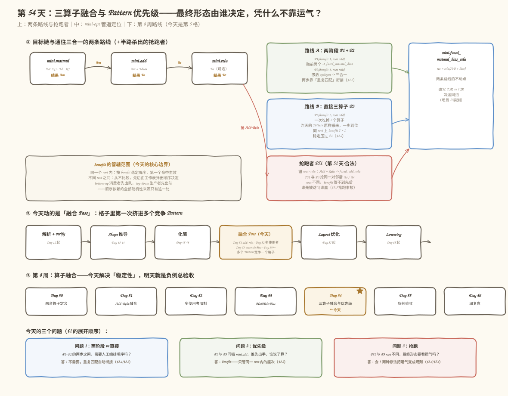
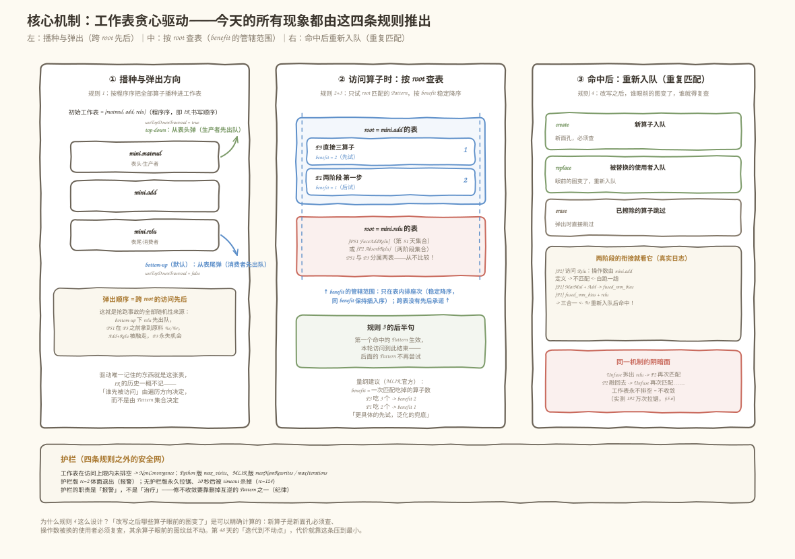
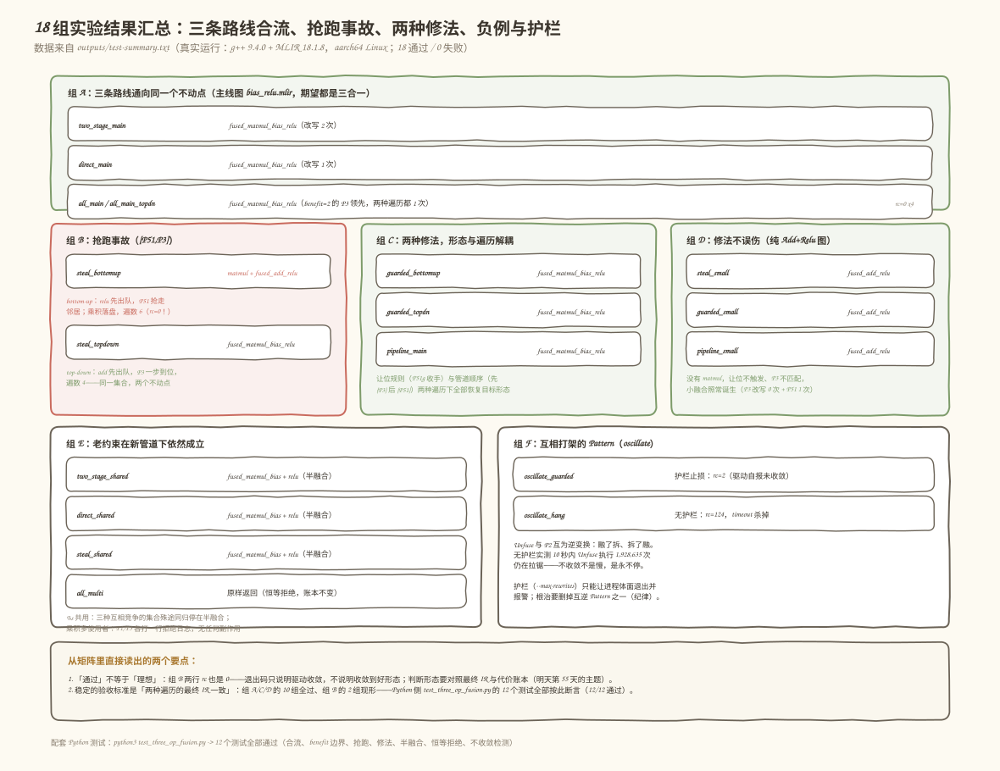

# 第 054 天：三算子融合与 Pattern 优先级——最终形态由谁决定，凭什么不靠运气？

> **今日目标**：能说出「同一张输入图放进同一个 Pattern 集合，最终形态由谁决定」的完整答案——benefit 只管**同一个 root 上**谁先出手，跨 root 的先后由访问顺序决定；能解释两阶段融合为什么**不需要人工编排 Pattern 顺序**（靠重复匹配衔接）；能复现「抢跑事故」并用两种修法（让位规则、Pass 管道顺序）消除对偶然执行顺序的依赖；最后能用 12 个 Python 稳定性测试＋18 组 MLIR 实验证明这一切。
> **预计时间**：学习 40 分钟＋实践 60 分钟（选做另加 25 分钟）
> **前置准备**：
> - 第 51/52 天的融合四步与多使用者铁律（`hasOneUse()` 先采样、失败无副作用、先擦消费者——本文一行不改地复用）
> - 第 53 天的 `MatMul + Add (→ Relu)` 融合 Pattern、`mini.fused_matmul_bias` 定义和「结果类型跟 matmul 走」的结论（本文 §3.1 直接把昨天的 Pattern 改名成 P3）
> - 第 48 天「Canonicalizer 的迭代执行与不动点」——今天的贪心驱动就是它的实现细节版
> - 热身需要 Python 3 + numpy；正餐需要 C++17 编译器与 MLIR 18
> **今日产出**：Python 版 `mini_fuse_pipeline.py`（带工作表贪心驱动与护栏）、`test_three_op_fusion.py`（12 个稳定性测试）、真实 MLIR 版 `mini-fuse3`（7 种 Pattern 集合 × 2 种遍历 × 护栏开关）、18 组真实运行记录（`run_all.sh` + `outputs/test-summary.txt`）

## 1. 今天解决什么问题？

昨天（第 53 天）收工时，我们的工具 `mini-fuse-bias` 已经能把最终项目图一步融成三合一：

```mlir
%m = mini.matmul %a, %b      : 2x3 · 3x2 -> 2x2   // 乘积：中间张量
%s = mini.add     %m, %bias   : 2x2 + 2x2 -> 2x2   // bias 加法
%r = mini.relu    %s          : 2x2     -> 2x2     // 激活（可选）

// 融合后（昨天已做到）：
%r = mini.fused_matmul_bias_relu %a, %b, %bias : ... -> tensor<2x2xf32>
```

还是昨天那组贯穿数字：`A=[[1,-2,3],[-4,5,-6]]`，`B=[[1,0],[-1,2],[3,-3]]`，`bias=[[10,-10],[20,-20]]`；直算得 `%m=[[12,-13],[-27,28]]`、`%s=[[22,-23],[-7,8]]`、`%r=[[22,0],[0,8]]`——今天所有形态的图求值出来都必须还是这三个值。

看起来第 8 周的融合主线已经通了？但真实编译器的 Pass 里从来不止一个 Pattern。把第 51 天的 `Add+Relu`、昨天的 `MatMul+Bias(+Relu)`、可能还有前天的 `Relu(Relu(x))` 全部塞进**同一个** `RewritePatternSet` 之后，立刻出现三个昨天没暴露的问题：

1. **两阶段 vs 直接**：把 `MatMul+Add` 融成两算子（P1），再让另一个 Pattern 把 Relu 吸收进 epilogue（P2）——这两步之间需要人工安排先后吗？还是驱动自己会衔接？
2. **优先级**：P1（一次吃 2 个算子）和 P3（一次吃 3 个算子）锚在同一个 `mini.add` 上，谁先出手？谁说了算？
3. **抢跑**：第 51 天的 `Add+Relu → fused_add_relu`（P51）完全合法，但它和 P3 抢的是同一对邻居 `%s/%r`——它俩 root 不同，谁先被访问谁赢。那「最终形态」是不是就要看驱动心情了？

学习计划第 54 天的实践要求写得非常直白：**保证 `MatMul + Bias + Relu` 最终得到预期融合形式，不依赖偶然执行顺序**。今天一整天就干这一件事：把「由谁决定」从运气变成规则，并且**用测试证明**它不再是运气。

一个先尝味道的最小事实（今天 §5.3 会完整展开）：同一张主线图、同一个 Pattern 集合 `[P51, P3]`，只把贪心驱动的遍历方向从 bottom-up 换成 top-down，最终形态一个变成 `matmul + fused_add_relu`（中间张量 `%m` 还得落盘一次），一个变成 `fused_matmul_bias_relu`（一步到位）——两次的 `verify` 都通过、数值都正确，但优化质量天差地别。这就是「合法但不理想」，也是今天要消灭的东西。

## 2. 先看全貌：今天的内容位于哪里？



**图 1**：上排是今天的主角们——通往 `fused_matmul_bias_relu` 的两条路线（两阶段 P1+P2、直接三算子 P3），以及半路杀出的抢跑者 P51；中排是 `mini-opt` 的优化管道，今天动的还是「融合 Pass」这一格，但这一格里面第一次挤进了**多个会互相竞争的 Pattern**；下排是第 8 周路线，今天解决「稳定性」，明天就是负例总验收。注意图里的关键划分：benefit 的管辖范围只在「同一个 root」之内（§3.2）。

今天的全局主线只有 5 步：

1. 概念：两条路线为什么殊途同归、benefit 管到哪里为止、重复匹配怎么衔接两阶段（§3）；
2. 机制：工作表贪心驱动的四条规则——今天所有现象（合流、抢跑、振荡）都是这四条规则推出来的（§4）；
3. Python 热身：迷你驱动复现全部场景，先在 5 分钟内看懂「谁在什么时机出手」（§5.1）；
4. 真实 MLIR：`mini-fuse3` 的 7 种 Pattern 集合、`--top-down`/`--max-rewrites` 旋钮、18 组实验（§5.2～§5.6）；
5. 两种修法让最终形态与访问顺序解耦，12 个稳定性测试守住它（§5.4、§5.7）。

## 3. 核心概念：两条路线、benefit 的管辖范围、重复匹配

### 3.1 两阶段融合 vs 直接三算子：同一条链的两种切法

一句通俗的解释：把「做一道 蛋炒饭→装盘→撒葱花」合并成一个动作，你可以**一口气全并**（直接三算子 P3：看到 `MatMul+Add+Relu` 整条链就换成 `fused_matmul_bias_relu`），也可以**分两步并**（两阶段：先把「做饭+装盘」并成 `fused_matmul_bias`，再让撒葱花并进来）。对应到技术上是：**P3 是一个锚在 `mini.add` 上的 Pattern，一次匹配吃掉 3 个算子；P1+P2 是两个分工的 Pattern——P1 锚在 `mini.add` 只管前两个，P2 锚在 `mini.relu` 专门吸收 epilogue**。

这个类比的边界：生活里「分两步」通常是因为一步做不来；技术上恰恰相反——P3 昨天已经写对了，两阶段的存在价值是**职责拆分**：P2 不只服务 MatMul 系，将来任何 `fused_xxx`（比如 Conv+Bias）都能复用「吸收 Relu」这个动作；而且 P1/P2 各自的匹配条件更短，负例测试更好写。今天是让两条路线在一个管道里**共存**，不是二选一。

用主线图看两条路线的中间状态（真实运行日志，`--set=two-stage`）：

```text
决策日志（贪心驱动，遍历 = bottom-up）：
  [P2] 访问 Relu：操作数由 mini.add 定义 -> 不匹配     ← 第一次访问 %r，白跑一趟
  [P1] 匹配 MatMul + Add -> fused_matmul_bias（两阶段·第一步，Relu 原地不动）
  [P2] fused_matmul_bias + relu -> fused_matmul_bias_relu（两阶段·第二步，epilogue 吸收）
```

而 `--set=direct` 只有一行：

```text
决策日志（贪心驱动，遍历 = bottom-up）：
  [P3] 匹配 MatMul + Add + Relu -> fused_matmul_bias_relu（直接三算子，一步到位）
```

注意两阶段日志里那行**「不匹配」**：驱动先访问了 `%r`（bottom-up 从消费者开始），P2 上去一看，操作数是 `mini.add` 定义的，不是 `fused_matmul_bias`，安静返回。之后 P1 改写了图，`%r` 被重新访问，这次 P2 匹配成功。**这正是「两步之间不需要人工编排顺序」的全部秘密——机制叫重复匹配，§3.3 展开。**

### 3.2 Pattern 优先级（benefit）：只管同一个 root 里的座次

benefit（`PatternBenefit`）一句通俗的解释：**同一场选秀里选手的出场顺位权重**。对应到技术上是：MLIR 的 PatternApplicator 把 Pattern **按 root 算子分组**，每个 root 的列表按 benefit **稳定降序**排序（0~65535 的无量纲整数，同 benefit 保持插入序）；驱动访问某个算子时，只在它那个 root 的列表里从高到低试，**第一个命中的生效，本轮结束**。

三个必须说清的边界，今天所有的坑都长在这三条缝里：

| 问题 | 答案 | 今天的证据 |
|---|---|---|
| benefit 管谁？ | 只管**同一个 root** 内的尝试顺序 | P1 和 P3 都锚 `mini.add`，P3 benefit=2 > P1 benefit=1，`--set=all` 时 P3 稳定先出手（1 次改写到位） |
| benefit 不管谁？ | **不同 root 之间的访问先后**——那由工作表弹出顺序（遍历方向）决定 | P51 锚 `mini.relu`、P3 锚 `mini.add`，`--set=steal` 时 bottom-up 和 top-down 得到两个不同的不动点（§5.3） |
| benefit 高=更优？ | 不一定，它只是**尝试顺序**；更高的 benefit 让你先出手，不保证你的结果更好 | Unfuse 的 benefit=3 压过一切，它带来的只有不收敛（§5.6） |

关于量纲，MLIR 官方的建议恰好和直觉一致：**一次匹配吃掉的算子数**。P1 吃 2 个（benefit 1 也可以，只要 < P3 的），P3 吃 3 个（benefit 2），所以「大融合先出手」——这不是性能优化，是**让更具体的 Pattern 先试，更泛化的当兜底**，和第 49 天「组合 Pattern 时先特判后兜底」是同一个道理。

一个常见误解要当场拆掉：「我把 P3 的 benefit 调到最大，是不是就万事大吉了？」——只在 P3 和 P1 抢同一个 root 时成立。P51 的 root 是 `mini.relu`，P3 的 benefit 就是调到 65535，也管不到「P51 和 P3 谁先被访问」。**benefit 是 root 内的座次表，不是全局的时间表。**

### 3.3 重复匹配：两阶段不需要剧本的机制来源

重复匹配（re-matching）一句通俗的解释：**改写过的格子要重新检查**。对应到技术上是贪心驱动的工作表（worklist）规则：**Pattern 命中后，新创建的算子、以及「输入被替换的使用者」都会重新入队**；被擦除的算子弹出时直接跳过。

回到 §3.1 的两阶段日志逐行对账（bottom-up，工作表初始 `[matmul, add, relu]`，从尾部弹）：

1. 弹出 `relu`：P2 尝试 → 操作数由 `add` 定义 → 不匹配，无事发生；
2. 弹出 `add`：P1 尝试 → 命中！创建 `fused_matmul_bias`（**新算子入队**），`add`/`matmul` 的结果被替换，使用者（`relu`，**输入变了，重新入队**）；
3. 弹出 `fused_matmul_bias`：P1/P3 都锚 `add`，此 root 没它的份；P2 锚 `relu` 也没份——无匹配；
4. 弹出 `relu`（第二次！）：P2 尝试 → 操作数由 `fused_matmul_bias` 定义 → 命中！创建 `fused_matmul_bias_relu`，替换、擦除。

所以「P1 先跑完再跑 P2」这个先后**不是人安排的，是工作表自然形成的**：P1 的改写把 `relu` 重新压回队尾，P2 得到了第二次机会。第 48 天说 Canonicalizer「迭代执行直到不动点」，今天看到的就是它的发动机内部。

类比的边界：体检复查是「同样的检查再做一遍」，而重复匹配**带着新信息**——第二次访问 `relu` 时它眼前的图已经变了。这也是为什么 P2 里那句「不匹配也打一行日志」是今天特意加的：它让「同一个算子被访问两次」直接写在输出里，看得见摸得着。

### 3.4 抢跑：合法 Pattern 之间的领地纠纷

现在把第 51 天的 P51（`Add+Relu → fused_add_relu`，锚 `mini.relu`）请回管道。它完全合法——第 51 天就是主角；它和多算子融合抢的却是**同一对邻居** `%s/%r`。两种结局（都是真实输出，§5.3 复现）：

```text
bottom-up（relu 先被访问）：
  [P51] 匹配 Add + Relu -> fused_add_relu
  最终形态: mini.matmul + mini.fused_add_relu      ← %m 被迫落盘（遍数 6）

top-down（add 先被访问）：
  [P3] 匹配 MatMul + Add + Relu -> fused_matmul_bias_relu
  最终形态: mini.fused_matmul_bias_relu             ← 一步到位（遍数 4）
```

bottom-up 那条路线为什么「不理想」？用第 53 天的代价账本口径：`fused_add_relu(%m, bias)` 把 `%m` 当操作数，乘积必须作为 SSA 值活到这一步——张量读写遍数 6 vs 目标形态的 4。语义没错（数值照样 `[[22,0],[0,8]]`）、`verify` 照样过，**这就是「合法但不理想」**：错误的形态不会报警，只会悄悄多付一次访存。

今天要给这个问题两个修法（§5.4），先说结论：

- **修法一（让位规则 P51g）**：P51 匹配前加一条自我约束——「add 的操作数里有 matmul 乘积，就让位给 MatMul 系大融合」。改的是 Pattern 自己的匹配条件；
- **修法二（Pass 管道顺序）**：把大融合和小融合拆成**两个先后执行的贪心轮**（先 `{P3}` 一轮，再 `{P51}` 一轮）。改的是 Pass 之间的显式契约。

两种修法的共同点：**把「先后」从驱动的实现细节提升为看得见的规则**——这正是「不依赖偶然执行顺序」的工程含义。

## 4. 图解核心机制：工作表贪心驱动的四条规则

今天所有现象——两阶段的衔接、benefit 的座次、抢跑的随机感、振荡的失控——全部由下面这张图里的四条规则推出。看图时先盯住中间的工作表：**驱动唯一记住的东西就是这张表，IR 的历史一概不记**。



**图 2**：左边是播种（程序序全部入队）与两种弹出方向（bottom-up 消费者优先，top-down 生产者优先）；中间是「访问某个算子时发生什么」——按 root 查表、benefit 稳定降序、第一个命中即生效；右边是命中后的事件链：新算子入队 + 输入被替换的使用者入队（这就是重复匹配的来源）。下面那行「护栏」是 §5.6 的伏笔：访问次数超限仍未排空 = 不收敛。

对照图逐条编号讲：

1. **播种**：`[matmul, add, relu]` 按程序序入队。bottom-up 从表尾弹（消费者先），top-down 从表头弹（生产者先）——**这一条就是抢跑事故的全部随机性来源**，没有别的玄机；
2. **root 分组**：访问 `add` 时只看 root=`mini.add` 的列表 `[P3(b2), P1(b1)]`；访问 `relu` 时只看 `[P2(b1)]`（或 `[P51(b1)]`）。**benefit 的作用范围到此为止**——跨 root 没有比较发生；
3. **稳定降序**：同 root 按 benefit 从大到小试，同 benefit 按插入序。所以「全家桶 `[P1, P2, P3]`」里 P3 先试；把 P3 的 benefit 改成 1，插入序就接管（§5.7 的对照实验）；
4. **命中后的事件链**：`create` 的新算子入队、`replace` 波及的使用者入队、已擦除的算子弹出时跳过。两阶段靠这条衔接，振荡也靠这条永动（Unfuse 拆出来的 `relu` 让 P2 再次匹配，P2 融回去又让 Unfuse 再次匹配……）。

为什么规则这么设计？因为「改写之后哪些算子眼前的图变了」是**可以精确计算的**：新算子是新面孔必须查，操作数被换的使用者眼前变了必须复查，其余算子眼前的图纹丝不动、不用浪费访问。第 48 天说「Canonicalizer 迭代到不动点」，代价就是靠这条规则把「要复查的范围」缩到最小。

## 5. 动手实践：把「由谁决定」跑成看得见的日志

### 5.1 准备文件

今天代码分两层：Python 迷你版先跑通概念，真实 MLIR 版对照验证。目录结构：

```text
tutorials/day-054/code/
├── mini_fuse_pipeline.py      # 迷你 IR + 工作表贪心驱动 + 5 类 Pattern + 6 场景
├── test_three_op_fusion.py     # 12 个稳定性测试（合流、抢跑、修法、不收敛）
└── mlir-mini/                 # 真实 MLIR 版（C++17 + MLIR 18）
    ├── MiniOps.td             #   方言：matmul/add/relu + 3 个融合算子
    ├── MiniDialect.{h,cpp}    #   方言实现（含 classifyBias 三分类，Day 53 口径）
    ├── MiniRules.h            #   共享规则：bias 三分类、找乘积对
    ├── mini-fuse3.cpp         #   7 种 Pattern 集合 × --top-down × --max-rewrites
    ├── CMakeLists.txt         #   mlir-tblgen 生成 + 链接 MLIR 库
    ├── inputs/                #   4 张测试图（主线/共用/纯Add+Relu/乘积多使用者）
    ├── run_all.sh             #   18 组实验一键复跑 -> outputs/test-summary.txt
    └── outputs/               #   真实运行记录（.out 融合后 IR + .err 决策日志）
```

Python 热身只需要一个命令：

```bash
cd tutorials/day-054/code
python3 mini_fuse_pipeline.py
```

真实 MLIR 版需要 MLIR 18（`find_package(MLIR)`，`mlir-tblgen` 生成 ODS 代码）。本文所有 MLIR 实验已在以下环境真实执行：`g++ (Ubuntu 9.4.0-1ubuntu1~20.04.2) 9.4.0`、`Ubuntu LLVM version 18.1.8`、aarch64 Linux。构建命令：

```bash
cd tutorials/day-054/code/mlir-mini
cmake -S . -B build -DLLVM_DIR=/usr/lib/llvm-18/lib/cmake \
      -DMLIR_DIR=/usr/lib/llvm-18/lib/cmake/mlir -DCMAKE_BUILD_TYPE=Release
cmake --build build          # 产物: build/mini-fuse3
```

### 5.2 场景 A：三条路线，同一个不动点

先验证「殊途同归」不是口号。对主线图 `inputs/bias_relu.mlir`（`MatMul → Add(bias) → Relu`，全部单使用者）分别用三个 Pattern 集合跑：

```bash
./build/mini-fuse3 inputs/bias_relu.mlir --set=two-stage   # P1 + P2
./build/mini-fuse3 inputs/bias_relu.mlir --set=direct      # P3
./build/mini-fuse3 inputs/bias_relu.mlir --set=all         # P1 + P2 + P3（同 root 上 P3 领先）
./build/mini-fuse3 inputs/bias_relu.mlir --set=all --top-down
```

**以下为真实执行结果**（`run_all.sh` A 组，4 组全部 rc=0，`verify` 通过）：

| Pattern 集 | 遍历 | 改写次数 | 最终形态 |
|---|---|---|---|
| `[P1, P2]` 两阶段 | bottom-up | 2 | `mini.fused_matmul_bias_relu` |
| `[P3]` 直接 | bottom-up | 1 | `mini.fused_matmul_bias_relu` |
| `[P1, P2, P3]` 全家桶 | bottom-up | 1 | `mini.fused_matmul_bias_relu` |
| `[P1, P2, P3]` 全家桶 | top-down | 1 | `mini.fused_matmul_bias_relu` |

（改写次数 = 决策日志里「匹配成功」的行数；两组 `*.err` 各自可数出 2 行与 1 行。）

四条路的融合后 IR 完全相同：

```mlir
func.func @graph_bias_relu(%arg0: tensor<2x3xf32>, %arg1: tensor<3x2xf32>, %arg2: tensor<2x2xf32>) -> tensor<2x2xf32> {
  %0 = mini.fused_matmul_bias_relu %arg0, %arg1, %arg2 : tensor<2x3xf32>, tensor<3x2xf32>, tensor<2x2xf32> -> tensor<2x2xf32>
  return %0 : tensor<2x2xf32>
}
```

值得看的是全家桶 bottom-up 的决策日志（真实输出 `outputs/all_main.err`）：

```text
Pattern 集: P1(benefit 1) + P2(benefit 1) + P3(benefit 2)——同 root(add) 上 P3 领先
决策日志（贪心驱动，遍历 = bottom-up）：
  [P2] 访问 Relu：操作数由 mini.add 定义 -> 不匹配
  [P3] 匹配 MatMul + Add + Relu -> fused_matmul_bias_relu（直接三算子，一步到位）
```

第一行是 P2 照例先访问 `%r` 白跑一趟；第二行轮到 `add`，root 表里 benefit=2 的 P3 先于 benefit=1 的 P1 被试，一击命中。**P1 这次连出场机会都没有**——这就是 §3.2 说的「root 内座次表」。把 visit 换成 top-down（先访问 `matmul` 再 `add`），P3 依然在 `add` 上先出手，改写次数还是 1——benefit 的管辖范围内，遍历方向改变不了结果。

### 5.3 抢跑事故：同一集合，只换遍历方向

现在做今天最核心的对照实验。Pattern 集换成 `[P51, P3]`（第 51 天的小融合 + 昨天的直接三算子，两者都合法），输入还是主线图，唯一变量是遍历方向：

```bash
./build/mini-fuse3 inputs/bias_relu.mlir --set=steal             # bottom-up（默认）
./build/mini-fuse3 inputs/bias_relu.mlir --set=steal --top-down
```

![抢跑事故实验：同一 Pattern 集合 [P51,P3] 在两种遍历方向下得到两个不同的不动点](images/03-steal-experiment.svg)

**图 3**：左右两条是真实运行结果的对照。左边 bottom-up：`relu` 先出队，P51 抢走 `Add+Relu` 融成 `fused_add_relu(%m, bias)`——乘积 `%m` 被迫作为操作数存活（账本：遍数 6）；右边 top-down：`add` 先出队，P3 一步到三合一（遍数 4）。两次 rc 都是 0、verify 都过、数值都是 `[[22,0],[0,8]]`——**差异只体现在代价账本上，不会报警**。中间标出了事故机理：P51 和 P3 的 root 不同，benefit 无从比较，先后全由工作表弹出顺序决定。

**以下为真实执行结果**（`run_all.sh` B 组）：

| 遍历 | 决策日志（`outputs/steal_*.err` 原文） | 最终形态 | 遍数 |
|---|---|---|---|
| bottom-up | `[P51] 匹配 Add + Relu -> fused_add_relu（Add+Relu 小融合）` | `mini.matmul + mini.fused_add_relu` | 6 |
| top-down | `[P3] 匹配 MatMul + Add + Relu -> fused_matmul_bias_relu（直接三算子，一步到位）` | `mini.fused_matmul_bias_relu` | 4 |

bottom-up 融合后的 IR（真实输出节选）——注意 `%0` 的 matmul 还活着，它的结果要作为 `%1` 的操作数：

```mlir
%0 = mini.matmul %arg0, %arg1 : tensor<2x3xf32>, tensor<3x2xf32> -> tensor<2x2xf32>
%1 = mini.fused_add_relu %0, %arg2 : tensor<2x2xf32>, tensor<2x2xf32> -> tensor<2x2xf32>
return %1 : tensor<2x2xf32>
```

Python 版的 `test_steal_order_dependent_fixpoint` 测试把这件事钉死成断言：bottom-up 必须抢跑成 `["mini.matmul", SMALL]` 且遍数 6，top-down 必须得到 `[FULL]` 且遍数 4——**抢跑不是 flaky test，是确定性的坏结果**。顺带注意日志的一行细节：bottom-up 下 P51 出手之后 P3 再也得不到机会——`fused_add_relu` 的操作数里 add 已经没了，P3 的匹配条件（找 `MatMul+Add` 对）永远不再成立。**抢跑是一次性的、不可逆的**。

### 5.4 两种修法：让「先后」变成看得见的规则

**修法一：让位规则（P51g）**。P51 的 `matchAndRewrite` 里加一段自我约束（`mini-fuse3.cpp` 中 `FuseAddReluPattern` 的 `guardMatmul` 分支）：

```cpp
if (guardMatmul) {
  // 让位规则：add 的操作数里有 matmul 乘积 -> 大融合的原料，不抢
  bool hasMatmulOperand =
      ad->getOperand(0).getDefiningOp<mini::MatmulOp>() ||
      ad->getOperand(1).getDefiningOp<mini::MatmulOp>();
  if (hasMatmulOperand) {
    llvm::errs() << "  [P51g] add 的操作数之一是 matmul 乘积 -> "
                    "让位给更大的融合（MatMul+Bias 系），本次不抢\n";
    return failure();
  }
}
```

它不是「禁止 P51 匹配」，而是**给 P51 的领地画边界**：只融「原生」的 `Add+Relu`，add 一旦吃的是 matmul 乘积就收手。运行（真实结果，C 组，两种遍历都试）：

```bash
./build/mini-fuse3 inputs/bias_relu.mlir --set=guarded             # bottom-up
./build/mini-fuse3 inputs/bias_relu.mlir --set=guarded --top-down
```

```text
决策日志（贪心驱动，遍历 = bottom-up）：          （top-down 只差一行让位日志的有无）
  [P51g] add 的操作数之一是 matmul 乘积 -> 让位给更大的融合（MatMul+Bias 系），本次不抢
  [P3] 匹配 MatMul + Add + Relu -> fused_matmul_bias_relu（直接三算子，一步到位）
```

两种遍历都收敛到 `fused_matmul_bias_relu`（rc=0，遍数 4）——**最终形态与访问顺序解耦**。

**修法二：Pass 管道顺序**。不改 Pattern，改装配：把大融合和小融合拆成两个独立的贪心轮次（`--set=pipeline`）：

```cpp
// 修法二：Pass 管道顺序——大融合的 Pass 先跑，小融合的 Pass 收尾。
// 两个独立的贪心轮次，先后是显式契约，不依赖驱动内部顺序。
RewritePatternSet phase1(&context);
phase1.add<FuseMatmulBiasReluDirectPattern>(&context, 2);
RewritePatternSet phase2(&context);
phase2.add<FuseAddReluPattern>(&context, /*guardMatmul=*/false, 1);
bool c1 = runGreedy(std::move(phase1), "第 1 轮 {P3}");
bool c2 = runGreedy(std::move(phase2), "第 2 轮 {P51}");
```

真实结果（C 组 `pipeline_main`，rc=0）：第 1 轮 P3 改写 1 次融成三合一，第 2 轮 P51 **改写 0 次**（`Add+Relu` 已不存在，无可抢）——最终 `fused_matmul_bias_relu`。这对应真实编译器里「融合 Pass 按 benefit 分层、大融合 Pass 排在小融合 Pass 之前」的常见做法。

**修法的验收不止于主线图**：小融合在纯 `Add+Relu` 图上才是正确答案，修法不能误伤它（真实结果，D 组，三种配置全部 rc=0）：

| 命令 | P3 改写 | P51 改写 | 最终形态 |
|---|---|---|---|
| `--set=steal inputs/add_relu_only.mlir` | 0 | 1 | `mini.fused_add_relu` |
| `--set=guarded inputs/add_relu_only.mlir` | 0 | 1 | `mini.fused_add_relu` |
| `--set=pipeline inputs/add_relu_only.mlir` | 0 | 1 | `mini.fused_add_relu` |

纯 `Add+Relu` 图上没有 matmul，让位规则不触发、P3 不匹配，`fused_add_relu` 照常诞生——P51g 的收手条件画得足够窄。对应测试 `test_pipeline_preserves_small_fusion` 和 `test_yield_guard_preserves_small_fusion` 各自在两种遍历下守住这条底线。

### 5.5 老约束在新管道下的表现：半融合不动点与恒等拒绝

昨天两个负例今天必须在新管道（多个 Pattern 共存）下重新过一遍——**稳定性修法不能以放宽合法性为代价**：

- **`%s` 共用**（`inputs/shared_result.mlir`，加法结果被 `relu` 和 `return` 同时使用）：`--set=two-stage`、`--set=direct`、`--set=steal` 三种集合都停在**同一个**半融合形态（真实结果，E 组，rc 均 0）：

  ```mlir
  %s' = mini.fused_matmul_bias %arg0, %arg1, %arg2 : tensor<2x2xf32>
  %r = mini.relu %s' : tensor<2x2xf32>
  return %r, %s'
  ```

  P2 的日志明说拒绝原因：`[P2] 融合结果 %s' 有 2 个使用者 -> 不能吸收 Relu`；P3 则直接只做两算子融合（`%s` 多使用者时不吸收 Relu）。有趣的是 **steal 集合也停在这里**：P51 想抢 `Add+Relu`，但 `%s` 双使用者连 P51 的 `hasOneUse()` 门槛都过不了——三种互相竞争的 Pattern 在这张图上殊途同归，半融合是**所有路线的共同不动点**（测试 `test_shared_result_half_fused_stable`：3 集合 × 2 遍历共 6 组合全数验证）。

- **乘积多使用者**（`inputs/multi_user_product.mlir`，`%m` 被 add 和另一个 relu 同时使用）：`--set=all` 下 IR 原样返回（`all_multi`，rc=0），P1/P3 的日志各打一行拒绝：`乘积使用者 2 -> 拒绝（Day 52 规则），保留整条链`。测试 `test_multi_user_product_identity` 断言的不只是算子名单不变，连**代价账本都原样**——拒绝必须是恒等变换，无副作用。

### 5.6 互相打架的 Pattern：不收敛与护栏

最后一种事故：Unfuse（`fused_matmul_bias_relu → fused_matmul_bias + relu`，语义合法，本日反面教材）和 P2 互为逆变换。装配进同一个集合（`--set=oscillate`），真实运行：

```bash
./build/mini-fuse3 inputs/bias_relu.mlir --set=oscillate --max-rewrites=6   # 护栏版
timeout 10 ./build/mini-fuse3 inputs/bias_relu.mlir --set=oscillate          # 无护栏版
```

**以下为真实执行结果**（F 组）：护栏版在改写上限处停下，`rc=2`（驱动自己报告未收敛），决策日志里 P1、P2、Unfuse 的成功改写分别为 1、30、29 次，合计 60 次后戛然而止——`--max-rewrites=6` 限制的是单轮改写数，驱动默认最多迭代 10 轮（`maxIterations`）；无护栏版 10 秒内未返回，被 `timeout` 杀掉（`rc=124`），此时 **Unfuse 已执行 1,928,635 次**仍在拉锯——不收敛不是「慢」，是「永远不停」。



**图 4**：本日全部 MLIR 实验的结果矩阵（数据来自 `outputs/test-summary.txt`，18 通过 / 0 失败）。上半部分是主线图上的 8 组：三条路线在两种遍历下全部合流到三合一；抢跑事故只在 `[P51,P3]` 无修法时发生（红色的两个不同形态）；两种修法各 3 组全部恢复目标形态。下半部分是负例与护栏：半融合不动点 3 组、恒等拒绝 1 组、护栏止损 rc=2、无护栏拉锯 rc=124。

两个要点从这张矩阵图里直接读出来：

1. **「通过」≠「理想」**：抢跑的两组 rc 也是 0——退出码只说明驱动收敛了，不说明收敛到了好形态。判断形态要靠对照最终 IR 与代价账本，这是明天（第 55 天）负例验收的主题；
2. **护栏只能止损**：`--max-rewrites=6` 让进程体面地退出并报 rc=2，但 IR 停在哪个中间态不可控（这次停巧了，是 `fused_matmul_bias_relu`）。修不收敛的根本办法是**删掉互逆的 Pattern 之一**——护栏是安全带，不是修车工具。

### 5.7 修改一个参数再观察：把 P3 的 benefit 从 2 改成 1

对照实验：全家桶里 P3 的 benefit=2，它在 root=`mini.add` 上压过 P1。把 benefit 改成 1（Python 版 `FuseMatmulBiasReluDirect(benefit=1)`），同 benefit 时插入序接管——`[P1, P2, P3]` 的插入序里 P1 在前，应当 P1 先出手（改写 2 次）；把 P3 插到最前（`[P3, P2, P1]`），P3 先出手（改写 1 次）。**以下为真实执行结果**（`test_equal_benefit_insertion_order_only_changes_path`，两组都跑过）：

| 插入序 | 改写次数 | 最终形态 |
|---|---|---|
| `[P1(b1), P2, P3(b1)]` | 2（P1 一步 + P2 一步） | `mini.fused_matmul_bias_relu` |
| `[P3(b1), P2, P1(b1)]` | 1（P3 一击） | `mini.fused_matmul_bias_relu` |

结论正是 §3.2 的实证：**benefit 相同时插入序决定路径（改写 1 次 vs 2 次），但不动点不变**。换个角度说：benefit 影响的是「走哪条路、花几次改写」，不动点由「Pattern 集合 + 图结构」本身决定——只要集合里没有互逆的 Pattern 抢跨 root 的同一块地盘。这条边界在抢跑实验里被跨 root 打破，在修法实验里被重新立起来。

## 6. 常见错误与排查

**错误 1：以为 benefit 调高就能解决一切冲突**
- **现象**：把 P3 的 benefit 从 2 调到 10，`--set=steal --top-down` 正常，`--set=steal`（bottom-up）还是被 P51 抢跑成 `matmul + fused_add_relu`。
- **原因**：P51 锚 `mini.relu`、P3 锚 `mini.add`，两者不在同一个 root 列表里，benefit 之间**从不发生比较**；bottom-up 下 `relu` 先出队，P51 在 P3 得到机会之前就把原料融走了。
- **定位**：看决策日志的第一行是谁——P51 出现在 P3 之前且图里 add 已消失，就是跨 root 抢跑；再对照 `--top-down` 复跑一次，两个形态不同即确诊。
- **修复**：让位规则（P51g）或 Pass 管道顺序（§5.4 两种修法）；benefit 只用来表达「同 root 内大融合优先」。

**错误 2：把两阶段的衔接寄托在 Pattern 注册顺序上**
- **现象**：担心「先注册 P2 会不会先跑、看到的全是不匹配」——Python 版场景 A1' 特意把插入序换成 `[P2, P1]` 跑过，与 `[P1, P2]` 一样正常收敛到三合一（`test_two_stage_confluent` 断言了 2 种插入序 × 2 种访问序共 4 种组合）。
- **原因**：两阶段的衔接靠的是**重复匹配**：P1 命中后 `%r` 的输入被替换，工作表把它重新入队，P2 的第二次访问才匹配成功。注册顺序只影响工作表的初始排列，不影响「谁在改写后被重新访问」。
- **定位**：在 P2 里像本文一样打「不匹配」日志——同一个 relu 出现两行访问记录（先不匹配、后吸收）就是重复匹配在工作。
- **修复**：不用修，这是正确行为；需要警惕的反而是**没有**那行「第二次访问」日志的情况——说明你的驱动忘了把输入被替换的使用者重新入队。

**错误 3：让位规则写得太宽，误伤纯 Add+Relu 图**
- **现象**：给 P51 加让位规则后，纯 `Add+Relu` 图（`add_relu_only.mlir`）也纹丝不动了——小融合消失。
- **原因**：让位条件写成了「检测到任何 matmul 相关算子就收手」或更糟的「一律让位」；纯图里根本没有 matmul，正确的让位条件（**add 的操作数**是 matmul 乘积）不会触发。
- **定位**：跑 D 组三个命令（`--set=steal/guarded/pipeline` 配 `add_relu_only.mlir`），三种配置的最终形态都应当是 `fused_add_relu`；哪一种不是，问题就在哪一层。
- **修复**：让位条件精确到 `ad->getOperand(0/1).getDefiningOp<mini::MatmulOp>()`；再加一个 `test_yield_guard_preserves_small_fusion` 这样的守护测试，防止将来改 P51 时再犯。

**错误 4：用护栏参数掩盖不收敛**
- **现象**：`--set=oscillate` 不加护栏时进程挂住（本日实测被 timeout 杀掉时 Unfuse 已执行 192 万次）；加了 `--max-rewrites=6` 后 rc=2 体面退出，于是有人把上限调成几万，「程序能跑完就行了」。
- **原因**：Unfuse 与 P2 互为逆变换，任何改写上限都改变不了「每融必拆、每拆必融」的循环——护栏只是让循环在有限步后停止，编译时间和电费照付。
- **定位**：驱动返回失败（rc=2）时先数日志：两种 Pattern 的行数交替上升、总数≈改写上限，就是互逆拉锯；单看最终 IR 根本看不出问题（语义一直是对的）。
- **修复**：删掉互逆 Pattern 之一；护栏（`maxNumRewrites`/`maxIterations`）保留为 CI 的安全网——它的职责是「报警」，不是「治疗」。

**错误 5：把「verify 通过 + rc=0」当成融合正确的证据**
- **现象**：抢跑实验的两种形态 rc 都是 0、`verify` 都通过，CI 全绿，但其中一种的乘积要多付一次落盘（遍数 6 vs 4）。
- **原因**：verify 检查的是**结构合法性**（类型、操作数个数、Shape 约束），两种形态结构上都合法；优化质量是**代价账本**的事，不在 verify 的管辖范围。
- **定位**：对同一输入固定一组 Pattern 集，在两种遍历方向下各跑一次，diff 最终 IR——不一致就是存在顺序依赖；再对比代价账本（本文用张量读写遍数）。
- **修复**：把「两种遍历的最终 IR 必须一致」写成测试（今天的 12 个测试全部这么写）；这是比 rc 更强的验收标准，也是明天负例验收的核心手法。

## 7. 今日练习

### 必做练习：预测三种装配的最终形态，再运行对答案

只用主线图 `bias_relu.mlir` 和纯图 `add_relu_only.mlir`，对下面三种装配先**笔头预测**「bottom-up / top-down 各自的最终形态、改写次数、是否受遍历方向影响」，再逐个运行验证：

1. `--set=all` 配 `--top-down`（全家桶 + 生产者先访问）：P2 会在 matmul 上空转吗？P3 改写几次？
2. `--set=guarded` 配 `add_relu_only.mlir`：让位日志会打出来吗？为什么？
3. `--set=pipeline` 配 `shared_result.mlir`（`%s` 共用图）：第 1 轮 P3 得到什么？第 2 轮 P51 还有机会吗？最终是不是半融合？

运行命令都在 §5；对照 `outputs/*.err` 的决策日志逐行核对你的预测，错一条就回到图 2 找是四条规则里的哪一条没推对。预期产出：一张 3×2 的预测-实际对照表（写在笔记里即可），以及每条差异的原因分析。

### 选做挑战：给 mini-fuse3 加一个 `--benefit-p3=N` 旋钮

仿照 `--max-rewrites` 的解析方式给工具加一个命令行参数，把 P3 的 benefit 变成可调（默认 2）。然后回答三个问题并用实验证明：

1. `--set=all --benefit-p3=1` 时，注册序 `[P1, P2, P3]` 和 `[P3, P2, P1]` 改写次数各是几次？（对照 §5.7 的 Python 结论）
2. benefit 调到 0 会发生什么？这合法吗（提示：`PatternBenefit` 的量纲与默认值语义）？
3. 把 P51 的 benefit 也调到 2，抢跑事故消失吗？为什么（§3.2 的第二行边界）？

这项改动总共 10 行左右，但它逼你把「参数解析 → Pattern 构造 → root 分组」这条装配链亲手走一遍。

## 8. 今日验收

- [ ] 我能不看资料说出 benefit 的三个边界：只管同 root 内的尝试顺序、跨 root 无比较、高 benefit 不保证好结果——并各配一个本日实验作证据；
- [ ] 我能独立复现抢跑事故：`--set=steal` 两种遍历方向各跑一次，指出哪个形态多付一次乘积落盘（遍数 6 vs 4），并解释为什么这不会让 verify 或 rc 报警；
- [ ] 我能解释两阶段为什么不需要人工编排 Pattern 顺序，并在 `outputs/two_stage_main.err` 里指出体现「重复匹配」的那两行日志；
- [ ] 我能说出两种修法（让位规则、Pass 管道顺序）各自改的是什么（Pattern 的匹配条件 vs 装配的显式契约），并运行 `--set=guarded`、`--set=pipeline` 证明两种遍历下形态一致；
- [ ] 我能运行 `python3 test_three_op_fusion.py`（12/12 通过）和 `bash run_all.sh`（18/18 通过），并指出哪个测试守护「恒等拒绝无副作用」、哪个守护「修法不误伤小融合」；
- [ ] 我保存了本日全部真实运行记录（`outputs/` 下 18 组 .out/.err 与 test-summary.txt），以及抢跑两种形态的 IR 对照。

## 9. 一句话总结与明天预告

今天把「多个融合 Pattern 放进同一个管道」从运气变成了规则：两条路线（两阶段 P1+P2、直接三算子 P3）靠重复匹配自然衔接、殊途同归到 `fused_matmul_bias_relu`；benefit 只决定同一个 root 内的出手顺序（量纲：一次匹配吃掉的算子数），跨 root 的先后由遍历方向决定——这正是抢跑事故（`[P51,P3]` 在两种遍历下得到两个代价不同的合法不动点）的根源；两种修法（P51g 让位规则、Pass 管道顺序）把「先后」提升为显式契约后，最终形态与访问顺序彻底解耦。18 组 MLIR 实验和 12 个稳定性测试全部真实跑通，其中最有价值的教训是：**rc=0 和 verify 通过都不足以说明融合做对了，两种遍历下最终 IR 一致才是更强的验收标准**；而互逆 Pattern 的不收敛（实测 192 万次拉锯）只能靠纪律解决，护栏只负责报警。明天（第 55 天）是第 8 周的负例总验收：把今天和前四天的全部融合负例（多使用者、Shape 不兼容、类型不支持、共用结果）整理成完整的 IR 测试集，产出优化前后对照和第二阶段代码——「合法」与「理想」的边界，明天画上句号。
