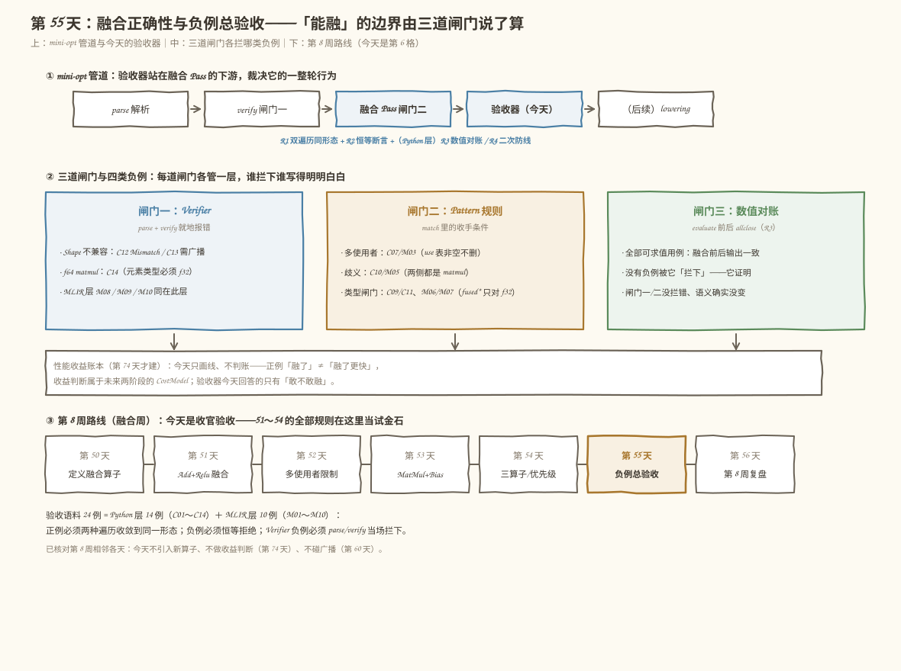
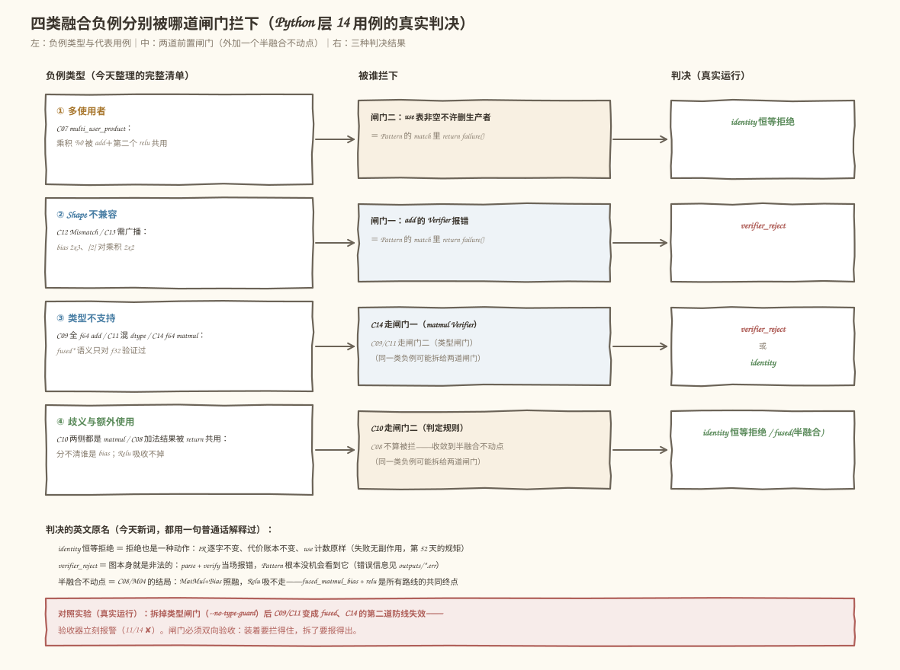
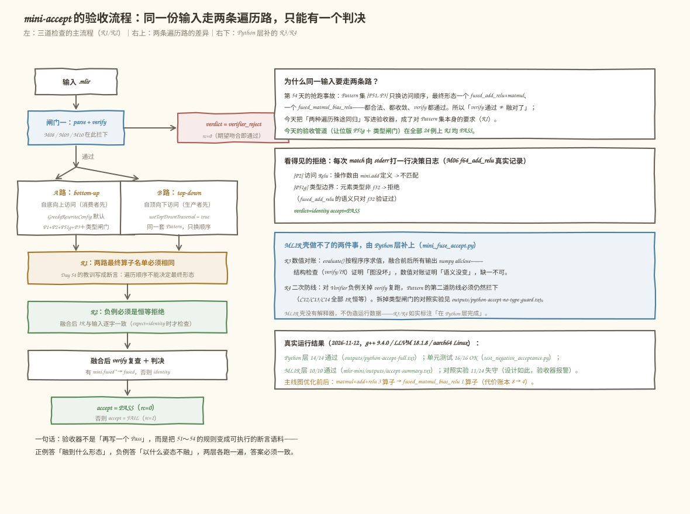
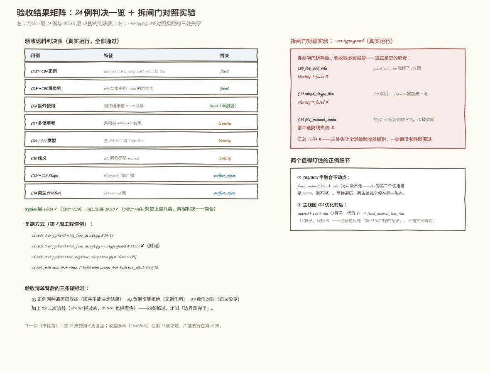

# 第 055 天：融合正确性与负例验收——「能融」的边界画在哪里，凭什么说了算？

> **今日目标**：能说清「融合正确」其实由三层边界共同把守——**结构合法性**（Verifier 与 Pattern 的静态规则）、**数值语义**（融合前后求值一致）、**性能收益**（第 74 天才建的收益判断，今天只画线不判账）；能整理出全部四类融合负例（多使用者、Shape 不兼容、类型不支持、额外使用约束／歧义），并说出每一类被哪一道闸门挡住；最后用一套 14 用例的验收语料在 Python 和真实 MLIR 两层各跑一遍：正例必须两种遍历方向收敛到同一形态、负例必须是恒等拒绝、所有可求值用例数值对账一致。
> **预计时间**：学习 40 分钟＋实践 60 分钟（选做另加 25 分钟）
> **前置准备**：
> - 第 52 天的多使用者铁律（擦除的前提是 use 表为空）、第 53 天的 `classifyBias` 三分类与「结果类型跟 matmul 走」
> - 第 54 天的贪心驱动、benefit 边界与「两种遍历的最终 IR 一致才是更强的验收标准」——今天的验收器就是这句话的代码化
> - 热身需要 Python 3 + numpy；正餐需要 C++17 编译器与 MLIR 18
> **今日产出**：Python 版 `mini_fuse_accept.py`（验收器：三道闸门＋14 用例语料＋数值对账）、`test_negative_acceptance.py`（负例验收测试）、真实 MLIR 版 `mini-accept`（双遍历对照＋恒等断言）、`run_all.sh` 全量复跑记录（`outputs/accept-summary.txt`）与优化前后对照

## 1. 今天解决什么问题？

第 8 周走到收官：第 51 天写了 `Add + Relu → fused_add_relu`，第 52 天补上多使用者铁律，第 53 天定义 `MatMul + Bias` 系，第 54 天解决 Pattern 优先级。四天攒下来的规则散在四个工程里，每条都单独验证过——但「整条融合管道在所有输入上的行为」从来没有被当成一个整体验收过。第 54 天结尾留了一句话：

> verify 通过 ≠ 融对了；两种遍历的最终 IR 一致，才是更强的验收标准。

今天就把这句话**代码化**。具体要回答的问题是一个反面的：`能融` 的边界画在哪里，凭什么说了算？看一个最典型的输入（C09）：

```mlir
func.func @graph_f64_add_relu(%arg0: tensor<2x2xf64>, %arg1: tensor<2x2xf64>) -> tensor<2x2xf64> {
  %0 = mini.add %arg0, %arg1 : tensor<2x2xf64>, tensor<2x2xf64> -> tensor<2x2xf64>
  %1 = mini.relu %0 : tensor<2x2xf64>
  return %1 : tensor<2x2xf64>
}
```

全 f64 的 `Add + Relu`，形状完全同形。`mini.add` 和 `mini.relu` 的 Verifier 都**不检查元素类型**——这张图能顺利通过 verify；P51 模式匹配也完全成立——直接融成 `fused_add_relu` 毫无障碍。可我们从来没对 f64 验证过融合算子的语义，这就是一个「合法但没人担保」的融合。边界必须由一道**类型闸门**来把守，而它住在 Pattern 里，不在 Verifier 里——谁来拦、拦下之后是什么姿态，就是今天的主题。

整理下来，「不能融」的情况一共四类，每一类被拦下的位置都不一样：

| 负例类型 | 代表用例 | 拦在哪儿 | 拒绝姿态 |
|---|---|---|---|
| 多使用者 | C07：乘积被 add＋第二个 relu 共用 | Pattern（use 表非空不删） | identity |
| Shape 不兼容 | C12 Mismatch／C13 需广播 | Verifier（parse 就报错） | verifier_reject |
| 类型不支持 | C09 全 f64／C11 混 dtype／C14 f64 matmul | C14 在 Verifier；C09/C11 在 Pattern 类型闸门 | identity 或 verifier_reject |
| 歧义与额外使用 | C10 两侧都是 matmul／C08 结果被 return 共用 | Pattern 判定规则 | identity／半融合不动点 |

今天的目标：把这四类负例连同六类正例写成 **24 例验收语料**（Python 层 14 例 + MLIR 层 10 例），配一个**验收器**，让「边界」从文档里的一张表变成每次改 Pattern 都能一键复跑的断言。

## 2. 先看全貌：今天的内容位于哪里？



**图 1**：看三个位置——上排是 `mini-opt` 管道：验收器站在融合 Pass 的**下游**，裁决的是它一整轮的行为（不是又一个 Pass）；中间是三道闸门的分工：Verifier 管结构、Pattern 管前置条件、数值对账证明「没拦错」，性能收益的账本第 74 天才建，今天只画线不判账；下排是第 8 周路线，今天是第 6 格收官验收，明天复盘。

今天的全貌可以概括成 4 步：

1. 讲清「融合正确」是三层边界的**与**（AND）：结构合法、数值语义、（未来的）性能收益——任何一层不满足都不算「融对了」（§3.1）；
2. 整理四类负例，标注每一类被哪道闸门拦下、以什么姿态拒绝（§3.2）；
3. 写验收器：Python 层 `mini_fuse_accept.py`（14 例 + R1～R4 四条判据 + numpy 数值对账），MLIR 层 `mini-accept`（同一套 Pattern 集、双遍历对照 + 恒等断言）（§4、§5）；
4. 用对照实验证明闸门是**活的**：拆掉类型闸门，验收器必须报警（11/14 ✘）（§6）。

## 3. 核心概念：三道闸门、四类负例、恒等拒绝

### 3.1 「融合正确」是三层边界的与（AND）

一句通俗的解释：说一个融合「正确」，等于同时说了三句话——**图没坏**（结构合法性：每个算子满足 Verifier 规则，use-def 完整）、**语义没变**（数值语义：同一组输入，融合前后输出一致）、**（将来）确实更快**（性能收益：融合省下的读写要大于代价）。类比成一道菜出厂：第一层是「包装没破」，第二层是「吃到嘴里味道没变」，第三层是「成本真的降了」。

对应到技术上是：第一层由 Verifier 和 Pattern 里的静态规则把守（Shape 三分类、rank-2、f32、结果类型跟 matmul 走）；第二层由求值器把守（本教程壳里是 `evaluate` + `allclose`，真实编译器里是测试集回归）；第三层需要代价模型——**第 74 天才建**，今天只画线、不判账。这个类比覆盖不到的边界：菜可以试吃验证「味道没变」，而真实编译器大多数时候**不可能穷举输入**，第二层只能是「测试集以内的置信」，不是数学证明——这正是验收语料要持续攒的原因。

### 3.2 四类负例：谁被哪道闸门拦下



**图 2**：同一张图里看全四类负例的去向。注意两点——**同一类负例可能拆给两道闸门**（类型不支持类：f64 的 matmul 在 Verifier 就报错，f64 的 add 却要通过 verify、由 Pattern 的类型闸门拦）；**有一个负例根本不算「被拦下」**（C08 的加法结果被 return 共用：MatMul+Bias 照融、Relu 吸不走，收敛到半融合不动点，判决是 fused 而不是 identity）。

三个判决词今天第一次成体系地出现，都用一句普通话解释：

- **identity（恒等拒绝）**：拒绝也是一种动作——IR 逐字不变、代价账本不变、use 计数原样。失败必须无副作用，这是第 52 天立下的规矩；
- **verifier_reject**：图本身就是非法的，parse + verify 当场报错，Pattern 根本没机会看到它；
- **半融合不动点**：`fused_matmul_bias + relu`——C08/M04 的终点，任何路线、任何遍历都停在这里（`%s` 的第二个使用者是 return，删不得）。

### 3.3 恒等拒绝：为什么「不动」也要验收

直觉上「没融就是没融」，还需要检查吗？需要——因为拒绝的实现路径和融合**共享同一套改写机制**（`Rewriter`）。一次失败的匹配如果在 return failure 之前不小心动了图（比如先建了新算子再发现条件不满足），拒绝就不再是恒等。所以 R2 把「拒绝」钉死成两条断言：IR 逐字不变、代价账本不变。单元测试里还有第三条：同名值的 use 计数原样（`test_identity_rejection_has_no_side_effects`）。

对应到技术上是：MLIR 对 `matchAndRewrite` 的**约定**是「要返回 failure 就不许动过图」——贪心驱动并不保证替你回滚，责任在 Pattern 作者：所有检查（形状、类型、use 计数）必须放在任何 `create`/`erase` **之前**，即「先查后改」。我们 Python 壳的 `Rewriter` 用同样的写法达到同一不变量，再靠测试钉死它——两层用不同的机制守住同一条规矩，本身就是交叉验证。

## 4. 动手实践（一）：Python 层验收器 mini_fuse_accept.py

### 4.1 四条验收判据

验收器的核心不是「再写一个 Pass」，而是把判据写成断言。`code/mini_fuse_accept.py` 的文件头就是它的规格（真实节选）：

```python
#   闸门一 Verifier    ：结构合法性（Shape 三分类、rank、dtype、结果类型）
#   闸门二 Pattern     ：融合前置条件（多使用者、类型边界、两侧 matmul 歧义）
#   闸门三 数值对账    ：融合前后 evaluate 结果一致（求值器能力以内的语义）
#
# 验收判据（每条用例）：
#   R1 正例：bottom-up / top-down 两种遍历必须收敛到同一形态（Day 54 教训）；
#   R2 负例：拒绝必须是恒等变换——IR 逐字不变、代价账本不变（无副作用）；
#   R3 数值：融合前后所有输出 allclose；
#   R4 Verifier 层负例：verify 报错即拦下；再关掉 verify 复跑，Pattern 的
#      第二道防线必须仍然拦下（防线冗余可观测）。
```

14 个用例全部沿用主线尺寸（`2×3 · 3×2` 矩阵家族，第 51 天起没换过）：C01～C04 正例、C05～C06 假负例（看起来危险其实必须融，见 §4.4）、C07～C11 Pattern 层负例、C12～C14 Verifier 层负例。

### 4.2 类型闸门：今天新增的唯一规则

前面说了，C09/C11 混进 f64 时 verify 会放行。闸门加在 Pattern 里（真实节选，先查后改）：

```python
def _all_f32(*values):
    return all(dtype_of(v.type) == "f32" for v in values)

def p51g_small(relu, rw, log=None, type_guard=True):
    """P51g（benefit 1, root relu）：Add + Relu 小融合，带两条收手：
    让位规则（add 操作数是乘积就让给大融合）＋类型边界（只融 f32）。"""
    x = relu.inputs[0]
    if x.def_op is None or x.def_op.name != "mini.add" or not x.has_one_use():
        return False
    ad = x.def_op
    if any(v.def_op is not None and v.def_op.name == "mini.matmul"
           for v in ad.inputs):
        _log(log, "  [P51g] add 的操作数之一是 matmul 乘积 -> "
                  "让位给更大的融合（MatMul+Bias 系），本次不抢")
        return False
    if type_guard and not _all_f32(ad.inputs[0], ad.inputs[1]):
        _log(log, "  [P51g] 类型边界：元素类型非 f32 -> 拒绝"
                  "（fused_add_relu 的语义只对 f32 验证过）")
        return False
    # ……检查全部通过，才开始 create / erase（先查后改）
```

### 4.3 一次验收的完整流程：run_one_case

每个用例都要过五关（真实节选）：

```python
# ---- 闸门一：Verifier ----
errors = verify_graph(g0)
if errors:
    check(expect_kind == "verifier_reject",
          f"Verifier 拦下 {len(errors)} 条错误，期望判决 = {expect_kind}")
    # R4：关掉 Verifier 复跑，第二道防线必须仍然拦下（恒等）
    gb = build()
    run_pipeline(gb, order="bottom-up", type_guard=type_guard)
    check(gb.print_ir() == pre_ir,
          "绕过 Verifier 后 Pattern 第二道防线仍拦下（IR 恒等）")
    return rec, ok

# ---- 闸门二：Pattern（两种遍历方向）----
g1, g2 = build(), build()
run_pipeline(g1, order="bottom-up", type_guard=type_guard)
run_pipeline(g2, order="top-down",   type_guard=type_guard)

# R1：两种遍历必须殊途同归（Day 54 的教训写成断言）
check(ir1 == ir2, "R1 双遍历同形态（bottom-up == top-down）")
# R2：负例必须是恒等拒绝（IR 逐字不变）
if expect_kind == "identity":
    check(ir1 == pre_ir, "R2 恒等拒绝：IR 逐字不变")
    check(count_cost(g1) == pre_cost, "R2 恒等拒绝：代价账本不变")
# ---- 闸门三：数值对账（按 return 位置对齐）----
same = (len(ref_out) == len(new_out)
        and all(np.allclose(a, b) for a, b in zip(ref_out, new_out)))
```

注意 `evaluate` 返回的是**与 return 一一对应的输出列表**（位置对齐）：C08 这种返回两个结果的用例，对账必须逐位置比，不能按键名凑。

### 4.4 真实运行结果（14/14）

```bash
cd tutorials/day-055/code
python3 mini_fuse_accept.py            # 全量验收 + 汇总表
python3 test_negative_acceptance.py    # 单元测试（16 个）
```

以下是**真实运行记录**（`outputs/python-accept-full.txt`，2026-11-12，Python 3.11.4）：

```text
用例    名称                    类别                期望               实测               遍数        判定
C01   bias_relu             正例                fused            fused            8->4      通过
C02   bias_only             正例                fused            fused            6->4      通过
C03   add_relu_only         正例                fused            fused            5->3      通过
C04   bias_on_left_relu     正例                fused            fused            8->4      通过
C05   relu_out_multi        假负例               fused            fused            11->7     通过
C06   bias_shared_2chains   假负例               fused            fused            12->8     通过
C07   multi_user_product    负例·多使用者           identity         identity         10->10    通过
C08   shared_result         负例·额外使用           fused            fused            8->6      通过
C09   f64_add_relu          负例·类型不支持          identity         identity         5->5      通过
C10   both_matmul           负例·歧义             identity         identity         9->9      通过
C11   mixed_dtype_bias      负例·类型不支持          identity         identity         8->8      通过
C12   bad_bias_shape        负例·Shape(Verifier)verifier_reject  verifier_reject  8->8      通过
C13   bad_bias_broadcast    负例·Shape(Verifier)verifier_reject  verifier_reject  8->8      通过
C14   f64_matmul_chain      负例·类型(Verifier)   verifier_reject  verifier_reject  6->6      通过
==============================================================================
汇总: 14/14 通过，全部通过 ✔
```

两个「假负例」值得点一句：C05 的 relu **结果**被多处使用——但删除的前提是看**生产者结果的 use 表**，relu 是被吸收的消费者，它自己结果的去处不影响删除合法性，必须照融；C06 一条 bias 喂两条链——bias 是图输入不是中间结果，也没有多使用者问题。把这两类「长得像负例的正例」放进语料，防止闸门修得太宽。

数值层同样有真实对账（主线图 C01，手算可核）：

```text
%m = a·b = [[12,-13],[-27,28]]    %s = m+bias = [[22,-23],[-7,8]]
%r = relu(s) = [[22,0],[0,8]]     # 融合前后 allclose，R3 PASS
```

单元测试 16 个全部 OK（`test_negative_acceptance.py`，0.008s），覆盖：双遍历同形态、恒等拒绝无副作用（use 计数原样）、数值等价、假负例照融、半融合不动点、类型边界（含「闸门不能太宽：f32 照常融」的回归守护）、Verifier 报错文案关键词、二次防线、代价账本。

## 5. 动手实践（二）：真实 MLIR 层 mini-accept

### 5.1 为什么同一套语料要跑两层

Python 层能做数值对账，但它是我们**自己写的玩具 IR**——万一壳本身对 use-def 的理解有偏差，14/14 也可能集体失真。把同一套判据搬到**真 MLIR**（`mlir::OpRewritePattern` + 贪心驱动）上再跑一遍，Pattern 的收手条件、Verifier 的报错、双遍历的行为全部交给 MLIR 自己实现，两层判决一一吻合，结论才立得住。MLIR 壳没有解释器，**不伪造运行数据**：R3（数值）与 R4（绕过 Verifier）如实用注说明只在 Python 层完成。

### 5.2 mini-accept.cpp：双遍历对照 + 恒等断言



**图 3**：左列是主流程——闸门一拦下 M08/M09/M10（`verifier_reject`）；通过者走 A、B 两条遍历路，R1 要求两路最终算子名单相同，R2 要求负例 IR 逐字恒等；右上是「为什么两条路」（第 54 天抢跑事故的教训），右下是 Python 层补的 R3/R4。

关键实现（真实节选，`code/mlir-mini/mini-accept.cpp`）——两条路用的是**同一个 Pattern 集**，只改 `GreedyRewriteConfig::useTopDownTraversal`：

```cpp
// A 路：bottom-up（默认）
GreedyRewriteConfig config;              // useTopDownTraversal = false
modA->walk([&](func::FuncOp fn) {
  if (failed(applyPatternsAndFoldGreedily(
          fn, FrozenRewritePatternSet(makePatterns(&context)), config)))
    convergedA = false;
});

// B 路：同一输入重新 parse，top-down
OwningOpRef<ModuleOp> modB = parseSourceFile<ModuleOp>(inputPath, &context);
GreedyRewriteConfig config;
config.useTopDownTraversal = true;
// ……同上

// R1：两种遍历必须殊途同归（程序序收集 mini.* 算子名单）
std::vector<std::string> namesA = collectOpNames(modA.get());
std::vector<std::string> namesB = collectOpNames(modB.get());
bool r1 = (namesA == namesB);

// R2：负例的拒绝必须是恒等变换（IR 逐字不变）
bool r2checked = (expect == "identity");
bool r2 = (postA == preIR);
```

验收管道 = 第 54 天收敛出的最终形态 Pattern 集（P1 两阶段／P2 吸收／P51g 让位版／P3 直接三算子）＋ 今天的类型闸门，与 Python 层完全同构。

### 5.3 构建、运行与真实记录

```bash
cd tutorials/day-055/code/mlir-mini
cmake -S . -B build -G Ninja \
      -DLLVM_DIR=/usr/lib/llvm-18/lib/cmake/llvm \
      -DMLIR_DIR=/usr/lib/llvm-18/lib/cmake/mlir -DCMAKE_BUILD_TYPE=Release
ninja -C build mini-accept
bash run_all.sh          # 10 用例全量验收，汇总写入 outputs/accept-summary.txt
```

以下为**真实运行记录**（节选自 `outputs/accept-summary.txt`，2026-11-12，g++ 9.4.0 / Ubuntu LLVM 18.1.8 / aarch64 Linux）：

```text
== 正例：应融合，且双遍历同形态（R1）==
M01_bias_relu  ->  rc=0  判决 fused (期望 fused)  通过
    最终形态: mini.fused_matmul_bias_relu
M02_add_relu_only  ->  rc=0  判决 fused (期望 fused)  通过
    最终形态: mini.fused_add_relu

== 负例（Pattern 闸门）：应恒等拒绝（R2：IR 逐字不变）==
M03_multi_user  ->  rc=0  判决 identity (期望 identity)  通过
M04_shared_result  ->  rc=0  判决 fused (期望 fused)  通过
    最终形态: mini.fused_matmul_bias mini.relu
M05_both_matmul  ->  rc=0  判决 identity (期望 identity)  通过
M06_f64_add_relu  ->  rc=0  判决 identity (期望 identity)  通过
M07_mixed_dtype  ->  rc=0  判决 identity (期望 identity)  通过

== 负例（Verifier 闸门）：parse + verify 拦下 ==
M08_f64_matmul  ->  rc=0  判决 verifier_reject (期望 verifier_reject)  通过
M09_bad_shape  ->  rc=0  判决 verifier_reject (期望 verifier_reject)  通过
M10_bad_broadcast  ->  rc=0  判决 verifier_reject (期望 verifier_reject)  通过

== 汇总: 10 通过 / 0 失败 ==
```

其中 M04 的形态 `mini.fused_matmul_bias + mini.relu` 就是半融合不动点——MatMul+Bias 照融，Relu 吸不走（`%s` 的第二个使用者是 return）。

拒绝是**看得见的**：每次匹配向 stderr 打一行决策日志。M06 的真实记录（`outputs/M06_f64_add_relu.err`）：

```text
决策日志（A 路，bottom-up）：
  [P2] 访问 Relu：操作数由 mini.add 定义 -> 不匹配
  [P51g] 类型边界：元素类型非 f32 -> 拒绝（fused_add_relu 的语义只对 f32 验证过）
决策日志（B 路，top-down）：
  [P2] 访问 Relu：操作数由 mini.add 定义 -> 不匹配
  [P51g] 类型边界：元素类型非 f32 -> 拒绝（fused_add_relu 的语义只对 f32 验证过）
verdict=identity  accept=PASS
```

M09 的 Verifier 报错（`outputs/M09_bad_shape.err`，parse 阶段就拦下，Pattern 根本没运行）：

```text
loc("inputs/m09_bad_bias_shape.mlir":7:8): error: 'mini.add' op 两个操作数 shape 不匹配
```

主线图 M01 的优化前后（`outputs/M01_bias_relu.out` 节选，A、B 两路逐字一致）：

```mlir
// 融合前：3 个算子
%0 = mini.matmul %arg0, %arg1 : tensor<2x3xf32>, tensor<3x2xf32> -> tensor<2x2xf32>
%1 = mini.add %0, %arg2 : tensor<2x2xf32>, tensor<2x2xf32> -> tensor<2x2xf32>
%2 = mini.relu %1 : tensor<2x2xf32>
// 融合后：1 个算子（A 路 == B 路）
%0 = mini.fused_matmul_bias_relu %arg0, %arg1, %arg2 :
     tensor<2x3xf32>, tensor<3x2xf32>, tensor<2x2xf32> -> tensor<2x2xf32>
```

代价账本（第 53 天口径的玩具记账：整张张量读写遍数）从 8 降到 4。再强调一次：**这只是记账，不是实测耗时**——收益判断属于第 74 天的 CostModel。

## 6. 对照实验：拆掉类型闸门，验收器必须报警

验收器自己怎么验证是「活的」？做一次破坏性实验：`--no-type-guard` 把 Pattern 里的类型闸门拆掉，其余原样，重跑 14 例。**设计期望就是出现失败**——失败被如实抓到，才证明验收器不是摆设。

```bash
python3 mini_fuse_accept.py --no-type-guard    # 记录见 outputs/python-accept-no-type-guard.txt
```

真实运行结果（节选）：

```text
C09   f64_add_relu          负例·类型不支持          identity         fused            5->3      失败
C11   mixed_dtype_bias      负例·类型不支持          identity         fused            8->4      失败
C14   f64_matmul_chain      负例·类型(Verifier)   verifier_reject  verifier_reject  6->4      失败
==============================================================================
汇总: 11/14 通过，存在失败 ✘
```

三处失守各说明一件事：C09 的 f64 图被融成了 `fused_add_relu`（闸门一没管、闸门二失守）；C11 的 f32 乘积＋f64 bias 被融成一坨；C14 最隐蔽——判决仍是 `verifier_reject`（闸门一照常拦下），但 R4 检查暴露了**第二道防线已经没了**：绕过 Verifier 复跑时遍数 6→4，IR 被改写，不再是恒等。所以闸门必须**双向验收**：装着的时候拦得住（14/14），拆掉的时候报得出（11/14 ✘）。



**图 4**：左边是 24 例的判决总表（八类特征 × 三种判决，两层一致）；右上是拆闸门实验的三处失守；右下是两个值得盯住的正例细节（半融合不动点、主线优化前后）；底部是复跑命令。

## 7. 常见错误

**错误 1：用 verify 代替数值对账。**「融合后 verify 通过」只说明图结构合法——第 54 天的改接事故里，`relu(a+b)` 顶替 `a+b` 喂给第二个使用者时，verify 一样通过，数值悄悄变错。结构检查（verify/IR 名单）与数值对账（evaluate + allclose）是两层不同的证据，缺一不可。

**错误 2：负例的「拒绝」带副作用。** 常见写法是先 `create` 融合算子、再检查条件不满足就 return failure——此时图已经被动过，拒绝不再是恒等。规矩是**先查后改**：所有检查（形状三分类、类型闸门、use 计数、歧义判定）放在任何 `create`/`erase` 之前。MLIR 贪心驱动不替你回滚，责任在 Pattern 作者。

**错误 3：只跑一种遍历就收工。** 第 54 天抢跑事故：同一 Pattern 集 `[P51, P3]`，bottom-up 融成 `fused_add_relu + matmul`、top-down 融成 `fused_matmul_bias_relu`，两个都 verify 通过。验收必须双遍历对照（R1），把「顺序不能决定结果」变成对 Pattern 集本身的要求。

**错误 4：f64 图过了 verify 就以为没事。** `mini.add`/`mini.relu` 的 Verifier 不检查元素类型，C09 会一路绿灯走到 Pattern——拦它的是类型闸门（今天新加）。反方向同样有坑：闸门不能太宽，f32 的正例必须照常融合，单测里专门有回归守护（`test_type_guard_does_not_block_f32`）。

**错误 5：把「收益」当验收标准。** 融合省下两次整张读写（代价 8→4）是**记账**，不是实测耗时；真正的收益判断要等第 74 天的 CostModel（布局、流水线、bank 冲突都在账上）。今天用「融没融成」做判据，是刻意的阶段划分，不是偷懒。

**错误 6：verifier_reject 的语料不留证。** 「拦下了」必须有据可查：Python 层记录 `verify_errors` 全文，MLIR 层把 parse/verify 的诊断留在 `outputs/*.err`（如 M09 的 `'mini.add' op 两个操作数 shape 不匹配`）。没有 stderr 证据的「通过」，和没跑一样。

## 8. 练习

**练习 1（热身，5 分钟）**：不改任何代码，跑 `python3 mini_fuse_accept.py --case C08`，读决策日志回答：为什么 P3 融合了 MatMul+Add、却没有吸收 Relu？（提示：`%s` 的 use 表里有谁。）

**练习 2（判据，15 分钟）**：把 C05（relu 结果多使用者）的期望从 `fused` 改成 `identity`，重跑验收。观察它**失败在哪一条判据**，然后解释为什么 relu 结果的去处不影响删除合法性（被删的是它的生产者链，不是它的结果）。改回原样，确认恢复 14/14。

**练习 3（闸门，20 分钟）**：给 `_all_f32` 的口径做减法：把类型闸门从「参与运算的全部操作数」改成「只检查 matmul 的两个输入」（漏掉 bias），构造一个 f32 乘积 + f64 bias 的用例，看它漏到哪一步才被拦（或者根本不被拦）。这正是 C11 的由来。

**练习 4（MLIR 层，25 分钟，选做）**：把 `mini-accept.cpp` 的 B 路改成 `--set=steal`（第 54 天的抢跑集：P51 不带让位规则），观察 R1 如何把「两种遍历不同形态」暴露成 accept=FAIL。这回答了「验收器和 Pass 的区别」：同一个 Pattern 集，Pass 说「我收敛了」，验收器说「但你两次收敛到的地方不一样」。

**练习 5（工程，15 分钟，选做）**：给 `mini_fuse_accept.py` 新增一个负例 C15：`add` 的 bias 在**左侧**且是 f64（`mini.add %bias64, %m`）。提示：`find_matmul_pair` 左右都认，你的用例应该停在 identity；如果它被融掉了，说明类型闸门漏了对 bias 在左侧的覆盖——修到 C15 通过并把 14/14 扩成 15/15。

## 9. 验收

完成下面清单后，今天的三层边界才算画完（全部命令在 `tutorials/day-055/` 下执行）：

- [ ] 跑通 Python 层全量验收：`cd code && python3 mini_fuse_accept.py`，汇总 14/14 通过（真实记录见 `code/outputs/python-accept-full.txt`）
- [ ] 跑通单元测试：`cd code && python3 test_negative_acceptance.py`，16 个测试全部 OK
- [ ] 跑通对照实验：`python3 mini_fuse_accept.py --no-type-guard`，确认 11/14 且失败用例恰为 C09/C11/C14（拆闸门必须报警）
- [ ] 构建 MLIR 层工具：`cd code/mlir-mini && ninja -C build mini-accept` 编译通过
- [ ] 跑通 MLIR 验收：`bash run_all.sh`，10/10 通过（真实记录见 `outputs/accept-summary.txt`）
- [ ] 说出四类负例分别被哪道闸门拦下、以什么姿态拒绝（identity / verifier_reject / 半融合不动点），并解释 C09 与 C14 为什么走不同的闸门
- [ ] 解释 R1～R4 各自守什么：R1 双遍历同形态、R2 恒等拒绝、R3 数值对账、R4 二次防线——以及为什么 verify 通过 ≠ 融对了

## 10. 总结

今天没有写新的融合，写的是**验收**：把第 51～54 天攒下的全部规则（多使用者铁律、Shape 三分类、结果类型跟 matmul 走、让位规则、benefit 优先级）变成 24 例可复跑的断言语料，让「能融的边界」从文档表格变成每次改 Pattern 都会自动检查的护栏。核心结论三条：

1. **融合正确是三层边界的与**：结构合法（Verifier＋Pattern 静态规则）、数值语义（对账）、性能收益（第 74 天才建账，今天只画线）——少一层都不叫「融对了」；
2. **拒绝必须恒等**：identity 的定义是 IR 逐字不变、代价账本不变、use 计数原样；实现上靠「先查后改」，MLIR 不替你回滚；
3. **验收要双向**：闸门装着要拦得住（14/14、10/10），拆掉要报得出（11/14 ✘）——验收器自己也要能被证伪，才配当裁判。

第 8 周到此收官：从 Day 50 定义融合算子，到今天把边界画完、证完。明天（第 56 天）做整周复盘；下一座大山是第 60 天的广播放行——C13/M10 这两个今天被拦下的「需广播」负例，到时候会变成正例，欢迎回来验收它们。


