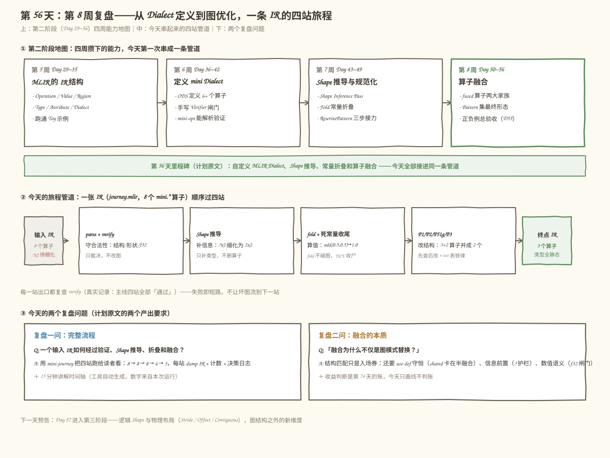
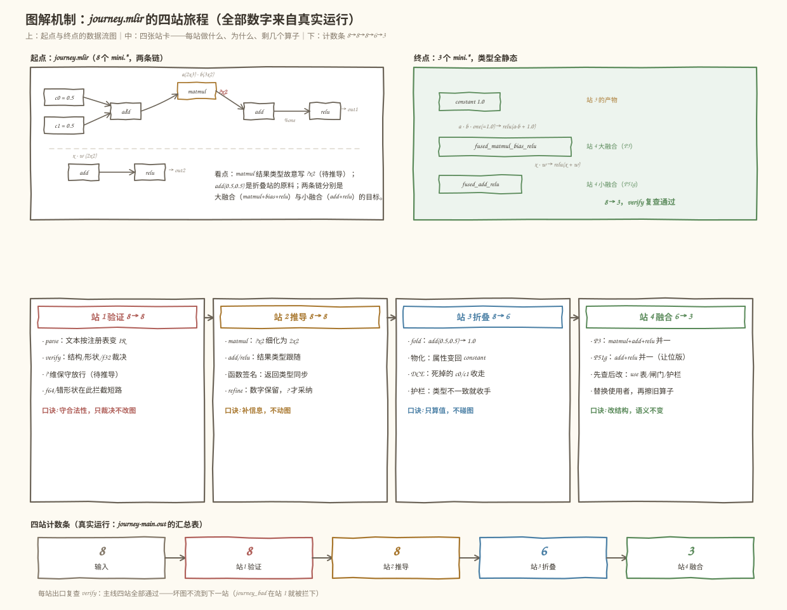
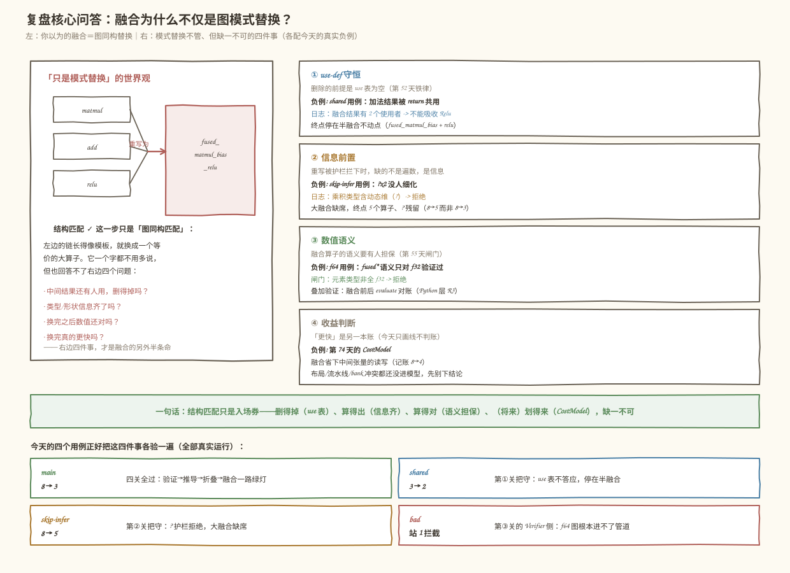
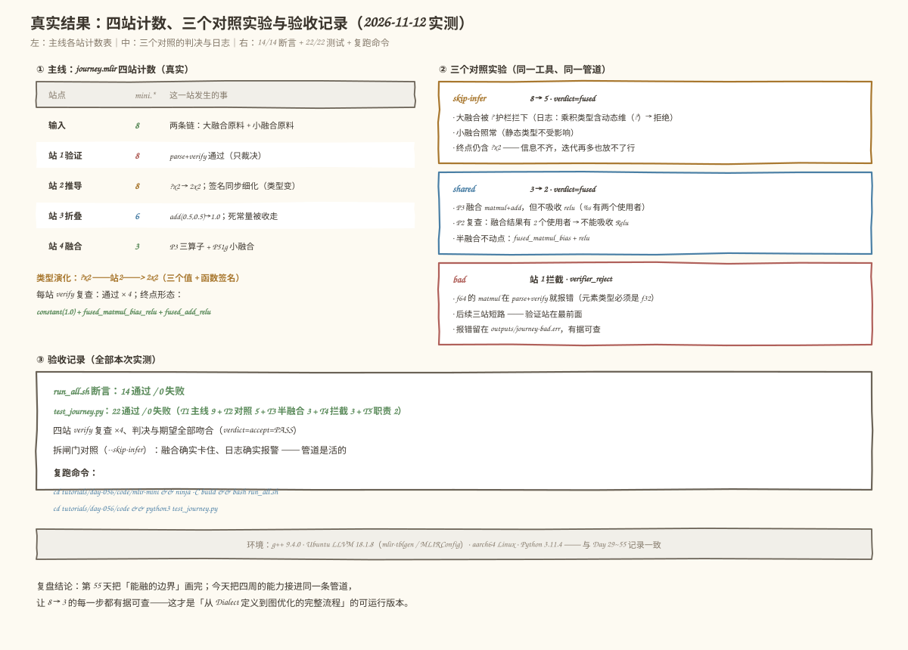

# 第 056 天：第 8 周复盘——从 Dialect 定义到图优化，一条 IR 的四站旅程

> **今日目标**：能不查资料讲清一个输入 IR 如何依次经过**验证 → Shape 推导 → 折叠 → 融合**四站——每站守什么、产出什么、失败时怎么表示；能用工具 `mini-journey` 把这条旅程完整跑一遍并解释 `8 → 8 → 8 → 6 → 3` 的每一步变化；能分四层回答计划复盘题"**融合为什么不仅是图模式替换**"（结构匹配只是入场券，use-def 守恒、信息前置、数值语义、收益判断缺一不可）；能用三个对照实验（`--skip-infer` 信息关卡、shared 半融合、bad 验证拦截）分别证明这三层边界是活的。
> **预计时间**：学习 40 分钟＋实践 50 分钟（选做另加 25 分钟）
> **前置准备**：
> - 第 8 周的全部前置：第 50～55 天的融合算子家族与 Pattern 集（P1/P2/P51g/P3 让位版＋类型闸门）、第 52 天多使用者铁律、第 53 天 `classifyBias` 三分类
> - 第 7 周的三种机制：Shape 推导"补信息不动图"（Day 43/44）、Fold"只算值不碰图"（Day 47）、RewritePattern"认形状改结构"（Day 45/46）——今天四站中的三站直接是它们的复用
> - 环境：C++17 编译器＋MLIR 18（含 `mlir-tblgen`、`MLIRConfig.cmake`）、CMake 3.20+ 与 Ninja、Python 3。实测环境：Ubuntu 20.04.5 LTS（aarch64）、g++ 9.4.0、LLVM/MLIR 18.1.8、cmake 3.20.5、ninja 1.10.0——与 Day 29~55 记录一致，本文全部输出在该环境真实运行
> **今日产出**：`mini-journey` 工具（四站管道＋逐站 dump＋verify 复查＋15 分钟讲解时间轴）、三个对照输入（`journey_shared` / `journey_bad` / `--skip-infer` 模式）、`run_all.sh` 一键复跑（**14/14 断言通过**）、`test_journey.py` 验收测试（**22/22 通过**）、4 张可复现插图（`make_images.py`）

## 1. 今天解决什么问题？

第 55 天把「能融的边界」画完、证完，第 8 周到此收官——今天同时也是**第二阶段（Day 29~56）的最后一天**，计划里的里程碑写着：自定义 MLIR Dialect、Shape 推导、常量折叠和算子融合。复盘日的危险是变成复述笔记：把四周的关键词抄一遍，感觉"都学过了"。但检验很简单——把所有能力接进**同一条管道**跑一遍。能做到，才算真的攒下了；做不到，说明每个能力还躺在各自的工程里。

计划给今天留了两句原话，就是今天的两个问题：

- **复盘一问（实践）**：「用 15 分钟讲解一个输入 IR 如何经过验证、Shape 推导、折叠和融合」；
- **复盘二问（产出）**：能回答「**融合为什么不仅是图模式替换**」。

两个问题共用一个载体：贯穿全文的主用例 `journey.mlir`（8 个 `mini.*` 算子，两条链）：

```mlir
func.func @journey(%a: tensor<2x3xf32>, %b: tensor<3x2xf32>,
                   %x: tensor<2x2xf32>, %w: tensor<2x2xf32>)
    -> (tensor<?x2xf32>, tensor<2x2xf32>) {
  // 链 1：折叠站原料 ＋ 动态 Shape ＋ 三算子大融合原料
  %c0 = mini.constant dense<0.5> : tensor<2x2xf32>
  %c1 = mini.constant dense<0.5> : tensor<2x2xf32>
  %one = mini.add %c0, %c1 : tensor<2x2xf32>, tensor<2x2xf32> -> tensor<2x2xf32>
  %m = mini.matmul %a, %b : tensor<2x3xf32>, tensor<3x2xf32> -> tensor<?x2xf32>
  %s = mini.add %m, %one : tensor<?x2xf32>, tensor<2x2xf32> -> tensor<?x2xf32>
  %r = mini.relu %s : tensor<?x2xf32>
  // 链 2：小融合原料
  %t = mini.add %x, %w : tensor<2x2xf32>, tensor<2x2xf32> -> tensor<2x2xf32>
  %u = mini.relu %t : tensor<2x2xf32>
  return %r, %u : tensor<?x2xf32>, tensor<2x2xf32>
}
```

这张图故意埋了四个考点：`add(0.5, 0.5)` 是**折叠站**的原料（第 47 天）；matmul 结果写成 `?x2` 是**推导站**的原料（第 43/44 天，`?` 的含义是"待推导"不是"任意"）；`matmul + add(bias) + relu` 是**融合站**大融合的原料（第 50~55 天）；`add + relu` 是小融合的原料。四站走完，8 个算子剩 3 个：

```mlir
%0 = mini.constant dense<1.000000e+00> : tensor<2x2xf32>
%1 = mini.fused_matmul_bias_relu %arg0, %arg1, %0 :
     tensor<2x3xf32>, tensor<3x2xf32>, tensor<2x2xf32> -> tensor<2x2xf32>
%2 = mini.fused_add_relu %arg2, %arg3 : tensor<2x2xf32>, tensor<2x2xf32> -> tensor<2x2xf32>
```

而复盘二问的答案藏在三个对照里：跳过推导站，大融合就卡住（结构匹配成立、信息不齐，拒绝）；中间结果被共用，融合就停在半路（结构匹配成立、use 表不答应，拒绝）；元素类型换成 f64，图连验证站都过不了（第 55 天的类型闸门在 Verifier 和 Pattern 两侧都拦）。**"融了"从来不等于"匹配上了"**——这是今天要讲透的一句话。

## 2. 先看全貌：今天的内容位于哪里？



**图 1**：看三个位置——上排是第二阶段的**四周能力地图**：第 5 周读懂 MLIR 的 IR 结构、第 6 周定义 mini Dialect、第 7 周做 Shape 推导与规范化、第 8 周做算子融合——这四周的能力此前分别住在各自的工程里，今天第一次接进同一条管道；中间的管道图就是今天的 `mini-journey`：一张 IR 顺序过四站，每站只做自己的事；底部两个问题卡是今天的两个复盘题。

今天的全貌可以概括成 4 步：

1. **拼管道**：在第 55 天验收壳的基础上，把 `mini.constant`（第 47 天）、Shape 推导（第 43/44 天）、fold 钩子（第 47 天）接进融合工程，让一张图能顺序过四站（§5.1～§5.2）；
2. **跑主线**：`journey.mlir` 走完全程，`8 → 8 → 8 → 6 → 3`，每站 dump IR＋计数＋决策日志，每站出口复查 verify（§5.3）；
3. **做对照**：三个对照实验分别卡在三道不同的边界上（`--skip-infer` 卡信息、shared 卡 use 表、bad 卡验证），证明边界是活的（§5.4）；
4. **答题**：用四站职责表回答复盘一问，用"三件半事"回答复盘二问，配 15 分钟讲解时间轴（§3、图 3、图 4）。

今天的改动半径（相对第 55 天的 `mlir-mini` 工程，全部为复盘整合服务）：

| 改动 | 文件 | 目的 |
|---|---|---|
| **算子回归** | `MiniOps.td`：＋`mini.constant`（Pure/ConstantLike/hasFolder），Dialect 打开 `hasConstantMaterializer = 1` | 折叠站需要常量可折；物化钩子是第 49 天踩坑后的正确入口 |
| **口径放开** | `MiniRules.h`：`classifyBias` 同秩逐维"相等或一侧是 ?"记 Same；`verifyMatmul2D` 允许**结果维**写 ?（操作数仍须静态） | 让"带 ? 的一张图"能通过验证站——`?` 是"待推导"，第 39/44 天保守放行口径的延续 |
| **新站实现** | `MiniDialect.cpp`：ConstantOp 的 verify/fold、AddOp 的 fold、`materializeConstant`；`mini-journey.cpp`：`inferShapes`（细化＋传播＋签名）与四站管道 | 第 47 天的折叠与第 43/44 天的推导在本工程的最小复刻 |
| **护栏补位** | 融合 Pattern（P1/P3/P51g）加"乘积/结果类型含 ? 就拒绝" | Verifier 保守放行 ≠ Pattern 可以动手：信息不齐的重写不做（第 46/49 天护栏口径） |

一句话：**今天没有造新的优化能力，做的是把四周的能力接进同一条管道，并给接缝处补上护栏**。§6 的错误 1 会展示整合时真实踩到的两个坑。

## 3. 核心概念：四站职责与融合的本质

### 3.1 复盘一问的四站职责表

一句通俗的总纲：四站像一条流水线上的四个车间，**每个车间只对自己的那类事负责，出了事把货退回，绝不替下一站干活**。对应到技术上是四条职责边界：

| 维度 | 站 1 验证 | 站 2 Shape 推导 | 站 3 折叠 | 站 4 融合 |
|---|---|---|---|---|
| 守什么 | 合法性：结构、形状、dtype | 信息：`?` 维到底是不是数字 | 值：常量碰常量 | 结构：多个算子并一个 |
| 产出 | 裁决（通过/报错），不改图 | 细化后的类型（`?x2 → 2x2`） | 算好的常量属性 | 改写后的 IR |
| 改图吗 | **绝不**（只读裁决） | 只 `setType`，不删算子 | fold **不碰图**，物化和收尸交给驱动 | 亲手改，必须经 PatternRewriter |
| 失败语义 | 报错即短路，后面三站不跑 | 推不出就保持 `?`（图合法，信息不全） | 返回空 Attribute 交回驱动 | 返回 failure 交回驱动（必须恒等） |
| 今天谁在干 | `verifyMatmul2D`＋三分类 | `inferShapes`（细化＋传播＋签名） | `AddOp::fold`＋`materializeConstant` | P1/P2/P51g/P3＋两道闸门 |
| 口诀 | **守合法性，只裁决** | **补信息，不动图** | **只算值，不碰图** | **改结构，先查后改** |

三处对照值得多看一眼。**站 1 和站 2 对 `?` 的态度不同**：验证站把 `?` 当"待推导"保守放行（图合法），推导站负责把 `?` 换成数字（信息增量）——同一件事的两半，谁也不越界。**站 3 和站 4 都"产出新东西"但形状不同**：折叠产出的是**值**（属性），连 PatternRewriter 的影子都见不到；融合产出的是**算子**（图结构），必须先查后改。**四个失败语义没有一种会中断编译**（站 1 除外——它就是用来中断的），这正是四站能自由组合的前提，也是第 49 天"三种机制失败语义一致"结论的四站版。

### 3.2 复盘二问：融合为什么不仅是图模式替换

直觉版回答：把"融合"想成收拾行李——**把三个袋子并成一个大袋子**。模式替换只回答了"这三个袋子看起来是一套的"；但并袋之前你还得确认：三件东西**没有别人也要用**（use-def 守恒）、**清单上每件东西都标了尺寸**（信息前置）、**并完之后分量没变**（数值语义）；最后才是"并完真的省事吗"（收益判断）。类比到这里必须刹车——行李可以倒出来数，编译器面对的是无穷输入空间，第三层永远只能是"测试集以内的置信"，不是数学证明。

对应到技术上是"三件半事"，今天的三个对照实验各撞一面墙：

1. **use-def 守恒**（第 52 天铁律）：擦除算子的前提是它的结果 use 表为空。`journey_shared` 里加法结果被 return 和 relu 共用——P3 照融 MatMul+Add，但 Relu 吸不走，任何遍历都停在 `fused_matmul_bias + relu` 这个半融合不动点。**匹配成立，use 表不答应**；
2. **信息前置**（第 46/49 天护栏口径）：`--skip-infer` 时乘积类型还是 `?x2`，P1/P3 直接拒绝——把 `?x2` 顶替进融合产物，使用者类型对不上。这个拒绝**不是 Pattern 胆小**：迭代一万次也放不了行，缺的不是遍数，是类型信息（第 49 天信息关卡在融合场景的再现）；
3. **数值语义**（第 55 天闸门）：`fused_*` 的语义只对 f32 验证过，f64 图在验证站就被拦（`journey_bad`）；即便绕过 Verifier，Pattern 的类型闸门是第二道防线。模式替换对"元素类型"一个字都不用多说，但语义担保必须有人签字；
4. **（半件）收益判断**：第 74 天的 CostModel 才建账。今天用"整张张量读写遍数"做的记账（融合前后 8→4）只是**玩具账本**，不是实测耗时——布局、流水线、片上容量都还没进模型。所以是"三件半"。

一句话版本（面试可直接用）：**结构匹配只是入场券；删得掉（use 表）、算得出（信息齐）、算得对（语义担保）、（将来）划得来（CostModel），缺一不可**。第 55 天把这三层画成"三道闸门"，今天把它们放进一条会跑的管道里各撞一次。

## 4. 图解核心机制：journey.mlir 的四站演化



**图 2**：三排讲同一件事。上排是起点和终点的数据流对照——起点图里 `?x2` 标红，是推导站的靶子；终点图里三个幸存者各自标了"出身"（constant 来自站 3，两个 fused 来自站 4）。中排四张站卡是本文 §3.1 职责表的图形版，每张卡右下角是口诀。底部计数条把 `8 → 8 → 8 → 6 → 3` 排成一列——注意前两站计数不动的原因完全不同：**站 1 是"裁决完什么都不做"，站 2 是"只改类型不删算子"**。按站逐步看：

1. **站 1 验证（8 → 8）**：`parse` 把文本按注册表变成内存 IR，`verify` 逐算子检查——matmul 内维 3==3 ✓、结果 `?x2` 按第 56 天口径放行（操作数静态、期望 `[2,2]`，`?` 视为待推导）✓、两个 add 的 bias 三分类都是 Same ✓。验证通过，**图一个字节都没变**。它的价值在负例上才看得见：`journey_bad.mlir`（f64 版）在这里报 `元素类型必须是 f32`，后面三站根本不执行——**失败即短路**；
2. **站 2 推导（8 → 8，类型变）**：`inferShapes` 迭代到不动点，做三件事——`%m` 的 `?x2` 细化为 `2x2`（refine：old 是数字保留、是 `?` 才采纳）；`%s`、`%r` 的结果类型**跟随操作数**（第 40 天"结果类型等于 lhs"的规则反过来用：lhs 有数字了，结果跟着长出来）；函数签名的返回类型同步细化（签名也是类型信息，不细化的话 verify 复查会挂）。SSA 的机制在这站最出彩：`Value::setType` 改一个值，**所有使用者立刻看到新类型**；
3. **站 3 折叠（8 → 6）**：`add(0.5, 0.5)` 的两个操作数都是常量，fold 逐元素算出 `dense<1.0>` 返回；驱动拿着属性调 `materializeConstant` 物化出新的 `mini.constant`，把 `%one` 的使用者改指新常量、擦除 add；两个旧常量失去使用者，被挂进 Pattern 集的 `EraseDeadConstant` 收走（第 25 天 DCE 的常量特例）。**fold 自始至终没碰图**——它只返回值；
4. **站 4 融合（6 → 3）**：P3 在 `%s` 上匹配 `matmul + add + relu`——先查（bias 三分类 Same、全 f32、乘积类型静态、乘积 use 表为空、`%s` 唯一使用者是 relu），后改（创建 `fused_matmul_bias_relu`、`replaceAllUsesWith`、依次擦除 relu/add/matmul）。P51g 在 `%u` 上匹配 `add + relu` 小融合。决策日志（真实记录）：

```text
[P51g] 匹配 Add + Relu -> fused_add_relu（Add+Relu 小融合）
[P51g] add 的操作数之一是 matmul 乘积 -> 让位给更大的融合（MatMul+Bias 系），本次不抢
[P3] 匹配 MatMul + Add + Relu -> fused_matmul_bias_relu（直接三算子，一步到位）
```

第二行是让位规则在工作：`%r` 的输入 `%s` 也是 add，P51g 看了一眼就退出——那是大融合的原料，小融合不抢。第 54 天的 Pattern 优先级设计，在复盘管道里依然稳定。

## 5. 动手实践：把四周的能力接进一条管道

### 5.1 准备文件与构建

今天的文件布局（在第 55 天验收壳上整合，改动半径见 §2 的表）：

```text
tutorials/day-056/code/
├── mlir-mini/                      # 四站管道工程
│   ├── MiniOps.td                  # 改：＋mini.constant（Pure/ConstantLike/hasFolder）
│   │                               #      Dialect 打开 hasConstantMaterializer = 1
│   ├── MiniRules.h                 # 改：classifyBias 的 ? 通配；matmul 结果维放行 ?
│   ├── MiniDialect.cpp             # 改：ConstantOp verify/fold、AddOp fold、物化钩子
│   ├── mini-journey.cpp            # 新：四站管道工具（本日核心）
│   ├── inputs/
│   │   ├── journey.mlir            # 主线：8 算子，四站全有戏
│   │   ├── journey_shared.mlir     # 对照 2：半融合不动点
│   │   └── journey_bad.mlir        # 对照 3：验证站拦截
│   ├── run_all.sh                  # 一键复跑（4 用例＋14 组断言）
│   └── outputs/                    # 全部真实运行记录（下文引用）
├── test_journey.py                 # Python 验收测试（22 个断言）
├── make_images.py                  # 4 张插图的生成器（固定随机种子）
└── outputs/                        # test_journey.py 的运行记录
```

构建与冒烟（约 1～2 分钟）：

```bash
cd tutorials/day-056/code/mlir-mini
cmake -S . -B build -G Ninja \
      -DLLVM_DIR=/usr/lib/llvm-18/lib/cmake/llvm \
      -DMLIR_DIR=/usr/lib/llvm-18/lib/cmake/mlir -DCMAKE_BUILD_TYPE=Release
ninja -C build
bash run_all.sh                     # 全量复跑，汇总见 outputs/journey-summary.txt
```

### 5.2 关键代码：三个接缝处

**接缝一：常量与折叠（第 47 天口径的最小复刻）**。`MiniOps.td` 里 `mini.constant` 回归，`AnyAttr` 换成 TypedAttr（`FloatElementsAttr<32>`）并加 `AllTypesMatch`——这不仅是风格问题，§6 错误 1 会展示 `AnyAttr` 版本在 assembly format 上直接编不过。fold 的分工一字未改：

```cpp
// MiniDialect.cpp —— constant 的 fold：递纸条（Day 47）
OpFoldResult mini::ConstantOp::fold(mini::ConstantOp::FoldAdaptor adaptor) {
  return getValue();
}

// add 的 fold：常量碰常量（节选，护栏完整版见源文件）
OpFoldResult mini::AddOp::fold(mini::AddOp::FoldAdaptor adaptor) {
  DenseElementsAttr lhsAttr =
      dyn_cast_or_null<DenseElementsAttr>(adaptor.getLhs());
  DenseElementsAttr rhsAttr =
      dyn_cast_or_null<DenseElementsAttr>(adaptor.getRhs());
  if (!lhsAttr || !rhsAttr)
    return {};                       // 有一个不是常量：交回驱动
  if (getRes().getType() != getLhs().getType() ||
      getRes().getType() != getRhs().getType())
    return {};                       // 类型护栏：动态维不折（见 §6 错误 2）
  // ……尺寸护栏（kMaxFoldElements = 1024）＋逐元素 APFloat 加法
  return DenseElementsAttr::get(resType, sum);
}
```

**接缝二：Shape 推导站（第 43/44 天规则的最小复刻＋传播）**。`mini-journey.cpp` 里的 `inferShapes` 迭代到不动点，三类规则：matmul 细化、类型跟随、签名同步。核心是 `refineType`——"数字保留、`?` 才采纳"的 Day 44 口径：

```cpp
// refine(old, new)：old 的维是数字就保留（写 IR 的人对 Verifier 的承诺，
// Pass 无权改写），是 ? 才采纳 new 的对应维；new 也是 ? 就保持 ?
static Type refineType(Type oldT, Type newT) {
  ...
  for (unsigned i = 0; i < o.getRank(); ++i) {
    int64_t od = o.getDimSize(i), nd = n.getDimSize(i);
    if (!ShapedType::isDynamic(od))      shape.push_back(od);
    else if (!ShapedType::isDynamic(nd)) shape.push_back(nd);
    else                                 shape.push_back(od);
  }
  return RankedTensorType::get(shape, o.getElementType());
}
```

类型跟随处理 `add`/`relu`（结果类型跟操作数走，第 40 天 Verifier 规则的逆用）；签名同步处理函数返回类型——这段是设计推演时**必须补**的：`%r` 细化成 `2x2` 之后，签名里的 `?x2` 不跟着改的话，站 2 出口的 verify 复查立刻失败。

**接缝三：`?` 护栏（Verifier 保守放行的配套）**。`MiniRules.h` 放开了验证站的 `?`，融合 Pattern 必须自己补上"信息不齐不动手"：

```cpp
// mini-journey.cpp —— 所有融合 Pattern 共用的静态形状检查
static bool hasStaticTensorShape(Value v) {
  auto t = v.getType().dyn_cast<RankedTensorType>();
  return t && t.hasStaticShape();
}
// P3 内（先查后改的"查"之一）：
if (!hasStaticTensorShape(m)) {
  llvm::errs() << "  [P3] 乘积类型含动态维（?）-> 拒绝"
                  "（信息不齐的重写不做，等 Shape 推导细化）\n";
  return failure();
}
```

为什么闸门放 Pattern 而不放 Verifier？因为"`?` 是合法的待推导状态"是**全局判断**（验证站管），"此刻信息够不够动手"是**局部判断**（Pattern 管）——第 55 天"同一类负例拆给两道闸门"的结论，今天在 `?` 上又演了一遍。

### 5.3 运行与观察：主线 8 → 3

```bash
./build/mini-journey inputs/journey.mlir --expect=fused
```

工具逐站打印 IR、计数和 verify 复查。以下是**真实运行记录**（`outputs/journey-main.out` 的汇总表，2026-11-12，g++ 9.4.0 / LLVM 18.1.8 / aarch64 Linux）：

```text
===== 汇总：一条 IR 的四站旅程 =====
站点            mini.* 计数   变化
输入            8
站 1 验证        8        （只裁决，结构不变）
站 2 Shape 推导   8        （类型 ?x2 -> 2x2，结构不变）
站 3 折叠        6        （add(0.5,0.5) -> 1.0，死常量被收走）
站 4 融合        3        （mini.constantx1 mini.fused_add_relux1 mini.fused_matmul_bias_relux1）
```

站 2 的细化过程在 stderr（真实记录，`outputs/journey-main.err`）：

```text
[J2] matmul 结果 %3: ? 维细化为 tensor<2x2xf32>
[J2] mini.add 结果类型跟随操作数: -> tensor<2x2xf32>
[J2] mini.relu 结果类型跟随操作数: -> tensor<2x2xf32>
[J2] 函数签名返回类型细化: ... -> (tensor<?x2xf32>, tensor<2x2xf32>)
    -> ... -> (tensor<2x2xf32>, tensor<2x2xf32>)
```

四行正好对应 §5.2 接缝二的三类规则：细化、跟随 ×2、签名。每站出口的 verify 复查全部通过——**站 2 改了类型还能过 verify，靠的就是签名同步**。

### 5.4 对照实验：三道边界各撞一次

复盘二问的"三件半事"不能只靠嘴说，三个对照实验各撞一面墙（全部可由 `run_all.sh` 复跑）：

**对照 1：`--skip-infer`——信息前置**。跳过站 2，其余原样：

```bash
./build/mini-journey inputs/journey.mlir --skip-infer
```

真实结果（`outputs/journey-skip-infer.out/.err`）：折叠照常（8→6，常量折叠不依赖 Shape 推导），小融合照常（`%t`/`%u` 本来就是静态类型），**大融合被 ? 护栏拦下**：

```text
[P3] 乘积类型含动态维（?）-> 拒绝（信息不齐的重写不做，等 Shape 推导细化）
[P1] 乘积类型含动态维（?）-> 拒绝（信息不齐的重写不做，等 Shape 推导细化）
```

终点 5 个算子、`?x2` 残留（8→5 而不是 8→3）。注意判决仍是 `fused`——小融合成功了，但这恰恰是**最值得警惕的输出**：如果不检查最终形态，你会以为"融合跑了"而漏掉大融合缺席。第 54 天的教训（"verify 通过 ≠ 融对了"）换个形态又出现了一次。

**对照 2：`journey_shared`——use-def 守恒**。加法结果被 return 和 relu 共用。真实记录（`outputs/journey-shared.err`）：

```text
[P3] 匹配 MatMul + Add -> fused_matmul_bias（%s 还有别的使用者时不吸收 Relu）
[P2] 融合结果有 2 个使用者 -> 不能吸收 Relu（Day 53 场景 E 的规则）
```

终点停在半融合不动点：`fused_matmul_bias + relu`（3 → 2）。结构匹配完全成立，use 表不答应——**模式替换管不着这件事**。

**对照 3：`journey_bad`——验证拦截**。f64 版主线图在站 1 被拦（真实记录 `outputs/journey-bad.err`）：

```text
loc("inputs/journey_bad.mlir":9:8): error: 'mini.matmul' op 元素类型必须是 f32
[J1] parse + verify: 拒绝（verifier_reject，报错见 stderr；后续三站短路）
```

三个对照合起来，正好回答复盘二问：**匹配成立（对照 2、3 里都成立或可成立）≠ 可以动手**——use 表、信息、语义三道边界各挡下一次。



**图 3**：读这张图先看左边——"只是模式替换"的世界观没有错，只是**远远不够**：图同构匹配只回答"长什么样"，右边四个问题（删得掉吗、信息齐吗、数值对吗、真的快吗）它一个都不用回答。右侧四张卡各配今天的真实负例和日志原文；第 4 张卡（收益判断）故意用了灰色——那是第 74 天的账，今天只画线不判账。底部一行把四个用例各归各位：`main` 四关全过，其余三个各撞一面墙。



**图 4**：左表是主线的四站计数（真实数字）；中间三个对照卡各配一行**真实日志原文**——负例的价值在于证据可查，不是"失败"两个字；右下是验收记录：`run_all.sh` 的 14 组断言、`test_journey.py` 的 22 个测试，全部通过，复跑命令在卡内。

## 6. 常见错误与排查

### 错误 1：constant 的 assembly format 编不过——"format ambiguity caused by `:`"

- **现象**：`MiniOps.td` 里给 constant 写 `assemblyFormat = "$value attr-dict `:` type($res)"`，tblgen 直接报错：`format ambiguity caused by ':' literal found after attribute 'value' which does not have a buildable type`。
- **原因**：`AnyAttr` 没有可构建类型（buildable type），解析器读完 `$value` 后无法判断后面的 `:` 是属性的一部分还是格式字面量——歧义。第 49 天的 mini 工程早就解决过：value 用 **TypedAttr**（`FloatElementsAttr<32>`，自带类型）＋ `AllTypesMatch<["value", "res"]>`，结果类型直接从属性推断，`:` 根本不用写。
- **定位**：报错指向 format 那一行；对比 day-049 的 `MiniOps.td`（同环境编译通过的口径）。
- **修复**：`arguments = (ins Mini_F32ElementsAttr:$value)`，`assemblyFormat = "$value attr-dict"`。复盘启示：**"看起来能写"和"tblgen 认"之间隔着一次真实构建**——第 49 天错误 4 的教训在复盘日重演，这正是复盘要把全部代码重新编译一遍的原因。

### 错误 2：站 2 之后 verify 复查失败——签名没跟着细化

- **现象**：`inferShapes` 只细化了 `%m`/`%s`/`%r` 的类型，站 2 出口复查 verify 报函数签名与 return 不匹配（返回值已是 `2x2`，签名还写着 `?x2`）。
- **原因**：函数签名**也是类型信息**。`Value::setType` 改的是单个 SSA 值，签名是 FuncOp 的属性——它不会自动跟着变。设计推演时容易把"传播"想到值、忘掉边界上的签名。
- **定位**：verify 的报错位置指向 func.return；对照站 2 的日志看有没有"函数签名返回类型细化"那一行。
- **修复**：`inferShapes` 的第 (d) 步：收集 return 操作数类型，用 `refineType` 合并进签名结果类型，`fn.setType` 更新。复盘启示：补信息的 Pass 要把**图内**和**图的边界**（签名）一起补，否则自己制造非法 IR。

### 错误 3：fold 之后旧常量赖着不走——计数停在 8

- **现象**：折叠站跑完，`add` 变成了新 constant，但两个旧的 `dense<0.5>` 常量还留在图里（计数停在 8 而不是降到 6——add 换成 constant 是一换一，真正减计数的两笔账是死常量被收走）。
- **原因**：fold 的契约是"只返回值"——物化新常量、改使用者、擦除 add 都是驱动的活；但驱动**不会**顺手擦除"失去使用者的旧常量"。死代码消除是第 25 天就学过的独立职责。
- **定位**：看站 3 的 dump IR——新 constant 在、旧 constant 也在、add 没了，就是收尸环节缺席。
- **修复**：fold 站的 Pattern 集挂一个 `EraseDeadConstant`（`use_empty()` 就 `eraseOp`），驱动迭代到不动点时会把死常量收走。复盘启示：**fold 造新、DCE 收旧**是两个职责，接管道时要各就各位。

### 错误 4：验证站放行了 ?，就以为 Pattern 也能融

- **现象**：把 `MiniRules.h` 的 `?` 保守放行理解为"动态维到处都行"，直接跑融合，结果融合产物类型带 `?`，下游使用者类型对不上（或更糟：悄悄融了，verify 复查才炸）。
- **原因**：`?` 的合法性是**全局判断**（图合法，待推导），"此刻能不能动手"是**局部判断**（信息齐不齐）——两个判断住在不同层。验证站放行只是说"这张图没病"，不是"任何重写都安全"。
- **定位**：对照 1（`--skip-infer`）的日志——P1/P3 的"乘积类型含动态维（?）-> 拒绝"就是这道护栏在工作。
- **修复**：所有融合 Pattern 在"先查后改"的查里加 `hasStaticTensorShape`。复盘启示：第 55 天"同一类负例拆给两道闸门"（f64 的 matmul 在 Verifier、f64 的 add 在 Pattern 类型闸门）的结构，在 `?` 上原样重演。

### 错误 5：用全文 grep 断言"终点无 ?x2"，被输入段误报

- **现象**：`run_all.sh` 里写 `! grep -q "?x2" outputs/journey-main.out` 想断言终点无动态维，结果断言失败——但终点明明全是 `2x2`。
- **原因**：`.out` 文件**包含所有阶段的 dump**，输入和站 1、站 2 的 IR 里本来就有 `?x2`；另外 `!` 是 bash 保留字，不能当参数传给断言函数（会被当作不存在的命令）。
- **定位**：`grep -n "?x2" outputs/journey-main.out` 看行号——命中的全在阶段 0/1/2 段。
- **修复**：先用 `sed -n '/^===== 阶段 4/,$p'` 截取"阶段 4 之后"再做 grep；否定断言单独写 `check_no`（命令成功＝断言失败）。复盘启示：**断言的作用域要和断言的意图一致**——这和 Pass 测试里"检查最终 IR 而不是中间 IR"是同一个道理。

## 7. 今日练习

### 必做练习

把 `journey.mlir` 的链 2 改造一下：删掉参数 `%w`，改为 `%z = mini.constant dense<0.0> : tensor<2x2xf32>`，`%t = mini.add %x, %z`。先在纸上预测四站的每一步：(a) 折叠站会把 `add(x, 0)` 折掉吗——fold 的匹配条件是什么，`%x` 是常量吗？(b) P51g 会把 `add + relu` 融成 `fused_add_relu` 吗——bias 换成常量 0 影响匹配吗？(c) 终点几个算子、`add(x, 0) → x` 这条第 46 天的恒等式消除发生了吗？然后运行验证。参考答案（已实测，记录见 `code/outputs/exercise-answer.out`）：输入 9 个算子；fold 不折 `add(x, 0)`（`%x` 是函数参数不是常量——fold 只做"常量碰常量"，恒等式消除是另一条 Pattern 的活，本工程没带它），站 3 只折掉 `add(0.5,0.5)`（9→7）；P51g 照融（bias 是不是常量不影响结构匹配）；终点 4 个算子：`constant(0.0) + constant(1.0) + fused_matmul_bias_relu + fused_add_relu`。**fold 和代数化简是两种不同的机制**——第 49 天复盘的结论换个输入又验证了一遍。

### 选做挑战

对照 1 的反向操作：`--skip-infer` 之后**补跑一轮**"先推导再融合"能不能救回来？写一个小脚本（或手工两条命令）：把 skip-infer 的阶段 3 输出存成文件，再喂给一个"只跑站 2＋站 4"的流程（提示：`mini-journey` 目前是四站固定顺序，你可以给它加一个 `--only-infer-fuse` 选项，或者在 `inferShapes` 后直接调 `runFuseStation`）。预测：能救回 8→5→3，且最终 IR 与主线**逐字节相同**——这验证了"信息后补也能到达同一形态"，但它多花了一整轮管道；对照第 49 天选做实验（错序可救）的结论，想想真实编译器为什么宁可精心排顺序，也不靠"多跑几轮"兜底。

## 8. 今日验收

完成下面清单后，第 8 周与第二阶段的复盘才算闭环（命令都在 `tutorials/day-056/` 下执行）：

- [ ] 构建并跑通主线：`cd code/mlir-mini && ninja -C build && ./build/mini-journey inputs/journey.mlir`，看到 `8 → 8 → 8 → 6 → 3`、四站 verify 复查全部通过（真实记录见 `outputs/journey-main.out`）
- [ ] 跑通一键复跑：`bash run_all.sh`，14/14 断言通过（真实记录见 `outputs/journey-summary.txt`）
- [ ] 跑通验收测试：`cd code && python3 test_journey.py`，22/22 通过（真实记录见 `outputs/test-journey.txt`）
- [ ] 不看资料说出四站职责与口诀：验证"守合法性只裁决"、推导"补信息不动图"、折叠"只算值不碰图"、融合"改结构先查后改"——以及四站的失败语义有什么共同点（都不中断编译、交回驱动；站 1 例外——它就是用来中断的）
- [ ] 分四层回答"融合为什么不仅是图模式替换"：use-def 守恒、信息前置、数值语义、收益判断（半件）——并各举今天的对照实验（shared / skip-infer / bad / 第 74 天预告）
- [ ] 解释两个接缝处的坑：为什么 `?` 在验证站放行、在 Pattern 被拦（全局判断 vs 局部判断）；为什么签名必须跟着细化（`Value::setType` 不自动更新 FuncOp）
- [ ] 我保存了今天的全部产出：`mini-journey` 工具、三个对照输入、`run_all.sh`、`test_journey.py`、`outputs/` 全部记录和 4 张插图（`make_images.py` 可确定性重生成）

## 9. 一句话总结与明天预告

复盘把第二阶段四周的能力接进同一条管道：**职责上**，验证守合法性、推导补信息、折叠算值、融合改结构，四站失败语义一致（交回驱动、不中断编译），`8 → 8 → 8 → 6 → 3` 的每一步变化都有 dump、计数和决策日志作证；**边界上**，三个对照实验各撞一面墙——`--skip-infer` 撞信息前置（8→5，`?` 残留）、shared 撞 use-def 守恒（半融合不动点）、bad 撞验证拦截（站 1 短路）——"融了"从来不等于"匹配上了"；**方法上**，复盘不是复述笔记：把代码重新编译一遍抓出 tblgen 的坑、把断言作用域对齐意图、把每站出口的 verify 复查做成规则，全部结论沉淀在 `run_all.sh` 里可一键重放。第二阶段到此收官：自定义 Dialect、Shape 推导、常量折叠、算子融合，四样都在一条管道里跑通了。

明天（第 57 天）进入第三阶段：**逻辑 Shape 与物理布局**——同一个 Tensor，Shape 相同但内存布局可以不同（Stride、Storage Offset、Contiguous）。今天四站管的全是**逻辑语义**；从明天起，图结构之外多了一个维度：数据在内存里**怎么躺**。第 60 天还会回来放行第 40/55 天拦下的「需广播」负例——到时候欢迎回来验收它们。
