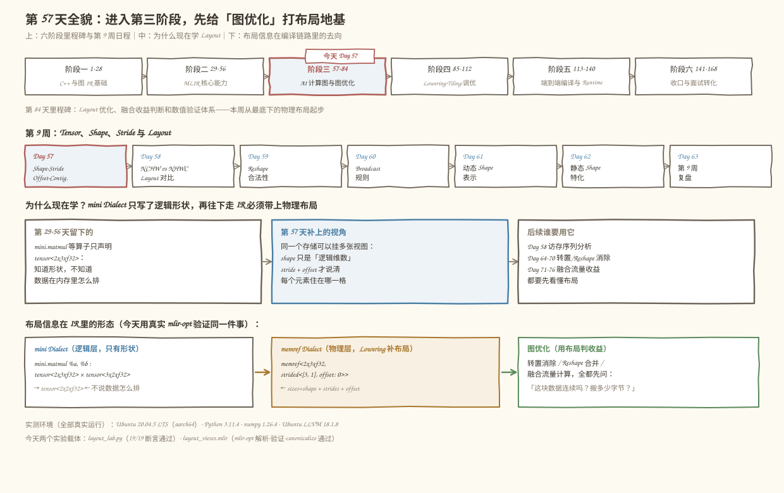
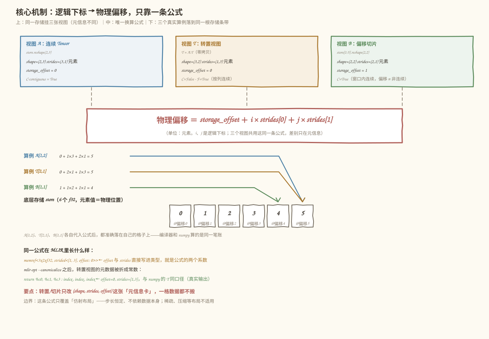
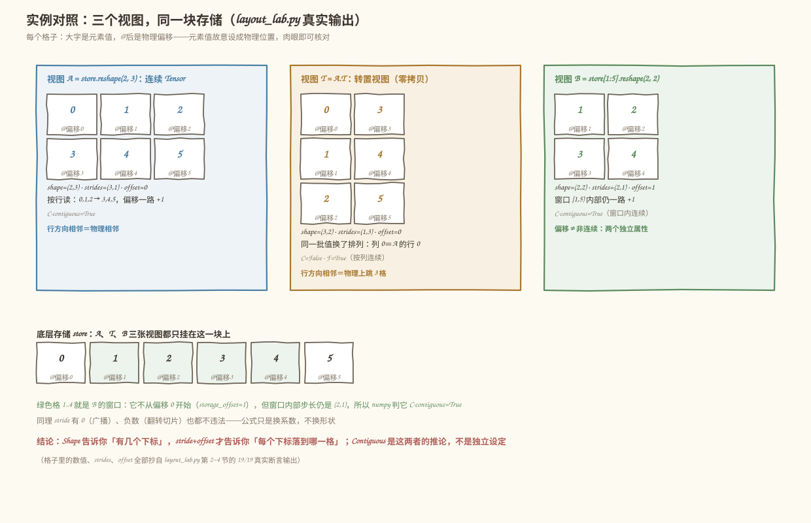
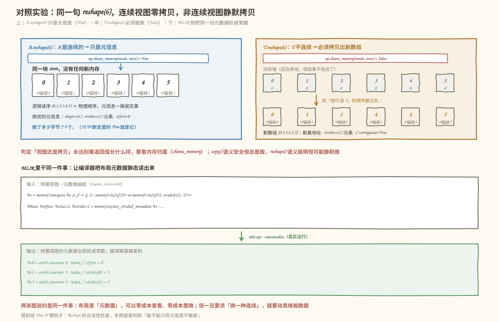

# 第 57 天：逻辑 Shape 与物理布局——为什么"形状相同"不等于"内存相同"

> **今日目标**：完成本教程后，你能对任意一个 Tensor 视图说出它的 Shape、Stride、Storage Offset 与 Contiguous 四个属性，能手算每个逻辑下标对应的物理偏移，并解释同一句 `reshape` 什么时候是零拷贝、什么时候偷偷搬家。
> **预计时间**：学习 40 分钟＋实践 40 分钟
> **前置准备**：Python 3.10+ 与 numpy（本机为 3.11.4 / numpy 1.26.4）；可选 `mlir-opt`（本机为 Ubuntu LLVM 18.1.8）用于 MLIR 对照实验；不需要 NPU。
> **今日产出**：一个打印物理偏移的布局实验（`code/layout_lab.py`，19/19 断言通过）、一组独立验收测试（`code/test_layout.py`，14/14 通过）、一份 MLIR memref 布局视图示例，以及 4 张示意图。

## 1. 今天解决什么问题？

先看一个真实会踩的坑。你在写一个图优化 Pass，想把两个算子融合：前一个算子的输出是 `2×3` 的矩阵，后一个算子要求输入是 `3×2`。你看了看 Shape，一转置正好对上，于是在 IR 里写了个 `transpose`，心想"这只是换个形状，应该没什么代价"。

问题就出在这句"应该"。**Shape 只告诉你逻辑上有多少个下标要填，完全不告诉你这些元素在内存里怎么摆。** 同样一个 `3×2` 的 Shape，可能是：

- 一块自己的、按行连续排布的内存（贵：要拷贝 6 个数）；
- 原来那块 `2×3` 内存的另一个"看法"，数据一个都没动（便宜：只改几个整数）。

两种实现 Shape 完全相同，数值完全相同，但对后面的访存效率、融合合法性、向量化可能性的影响天差地别。如果你（或你写的 Pass）分不清这两者，要么白白多搬一次数据，要么在错误假设下做出非法优化。

今天我们用一根贯穿全文的小例子把这件事彻底拆开：

```text
底层存储 store = [0, 1, 2, 3, 4, 5]      # 6 个 f32，元素值故意设成它的物理位置
视图 A = store.reshape(2, 3)              # 连续 Tensor：按行读是 0,1,2 / 3,4,5
视图 T = A.T                              # 转置视图：3×2，零拷贝，只改元信息
视图 B = store[1:5].reshape(2, 2)         # 带 storage offset 的切片
```

预期结果：打印出 A、T、B **每一个元素**的物理偏移，你会亲眼看到——T 的形状变了、数据没动；B 的起点挪了 1 格、但窗口内依然连续；同一句 `reshape(6)`，作用在 A 上是零拷贝，作用在 T 上必须搬家。

## 2. 先看全貌：今天的内容位于哪里？



**图 1**：三栏从上往下看——今天的课程位置、为什么偏偏现在学布局、布局信息在编译链路里的去向。

用 4 步把全局串起来：

1. **前 56 天**：第 1–28 天打了 C++ 与图 IR 基础，第 29–56 天掌握了 MLIR 核心能力——但自己写的 mini Dialect 里，Tensor 只带**逻辑形状**，"数据在内存里怎么摆"这件事一直被跳过。
2. **今天进入阶段三（57–84 天）**：AI 计算图与图优化。图优化的核心问题是"这两个算子能不能融合、数据要不要重排、重排值不值"——回答任何一个都绕不开物理布局。
3. **今天打地基**：把 Shape、Stride、Storage Offset、Contiguous 四个属性讲透，它们是后面 8 周所有 Layout 讨论的词汇表。
4. **布局信息的去向**：在 IR 里它住进 `memref` 的 `strided<[...], offset: ...>` 类型；在编译期它是**常量元数据**，Pass 可以直接读出来做决策（今天会用 `--canonicalize` 亲眼看到它被折成常数）。

## 3. 核心概念：先用直觉，再给准确定义

先给一个贯穿四个概念的类比：**一排编号 0–5 的储物柜**（就是 `store`）。任何"Tensor"本质上都只是一张**登记表**，写明三件事：从几号柜开始租、按什么顺序读、共租几格。柜子（内存）从来没动过，动的只是登记表。

### 3.1 Shape（逻辑形状）

- **一句通俗解释**：Shape 是用户和算子"看到"的下标空间——`A` 的 Shape 是 `(2, 3)`，意思是要定位一个元素，得给两个下标 `A[i, j]`，`i` 取 0–1、`j` 取 0–2。
- **类比**：登记表上的"租了 2 行 × 3 列"。
- **对应到技术上是**：Shape 决定**下标的取值范围和秩（rank，下标个数）**，仅此而已。它不决定任何一个元素放在哪一格柜子里。矩阵乘要求 `K` 对齐、广播要求维度可扩展——这些"形状推理"规则全部只看 Shape。
- **最小例子**：`store.reshape(2, 3)` 和 `store.reshape(3, 2)` 的 Shape 不同，但用的是同一排柜子。
- **常见误解**："Shape 相同 ⇒ 内存布局相同"。`A`（`2×3` 连续）和某个恰好 `2×3` 的非连续切片 Shape 相同、布局完全不同。这是今天要拔掉的第一颗钉子。

### 3.2 Stride（步长）

- **一句通俗解释**：某个维度的下标 `+1`，物理位置要跳几格。
- **类比**：登记表上写着"每换一行，柜子号 +3；每换一列，柜子号 +1"。
- **对应到技术上是**：`strides` 是一个和 Shape 等长的向量，第 k 维的 stride 记跳过多少**存储单位**。行主序（C 顺序）的 `(2, 3)` 矩阵 strides 是 `(3, 1)`：行方向跨 3 格，列方向跨 1 格。**注意单位差异**：numpy 的 `strides` 以**字节**计（f32 每格 4 字节，所以打印出来是 `(12, 4)`）；MLIR 的 `strided<[...]>` 以**元素**计（`strided<[3, 1]>`）。两边口径不同，是真实工程里高频出坑点。
- **最小例子**：转置 `T = A.T` 后 strides 从 `(3, 1)` 变成 `(1, 3)`——只是把两个数对调，**一个数据都没搬**。
- **类比边界**：储物柜类比里"柜子是逐格的"，但技术上 stride 还可以是 0（多个逻辑位置共享同一格，即 broadcast）或负数（倒着读）。这两种登记表在"实柜子"世界里没有直接对应，做优化时必须单独处理。

### 3.3 Storage Offset（存储偏移）

- **一句通俗解释**：这张视图的首元素（下标全 0 的那个）离底层存储起点隔了几格。
- **类比**：登记表第一行写着"从 1 号柜开始租"。
- **对应到技术上是**：一个整数偏移量。切片 `store[1:5]` 产出的视图 offset = 1；MLIR 里它写进类型：`memref<2x2xf32, strided<[2, 1], offset: 1>>`。
- **最小例子**：`B = store[1:5].reshape(2, 2)`，`B[0, 0]` 的值是 1——因为它住在 1 号柜（偏移 1），而那里本来就放着 1。
- **常见误解**："offset 不为 0 ⇒ 这个视图不连续"。错。偏移说的是**从哪开始**，连续性说的是**窗口里怎么走**，是两个独立属性——`B` 带着偏移 1 依然是 C-contiguous 的，第 6 节会专门排这个错。

### 3.4 Contiguous（连续性）

- **一句通俗解释**：按逻辑顺序（C 顺序：最后一维先走）逐个读元素时，物理偏移是否恰好一路 `+1`。
- **类比**：租的柜子是不是一排**紧挨着**的——挨着的话，管理员从头扫到尾一遍就能读完。
- **对应到技术上是**：可以形式化地判——对每个维度 k 从后往前累乘：期望 stride 等于"后面所有维度大小的乘积"，且最后一维 stride 必须是 1；**大小为 1 的维度不施加约束**（它只被读一次，跳几格无所谓）；负 stride、stride 0 都不算 C-contiguous。numpy 把结论缓存在 `flags['C_CONTIGUOUS']` 里；MLIR 里最接近的对应是"affine map 是恒等排列的行主序 memref"。
- **为什么它重要**：连续性直接决定三件事——`reshape` 是否零拷贝（见 5.4）、memcpy 式的整体搬运是否可行、以及后端能不能按顺序预取/向量化。
- **常见误解**："转置后数据乱了所以不连续"。更准确的说法是：**T 是按列连续（F-contiguous）的**，`T.flags['F_CONTIGUOUS'] == True`。"连续"不指定沿哪个方向，C/F 是两个方向的特例——这个区分在 Day 58 对比 NCHW/NHWC 时会再次出现。

## 4. 图解核心机制

四个属性怎么合力把逻辑下标变成物理位置？只靠一条公式：

```text
物理偏移(i, j) = storage_offset + i × strides[0] + j × strides[1]     （单位：元素）
```



**图 2**：上半部分是三张视图各自的元信息，中间是唯一的换算公式，下半部分把三个真实算例落到同一根存储条带上。

按图中编号逐步讲：

1. **三个视图，一块存储**。A、T、B 的元信息（Shape / Stride / Offset）各不相同，但底下的存储条带是同一根 `store`。视图 = 存储 + 元信息，元数据体积是 O(秩) 而不是 O(元素数)，这就是"转置零拷贝"的全部秘密。
2. **公式是唯一的桥梁**。任何视图、任何下标，都走同一条公式。差别只在代入的三个数：`A[1,2] = 0 + 1×3 + 2×1 = 5`；`T[2,1] = 0 + 2×1 + 1×3 = 5`；`B[1,1] = 1 + 1×2 + 1×1 = 4`。三个算例里 `A[1,2]` 和 `T[2,1]` 得到同一个偏移 5——**这正是"转置"在物理层的含义**：`T[i,j]` 就住在 `A[j,i]` 的那格柜子里。
3. **存储条带是最终裁判**。图最下方那根条带上，每个格子同时标着元素值和偏移，而元素值当初被故意设成物理位置——所以任何一条公式算错，肉眼对着图就能查出来。我们的代码也按这个思路写断言：不信任公式，逐元素用地址反查核对（见 5.2）。

## 5. 动手实践：完成一个最小可运行例子

### 5.1 准备文件

```text
tutorials/day-057/
├── README.md
├── images/                    # 4 张示意图（本文图 1–4）
└── code/
    ├── layout_lab.py          # 主实验：三个视图 + 逐元素物理偏移 + 19 条断言
    ├── test_layout.py         # 独立验收测试：14 个测试点
    ├── layout_views.mlir      # MLIR 对照：同一份数据的 transpose / offset 视图
    ├── bad_load.mlir          # 常见错误现场：Verifier 拒绝的下标错误
    ├── run_all.sh             # 一键复跑全部实验并保存真实输出
    └── outputs/               # 已保存的真实输出
```

运行方式（在 `code/` 目录下）：

```bash
bash run_all.sh
```

`run_all.sh` 会先打印环境（本机实测：Python 3.11.4、numpy 1.26.4、Ubuntu LLVM 18.1.8 的 `mlir-opt`、Linux aarch64），再依次跑 Python 实验、MLIR 解析与折叠、错误注入。没有 `mlir-opt` 也能跑前两步，Python 实验不依赖它。

### 5.2 编写代码

完整代码见 `code/layout_lab.py`（142 行，可直接运行）。核心是三个函数，最关键的两个：

```python
def phys_offset(view, store, idx):
    """逻辑下标 idx 的元素在底层存储中的物理偏移（单位：元素）。"""
    addr = view.ctypes.data          # 视图首元素的地址（即 offset 落点）
    for i, s in zip(idx, view.strides):
        addr += i * s                # 手工执行 偏移 = off + Σ idx_k × stride_k
    return (addr - store.ctypes.data) // view.itemsize

def elem_strides(view):
    """把字节 stride 换算成「元素 stride」，与 MLIR strided<[...]> 同口径。"""
    return tuple(s // view.itemsize for s in view.strides)
```

两点设计意图值得注意：

- `phys_offset` **不使用**现成的偏移公式来"自证公式"——它直接从视图首地址出发、按字节 stride 逐项累加，再用底层存储首地址归一化。这样第 6 节断言里"偏移 == off + i×s0 + j×s1"才是真正的交叉验证：一条路走公式，一条路走地址反查，两条路对上才算数。
- `elem_strides` 显式做了**字节→元素**的换算，因为 numpy 的 `strides` 单位是字节（f32 就是 4 倍），而 MLIR 的 `strided<[3, 1]>` 单位是元素。让两者同口径，后面的 MLIR 对照实验才能逐数对上。

MLIR 侧（`code/layout_views.mlir`）用同一份数据做同样的事，关键两行：

```mlir
// 转置：纯元信息操作，结果类型就是 numpy 那个 T 的 (1,3) stride
%t = memref.transpose %s (i, j) -> (j, i)
  : memref<2x3xf32> to memref<3x2xf32, strided<[1, 3]>>

// 带偏移的视图：对应 B = store[1:5].reshape(2,2)
%b = memref.reinterpret_cast %base to
  offset: [1], sizes: [2, 2], strides: [2, 1]
  : memref<f32> to memref<2x2xf32, strided<[2, 1], offset: 1>>
```

`memref.transpose` 和 `memref.reinterpret_cast` 都**不生成任何数据搬运代码**——布局信息直接写进 memref 的类型（`strided<[1, 3]>`），Verifier 负责保证这些元数据自洽。

### 5.3 运行与观察

以下均为**本机真实执行结果**（2026-11-12，Python 3.11.4 / numpy 1.26.4，输出已存 `code/outputs/layout_lab.txt`）：

```text
=== 3. 视图 T = A.T：转置视图（同一存储，零拷贝） ===
T: shape=(3, 2)  strides=(1, 3) 元素（(4, 12) 字节）  storage_offset=0
  C-contiguous=False  F-contiguous=True  与 store 共享内存=True
  T[0,0]=0 @ 偏移0   T[0,1]=3 @ 偏移3
  T[1,0]=1 @ 偏移1   T[1,1]=4 @ 偏移4
  T[2,0]=2 @ 偏移2   T[2,1]=5 @ 偏移5

=== 4. 视图 B = store[1:5].reshape(2, 2)：storage_offset = 1 ===
B: shape=(2, 2)  strides=(2, 1) 元素（(8, 4) 字节）  storage_offset=1
  C-contiguous=True  F-contiguous=False  与 store 共享内存=True
  B[0,0]=1 @ 偏移1   B[0,1]=2 @ 偏移2
  B[1,0]=3 @ 偏移3   B[1,1]=4 @ 偏移4
```



**图 3**：三个视图的格子图全部取自上面的真实输出——大字是元素值，`@偏移n` 是物理位置。

对着图读三个结论：

1. **T 的形状变了，数据一格没动**。看 T 那一栏：`T[0,0]` 和 `T[0,1]` 的偏移是 0 和 3——沿行方向走一步，物理上跳 3 格。转置在物理层只是把公式里的 `i` 和 `j` 对调了权重。
2. **B 的起点挪了，但窗口内依然连续**。B 的四个格子偏移是 1,2,3,4，一路 +1。它带着 `storage_offset = 1` 却依然是 C-contiguous——**偏移和连续性互不干涉**。
3. **三个视图都挂在同一根存储条带上**。`np.shares_memory` 逐个验证为 True。这意味着改 `T[0,0]` 会立刻反映到 `A[0,0]`——视图不是快照，是同一块内存的另一个名字。

最后是断言部分的收尾（完整 19 条见 `code/outputs/layout_lab.txt`）：

```text
[PASS] B 虽有偏移 1 但仍 C-contiguous（偏移与连续性无关）
[PASS] T 不是 C-contiguous 但 F-contiguous
[PASS] T.reshape(6) 值顺序 == 按列读 A
layout_lab: 19/19 checks passed
```

### 5.4 修改一个参数再观察：同一句 reshape，两种代价

现在做今天的对照实验：对连续视图和非连续视图**说同一句 `reshape(6)`**，看代价有什么区别。

```text
=== 5. 对照实验：同一句 reshape，两种代价 ===
A.reshape(6) 与 store 共享内存: True   → 元信息操作，零拷贝
T.reshape(6) 与 store 共享内存: False  → 必须拷贝出新的连续数组
T.reshape(6) 值: [0.0, 3.0, 1.0, 4.0, 2.0, 5.0]
显式拷贝 ascontiguousarray(T): strides=(8, 4) 字节，C-contiguous=True，与 store 共享内存=False
```



**图 4**：上半部分是 `A.reshape(6)`——逻辑读序恰好等于物理顺序，换张登记表就完事；中间是 `T.reshape(6)`——`[0,3,1,4,2,5]` 这条读序在原存储上无法用一组 stride 表达，只能搬去新家；下半部分是 MLIR 侧的同一件事。

为什么 `T.reshape(6)` 无法零拷贝？一个 `(6,)` 的连续一维视图只有一种合法元信息：`strides=(1,)`、`offset=0`。沿着它读下去应该是 `0, 1, 2, 3, 4, 5`（物理顺序）。但 `T.reshape` 要求保持**逻辑读序**——`T` 按行读是 `0, 3, 1, 4, 2, 5`，这个序列在原存储上不满足"逐格 +1"，任何登记表都写不出来，于是 numpy 静默分配新内存、按逻辑顺序把值搬过去。**同一句 API，一种情况 O(1)，一种情况 O(N) 拷贝，返回值看起来一模一样**——判定必须靠 `np.shares_memory`，不能靠肉眼。

MLIR 侧的对照：布局元数据在编译期是**常量**，Pass 可以直接读走。跑一遍折叠（真实输出，已存 `code/outputs/layout_views_canon.mlir`）：

```bash
mlir-opt --canonicalize layout_views.mlir
```

```mlir
func.func @transpose_view() -> (index, index, index) {
  %c0 = arith.constant 0 : index
  %c1 = arith.constant 1 : index
  %c3 = arith.constant 3 : index
  return %c0, %c1, %c3 : index, index, index
}
```

`memref.extract_strided_metadata` 把转置视图的 `(offset, strides)` 拆出来后，`--canonicalize` 直接把它们折叠成三个常数 `(0, 1, 3)`——**编译器在编译期就把布局读明白了**。这就是阶段三"图优化 Pass 判断融合/重排收益"时所用信息的原始形态：不需要运行任何东西，`strided<[1, 3], offset: 0>` 就写在类型里。

## 6. 常见错误与排查

**错误 1：memref.load 下标个数不等于秩**

- **现象**：`mlir-opt` 直接拒绝整张 IR（真实输出，`code/outputs/bad_load.txt`）：

  ```text
  bad_load.mlir:10:10: error: 'memref.load' op incorrect number of indices for load, expected 2 but got 1
  ```

- **原因**：对 `memref<2x3xf32>` 用了单个下标 `%s[%i]`。逻辑 Shape 是 `(2,3)`，秩是 2，每个 `load` 就必须给 2 个下标——Shape 不只是装饰，它约束了所有访存指令的形状检查。
- **定位**：报错指向 `bad_load.mlir:10:10`，并把当前操作原样打出来（`"memref.load"(%0, %arg0) : (memref<2x3xf32>, index) -> f32`）。
- **修复**：改成 `%s[%i, %j]`。顺带记住：这类错误被 **Verifier**（MLIR 的 IR 合法性检查器）在解析后立刻拦截，根本活不到优化阶段。

**错误 2：把"非零 offset"当成"非连续"，做了多余的拷贝**

- **现象**：拿到切片 `B = store[1:5].reshape(2,2)` 后，看到它"不是从 0 开始"，于是无脑补一句 `np.ascontiguousarray(B)`，白白多搬一次数据。
- **原因**：混淆了两个独立属性。offset 说"从哪开始"，连续性说"窗口里怎么走"。B 的窗口内偏移是 1→2→3→4 一路 +1，**本来就是连续的**。
- **定位**：一行判定：`B.flags['C_CONTIGUOUS']`。实验里的断言 `[PASS] B 虽有偏移 1 但仍 C-contiguous` 专门钉死这一点。
- **修复**：先查 flag 再决定要不要物化；同理，看到 `strided<[2, 1], offset: 1>` 这个 MLIR 类型也别急着插 copy——先把"要不要顺序访存"想清楚。

**错误 3：假设"reshape 一定是零拷贝"**

- **现象**：在一个上游视图（比如转置、跨步切片）之后再 `reshape`，代码悄悄慢了一个量级，或者 Pass 生成的融合方案因为"以为数据连续"而在后端不成立。
- **原因**：`reshape` 只在**新形状能被元信息表达**时才是视图。`A.reshape(6)` 是纯元信息操作；`T.reshape(6)` 的逻辑读序 `[0,3,1,4,2,5]` 无法用任何 `(stride, offset)` 写出，必须拷贝。
- **定位**：永远用 `np.shares_memory(result, store)` 判定，别看返回值长什么样。对照实验里两行输出 `True / False` 就是铁证。
- **修复**：需要真拷贝就显式写 `np.ascontiguousarray`，把隐式行为变成显式语句；写编译 Pass 时，检查源 memref 类型是不是"恒等布局的行主序"，再决定能否省掉中间物化。

**错误 4：numpy 字节 stride 和 MLIR 元素 stride 直接相等比较**

- **现象**：拿 numpy 的 `(12, 4)` 和 MLIR 的 `strided<[3, 1]>` 比较，得出"布局不一致"的错误结论。
- **原因**：单位不同——numpy 以字节计（f32 = 4 字节/格），MLIR 以元素计。
- **定位**：换算后再比：`tuple(s // view.itemsize for s in view.strides)`，即 `code/layout_lab.py` 里的 `elem_strides`。
- **修复**：统一口径。今天实验里 Python 侧打印的"元素 strides `(3, 1)`"与 MLIR 侧 `strided<[1, 3]>`（转置后）逐数一致，靠的就是这个换算。

## 7. 今日练习

### 必做练习

在 `code/test_layout.py` 的 `views` 字典里加一个新视图，**先手算再验证**：

```python
"你的视图": store[0:12:2].reshape(2, 3),   # 或者任何你选的切片/转置组合
```

要求：

1. 动手前，在纸上写出它的 `storage_offset`、元素 `strides`，以及**每个元素**的逻辑下标→物理偏移（共 6 个）；
2. 预测 `C-contiguous` 是 True 还是 False，并给自己一个理由（提示：窗口内偏移是 0, 2, 4, 6, 8, 10，注意 stride 不等于 1）；
3. 运行 `python3 test_layout.py`，用现有的 `formula_holds` 验证你的手算。预期产出：`[PASS] 偏移公式对「你的视图」成立`，且总计数从 14/14 变成 15/15。

### 选做挑战

把 `layout_views.mlir` 里的 `@offset_view` 改造成 `3×3` 版本：`offset: [1], sizes: [3, 3], strides: [3, 1]`，配一个至少 10 个元素的 `memref.global`。

1. 先写出你预期的 `memref.extract_strided_metadata` 返回值；
2. 跑 `mlir-opt --canonicalize` 看折叠出的常数对不对；
3. 思考一个边界：如果给 `strides: [0, 1]`（第 0 维退化、逻辑上三行共享同一行数据），Verifier 会不会接受？为什么这种视图对"消除冗余拷贝"的 Pass 反而是好事？

## 8. 今日验收

- [ ] 我能用自己的话分别说清 Shape、Stride、Storage Offset、Contiguous **各自回答哪个问题**（下标怎么给／跳几格／从哪开始／窗口里是否挨着）；
- [ ] 我能手算 `A[1,2]`、`T[2,1]`、`B[1,1]` 的物理偏移，和程序输出对上（5、5、4）；
- [ ] 我能独立运行 `bash code/run_all.sh`，复现 19/19 + 14/14 通过与 MLIR 折叠输出；
- [ ] 我能预测"同一句 reshape"在连续视图与非连续视图上分别是零拷贝还是搬家，并用 `np.shares_memory` 验证；
- [ ] 我能解释为什么 `B` 带偏移 1 依然连续、为什么负 stride 不算 C-contiguous；
- [ ] 我保存了布局实验、验收测试、MLIR 示例、错误现场和 4 张示意图（`tutorials/day-057/`）。

## 9. 一句话总结与明天预告

今天的问题始于"Shape 相同不代表内存相同"。机制上，任何视图都是"一块存储 + 一份元信息"，逻辑下标靠唯一一条公式 `offset + Σ idx_k × stride_k` 落到物理位置；实践中，我们用同一块 6 元素存储构造了连续 Tensor、转置视图和偏移切片，逐元素打印物理偏移并以 19+14 条断言交叉验证；对照实验证明了同一句 `reshape` 可能是 O(1) 元信息操作、也可能是 O(N) 静默拷贝；MLIR 侧则亲眼看到布局作为常量元数据写进 `memref` 类型，并被 `--canonicalize` 折成常数——这正是后续图优化 Pass 做决策的信息来源。

明天（Day 58）把这套词汇表用到第一个真实场景上：NCHW 与 NHWC——同样的 `1×3×2×2` 数据，两种 Layout 各自牺牲谁的连续性、成全谁的访问模式，以及编译器为什么需要在它们之间做选择。
