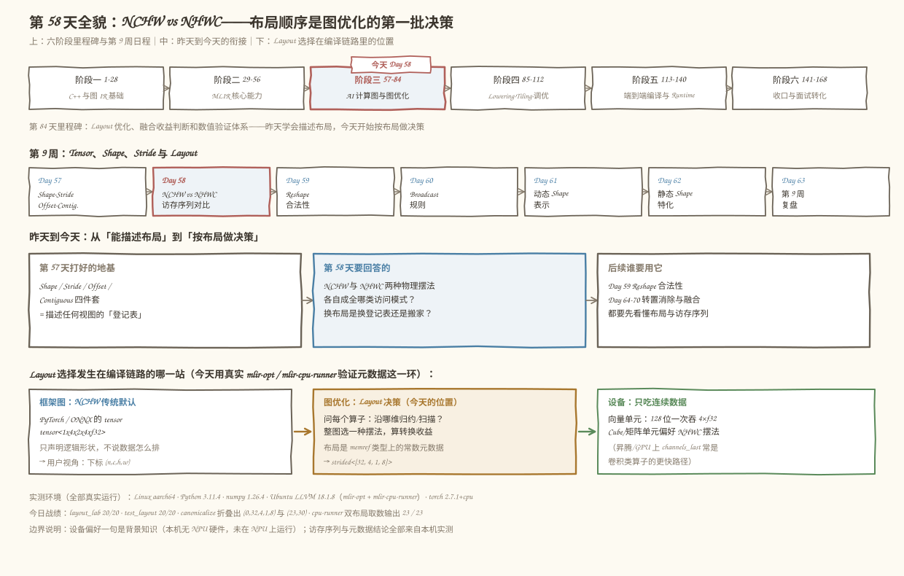
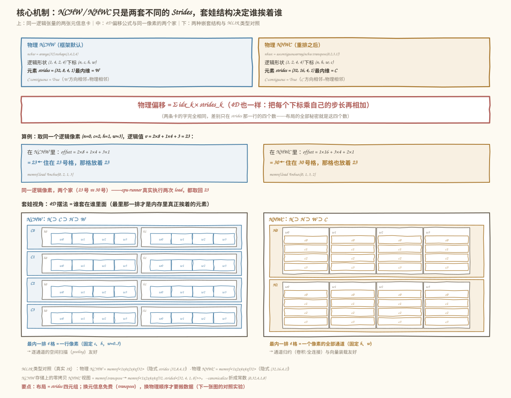
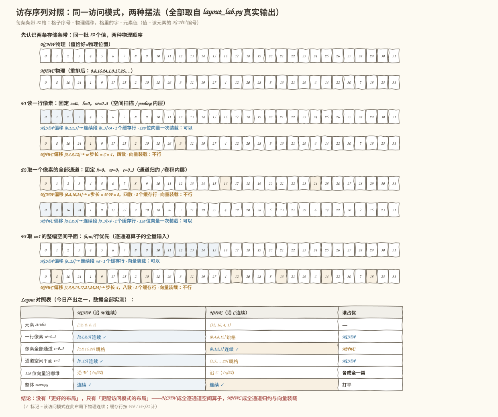
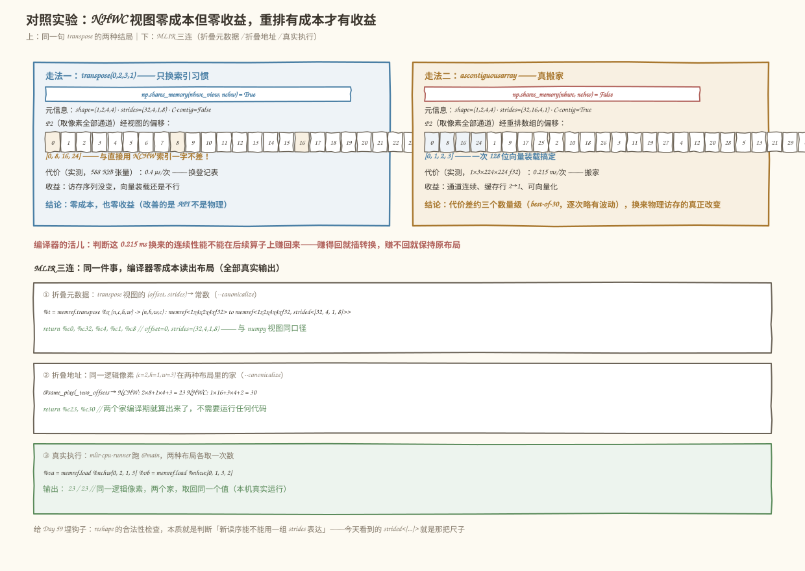

# 第 58 天：NCHW 与 NHWC——同一个张量的两种摆法，编译器替谁排队

> **今日目标**：完成本教程后，你能对一个 4 维 Tensor 说出 NCHW 与 NHWC 各自的元素 Strides、最内维是谁；能手算同一访问模式在两种布局下的物理偏移序列，判断哪边连续、能不能一次 128 位向量装载；能区分"NHWC 逻辑视图（零拷贝）"和"NHWC 物理重排（真搬家）"，并用 `mlir-opt` 亲眼看到编译器把布局元数据折成常数、用 `mlir-cpu-runner` 真实跑通双布局取数。
> **预计时间**：学习 40 分钟＋实践 40 分钟
> **前置准备**：第 57 天的 Shape / Stride / Storage Offset / Contiguous 词汇表；Python 3.10+ 与 numpy（本机 3.11.4 / 1.26.4）；`mlir-opt`（本机为 Ubuntu LLVM 18.1.8，另有 `mlir-cpu-runner` 可真实执行）；torch 可选（本机 2.7.1+cpu）。不需要 NPU。
> **今日产出**：一份 Layout 对照表、一组访存序列实验（`code/layout_lab.py`，20/20 断言通过）、一组独立验收测试（`code/test_layout.py`）、一份 MLIR 双布局示例（解析/折叠/真实执行三连）以及 4 张示意图。

## 1. 今天解决什么问题？

先看一个真实的工程局面。你写的图优化 Pass 收到一张卷积的计算图，后端告诉你："向量单元一次能吞 128 位，也就是 4 个连续的 f32，请让**一个像素的 4 个通道**在内存里挨着。"而框架递过来的 Tensor 是 `1×4×2×4`（NCHW）——通道这个维度在内存里**隔得老远**。你该怎么办？

第一反应可能是"转置一下不就行了"：`x.transpose(0, 2, 3, 1)`，逻辑顺序立刻变成 NHWC。但昨天（Day 57）刚学过——转置只是换登记表，**一格数据都不动**。也就是说：算子从此要按 `(n, h, w, c)` 给下标了（索引习惯变了），可"一个像素的 4 个通道"在物理内存里**还是隔着 8 格**（访存序列一点没变）。要真的让它们挨着，必须把数据搬一次家。

这就是今天要拆的问题：**NCHW 和 NHWC 不是两个"格式标签"，而是同一批数据的两种物理摆法；换标签免费，换摆法要搬家。** 而编译器的职责，就是站在全局 decide：哪些算子该吃哪种摆法、转换值不值、转换能不能和其他算子融合掉。

用一个贯穿全文的小例子（上一天预告的 `1×3×2×2` 放不下向量化故事，我们扩成 `1×4×2×4`——通道数凑成 4 正好一条 128 位向量，宽度凑成 4 让两边有一场公平对比）：

```text
N=1, C=4, H=2, W=4，共 32 个 f32
每个元素的值 = 它的 NCHW 编号 v(c, h, w) = c×8 + h×4 + w

nchw      = np.arange(32).reshape(1, 4, 2, 4)     # 物理 NCHW（框架默认摆法）
nhwc_view = nchw.transpose(0, 2, 3, 1)            # NHWC 逻辑顺序，物理没动（视图）
nhwc      = np.ascontiguousarray(nhwc_view)       # 物理 NHWC（真重排，新内存）
```

预期结果（以下均为本机真实运行，2026-11-12）：打印出三个对象的 Layout 对照表（Strides / 最内维 / 连续性 / 存储归属），再打印四种典型访问模式下两种布局的物理偏移序列——你会亲眼看到：**NCHW 沿 W 连续、NHWC 沿 C 连续，两边各成全一类算子、各牺牲另一类**；转置视图的访存序列与原布局一字不差；只有重排才真正改变物理访存。

## 2. 先看全貌：今天的内容位于哪里？



**图 1**：三栏从上往下看——今天的课程位置、为什么布局顺序是图优化的第一批决策、Layout 选择发生在编译链路的哪一站。

用 4 步把全局串起来：

1. **前 57 天**：阶段一、二打完 C++ 与 MLIR 基础；昨天的 Shape / Stride / Offset / Contiguous 四件套是"描述布局的词汇表"。
2. **今天进入第一场实战**：NCHW 与 NHWC 是工业界真实存在的两种 4D 摆法——PyTorch / ONNX 传统默认 NCHW，TensorFlow、GPU Tensor Core 和昇腾算子偏好 NHWC（PyTorch 里叫 `channels_last`）。词汇表终于要用来回答工程问题了。
3. **决策发生在图优化阶段**：编译器看着计算图问每个算子"你沿哪个维度归约/扫描？"，再决定整图选哪种摆法、在哪插入或消除转换——这正是图 1 最下面那条链路。
4. **判定依据是元数据不是试跑**：今天用 `mlir-opt --canonicalize` 亲眼看到，布局在 IR 里是类型上的常数元数据（`strided<[32, 4, 1, 8]>`），编译器**零成本**就能读出来做决策——这是后面 8 周所有 Layout Pass 的工作方式。

## 3. 核心概念：先用直觉，再给准确定义

先给一个贯穿的类比：**同一栋宿舍楼**（内存），**门牌编号规则**和**住户实际入住顺序**可以不一致。你可以规定"报地址要说 楼-单元-层-房"，但住户完全可能是按姓氏笔画排着住进来的——报地址的顺序（逻辑维序）和实际住的位置（物理 Layout）是两套独立的事。

### 3.1 逻辑维序 vs 物理 Layout

- **一句通俗解释**：逻辑维序是"你按下标叫人的顺序"（NCHW：先给 n，再给 c、h、w）；物理 Layout 是"这些人实际在内存里坐的顺序"。
- **类比**：门牌规则 vs 入住顺序。
- **对应到技术上是**：逻辑维序体现在**下标顺序和 Shape**（形状推理、广播对齐都只看它）；物理 Layout 体现在 **Strides**（每个下标 +1 时物理位置跳几格）。`NCHW/NHWC` 这两个词同时踩在两个概念上——它们既是下标习惯又是摆法——但**两件事可以独立变化**，这正是容易混淆的根源。
- **最小例子**（5.3 节真实输出的两条）：`tx.stride() = (32, 8, 4, 1)` 与 `ty.stride() = (32, 1, 16, 4)`——两个 Tensor 的**逻辑形状都是 `(1,4,2,4)`、下标都是 `(n,c,h,w)`**，物理摆法却一个是 NCHW 一个是 NHWC（torch 的 `channels_last`：逻辑维不动，只换物理）。反过来，`nchw.transpose(0,2,3,1)` 是**逻辑维变成 `(n,h,w,c)` 而物理还是 NCHW** 的视图。四种组合里两种"错位"的都真实存在。
- **常见误解**："把 NCHW 转成 NHWC 就是做个转置"。转置视图只换逻辑标签，物理一格不动（第 5.4 节实验会证明它的访存序列与原来一字不差）；要换物理摆法必须搬家。

### 3.2 两种摆法各自成全谁

- **一句通俗解释**：NCHW 把"同一通道的一行像素"摆在一起；NHWC 把"同一个像素的所有通道"摆在一起。
- **类比**：图书馆排书——按"先科目再书名"排（NCHW），查一个科目的全部藏书很顺，查某个书名在各科目的版本要跑遍全馆；按"先书名再科目"排（NHWC）正好相反。
- **对应到技术上是**（本机实测的访存序列，第 5.3 节）：

| 访问模式 | NCHW | NHWC |
|---|---|---|
| 读一行像素（固定 c、h，变 w）——pooling/空间扫描的内层 | `[0,1,2,3]` 连续 | `[0,4,8,12]` 隔 C 跳 |
| 取一个像素的全部通道（固定 h、w，变 c）——卷积/通道归约的内层 | `[0,8,16,24]` 隔 H·W 跳 | `[0,1,2,3]` 连续 |
| 128 位向量一次装 4×f32 | 沿 W 可以 | 沿 C 可以 |

- **向量化**：向量/SIMD 单元一次读 128 位（4 个连续 f32）。NCHW 沿 W 打包、NHWC 沿 C 打包——**"沿哪维连续"直接决定"沿哪维能向量化"**。
- **数据复用**：卷积算一个输出像素要读 `C×kh×kw` 个输入，NHWC 把 C 挨在一起，同一 patch 的重用窗口更紧凑、缓存行浪费更少；逐通道算子（pooling、BN 的逐通道统计）则反过来，NCHW 一次扫整幅平面。
- **类比边界**：别把结论说成"NCHW 慢、NHWC 快"或"CPU 用 NCHW、GPU 用 NHWC"——真实决定因素是**算子沿哪维归约/扫描**加**设备的内存层次**，同一张图里两类算子都存在，所以这是个全局决策（3.3 节）。

### 3.3 Layout 是编译器的决策，不是用户的负担

- **一句通俗解释**：用户不该手动搬数据；编译器看着整张图决定"数据到底按哪种摆法住"。
- **对应到技术上是**：图优化阶段的 Layout 决策 Pass 做三件事——① 读每个值上的布局元数据（在 MLIR 里就是 memref 类型上的 `strided<[...]>`，**编译期常数，零成本可读**，第 5.4 节用 `--canonicalize` 亲眼验证）；② 问每个算子"你沿哪维归约/扫描"（卷积沿 C、pooling 沿 H×W）；③ 全局权衡后决定：整图选哪种摆法、在哪插入真实转换（重排）、哪些转换可以消除或融合。
- **转换永远有两档代价**：视图档 O(1)（只改元信息，`memref.transpose` / numpy `transpose`）和重排档 O(N)（真搬数据，`ascontiguousarray`）。昨天 view vs copy 的结论在 4D 直接复用——这就是 Day 57 打地基的回报。
- **背景知识（本机无 NPU，未实测，仅作事实背景）**：昇腾 AI Core 的 Cube 矩阵单元按矩阵（分形）方式取数，卷积类算子在昇腾/GPU 上常以 NHWC（PyTorch 叫 `channels_last`）为更快路径，因此框架图的 NCHW 默认摆法到设备之间，通常存在编译器插入的布局转换——"消除不必要的转换"是真实的优化话题（Day 64–70 会专门展开）。

## 4. 图解核心机制

昨天那条偏移公式升到 4 维，一个字都不用改：

```text
物理偏移(n, c, h, w) = Σ idx_k × strides_k      （单位：元素）
```



**图 2**：上半部分是同一逻辑张量的两张"元信息卡"，中间是唯一的公式和一个真实算例，下半部分把两种摆法画成套娃结构。

按图中编号逐步讲：

1. **两张卡只差一行**。`nchw` 与 `nhwc` 的逻辑内容完全相同（32 个值一一对应），Shape 分别是 `(1,4,2,4)` 和 `(1,2,4,4)`，而真正的差别只在 strides 四元组：`(32,8,4,1)` vs `(32,16,4,1)`。**布局的全部秘密就是这四个数**——最内维（stride=1 的那个）是 W 还是 C。
2. **同一个像素，两个家**。取逻辑像素 `(c=2, h=1, w=3)`，逻辑值 `v = 2×8+1×4+3 = 23`。代入两条公式：NCHW 里 `2×8+1×4+3×1 = 23` 号格；NHWC 里 `1×16+3×4+2×1 = 30` 号格。`30` 号格里住的恰好也是 `23`——两个家，同一个住户。第 5.4 节会让 `mlir-cpu-runner` 真的跑两次 load，都取回 23。
3. **套娃结构决定谁挨着谁**。4D 摆法就是"谁套谁"：NCHW 是 N⊃C⊃H⊃W，最里那一排是**一行像素**（固定 c、h 的 4 个 w）；NHWC 是 N⊃H⊃W⊃C，最里那一排是**一个像素的全部通道**。内存里真正挨着的，永远只有最内层那一排——这是"连续性"在 4D 里的直观形态。
4. **MLIR 侧同口径**。物理 NCHW 写作 `memref<1x4x2x4xf32>`（隐式 strides `(32,8,4,1)`）；在它上面做 `memref.transpose (n,c,h,w) -> (n,h,w,c)` 得到零拷贝视图 `memref<1x2x4x4xf32, strided<[32, 4, 1, 8]>>`——注意这是**视图的** strides（c 方向步长 8），不是重排后的 `(32,16,4,1)`。`--canonicalize` 把它折成常数 `(0, 32, 4, 1, 8)`，编译器分文未花就读懂了布局。

## 5. 动手实践：完成一个最小可运行例子

### 5.1 准备文件

```text
tutorials/day-058/
├── README.md
├── images/                    # 4 张示意图（本文图 1–4）
└── code/
    ├── layout_lab.py          # 主实验：对照表 + 访存序列 + 计时 + torch 对照（20 断言）
    ├── test_layout.py         # 独立验收测试（20 个测试点，含 N=2 一般化）
    ├── layout_orders.mlir     # MLIR 双布局示例：解析 / 折叠 / cpu-runner 执行三连
    ├── bad_layout.mlir        # 常见错误现场：Verifier 拒绝的谎报布局
    ├── make_images.py         # 生成 4 张 SVG 的脚本
    ├── run_all.sh             # 一键复跑全部实验并保存真实输出
    └── outputs/               # 已保存的真实输出
```

运行方式（在 `code/` 目录下）：

```bash
bash run_all.sh
```

`run_all.sh` 先打印环境（本机实测：Python 3.11.4、numpy 1.26.4、Ubuntu LLVM 18.1.8 的 `mlir-opt` 与 `mlir-cpu-runner`、Linux aarch64），再依次跑 Python 实验、验收测试、MLIR 解析与折叠、LLVM 降级加真实执行、错误注入。没有 `mlir-opt` 也能跑前两步。

### 5.2 编写代码

完整代码见 `code/layout_lab.py`（可直接运行）。最关键的一个函数和一组数据：

```python
def phys_offsets(a, idxs):
    """地址反查：每个逻辑下标落在 a 自身底层缓冲的第几格（元素）。"""
    base = a.ctypes.data          # 不用 stride 公式自证公式，从地址出发
    out = []
    for idx in idxs:
        addr = base
        for i, s in zip(idx, a.strides):
            addr += i * s         # 按字节逐项累加，再归一化成元素格号
        out.append((addr - base) // a.itemsize)
    return out

patterns = [
    ("P1 读一行像素", [(0, 0, 0, w) for w in range(W)],   # NCHW 下标 (n,c,h,w)
                     [(0, 0, w, 0) for w in range(W)]),   # NHWC 下标 (n,h,w,c)
    ("P2 取一个像素的全部通道", [(0, c, 0, 0) for c in range(C)],
                               [(0, 0, 0, c) for c in range(C)]),
    ("P3 取 c=1 的整幅空间平面", [(0, 1, h, w) for h in range(H) for w in range(W)],
                                 [(0, h, w, 1) for h in range(H) for w in range(W)]),
]
```

两点设计意图：

- **访问模式与布局解耦**：每个 pattern 给出**同一逻辑访问**在两种布局下的两套下标写法（NCHW 按 `(n,c,h,w)`，NHWC 按 `(n,h,w,c)`），再各自算物理偏移——这样比出来的才是"同一件事的两种物理代价"，而不是两件不同的事。
- **地址反查而不是公式代入**：`phys_offsets` 沿用第 57 天的交叉验证思路，从 `ctypes` 地址出发累加，让"stride 公式"和"真实地址"两条路互相对账；`runs()` 再把偏移序列切成连续段，`cache_lines()` 数触碰的 64 字节缓存行——"能不能一次向量装载"就有了机械可判的口径（连续段 ≥ 4）。

MLIR 侧（`code/layout_orders.mlir`）的三个角色，关键两处：

```mlir
// NCHW 存储上的零拷贝 NHWC 视图：结果 strides 必须是 (32, 4, 1, 8)
%t = memref.transpose %x (n, c, h, w) -> (n, h, w, c)
  : memref<1x4x2x4xf32> to memref<1x2x4x4xf32, strided<[32, 4, 1, 8]>>

// 同一逻辑像素 (c=2,h=1,w=3)，两种布局各取一次数
%va = memref.load %a[%c0, %c2, %h1, %w3] : memref<1x4x2x4xf32>   // NCHW 下标序
%vb = memref.load %b[%c0, %h1, %w3, %c2] : memref<1x2x4x4xf32>   // NHWC 下标序
```

`@nchw` 与 `@nhwc` 两块 `memref.global constant` 装的是**同一逻辑张量的两种物理摆放**（值都是"元素的 NCHW 编号"，肉眼可核对）。

### 5.3 运行与观察

以下均为**本机真实执行结果**（2026-11-12，Python 3.11.4 / numpy 1.26.4，输出已存 `code/outputs/layout_lab.txt`）。先看 Layout 对照表（今日产出之一）：

```text
=== 2. Layout 对照表（元信息） ===
对象         逻辑形状         元素strides         最内维         C连续    与nchw同存储
nchw      (1, 4, 2, 4)(32, 8, 4, 1)     W (stride 1)True   True
nhwc_view (1, 2, 4, 4)(32, 4, 1, 8)     c (stride 8)False  True
nhwc      (1, 2, 4, 4)(32, 16, 4, 1)    C (stride 1)True   False
注：strides 单位是元素；numpy 的 a.strides 是字节（各 ×4）。
```

再看访存序列（今日产出之二，图 3 就是它的可视化）：

```text
--- P1 读一行像素：固定 c=0,h=0，w=0..3（空间方向扫描） ---
  NCHW: 偏移 [0, 1, 2, 3]
        连续段 [0..3]×4 · 触碰缓存行 1 个 · 128位向量(4×f32)一次装载: 可以
  NHWC: 偏移 [0, 4, 8, 12]
        连续段 [0] [4] [8] [12] · 触碰缓存行 1 个 · 128位向量(4×f32)一次装载: 不行

--- P2 取一个像素的全部通道：固定 h=0,w=0，c=0..3（通道归约） ---
  NCHW: 偏移 [0, 8, 16, 24]
        连续段 [0] [8] [16] [24] · 触碰缓存行 2 个 · 128位向量(4×f32)一次装载: 不行
  NHWC: 偏移 [0, 1, 2, 3]
        连续段 [0..3]×4 · 触碰缓存行 1 个 · 128位向量(4×f32)一次装载: 可以

--- P3 取 c=1 的整幅空间平面：(h,w) 行优先（逐通道 pooling） ---
  NCHW: 偏移 [8, 9, 10, 11, 12, 13, 14, 15]
        连续段 [8..15]×8 · 触碰缓存行 1 个 · 128位向量(4×f32)一次装载: 可以
  NHWC: 偏移 [1, 5, 9, 13, 17, 21, 25, 29]
        连续段 [1] [5] [9] [13] [17] [21] [25] [29] · 触碰缓存行 2 个 · 128位向量(4×f32)一次装载: 不行
```



**图 3**：每条 32 格条带上，格子序号是物理偏移、格里的字是元素值（值 = 该元素的 NCHW 编号）；三种访问模式各自高亮两边的格子。

对着图读三个结论：

1. **P1 和 P2 互为镜像**。NCHW 在 P1 连续、P2 四散；NHWC 正好反过来。这不是巧合：最内维是 W 的摆法当然沿 W 连续，最内维是 C 的摆法当然沿 C 连续——**布局没有好坏，只有和访问模式配不配**。
2. **同一批数据，两种物理顺序**。上面第二条条带的平铺是 `0,8,16,24,1,9,17,25,…`——和第一条完全相同的 32 个值，重排了住法。逻辑上它们是同一个张量（`np.array_equal` 为 True），物理上是两块不同的内存。
3. **P4 整体搬运打平**。两种布局各自整体连续（`0..31` 一口气），所以"纯搬运"（如 DMA 整块拷贝）两边都没差——差别只出现在**沿着某个维度取子集**的时候。

torch 对照（`code/outputs/layout_lab.txt` 第 6 节，真实运行）把这件事和工业界接上了头：

```text
tx.stride() = (32, 8, 4, 1)            # NCHW：(H*W*C, H*W, W, 1)
ty.stride() = (32, 1, 16, 4)     # channels_last：(H*W*C, 1, W*C, C)
numpy 侧等价视图 nhwc.transpose(0,3,1,2) 的元素 strides = (32, 1, 16, 4)
torch.equal(tx, ty) = True · ty 与 tx 不同内存 = True
```

`torch.channels_last` 的逻辑维仍是 `(N,C,H,W)`、strides 却是 `(32,1,16,4)`——与我们重排出的 `nhwc`（逻辑维 `(N,H,W,C)`）是**同一块物理摆法的两种逻辑标签**。物理布局才是本质，这正是 3.1 节的区分在真实框架里的样子。

断言收尾（完整 20 条见 `code/outputs/layout_lab.txt`）：

```text
[PASS] P2 NHWC 序列 == [0,1,2,3]（通道连续→1 次向量装载）
[PASS] 视图零收益：经 nhwc_view 的 P2 序列 == 经 nchw 的 P2 序列
[PASS] torch channels_last 的物理平铺顺序 == numpy 重排 nhwc 的平铺顺序
layout_lab: 20/20 checks passed
```

### 5.4 修改一个参数再观察：同一句 transpose 的两种结局

现在做今天的对照实验：对同一块 NCHW 存储，**先只换逻辑顺序（视图），再真的搬家（重排）**，比较 P2 的物理访存和代价：

```text
=== 4. 视图零成本，但也零收益 ===
同一个 P2（取像素 (h=0,w=0) 的全部通道），三种走法：
  经 nchw       （下标 (n,c,h,w)）: [0, 8, 16, 24]
  经 nhwc_view  （下标 (n,h,w,c)）: [0, 8, 16, 24]
  经 nhwc 重排  （下标 (n,h,w,c)）: [0, 1, 2, 3]

=== 5. 重排有成本，才有收益（真实计时） ===
输入: 1x3x224x224 f32 = 602112 字节（约 588 KiB）
创建零拷贝视图 transpose(0,2,3,1)   :      0.4 µs/次（最优）
真实重排 ascontiguousarray(同一句)  :    0.215 ms/次（最优）
差距约 615 倍——「换登记表」与「搬家」的代价从来不在一个量级
```

（计时为 best-of-30 最优值，逐次运行在 ±5% 内波动；倍数以当次输出为准。）



**图 4**：上半部分左右对照两条走法的元信息、访存序列与实测代价；下半部分是 MLIR 侧的三连验证。

三个层次的结论：

1. **视图零成本、零收益**。`nhwc_view` 让你用 `(n,h,w,c)` 的习惯给下标，但 P2 的物理偏移还是 `[0,8,16,24]`，与直接按 NCHW 索引**一字不差**——转置改善的是 API 不是物理。
2. **重排有成本、有收益**。0.4 µs 与 0.215 ms（约三个数量级）换来 P2 变成 `[0,1,2,3]`：一次 128 位向量装载、缓存行 2→1。编译器的活儿就是判断这笔买卖在后续算子上能不能赚回来。
3. **MLIR 三连**（全部真实输出，已存 `code/outputs/`）：`--canonicalize` 把视图元数据折成 `return %c0, %c32, %c4, %c1, %c8`（offset=0、strides=(32,4,1,8)），把同一像素的两个家折成 `return %c23, %c30`（编译期就算出了两个地址）；`mlir-cpu-runner` 真实执行 `@main`，两次 `memref.load` 各按自己的布局取数，输出：

```text
23
23
```

两个 23——同一逻辑像素、两个物理家、取回同一个值。布局的全部故事（元数据可白读、地址可静态算、取数按各自摆法）在这一行输出里全部落地。

## 6. 常见错误与排查

**错误 1："转置一下不就是 NHWC 了"——换了标签，性能纹丝不动**

- **现象**：把 `x.transpose(0,2,3,1)` 的结果喂给偏好 NHWC 的算子，期待提速，结果 benchmark 几乎没变，甚至更慢（多了一层非连续视图）。
- **原因**：transpose 是零拷贝视图，只换了下标习惯；物理访存序列与原来一字不差（5.4 节实验：P2 经视图仍是 `[0,8,16,24]`）。
- **定位**：两行判定：`np.shares_memory(view, x)`（True 说明没搬家）＋把访问模式的偏移序列打出来对拍。
- **修复**：需要物理连续就显式 `np.ascontiguousarray`（或 torch 的 `.contiguous(memory_format=torch.channels_last)`），把隐式行为变成显式语句；写编译 Pass 时，把"插入 transpose"和"插入真实重排"当成两档不同代价的决策。

**错误 2：在 MLIR 里把重排后的布局谎报成转置视图的布局**

- **现象**：`mlir-opt` 直接拒绝整张 IR（真实输出，`code/outputs/bad_layout.txt`）：

  ```text
  bad_layout.mlir:12:10: error: 'memref.transpose' op result type
  'memref<1x2x4x4xf32, strided<[32, 16, 4, 1]>>' is not equivalent to the
  canonical transposed input type 'memref<1x2x4x4xf32, affine_map<(d0, d1, d2, d3)
  -> (d0 * 32 + d1 * 4 + d2 + d3 * 8)>>'
  ```

- **原因**：`strided<[32,16,4,1]>` 是数据**搬过家**之后的 strides；在 NCHW 存储上做 transpose，唯一合法的结果是 `strided<[32,4,1,8]>`。元信息可以免费置换，但必须自洽——Verifier 按 `d0*32 + d1*4 + d2*1 + d3*8` 这条仿射映射逐项核对。
- **定位**：报错把期望的仿射映射整个打了出来，对照着改 strides 即可。
- **修复**：想要 `(32,16,4,1)` 就得走真实重排（先物化一块新存储）；想保留视图就写 `(32,4,1,8)`。**这条报错是好事**：它保证了布局元数据永远可信，后面的 Pass 才敢零成本读它做决策。

**错误 3：拿 torch 的 strides 和 numpy 的 strides 直接比，得出"布局不一致"**

- **现象**：`ty.stride() = (32, 1, 16, 4)`，而 `nhwc.strides` 换算成元素是 `(32, 16, 4, 1)`——顺序看起来完全不同，误判成两种布局。
- **原因**：两件事叠加。① torch 的 `channels_last` 逻辑维仍是 `(N,C,H,W)`（strides 按 C 在第 1 维报），我们的 `nhwc` 逻辑维是 `(N,H,W,C)`（strides 按 C 在最后一维报）——**同一块物理摆法的两种逻辑标签**；② numpy 的 `strides` 以字节计，torch 以元素计。
- **定位**：统一口径再比：`nhwc.transpose(0,3,1,2)` 的元素 strides 是 `(32,1,16,4)`，与 `ty.stride()` 逐数一致；物理平铺顺序逐元素相等（`layout_lab.py` 的最后两条断言钉死了这一点）。
- **修复**：比较布局时先问三个问题——逻辑维序是什么？strides 单位是什么？和谁比？把这三个对齐，"不一致"大多会消失。

**错误 4：把"NCHW 慢、NHWC 快"当成铁律**

- **现象**：全图无脑转 channels_last，结果 pooling / 逐通道统计类算子反而变慢。
- **原因**：P3 已经给出反例：逐通道的空间平面在 NCHW 下连续 `[8..15]`（1 个缓存行），在 NHWC 下步长 4 八散（2 个缓存行）。**速度属于"布局 × 访问模式"的组合，不属于布局本身**。
- **定位**：对每个算子问一句"内层循环沿哪个维度走"，再查该维的 stride 是不是 1——这正是 5.2 节 `patterns` 干的事。
- **修复**：按访问模式分类决策（卷积/通道归约 → NHWC 占优；空间扫描/逐通道 → NCHW 占优），整图权衡转换成本；这也是真实编译器 Layout Pass 的思路，而不是给用户一个全局开关就完事。

## 7. 今日练习

### 必做练习

把例子从 `C=4, W=4` 换成 `C=8, W=3`（`test_layout.py` 里 `build(1, 4, 2, 4)` 改成 `build(1, 8, 2, 3)`），**先手算再验证**：

1. 写出两种布局的元素 strides（提示：NCHW 是 `(C·H·W, H·W, W, 1)`，NHWC 是 `(H·W·C, W·C, C, 1)`；预期 `(48, 6, 3, 1)` 和 `(48, 24, 8, 1)`）；
2. 手算 P2（取像素全部通道，c=0..7）在两种布局下的偏移序列（一边是 `0,6,12,…,42`，一边是 `0..7`）；
3. 手算 P1（读一行像素，w=0..2）在 NCHW 下的连续段长度——是 3。注意它**不足 4**：128 位向量装载还能不能一次装下？由此体会"C 和 W 至少一个凑够向量宽度"为什么是真实的工程约束；
4. 运行验证：给 `test_layout.py` 加两三条断言，预期产出新的 `[PASS]`，总数从 20/20 涨上去。

### 选做挑战

把 `layout_orders.mlir` 里 `@same_pixel_two_offsets` 的像素换成 `(c=1, h=0, w=2)`：

1. 先手算两个家：NCHW 里 `1×8 + 0×4 + 2×1 = 10`，NHWC 里 `0×16 + 2×4 + 1×1 = 9`；
2. 改跑 `mlir-opt --canonicalize`，看折叠出的 `%c10, %c9` 和手算对不对；
3. 再想一个退化情形：`H=W=1` 时两种布局的 strides 各是多少？此时"两种布局"还有实质区别吗？（提示：回想第 57 天"大小为 1 的维度不施加约束"——只有最内维的 stride=1 才有约束力。）

## 8. 今日验收

- [ ] 我能用自己的话说清"逻辑维序"和"物理 Layout"各自指什么，并举出逻辑维是 NHWC 而物理是 NCHW（transpose 视图）、逻辑维是 NCHW 而物理是 NHWC（channels_last）两个"错位"实例；
- [ ] 我能手算 `(1,4,2,4)` 张量在两种布局下的元素 strides（(32,8,4,1) 与 (32,16,4,1)），以及 P1/P2 的偏移序列（[0,1,2,3]/[0,4,8,12] 与 [0,8,16,24]/[0,1,2,3]），和程序输出对上；
- [ ] 我能独立运行 `bash code/run_all.sh`，复现 20/20 + 20/20 通过、canonicalize 折叠出 (0,32,4,1,8) 与 (23,30)、cpu-runner 输出两个 23；
- [ ] 我能预测"转置视图"和"真实重排"对访存序列的不同影响，并用 `np.shares_memory` 与偏移序列对拍验证；
- [ ] 我能定位"Verifier 拒绝谎报布局"这类错误，并说出视图 strides (32,4,1,8) 与重排 strides (32,16,4,1) 的区别；
- [ ] 我保存了 Layout 对照表、访存序列实验、验收测试、MLIR 三连示例、错误现场和 4 张示意图（`tutorials/day-058/`）。

## 9. 一句话总结与明天预告

今天的问题始于"算子要的连续方向和数据的摆放方向对不上"。机制上，NCHW 与 NHWC 只是同一逻辑张量的两套 Strides（(32,8,4,1) vs (32,16,4,1)），谁挨着谁由最内维决定，换元信息免费、换物理要搬家；实践中，我们用同一批 32 个值构造了两种摆法，打印了三种访问模式的偏移序列，看到两边各成全一类算子（NCHW 成全空间扫描、NHWC 成全通道归约与向量装载），并用真实计时把"视图 0.4 µs / 重排 0.215 ms"的代价差钉在纸面上；MLIR 侧则三连验证了布局作为编译期常量元数据的全部待遇——元数据可折叠、地址可静态算、取数可真实执行。产出是一张 Layout 对照表和一组可直接复用的访存序列分析方法。

明天（Day 59）把这些结论收进一个具体机制：Reshape 的合法性——什么时候只是改元信息、什么时候必须搬家，判定的钥匙就是今天反复出现的那把尺子：`strided<[...]>` 能不能表达新的读序。
