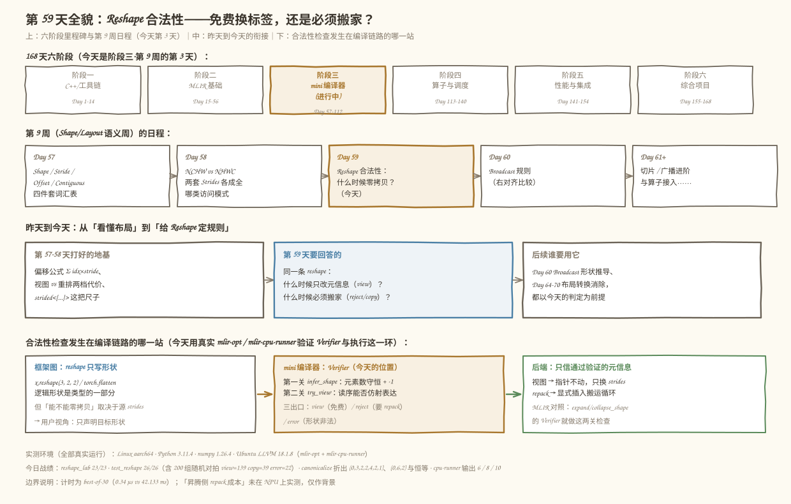
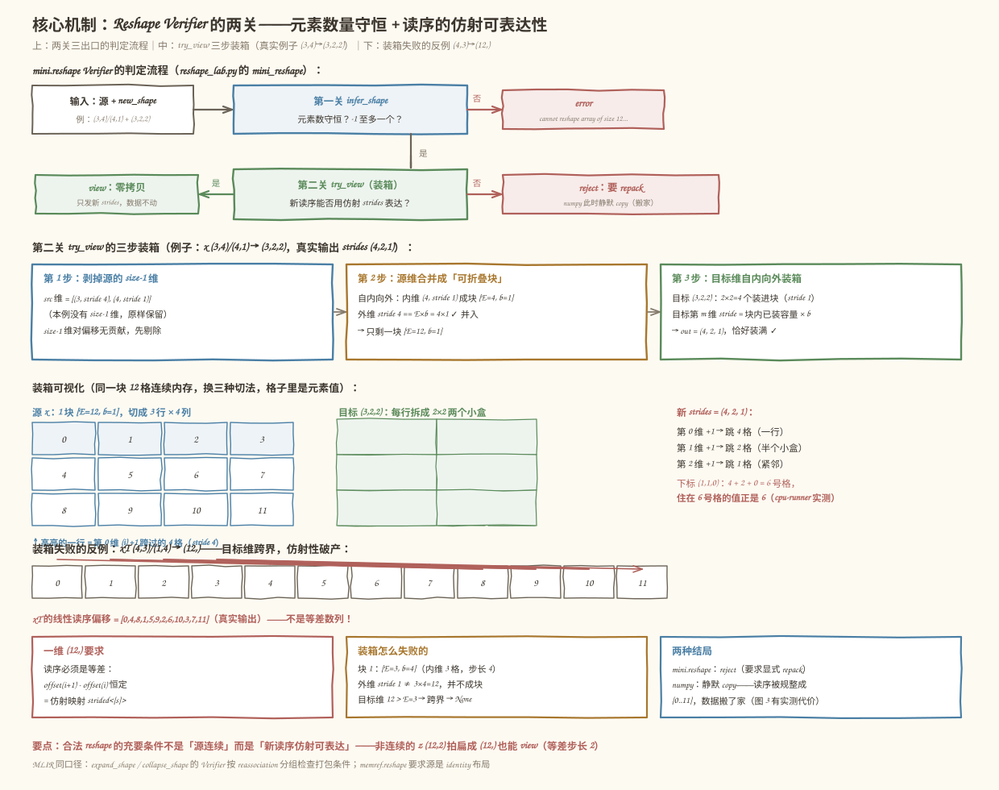
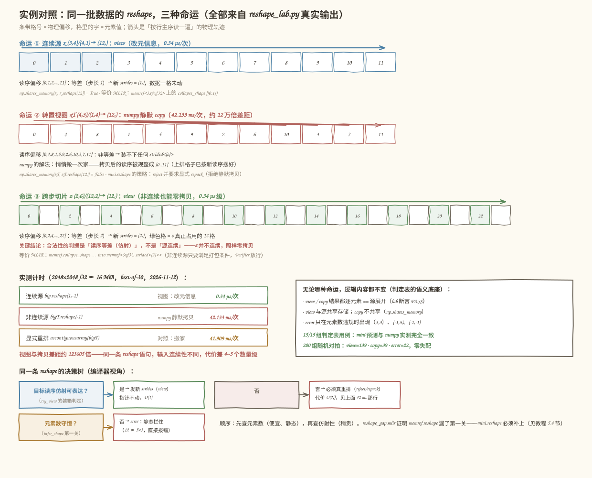
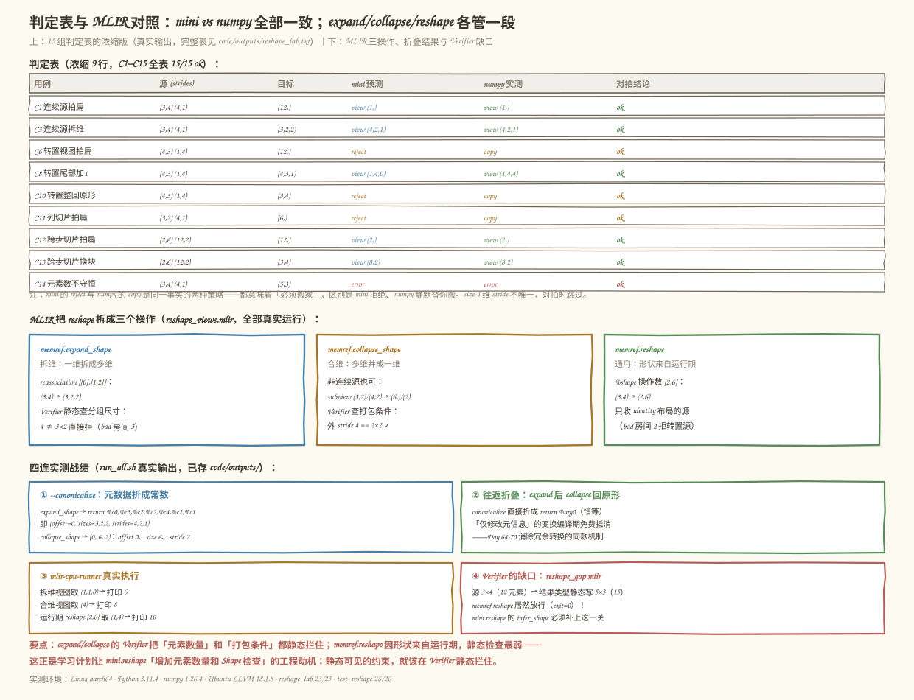

# 第 59 天：Reshape 合法性——免费换标签，还是必须搬家

> **今日目标**：完成本教程后，你能为任意一对「源形状/strides + 目标形状」判断 reshape 的三种结局（view / 需要重排 / 形状非法）；能说清判定钥匙不是「源连续」而是「新读序能否用仿射 strides 表达」；能手算装箱算法给出的新 strides；并能在 MLIR 里用 `expand_shape` / `collapse_shape` / `reshape` 写出合法视图，亲眼看到 `--canonicalize` 把元数据折成常数、`mlir-cpu-runner` 真实取数。
> **预计时间**：学习 40 分钟＋实践 45 分钟
> **前置准备**：第 57 天的 Shape / Stride / Storage Offset / Contiguous 词汇表；第 58 天的偏移公式 `Σ idx×stride` 与「视图 vs 重排」两档代价；Python 3.10+ 与 numpy（本机 3.11.4 / 1.26.4）；`mlir-opt`（本机为 Ubuntu LLVM 18.1.8，另有 `mlir-cpu-runner` 可真实执行）。不需要 NPU。
> **今日产出**：一个 Reshape Verifier（`code/reshape_lab.py`，23/23 断言通过，含 15 组判定表与 200 组随机对拍）、一组独立验收测试（`code/test_reshape.py`，26/26 通过）、一份 MLIR 三操作示例（解析/折叠/真实执行三连）、两个 Verifier 现场文件（合法被拒 + 非法放行的缺口）以及 4 张示意图。

## 1. 今天解决什么问题？

先看一个真实的性能事故。推理图里有一步 `flatten`：把 `(2048, 2048)` 的特征图变成一维向量喂给全连接层。同一行代码，两个来源，命运完全不同——来源是卷积直接输出的连续张量时，这步**快到测不出**（本机实测 0.34 µs）；来源是 `x.T` 之类的转置视图时，这步**悄悄花了 42 ms**（本机实测，best-of-30）。同一条 reshape 语句，代价差了 4~5 个数量级，而 numpy 不会给你任何警告——它静默拷贝了 16 MiB 数据。

为什么？因为 reshape 想做到「零拷贝」，有个隐藏前提：**新形状的读序必须还能用「每维一个步长」的仿射映射表达**。连续数组拍扁成 `(12,)`，读序是 `0,1,2,...,11`，步长 1，装得下；转置视图拍扁，读序是 `0,4,8,1,5,9,...`，根本不是等差数列，任何 `strided<[s]>` 都装不下——只能搬家。

这就是今天的核心问题：**Reshape 的合法性不是「形状对得上」一件事，而是两件事——元素数量必须守恒（否则直接非法），读序必须仿射可表达（否则必须 repack）。** 你在给 mini 编译器写 Verifier（编译期合法性检查器）时，这两关都必须显式拦住：第一关漏了，非法形状会留到运行期越界读内存；第二关判错，要么白搬一次家，要么把非仿射视图谎报成零拷贝、算出错误地址。

MLIR 侧也有一场现成的对照：`memref.expand_shape` / `collapse_shape` 的 Verifier 会静态检查打包条件（做得很对），但 `memref.reshape` 对「静态可见的元素数违规」居然放行（本机实测，exit=0）——这正是学习计划点名要 mini.reshape「增加元素数量和 Shape 检查」的工程动机。

用一个贯穿全文的小例子（12 个元素，值 = 逻辑行主序编号，肉眼可核对）：

```text
x   = np.arange(12).reshape(3, 4)           # 连续基座  (3,4)   strides (4,1)
xT  = x.T                                    # 转置视图  (4,3)   strides (1,4)
col = x[:, :2]                               # 列切片    (3,2)   strides (4,1)
z   = np.arange(24).reshape(2, 12)[:, ::2]   # 跨步切片  (2,6)   strides (12,2)
```

对这四个对象各执行一次 `reshape(12)`，预期三种结局（本机真实运行）：`x` 得到零拷贝视图；`xT` 与 `col` 的读序非等差、无法仿射表达，numpy 静默拷贝（mini.reshape 判 reject）；`z` 虽然不连续，但读序是步长 2 的等差数列，照样零拷贝——这就是「判据是仿射性不是连续性」的最小反例集。

## 2. 先看全貌：今天的内容位于哪里？



**图 1**：三栏从上往下看——今天的课程位置（阶段三·第 9 周第 3 天）、昨天到今天的衔接、合法性检查发生在编译链路的哪一站。

用 4 步把全局串起来：

1. **前 58 天**：阶段一、二打完 C++ 与 MLIR 基础；第 57 天的四件套给了描述任何视图的「登记表」，第 58 天用 NCHW/NHWC 验证了「换元信息免费、换物理要搬家」。
2. **今天把结论收进一个具体机制**：Reshape 什么时候只是改登记表（view）、什么时候必须搬家（reject/repack）、什么时候根本非法（error）。这是 mini 编译器里 Shape 推导之后紧接着的一关。
3. **决策发生在 Verifier，依据是元数据不是试跑**：源 strides 在 IR 里是编译期常数（`strided<[...]>`），两关检查全部静态完成——今天用 `mlir-opt --canonicalize` 亲眼看到视图元数据被折成常数 `(0,3,2,2,4,2,1)`。
4. **后续都站在这关之上**：明天（Day 60）Broadcast 的形状推导要复用今天的 `infer_shape` 思路；Day 64–70 的布局转换消除，判定的正是「哪些 reshape/transpose 链可以免费抵消」（今天的 roundtrip 实验已给出预演：expand 后 collapse 被 canonicalize 折成恒等）。

## 3. 核心概念：先用直觉，再给准确定义

先给一个贯穿的类比：**reshape 像重新划停车位**。停车场（内存）里 12 辆车一辆没动，管理员（编译器）只想换一种编号规则——「按排报号」改成「按区报号」。规则换得了，前提是**新编号在旧车场上仍然规整**（每跨一个区，多走固定的步数）；要是新规则要求「报号每 +1 就跳到隔壁排」，车位根本对不上，只能把车真挪一遍。

### 3.1 第一关：元素数量守恒（infer_shape）

- **一句通俗解释**：reshape 只许「换分组方式」，不许「变出或变没元素」——12 个元素的目标形状，各维乘积必须还是 12。
- **类比**：重新装箱可以改变每箱几个、装几箱，但苹果总数不能变。
- **对应到技术上是**：`math.prod(new_shape) == numel` 必须成立；目标形状里的 `-1` 表示「这一维我自己算」，规则是 `-1` 至多出现一次，且其余维的乘积必须**整除**元素总数。三条违规各有专属报错（与 numpy 同口径，真实输出）：

  ```text
  (5,3)   → error: cannot reshape array of size 12 into shape (5, 3)
  (-1,5)  → error: cannot reshape array of size 12 into shape (-1, 5)   # 12 % 5 != 0
  (-1,-1) → error: can only specify one unknown dimension
  ```

- **最小例子**：`(3,4)` 有 12 个元素，`(-1,2)` 推出 `(6,2)`，`(2,-1)` 推出 `(2,6)`。
- **常见误解**：「Verifier 反正会拦」。本机实测（LLVM 18.1.8）`memref.reshape` 对静态可见的 `3×4 → 5×3` **放行**（`code/reshape_gap.mlir`，exit=0）——真形状来自运行期 `%shape` 操作数，类型里的 `5x3` 只是声明。静态可见的约束要静态拦，这正是 mini.reshape 要补的课。

### 3.2 第二关：读序的仿射可表达性（try_view）

- **一句通俗解释**：把源张量按行主序**从头读一遍**，记下每个逻辑位置落在物理内存的第几格（读序偏移）；零拷贝 reshape 成立的充要条件是——**新形状下这条读序仍然能写成「每维一个固定步长」的仿射映射**。
- **类比**：重新划车位后，「报号 +1 多走几步」必须是个固定数；一会儿跳 3 步一会儿跳 1 步的规则，车场装不下。
- **对应到技术上是**：寻找一组新 strides，使 `物理偏移 = Σ new_idx_k × strides_k` 对所有下标成立。一维目标是特例：读序必须是**等差数列**。本机实测的三个读序（第 58 天 `phys_offset` 的地址反查法，`np.ndindex` 行主序枚举）：

  | 对象 | 读序偏移 | 等差？ | `(12,)` 结局 |
  |---|---|---|---|
  | `x` `(3,4)/(4,1)` | `[0,1,2,...,11]` | 是（步长 1） | view，新 strides `(1,)` |
  | `xT` `(4,3)/(1,4)` | `[0,4,8,1,5,9,2,6,10,3,7,11]` | **否** | 必须搬家 |
  | `z` `(2,6)/(12,2)` | `[0,2,4,...,22]` | 是（步长 2） | view，新 strides `(2,)` |

- **最小例子**：`z` 是关键反例——它**不连续**（`C_CONTIGUOUS=False`），但读序等差，`strided<[2]>` 装得下，照样零拷贝。**判据是仿射性，不是连续性**；连续只是「步长 1 的特例」。
- **常见误解/类比边界**：「源连续才能 view」对一维目标恰好大致成立，但对多维目标连方向都不对——反过来，「源不连续就不能 view」被 `z` 直接证伪。正确的心智模型永远是：**问新读序，不问源连续**。

### 3.3 三种结局与两种策略

- **一句通俗解释**：Verdict 只可能有三种——`view`（免费）、`reject`（要搬家）、`error`（非法）。
- **对应到技术上是**：`view` 返回新 strides，指针不动，O(1)；`reject` 表示零拷贝不可表达，需要真实重排（O(N)）；`error` 表示形状本身非法。**mini.reshape 与 numpy 对 `reject` 的策略不同**：numpy 静默拷贝（用户无感但付钱），mini.reshape 显式拒绝并要求调用方写 repack（编译器把隐式行为变成显式决策）。判定表对拍时，mini 的 `reject` 与 numpy 的 `copy` 记作「同一事实的两种处理」。

## 4. 图解核心机制

两关的完整流程和装箱算法如图 2：



**图 2**：上半部分是判定流程（两关、三出口）；中间用 `(3,4)→(3,2,2)` 的真实例子演示装箱三步；下半部分是装箱失败的反例 `(4,3)→(12,)`。

按图中编号逐步讲：

1. **第一关便宜，先做**。`infer_shape` 只看数字，任何情况下都该在解析/验证期完成（`reshape_gap.mlir` 证明 MLIR 的 `memref.reshape` 漏了它）。
2. **第二关是一个三步「装箱」算法**（numpy 同款思路，`reshape_lab.py` 的 `try_view`）：
   - **剥 size-1 维**：对偏移无贡献，先剔除（这就是 `(1,12)` 这种「加壳」reshape 永远免费的原因）；
   - **源维合并成可折叠块**：自内向外，相邻两维满足「外维步长 == 内维容量 × 内维步长」（内维在内存里打包紧贴）就并成一块。`(3,4)/(4,1)`：内维 `(4,1)` 成块 `[E=4, b=1]`，外维步长 4 == 4×1，并入 → 只剩一块 `[E=12, b=1]`；
   - **目标维自内向外装箱**：每块必须被连续的目标维**恰好填满**，目标第 m 维的 stride = 块内更内层目标容量连乘 × 块内步长。`(3,2,2)`：最内 `2×2=4` 个装进块（stride 1），得 `out = (4, 2, 1)`，恰好装满——零拷贝成立。
3. **反例怎么失败**：`(4,3)/(1,4)` 自内向外成块 `[E=3, b=4]`（内维 3 格、步长 4），外维步长 1 ≠ 3×4=12 并不进来；目标维 12 > E=3，**跨界** → 返回 `None` → reject。读序 `[0,4,8,1,5,9,...]` 不是等差数列，就是这次失败的肉眼证据。
4. **拆维永远免费**：装箱只要求「恰好填满」，把一个维拆碎（`(4,3)→(4,3,1)`、`(4,1,3)`）从不跨界——所以「加 1」操作全部 view（判定表 C8/C9，mini 给 `(1,4,0)` 与 `(1,0,4)`，numpy 实测同为 view，只是 size-1 维的 stride 取值不同，对拍时跳过）。

## 5. 动手实践：完成一个最小可运行例子

### 5.1 准备文件

```text
tutorials/day-059/
├── README.md
├── images/                    # 4 张示意图（本文图 1–4）
└── code/
    ├── reshape_lab.py         # 主实验：mini.reshape Verifier + 判定表 + 偏移序列 + 计时（23 断言）
    ├── test_reshape.py        # 独立验收测试（26 个测试点，含 200 组随机对拍）
    ├── reshape_views.mlir     # MLIR 三操作示例：解析 / 折叠 / expand-metadata / cpu-runner 四连
    ├── bad_reshape.mlir       # 错误博物馆：Verifier 应拒的三类非法 reshape
    ├── reshape_gap.mlir       # Verifier 缺口：元素数 12→15 静态可见却放行
    ├── make_images.py         # 生成 4 张 SVG 的脚本
    ├── run_all.sh             # 一键复跑全部实验并保存真实输出
    └── outputs/               # 已保存的真实输出
```

运行方式（在 `code/` 目录下）：

```bash
bash run_all.sh
```

`run_all.sh` 先打印环境（本机实测：Python 3.11.4、numpy 1.26.4、Ubuntu LLVM 18.1.8 的 `mlir-opt` 与 `mlir-cpu-runner`、Linux aarch64），再依次跑 Python 实验、验收测试、MLIR 解析/折叠/展开/真实执行、错误注入、缺口验证。没有 `mlir-opt` 也能跑前两步（Python 侧自包含）。

### 5.2 编写代码

完整代码见 `code/reshape_lab.py`（可直接运行）。今天是两关的核心实现，一个函数一关：

```python
def infer_shape(new_shape, numel: int) -> tuple[int, ...]:
    """第一关：元素数量检查 + -1 推断。失败抛 ValueError（口径与 numpy 一致）。"""
    new_shape = tuple(int(d) for d in new_shape)
    if new_shape.count(-1) > 1:
        raise ValueError("can only specify one unknown dimension")
    if -1 in new_shape:
        known = math.prod(d for d in new_shape if d != -1)
        if known == 0 or numel % known != 0:
            raise ValueError(
                f"cannot reshape array of size {numel} into shape {new_shape}")
        return tuple(numel // known if d == -1 else d for d in new_shape)
    if math.prod(new_shape) != numel:
        raise ValueError(
            f"cannot reshape array of size {numel} into shape {new_shape}")
    return new_shape


def try_view(shape, strides, new_shape):
    """第二关：装箱判定。返回新 strides（元素单位）；不可表达返回 None。"""
    if math.prod(shape) != math.prod(new_shape):
        return None
    src = [(s, t) for s, t in zip(shape, strides) if s != 1]   # 1) 剥 size-1 维
    groups = []                                                # 2) 合并成可折叠块
    for s, t in reversed(src):
        if groups and t == groups[-1][0] * groups[-1][1]:
            groups[-1][0] *= s          # 外维步长 == 内维容量×内维步长 → 并入
        else:
            groups.append([s, t])
    out = [None] * len(new_shape)                              # 3) 目标维装箱
    g = E = b = 0
    packed = 1
    for j in range(len(new_shape) - 1, -1, -1):
        d = new_shape[j]
        if d == 1:
            out[j] = 0
            continue
        if E == 0:
            if g >= len(groups):
                return None
            E, b = groups[g]
            packed = 1
        if packed * d > E:
            return None                 # 目标维跨界：仿射性破产
        out[j] = packed * b
        packed *= d
        if packed == E:                 # 恰好装满，换下一块
            g += 1
            E = 0
            packed = 1
    if E != 0:
        return None                     # 块没被恰好装满
    return tuple(out)


def mini_reshape(src: np.ndarray, new_shape):
    """完整 Verifier：返回 ('error', msg) / ('view', strides) / ('reject', 原因)。"""
    try:
        full = infer_shape(new_shape, src.size)
    except ValueError as e:
        return "error", str(e)
    st = try_view(tuple(src.shape), estrides(src), full)
    if st is None:
        return "reject", "目标读序无法用仿射 strides 表达，需要真实重排"
    return "view", st
```

（`reshape_lab.py` 里 `E` 用 `None` 哨兵、注释更细；上面为紧凑版，语义一致。）

三点设计意图：

- **报错口径与 numpy 完全一致**：`infer_shape` 的三条消息逐字抄自 numpy 的 `ValueError`（判定表 C14/C15 对拍的就是这两边），读者拿报错信息就能和真实框架互相印证。
- **装箱是 numpy 同款思路**：从最内维往外的贪心装箱，`try_view` 的三步对应图 2 的中间一排；它不是本文独创，好处是判定结果可以和 numpy 逐 strides 对拍（跳过 size-1 维）。
- **裁判独立**：`numpy_actual` 用 `np.shares_memory` 判 view/copy，与 mini 的预测**互不引用**——对拍才有意义（test_reshape.py 的 C 段把它扩成 200 组随机对拍）。

MLIR 侧（`code/reshape_views.mlir`）三个函数各演示一种合法姿态，关键两处：

```mlir
// 拆维视图：(3,4) → (3,2,2)，reassociation [[0],[1,2]]：源第 1 维(大小4)拆成 2×2
%e = memref.expand_shape %g [[0], [1, 2]]
  : memref<3x4xf32> into memref<3x2x2xf32>

// 合维视图：非连续源也能合——subview (3,2)/(4,2) 上打包条件成立
%c = memref.collapse_shape %s [[0, 1]]
  : memref<3x2xf32, strided<[4, 2]>> into memref<6xf32, strided<[2]>>
```

`@main` 里再用运行期 `%shape = [2,6]` 走一遍通用 `memref.reshape`，三种视图上各 `memref.load` 一个数，交给 `mlir-cpu-runner` 打印。

### 5.3 运行与观察

以下均为**本机真实执行结果**（2026-11-12，Python 3.11.4 / numpy 1.26.4 / LLVM 18.1.8，输出已存 `code/outputs/`）。先看四个对象的元信息与读序：

```text
=== 1. 贯穿例子：同一批数据的四种身份 ===
对象           逻辑形状    元素strides   连续    线性读序的前几个物理偏移
x   连续基座       (3, 4)        (4, 1)   True   [0, 1, 2, 3, 4, 5] ...
xT  转置视图       (4, 3)        (1, 4)  False   [0, 4, 8, 1, 5, 9] ...
col 列切片        (3, 2)        (4, 1)  False   [0, 1, 4, 5, 8, 9] ...
z   跨步切片       (2, 6)       (12, 2)  False   [0, 2, 4, 6, 8, 10] ...
```

再看判定表（今日产出之一，15/15 对拍一致，完整表见 `code/outputs/reshape_lab.txt`）：

```text
=== 3. 判定表：mini.reshape 预测 vs numpy 实测 ===
用例                 源(strides)          目标        mini预测        numpy实测        对拍
C1  连续源拍扁           (3, 4)     (4, 1)      (12,)   view (1,)      view (1,)      ok
C3  连续源拆维           (3, 4)     (4, 1)   (3, 2, 2)   view (4, 2, 1) view (4, 2, 1) ok
C6  转置视图拍扁          (4, 3)     (1, 4)      (12,)   reject         copy           ok
C10 转置视图整回(3,4)     (4, 3)     (1, 4)     (3, 4)   reject         copy           ok
C12 跨步切片拍扁          (2, 6)    (12, 2)      (12,)   view (2,)      view (2,)      ok
C13 跨步切片换块          (2, 6)    (12, 2)     (3, 4)   view (8, 2)    view (8, 2)    ok
C14 元素数不守恒          (3, 4)     (4, 1)     (5, 3)   error          error          ok
[PASS] 15/15 组用例：mini.reshape 的判定与 numpy 实测完全一致（reject 对应 numpy 的静默 copy）
```

三种命运在物理条带上长什么样，如图 3：



**图 3**：三条命运各配一条物理条带（格号 = 物理偏移，格里的字 = 元素值，箭头 = 行主序读一遍的轨迹），下半部分是真实计时与编译器决策树。

对着图读三个结论：

1. **命运 ①（view）**：`x.reshape(12)` 的读序 `[0..11]` 与源一字不差，新 strides `(1,)`，指针没动。
2. **命运 ②（copy/reject）**：`xT.reshape(12)` 的读序 `[0,4,8,1,5,9,...]` 非等差，numpy 悄悄搬了家——拷贝后的读序被规整成 `[0..11]`（条带上的格子已按新读序摆好），16 MiB 输入实测 **42.133 ms**；mini.reshape 在这里判 reject，把「搬家」变成显式决策。
3. **命运 ③（跨步 view）**：`z` 的 24 格底层存储里只占 12 个偶数格，读序 `[0,2,...,22]` 等差，`strided<[2]>` 装得下——**非连续照样零拷贝**，这就是 3.2 节的反例钉在物理条带上的样子。

计时与随机对拍（真实输出）：

```text
=== 5. 同一条 reshape，两种命运（真实计时，best-of-30） ===
输入: 2048x2048 f32 = 16777216 字节（约 16 MiB）
连续源  big.reshape(1,-1)   （视图，改元信息）:      0.34 µs/次
非连续源 bigT.reshape(-1)    （numpy 静默拷贝）:    42.133 ms/次
显式重排 ascontiguousarray(bigT)（对照）      :    41.909 ms/次
视图与拷贝差距约 123605 倍——同一条 reshape 语句，输入连续性不同，代价差 4~5 个数量级
[PASS] reshape 视图零拷贝、静默拷贝语义正确且代价差 >100 倍

reshape_lab: 23/23 checks passed
```

```text
== C. 随机对拍：mini.reshape vs numpy（200 组）==
[PASS] C1 200 组随机用例判定全部一致（view/copy/error 各归其位）
[PASS] C2 三种结局都出现过（view=139 copy=39 error=22）
test_reshape: 26/26 passed
```

（随机源由「随机分解因子 + 随机视图手术（转置/跨步切片/插 size-1 维）」生成，种子 59，可复现。）

### 5.4 修改一个参数再观察：MLIR 三连与 Verifier 的缺口

现在做今天的对照实验：同一份 `reshape_views.mlir`，换四种方式「运行」，看编译器对元信息的全部待遇（真实输出，已存 `code/outputs/`）：

```text
== 4. --canonicalize：reshape 元数据折叠成常数 ==
func.func @expand_metadata() -> ... {
  return %c0, %c3, %c2, %c2, %c4, %c2, %c1    // (offset, sizes=3,2,2, strides=4,2,1)
}
func.func @collapse_metadata() -> ... {
  return %c0, %c6, %c2                          // (offset=0, size=6, stride=2)
}
func.func @roundtrip(%arg0: memref<3x4xf32>) -> memref<3x4xf32> {
  return %arg0                                  // expand 后 collapse 被折成恒等！
}

== 6. 降级到 LLVM 并用 mlir-cpu-runner 真实执行 ==
6        // 拆维视图 (3,2,2) 下标 (1,1,0)：4+2+0 = 6 号格，值 6
8        // 合维视图 (6,) 下标 4：4×2 = 8 号格，值 8
10       // 运行期 reshape [2,6] 下标 (1,4)：flat 10，值 10

== 7. bad_reshape.mlir：Verifier 应拒绝（退出码 1）==
bad_reshape.mlir:16:8: error: 'memref.collapse_shape' op invalid source layout
  map or collapsing non-contiguous dims

== 8. reshape_gap.mlir：静态元素数 12 != 15，Verifier 居然放行 ==
通过验证（exit=0）—— memref.reshape 不静态检查元素数量
```

判定表浓缩版、MLIR 三操作的分工与两个 Verifier 现场，如图 4：



**图 4**：上半部分是 15 组判定表的浓缩（`view` 蓝色 / `reject→copy` 橙色 / `error` 红色）；下半部分是 MLIR 三操作、四连实测战绩和 Verifier 缺口。

三个层次的结论：

1. **元数据是编译期常数，检查零成本**。`--canonicalize` 把 `expand_shape` 的视图折叠成 `(0,3,2,2,4,2,1)`——offset、sizes、strides 全是字面常数，与我们装箱算法手算的 `(4,2,1)` 逐位一致；`collapse_metadata` 折出 `(0,6,2)`，正是 `z` 型跨步视图的 `strided<[2]>`。`--expand-strided-metadata` 则把视图彻底展开成基址 + 偏移运算（`memref.reinterpret_cast` + index 乘加），这就是后端真正消费视图的方式。
2. **「仅修改元信息」的变换可以免费抵消**。`@roundtrip` 里 expand 后 collapse 回原形，canonicalize 直接折成 `return %arg0`——Day 64–70 消除冗余布局转换用的正是这个机制。
3. **Verifier 拦对了什么、漏了什么**。`bad_reshape.mlir` 的三个房间（非连续源合维 / reshape 吃非 identity 源 / 分组尺寸 4≠3×2）全部被静态拒绝，报错文本直指打包条件——这与 `try_view` 的判定完全同口径；但 `reshape_gap.mlir`（`3×4 → 5×3`，静态可见的 12≠15）**通过了**。mini.reshape 的 `infer_shape` 必须补上这一关，而且要放在 try_view 之前（便宜的事先做）。

## 6. 常见错误与排查

**错误 1：「reshape 是廉价操作」——在非连续视图上拍扁，暗中付出 42 ms**

- **现象**：`bigT.reshape(-1)` 塞进数据管线，单测全过（结果数值正确），压测时整条管线凭空多出几十毫秒。
- **原因**：`bigT` 是转置视图，读序 `[0,4,8,1,...]` 非等差，reshape 无法零拷贝，numpy 静默拷贝 16 MiB（本机实测 42.133 ms，与显式 `ascontiguousarray` 的 41.909 ms 同量级——搬家的钱一分没少，只是账单藏起来了）。
- **定位**：一行判定 `np.shares_memory(src, src.reshape(new))`——False 就是搬了家；再打印 `linear_read_offsets(src)` 看读序是否等差。
- **修复**：读序等差但步长不为 1 的（如 `z` 型跨步切片）放心用视图；非仿射的要搬家就**显式**写 repack，把成本摆到台面上；写 Pass 时把「插入 reshape」和「插入重排」当两档代价的决策。

**错误 2：在 MLIR 里对转置视图做 collapse_shape——Verifier 直接拒绝**

- **现象**：`mlir-opt` 拒绝整张 IR（真实输出，`code/outputs/bad_reshape.txt`）：

  ```text
  bad_reshape.mlir:16:8: error: 'memref.collapse_shape' op invalid source layout map
    or collapsing non-contiguous dims
  ```

- **原因**：转置视图 `(4,3) strided<[1,4]>` 的外维步长 1 ≠ 内维容量 3 × 内维步长 4 = 12，打包条件不成立；`(12,)` 要求等差读序，而它的读序是 `[0,4,8,1,5,9,...]`。
- **定位**：报错直指 `invalid source layout map or collapsing non-contiguous dims`——先检查 reassociation 组里最内维是否 stride 最小、外维步长是否等于内维容量连乘。
- **修复**：要么先 `memref.copy` 到连续缓冲再 collapse，要么改走 `linalg.generic` 这类按索引映射读写的算子；**不要**试图谎报结果类型——Verifier 会算出正确的仿射映射逐项核对。

**错误 3：以为「源连续」是零拷贝的判据——漏掉跨步视图，误拒合法优化**

- **现象**：自研 Pass 里写 `if not src.is_contiguous(): insert_repack()`，结果对 `z = big[:, ::2]` 这类等差读序的源白白插了一次重排，benchmark 变慢。
- **原因**：连续是「步长 1」的特例，不是判据本体。`z (2,6)/(12,2)` 不连续，但读序 `[0,2,...,22]` 等差，`strided<[2]>` 完全装得下（判定表 C12：view；MLIR 侧 `collapse_shape … into memref<6xf32, strided<[2]>>` 合法）。
- **定位**：把判据换成 `try_view(shape, strides, new_shape)` 的装箱结果；对一维目标可用快捷问法「读序是否等差」。
- **修复**：删掉连续性检查，改用仿射可表达性判定；size-1 维记得剥掉（它对偏移无贡献，永远免费）。

**错误 4：拿 mini 预测的 strides 和 numpy 逐位硬比——size-1 维上必翻车**

- **现象**：判定表 C8 里 mini 给 `(1,4,0)`，numpy 实测 `(1,4,4)`，误判成算法 bug。
- **原因**：size-1 维的下标恒为 0，`0 × 任何步长 = 0`——它的 stride **不唯一**（0、继承值都合法），两个实现只是选了不同的合法值。
- **定位**：对拍时跳过目标形状里 d==1 的维（`reshape_lab.py` 的 `strides_match` 就是这么写的）。
- **修复**：比较口径改成「非 1 维逐位相等」；工程上更稳的做法是两边都用 `extract_strided_metadata` 取 sizes/strides 再对齐。

## 7. 今日练习

### 必做练习

把贯穿例子扩到 3 维：`y = np.arange(24).reshape(2, 3, 4)`（连续基座，元素 strides `(12, 4, 1)`），**先手算再验证**：

1. 写出 `y.transpose(1, 0, 2)` 的形状与元素 strides（预期 `(3, 2, 4)` 与 `(4, 12, 1)`）；
2. 手算它的线性读序前 5 项（预期 `[0, 1, 2, 3, 12]`——内维连续，跨 j 时跳到 12），并由此判断 `reshape(3, 8)` 能否零拷贝（预期：外维步长 12 ≠ 4×1，块合不上 → 不可表达，这正是 `test_reshape.py` 的 E3/E4 两条断言）；
3. 手算 `y.reshape(2, 12)` 的新 strides（预期装箱：整块 `[E=24, b=1]`，目标 2×12 → `(12, 1)`），跑 `try_view((2,3,4), (12,4,1), (2,12))` 验证；
4. 运行验证：`python3 -c "from reshape_lab import try_view; print(try_view((3,2,4),(4,12,1),(3,8)))"`，预期输出 `None`；把 2 的结论写成一两条新断言加进 `test_reshape.py`，看总数从 26/26 涨上去。

### 选做挑战

给 `bad_reshape.mlir` 的房间 3 做一次「修正」练习：

1. 把 `@expand_wrong_group` 的目标类型从 `3x3x2` 改成 `3x2x2`，先预测 `mlir-opt` 的行为（预期：通过，因为 3×2 = 6？不——源第 1 维是 4，3×2=6 ≠ 4 仍应被拒；再改成 `2x2` 才对）；
2. 跑 `mlir-opt bad_reshape.mlir` 验证预测，注意报错文本 `collapsed dim size (4) must equal reassociation group size` 里的两个数字；
3. 再想一个边界：`expand_shape` 把 `(3,4)` 拆成 `(3,4,1)`（尾部加 1）合法吗？reassociation 该怎么写？和 `try_view` 对 `(3,4,1)` 的判定对照（C8/C9 已给出答案：拆维永远免费）。

## 8. 今日验收

- [ ] 我能用自己的话说清 Reshape 的两关——元素数量守恒（`infer_shape`）与读序仿射可表达性（`try_view` 装箱），以及三出口 view / reject / error 各自的含义；
- [ ] 我能说出「判据是仿射性不是连续性」并举出两侧反例：`z (12,2)` 不连续却能零拷贝（view `(2,)`），`xT (1,4)` 拍扁必须搬家（reject/copy）；
- [ ] 我能手算 `(3,4)/(4,1) → (3,2,2)` 的装箱三步并得出新 strides `(4,2,1)`，和 `--canonicalize` 折叠出的 `(0,3,2,2,4,2,1)` 对上；
- [ ] 我能独立运行 `bash code/run_all.sh`，复现 reshape_lab 23/23、test_reshape 26/26（含 200 组随机对拍 view=139 copy=39 error=22）、cpu-runner 输出 6/8/10；
- [ ] 我能定位三类错误：非连续源合维被 Verifier 拒（`bad_reshape.mlir`）、`memref.reshape` 放行元素数违规（`reshape_gap.mlir` 缺口）、size-1 维 strides 对拍不一致（跳过即可）；
- [ ] 我保存了 Reshape Verifier、验收测试、MLIR 三操作示例、两个错误现场和 4 张示意图（`tutorials/day-059/`）。

## 9. 一句话总结与明天预告

今天的问题始于「同一条 reshape，代价差五个数量级」。机制上，reshape 的合法性是两件事：元素数量守恒（`infer_shape`，静态可查、便宜）与读序的仿射可表达性（`try_view` 三步装箱：剥 size-1 维、合并可折叠块、目标维恰好装满）——判据从来不是「源连续」，`z` 型等差读序的非连续源照样零拷贝，`xT` 型非仿射读序只能搬家；实践中，我们给 mini.reshape 写出了完整 Verifier，15 组判定表加 200 组随机对拍与 numpy 零失配，用真实计时把「0.34 µs 的视图 vs 42.133 ms 的静默拷贝」钉在纸面上；MLIR 侧四连验证了 `expand_shape` / `collapse_shape` / `reshape` 的分工、canonicalize 把视图元数据折成常数 `(0,3,2,2,4,2,1)`、往返变换免费抵消成恒等，也亲眼看到 `memref.reshape` 对静态元素数违规放行的缺口——mini.reshape 必须把第一关补上。

明天（Day 60）从「改自己的形状」转向「两个张量的形状怎么凑到一起」：Broadcast 规则——右对齐比较维度、维度为 1 的扩展与未知维度处理，它的输出 Shape 推导会直接复用今天 `infer_shape` 的校验思路。


