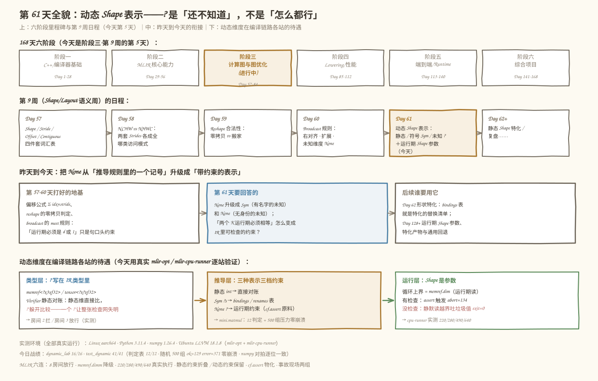
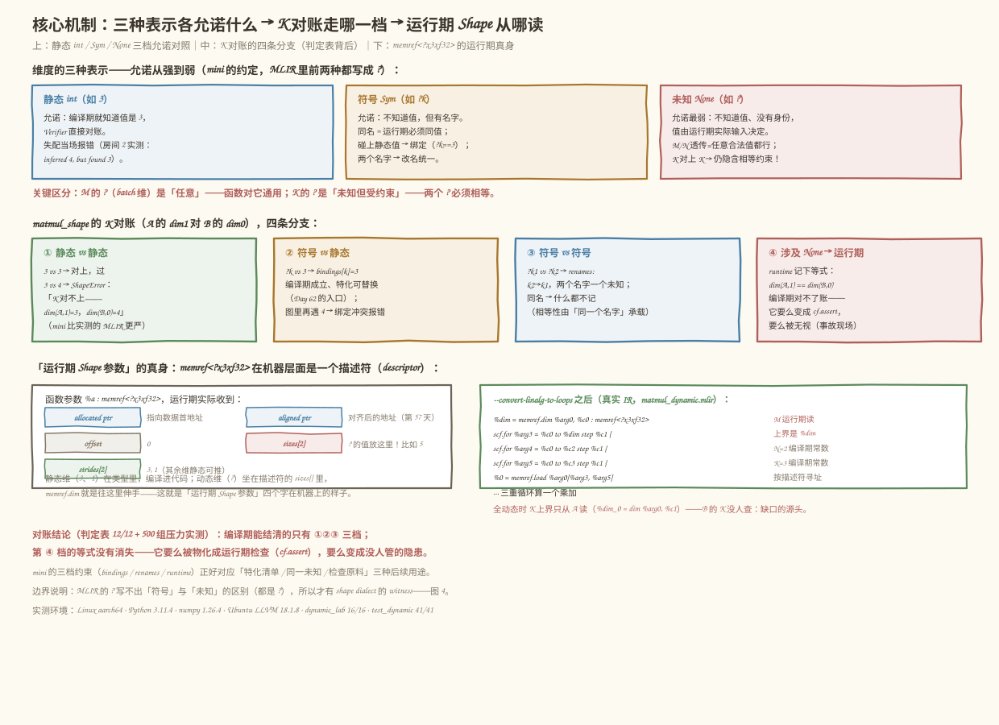
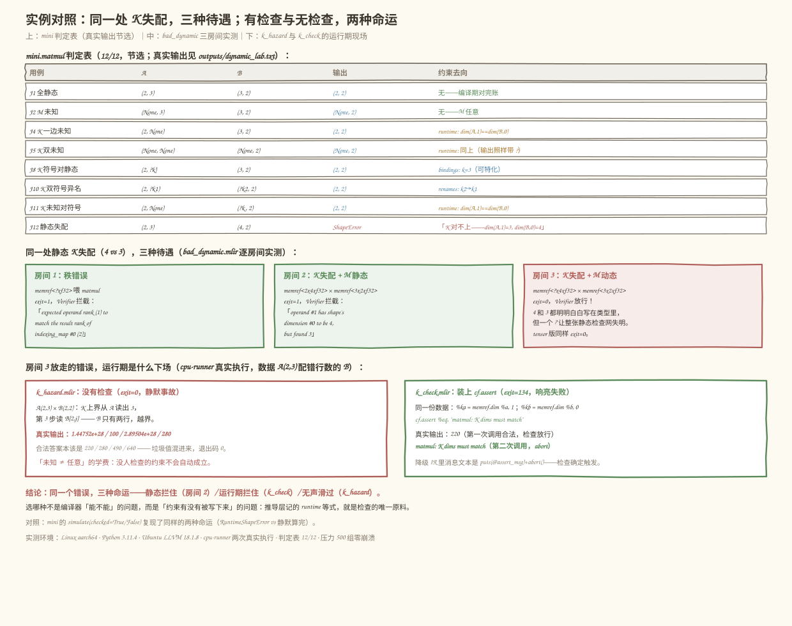
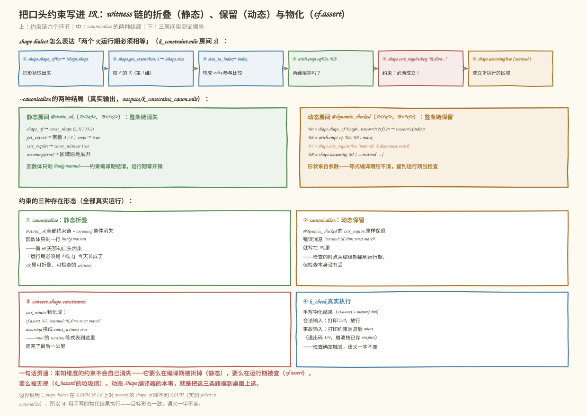

# 第 61 天：动态 Shape 表示——`?` 是「还不知道」，不是「怎么都行」

> **今日目标**：完成本教程后，你能说清动态维度的三种表示（静态整数、符号维度、未知 `?`）各自允诺了什么；能解释为什么 `tensor<?x?xf32>` 乘 `tensor<?x?xf32>` 的两个 `?` **不是各自任意取值**而是运行期必须相等，而输出里的 `?`（batch 维）才是真正「怎么都行」；能给 mini 写出带约束记录的 MatMul Shape 推导（静态对账、符号绑定、运行期检查三档）；并能在 MLIR 里亲手复现三种命运——合法动态 MatMul 真实算出 220/280/490/640、静态失配被 Verifier 拦下、藏在 `?` 后面的失配要么靠 witness 约束变成 `cf.assert` 要么静默读越界吐垃圾值。
> **预计时间**：学习 40 分钟＋实践 45 分钟
> **前置准备**：第 57 天的 Shape / Stride / Offset 词汇表；第 60 天 Broadcast 的未知维度 `None` 及其 meet 规则（今天把那句口头约束「运行期必须是 d 或 1」升级成 IR 里可检查的东西）；Python 3.10+ 与 numpy（本机 3.11.4 / 1.26.4）；`mlir-opt`（本机 Ubuntu LLVM 18.1.8，另有 `mlir-cpu-runner` 可真实执行）。不需要 NPU。
> **今日产出**：一个带符号维度与约束记录的动态 Shape 实验室（`code/dynamic_lab.py`）、一组独立验收测试（`code/test_dynamic.py`）、一个由代码生成的 8 房间动态 IR 压力文件（`code/generated_dynamic_tests.mlir`）、三个手写 MLIR 现场（合法执行 `matmul_dynamic.mlir`、无检查事故 `k_hazard.mlir`、有检查事故 `k_check.mlir`）、一个 witness 约束演示（`k_constraint.mlir`）、一个错误博物馆（`bad_dynamic.mlir`）以及 4 张示意图。

## 1. 今天解决什么问题？

从昨天 (Day 60) 结尾留下的一句话开始。Broadcast 的 meet 规则里有条口头约束：`None 对 d>1 → d`，**「运行期该维必须是 d 或 1」**——当时这句话只是句注释，IR 里没有任何东西检查它。今天把这句话拿到显微镜下看：一个编译期不知道取值的维度（`?`），到底允诺了什么？谁负责检查它？

先看一个今天真实发生的翻车现场（本机 Ubuntu LLVM 18.1.8 实测）。同样的 K 失配（4 vs 3，两个数字都明明白白写在类型里），写出两种 MatMul：

```text
房间 2：memref<2x4xf32> × memref<3x2xf32>  → exit=1，Verifier 拦截
房间 3：memref<?x4xf32> × memref<3x2xf32>  → exit=0，Verifier 放行！
```

M 从静态 `2` 改成 `?` 之后，连 **K 的静态失配都查不出来了**——一个 `?` 让整张静态检查网失明。放行的错误去哪了？再往下追（`mlir-cpu-runner` 真实执行，`k_hazard.mlir`）：给全动态的 MatMul 喂 `A(2,3) × B(2,2)`，K 上界只从 A 读出 3，第 3 步读 `B[2,j]` 越界，真实输出是：

```text
1.44752e+28
100
2.89504e+28
280      ← 合法答案本该是 220 / 280 / 490 / 640，垃圾值混进来，退出码 0
```

这就是今天的核心问题：**`?` 的意思是「编译期还不知道」，不是「怎么都行」**。M 维的 `?`（batch 大小）确实怎么都行——函数对它通用；但 K 维的两个 `?` 隐含着「运行期必须相等」的约束，这条约束不会因为看不见就自动成立。它要么在编译期被折掉，要么在运行期被检查，要么被无视然后产出错误结果。今天的任务就是给 mini 和 MLIR 把这三条路都亲手走一遍。

贯穿全文的小例子（与 MLIR 侧 `matmul_dynamic.mlir` 用同一份数据，值肉眼可核对）：

```text
A(2,3) = [[1,2,3],[4,5,6]]，B(3,2) = [[10,20],[30,40],[50,60]]
C(2,2) = A×B = [[220, 280], [490, 640]]        ← cpu-runner 实测一致

把 M / K / N 换成三种表示，看推导器各自允诺什么：
  (2, 3)      ×  (3, 2)      → (2, 2)     零约束（K 的 3==3 编译期对完账）
  (?M, 3)     ×  (3, 2)      → (?M, 2)    零约束（M 透传）
  (2, ?k)     ×  (3, 2)      → (2, 2)     bindings: k=3（符号被静态值钉住）
  (2, None)   ×  (None, 2)   → (2, 2)     运行期约束 dim(A,1)==dim(B,0)
  (2, 3)      ×  (4, 2)      → ShapeError（编译期拒绝）
```

## 2. 先看全貌：今天的内容位于哪里？



**图 1**：三栏从上往下看——今天的课程位置（阶段三·第 9 周第 5 天）、昨天到今天的衔接（None 从推导记号升级成带约束的表示）、动态维度在类型层 / 推导层 / 运行层各站的待遇。

用 4 步把全局串起来：

1. **前 60 天**：阶段一、二打完 C++ 与 MLIR 基础；第 57 天给了 Shape / Stride 词汇表，第 59 天给 reshape 写了 Verifier，第 60 天的 Broadcast 引出了 `None` 与 meet 规则——但「运行期必须是 d 或 1」只是句口头约束。
2. **今天给未知维度正名**：区分三种表示——静态 `int`（编译期就知道）、符号 `Sym`（不知道值但有名字，同名必须相等）、未知 `None`（无身份，值由运行期输入决定）；并区分「未知」与「任意」：M 的 `?` 是任意（函数对它通用），K 的 `?` 是未知但受约束（必须相等）。
3. **约束要有一个可检查的家**：mini 把约束分三档存放（bindings / renames / runtime）；MLIR 用 shape dialect 的 witness（`shape.cstr_require` + `shape.assuming`）表达同一件事，静态时整条链被 `--canonicalize` 折没，动态时物化成 `cf.assert`。
4. **明天 (Day 62) 顺着 bindings 表走**：形状特化把符号替换成具体值重新验证——今天 `bindings: k=3` 那一行，就是特化的替换清单。

## 3. 核心概念：先用直觉，再给准确定义

先给一个贯穿的类比：**动态维度像「未拆封的快递」**。你不知道里面是什么，但盒子上贴着单号（符号维度 `Sym`），单号相同的两个盒子必然是同一批货，收货时要对单；没贴单号的盒子（未知 `None`）到了才知道是什么，谁也不能提前对它做任何承诺。对应到技术上是：**「未知」描述的是编译期的知识状态，「约束」描述的是运行期的合法取值集合——两件事独立，`?` 只声明了前者，后者必须另有人管**——这个类比到「快递可以装任何东西」就止步了：维度的取值不是「任何」都合法，K 维的合法集合是 `「等于另一个操作数的 K」`，一个点。

### 3.1 动态维度：未知，不是任意

- **一句通俗解释**：类型里的 `?`（mini 写 `None`，MLIR 写 `?`）表示这个维度编译期不知道取值，取值由运行期实际到达的输入决定。
- **类比**：未拆封、没贴单的快递。
- **对应到技术上是**：`memref<?x3xf32>` 的机器表示是一个描述符（第 57 天的 allocated/aligned ptr + offset + `sizes[]` + `strides[]`），`?` 的值坐在 `sizes[0]` 里随参数传入——这就是「运行期 Shape 参数」的真身；循环上界降级后是 `%dim = memref.dim %arg0, %c0`，一行真实的运行期读取（今天 5.3 节实测）。
- **最小例子**：`A(None, 3) × B(3, 2) → (None, 2)`——M 未知，输出跟着未知；但 K 是静态 3，对账照常完成。
- **常见误解/类比边界**：把「未知」当「任意」。`M` 的 `?` 确实任意（取 1 也行取 4096 也行，函数对它通用）；但 `A(2, None) × B(None, 2)` 的两个 `None` **不是各自任意**——它们运行期必须相等，推导器要记下 `dim(A,1) == dim(B,0)` 这条约束。更隐蔽的是反向误解：以为「有约束就别用 ?」——那样损失的是通用性，正确做法是 `?` 加约束（今天 5.4 节 witness 就是干这个的）。

### 3.2 符号维度：有名字的未知

- **一句通俗解释**：给未知维度起个名字（mini 的 `Sym("k")`、MLIR 生态里对应符号形状推理），同名符号在运行期必须取同一个值。
- **类比**：快递单号——两个盒子贴同一个单号，收货时必须对得上。
- **对应到技术上是**：`?k` 参与对账时有三种结局——碰静态值 → **绑定**（`bindings[k]=3`，编译期成立，特化可直接替换）；碰异名符号 → **改名**（`renames[k2→k1]`，两个名字一个未知）；碰 `None` → 还是只能记运行期约束。一张图（共享 Constraints）里同名符号只能有一个值，第二个静态值绑不上去就报「已绑定 3，又遇到 4」。
- **最小例子**：`(2, ?k) × (3, 2) → (2, 2), bindings{k:3}`；`(?M, ?k1) × (?k2, 2) → (?M, 2), renames{k2: k1}`。
- **常见误解**：以为 MLIR 的 `?` 自带符号语义——**没有**。`tensor<?x?xf32>` 的两个 `?` 没有名字、没有相等承诺，第 5.3 节降级出的循环只从 A 读 K 就证明了这一点；符号层面的相等要么靠推导器自己记（mini 的做法），要么靠 shape dialect 的 witness 显式写进 IR（5.4 节的做法）。另一个误解是拿 `-1` 当符号——Day 60 实测过，`-1` 在 shape 语义里就是负数维度，直接非法。

### 3.3 运行期 Shape 参数

- **一句通俗解释**：动态维度的值不在 IR 里，而是运行期随张量一起传进来的「隐藏参数」。
- **类比**：函数的形参列表里没写它，但每个张量背着一个信封（描述符），里面装着它全部的 `?` 的答案。
- **对应到技术上是**：`memref<?x3xf32>` 的 ABI 是 `(ptr, ptr, i64 offset, i64 sizes[2], i64 strides[2])`（今天用 `--convert-linalg-to-loops` 和 5.3 节的降级 IR 亲眼看到）；`memref.dim` 是唯一的取值通道；`memref.cast` 把静态张量「借给」动态接口（只改类型描述不搬数据，5.3 节用它完成了静态数据 → 动态函数 → 打印 220/280/490/640 的真实闭环）。
- **最小例子**：`main` 里 `memref<2x3xf32>` cast 成 `memref<?x3xf32>` 调动态函数——静态世界与动态世界的桥。
- **常见误解**：以为运行期 Shape 参数会让代码变慢——`memref.dim` 在循环外读一次，循环内用寄存器里的值；真正贵的是**没有它**：要么为每个 Shape 编译一份特化产物（编译时间爆炸），要么放弃检查（错误结果）。

## 4. 图解核心机制

三种表示的允诺、K 对账的四条分支与运行期描述符的真身，如图 2：



**图 2**：上半部分是静态 int / Sym / None 三档允诺对照；中间是 `matmul_shape` 的 K 对账四分支（判定表背后）；下半部分左边是 `memref<?x3xf32>` 的描述符布局，右边是降级后的真实循环。

按图中编号逐步讲：

1. **允诺从强到弱排成三档**：静态 `int` 允诺「编译期知道值」，Verifier 可以直接对账（房间 2 的 `inferred 4, but found 3` 就是这档的拦截）；`Sym` 允诺「有名字」——名字承载相等性；`None` 只允诺「值由运行期决定」，其余一切免谈。MLIR 的类型系统只写得出第一档和后两档的**合体**（都是 `?`），分不出 Sym 和 None——这正是 shape dialect 要补的信息。
2. **K 对账四分支就是今天的判定表**：静态对静态直接比；符号碰静态记绑定；符号碰符号记改名；**只要涉及 None 就只能记运行期等式**。注意第 ① 档 mini 比 MLIR 严：`(2,3)×(4,2)` mini 直接 `ShapeError`，而 MLIR 只有在 M 也静态时才拦（房间 3 的失明现场）。
3. **运行期 Shape 参数的真身是描述符的 `sizes[]`**：静态维（3、1）编译进代码当常数；`?` 的值随参数传入，`memref.dim` 是唯一取值通道。图 2 右下角的真实 IR 里，M 的循环上界是 `%dim`（运行期读），N、K 是 `%c2`、`%c3`（编译期常数）——同一个函数里两种知识状态并存。
4. **全动态时 K 只从 A 读**：`%dim_0 = memref.dim %arg0, %c1`——B 的 K 没有任何代码读过。这不是 bug 而是设计：类型里的两个 `?` 没有相等承诺，生成代码只能选一边当上界；选错边的代价就是第 5.3 节的越界垃圾值。约束必须有人显式补——5.4 节的 witness 补的就是它。

## 5. 动手实践：完成一个最小可运行例子

### 5.1 准备文件

```text
tutorials/day-061/
├── README.md
├── images/                        # 4 张示意图（本文图 1–4）
└── code/
    ├── dynamic_lab.py             # 主实验：三种表示 + 判定表 + 特化 + 运行期模拟 + 压力（16 项断言）
    ├── test_dynamic.py            # 独立验收测试（A–E 五段 41 个测试点）
    ├── matmul_dynamic.mlir         # 动态 MatMul：M 动态 / 全动态 + cast 桥 + 真实执行
    ├── generated_dynamic_tests.mlir# 由 dynamic_lab 生成的 8 房间压力 IR（M/N/K 全组合）
    ├── k_constraint.mlir           # witness 约束：静态折叠 / 动态保留 / cf.assert 物化
    ├── bad_dynamic.mlir            # 同一处失配的三种待遇（秩拦截 / 静态拦截 / ? 失明）
    ├── k_hazard.mlir               # 无检查的事故现场（越界读垃圾值）
    ├── k_check.mlir                 # 有检查的同一现场（cf.assert 触发 abort）
    ├── make_images.py              # 生成 4 张 SVG 的脚本
    ├── run_all.sh                  # 一键复跑全部实验并保存真实输出
    └── outputs/                    # 已保存的真实输出
```

运行方式（在 `code/` 目录下）：

```bash
bash run_all.sh
```

`run_all.sh` 先打印环境（本机实测：Python 3.11.4、numpy 1.26.4、Ubuntu LLVM 18.1.8 的 `mlir-opt` 与 `mlir-cpu-runner`、Linux aarch64），再依次跑 Python 实验、验收测试、六个 MLIR 环节和两个运行期现场。没有 `mlir-opt` 也能跑前两步（Python 侧自包含）。

### 5.2 编写代码

完整代码见 `code/dynamic_lab.py`（可直接运行）。今天的心脏是 K 对账的四个分支：

```python
def _k_account(k_a, k_b, ctx: Constraints, pos_a: str, pos_b: str):
    """K 对账：A 的第 1 维 vs B 的第 0 维，按表示档位走分支。"""
    if isinstance(k_a, int) and isinstance(k_b, int):     # 静态 vs 静态：直接比
        if k_a != k_b:
            raise ShapeError(
                f"matmul: K 对不上——A 的 {pos_a}={k_a}，B 的 {pos_b}={k_b}")
        return
    if isinstance(k_a, Sym) and isinstance(k_b, Sym):      # 符号 vs 符号
        na, nb = ctx.resolve(k_a).name, ctx.resolve(k_b).name
        if na != nb:
            ctx.rename(nb, na)                             # ?k2 就是 ?k1
        return
    if isinstance(k_a, Sym) and isinstance(k_b, int):      # 符号 vs 静态：绑定
        ctx.bind(ctx.resolve(k_a).name, k_b)                # ?s == 3
        return
    if isinstance(k_a, int) and isinstance(k_b, Sym):
        ctx.bind(ctx.resolve(k_b).name, k_a)
        return
    # 剩下的组合至少含一个 None：编译期对不了账，只能记运行期等式
    ctx.runtime.append(f"{pos_a} == {pos_b}")               # e.g. "dim(A,1) == dim(B,0)"


def matmul_shape(a, b, ctx: Constraints | None = None):
    """MatMul 输出 Shape 推导（带约束记录）。非法抛 ShapeError。"""
    a, b = clean_shape(a), clean_shape(b)
    if len(a) != 2 or len(b) != 2:
        raise ShapeError(
            f"matmul 需要二维操作数，收到 rank {len(a)} 与 rank {len(b)}")
    ctx = ctx if ctx is not None else Constraints()
    _k_account(a[1], b[0], ctx, "dim(A,1)", "dim(B,0)")
    return (ctx.resolve(a[0]), ctx.resolve(b[1])), ctx
```

三点设计意图：

- **约束分三档存放，各有用途**：`bindings`（符号被静态值钉住，是 Day 62 特化的替换清单）、`renames`（两个名字一个未知）、`runtime`（运行期必须成立的等式，`cf.assert` 的原料）。推导器的输出不只是 `(M, N)`，还有这张约束表——**约束是推导结果的一部分**。
- **ctx 可以跨算子共享**：一张图（一条链）里同名符号只有一个值，第二个静态值绑不上去就报 `已绑定 3，又遇到 4`——图级约束冲突在构造期就拦住（测试 C3/C4）。
- **`-1` 在 clean_shape 里就地枪毙**：Day 60 实测过 `negative dimensions are not allowed`，mini 沿用同一口径，把「负数」与「未知」两套语义彻底分开。

### 5.3 运行与观察

以下均为**本机真实执行结果**（2026-11-12，Python 3.11.4 / numpy 1.26.4 / LLVM 18.1.8，输出已存 `code/outputs/`）。先看 mini 侧的贯穿例子（`dynamic_lab.py` 六种结局，16/16 断言通过）：

```text
=== 1. 贯穿例子：三种表示 × 六种结局 ===
  ① 全静态：(2,3)×(3,2) → 输出 (2, 2)，约束：无（K 的 3==3 编译期对完账）
  ② M 符号：(?M,3)×(3,2) → 输出 (?M, 2)，约束：无（M 透传，K 静态）
  ③ K 符号：(2,?k)×(3,2) → 输出 (2, 2)，绑定 {'k': 3}（?k 被钉成 3，特化可直接替换）
  ④ K 未知：(2,?)×(?,2) → 输出 (2, 2)（全静态！），运行期约束 ['dim(A,1) == dim(B,0)']
     —— K 不在输出里所以输出静态，但两个 ? 仍必须相等：未知 ≠ 任意
  ⑤ 静态失配：(2,3)×(4,2) → ShapeError: matmul: K 对不上——A 的 dim(A,1)=3，B 的 dim(B,0)=4
  ⑥ 双符号 K：(?M,?k1)×(?k2,2) → 输出 (?M, 2)，改名 {'k2': 'k1'}（?k2 就是 ?k1，一个名字）
```

注意 ④ 的输出 `(2, 2)` 全静态——**输出静态不代表没有约束**：K 不出现在输出里，但两个 `?` 的相等约束还在 `runtime` 表里等运行期对账。判定表 12/12 与手算一致，随机压力 500 组 `ok=129 · shape_error=371 · other_exception=0 · bad_result=0`——推导器要么出结果要么出 `ShapeError`，零崩溃零坏结果（这就是计划里「检查 Verifier 和推导不崩溃」的实测形态）。

再看 MLIR 侧。`matmul_dynamic.mlir` 房间 1（M 动态）降成循环后，**M 的上界是一行运行期读取**（真实 IR，`outputs/matmul_dynamic_loops.mlir`）：

```text
%dim = memref.dim %arg0, %c0 : memref<?x3xf32>    ← M：运行期从描述符 sizes[] 读
scf.for %arg3 = %c0 to %dim step %c1 {
  scf.for %arg4 = %c0 to %c2 step %c1 {           ← N=2：编译期常数
    scf.for %arg5 = %c0 to %c3 step %c1 {         ← K=3：编译期常数
```

然后是静态世界与动态世界的桥——`memref.cast` 只改类型描述不搬数据，`mlir-cpu-runner` 真实执行（`outputs/matmul_dynamic_exec.txt`）：

```text
220
280
490
640
```

与手算逐位一致。由 `dynamic_lab.py` 第 6 节生成的 8 房间压力 IR（M/N/K 各取静态/动态的全组合，输出类型全部由 mini 推导后写出）也全数通过 `mlir-opt` 解析 + 验证（`parse+verify exit=0`）。

判定表浓缩版、bad_dynamic 三房间与两个运行期现场，如图 3：



**图 3**：上半部分是 mini 判定表（12/12 的浓缩版）；中间是 bad_dynamic 三房间实测——秩拦截、静态拦截、`?` 失明放行；下半部分是 k_hazard（垃圾值 exit=0）与 k_check（检查触发 abort=134）的运行期现场。

对着图读三个结论：

1. **同一处失配，三种待遇**：秩错误被拦（`expected operand rank (1) to match the result rank of indexing_map #0 (2)`）；M 静态时 K 失配被拦（`operand #1 has shape's dimension #0 to be 4, but found 3`）；M 动态时**同两个数字 4 和 3** 就查不出来了（exit=0）——静态检查是全有或全无的：类型里混进一个 `?`，整套推断就退化为「什么都推不出」，连本来能查的也不查了。
2. **放行的错误不会自己消失**：k_hazard 实测输出 `1.44752e+28 / 100 / 2.89504e+28 / 280`、exit=0——其中 `100` 和 `280` 是「按 A 的 K=3 算但 B 只有 2 行、越界读到 0」的错误值，`e+28` 是读到的无关内存。对照 k_check：同一份数据加上 `cf.assert`，第一次合法调用打印 220 放行，第二次调用打印 `matmul: K dims must match` 后 abort（exit=134）。
3. **mini 与 MLIR 说同一件事**：mini 的 `runtime` 等式 `dim(A,1) == dim(B,0)` ↔ k_check 的 `%ka = memref.dim %a, 1; %kb = memref.dim %b, 0; cf.assert %eq, "..."`——推导层记下的每条运行期约束，都该有一条物化路径。

### 5.4 修改一个参数再观察：witness 的折叠与物化

现在做今天的对照实验：把「两个 K 运行期必须相等」这句话用 shape dialect 写进 IR（`k_constraint.mlir`），然后只改一个参数——形状从静态换成动态——看 `--canonicalize` 的两种结局（真实输出，`outputs/k_constraint_canon.mlir`）：

```text
-- 静态房间 @static_ok（A<2x3>、B<3x2>）：
   函数体只剩 linalg.matmul——shape_of/get_extent/cmpi/cstr_require/assuming
   整条链消失，assuming 区域原地展开：约束编译期结清，运行期零开销。

-- 动态房间 @dynamic_checked（A<?x?>、B<?x?>）：
   %6 = arith.cmpi eq, %4, %5 : index
   %7 = shape.cstr_require %6, "matmul: K dims must match"
   %8 = shape.assuming %7 { ... linalg.matmul ... }
   ——整条链原样保留，检查挪到运行期，但一条没丢。
```

witness 链条、canonicalize 两种结局与物化证据，如图 4：



**图 4**：上半部分是约束链的六个环节（shape_of → get_extent → size_to_index → cmpi → cstr_require → assuming）；中间是 canonicalize 的两种结局；下半部分是四项实测证据。

四层结论：

1. **静态时约束是免费的**：`shape_of` 折成 `const_shape`，`get_extent` 折成常数，`cmpi` 折成 `true`，`cstr_require` 折成 `const_witness true`，`assuming(true)` 区域原地展开——约束参与优化而不是拖累优化。
2. **动态时约束是显式的**：`cstr_require` 连同错误消息 `"matmul: K dims must match"` 一起留在 IR 里，谁读这段 IR 都知道这里有一条运行期检查。
3. **物化只差一步**：`--convert-shape-constraints` 把 `cstr_require` 变成 `cf.assert %7, "matmul: K dims must match"`（`outputs/k_constraint_cstr.mlir` 实测）。本机实测 shape dialect 在 LLVM 18.1.8 上对 memref 的 `shape_of` 还降不到 LLVM（`failed to materialize conversion for result #0 of operation 'shape.shape_of'`），所以 `k_check.mlir` 手写了这份物化结果（`memref.dim` + `cf.assert`）拿去真实执行——目标形态一致，语义一字不差；k_check 的 stdout 先打出合法调用的 220，再打出约束消息，然后 abort（exit=134）。
4. **第 60 天的口头约束今天结案**：「运行期必须是 d 或 1」从一句注释，变成了 `cstr_require`/`cf.assert` 里可检查、可折叠、可物化的一等公民——这正是昨天预告里说的「明天会变成 IR 里可检查的类型」。

## 6. 常见错误与排查

**错误 1：以为 `?` 写进了类型，Verifier 就会替你管好它**

- **现象**：`memref<?x4xf32> × memref<3x2xf32>`（K 一个 4 一个 3，只把 M 写成 `?`）——`mlir-opt` exit=0 放行；同款 M 静态的写法却 exit=1 被拦（`inferred input/output operand #1 has shape's dimension #0 to be 4, but found 3`）。
- **原因**：Verifier 的形状推断是全有或全无——类型里出现 `?` 后推断返回「全未知」，静态可见的 4 vs 3 也跟着跳过。**`?` 关掉的是检查，不是约束**：约束还在，只是没人执行了。
- **定位**：写 IR 前先问自己「这条类型里有没有混合静态与动态的同一语义维」；用 `--convert-linalg-to-loops` 看生成的循环上界从哪个操作数读（全动态时 K 上界只从 A 读，B 的 K 无人查——缺口的直接证据）。
- **修复**：要么把能静态写的维都写静态（让推断可运行）；要么显式补运行期检查（`cf.assert`/witness，见 5.4 节）；要么在推导层（mini 的 `runtime` 表）记录等式并在生成代码时物化。**不要**指望下游「大概会查」。

**错误 2：把两个 `?` 当成同一个未知**

- **现象**：`tensor<?x?xf32>` 乘 `tensor<?x?xf32>`，以为「都是 ? 所以两个 K 自动相等」；喂进 `A(2,3)` 和 `B(5,2)` 期待报错，实际（k_hazard 同款现场实测）——按 A 的 K=3 静默算完、exit=0，还打印出 220/280/490/640 这样**看起来完全正确**的答案（B 的前 3 行恰好是对的，第 4、5 行被无声无视——这种错误比垃圾值更难发现）；B 更短时（k_hazard 实测 `A(2,3)×B(2,2)`）则越界读出 `1.44752e+28`。
- **原因**：MLIR 的 `?` 没有名字、没有相等承诺。类型系统里 `?` 的语义就是「未知」，**不是「与另一个 ? 相等」**。相等性是额外的约束，必须有人显式表达（推导器记账、witness 或运行期检查）。
- **定位**：看降级 IR 找 `memref.dim` 的参数：`%dim_0 = memref.dim %arg0, %c1`（A 的 K）有，`memref.dim %arg1, %c0`（B 的 K）没有——两行一对比，缺口现形。
- **修复**：mini 侧用 `Sym` 同名承载相等、`None` 配 `runtime` 等式；MLIR 侧用 `shape.cstr_require` + `shape.assuming`（5.4 节），或降到 `cf.assert`。检查放哪一层是设计决策，但**至少要有一层**。

**错误 3：动态维度撞上负数——拿 `-1` 当「未知」**

- **现象**：mini 的 `clean_shape((2, -1))` 报 `negative dimensions are not allowed: -1`；Day 60 实测 `np.broadcast_shapes((2,3), (-1,))` 同款报错。
- **原因**：`-1` 是 reshape 语义里的「这一维帮我算」（Day 59），在 shape 推导语义里它就是字面上的负数维度——两套约定同名不同义。
- **定位**：想清楚你要的是「推导时缺一维」（reshape 的 `-1`）还是「编译期不知道这一维」（动态维度）。
- **修复**：未知用独立表示——mini 用 `None`，MLIR 用 `?`，要跨维相等再升级成 `Sym`/witness；负数维度在任何 shape 语义里都不合法。

**错误 4：全动态一时爽，特化火葬场——约束表丢了**

- **现象**：把所有维度都写成 `?`（「反正通用」），下游想做特化（Day 62 的 `specialize-shape`）时发现无约束可依：两个 `?` 哪些必须相等、哪些被钉过静态值，全都丢了，只能保守地全运行期检查。
- **原因**：`?` 只记录「不知道」，不记录「为什么不知道、跟谁绑定」。mini 的三档约束表（`bindings`/`renames`/`runtime`）就是防止这种信息丢失的：`(2, ?k) × (3, 2)` 推导时顺手记下 `k==3`，特化时才有替换清单。
- **定位**：推导结束后打印 `Constraints`——空表不代表干净，可能代表信息白白流走。
- **修复**：能静态写的维度写静态（让对账发生）；必须动态的用符号命名并保持同名一致；跨算子共享同一个 `ctx` 让约束沿图传播（测试 C5 的链式推导）。这也是为什么真实编译器前端（如 torch.export、IREE 的符号形状推理）都维护一张符号约束集而不是裸 `?`。

## 7. 今日练习

### 必做练习

拿贯穿例子练手，**先笔算再跑**：

1. 手算六组 K 对账的约束去向（先别跑，全部写下输出 Shape 和三张表的内容）：
   `(3,4)×(4,5)`、`(None,4)×(4,5)`、`(2,Sym('k'))×(4,5)`、`(2,None)×(None,5)`、`(Sym('a'),Sym('b'))×(Sym('b'),5)`、`(3,4)×(5,6)`。
   预期依次：`(3,5)` 零约束；`(None,5)` 零约束（K 静态对完账）；`(2,5)` 且 `bindings={k:4}`（**第一次绑定是合法的**——只有共享 ctx 里 `?k` 已绑过别的值才报错）；`(2,5)` 且 `runtime=['dim(A,1) == dim(B,0)']`；`(?a,5)` 零约束（同名 `?b` 自己承载相等）；最后一组 `ShapeError`（静态 4 vs 5 直接拒）。
2. 在 `code/` 目录下验证第 4 组：`python3 -c "from dynamic_lab import *; print(matmul_shape((2,None),(None,5)))"`（预期输出里含 `runtime=['dim(A,1) == dim(B,0)']`）。
3. 把第 1 组中你觉得最反直觉的一组写成新断言加进 `test_dynamic.py` 的 B 段（照抄现有用例的写法），跑 `python3 test_dynamic.py`，看总数从 41/41 涨上去。
4. 输出侧的 `?` 同样没人查——把 `matmul_dynamic.mlir` 的房间 1 函数复制到新文件，把 `%o` 与 `outs` 两处的类型从 `memref<?x2xf32>` 改成 `memref<?x4xf32>`（输出声称 N=4，而 B 的 N 明明是 2）。先预测：M 动态时 Verifier 什么反应？再预测把 M 也改静态（`memref<2x3xf32>`、输出 `memref<2x4xf32>`）会怎样？跑 `mlir-opt` 核对（实测：前者 exit=0 放行——输出 N 的失配和 K 一样被 `?` 藏住；后者 exit=1，`operand #2 has shape's dimension #1 to be 2, but found 4`——全静态时连输出侧也查）。

### 选做挑战

给 `k_check.mlir` 做一次「换位」手术：

1. 把检查里的 `%ka = memref.dim %a, %c1` 改成 `%ka = memref.dim %a, %c0`（读 M 当 K），其余不动；
2. 先预测：main 第一次调用（A(2,3) × B(3,2) 合法）这次还能过吗？算一下：`dim(A,0)=2`，`dim(B,0)=3`——assert 应该触发，**连 220 都打不出来**；
3. 用 5.4 节的命令真实执行核对（实测 exit=134，stdout 里只有一行 `matmul: K dims must match`，220 没了——检查比计算先发生，这正是「检查要放在计算前」的现场证明）；
4. 想清楚一个设计问题：如果把 `cf.assert` 挪到 `linalg.matmul` **之后**，行为有什么区别？（提示：垃圾值已经写进 %o 了——检查可以晚到，但代价已经发生；这也解释了为什么 witness 的 `shape.assuming` 把计算包在区域**里面**。）

## 8. 今日验收

- [ ] 我能用自己的话说清三种表示——静态 `int`（编译期对账）、符号 `Sym`（有名字的未知，同名必须相等）、未知 `None`（无身份，运行期定值），并解释为什么 M 的 `?` 是「任意」而 K 的两个 `?` 仍是「未知但受约束」；
- [ ] 我能解释「一个 `?` 让整张静态检查网失明」：房间 2（M 静态）被拦、房间 3（M 动态）放行的实测差异，以及全动态时 K 上界只从 A 读的缺口；
- [ ] 我能说清约束的三档去向——bindings（特化清单）/ renames（同一未知）/ runtime（cf.assert 原料），并演示 `(2,?k)×(3,2)` 特化后回 `(2,2)`；
- [ ] 我能独立运行 `bash code/run_all.sh`，复现 dynamic_lab 16/16、test_dynamic 41/41、cpu-runner 的 220/280/490/640、k_hazard 的垃圾值（exit=0）与 k_check 的 abort（exit=134）；
- [ ] 我能定位两类错误：静态可见但被 `?` 藏住的 K 失配（错误 1）、把两个 `?` 当同一个未知的无声事故（错误 2），并说出对应的三种修复路径；
- [ ] 我保存了动态 Shape 实验室、验收测试、六个 MLIR 现场、8 房间生成 IR 和 4 张示意图（`tutorials/day-061/`）。

## 9. 一句话总结与明天预告

今天的问题始于「`memref<?x4xf32>` 乘 `memref<3x2xf32>`，4 和 3 都写在类型里却无人拦截，cpu-runner 静默吐出 `1.44752e+28`」。机制上，`?` 的含义是「编译期还不知道」而不是「怎么都行」：M 维的 `?` 是真正的任意（函数对它通用），K 维的两个 `?` 却隐含相等约束，这条约束要么编译期对账（静态）、要么运行期检查（`cf.assert`/witness）、要么被无视（错误结果）——没有第四种命运。实践中，mini 把 K 对账拆成四条分支并把约束分三档记账（bindings/renames/runtime），判定表 12/12、随机 500 组零崩溃，8 个 M/N/K 静态-动态房间的生成 IR 全数通过 mlir-opt 验证；MLIR 侧用 `memref.cast` 桥接静态与动态世界真实算出 220/280/490/640，用 `--convert-linalg-to-loops` 看到 `memref.dim` 这个运行期 Shape 参数的真身，用 `shape.cstr_require` + `shape.assuming` 亲手把第 60 天的口头约束折叠掉（静态）、保留住（动态）、物化成 `cf.assert`（k_check 实测 abort=134）。

明天（Day 62）拿着今天的 `bindings` 表走进静态 Shape 特化：设计 `specialize-shape` 入口，把动态维度替换成具体值并重新验证——今天 `(2,?k)×(3,2)` 推导时记下的 `k==3`，明天就是特化的替换清单；特化的收益（循环展开、编译期常量）和代价（产物数量、编译时间）会在那里展开。

