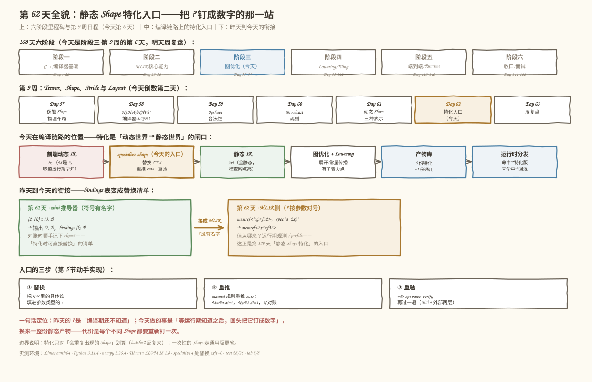
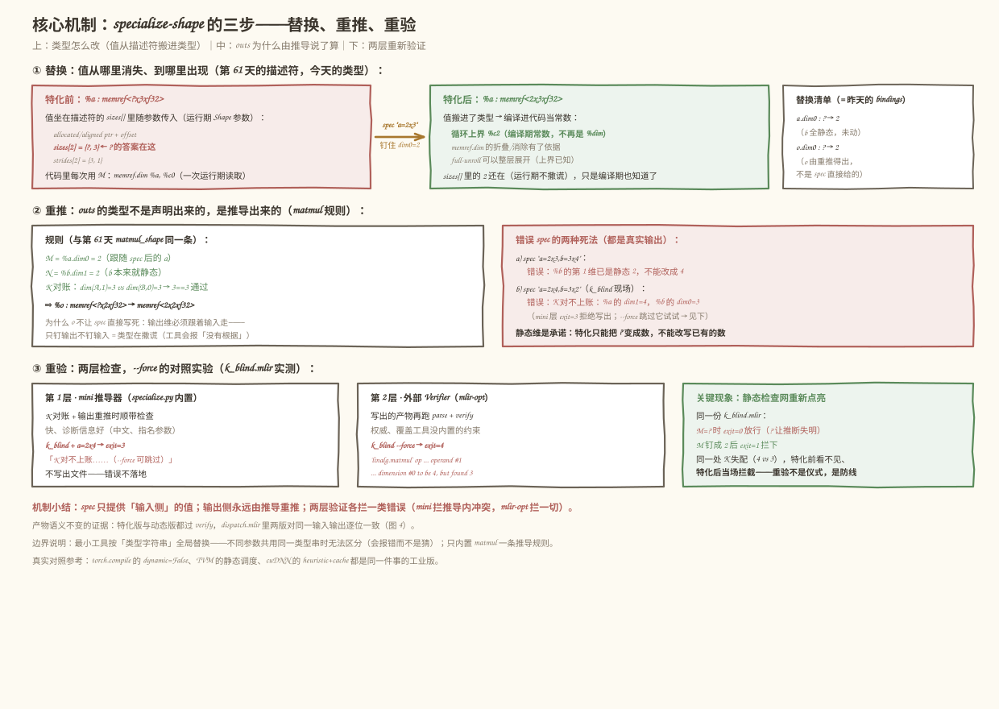
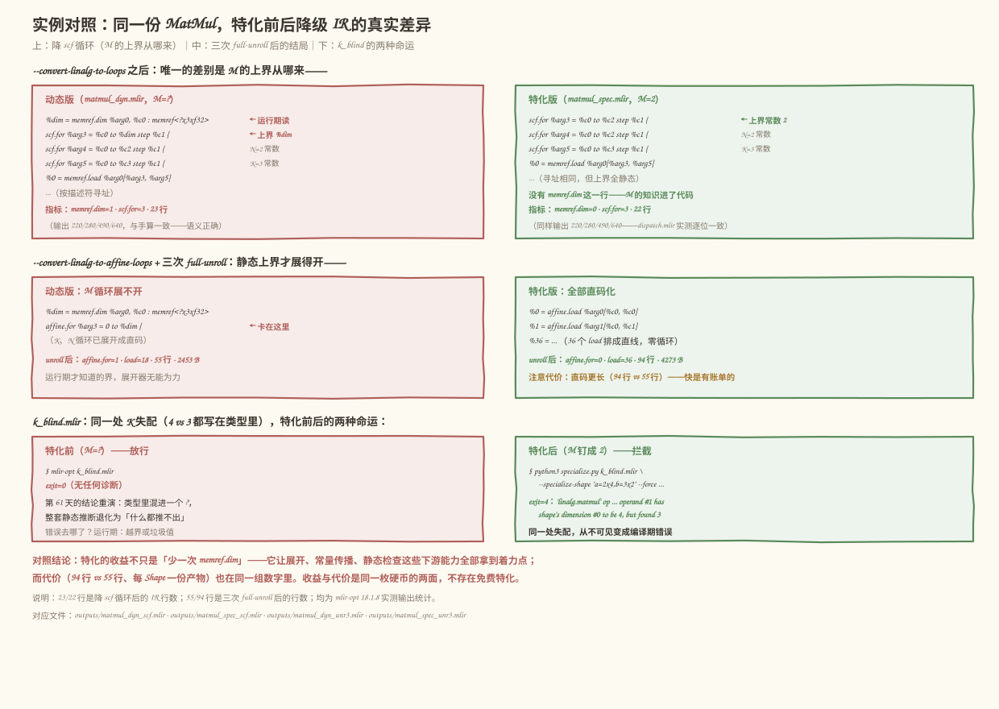
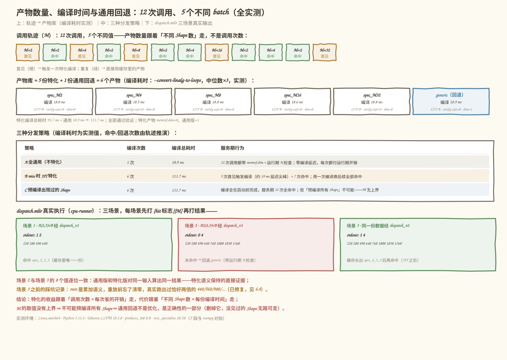

# 第 62 天：静态 Shape 特化入口——把 `?` 钉成数字，静态世界重新睁眼

> **今日目标**：完成本教程后，你能说清 Shape 特化（specialization）用一份运行期观测到的具体 Shape，把 IR 里的动态维度替换成常量、得到一份全静态产物时，**收益**（循环上界变成编译期常数、`memref.dim` 消失、循环可完全展开、Verifier 的静态检查重新生效）与**代价**（每个不同 Shape 一份产物、编译时间随 Shape 种类增长、代码体积变大）各来自哪里；能解释为什么任何特化系统都必须配一条**通用实现回退**（generic fallback）路径；并亲手做出一个最小 `specialize-shape` 工具：给定 `a=2x3,b=3x2` 这样的替换清单，把动态 IR 改写成静态 IR、用 mini 推导器加 `mlir-opt` 双重重新验证，再量化对比特化前后的降级 IR（`memref.dim` 计数、展开能力、编译耗时）与分发命中/回退行为。
> **预计时间**：学习 40 分钟＋实践 45 分钟
> **前置准备**：第 61 天的三种维度表示（静态 `int` / 符号 `Sym` / 未知 `None`）与三档约束表（`bindings` / `renames` / `runtime`）——今天的替换清单就是昨天的 `bindings`；第 57 天的 Shape / Stride 词汇表；Python 3.10+ 与 numpy（本机 3.11.4 / 1.26.4）；`mlir-opt`、`mlir-cpu-runner`（本机 Ubuntu LLVM 18.1.8）。不需要 NPU。
> **今日产出**：一个最小 Shape 特化工具（`code/specialize.py`，含 `--specialize-shape` 命令行选项与双重重新验证）、特化前后 IR（`code/matmul_dyn.mlir` → `code/outputs/matmul_spec.mlir`）、一个产物数量与分发实验（`code/products_lab.py`，产物数、编译耗时、`memref.dim` 计数全部实测）、一个可真实执行的分发现场（`code/dispatch.mlir`，命中特化版 / 回退通用版 / 缓存增长后再命中三条路径都跑到）、一组验收测试（`code/test_specialize.py`，28 个测试点）以及 4 张示意图。

## 1. 今天解决什么问题？

从昨天 (Day 61) 结尾的那张表开始。推导 `(2, ?k) × (3, 2)` 时，mini 顺手记下了 `bindings {k: 3}`——「特化时可直接替换」。当时这句话只是一句注释。今天把它变成一个真的入口。

先看昨天的两个遗留问题，今天都会被特化直接处理：

```text
问题一（性能）：动态版降循环后，M 的上界是一行运行期读取——
    %dim = memref.dim %arg0, %c0 : memref<?x3xf32>
    每次循环边界判断、每次优化决策都被这个「运行期才知道」卡住。

问题二（正确性）：k_blind.mlir 里 K=4 vs 3 都明明白白写在类型里，
    但 M 是 ? —— mlir-opt 实测 exit=0 放行（昨天「失明」现场）。
```

今天的核心动作只有一句话：**等运行期知道 M 是多少之后，回头把 `?` 钉成那个数字**。拿贯穿全文的同一份数据看效果（本机 Ubuntu LLVM 18.1.8 实测）：

```text
输入 IR：  %a : memref<?x3xf32>   （M 动态——batch 维，取值运行期才知）
spec：     a=2x3                  （运行期观测到 batch=2）
产物 IR：  %a : memref<2x3xf32>   （M=2 编译期可知）

降 scf 循环后：
  动态版：scf.for %arg3 = %c0 to %dim step %c1   ← 上界运行期读取
  特化版：scf.for %arg3 = %c0 to %c2  step %c1   ← 上界编译期常数

三次 full-unroll 之后（真实数字）：
  动态版：affine.for=1（M 循环卡在 %dim 上展不开）· load=18 · 55 行
  特化版：affine.for=0（全部直码化，零循环）      · load=36 · 94 行

同一份 k_blind.mlir：
  特化前（M=?）：mlir-opt exit=0 放行
  特化后（M=2）：mlir-opt exit=1 拦下（operand #1 ... to be 4, but found 3）
```

但特化不是免费的。同样实测：一份产物的编译要花约 19 ms，batch 取值有 5 种（2/4/8/16/32），就要 5 份特化产物加 1 份通用回退共 6 个产物；而 batch 的取值**没有上界**——想给每个可能的 Shape 都备一份特化是不可能的。所以今天的完整问题是三件事连在一起：**特化怎么做得对（替换 + 重推 + 重验）、值不值（收益与产物数量的账怎么算）、兜不兜得住（没见过的 Shape 走哪）**。

## 2. 先看全貌：今天的内容位于哪里？



**图 1**：三栏从上往下看——今天的课程位置（阶段三·第 9 周第 6 天，明天周复盘）、特化入口在编译链路中的位置（动态 IR → 特化 → 静态 IR → 优化 → 产物库 → 运行时分发）、昨天到今天的衔接（bindings 表变成替换清单）。

用 4 步把全局串起来：

1. **前 61 天**：阶段一、二打完 C++ 与 MLIR 基础；第 9 周从 Shape / Stride / Layout 一路讲到动态 Shape 的三种表示，昨天留下 `bindings` 表这张「特化清单」。
2. **今天做入口**：`specialize-shape` 三步——**替换**（把 spec 给出的具体维填进参数类型的 `?`）、**重推**（用 matmul 规则重推输出类型，K 对账）、**重验**（产物再过一遍 mlir-opt 的 parse + verify）。
3. **产物与分发**：每个不同 Shape 一份特化产物 + 恒有一份通用回退；运行期按实际维度分发——命中走特化版，未命中走通用版（或触发一次 JIT）。
4. **明天 (Day 63) 周复盘**：把 Shape、Stride、Layout、Broadcast、动态维度和今天的特化串成一页——今天结尾的「同一 Tensor 不同布局 / 动态不等于没约束」两条线索都到齐了。

## 3. 核心概念：先用直觉，再给准确定义

先给一个贯穿的类比：**动态维度像「合租的水电费」**。不知道具体数字，但每个月都有一个确定的数；等到账单来了（运行期输入到达），你可以选择「按账单把这一年的房租合同改成固定价」（特化），也可以继续「每月按表读数」（通用版）。对应到技术上是：**特化 = 用一次运行期观测到的具体值，替换 IR 类型里的 `?`，生成一份全静态产物；它改变的是编译期知识状态，不改变任何运行期数值语义**——这个类比到「改合同」就止步了：合同改了旧账单不会变，而特化后的产物对**其他** Shape 是不能用的（喂 M=4 进 M=2 的产物，轻则浪费重算，重则越界），所以必须有分发和回退，这是类比覆盖不到的边界。

### 3.1 Shape 特化：把「还不知道」变成「当时是 2」

- **一句通俗解释**：Shape 特化（shape specialization）就是拿一份运行期实际出现的 Shape，把 IR 里的动态维度（`?`）替换成具体数字，得到一份只对这个 Shape 有效的静态产物。
- **类比**：见上——按账单把浮动价改成固定价。
- **对应到技术上是**：`memref<?x3xf32>` 的 M 值坐在描述符的 `sizes[]` 里随参数传入（第 61 天的运行期 Shape 参数）；特化把它从 `sizes[]` 「搬进」类型 `memref<2x3xf32>`——值没变（运行期描述符里还是 2），变的是**编译期也知道了**。于是 `memref.dim` 的读取可以折叠/消除，循环上界成为常数，full-unroll 才有可能。
- **最小例子**：`--specialize-shape "a=2x3,b=3x2"` 作用于 `matmul_dyn.mlir`：`%a` 从 `memref<?x3xf32>` 变 `memref<2x3xf32>`，`%o`（输出）由推导重推成 `memref<2x2xf32>`。
- **常见误解/类比边界**：把特化当成「把类型写好看一点」。不是——特化产物的类型是**承诺**：M=2 的产物就只该喂 M=2 的输入。谁负责在运行期兑现承诺？分发器（3.4 节）。另一个误解是「特化 = 删掉动态版本」——那样新 Shape 一来就无路可走。

### 3.2 特化的收益：静态知识解锁下游能力

- **一句通俗解释**：把 `?` 钉成数字本身不产生性能，它产生的是「下游优化可以着力」的机会。
- **类比**：把帐篷的桩钉死，不代表房子盖好了，但打地基终于可以开工。
- **对应到技术上是**（今天全部实测的三个层次）：
  1. **循环上界变常数**：`scf.for ... to %dim` → `scf.for ... to %c2`，`memref.dim` 从 1 个变 0 个；
  2. **循环可完全展开**：三次 `--affine-loop-unroll=unroll-full` 后，动态版还剩 1 个 `affine.for`（M 循环上界是 `%dim`，展开器无能为力），特化版 0 个循环、36 个 load 排成直线；
  3. **静态检查重新生效**：`k_blind.mlir` 同一处 K 失配，动态版 exit=0 放行，特化后 exit=1 拦下——`?` 让推断失明（昨天），特化把灯重新点亮（今天）。
- **最小例子**：见第 1 节的对照表。
- **常见误解**：以为收益主要是「省一次 `memref.dim` 读取」。那次读取在循环外、几乎免费；真正的收益链是 常数上界 → 可展开/可向量化/可 Tiling 规划 → 后面第 14～16 周的全部内容。今天只是把「钥匙」拿到手。

### 3.3 代价：产物数量与编译时间

- **一句通俗解释**：每钉一个新 Shape，就要重新编译一份产物；Shape 的种类没有上界，产物数量却要有上界。
- **类比**：按账单改固定价合同——每来一个新数字就要重签一份合同，签合同是要花钱花时间的。
- **对应到技术上是**（products_lab.py 实测）：12 次调用的轨迹 `[2,2,4,2,8,2,4,16,2,4,2,32]` 只有 5 个不同 M，于是 5 份特化产物（每份编译 18.0～18.8 ms，中位数×3）+ 1 份通用回退（18.9 ms）= 6 个产物、特化编译总耗时 92.7 ms。产物数量跟着**不同 Shape 数**走，不跟调用次数走——这是特化划算的全部前提（batch 会反复出现）。
- **最小例子**：M=16 与 M=32 的产物只差两个字符（`memref<16x3xf32>` vs `memref<32x3xf32>`），但各占 1279 B、各编译一次。
- **常见误解**：「编译才 19 ms，无所谓」。今天的例子小；真实模型一次编译以秒或分钟计，Shape 种类一多（图片分辨率、序列长度、batch 组合）编译时间就是主要成本——这正是第 129 天「特化产物、性能表和代码大小记录」要正面处理的问题。另一个隐性代价是代码体积：展开后 94 行 vs 55 行，指令缓存的压力是真实账单。

### 3.4 通用实现回退：分发器的另一半

- **一句通俗解释**：特化产物是「会员通道」，通用版是「永远开着的大门」——没见过的 Shape 只能走大门，而且大门永远不能拆。
- **类比**：会员通道再快，也不能把普通通道焊死——新客人的类型你没有会员卡。
- **对应到技术上是**：运行期分发器读实际维度（`memref.dim`）→ 与特化键比较（`arith.cmpi`）→ 命中则 `memref.cast` 收紧成静态类型调特化版，未命中回退全动态的通用版（内带运行期 K 检查，即第 61 天的 `cf.assert` 形态）。因为 M 的取值没有上界，「预编译所有 Shape」不可能，**通用回退不是性能选项，是正确性的一部分**。
- **最小例子**：`dispatch.mlir` 三场景实测——A(2,3)×B 命中 `spec_2_3_2` 打印 220/280/490/640；A2(4,3)×B 未命中回退通用版打印 C2 八个值；缓存长出 `spec_4_3_2` 后同一份数据再命中，输出逐位一致。
- **常见误解**：「回退版慢，尽量别让人走到」。恰恰相反——回退版保证的是**任何合法输入都有正确答案**；特化版只是让热门输入走得更快。两者的关系是正确性兜底 + 性能加速，不是二选一。

## 4. 图解核心机制

替换、重推、重验三步的完整机制，如图 2：



**图 2**：上半部分是类型改写的前后对照（值从描述符 `sizes[]` 搬进类型）与替换清单；中间是输出类型的推导规则与两种错误 spec 的真实报错；下半部分是两层重新验证与 k_blind 的两种命运。

按图中编号逐步讲：

1. **替换的本质是搬运，不是发明**：值本来就在运行期描述符的 `sizes[]` 里（第 61 天），特化只是让编译期也看见它。所以 spec 提供的必须是**观测值**（运行期真的来过 2），而不是愿望——这也是 `--specialize-shape` 只接受具体数字、想保持动态就写 `?` 的原因。
2. **输出类型由推导说了算，不由 spec 说了算**：`%o` 的 M 跟随 `%a.dim0`、N 跟随 `%b.dim1`、K 要对账——这是第 61 天 `matmul_shape` 的同一条规则。只钉输出不钉输入（`o=2x2` 而 `a` 仍是 `?`）等于让类型撒谎，工具直接报「特化没有根据」；spec 与推导冲突（`o=3x2` 但推导是 `2x2`）同样被拒。
3. **静态维是承诺，特化无权改写**：`b=3x4` 撞上类型里已有的静态 2，当场拒绝——特化只能把 `?` 变成数，不能把 2 改成 4。
4. **两层验证各拦一类错误**：第 1 层是 mini 推导器（快、诊断友好，K 对账失败时 exit=3 且不写出文件）；第 2 层是外部 `mlir-opt`（权威，`--force` 跳过 mini 后它接住——k_blind 实测 exit=4，错误信息 `operand #1 ... to be 4, but found 3`）。跳过第 1 层可以演示，跳过第 2 层是赌博。

## 5. 动手实践：完成一个最小可运行例子

### 5.1 准备文件

```text
tutorials/day-062/
├── README.md
├── images/                        # 4 张示意图（本文图 1–4）
└── code/
    ├── specialize.py              # 今天的主角：最小 Shape 特化工具（CLI）
    ├── products_lab.py            # 收益 / 产物数量 / 编译时间 / 分发模拟（全实测）
    ├── test_specialize.py         # 验收测试（A–F 六段 28 个测试点）
    ├── matmul_dyn.mlir            # 特化的输入（M 动态、K/N 静态）
    ├── k_blind.mlir               # 藏在 ? 后面的 K 失配（昨天的失明现场）
    ├── dispatch.mlir              # 分发现场：命中 / 回退 / 缓存增长三场景
    ├── make_images.py             # 生成 4 张 SVG 的脚本
    ├── run_all.sh                 # 一键复跑全部实验并保存真实输出
    └── outputs/                   # 已保存的真实输出（IR、指标、执行结果）
```

运行方式（在 `code/` 目录下）：

```bash
bash run_all.sh
```

`run_all.sh` 先打印环境（本机实测：Python 3.11.4、numpy 1.26.4、Ubuntu LLVM 18.1.8 的 `mlir-opt` 与 `mlir-cpu-runner`、Linux aarch64），再依次跑：list-dims、特化主流程、前后 IR 对照、k_blind 对照、products_lab、验收测试和 dispatch 真实执行。没有 `mlir-opt` 时 Python 侧仍可跑，验证类步骤会明确降级。

### 5.2 编写代码

完整代码见 `code/specialize.py`（可直接运行，约 470 行含注释）。今天的心脏是三步里的第 2 步——**输出重推与 K 对账**（`specialize_ir` 内部）：

```python
# ---- 逐个 matmul：K 对账 + outs 重推 ----
for mm in MATMUL_RE.finditer(body):
    ins_names, out_name = ...                    # 从 ins(...) outs(...) 里解析操作数
    ia, ib, io = (name_to_idx[n] for n in (*ins_names, out_name))
    da, db = dims_of(ia), dims_of(ib)            # spec 应用后的维度（没动的用原值）

    # K 对账（重新验证第 1 层：mini 推导器）
    ka, kb = da[1], db[0]
    if ka is not None and kb is not None and ka != kb:
        msg = (f"K 对不上账：%{args[ia][0]} 的 dim1={ka}，"
               f"%{args[ib][0]} 的 dim0={kb}")
        if not force:
            raise KAccountError(msg + "（--force 可跳过本检查，交给 mlir-opt）")

    # outs 重推：M=%a.dim0，N=%b.dim1
    derived = [da[0], db[1]]
    if io in resolved:                           # spec 也写了 outs？只能冗余确认
        for i, (dv, sv) in enumerate(zip(derived, resolved[io])):
            src = f"%{args[ia][0]}.dim0" if i == 0 else f"%{args[ib][0]}.dim1"
            if dv is None and sv is not None:
                raise SpecError(
                    f"%{args[io][0]} 的第 {i} 维特化没有根据：它跟随 {src}，"
                    f"而后者仍是 ?——请先特化来源参数")
            if dv is not None and sv is not None and dv != sv:
                raise SpecError(
                    f"%{args[io][0]} 的第 {i} 维由推导得出 {dv}，"
                    f"与 spec 的 {sv} 冲突")
    po = parse_shaped_type(args[io][1])
    new_o_type = fmt_type(po[0], derived, po[2])   # memref<?x2xf32> → memref<2x2xf32>
```

四点设计意图：

- **spec 只写输入侧**：输出类型永远是推导的结果——`o=2x2` 这种「只钉输出」的写法被「没有根据」检查拦住，`o=3x2` 这种与推导冲突的写法被一致性检查拦住（测试 D 段）。类型不能撒谎。
- **K 对账复用昨天的规则**：`dim(A,1)` 对 `dim(B,0)`，静态失配当场拒绝。`--force` 不是「修好它」，是「把检查交给外部 Verifier」——用来演示两层验证的分工。
- **单遍正则替换**：所有「旧类型串 → 新类型串」在一次扫描里完成（先按长度排序），避免 A 的新类型串恰好等于 B 的旧类型串时被连锁误改。
- **退出码即语义**：0 成功；2 spec 非法（rank / 改静态维 / 未知名字）；3 mini K 对账失败（不写出文件）；4 已写出但 `mlir-opt` 拒收。CI 里可以直接用。

### 5.3 运行与观察

以下均为**本机真实执行结果**（2026-11-12，Python 3.11.4 / numpy 1.26.4 / Ubuntu LLVM 18.1.8，输出已存 `code/outputs/`）。先看工具主流程（`outputs/specialize_run.txt`）：

```text
$ python3 specialize.py matmul_dyn.mlir --specialize-shape "a=2x3,b=3x2" \
        -o outputs/matmul_spec.mlir
== specialize-shape：matmul_dyn.mlir → outputs/matmul_spec.mlir ==
函数 @matmul（3 个参数）
替换清单（MLIR 的 ? 没有名字，按「参数.维」对号——第 61 天 bindings 表的 MLIR 版）：
  %a : memref<?x3xf32> → memref<2x3xf32>   （spec）
  %b : memref<3x2xf32>   [3x2] 全静态，未改动
  %o : memref<?x2xf32> → memref<2x2xf32>   （输出重推）
共替换 4 处类型串（2 种类型）
重新验证（/usr/lib/llvm-18/bin/mlir-opt parse+verify）：exit=0 通过
写出 outputs/matmul_spec.mlir
```

对照报告里 `%o` 那一行：spec 里根本没写 `o`——`memref<2x2xf32>` 是推导出来的（M=2 跟随 `%a`，N=2 跟随 `%b`，K 对账 3==3 通过）。这就是「重推」在工作。

然后是特化前后降级 IR 的真实差异（`outputs/matmul_dyn_scf.mlir` 与 `outputs/matmul_spec_scf.mlir`、`*_unr3.mlir`），如图 3：



**图 3**：上半部分是降 scf 循环后唯一的差别——M 的上界从 `%dim`（运行期读取）变成 `%c2`（编译期常数）；中间是三次 full-unroll 后的结局——动态版 M 循环卡在 `%dim` 上（affine.for=1），特化版全部直码化（affine.for=0、36 个 load）；下半部分是 k_blind 的两种命运。

对着图读三个结论：

1. **`memref.dim` 的消失只是表象**：静态版少的那一行 `%dim = memref.dim %arg0, %c0` 背后，是 M 的知识状态从「运行期才知道」变成「编译进代码」——unroll、常量传播、静态检查全部因此拿到着力点。
2. **收益和代价在同一组数字里**：展开后特化版 94 行 vs 动态版 55 行、4273 B vs 2453 B——直码化消灭了循环开销，也付出了代码体积。快是有账单的（第 96 天 Unroll 会正面处理这笔账）。
3. **语义不变有证据链**：两版都通过验证只是第一层；`dispatch.mlir` 里通用版和特化版对同一输入的输出逐位一致（5.4 节实测）才是数值层面的证据。

### 5.4 修改一个参数再观察：k_blind 的两种命运与产物的账

**对照实验一：把 M 钉成 2，看静态检查醒来。** `k_blind.mlir` 里 K=4（`%a` 的 dim1）与 K=3（`%b` 的 dim0）明明白白写在类型里，但 M 是 `?`，昨天实测 `mlir-opt` exit=0 放行。今天分两步：

```text
第 1 步（mini 层拒绝）：
$ python3 specialize.py k_blind.mlir --specialize-shape "a=2x4,b=3x2" -o /tmp/x.mlir
错误（K 对账失败）：K 对不上账：%a 的 dim1=4，%b 的 dim0=3
（--force 可跳过本检查，交给 mlir-opt）          ← exit=3，文件未写出

第 2 步（--force，交给外部 Verifier）：
$ python3 specialize.py k_blind.mlir --specialize-shape "a=2x4,b=3x2" \
        --force -o outputs/k_blind_spec_rejected.mlir
...
重新验证（/usr/lib/llvm-18/bin/mlir-opt parse+verify）：exit=1 被拒
  /tmp/...mlir:19:5: error: 'linalg.matmul' op inferred input/output operand #1
  has shape's dimension #0 to be 4, but found 3        ← exit=4
```

同一处失配，三种状态：动态版看不见（exit=0）、mini 层点名拒绝（exit=3）、特化后被 Verifier 拦下（exit=4）。**特化不只为了性能——它把第 61 天被 `?` 弄失明的静态检查网重新点亮**。这也回答了「为什么特化之后必须重新验证」：替换这个动作本身可能引入不一致（手滑写错 spec、类型串替换波及别处），验证是特化合法性的最后一道防线。

**对照实验二：换一组 Shape 轨迹，看产物的账。** `products_lab.py` 用 12 次调用的轨迹把收益、产物数、编译时间一次算清（`outputs/products_lab.txt` 真实输出），如图 4：



**图 4**：上半部分是调用轨迹（首见标橙、命中标绿）与 6 个产物的实测编译耗时；中间是三种分发策略的对照表；下半部分是 dispatch.mlir 三场景的真实 stdout。

四层结论：

1. **产物数量跟着「不同 Shape 数」走**：轨迹 12 次调用只有 5 个不同 M，于是 5 份特化 + 1 份通用 = 6 个产物；每份特化编译 18.0～18.8 ms（`--convert-linalg-to-loops`，中位数×3），特化编译总耗时 92.7 ms。M=2 出现 6 次，只编译 1 次。
2. **三种策略没有免费午餐**：A 全通用——1 次编译（18.9 ms）但 12 次调用每次都带运行期读取和 K 检查；B miss 时 JIT——6 次编译（111.7 ms），5 次首见各付一次约 19 ms 的延迟尖峰，7 次命中；C 预编译出现过的 Shape——编译总量与 B 相同（111.7 ms）但全在启动前，服务期 12 次全命中。B 与 C 的差别只在**编译发生的时机**。
3. **「预编译所有 Shape」是伪选项**：M 的取值没有上界——这就是通用回退存在的根本理由。它不是性能优化，是正确性的一部分。
4. **分发现场真实可跑**：`dispatch.mlir` 用 `mlir-cpu-runner` 执行（`outputs/dispatch_exec.txt`），三个场景的输出——场景 1 打 `1 2`（hit=1，M=2）后是 220/280/490/640；场景 2 打 `0 4`（miss，回退通用版）后是 220/280/490/640/760/1000/1030/1360；场景 3 打 `1 4`（缓存长出第二份特化后再命中）后是同样八个值。**场景 2 与场景 3 逐位一致**：通用版与特化版对同一输入算出同一结果，这就是特化语义保持的直接证据（测试 F 段与 numpy 对拍确认）。

## 6. 常见错误与排查

**错误 1：spec 想改静态维，或想「只钉输出」**

- **现象**：`--specialize-shape "b=3x4"` 报 `错误（spec 非法）：%b 的第 1 维已是静态 2，不能改成 4`；`--specialize-shape "o=2x2"` 报 `%o 的第 0 维特化没有根据：它跟随 %a.dim0，而后者仍是 ?——请先特化来源参数`（均为真实输出）。
- **原因**：静态维是类型对全世界做的承诺，特化的权限只有「把 `?` 变成数」；输出维是输入维的函数，输入不动输出先动，等于让类型提前撒谎。
- **定位**：看报错里指名的「参数.维」和它跟随的来源；`--list-dims` 可以先打印每个参数的维度和角色（`← outs（输出，由推导重推）`）。
- **修复**：想改 K 就去改**输入**的类型（重新写输入 IR），而不是在 spec 里改数；想钉输出就把来源输入一起钉。

**错误 2：`--force` 之后忘记看外部验证结果**

- **现象**：`--force` 跳过 mini K 对账后，工具写出文件、退出码 4，但有人只看「文件生成了」就拿去用——下游在错误的 IR 上继续编译。
- **原因**：`--force` 的语义是「把检查交给 mlir-opt」，不是「跳过检查」。外部验证失败（exit=4）意味着产物非法。
- **定位**：退出码。0 成功；3 mini 拒绝（文件都没写）；4 外部拒收（文件写了但**不可用**）。
- **修复**：CI/脚本里对退出码零容忍；`--force` 只该出现在「演示两层验证分工」的教学场景（比如今天 5.4 节）。

**错误 3：分发器重放请求，忘了 `outs` 是累加语义（今天的真实踩坑）**

- **现象**：初版 `dispatch.mlir` 场景 3 复用场景 2 的输出缓冲直接再算一遍，cpu-runner 真实输出是 `440/560/980/1280/1520/2000/2060/2720`——**恰好全是正确值的两倍**，退出码还是 0。
- **原因**：`linalg.matmul` 的 `outs` 是「读初值再累加」的语义——`memref<?x2xf32>` 的输出要求调用方保证初始状态（这正是它比「无初值的纯函数输出」更底层的原因）。分发器重放同一请求时，输出缓冲里还躺着上一次的结果。
- **定位**：数值恰好翻倍是最典型的指纹；对照 numpy 参考一眼确诊（测试 F 段的价值就在这）。
- **修复**：重放前清零 `%o2`（已修复，`dispatch.mlir` 场景 3 前的八行 `memref.store`）；更工程的做法是每次调用分配新缓冲或由调用方保证初始化契约。教训：**「输出缓冲的初始状态」是调用约定的一部分，特化和分发都不豁免它**。

**错误 4：幻想「把所有 Shape 都特化掉」，删掉通用回退**

- **现象**：实测里 5 个不同 M 就要 5 份产物 92.7 ms 编译；有人把 batch 维也钉死、只保留特化路径，结果训练侧改了一个 batch size，服务直接无路可走（找不到产物）。
- **原因**：M 的取值没有上界，产物数量不可能覆盖；而且特化的收益只有「同 Shape 反复出现」时才能摊平编译成本（轨迹里 M=2 出现 6 次才划算）。
- **定位**：数一数分发日志里的 miss 率；miss 率高说明特化键选错了（比如把几乎不重复的维度也钉死）。
- **修复**：永远保留通用回退路径（`dispatch.mlir` 的 `@matmul_generic`）；只对**高频重复**的 Shape 做特化（profile 驱动）；miss 时可 JIT（策略 B）但要设缓存上限。第 130 天「通用实现回退」会把这套分发逻辑做成正式组件。

## 7. 今日练习

### 必做练习

拿贯穿例子练手，**先笔算再跑**：

1. 不跑工具，先写下三组 spec 作用在 `matmul_dyn.mlir` 上的产物类型与退出码：`a=4x3`、`a=?x3`（只确认 K，M 保持动态）、`arg0=2x3,arg1=3x2,arg2=2x2`。预期依次：`%a → memref<4x3xf32>`、`%o → memref<4x2xf32>`（exit=0）；`%a` 与 `%o` 都保持原样（替换 0 处，exit=0——`?` 在 spec 里就是「这一维别动」）；第三组与第一组产物相同（`o` 的 spec 冗余但一致，exit=0）。跑 `python3 specialize.py matmul_dyn.mlir --specialize-shape "..." --no-verify` 核对。
2. 把 `matmul_dyn.mlir` 复制成 `mm2.mlir`，把 `%o` 的类型全部改成 `memref<4x2xf32>`（输出声称 N=4，而 B 的 N 明明是 2）。先笔算三问再跑：(a) 原始动态版过不过 `mlir-opt`？(b) `--specialize-shape "a=2x3"` 后 `%o` 变成什么？(c) 产物过不过验证？实测答案：(a) exit=0——N 的失配和昨天的 K 一样被 `%a` 里的 `?` 藏住；(b) 推导给出 `memref<2x2xf32>`，**覆盖**了错误的 `4x2`（输出类型由推导说了算，不是抄写原声明）；(c) exit=0——产物反而是「被修好」的。想想看：如果工具照抄原类型不重推，(a) 的谎言会跟着进入产物吗？
3. 用 `products_lab.py` 的轨迹 `[2,2,4,2,8,2,4,16,2,4,2,32]` 笔算：如果分发器**只缓存最近的 2 份特化**，12 次调用里命中几次？分两种口径各算一遍——LRU（命中也刷新新鲜度）与 FIFO（命中不刷新）：笔算答案分别是 4 次和 3 次（无界缓存是 7 次），先写下推理过程再改代码验证（把 `products_lab.py` 第 3 段的策略表加这两种策略）。这道题想让你看见：**缓存策略本身就是特化系统的一部分设计**。
4. 跑 `bash run_all.sh`，把 `outputs/dispatch_exec.txt` 的 26 个数字与 `numpy` 手算逐一对照（A、A2、B 的数据都在 5.1 节的文件里；每个场景先打 2 个元数据 [hit 标志、M]，场景 1 再打 4 个结果、场景 2/3 各打 8 个）。

### 选做挑战

给 `specialize.py` 加一个 `--batch` 选项：一次读入多组 spec（如 `--batch "a=2x3;a=4x3;a=8x3"`），批量生成 `spec_M2.mlir / spec_M4.mlir / spec_M8.mlir` 并汇总每份的验证退出码与编译耗时——也就是把 `products_lab.py` 第 2 段的手工循环搬进工具。要求：任何一组失败都不能影响其它组的结果汇报（`--force` 按组生效）。预期产出：3 个文件 + 一张与 `products_lab.py` 一致的耗时表。

## 8. 今日验收

- [ ] 我能用自己的话说清特化三步——**替换**（spec 的具体维填进 `?`，值从描述符 `sizes[]` 搬进类型）、**重推**（outs 由 matmul 规则推导，M=%a.dim0、N=%b.dim1、K 对账）、**重验**（mini 层 exit=3 拒绝 + mlir-opt 层 exit=4 拦截），并解释为什么输出类型不能由 spec 直接指定；
- [ ] 我能说清特化的收益链（常数上界 → `memref.dim` 归零 → 循环可完全展开 → 静态检查重新点亮）与代价链（每个不同 Shape 一份产物、编译时间随种类增长、代码体积变大），且每条都有今天的实测数字撑腰；
- [ ] 我能解释为什么通用回退是正确性的一部分而不是性能选项（M 无上界 ⇒ 不可能预编译所有 Shape），并画出分发器的判断结构（读维度 → 比键 → 命中 cast 收紧调特化版 / 未命中回退带检查的通用版）；
- [ ] 我能独立运行 `bash code/run_all.sh`，复现 specialize 4 处替换 exit=0、`memref.dim` 1→0、三次 unroll 后 `affine.for` 1→0、k_blind 的 exit=0/3/4 三种命运、6 个产物约 19 ms/份、dispatch 三场景与 numpy 逐位一致；
- [ ] 我能定位今天的四类错误：改静态维/只钉输出（spec 越权）、`--force` 后不看退出码（验证纪律）、`outs` 累加导致重放翻倍（调用约定）、删掉通用回退（分发兜底）；
- [ ] 我保存了特化工具、特化前后 IR、产物实验数据、dispatch 执行记录和 4 张示意图（`tutorials/day-062/`）。

## 9. 一句话总结与明天预告

今天的问题始于昨天的 `bindings` 表——「特化时可直接替换」只是一句注释。机制上，特化 = **替换 + 重推 + 重验**：spec 提供输入侧的观测值（`a=2x3`），输出侧永远由推导重推（`memref<?x2xf32> → memref<2x2xf32>`），mini K 对账与 mlir-opt 两层验证守住合法性（k_blind 的 exit=0/3/4 三种命运就是分工的现场）。实践中，特化把 M 的知识从描述符搬进类型：`memref.dim` 1→0、三次 full-unroll 后 `affine.for` 1→0（动态版 M 循环卡在 `%dim` 上，特化版 36 个 load 全直码），代价是 5 个不同 batch = 5 份产物 92.7 ms 编译加一倍代码体积；dispatch.mlir 三场景（命中 220/280/490/640、回退 C2 八值、缓存增长后再命中且逐位一致）证明分发 + 回退既保性能又保正确性。验证侧，`test_specialize.py` 28/28、`products_lab.py` 8/8，全部真实执行。

明天（Day 63）是第 9 周复盘：把 Shape / Stride、NCHW / NHWC、Reshape、Broadcast、动态维度和今天的特化串成一页，用同一个 Tensor 回答「Shape 相同但内存布局不同」和「动态维度不等于没有约束」——今天留下的两条线（`sizes[]` 里的值与类型里的值、特化键与回退）都会在复盘里归位。
