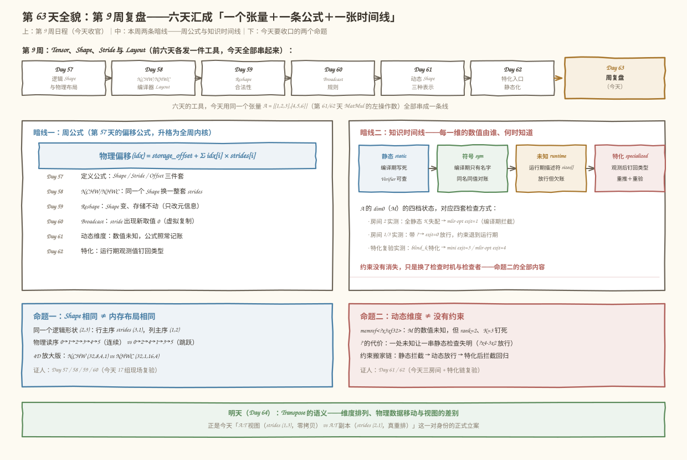
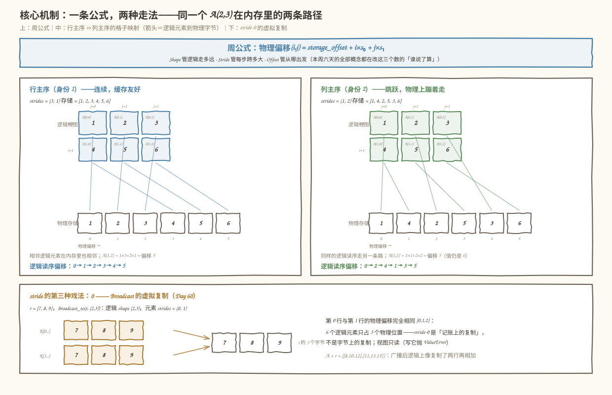
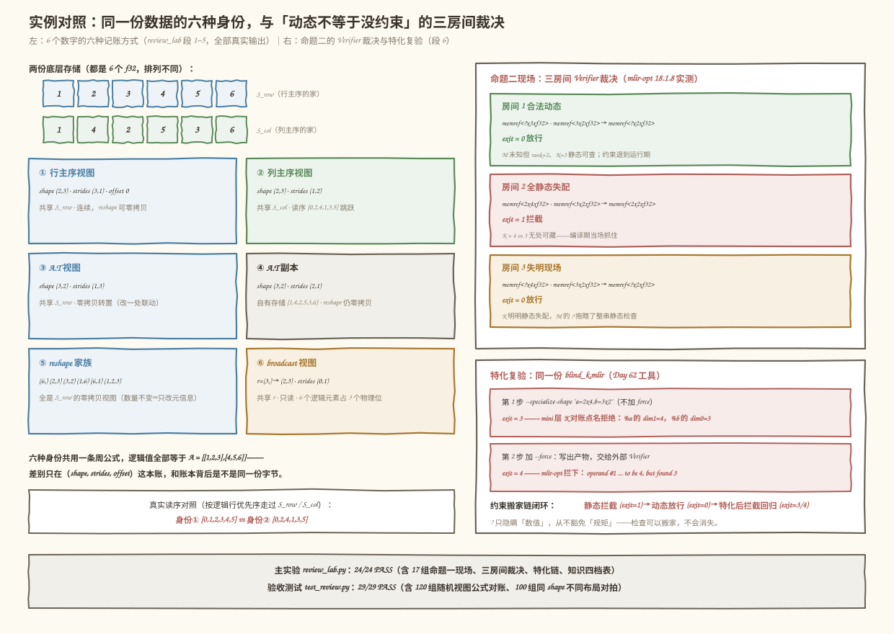
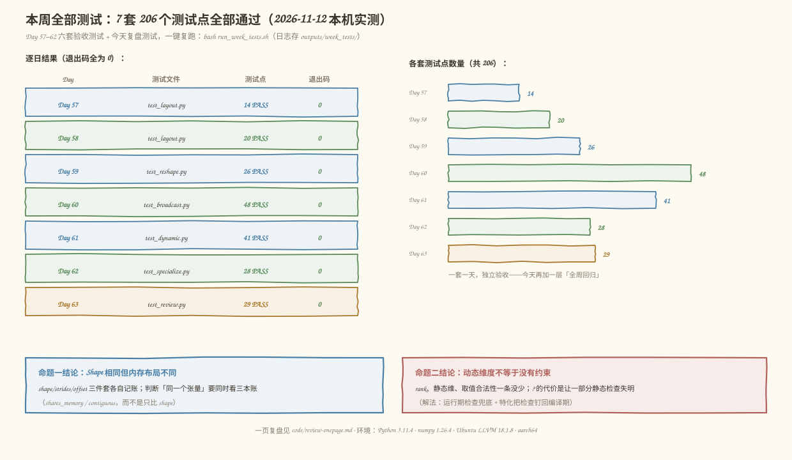

# 第 63 天：第 9 周复盘——一个张量的六种身份，一条公式串起六天

> **今日目标**：完成本教程后，你能用**同一个张量** `A = [[1,2,3],[4,5,6]]`（第 61/62 天 MatMul 的左操作数，本周出镜率最高的那份数据）把第 9 周六天串成一条线：解释清**命题一「Shape 相同但内存布局不同」**——同一个逻辑形状 `(2,3)` 可以有行主序 `strides (3,1)` 与列主序 `strides (1,2)` 两种物理摆放、同一个 `(3,2)` 可以是零拷贝转置视图也可以是真重排副本，Day 58 的 NCHW/NHWC 只是同款现象的 4D 放大；解释清**命题二「动态维度不等于没有约束」**——`memref<?x3xf32>` 的 M 未知，但 rank=2、K=3 仍然钉死、运行期取值仍须兑现这些约束，而 `?` 同时会让一部分静态检查**失明**（`?x4 · 3x2` 实测 exit=0 放行、`2x4 · 3x2` 实测 exit=1 拦截），约束没有消失、只是搬了家（运行期检查 / 特化后重新生效）；最后把本周**全部测试（Day 57–62 共 6 套 + 今天 1 套）**真实复跑一遍，并沉淀出一张可带走的一页复盘。
> **预计时间**：学习 40 分钟＋实践 45 分钟
> **前置准备**：第 57 天的 Shape / Stride / Storage Offset / Contiguous 四件套与偏移公式；第 58 天的 NCHW/NHWC 与「逻辑维序 vs 物理 Layout」；第 59 天的 Reshape 合法性（元素数量不变 + 零拷贝视图判据）；第 60 天的 Broadcast 右对齐规则与 stride-0 视图；第 61 天的三种维度表示（静态 `int` / 符号 / 未知）与三档约束表；第 62 天的特化三步（替换 + 重推 + 重验）与通用回退。工具：Python 3.10+ 与 numpy（本机 3.11.4 / 1.26.4）、`mlir-opt`（本机 Ubuntu LLVM 18.1.8，`/usr/lib/llvm-18/bin/mlir-opt`）。不需要 NPU。
> **今日产出**：一个主实验（`code/review_lab.py`：同一个 Tensor 的六种身份 + 一条偏移公式 + 三房间 Verifier 裁决，全真实运行）、一组复盘验收测试（`code/test_review.py`）、**本周全部测试的一键复跑**（`code/run_week_tests.sh`，Day 57–62 六套 + 今天一套，输出存 `code/outputs/week_tests/`）、一页复盘（`code/review-onepage.md`）以及 4 张示意图。

## 1. 今天解决什么问题？

第 9 周的六天，每天都在往你的工具箱里塞一件新工具：偏移公式（Day 57）、Layout（Day 58）、Reshape 合法性（Day 59）、Broadcast 规则（Day 60）、动态 Shape（Day 61）、特化入口（Day 62）。复盘日要防的不是「忘了某件工具」，而是一个更隐蔽的病：**词汇都认识，图景没打通**——让你解释「Shape 相同的两个张量为什么不一定是同一个东西」，你背得出定义，却拿不出一个从头到尾只用一份数据的现场。

先看两个真实失败现场（都在本机复现过）：

```text
现场一（布局）：三行代码打印出三个一模一样的 [[1, 2, 3], [4, 5, 6]]，
    shape 都是 (2, 3)、值都相等——但 strides 分别是 (3,1)、(1,2)、(3,1)+偏移。
    问：它们在内存里是同一份字节吗？能一视同仁地零拷贝 reshape 吗？
    （答案：不是；不能。第 57 天的 bad_load.mlir 就是拿错账本读错元素的现场。）

现场二（动态）：同一处 K 失配（A 的 dim1=4，B 的 dim0=3），两种命运——
    memref<2x4xf32> · memref<3x2xf32>  → mlir-opt exit=1 当场拦截
    memref<?x4xf32> · memref<3x2xf32>  → mlir-opt exit=0 放行（今天 5.3 节实测）
    问：动态维 = 没有约束吗？恰恰相反——约束还在，只是有一部分
    从「编译期可查」退到了「运行期才查」，中间形成了一个检查缺口。
```

今天的解法是**用一个贯穿的 Tensor 把六天拉回同一条线**。选本周出镜率最高的那份数据——第 61/62 天 MatMul 的左操作数：

```text
底层存储 S（6 个 f32，线性排布）：  [ 1, 2, 3, 4, 5, 6 ]
逻辑张量 A（2,3）：               [[1, 2, 3],
                                   [4, 5, 6]]
贯穿全文的一条公式（第 57 天的偏移公式，今天升格为「周公式」）：
  物理偏移(idx) = storage_offset + Σ idx[i] × strides[i]
```

这 6 个数字会以**六种身份**出场：行主序 A、列主序 A、转置视图 `A.T`、转置副本 `A.T` 的连续版、reshape 视图家族、broadcast 的 stride-0 视图。六种身份共用一条公式，而六天的内容恰好各认领其中一种身份的「记账规则」。今天结束时，你要能把这两个命题各用三句话说清：

- **命题一**：Shape 只回答「逻辑下标走多远」，Stride 才回答「每一步在内存里跨多大」——所以 Shape 相同的两个张量，可以是两份完全不同的字节序列。
- **命题二**：`?` 只回答「这一维的**数值**编译期不知道」，从不回答「这一维**没有规矩」——rank、静态维、取值范围这些约束一条没少，只是检查时机从编译期挪到了运行期（或者特化之后回来）。

## 2. 先看全貌：今天的内容位于哪里？



**图 1**：上半部分是第 9 周六天的日程条（Day 57 公式 → Day 58 Layout → Day 59 Reshape → Day 60 Broadcast → Day 61 动态 → Day 62 特化），全部汇入今天的复盘；下半部分是本周真正的两条暗线——**一条偏移公式**（所有身份共用）和**一张知识时间线**（每一维的数值由谁在什么时候知道：编译期静态 / 符号 / 运行期 / 特化钉死）。

用 4 步把全局串起来：

1. **前六天的分工**：Day 57 给出记账三件套（Shape / Stride / Offset）和偏移公式；Day 58 用 NCHW vs NHWC 证明「同 Shape 不同摆放」是生产级现象；Day 59 划清 Reshape 的零拷贝边界（连续才可视图化）；Day 60 让 Stride 出现新取值 0（虚拟复制）；Day 61 让某一维的数值「编译期不知道」；Day 62 把运行期观测到的数值钉回类型。
2. **今天的两个命题是六天的收口**：命题一由 Day 57/58/59/60 联名作证（布局、视图、副本、广播全是 stride 的戏法）；命题二由 Day 61/62 联名作证（约束的三档归属与失明现场）。
3. **本周位置**：第 9 周属于阶段三「图优化」的 Shape/Layout 地基——后面第 10 周的 Transpose/Permute、第 11 周的常量折叠与死代码消除，每一步 Rewrite 都要先问「这个操作改的是逻辑形状还是物理布局、动没动存储」。
4. **明天的衔接**：Day 64 讲 Transpose 的语义（维度排列 vs 物理数据移动 vs 视图）——恰好是今天「六种身份」里 `A.T` 那一对（视图 vs 副本）的正式立案。

## 3. 核心概念：先用直觉，再给准确定义

先给一个贯穿全文的类比：**仓库与两套台账**。6 件货（值 1～6）摆在 6 个货架上，这是**底层存储**；提货单上写「2 行 3 列」，这是 **Shape**；台账规则「第 i 行第 j 列的货在几号架」由 **Strides** 决定，**Offset** 说明从几号架起算。同一张提货单可以配两套台账（命题一）；「这批货的数量待定」（动态维度）也不代表「随便塞多少都行」——货架的对接口径早就定了（命题二）。对应到技术上是：**Shape/Strides/Offset 合成一条偏移公式，把逻辑下标映射到物理字节；换成 memref 语言，类型里的形状 + `strided<[...]>` + `offset: N` 就是这套账**。这个类比到两处就失效：现实中没有「步长为 0 的货架」（stride-0 广播是纯记账上的复制，字节根本不增加），也没有「负步长货架」（翻转视图是往前走），这两件事恰好说明 Strides 是**数学参数**，不是物理货架的属性——这正是类比的边界。

### 3.1 周公式：六天共用的那条线

- **一句通俗解释**：任何一个张量元素在内存里的位置，都由同一条公式算出：`物理偏移(idx) = storage_offset + Σ idx[i] × strides[i]`。
- **类比**：见上——台账规则决定「几行几列的货放在几号架」。
- **对应到技术上是**：Shape 只出现在公式的**求和范围**里（下标走多远），Strides 是**每一步的系数**，Offset 是**常数项**。第 57 天定义它；第 58 天换一整套 Strides（NCHW/NHWC）；第 59 天只改 Shape 不动存储（Reshape 零拷贝）；第 60 天让系数取 0（Broadcast 虚拟复制）；第 61 天让某个维度大小「公式照常、数值未知」；第 62 天把观测到的数值写回类型。六天没有一天跳出这条公式。
- **最小例子**：行主序 `A` 的 `A[1,2]`：`1×3 + 2×1 = 5`——正好是 6 在存储 `[1,2,3,4,5,6]` 里的下标。
- **常见误解**：把公式当成「第 57 天的老知识」。复盘的价值在于它是**唯一的**记账规则——后面第 10 周讲 Transpose/Permute 时，判断一次改写「动没动存储」的依据仍然是它。

### 3.2 命题一：Shape 相同但内存布局不同

- **一句通俗解释**：两个张量 shape 相同、值相同，完全可能是**两份不同的字节序列**——因为公式里的 Strides 和存储内容都可以不同。
- **类比**：同一张提货单，配两套台账，取货路径完全不同。
- **对应到技术上是**（今天实测的四种现场）：① 同 shape `(2,3)`：行主序 strides `(3,1)` 走读序 `[0,1,2,3,4,5]`，列主序 strides `(1,2)` 走 `[0,2,4,1,3,5]`，存储分别是 `[1,2,3,4,5,6]` 和 `[1,4,2,5,3,6]`；② 同 shape `(3,2)`：转置**视图**（strides `(1,3)`，改一字节联动）vs 转置**副本**（strides `(2,1)`，自有存储）；③ 4D 放大：NCHW `(32,8,4,1)` vs NHWC `(32,1,16,4)`，同一逻辑 `(1,4,2,4)`；④ stride-0：广播出来的 `(2,3)` 只有 3 个物理字节。
- **最小例子**：`np.array_equal(id1, id2)` 为 True，`np.shares_memory(id1, id2)` 为 False——「值相等」和「是同一份内存」是两个问题。
- **常见误解/类比边界**：「转置视图和副本反正值一样，随便用」。不等的地方在**下游权利**：连续的副本能零拷贝 reshape，非连续的视图会被迫拷贝（第 59 天）；把视图传给期待连续输入的算子，就要么付一次拷贝、要么换一个支持 strided 访问的实现。

### 3.3 命题二：动态维度不等于没有约束

- **一句通俗解释**：类型里写 `?` 只是说「这一维的**数值**编译期不知道」，从来不是说「这一维没有规矩」。
- **类比**：「这批货的数量待定」不代表货物可以随便堆——每层的格数（K）、货架层数（rank）早就定了，到货时还得点数对账。
- **对应到技术上是**：`memref<?x3xf32>` 的约束清单：rank 固定为 2、K=3 钉死、运行期 M 必须是正数、M 的实际值坐描述符的 `sizes[]` 里随参数传入。今天实测的两个方向：**约束仍在**（房间 1 放行只是把检查退到运行期）；**检查会失明**（房间 3：`?x4 · 3x2` 的 K 失配 exit=0 放行，同一失配全静态时 exit=1 拦截——一个 `?` 拖瞎一串静态检查）。特化把数值钉回类型后，检查重新生效（同款 IR 特化后 exit=3/4 被拒）。
- **最小例子**：同一份 K 失配 IR 的三种命运——动态放行（exit=0）→ 全静态拦截（exit=1）→ 特化后拦截回归（exit=3/4）。
- **常见误解**：「动态 = 什么都行」和「动态 = 不安全」都不对。前者的反例是 rank/K 约束仍然生效；后者的反例是合法动态（房间 1）配合运行期检查完全可用。准确的说法是：**约束分编译期账和运行期账两本，`?` 只是把一部分账从前者挪到后者**。

### 3.4 知识时间线：谁在什么时候知道哪一维

- **一句通俗解释**：本周真正的暗线不是「维度的值是多少」，而是「这个值**由谁、在什么时候**知道」。
- **对应到技术上是**（A 的 dim0=M 的四档）：**静态** `memref<2x3xf32>`（写类型那一刻，Verifier 可查）→ **符号** `Sym("M")`（编译期只有名字，同名必须同值）→ **未知** `memref<?x3xf32>`（运行期输入到达，检查退到运行期）→ **特化** `memref<2x3xf32>` 产物（运行期观测后钉回，重推 + 重验）。第 61 天引入前三档，第 62 天补上第四档。
- **最小例子**：同一个 M，在四档里分别是「2」「一个名字」「描述符里的运行期值」「被观测值钉死的 2」。
- **常见误解**：把「特化」当成第五种新知识。不是——特化产物里的 2 仍然是**运行期观测到的那个 2**，只是被搬进了类型；这也解释了为什么特化必须配通用回退：观测值只承诺它见过的 Shape。

## 4. 图解核心机制

一条公式如何同时解释行主序、列主序和 stride-0 广播，如图 2：



**图 2**：顶部是周公式；左右两个面板是同一个逻辑 `A(2,3)` 的两种布局——箭头是「逻辑元素 → 物理字节」的映射，两个面板的箭头形状完全不同；底部是 stride-0 的虚拟复制。全部数字来自今天的真实运行。

按图中编号读：

1. **公式是同一个，系数不同**：左面板 `A[1,2] = 1×3 + 2×1 = 5`，右面板 `A[1,2] = 1×1 + 2×2 = 5`——**同一个逻辑元素落在同一格值上**，但两边的箭头走了完全不同的路径。这就是「Shape 相同但内存布局不同」的全部机制。
2. **列主序为什么必须换存储**：右面板的存储是 `[1,4,2,5,3,6]` 而不是 `[1,2,3,4,5,6]`——只改 strides 不改存储，逻辑值就变成了 `[[1,3,5],[2,4,6]]`（另一个张量）；要保值就必须连存储一起重排（5.4 节对照实验一实测）。
3. **stride-0 是公式的自然推广**：`broadcast_to(r, (2,3))` 的 strides 是 `(0,1)`，第 1 行的每个元素 `1×0 + j×1` 和第 0 行落在**同一格**——6 个逻辑元素只占 3 个物理位置。「复制」发生在账本上，不发生在字节上，所以视图只读（写它抛 `ValueError`）。
4. **知识时间线不改变公式**：`?` 不会让公式失效，只是让「M 的取值」这一项在编译期算不出结果——第 61/62 天的全部内容都是关于这个「算不出」的代价与补救。

## 5. 动手实践：完成一个最小可运行例子

### 5.1 准备文件

```text
tutorials/day-063/
├── README.md
├── images/                        # 4 张示意图（本文图 1–4）
└── code/
    ├── review_lab.py              # 主实验：一个张量的六种身份 + 三房间裁决（24 项检查）
    ├── test_review.py             # 复盘验收测试（A–D 四段 29 个测试点）
    ├── run_week_tests.sh          # 本周全部测试一键复跑（Day 57–63 共 7 套）
    ├── run_all.sh                 # 今天的一键复跑（环境 + 主实验 + 测试 + 周测试）
    ├── make_images.py             # 生成 4 张 SVG 的脚本
    ├── review-onepage.md          # 一页复盘（计划要求的产出之一）
    └── outputs/                   # 全部真实输出
        ├── review_lab.txt         # 主实验完整输出（24/24）
        ├── test_review.txt        # 验收测试（29/29）
        ├── contrast1.txt          # 5.4 对照实验一
        ├── contrast2.txt          # 5.4 对照实验二（room1 特化成功）
        ├── room1.mlir             # 合法动态 IR（对照实验二的输入）
        ├── room1_spec.mlir        # 对照实验二的特化产物（exit=0，合法）
        ├── blind_k.mlir           # 失明现场 IR（段 6 的输入）
        ├── blind_k_spec_rejected.mlir  # --force 写出但被拒的产物
        └── week_tests/            # 7 套测试的逐日日志 + summary.txt
```

运行方式（在 `code/` 目录下）：

```bash
bash run_all.sh        # 环境 → 主实验 → 验收测试 → 本周全部测试
```

### 5.2 编写代码

主实验 `review_lab.py`（约 400 行）分八段，最见「复盘功力」的是两处。第一处——**同一逻辑值的两种布局怎么构造**（命题一的根基）：

```python
# 身份 1：行主序——A 的自然摆放
S_row = np.arange(1, 7, dtype=np.float32)          # [1,2,3,4,5,6]
id1 = S_row.reshape(2, 3)                          # strides (3,1) offset 0

# 身份 2：列主序——同一个逻辑 A，但存储按列摆放
#   存储内容必须换成 [1,4,2,5,3,6]，strides 才能是 (1,2)
S_col = np.ascontiguousarray(A.T).ravel().astype(np.float32)
id2 = S_col.reshape(3, 2).T                        # shape (2,3) strides (1,2)
```

注意 `id2` 的构造链：先转置再拉平得到**重排过的存储**，再 `reshape(3,2).T` 套上列主序步长——这一行就是「命题一」的可执行版本：**换布局必须换存储，只换 strides 换出来的是另一个逻辑张量**（5.4 节对照实验一会专门踩这个坑）。

第二处——**三房间 IR 的构造与裁决**（命题二的现场）：

```python
rooms = [
    ("房间 1：合法动态  ?x3 · 3x2 → ?x2",
     matmul_ir("memref<?x3xf32>", "memref<3x2xf32>", "memref<?x2xf32>"),
     0, "M 未知但 rank=2、K=3 静态可查——放行，约束退到运行期"),
    ("房间 2：全静态失配 2x4 · 3x2 → 2x2",
     matmul_ir("memref<2x4xf32>", "memref<3x2xf32>", "memref<2x2xf32>"),
     1, "K=4 vs 3 无处可藏——Verifier 当场拦截"),
    ("房间 3：失明现场  ?x4 · 3x2 → ?x2",
     matmul_ir("memref<?x4xf32>", "memref<3x2xf32>", "memref<?x2xf32>"),
     0, "K=4 vs 3 明明都是静态，但 M 的 ? 让推断整体失效——放行（缺口）"),
]
for tag, ir, expect, why in rooms:
    code = mlir_opt_verdict(ir, tag)      # subprocess 喂给 mlir-opt，拿退出码
```

三个房间只差类型串里的两三个字符，裁决却是 0/1/0——房间 3 是本周最重要的一张「负面证据」：`?` 对静态检查的破坏是**整串的**，不是局部的。段 6 后半部分接着把房间 3 的 IR 落盘，交给第 62 天的 `specialize.py` 走特化链（不加 `--force` 期望 exit=3、加了期望 exit=4），把「约束搬家」的闭环跑通。

### 5.3 运行与观察

以下均为**本机真实执行结果**（2026-11-12，Python 3.11.4 / numpy 1.26.4 / Ubuntu LLVM 18.1.8 / aarch64，完整输出存 `code/outputs/review_lab.txt`）。先看命题一的主现场：

```text
$ python3 review_lab.py
== 1. 命题一 A：同 Shape (2,3)，两种布局 ==
身份 1（行主序）: shape=(2, 3) strides=(3, 1) offset=0 存储=[1, 2, 3, 4, 5, 6]
身份 2（列主序）: shape=(2, 3) strides=(1, 2) offset=0 存储=[1, 4, 2, 5, 3, 6]

逐元素账本（值 @ 物理偏移，括号里是周公式的手算过程）：
  身份1: A[0,0]=1@0(0×3+0×1)  A[0,1]=2@1(0×3+1×1)  A[0,2]=3@2(0×3+2×1)
         A[1,0]=4@3(1×3+0×1)  A[1,1]=5@4(1×3+1×1)  A[1,2]=6@5(1×3+2×1)
  身份2: A[0,0]=1@0(0×1+0×2)  A[0,1]=2@2(0×1+1×2)  A[0,2]=3@4(0×1+2×2)
         A[1,0]=4@1(1×1+0×2)  A[1,1]=5@3(1×1+1×2)  A[1,2]=6@5(1×1+2×2)

按逻辑读序（行优先）走过的物理偏移序列：
  身份 1（连续）: [0, 1, 2, 3, 4, 5] ← 相邻逻辑元素在内存里也相邻
  身份 2（跳跃）: [0, 2, 4, 1, 3, 5] ← 同样的逻辑读序，物理上蹦着走
[PASS] 1a 两身份 shape 相同且值逐位相等
[PASS] 1b 两身份底层字节不同（不是同一份内存）（S_row=[1, 2, 3, 4, 5, 6] vs S_col=[1, 4, 2, 5, 3, 6]）
```

逐元素账本里两行 `A[1,2]=6@5` 值得盯十秒：**同一个逻辑元素、同一个值、同一个物理下标，两边的推导过程完全不同**——`1×3+2×1` 与 `1×1+2×2`。这就是「同 Shape 不同布局」的最小完整样本。六种身份的完整对照如图 3：



**图 3**：左侧是 6 个数字的六种记账方式（两份存储 + 六张身份卡，含各自的 shape/strides/归属），右侧是命题二的三房间裁决与特化复验——右下角的约束搬家链把第 61、62 天接回今天。

对着图读三个结论：

1. **身份 ② 和身份 ④ 共享同一份存储 `[1,4,2,5,3,6]`**：列主序的 A 和 A.T 的连续副本是同一段字节——不是巧合，转置的两种实现（换 strides vs 重排存储）在极限处相遇。
2. **身份 ③（视图）和 ④（副本）shape、值全同，下游权利不同**：③ reshape `(6,)` 被迫拷贝、④ 仍零拷贝——第 59 天的「连续性判据」在复盘里归位。
3. **右侧三行裁决只差几个字符**：`?x3/2x4/?x4` 一字之差，exit 码 0/1/0——动态的「检查失明」不是玄学，是推断链条上一环断了整链失效。

再命题二的特化复验段（真实输出）：

```text
== 6. 命题二：动态维度不等于没有约束（三房间裁决 + 特化复验）==
  房间 1：合法动态  ?x3 · 3x2 → ?x2: mlir-opt exit=0（预期 0，符合预期）
  房间 2：全静态失配 2x4 · 3x2 → 2x2: mlir-opt exit=1（预期 1，符合预期）
  房间 3：失明现场  ?x4 · 3x2 → ?x2: mlir-opt exit=0（预期 0，符合预期）

  特化复验（Day 62 的 specialize.py，同一份 blind_k.mlir）：
    不加 --force: exit=3 —— 错误（K 对账失败）：K 对不上账：%a 的 dim1=4，
                  %b 的 dim0=3（--force 可跳过本检查，交给 mlir-opt）
    加 --force:   exit=4 —— .../tmp...mlir:4:5: error: 'linalg.matmul' op
                  inferred input/output operand #1 has shape's dimension
                  #0 to be 4, but found 3
    → 约束搬家链闭环：静态拦截(exit=1) → 动态放行(exit=0) → 特化后拦截回归(exit=3/4)

== 7. 知识时间线：A 的 dim0（M）的四档状态 ==
  档位              写法                          数值何时知道      约束在哪查
  静态 static       memref<2x3xf32>（写死）        写类型那一刻      编译期 Verifier
  符号 sym（mini）   Sym("M") + 约束表同名对账       编译期只有名字    推导时同名必须相等
  未知 runtime      memref<?x3xf32>（描述符）      运行期输入到达    运行期检查 / 放行欠账
  特化 specialized  memref<2x3xf32>（观测值钉回）   运行期观测之后    重推 + 重验

==================================================================
汇总：PASS 24 / FAIL 0
```

### 5.4 修改一个参数再观察

**对照实验一：只换 strides、不换存储，看逻辑值怎么变。** 把身份 2 的构造里那步「重排存储」去掉，直接给原存储套列主序步长：

```text
$ python3 - <<'EOF'   （完整记录存 outputs/contrast1.txt）
S = np.arange(1, 7, dtype=np.float32)
wrong = S.reshape(3, 2).T          # 只换 strides、不换存储
行主序 A              = [[1, 2, 3], [4, 5, 6]]  strides (3, 1)
S 直接套 strides(1,2) = [[1, 3, 5], [2, 4, 6]]  strides (1, 2)
换存储后列主序 A      = [[1, 2, 3], [4, 5, 6]]  strides (1, 2)
EOF
```

只换 strides 的那一行，逻辑值立刻变成 `[[1,3,5],[2,4,6]]`——**它是同一个存储上的另一个张量**（第 57 天的转置视图），不是「A 的另一种布局」。命题一的准确表述由此显影：*逻辑值不变的前提下*，Shape 相同的两种布局必然对应两份不同的物理序列；反过来说，同一份物理序列配不同 strides，得到的是不同逻辑值。「同 Shape 不同布局」和「同存储不同视角」是一枚硬币的两面，分清哪一面在说话，是本周最容易滑过去的一步。

**对照实验二：把失明现场的 spec 换成正确观测值，看特化链走通。** 房间 3 的 IR 换成房间 1 的合法动态版本（`?x3 · 3x2`，K 本来就对），再走同一条特化链（`outputs/contrast2.txt`）：

```text
$ python3 ../../day-062/code/specialize.py outputs/room1.mlir \
        --specialize-shape "a=2x3,b=3x2" -o outputs/room1_spec.mlir
  %a : memref<?x3xf32> → memref<2x3xf32>   （spec）
  %b : memref<3x2xf32>   [3x2] 全静态，未改动
  %o : memref<?x2xf32> → memref<2x2xf32>   （输出重推）
共替换 4 处类型串（2 种类型）
重新验证（mlir-opt parse+verify）：exit=0 通过       ← exit=0，全链走通
```

同一个工具、同一条链：观测值与类型不冲突（2x3 对上 ?x3 的 K=3）就是合法特化（exit=0），观测值与静态维打架（2x4 撞 ?x4）就是被拒（exit=3/4）。**特化本身没有对错，对错在于观测值是否兑现了类型里剩下的约束**——这就是命题二在工程侧的落点。

### 5.5 本周全部测试与一页复盘

计划要求复盘日交出「本周全部测试」。`run_week_tests.sh` 把 Day 57–62 的六套验收测试加今天的复盘测试一起复跑，逐日日志存 `code/outputs/week_tests/`。以下是**本机真实执行结果**（`outputs/week_tests/summary.txt`）：

```text
$ bash run_week_tests.sh
Day    测试文件           结果       退出码
-------------------------------------------------------------
057    test_layout.py         14 PASS      0
058    test_layout.py         20 PASS      0
059    test_reshape.py        26 PASS      0
060    test_broadcast.py      48 PASS      0
061    test_dynamic.py        41 PASS      0
062    test_specialize.py     28 PASS      0
063    test_review.py         29 PASS      0
-------------------------------------------------------------
合计：206 PASS / 0 FAIL / 0 SKIP（共 206 个测试点，7 套）
第 9 周测试状态：全部通过 ✓
```

今天的 `test_review.py` 补上了复盘专属的缺口，四段 29 个测试点里有两处是全周没做过的：**A 段**用 120 组随机形状（1–4 维、随机组合转置/隔行切片/广播）共 1421 个元素做「周公式 vs `ctypes` 实测地址」的对账；**B6** 用 100 组随机「转置 + 连续化 + 转回来」构造出同 shape、同值、不同布局、不共享内存的张量对——命题一从手算例子升级成了随机化性质。汇总如图 4：



**图 4**：左侧是逐日结果表（退出码全 0），右侧是各套测试点数量的手绘条形图；底部两个盒子是两个命题最终带走的结论。一页复盘的完整版在 `code/review-onepage.md`——六天速查表、两个命题、知识时间线、测试汇总和「带走的三句话」，可以直接贴在工位上。

## 6. 常见错误与排查

**错误 1：用 `shape` 相等判断「是同一个张量」**

- **现象**：两个 `(2,3)` 的张量 `np.array_equal` 为 True，就当成同一份数据往下传；某个算子对非连续输入走拷贝路径，性能或行为和预期不符（第 57 天 `bad_load.mlir` 就是拿错账本读错元素）。
- **原因**：「值相等」+「shape 相同」只锁定了逻辑视角，没锁定 Strides / Offset / 存储归属——命题一的四种现场全都满足这两个条件。
- **定位**：三连问：`v.strides`、`v.ctypes.data - base`（偏移）、`np.shares_memory(a, b)`；MLIR 侧看类型的 `strided<[...], offset: N>` 部分。
- **修复**：下游需要连续输入时显式 `ascontiguousarray`；需要判断别名时用 `shares_memory`；文档里把「要求 C-contiguous」写成调用约定。

**错误 2：以为 `memref<?x3xf32>` 什么都拦不住 / 或什么都拦得住**

- **现象**：两种相反的翻车——(a) 以为 `?` 后面藏不住错误，结果 `?x4 · 3x2` 的 K 失配实测 exit=0 放行，带着错误 IR 跑到运行期才爆；(b) 以为动态类型不安全什么都不敢用，实际上合法动态（`?x3 · 3x2`）配合运行期检查完全正确。
- **原因**：`?` 对静态检查的破坏是整串的（推断链条一环断、全链失效——房间 3 实测），但约束本身没有消失，只是分成了「编译期账」和「运行期账」两本。
- **定位**：把每一维按知识时间线归档（静态/符号/未知/特化）；静态维失配当场测（房间 2 的 exit=1 就是标尺）；动态维列出运行期必须检查的清单。
- **修复**：静态可见的失配静态拦（mini 层 K 对账，exit=3）；动态维配运行期检查或走特化（正确的 spec → exit=0 产物 + 分发回退，对照实验二）。

**错误 3：对非连续视图做 reshape，期待零拷贝**

- **现象**：`np.reshape(A.T, (6,))` 之后 `np.shares_memory` 是 False；MLIR 侧对非连续 memref 做融合改写时 layout 对不上（第 58 天实测：Verifier 拒绝把重排布局谎报成转置视图）。
- **原因**：`(6,)` 需要 strides `(1,)`，而 `A.T` 的逻辑读序在物理上是跳跃的，单一 stride 表达不出来——公式算不出合法系数，只能重排字节。
- **定位**：先查 `v.flags['C_CONTIGUOUS']`（numpy）或类型的 strides；今天 2c/2d 检查就是这对判据（非连续→拷贝、连续→视图）。
- **修复**：要么先连续化（付一次拷贝），要么保留多维形状让下游按 strided 访问（第 59 天的两条出路）。

**错误 4：往广播视图里写数据**

- **现象**：`R = np.broadcast_to(r, (2,3))` 之后 `R[0,0] = 99` 抛 `ValueError: assignment destination is read-only`（今天 5d 实测）。
- **原因**：stride-0 是**记账上的复制**——两个逻辑行共享同一批字节，写任何一格都会同时改变「多份拷贝」，所以框架直接把视图设为只读。
- **定位**：看到 strides 里的 0 就要意识到这是共享视图；`R.flags.writeable` 为 False 是直接证据。
- **修复**：需要可写结果时先物化（`np.broadcast_to(...).copy()` 或直接用广播运算生成新数组）；只读消费（A + r）则完全没问题。

## 7. 今日练习

### 必做练习

拿贯穿例子练手，**先笔算再跑**：

1. **笔算偏移账本**：给定存储 `S = [1,2,3,4,5,6]`、shape `(2,3)`、strides `(1,2)`，写出六个元素的值矩阵和各自的物理偏移；再回答：这个张量与行主序 A（值 `[[1,2,3],[4,5,6]]`）逻辑值是否相等？它与「A 的列主序布局」差在哪一步？预期：值矩阵是 `[[1,3,5],[2,4,6]]`（与 5.4 对照实验一的 `wrong` 相同——它是转置视图不是布局）；差的那一步是「存储重排」。用 `python3 -c` 或在 `review_lab.py` 里改一行核对。
2. **笔算三房间裁决**：先给三段 IR 写下你预测的 exit 码再跑核对——(a) `memref<?x3xf32> · memref<?x2xf32> → memref<?x2xf32>`（右侧 rank=2）；(b) `memref<2x3xf32> · memref<3x2xf32> → memref<2x2xf32>`；(c) `memref<?x3xf32> · memref<4x2xf32> → memref<?x2xf32>`（K 失配挪到 B 侧）。预期依次：0（全动态互相未知）、0（合法）、0（失明——K=3 是静态、B 的 dim0=4 也是静态，但 M 的 `?` 拖瞎推断；注意失明与失配在哪一侧无关）。用 `mlir-opt -` 从 stdin 喂 IR 验证。
3. **笔算广播账本**：`(2,3) + (2,1) → (2,3)`——写出右操作数扩展后的 strides（提示：`(2,1)` 先右对齐补成 `(1,2)`？不对，`(2,1)` 与 `(2,3)` 右对齐后 dim1 是 `1 vs 3`，扩展后 strides 是 `(1,0)` 还是 `(0,1)`？），再笔算 `A + [[10],[20]]` 的值。预期：扩展维的 stride 是 0，结果是 `[[11,12,13],[24,25,26]]`。用 `np.broadcast_to([[10],[20]], (2,3)).strides` 和 `A + np.array([[10],[20]])` 核对。
4. **复跑全周回归**：跑 `bash run_all.sh`，把 `outputs/week_tests/summary.txt` 的 7 行数字与图 4 对照；再抽查 `outputs/week_tests/day-060.txt` 里任意 3 个 `[PASS]`，回到第 60 天的教程确认你能说清它测的是什么。

### 选做挑战

给 `review_lab.py` 加**第 7 种身份**：带偏移切片 `P[1:7].reshape(2,3)`（P 是 `[99,1,2,3,4,5,6,99]`）和**第 8 种身份**：负 stride 翻转视图 `A[:, ::-1]`。要求：打印每种身份的 `(shape, strides, offset)`，逐元素验证周公式，并回答两个新问题——(a) 带偏移视图的 `storage_offset` 是多少（预期 1）；(b) 负 stride 的翻转视图 reshape `(6,)` 是拷贝还是视图（预期拷贝：读序物理倒退，单一正 stride 表达不出）。改完跑 `python3 review_lab.py`，原有 24 项检查必须仍然全过。

## 8. 今日验收

- [ ] 我能用自己的话讲清**周公式**（`物理偏移 = offset + Σ idx×stride`）如何统一本周六天：Day 57 定义、Day 58 换整套 strides、Day 59 只改 shape、Day 60 系数取 0、Day 61 数值未知、Day 62 观测值钉回——并能对 `A[1,2]` 在 `(3,1)` 与 `(1,2)` 两种 strides 下各手算一遍（都落到偏移 5）；
- [ ] 我能独立构造「Shape 相同但内存布局不同」的两对现场（行主序 vs 列主序的 `(2,3)`、视图 vs 副本的 `(3,2)`），并用 `array_equal` + `shares_memory` + `strides` 三件工具证明「值相同、内存不同、权利不同」；
- [ ] 我能解释「动态维度不等于没有约束」的两个方向：约束仍在（rank/K/运行期取值），检查会失明（`?x4·3x2` 放行 vs `2x4·3x2` 拦截，一字之差 exit 0 vs 1），并画出约束搬家链（静态拦截 → 动态放行 → 特化后拦截回归 exit=3/4）；
- [ ] 我能独立运行 `bash code/run_all.sh`，复现主实验 24/24、验收测试 29/29、本周 7 套 206/206，并说清 test_review 里 A 段（120 组随机视图公式对账）和 B6（100 组同 shape 不同布局对拍）各验证了哪个命题；
- [ ] 我能定位今天列出的四类错误：只看 shape 判断同一张量、对 `?` 的两个相反误解、非连续视图期待零拷贝 reshape、写广播视图——每类都能报出今天实测的证据（shares_memory False、exit 0/1/0、exit=3/4、ValueError）；
- [ ] 我保存了一页复盘（`code/review-onepage.md`）、主实验与全部测试的真实输出（`code/outputs/`，含 `week_tests/` 七份日志）和 4 张示意图（`tutorials/day-063/`）。

## 9. 一句话总结与明天预告

本周的问题从「Shape 到底说了什么」开始，今天的复盘把它收成一条线：**一条公式**（`物理偏移 = offset + Σ idx×stride`）+ **一个张量的六种身份**（行主序/列主序/转置视图/转置副本/reshape 家族/stride-0 广播）统一了 Day 57–60 的布局世界，**一张知识时间线**（静态 → 符号 → 未知 → 特化）统一了 Day 61–62 的动态世界。两个命题各有实测支撑：命题一「Shape 相同但内存布局不同」——同一个 `(2,3)` 的逻辑读序 `[0,1,2,3,4,5]` vs `[0,2,4,1,3,5]`，加上 4D 的 `(32,8,4,1)` vs `(32,1,16,4)`；命题二「动态维度不等于没有约束」——三房间裁决 0/1/0 与特化链 3/4 拼出完整的约束搬家链。验证侧，今天新增 `review_lab.py` 24/24、`test_review.py` 29/29（含 120 组随机视图 1421 个元素的公式对账、100 组同 shape 不同布局对拍），并把全周 7 套测试 206/206 一键复跑归档。

明天（Day 64）讲 **Transpose 的语义**：维度排列、物理数据移动与视图之间的差别——今天六种身份里 `A.T` 那一对（零拷贝视图 strides `(1,3)` vs 真重排副本 strides `(2,1)`）正是它的完整提纲。
