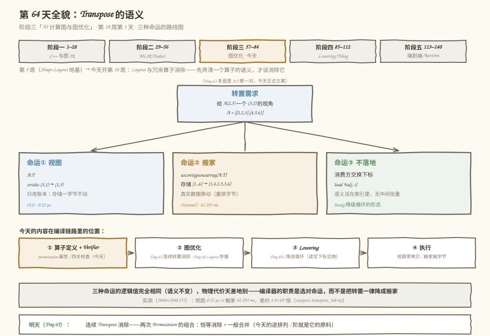
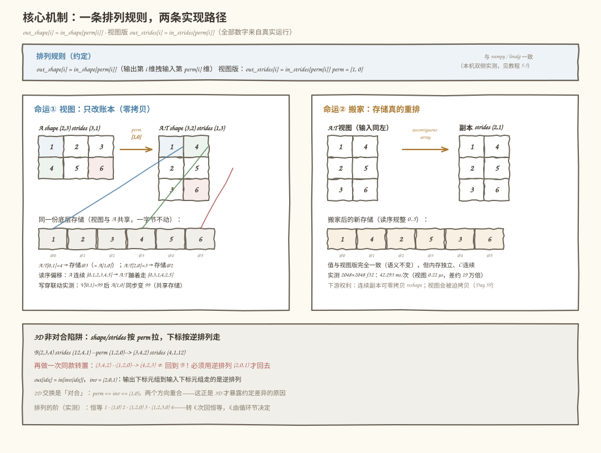
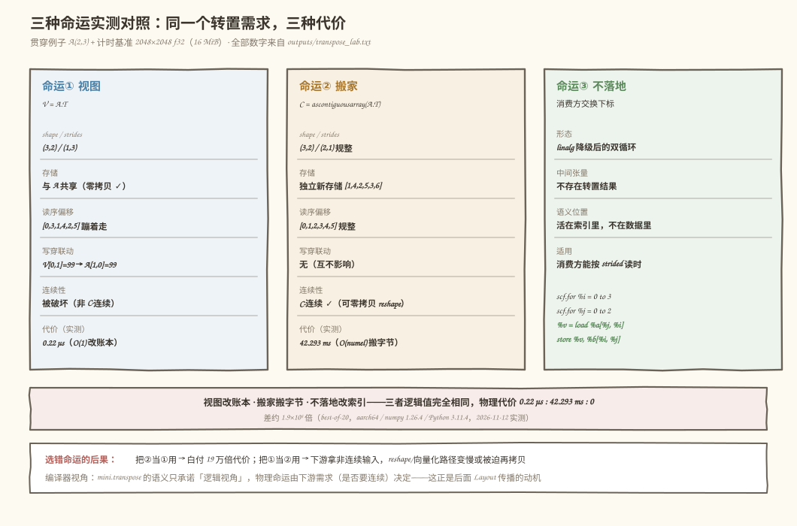

# 第 64 天：Transpose 的语义——一次转置，三种命运

> **今日目标**：完成本教程后，你能说清「转置」这个词**承诺了什么、没承诺什么**——它承诺的只是一个逻辑视角（维度排列），从不承诺物理上搬不搬数据；能给 `mini.transpose` 写出带 Permutation（排列）属性的 Operation 文本和**四关 Verifier**（长度 → 值域 → 双射 → 形状，顺序本身就是设计决策）；能用同一条转置需求区分**三种命运**——视图（改账本，实测 0.22 µs）、搬家（搬字节，实测 42.293 ms，差约 1.9×10⁵ 倍）、不落地（消费方交换下标）；并能在 MLIR 侧用 `linalg.transpose` 的 8 个真实裁决（含两个「只差维序」的约定现场）验证你自己的理解。
> **预计时间**：学习 40 分钟＋实践 45 分钟
> **前置准备**：第 57 天的偏移公式（`物理偏移 = offset + Σ idx[i]×strides[i]`）；第 59 天 reshape 的「零拷贝视图 vs 被迫拷贝」判据（今天会反复对照它）；第 63 天复盘里 `A.T` 的两个身份（视图 strides `(1,3)` / 副本 strides `(2,1)`）——今天就是给它们「正式立案」。工具：Python 3.10+ 与 numpy（本机 3.11.4 / 1.26.4）、`mlir-opt`（本机 Ubuntu LLVM 18.1.8，`/usr/lib/llvm-18/bin/mlir-opt`）。不需要 NPU。
> **今日产出**：`mini.transpose` Operation（IR 文本 + permutation 属性，`code/transpose_lab.py`）、四关 Verifier（21/21 主实验通过）、独立验收测试（`code/test_transpose.py`，63/63 通过）、两个可复跑的 MLIR IR 文件（`transpose_2d.mlir` 合法 exit=0 / `bad_transpose.mlir` 非法 exit=1）、`outputs/` 全部真实输出，以及 4 张示意图。

## 1. 今天解决什么问题？

第 63 天复盘收尾时留了一个悬念：同一个 `A.T`，在「六种身份」里占了两个坑——转置**视图**（strides `(1,3)`，与 A 共享存储）和转置**副本**（strides `(2,1)`，自有存储 `[1,4,2,5,3,6]`）。当时只说「下游权利不同」，没说清为什么同一句话能长出两个完全不同的物理结果。今天正式立案。

先看两个真实失败现场（都在本机复现过）：

```text
现场一（性能）：同一句「转置 2048×2048 f32（16 MiB）」——
    big.T                     0.22 µs/次     （改账本）
    ascontiguousarray(big.T)  42.293 ms/次   （搬字节）
    差约 19 万倍。以为「转置必然免费」的人会在下游拿到非连续输入时
    被迫再拷贝一次；以为「转置必然搬数据」的人会白付 19 万倍代价。

现场二（正确性）：给 2 维输入写排列 [2, 0]（值越界），拿去喂
    linalg.transpose（本机 LLVM 18.1.8 实测）——操作确实被拒（exit=1），
    但报错是：dim(result, 0) = 3 doesn't match
              dim(input, permutation[0]) = 187651783086528
    「维度 = 1876 万亿」？这不是维度，是越界读到的未定义值——
    诊断路径先拿 2 去查 shape，读到了栈上的垃圾数字。
```

这两个现场指向同一个根因：**「转置」这个词只承诺逻辑语义（把维度重新排列），完全不承诺物理实现**。分不清承诺和没承诺的部分，性能和正确性都会翻车。

今天的解法是把一次转置拆成三件互相独立的事，用一个贯穿例子讲透：

```text
贯穿例子（第 63 天同款数据）：
  A(2,3) = [[1, 2, 3],        底层存储 S = [1, 2, 3, 4, 5, 6]
             [4, 5, 6]]        行主序 strides (3, 1)
  排列属性 permutation = [1, 0]（输出第 i 维拽输入第 perm[i] 维）

  三维放大（专门用来暴露约定陷阱）：
  B(2,3,4) = arange(24)，strides (12, 4, 1)，permutation (1, 2, 0)
```

今天要回答三个问题：**① 转置的语义到底是什么（Permutation 属性怎么记）？② 合法性怎么验证（四关 Verifier，顺序为什么重要）？③ 视图 / 搬家 / 不落地三种物理命运各是什么、何时选谁？**

## 2. 先看全貌：今天的内容位于哪里？



**图 1**：上半部分是课程位置——第 10 周「Layout 与冗余算子消除」的第一天，地基是第 9 周的 Shape/Stride 词汇表；中间是今天的核心图景——一个居中的「转置需求」扇形展开成三种命运（视图 / 搬家 / 不落地），每个框里标了实测代价；底部是编译链路位置和明天的去向。

用 4 步把全局串起来：

1. **上周给的地基**：第 57 天的偏移公式是所有讨论的裁判；第 59 天 reshape 已经建立了「零拷贝视图 vs 被迫搬家」的判定框架——今天会发现转置在这个框架里是个**特权阶级**（第 3.2 节）。
2. **今天在链路里的位置**：算子定义 + Verifier 是图优化的**前置**。第 10 周要做的事——Day 65 消除连续转置、Day 68 让 Transpose 穿过逐元素算子——每一步 Rewrite 都得先精确回答「这个 Transpose 的语义是什么、动没动存储」。语义含糊，消除就是赌博。
3. **今天的产品**：一个 `MiniTransposeOp`（IR 文本 + permutation 属性 + 打印/解析往返）、一个四关 `verify_transpose`（含报错质量设计）、一套 63 项验收测试，外加 MLIR 侧 8 个真实裁决案例。
4. **明天的衔接**：连续 Transpose 消除用的「组合排列」「逆排列」「阶」，今天只作为性质测出来（`perm_order`、`inverse_perm`），不做任何 Rewrite——那是 Day 65 的领地。

## 3. 核心概念：先用直觉，再给准确定义

先给一个贯穿全文的类比：**同一间教室，换一张座位表**。学生（字节）坐在座位（存储格子）上一动不动；你只是把座位表上「第 i 排第 j 列」的**编号规则**对调了（strides 对调）。于是「第 1 排第 2 列」这个名字现在指的是另一个人——逻辑视角变了，物理世界纹丝不动。对应到技术上是：**视图转置 = 只重排 strides，`out_strides[i] = in_strides[perm[i]]`，偏移公式在同一份存储上重新求值**。这个类比有三处失效：①教室是二维的，排列可以作用于任意秩的张量；②类比里没有「搬家」的自然对应——让学生真的按新表就座，正是那个贵 19 万倍的 `ascontiguousarray`；③真实座位表从 1 开始编号，下标世界从 0 开始。

### 3.1 Permutation（排列）属性：转置的唯一语义载体

- **一句通俗解释**：转置的全部语义就是一张**排列表**（permutation）——「输出的第 `i` 个维度，拽的是输入的第 `perm[i]` 个维度」，除此之外它什么都没说。
- **类比**：座位表上每行写「本排学生的来源」——第 0 行写「原第 1 排」，第 1 行写「原第 0 排」。
- **对应到技术上是**（mini 的约定，与 numpy、LLVM 18 的 `linalg.transpose` 一致，两侧都本机实测过）：

  ```text
  out_shape[i]   = in_shape[perm[i]]        （Shape 推导）
  out_strides[i] = in_strides[perm[i]]      （视图配方，见 3.2）
  perm = [1, 0]：A(2,3) → A.T(3,2)，strides (3,1) → (1,3)
  ```

- **最小例子**：`A.T[0,1] = 4`。物理偏移 = `0×1 + 1×3 = 3`——正好是存储 `[1,2,3,4,5,6]` 里 4 的位置，也正是 `A[1,0]` 的偏移。一个名字（`A.T[0,1]`），两个视角，同一格字节。
- **两个必须一起记住的伴生概念**：
  - **逆排列**（inverse permutation）`inv`：满足 `inv[perm[i]] = i`。**下标映射走的是逆排列**：`out[idx] = in[inv(idx)]`，即 `in_idx[k] = idx[inv[k]]`。为什么方向反？因为 shape/strides 是「输出拽输入」，下标是「拿输出的位置去输入里找货」——一去一回，自然互逆。
  - **阶**（order）：最少自乘几次回到恒等排列。`(1,0)` 的阶是 2（**对合**，involution——转两次回原样）；`(1,2,0)` 的阶是 3（3-循环——转三次才回原样）。这就是 3D 陷阱的来源（5.4 节实测）。
- **常见误解**：「2D 的 `(1,0)` 转两次等于没转，所以转置转两次总是恒等」。只对对合成立——`B(2,3,4)` 经 `(1,2,0)` 转一次得 `(3,4,2)`，**再**转一次得 `(4,2,3)`，不是 B；必须用逆排列 `(2,0,1)` 才回去。2D 交换恰好 `perm == inv`，两个方向重合，把陷阱盖住了。

### 3.2 三种命运：视图、搬家、不落地

- **一句通俗解释**：同一个「我要 A 的转置」需求，物理上有三条互不相同的落地路径，**语义（逻辑值）三者完全相同，代价天差地别**。
- **类比**：见开头的教室——①只换座位表（视图）；②让学生按新表真的换座位（搬家）；③干脆不发新表，谁要点名就按新规则报旧座位（不落地）。
- **对应到技术上是**：
  1. **命运① 视图**：`V = A.T`——只改元信息，`strides (3,1) → (1,3)`，存储一字节不动，O(1)。写穿联动：`V[0,1] = 99` 会让 `A[1,0]` 同步变 99（共享存储的下游权利）。
  2. **命运② 搬家**：`C = np.ascontiguousarray(A.T)`——真实数据移动，新存储 `[1,4,2,5,3,6]`、strides `(2,1)`、C-连续，O(numel)。
  3. **命运③ 不落地**：消费方直接按交换下标读 A——`A.T[0,1]` 这个访问本身就是 `A[1,0]`；linalg 降级后的 `load %a[%j, %i]` 是它的代码形态。没有中间张量，语义活在索引里。
- **最小例子**：读序偏移（按行主序读一遍，物理上走过的格子）——A 是 `[0,1,2,3,4,5]` 连续；视图 V 是 `[0,3,1,4,2,5]` 蹦着走（存储没动）；搬家 C 是 `[0,1,2,3,4,5]` 规整（存储重排了）。
- **转置的特权（与 reshape 对照）**：第 59 天的 reshape 有 `try_view` 失败的用例（读序不是等差数列就装不下）；转置**对任意合法排列永远可以视图化**——strides 重排后仍是合法仿射映射，不存在「装不下」。今天实测 100 组随机转置全部零拷贝。换句话说：**转置的「能不能视图化」不是问题，「该不该」才是**——下游需要连续输入时（如零拷贝 reshape、向量化），视图的权利就变成了义务的缺口。
- **常见误解/类比边界**：「numpy 的 `.T` 是免费的，所以转置没成本」。`.T` 本身免费（改账本），但它把**连续性破坏了**——后续任何要求 C-连续的操作都会被迫付那次你没看见的搬家费。免费的是语义，不是全链路。

### 3.3 四关 Verifier：合法性怎么查、按什么顺序查

- **一句通俗解释**：一张排列表要合法，必须过四关——**长度对、值在界内、不重复、结果形状逐维对上**；而**检查顺序本身就是设计决策**。
- **类比**：查一张调班表——先数人数（长度），再看有没有写到不存在的班级（值域），再看有没有人被写两次（双射），最后对名单（形状）。不先数人数、不先验班级存在，直接拿着「3 班」去教务处查名单——就会查出今天开头那个 1876 万亿。
- **对应到技术上是**（`verify_transpose` 的四关，每关失败即返回）：

  ```text
  E1 长度：len(perm) == rank           perm [0,1,2] 对 2 维输入 → 拒绝
  E2 值域：0 ≤ perm[i] < rank          perm [2,0] 对 2 维输入 → 拒绝
  E3 双射：sorted(perm) == 0..rank-1   perm [1,1]（维 1 用两次）→ 拒绝
  E4 形状：result[i] == in[perm[i]]    结果写 2x3（应 3x2）→ 拒绝并写明约定
  ```

  E2 必须发生在「拿 `perm[i]` 去查 `in_shape`」**之前**——这不是风格问题，是今天从 linalg 的乱码现场（5.3 节 M6 案例）换来的教训：LLVM 18 的 `linalg.transpose` 恰好缺这关，越界的 2 直接进了 `getDimSize(2)`，读出未定义值再打印成「维度」。
- **最小例子**：`verify_transpose((2,3), (2,0), (3,2))` 返回 `[E2] 排列第 0 项 2 超出输入秩 2 的合法范围 0..1：拒绝，而不是拿它去查维度`——位置（第 0 项）、非法值（2）、合法范围（0..1）全在报错里。报错质量是 Verifier 的一部分：它要能替你把 bug 定位到「哪一关、期望什么、实际什么」。
- **常见误解**：「恒等排列 `perm = [0,1]` 应该被 Verifier 拒绝，因为它什么都没做」。不——它**语义合法**（形状、值域、双射全过），只是**收益为零**。「合不合法」归 Verifier，「值不值得」归 Canonicalizer（明天 Day 65 的消除对象）。今天实测 linalg 对恒等排列也是放行的（M8 案例，exit=0）。

## 4. 图解核心机制

一条排列规则如何同时长出两条物理路径、以及 3D 为什么是照妖镜，如图 2：



**图 2**：顶部是唯一的排列规则；左面板是视图路径（A 与 A.T 的格子、共享存储条、三条彩色连线是「逻辑元素 → 物理格子」的映射）；右面板是搬家路径（新存储条、字节重排）；底部是 3D 非对合陷阱和下标走逆排列的说明。全部数字来自今天的真实运行。

按图中编号读：

1. **规则只有一条，路径有两条**：`out_strides[i] = in_strides[perm[i]]` 让 `A.T[0,1]=4` 落在存储 `@3`——与 `A[1,0]` 同格。左面板两个网格**共享同一条存储**（连线即证据）；右面板的副本有**自己的存储** `[1,4,2,5,3,6]`，读序被规整成 `0..5`。
2. **视图的账本证据**：读序偏移 `A: [0,1,2,3,4,5]` → `V: [0,3,1,4,2,5]`——存储没动，走法变了；搬家的证据是 `C: [0,1,2,3,4,5]`——存储真的重排了。写穿联动（`V[0,1]=99 → A[1,0]=99`）进一步证明视图与源共享字节。
3. **3D 是约定的照妖镜**：`B(2,3,4)` 经 `(1,2,0)` → `(3,4,2)`，strides `(12,4,1) → (4,1,12)`。此时「shape/strides 按 perm 拉」和「下标按 perm 走」**不再重合**——下标映射必须走逆排列 `(2,0,1)`。2D 的 `(1,0)` 是对合（`perm == inv`），把这件事盖得严严实实；这也是为什么教程坚持用 3D 例子钉约定（5.3 节 M2/M3）。
4. **阶数预告了明天的消除规则**：`(1,0)` 阶 2（转两次抵消）、`(1,2,0)` 阶 3（转三次抵消）——「连续转置何时可消除」的答案已经藏在今天的性质测试里。

## 5. 动手实践：完成一个最小可运行例子

### 5.1 准备文件

```text
tutorials/day-064/
├── README.md
├── images/                        # 4 张示意图（本文图 1–4）
└── code/
    ├── transpose_lab.py           # 主实验：三种命运 + Operation + 四关 Verifier + MLIR 对表（21 项检查）
    ├── test_transpose.py          # 独立验收测试（A–H 八段 63 个测试点）
    ├── transpose_2d.mlir          # 合法的 2D 转置（mlir-opt exit=0）
    ├── bad_transpose.mlir         # 非法的转置：结果类型写错（exit=1）
    ├── make_images.py             # 生成 4 张 SVG 的脚本
    ├── run_all.sh                 # 一键复跑（环境 → 主实验 → 测试 → IR 裁决）
    └── outputs/                   # 全部真实输出
        ├── transpose_lab.txt      # 主实验完整输出（21/21）
        ├── test_transpose.txt     # 验收测试（63/63）
        ├── transpose_2d.loops.mlir  # --convert-linalg-to-loops 的降级产物
        ├── transpose_2d.verdict.txt / bad_transpose.verdict.txt
        └── run_all.txt
```

运行方式（在 `code/` 目录下）：

```bash
bash run_all.sh        # 环境 → 主实验 → 验收测试 → 两个静态 IR 的 mlir-opt 裁决
```

### 5.2 编写代码

`transpose_lab.py` 里，今天的核心产出分三层。第一层——**语义三函数**（排列的全部数学）：

```python
def infer_transposed_shape(shape, perm):
    """Shape 推导：out_shape[i] = in_shape[perm[i]。"""
    return tuple(int(shape[p]) for p in perm)

def permute_strides(strides, perm):
    """视图配方：out_strides[i] = in_strides[perm[i]。
    对任意合法排列，重排后的 strides 仍是合法仿射映射——
    这就是「转置永远可以视图化」的全部原因。"""
    return tuple(int(strides[p]) for p in perm)

def inverse_perm(perm):
    """逆排列 inv：inv[perm[i]] = i。下标映射 out[idx] = in[inv(idx)]。"""
    inv = [0] * len(perm)
    for i, p in enumerate(perm):
        inv[p] = i
    return tuple(inv)
```

注意 `permute_strides` 和 `infer_transposed_shape` **是同一个函数形状**——「拽哪一维」对 shape 和 strides 一视同仁，这正是「转置只动账本」的形式化表述。

第二层——**四关 Verifier**（顺序是设计决策）：

```python
def verify_transpose(in_shape, perm, result_shape=None) -> list[str]:
    errs, rank = [], len(in_shape)
    perm = tuple(int(p) for p in perm)

    if len(perm) != rank:                          # E1 长度
        errs.append(f"[E1] 排列长度 {len(perm)} 与输入秩 {rank} 不相等："
                    f"permutation 必须给每一个输入维安排一个去处")
        return errs                                # 长度不对，后面无从查起

    for i, p in enumerate(perm):                   # E2 值域（在索引之前！）
        if not (0 <= p < rank):
            errs.append(f"[E2] 排列第 {i} 项 {p} 超出输入秩 {rank} 的合法范围 "
                        f"0..{rank - 1}：拒绝，而不是拿它去查维度")
            return errs

    if sorted(perm) != list(range(rank)):          # E3 双射
        ...                                        # 报重复项，返回

    # E4 结果形状逐维一致（此处展开报出所有失配维，每条写明约定）
    ...
    return errs
```

两个设计点值得盯十秒：**每关失败立即返回**——后面的关是在「前面全过」的前提下才有意义（E1 都不过，`perm[i]` 可能根本没有第 `i` 项）；**E2 的报错文本写了「拒绝，而不是拿它去查维度」**——这句是给 5.3 节 M6 案例里 linalg 的乱码现场预留的对照。

第三层——**Operation 本体**（属性 + IR 文本 + 往返）：

```python
@dataclass
class MiniTransposeOp:
    result_id: str                      # 结果值名，如 "%t"
    input_id: str                       # 输入值名，如 "%in"
    in_shape: tuple
    dtype: str = "f32"
    perm: tuple = ()                    # ← Permutation 属性
    result_shape: tuple | None = None   # None = 交给推导

    def print_ir(self) -> str:
        perm_s = "[" + ", ".join(str(p) for p in self.perm) + "]"
        in_t = "x".join(str(d) for d in self.in_shape) + "x" + self.dtype
        out_t = ("?" if self.result_shape is None
                 else "x".join(str(d) for d in self.result_shape) + "x" + self.dtype)
        return (f"{self.result_id} = mini.transpose {self.input_id} "
                f"permutation = {perm_s} : ({in_t}) -> ({out_t})"
```

打印出的 IR 文本长这样（测试 A1 验证打印 → 解析 → 等价）：

```text
%t = mini.transpose %in permutation = [1, 0] : (2x3xf32) -> (3x2xf32)
```

### 5.3 运行与观察

以下均为**本机真实执行结果**（2026-11-12，Python 3.11.4 / numpy 1.26.4 / Ubuntu LLVM 18.1.8 / aarch64，完整输出存 `code/outputs/transpose_lab.txt`）。先看三种命运的现场：

```text
$ python3 transpose_lab.py
== 1. 现场一：同一个转置需求，三种命运 ==
A       shape (2, 3) strides (3, 1) 存储 [1, 2, 3, 4, 5, 6]
命运① V = A.T                shape (3, 2) strides (1, 3) 共享存储 True
命运② C = ascontiguousarray  shape (3, 2) strides (2, 1) 共享存储 False 存储 [1, 4, 2, 5, 3, 6]
命运③ 不落地：消费方直接按交换下标读 A——A.T[0,1] 与 A[1,0] 是同一格：
        A.T[0,1] 的物理偏移 3，A[1,0] 的物理偏移 3

读序偏移（按行主序从头读一遍，物理上走过的格子）：
  A（原样） : [0, 1, 2, 3, 4, 5]   连续
  命运① V  : [0, 3, 1, 4, 2, 5]   蹦着走——存储没动，账本换了
  命运② C  : [0, 1, 2, 3, 4, 5]   规整——存储真的重排了
[PASS] 命运①视图：形状/值正确且与 A 共享存储
[PASS] 命运②搬家：值相同但存储独立、strides 规整
[PASS] 写穿联动：V[0,1]=99 后 A[1,0] 同步变 99（视图共享存储）
```

再看四关 Verifier 的报错现场与判定表（对拍三方：mini 推导、numpy 实测、独立参考实现 `ref_transpose`——它不调 `np.transpose`，用下标算术按逆排列直接搬值）：

```text
== 2. mini.transpose：Permutation 属性与四关 Verifier ==
Operation（IR 文本）：%t = mini.transpose %in permutation = [1, 0] : (2x3xf32) -> (3x2xf32)
四关各自的报错现场：
  E2 值域: perm=[2, 0] result=[3, 2] ← 拿 2 去查 2 维输入的 shape
        mini 报错: [E2] 排列第 0 项 2 超出输入秩 2 的合法范围 0..1：拒绝，而不是拿它去查维度
  E4 形状: perm=[1, 0] result=[2, 3] ← 排列合法，但结果类型写错（应为 3x2）
        mini 报错: [E4] 结果第 0 维应为 3（= 输入第 1 维），实际写的 2：约定 out_shape[i] = in_shape[perm[i]]

== 3. 判定表：mini 推导 vs numpy 实测 ==
T3  3D (1,2,0)      (2, 3, 4)  (1, 2, 0)   (3, 4, 2)/(4, 1, 12)   (3, 4, 2)/(4, 1, 12)   ok
T4  3D (2,0,1)      (2, 3, 4)  (2, 0, 1)   (4, 2, 3)/(1, 12, 4)   (4, 2, 3)/(1, 12, 4)   ok
T12 先切片再转置             (3, 2)     (1, 0)     (2, 3)/(1, 4)         (2, 3)/(1, 4)         ok
[PASS] 判定表 12/12：shape、strides、值三方一致
[PASS] 随机对拍 200/200：推导 + 视图配方 + 独立参考 + 零拷贝全成立

== 4. 视图的特权与搬家的代价 ==
  big.T                     （视图，改账本）:      0.22 µs/次
  ascontiguousarray(big.T)  （搬家，重排字节）:    42.293 ms/次
  差距约 190806 倍——同一个『转置』需求，视图是 O(1) 元信息操作，搬家是 O(numel) 数据搬运
```

三种命运的完整对照（含每条的判据与实测代价）如图 3：



**图 3**：三列分别是三种命运的元信息、存储归属、读序偏移、写穿行为、连续性和实测代价；③列的代码片段是 `linalg.transpose` 降级后的双循环——`load %a[%j, %i]` 一行就是「语义活在索引里」的全部证据。读图时注意：三列的**逻辑值完全相同**，差别全部在物理层。

最后是 MLIR 侧的真实裁决（`linalg.transpose`，`permutation` 属性与 mini 同款约定）：

```text
== 6. MLIR 对照：linalg.transpose 的真实裁决（本机 LLVM 18.1.8） ==
  M1 合法 2D       memref<2x3xf32>    → memref<3x2xf32>    perm [1, 0]      exit=0（预期 0，符合预期）
  M2 约定A 4x2x3   memref<2x3x4xf32>  → memref<4x2x3xf32>  perm [2, 0, 1]   exit=0（预期 0，符合预期）
  M3 约定B 3x4x2   memref<2x3x4xf32>  → memref<3x4x2xf32>  perm [2, 0, 1]   exit=1（预期 1，符合预期）
        报错: 'linalg.transpose' op dim(result, 0) = 3 doesn't match dim(input, permutation[0]) = 4
  M4 E1 长度       perm [0, 1, 2]  → exit=1  size of permutation 3 does not match the argument rank 2
  M5 E3 双射       perm [1, 1]     → exit=1  permutation is not valid
  M6 E2 值域       perm [2, 0]     → exit=1  …permutation[0]) = 187651783086528
  M7 E4 形状       perm [1, 0]     → exit=1  …permutation[0]) = 3
  M8 恒等合法      perm [0, 1]     → exit=0
  （M4–M8 为节省篇幅压缩成单行，完整报错见 outputs/transpose_lab.txt）
[PASS] 8 个 MLIR 案例的退出码与预期完全一致

命运③的代码形态（linalg.transpose --convert-linalg-to-loops）：
    scf.for %arg2 = %c0 to %c3 step %c1 {
    scf.for %arg3 = %c0 to %c2 step %c1 {
    %0 = memref.load %arg0[%arg3, %arg2] : memref<2x3xf32>
    memref.store %0, %arg1[%arg2, %arg3] : memref<3x2xf32>
```

对着输出读三个结论：

1. **M2 vs M3 把约定钉死了**：`in 2x3x4, perm [2,0,1]` 只接受 `out 4x2x3`（`out_shape[i] = in_shape[perm[i]]`），写成 `3x4x2`（方向反过来）被拒。M3 的报错原文 `dim(result, 0) = 3 doesn't match dim(input, permutation[0]) = 4` **把约定写在了错误信息里**——好的 Verifier 报错自带文档。
2. **M6 是今天最好的反面教材**：`perm [2,0]` 的 2 越界，linalg 的「permutation 是否合法」检查没拦住它（只查了重复），shape 一致性检查先拿 2 去查 `getDimSize(2)`——读出未定义值。操作仍被拒（exit=1），但报错失去了诊断价值。
3. **降级循环里读写下标是交换的**：`load %arg0[%arg3, %arg2]`（读端交换）+ `store %arg1[%arg2, %arg3]`（写端正常）——转置的物理工作全部发生在「从哪读」，这正是命运③「语义活在索引里」的代码证据。

验收测试（`test_transpose.py`，八段 63 项）把上面每个结论都钉成了断言，包括 H10：M6 连跑两次、断言两次报错的乱码值**不相等**——「乱码不稳定」本身就是要被测试固化的证据。

### 5.4 修改一个参数再观察

**对照实验一：把 perm 从对合换成 3-循环，看「转两次」的命运分岔。**

```text
$ python3 - <<'EOF'   （节选自 outputs/transpose_lab.txt 段 5，全真实运行）
  B(2,3,4) 经 perm (1, 2, 0) → (3, 4, 2)；
  再做一次同款转置 ≠ 回到 B：3x4x2 经 (1, 2, 0) → (4, 2, 3)（是 (2,3,4) 的另一个循环）
  必须用逆排列 (2, 0, 1) 才能回去：3x4x2 经 (2, 0, 1) → (2, 3, 4)
[PASS] 转两次(非对合)≠原样、转『排列+逆排列』=原样
EOF
```

只改了排列的三个数字，「转两次 = 恒等」这条 2D 直觉就失效了。根因：`(1,2,0)` 的阶是 3 不是 2，而「撤销一次转置」需要的不是再转一次、而是**逆排列**。2D 的 `(1,0)` 恰好 `perm == inv`，把两条不同的路焊成了一条——这就是为什么验证排列约定必须用 3D 例子。

**对照实验二：把 `perm` 写成 `[2, 0]`，看 mini 与 linalg 的两种命运。**

```text
mini（先查值域）：   [E2] 排列第 0 项 2 超出输入秩 2 的合法范围 0..1：拒绝，而不是拿它去查维度
linalg（先索引）：   第一次: …permutation[0]) = 187651783086528
                    第二次: …permutation[0]) = 187652031675040
```

同一个非法排列，两份报错。mini 的报错稳定、可定位（第 0 项、值 2、范围 0..1）；linalg 的报错两次数字都不同（越界读到的未定义值连「碰巧稳定」都做不到）。这个对照不是踩 linalg——它仍然把非法操作拒掉了（exit=1），只是提醒你：**当你给自己的 Verifier 排检查顺序时，E2 那一关放在哪，决定了你的用户看到 1876 万亿还是看到 `[E2] 排列第 0 项 2 超出…`**。

## 6. 常见错误与排查

**错误 1：把「转置」默认当成「搬家」（或默认成「免费」）**

- **现象**：两种相反的翻车——(a) 在图里插了一个 `transpose` 节点，以为它像 `matmul` 一样是「计算」，为每个转置都付一次 O(numel) 的搬运；(b) 以为 `.T` 免费，随手转了好几次，最后交给一个要求 C-连续的算子，被迫付一次隐藏拷贝（还破坏了向量化路径）。
- **原因**：「转置」只承诺逻辑视角，物理命运由**下游需求**决定——这恰好是最容易含糊过去的一层。
- **定位**：三连问：`v.strides`（视图化了没有）、`np.shares_memory(v, src)`（共享存储吗）、`v.flags['C_CONTIGUOUS']`（下游要的连续性还在吗）；今天 5.3 节的读序偏移序列是更细的证据（`[0,3,1,4,2,5]` = 蹦着读）。
- **修复**：默认走命运①（视图/账本）；只有下游明确要求连续时才显式 `ascontiguousarray`（把那 19 万倍的代价花在明处）；更激进的路线是命运③——让消费方按交换下标读（Day 68 的 Layout 传播会正式展开）。

**错误 2：排列越界值未先检查，直接拿去索引 shape**

- **现象**：Verifier 对 `perm = [2, 0]`（2 维输入）报出 `dim(input, permutation[0]) = 187651783086528`——一个随运行变化的天文数字。
- **原因**：检查顺序错了——「值域检查」被排在了「用 perm[i] 查 in_shape」之后，越界下标读到了未定义值（本机实测两次运行数字不同）。
- **定位**：看你的 Verifier 代码里 `shape[perm[i]]` 第一次出现在哪一行——它的前面必须有 `0 ≤ perm[i] < rank` 的守卫。
- **修复**：四关顺序固定为 E1 长度 → E2 值域 → E3 双射 → E4 形状，每关失败即返回；E2 的报错把「第几项、什么值、合法范围」写全。

**错误 3：以为转两次总能转回去（非对合排列陷阱）**

- **现象**：对 3D 张量做两次同款转置，值不是原样；`Transpose(Transpose(x, p), p) ≠ x`，且不报任何错——这是**语义正确但预期错误**，最隐蔽。
- **原因**：`(1,2,0)` 的阶是 3；撤销它需要的是逆排列 `(2,0,1)`，不是它自己。2D 交换 `(1,0)` 是对合（`perm == inv`），造成「转置自带撤销」的错觉。
- **定位**：笔算 `infer_transposed_shape(infer_transposed_shape(shape, p), p)` 是否等于 `shape`；或直接查 `perm_order(p)` 是不是 2。
- **修复**：撤销用 `inverse_perm(p)`；这也正是明天 Day 65「连续 Transpose 消除」的正确判据——**互逆消除看 `q == inv(p)`，不是 `q == p`**（对合时两者碰巧等价）。

**错误 4：排列方向约定混用（`out_shape[i] = in_shape[perm[i]]` vs 其逆）**

- **现象**：照着某段示例写 `perm`，2D 一切正常，3D 全错——今天 M2/M3 现场：`in 2x3x4, perm [2,0,1]`，`out 4x2x3` 被接受、`out 3x4x2` 被拒，和你预期的正好相反。
- **原因**：排列有两个天然方向（「输出拽输入」与「输入送到输出」），对合排列下两者重合，2D 测试发现不了；不同库的文档措辞又常常不点破。
- **定位**：用 3D 非对合排列做一次 M2/M3 式对照（只换输出维序、看哪个过）；或读 Verifier 报错原文——`dim(result, i)` 对 `dim(input, permutation[i])` 的比较方式就是约定的自白。
- **修复**：把约定写成一句话钉在代码和报错里（mini 的 E4 报错末尾就带着「约定 out_shape[i] = in_shape[perm[i]]」）；跨库搬运 perm 时先跑一个 3D 用例对表。

## 7. 今日练习

### 必做练习

拿贯穿例子练手，**先笔算再跑**：

1. **笔算视图账本**：给定 `A(2,3)`、存储 `[1,2,3,4,5,6]`、`perm (1,0)`，写出 `A.T` 六个元素的值矩阵、每个元素的物理偏移（用 `out_strides[i] = in_strides[perm[i]]` 先算出 strides `(1,3)`），并回答：这一步存储变了吗？预期：值矩阵 `[[1,4],[2,5],[3,6]]`，偏移 `[0,3,1,4,2,5]`，存储不变。用 `python3 -c "import numpy as np; a=np.arange(1,7,dtype=np.float32).reshape(2,3); v=a.T; print(v, [int((v.ctypes.data+sum(i*s for i,s in zip(idx,v.strides))-a.ctypes.data)//4) for idx in np.ndindex(3,2)])"` 核对。
2. **笔算 3D 推导与下标逆映射**：`B(2,3,4)`、`perm (0,2,1)`——写出 out_shape、out_strides；再笔算 `out[1,2,0]` 取的是 B 的哪个元素（提示：下标走逆排列，先算 `inv = inverse_perm((0,2,1))`）。预期：`(2,4,3)`、`(12,1,4)`、`inv=(0,2,1)`（这个排列恰好也是对合），`out[1,2,0] = B[1,0,2]`。用 `np.transpose(np.arange(24).reshape(2,3,4),(0,2,1))[1,2,0]` 核对。
3. **构造四关反例**：给 `verify_transpose` 每关各写一个**新的**非法输入（别抄教程里的），先在纸上预测报错的 `[E?]` 标签，再跑 `python3 -c "from transpose_lab import verify_transpose; print(verify_transpose(...))"` 核对；再挑一个越界排列同时喂给 mini 和 `mlir-opt`（用 `linalg_transpose_ir` 生成 IR），对比两份报错。
4. **复跑全链**：`bash run_all.sh`，确认主实验 21/21、验收测试 63/63、两个静态 IR 裁决 `transpose_2d.mlir exit=0` / `bad_transpose.mlir exit=1`；再打开 `outputs/transpose_2d.loops.mlir` 找到 `load` 那行，说清为什么它的两个下标是反的。

### 选做挑战

把 T12「先切片再转置」推广成一组**复合视图对账**：构造 5 个「转置 + 切片/跨步/广播」复合视图（例如 `np.arange(12).reshape(3,4)[:, ::2].T`、`np.broadcast_to(np.arange(3),(2,3)).T`），逐元素用偏移公式（`phys_offset`）对账「逻辑元素 → 物理格子」，并回答两个新问题：(a) stride-0 输入转置后 strides 是什么？（预期还是 0 在某个位置上——「转置永远可视图化」对广播视图同样成立）；(b) 这些复合视图里哪个的「再转置回来」不等于恒等？把结果记成 5 行小表。改完跑 `python3 transpose_lab.py`，原有 21 项检查必须仍然全过。

## 8. 今日验收

- [ ] 我能用自己的话讲清「转置只承诺逻辑视角」：一个 `perm` 属性 + 两条推导规则（`out_shape[i] = in_shape[perm[i]]`、`out_strides[i] = in_strides[perm[i]]`）就是它的全部语义，并能对 `A.T[0,1] = 4` 手算偏移 `0×1 + 1×3 = 3`（与 `A[1,0]` 同格）；
- [ ] 我能区分三种命运并报出实测代价：视图（0.22 µs，改账本、写穿联动、连续性被破坏）／搬家（42.293 ms，存储重排 `[1,4,2,5,3,6]`、C-连续）／不落地（`load %a[%j, %i]`，语义在索引里）——以及为什么转置和 reshape 不同、「永远可以视图化」；
- [ ] 我能独立写出并通过四关 Verifier：E1 长度 → E2 值域 → E3 双射 → E4 形状，能解释 E2 为什么必须排在「拿 perm[i] 索引 shape」之前（M6 的 1876 万亿 vs mini 的 `[E2] 排列第 0 项 2 超出…`）；
- [ ] 我能用 3D 例子钉死排列约定并识别非对合陷阱：M2/M3 现场（`2x3x4, perm [2,0,1]` → 只接受 `4x2x3`）、`B` 经 `(1,2,0)` 转两次 ≠ 原样、撤销要用逆排列 `(2,0,1)`、`perm_order` 给出阶；
- [ ] 我能独立运行 `bash code/run_all.sh` 复现全部结果（21/21 + 63/63 + 两个 IR 裁决 exit 0/1），并定位今天列出的四类错误（默认搬家/免费、越界先索引、转两次当恒等、约定方向混用）各自的证据；
- [ ] 我保存了 `mini.transpose` Operation 与四关 Verifier（`code/transpose_lab.py`）、63 项验收测试（`code/test_transpose.py`）、两个 MLIR IR 文件、全部真实输出（`code/outputs/`）和 4 张示意图。

## 9. 一句话总结与明天预告

今天的问题从「同一个 `A.T` 为什么有两种物理结果」开始，答案是把转置拆成**一条语义、三种命运**：语义只有一个 `permutation` 属性加两条推导规则（`out_shape/out_strides[i] ← in[perm[i]]`，下标映射走逆排列）；命运有视图（改账本，实测 0.22 µs）、搬家（搬字节，实测 42.293 ms，差约 1.9×10⁵ 倍）和不落地（消费方交换下标，`load %a[%j, %i]`）。实践侧交付了 `mini.transpose` Operation（IR 文本 + 打印/解析往返）、四关 Verifier（E1→E2→E3→E4，顺序是设计决策——E2 在索引之前，linalg 的 M6 乱码现场是反面教材）和 63 项验收测试；MLIR 侧 8 个真实裁决把约定钉死（M2/M3：`out_shape[i] = in_shape[perm[i]]`，报错原文自带文档）。验证侧：主实验 21/21、判定表 12/12、随机对拍 200/200、视图零拷贝 100/100。

明天（Day 65）讲**连续 Transpose 消除**：两次 Permutation 的组合什么时候等价于恒等或一次 Transpose——今天的 `inverse_perm`（互逆消除）和 `perm_order`（对合 vs 循环）就是它现成的原料。


