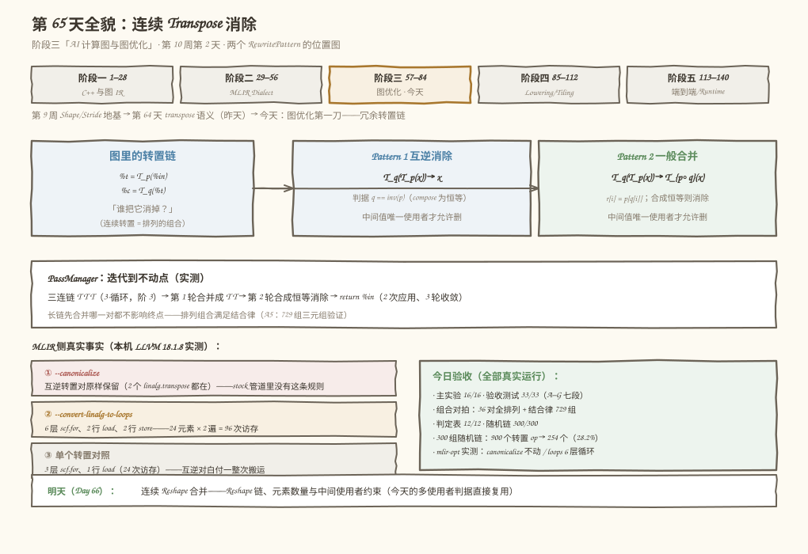
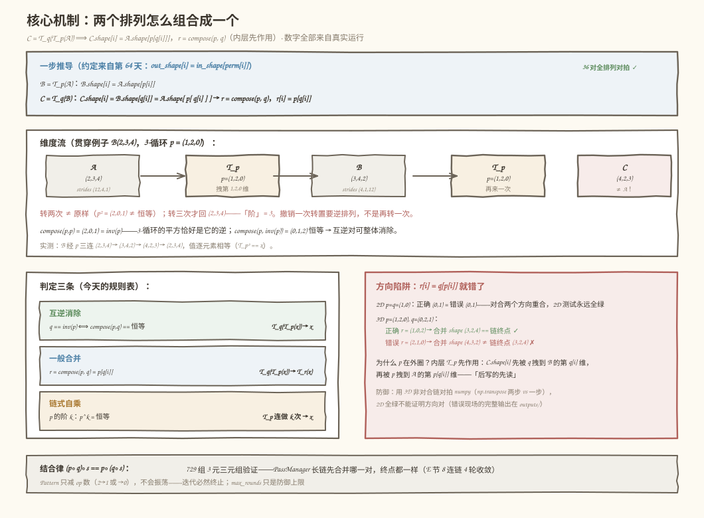
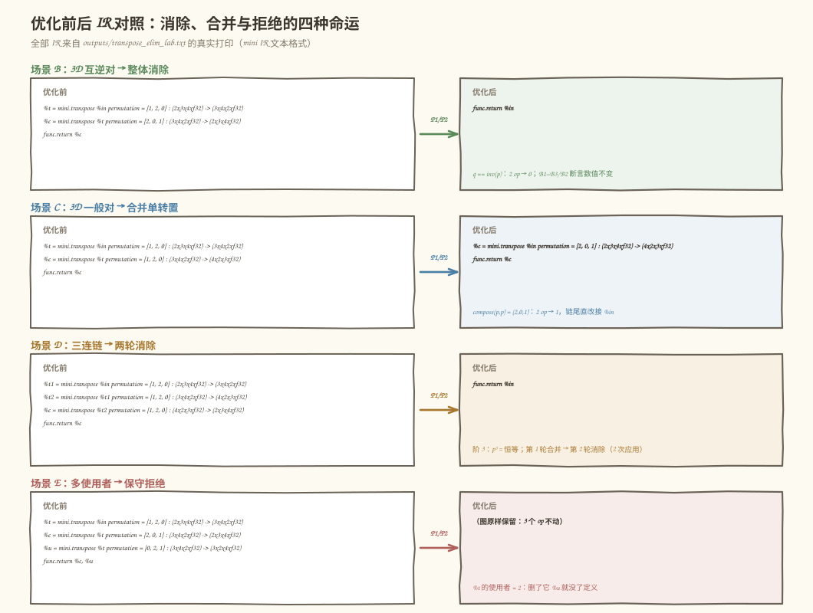
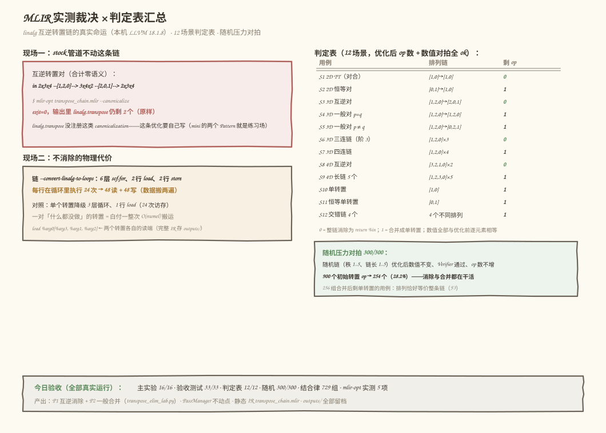

# 第 65 天：连续 Transpose 消除——两次 Permutation 的组合

> **今日目标**：完成本教程后，你能推导并钉死**连续两个转置的组合方向**——`C = T_q(T_p(A))` 时 `C.shape[i] = A.shape[p[q[i]]]`，合并排列 `r = compose(p, q)`（**内层 p 先作用，所以 p 在外圈**）；能写出一个判据回答「什么时候等价于恒等」——`q == inv(p) ⟺ compose(p, q) == 恒等`（排列群 `ab = e ⟺ b = a⁻¹`，互逆消除是一般合并的数学特例）；能实现**两个 RewritePattern**（互逆消除 `T_q(T_p(x)) → x`、一般合并 `T_q(T_p(x)) → T_r(x)`），并说清它们的**合法性边界**——中间值唯一使用者（含 `func.return`）；能用 PassManager 的**不动点迭代**消掉三连链（3-循环的阶是 3：`T T T → x`）；并能在本机 LLVM 18.1.8 上复现一个真实事实——**`--canonicalize` 不合并连续 `linalg.transpose`**，不消除的链降级后是 6 层循环、数据白搬两遍。
> **预计时间**：学习 40 分钟＋实践 45 分钟
> **前置准备**：第 64 天的 `inverse_perm`（逆排列）、`perm_order`（阶）、四关 Verifier 和约定 `out_shape[i] = in_shape[perm[i]]`——今天全部直接复用；第 52 天「融合的多使用者限制」的结论（中间结果被多个节点使用时不能随便删）今天在 Pattern 里正式上岗。工具：Python 3.10+ 与 numpy（本机 3.11.4 / 1.26.4）、`mlir-opt`（本机 Ubuntu LLVM 18.1.8，`/usr/lib/llvm-18/bin/mlir-opt`）。不需要 NPU。
> **今日产出**：两个 RewritePattern（`cancel_inverse_transpose` + `merge_consecutive_transpose`，`code/transpose_elim_lab.py`）、迭代到不动点的 PassManager、独立验收测试（`code/test_transpose_elim.py`，33/33 通过）、12 场景判定表＋300 组随机链压力对拍（900 个 op → 254 个，28.2%）、可复跑的 MLIR IR 文件（`transpose_chain.mlir`，实测 `--canonicalize` 原样保留 exit=0）、`outputs/` 全部真实输出，以及 4 张示意图。

## 1. 今天解决什么问题？

连续转置链在真实图里经常出现：框架把 NCHW 算子包进 NHWC 图时会插一对转置，用户代码里手写的 `.T`、`permute(0,2,1)` 又叠上去；昨天（Day 64）我们已经确认，转置的语义只是一个排列属性，但它落到物理上可以是 19 万倍差距的「搬家」。链越长，白搬的次数越多。今天要回答的问题是：**一串转置什么时候在数学上坍缩成「什么都不做」（恒等），什么时候可以压缩成一次转置？谁来干这件事？**

先看两个真实现场（都在本机复现过）：

```text
现场一（性能，本机 LLVM 18.1.8 实测）：
    一对互逆转置（in 2x3x4 --[1,2,0]--> 3x4x2 --[2,0,1]--> 2x3x4，
    语义合计 = 恒等，什么都没做）交给 stock 管道：
      mlir-opt transpose_chain.mlir --canonicalize
        → exit=0，输出里 linalg.transpose 仍剩 2 个——IR 原样保留
      mlir-opt transpose_chain.mlir --convert-linalg-to-loops
        → 6 层 scf.for、2 行 load、2 行 store（每行执行 24 次）
        → 48 次读 + 48 次写：24 个元素被搬了两遍
    「合计零语义」的一对算子，物理上白付一整次 O(numel) 搬运。

现场二（正确性，构造于今天的主实验段 5）：
    自己写合并 Pattern 时把组合方向写成 r[i] = q[p[i]]：
      2D 测试（p=q=(1,0)）→ 正确答案 (0,1)，错误答案 (0,1)——
      对合排列两个方向重合，测试全绿
      3D 一上（p=(1,2,0), q=(0,2,1)）→ 正确 (1,0,2)，错误 (2,1,0)；
      链的真实终点 (3,2,4)，错误合并推出 (4,3,2)——对不上
    2D 全绿不能证明方向对；3D 非对合排列是方向的照妖镜。
```

现场一说明**这条优化在 stock 管道里不存在、要自己写**（`linalg.transpose` 没有注册这类 canonicalization pattern——这是实测结论，不是猜测）；现场二说明**写它的第一道坎是组合的方向**。今天的解法分两步：先把两个排列的组合数学钉死（第 3 节），再把数学装进两个 RewritePattern、交给迭代跑到不动点的 PassManager（第 5 节），最后用数值对拍和 MLIR 实测双重验收。

贯穿例子（延续第 64 天的 B，值肉眼可核对）：

```text
B(2,3,4) = arange(24)，strides (12, 4, 1)
3-循环 p = (1,2,0)：B --p--> (3,4,2) --p--> (4,2,3) --p--> (2,3,4)
  （注意：转两次 ≠ 原样！p² = (2,0,1) ≠ 恒等；转三次才回来——阶 = 3）
互逆对：p = (1,2,0)，inv(p) = (2,0,1)——q 取逆排列时整链坍缩为恒等
```

今天要回答三个问题：**① 两次 Permutation 的组合怎么算、方向怎么定？② 什么时候等价于恒等、什么时候等价于一次 Transpose？③ Pattern 的合法性边界在哪（什么样的链不许动）？**

## 2. 先看全貌：今天的内容位于哪里？



**图 1**：上半部分是课程位置——第 10 周「Layout 与冗余算子消除」的第二天，昨天交付了 `mini.transpose` 的语义与 Verifier，今天在它上面开图优化第一刀；中部是转置链扇形展开成两个 Pattern 的裁决（互逆消除 / 一般合并），各自带判据与边界；底部左边是 MLIR 侧的三个真实事实（canonicalize 原样保留、loops 的 6 层循环代价、单转置对照），右边是今日验收汇总，最底下是明天的去向。

用 4 步把全局串起来：

1. **昨天给的地基**：第 64 天钉死的约定 `out_shape[i] = in_shape[perm[i]]`、逆排列 `inv`、阶 `perm_order`——今天全部变成 Pattern 的零件；四关 Verifier 继续守门（合并产物要再过一遍）。
2. **今天在链路里的位置**：图优化阶段。转置链消除是「冗余算子消除」家族（本周的 Transpose、Reshape、Cast 消除都是同构的：**找到链 → 判合法性 → 替换/删除 → 迭代到不动点**）；后面 Day 68 的 Layout 传播会把转置「穿过」逐元素算子，今天的多使用者判据是它们共同的边界工具。
3. **今天的产品**：`compose_perm`（组合排列）＋两个 RewritePattern＋PassManager 不动点迭代；MLIR 侧一份实测证据（stock 管道没有这条规则）说明「自己写」的正当性。
4. **明天的衔接**：Day 66 连续 Reshape 合并——它跟今天共享「中间值唯一使用者」这条边界，只是判据从排列组合换成元素数量守恒。

## 3. 核心概念：先用直觉，再给准确定义

先给一个贯穿全文的类比：**快递中转两次**。包裹（数据）从 A 仓发到 B 仓按第一张调度表（`p`：B 的第 `i` 排货架放 A 的第 `p[i]` 排货），再从 B 仓发到 C 仓按第二张表（`q`）。要直接从 A 发到 C，你得把两张表**串起来查**：C 的第 `i` 排放的是 B 的第 `q[i]` 排，而 B 的第 `q[i]` 排放的是 A 的第 `p[q[i]]` 排——**先查外层表 `q`，再拿结果查内层表 `p`**。对应到技术上是：`C = T_q(T_p(A))` 的合并排列 `r = compose(p, q)` 满足 `r[i] = p[q[i]]`——**内层 `p` 先作用，所以 `p` 写在外圈**。这个类比有两处失效：①类比里「查表」顺序从外往内，但排列的书写习惯容易让人反过来读；②快递是物理搬运，而转置链里每一跳都可以只是账本（第 64 天的命运①）——消除链的收益不一定是省搬运，也可能是把「要求连续的下游」从非连续视图里解放出来。

### 3.1 组合排列（composition）：两个转置 = 一个转置

- **一句通俗解释**：连续做两次「重排维度」，总效果永远等价于**一次**重排——排列对排列的组合还是排列（排列群里两个元素相乘还是群里的元素，这是「群封闭性」）。
- **类比**：上面两张调度表串查——外层表的行号先决定查哪一行内层表。
- **对应到技术上是**（推导只用昨天的约定 `out_shape[i] = in_shape[perm[i]]`）：

  ```text
  B = T_p(A)：B.shape[i] = A.shape[p[i]]
  C = T_q(B)：C.shape[i] = B.shape[q[i]] = A.shape[ p[ q[i] ] ]
  结论：C = T_r(A)，r = compose(p, q)，r[i] = p[q[i]]
  ```

- **最小例子**（今天实测段 5 的现场）：`p = (1,2,0)`、`q = (0,2,1)`，则 `r[i] = p[q[i]] = (p[0], p[2], p[1]) = (1, 0, 2)`。数值终审：`np.transpose(np.transpose(B, (1,2,0)), (0,2,1))` 与 `np.transpose(B, (1,0,2))` 逐元素相等。
- **方向为什么容易错**：排列的书写顺序和作用顺序是反的——`T_q(T_p(x))` 文本上 `q` 在前，但 `p` 先作用。2D 里 `(1,0)` 是**对合**（involution，`p == inv(p)`，两个方向重合），所以 `q[p[i]]` 和 `p[q[i]]` 算出同一个东西，2D 测试**永远发现不了方向错误**；3D 非对合排列（如 `(1,2,0)`）才能把方向照出来。这就是昨天强调「验证排列约定必须用 3D」在今天的第一手回报。
- **常见误解**：「连续转置消除就是查 `q == p`」——不对，那是把「对合」当成了通例。正确的恒等判据是 `q == inv(p)`；对合时 `inv(p) == p` 两者碰巧重合，2D 又把这个陷阱盖住了。

### 3.2 互逆消除与恒等判据：什么时候坍缩成「什么都不做」

- **一句通俗解释**：一张调度表和它的**逆表**连用，等于没有调度——整条链可以删成一根直线。
- **类比**：快递先按表 `p` 重排货架，再按表 `inv(p)` 原样排回去——每个包裹回到出发位置，两次操作合计是恒等。
- **对应到技术上是**：

  ```text
  compose(p, q) == 恒等排列 (0,1,…,rank-1)
      ⟺  q == inv(p)            （排列群：ab = e ⟺ b = a⁻¹）
  此时  T_q(T_p(x)) → x           （互逆消除，Pattern 1 的判据）
  否则  T_q(T_p(x)) → T_r(x)      （一般合并，Pattern 2 的主线）
  ```

  「互逆消除」在数学上是「一般合并合成恒等」的特例——这正是今天实现两个 Pattern 的关系：**P1 是 P2 的特例**，但按计划先实现 P1（判据便宜：算一次逆排列比构造新 op 短路更快），再实现 P2 把一般情况收编（P2 里合成恒等时走 P1 同款的消除路径）。今天的测试 C3/C4 实测：**只用 P2 跑五个代表场景，结果与双 Pattern 完全一致**——特例归特例，泛化归泛化，两条实现互相验证。
- **最小例子**：`p = (1,2,0)`，`inv(p) = (2,0,1)`。链 `B --p--> (3,4,2) --inv(p)--> (2,3,4)`，值逐元素回到 B（36 对全排列对拍确认：`回到原样 ⟺ compose 是恒等 ⟺ q 是逆`，三重判定一致）。
- **阶（order）给链式消除定下限**：`p` 的阶 `k` 意味着 `T_p` 连做 `k` 次合成恒等——`(1,2,0)` 的阶是 3（三连链 `T T T → x`，今天实测 2 次应用、3 轮收敛），`(1,0)` 的阶是 2（两连链消除）。今天实测 24 个 4 元排列全部满足「连做『阶』次回到恒等」。

### 3.3 Pattern 的合法性边界：什么链不许动

- **一句通俗解释**：替换 `T_q(T_p(x))` 要删掉中间值 `T_p(x)`——**只有当没有任何别人需要它时才能删**；`func.return` 也算「别人」。
- **类比**：中转仓 B 的货架如果有第二家门店也在取货（多一个使用者），你不能为了给第一家省一趟车就把 B 仓撤了。
- **对应到技术上是**（RewritePattern 的三步纪律）：

  ```text
  匹配     outer.input == inner.result，两个都是 mini.transpose
  合法性   use_count(inner.result) == 1   ← ops 的输入 + func.return 都算使用
  改写     replaceAllUses(outer.result, 新值) → erase 两个旧 op
  ```

  两条纪律值得点名：**①中间值被 `func.return` 导出时同样拒绝**（导出的中间结果是「图输出」，语义上必须保留——今天的场景 F 实测拒绝）；**②合并产物要能再次通过四关 Verifier**（Pattern 不是法外之地，产物的排列、类型必须和推导一致——今天在 P2 里对构造好的合并 op 做了一次防御性自检）。
- **最小例子**：场景 E 的图——`%t` 被 `%c` 和 `%u` 两个转置使用，`use_count(%t) == 2`，两个 Pattern 都拒绝，图原样保留（3 个 op），数值不变。
- **常见误解/类比边界**：「多使用者就彻底没救了」——不。**保守拒绝**（mini 默认）只是策略之一；另一种**合法且有益**的改写是：保留 `%t`，把 `%c` 的定义改成直接 `T_{compose(p,q)}(%in)`——`%c` 路径从两次转置变一次，`%u` 不受影响，语义不变且 op 数不增。它甚至还能再进一步：**复用**已有的 `T_p` 结果时判断哪种形式更省。今天把它留成选做挑战，正文实现保守版——理由和第 52 天一致：先保证「动了的才合法」，再谈「合法的都去动」。

## 4. 图解核心机制

两个排列怎么组合成一个、方向怎么定、什么时候坍缩成恒等，如图 2：



**图 2**：顶部是一步推导链（`C.shape[i]` 先被 `q` 拽、再被 `p` 拽，落到 `A.shape[p[q[i]]]`）；中部是贯穿例子的维度流——`B(2,3,4)` 经 `(1,2,0)` 转两次到 `(4,2,3)` **不等于**原样，转三次才回来（阶 3 的可视化）；左下是判定三条（互逆消除 / 一般合并 / 链式自乘）；右下是方向陷阱的完整现场（正确 `(1,0,2)` vs 错误 `(2,1,0)`，及 2D 为什么发现不了）。

按图中编号读：

1. **推导只有一行，但方向藏在嵌套里**：`C.shape[i] = A.shape[p[q[i]]]`——下标先走外层 `q` 再走内层 `p`。这一行就是 `compose_perm` 的全部数学，今天的 36 对全排列对拍把它钉死。
2. **维度流把「阶」画了出来**：`(2,3,4) → (3,4,2) → (4,2,3) → (2,3,4)`——第三个箭头才回到原点。转两次停在中途 `(4,2,3)`，这是昨天「3D 陷阱」在链上的延续：撤销一次转置靠逆排列，不是再转一次。
3. **三条判定覆盖所有情况**：`compose == 恒等` → 整链消除；`compose != 恒等` → 合并成单转置；链长超过阶的倍数时靠 PassManager 迭代收敛（结合律保证先合并哪一对都不影响终点——729 组三元组实测）。
4. **方向陷阱的防线**：2D 全绿不算数，必须用 3D 非对合链对拍 numpy；今天的错误实现现场（正确方向推导 `(3,2,4)` 与链终点一致，错误方向 `(4,3,2)` 对不上）就是这条防线的演示。

## 5. 动手实践：完成一个最小可运行例子

### 5.1 准备文件

```text
tutorials/day-065/
├── README.md
├── images/                        # 4 张示意图（本文图 1–4）
└── code/
    ├── transpose_elim_lab.py      # 主实验：组合数学 + 两个 Pattern + PassManager + MLIR 对表（16 项检查）
    ├── test_transpose_elim.py     # 独立验收测试（A–G 七段 33 个测试点）
    ├── transpose_chain.mlir       # 互逆转置链（linalg，实测 canonicalize 原样保留）
    ├── make_images.py             # 生成 4 张 SVG 的脚本
    ├── run_all.sh                 # 一键复跑（环境 → 主实验 → 测试 → 静态 IR 实测）
    └── outputs/                   # 全部真实输出
        ├── transpose_elim_lab.txt       # 主实验完整输出（16/16）
        ├── test_transpose_elim.txt      # 验收测试（33/33）
        ├── transpose_chain.canon2.mlir  # --canonicalize 产物（IR 原样）
        ├── transpose_chain.loops2.mlir  # --convert-linalg-to-loops 产物（6 层循环）
        └── run_all.txt
```

运行方式（在 `code/` 目录下）：

```bash
bash run_all.sh        # 环境 → 主实验 → 验收测试 → 静态 IR 的 mlir-opt 实测
```

### 5.2 编写代码

`transpose_elim_lab.py` 里，今天的核心产出分三层。第一层——**组合数学**（一行是方向，其余是零件）：

```python
def compose_perm(p, q):
    """组合排列：C = T_q(T_p(A)) 时 C.shape[i] = A.shape[p[q[i]]]。

    r = compose(p, q)，r[i] = p[q[i]]——内层 p 先作用，所以 p 在外圈。
    方向是今天的第一个陷阱：写成 q[p[i]] 在 2D（对合）测试永远发现不了。
    """
    return tuple(int(p[int(q_i)]) for q_i in q)

def is_identity(perm) -> bool:
    return tuple(perm) == tuple(range(len(perm)))
```

第二层——**两个 RewritePattern**（今天的正式产出）。Pattern 1 只认互逆：

```python
def cancel_inverse_transpose(graph: MiniGraph) -> bool:
    """P1 互逆消除：T_q(T_p(x)) 且 q == inv(p) 且中间值唯一使用者 → x。"""
    for inner, outer in chain_of(graph):
        if outer.perm != inverse_perm(inner.perm):
            continue
        if graph.use_count(inner.result_id) != 1:
            continue          # 中间值有别的消费者（或被 return）→ 保守拒绝
        graph.replace_all_uses(outer.result_id, inner.input_id)
        graph.erase(outer.result_id)
        graph.erase(inner.result_id)
        return True           # 本轮只做一次，留给 PassManager 迭代
    return False
```

Pattern 2 泛化到一般情况（合成恒等时走 P1 同款路径）：

```python
def merge_consecutive_transpose(graph: MiniGraph) -> bool:
    """P2 一般合并：T_q(T_p(x)) → T_{compose(p,q)}(x)。"""
    for inner, outer in chain_of(graph):
        if graph.use_count(inner.result_id) != 1:
            continue
        r = compose_perm(inner.perm, outer.perm)
        if is_identity(r):
            graph.replace_all_uses(outer.result_id, inner.input_id)
            graph.erase(outer.result_id)
            graph.erase(inner.result_id)
        else:
            # 原地把 outer 改写成从 inner 的输入直接转一次，再删 inner
            outer.perm, outer.input_id, outer.in_shape = (
                r, inner.input_id, inner.in_shape)
            if verify_transpose(outer.in_shape, outer.perm,
                                outer.result_shape) != []:
                continue      # 产物非法就不动（防御）
            graph.erase(inner.result_id)
        return True
    return False
```

三个设计点值得盯十秒：**①每个 Pattern 一次只改一处**——三连链的消除靠 PassManager 的下一轮，不靠单个 Pattern 内部循环（迭代逻辑集中在管理者手里，Pattern 保持「无状态、可组合」）；**②`use_count` 把 `func.return` 算进使用者**——被导出的中间结果不能删，这是语义边界不是实现细节；**③P2 改写 `outer` 而不是新建 op**——result id 不变，下游使用自动跟着走（MLIR 里对应 `rewriter.replaceOp` 后 `if (innerOp.use_empty()) erase`）。

第三层——**PassManager**（迭代到不动点）：

```python
def run_passes(graph, patterns, trace=None, max_rounds=10):
    rounds, applied = 0, 0
    while True:
        changed = False
        for name, pat in patterns:
            if pat(graph):
                changed = True
                applied += 1
        rounds += 1
        if not changed or rounds >= max_rounds:
            return rounds, applied     # 无变化 = 不动点
```

图数据结构（`MiniGraph`）延续第 64 天的 `MiniTransposeOp` 文本格式，补上三样今天才需要的东西：`use_count`（使用计数，含 `func.return`）、`replace_all_uses`（全量使用替换）、`eval`（用 numpy 按拓扑序求数值——优化前后对拍的裁判）。

### 5.3 运行与观察

以下均为**本机真实执行结果**（2026-11-12，Python 3.11.4 / numpy 1.26.4 / Ubuntu LLVM 18.1.8 / aarch64，完整输出存 `code/outputs/transpose_elim_lab.txt`）。先看 MLIR 侧的「不消除的代价」：

```text
$ bash run_all.sh   （节选，全真实运行）
== 1. transpose_elim_lab.py ==
== 1. 现场一：一对互逆转置（合计零语义），mlir-opt 实测 ==
IR：in 2x3x4 --[1,2,0]--> 3x4x2 --[2,0,1]--> 2x3x4（回到原形状）
  --canonicalize 退出码 0，输出里 linalg.transpose 仍剩 2 个（输入是 2 个）
[PASS] 互逆转置对经 --canonicalize 后原样保留（LLVM 18 无此规则）
  --convert-linalg-to-loops：6 层循环、2 行 load、2 行 store——
  每行在循环里执行 24 次，共 48 读 + 48 写（数据搬两遍）
  对照：单个转置降级后是 3 层循环、1 行 load（执行 24 次）
        ——一对互逆转置白付一整次搬运
```

再看 mini 侧两个 Pattern 的现场（场景 B 互逆消除 → 场景 C 一般合并 → 场景 D 三连链）：

```text
场景 B（3D 互逆对，p=(1,2,0)，q=(2,0,1)=inv(p)，→ x）：
  %t = mini.transpose %in permutation = [1, 2, 0] : (2x3x4xf32) -> (3x4x2xf32)
  %c = mini.transpose %t permutation = [2, 0, 1] : (3x4x2xf32) -> (2x3x4xf32)
  func.return %c
→ PassManager 2 轮、应用 1 次：
  func.return %in
[PASS] B：3D 互逆对整体消除（op 数 2→0）且数值不变

场景 C（3D 一般对，p=q=(1,2,0)，合并 → T_{p²}=T_{inv(p)} 单转置）：
  %t = mini.transpose %in permutation = [1, 2, 0] : (2x3x4xf32) -> (3x4x2xf32)
  %c = mini.transpose %t permutation = [1, 2, 0] : (3x4x2xf32) -> (4x2x3xf32)
  func.return %c
→ PassManager 2 轮、应用 1 次：
  %c = mini.transpose %in permutation = [2, 0, 1] : (2x3x4xf32) -> (4x2x3xf32)
  func.return %c
[PASS] C：一般对合并为单转置（op 数 2→1，perm=(2,0,1)）

场景 D（3-循环三连链 T T T，阶 3 → 两轮 → x）：
  %t1 = mini.transpose %in permutation = [1, 2, 0] : (2x3x4xf32) -> (3x4x2xf32)
  %t2 = mini.transpose %t1 permutation = [1, 2, 0] : (3x4x2xf32) -> (4x2x3xf32)
  %c  = mini.transpose %t2 permutation = [1, 2, 0] : (4x2x3xf32) -> (2x3x4xf32)
  func.return %c
PassManager 3 轮、应用 2 次（轮间 IR 存 trace）：
  func.return %in
[PASS] D：三连链两轮消除为 x（op 数 3→0）且数值不变
```

场景 C 值得多看一眼：`p=q=(1,2,0)` 转两次**不是**恒等（停在 `(4,2,3)`），P1 正确地拒绝了它；P2 把两次 `(1,2,0)` 合并成一次 `(2,0,1)`——这恰好是 `inv(p)`（3-循环的平方是它的逆），但 Pattern 不需要知道这个巧合，`compose` 算出来什么就是什么。

多使用者与被 return 的两个反例（场景 E/F）：

```text
场景 E（%t 被 %c、%u 两个消费方使用）：
  %t 的使用者数 = 2（%c、%u 各一）——两个 Pattern 都拒绝
[PASS] E：多使用者时图不动（3 个 op 原样）且数值不变
场景 F（%t 也被 func.return 导出）：
  %t 的使用者数 = 2（%c 一个 + func.return 一个）
[PASS] F：被 return 的中间值同样拒绝（op 数仍 2）
```

四种命运（消除 / 合并 / 两轮消除 / 拒绝）的优化前后 IR 对照如图 3：



**图 3**：四行分别是场景 B/C/D/E 的真实 mini IR 文本（左列优化前，右列优化后）。读图时注意两点：B 和 D 的右列都只剩 `func.return %in`（整链坍缩），C 的右列是一个直连 `%in` 的单转置（`perm` 变成 `(2,0,1)`），E 的右列标注「原样保留」——每行末尾写的是判据。

判定表与随机压力对拍（数值终审）：

```text
== 4. 判定表：12 个链式场景，优化前后数值对拍 ==
用例                   输入shape     排列链                    优化后op数  数值对拍
S1  2D TT（对合）                (2, 3)                     [1, 0] → [1, 0]       0      ok
S2  2D 恒等对                   (2, 3)                     [0, 1] → [1, 0]       1      ok
S3  3D 互逆对                (2, 3, 4)               [1, 2, 0] → [2, 0, 1]       0      ok
S4  3D 一般对 p=q            (2, 3, 4)               [1, 2, 0] → [1, 2, 0]       1      ok
S6  3D 三连链（阶 3）           (2, 3, 4)   [1, 2, 0] → [1, 2, 0] → [1, 2, 0]       0      ok
S7  3D 四连链（阶 3）           (2, 3, 4)    [1, 2, 0] → [1, 2, 0] → [1, 2, …       1      ok
S9  4D 长链 5 个          (2, 3, 4, 5)    [1, 2, 3, 0] → [1, 2, 3, 0] → […       1      ok
（S5/S8/S10–S12 压缩省略，全部 ok）
[PASS] 判定表 12/12：op 数符合预期 + 数值不变 + Verifier 通过

随机压力对拍（300 组随机链，秩 1..5、链长 1..5）：
[PASS] 随机对拍 300/300：数值不变、Verifier 通过、op 数不增
  300 组共 900 个初始 op（平均链长 3），优化后剩 254 个（28.2%）
```

判定表的规律一眼可见：**同款排列链长 L 的剩余 op 数由 `L mod 阶` 决定**（`(1,2,0)` 阶 3：L=1,2 剩 1 个、L=3 消除、L=4 剩 1 个……测试 E1 把 L=1..8 全部钉死）。验收测试的汇总与 MLIR 侧完整裁决如图 4：



**图 4**：左上是 `--canonicalize` 的原样保留现场（这条优化在 stock 管道不存在），左下是不消除的 loops 代价（6 层循环、96 次访存），右侧是 12 场景判定表和 300 组随机对拍（900 → 254）。三个数字放在一起就是今天存在的理由：**语义为零的链，物理代价是真实存在的，而管道不会替你消它**。

### 5.4 修改一个参数再观察

**对照实验：把外层排列 `q` 从 `inv(p)` 改成 `p`——只动一个数字，看 2D 与 3D 的命运分岔。**

```text
$ python3 - <<'EOF'   （语义同主实验段 5 的方向对照，可直接验证）
import numpy as np
p = (1, 2, 0)
inv = (2, 0, 1)
x = np.arange(24, dtype=np.float32).reshape(2, 3, 4)
# q = inv(p)：整链消除
print(np.transpose(np.transpose(x, p), inv).shape)    # (2, 3, 4) == 原样
# q = p：转两次 ≠ 原样（阶 3，中途停在 (4,2,3)）
print(np.transpose(np.transpose(x, p), p).shape)      # (4, 2, 3) ≠ 原样
EOF
```

2D 版本里把 `p` 换成 `(1, 0)`：`q == inv(p) == p`，两种写法结果都是恒等——**参数改了、输出没变**，这就是「对合把陷阱盖住」的直观体验。3D 版本里同一个改动让链从「消除」变成「合并成单转置」：终点形状从 `(2,3,4)` 变成 `(4,2,3)`，mini 侧对应 P1 拒绝、P2 接手（判定表 S4）。根因只有一句话：**恒等判据是 `q == inv(p)`，从来不是 `q == p`**——对合时两者碰巧相等。

## 6. 常见错误与排查

**错误 1：组合方向写反（`r[i] = q[p[i]]`）**

- **现象**：2D 测试全绿（对合排列两个方向重合），3D 链一上就错——合并后的 shape 与链的真实终点对不上（今天的实测现场：正确方向推出 `(3,2,4)` 与终点一致，错误方向推出 `(4,3,2)`）；如果实现里还有类型检查，Verifier 的 E4 会先拒绝。
- **原因**：`T_q(T_p(x))` 文本上 `q` 在前，但 `p` 先作用——书写顺序与作用顺序相反；2D 的 `(1,0)` 是对合，把方向错误完美掩盖。
- **定位**：跑一个 3D 非对合链的数值对拍：`np.transpose(np.transpose(x, p), q)` vs `np.transpose(x, r)`——两边不等就说明 `r` 的方向错了；或直接检查 `infer_transposed_shape(infer_transposed_shape(shape, p), q) == infer_transposed_shape(shape, r)`。
- **修复**：`r[i] = p[q[i]]`（外层 `q` 的下标先走，内层 `p` 在外圈）；用一句话钉住推导「C.shape[i] 先被 q 拽到 B 的第 q[i] 维，再被 p 拽到 A 的第 p[q[i]] 维」。

**错误 2：不查中间值的使用者，直接删除**

- **现象**：两种翻车——(a) 下游 op 引用了一个被删掉的值（图非法，Verifier 报「输入无定义」，或执行时直接 KeyError/未定义行为）；(b) 图还能跑，但另一个消费方读到的值变了（语义破坏——这种更隐蔽，测试不覆盖就流出去了）。
- **原因**：`T_q(T_p(x))` 的替换要删 `%t = T_p(x)`，但 `%t` 可能还有别的使用者；`func.return` 也是使用者这一点最容易被漏。
- **定位**：在 Pattern 的改写入口打印 `use_count(inner.result_id)`；把 `use_count` 的实现翻出来，确认它统计的是「ops 的输入 + returns」两个来源。
- **修复**：`use_count == 1` 才允许删（保守策略）；被 return 的中间结果一律保留。想要更激进的「保留 `%t`、只重写 `%c`」见选做挑战。

**错误 3：把 `q == p` 当成消除判据（对合陷阱的链上翻版）**

- **现象**：对 3D 链 `T T` 直接整链删除（以为转两次=恒等）——值直接错（终点是 `(4,2,3)` 不是 `(2,3,4)`）；或者反过来：看到 `T T` 没被自己的 Pattern 消除，以为 Pattern 写错了。
- **原因**：2D 交换 `(1,0)` 是对合（`perm == inv`），造成「转置自带撤销」的错觉；3D 的 `(1,2,0)` 阶是 3，转两次停在中途。
- **定位**：笔算 `compose(p, p)` 是否等于恒等；或查 `perm_order(p)` 是不是 2。
- **修复**：恒等判据用 `q == inv(p)`（或等价地 `compose(p, q) == 恒等`）；链长与阶的关系交给 PassManager 迭代处理（三连链自然消除），不要在单个 Pattern 里硬编码「转两次抵消」。

**错误 4：Pattern 不收敛或结果振荡**

- **现象**：PassManager 跑不完（一直在改图）；或同一轮里 Pattern 互相把对方的成果改回去，图在两种形态之间来回跳。
- **原因**：今天的两个 Pattern 都单调减少 op 数（2→1 或 2→0），理论上不可能振荡——但如果 Pattern 里有「拆开」方向的改写（比如把一个转置拆成两个，或 Day 68 会遇到的 Layout 传播往返），就要小心不动点不成立。
- **定位**：给 PassManager 加每轮的 op 计数打印；连续两轮计数不降反升就说明有 Pattern 在「逆优化」。
- **修复**：保持 Pattern 单向（合并/消除方向）；`max_rounds` 作防御上限；组合数学上靠结合律保证「先合并哪一对终点都一样」（729 组三元组实测），所以不用关心 Pattern 在链里的匹配顺序。

## 7. 今日练习

### 必做练习

拿贯穿例子练手，**先笔算再跑**：

1. **笔算组合**：给定 `p = (1,2,0)`、`q = (0,2,1)`，写出 `r = compose(p, q)` 并预测链 `B(2,3,4) → ? → ?` 每一步的 shape；再算 `q' = inv(p)` 时的 `r'`。预期：`r = (1,0,2)`（链终点 `(3,2,4)`）、`r' = 恒等`。用 `python3 -c "import numpy as np; x=np.arange(24).reshape(2,3,4); print(np.transpose(np.transpose(x,(1,2,0)),(0,2,1)).shape)"` 核对方向感。
2. **构造第三个 Pattern**：消除**单个**恒等转置 `T_id(x) → x`（用户手写 `permutation = [0,1]` 的场景，判定表 S11 今天故意留着它）。要求：写正例（op 数 1→0）和两个反例（输入被 return 时不消除；非恒等排列不动），并跑 `python3 test_transpose_elim.py` 确认 33 项原有测试不受影响。
3. **构造多使用者反例**：仿照场景 E，给三连链的**中间**转置（不是第一个）加一个消费方，先预测 PassManager 会消掉哪几个 op、保留哪几个，再跑核对（提示：链被切成两段，各段独立判定）。
4. **复跑全链**：`bash run_all.sh`，确认主实验 16/16、验收测试 33/33、静态 IR 实测 `--canonicalize` 原样保留（2 个 `linalg.transpose`）且 `--convert-linalg-to-loops` 是 6 层循环；打开 `outputs/transpose_chain.loops2.mlir` 找到两处 `load`，确认它们读的下标排列不同（两次搬家的证据）。

### 选做挑战

实现**激进版多使用者改写**：当 `T_q(T_p(x))` 的中间值 `%t` 还有别的消费者时，不删除 `%t`，而是把 `outer` 改写成直接从 `%in` 转一次（`T_{compose(p,q)}(%in)`），`%t` 原样保留。要求：(a) 先写语义论证——为什么这种改写不改变任何可见值；(b) 构造用例验证：`%c` 路径的值不变、`%u` 路径的值不变、op 数不增也不减（3 个 → 3 个）；(c) 回答一个新问题：这个改写什么情况下**白做工**（提示：如果 `%c` 是唯一消费者，改写后 `%t` 变成死代码，应该连带 DCE——第 25 天的 Pass 今天可以回来串场）。改完跑 `python3 transpose_elim_lab.py`，原有 16 项检查必须仍然全过。

## 8. 今日验收

- [ ] 我能用自己的话推导组合方向：`C = T_q(T_p(A))` 时 `C.shape[i] = A.shape[p[q[i]]]`，`r = compose(p, q)` 内层先作用——并能解释为什么 2D 测试发现不了方向错误（对合两个方向重合）；
- [ ] 我能说清恒等判据及其等价形式：`q == inv(p) ⟺ compose(p,q) == 恒等`（排列群 `ab = e ⟺ b = a⁻¹`），并知道「互逆消除是一般合并的特例」（测试 C3/C4：P2 单独跑结果与双 Pattern 一致）；
- [ ] 我能独立实现两个 RewritePattern 并守住合法性边界：中间值唯一使用者（含 `func.return`，场景 E/F 实测拒绝）、合并产物过四关 Verifier；
- [ ] 我能用 PassManager 的不动点迭代处理长链：三连链 2 次应用消除为 `return %in`、八连链 4 轮收敛、链长 `L` 的剩余 op 数由 `L mod 阶` 决定（测试 E1：L=1..8 全对）；
- [ ] 我能复述 MLIR 侧的实测事实并说明其含义：`--canonicalize` 不合并连续 `linalg.transpose`（LLVM 18.1.8 实测原样保留）、不消除的链降级为 6 层循环 96 次访存——这条优化要自己写；
- [ ] 我能独立运行 `bash code/run_all.sh` 复现全部结果（16/16 + 33/33 + 静态 IR 实测），并定位今天列出的四类错误（方向反、漏使用者检查、对合当恒等、不收敛）各自的证据；
- [ ] 我保存了两个 RewritePattern 与 PassManager（`code/transpose_elim_lab.py`）、33 项验收测试（`code/test_transpose_elim.py`）、静态 IR 文件、全部真实输出（`code/outputs/`）和 4 张示意图。

## 9. 一句话总结与明天预告

今天的问题从「语义合计为零的一对转置，stock 管道却让数据白搬两遍」开始（实测：`--canonicalize` 原样保留、loops 6 层循环 96 次访存），答案是把连续转置还原成**排列的代数**：组合 `r[i] = p[q[i]]`（内层先作用，2D 对合会掩盖方向错误，3D 非对合是照妖镜）、恒等判据 `q == inv(p)`（互逆消除是一般合并的特例）、阶数给链式自乘定下限（三连链两轮消除）。实践侧交付了两个 RewritePattern（互逆消除 + 一般合并）和迭代到不动点的 PassManager，边界纪律是「中间值唯一使用者才允许删，`func.return` 也算使用者」。验证侧：主实验 16/16、验收测试 33/33（含结合律 729 组、方向陷阱真实反例）、判定表 12/12（`L mod 阶` 的消长规律）、随机链 300/300（900 个 op → 254 个，28.2%）。

明天（Day 66）讲**连续 Reshape 合并**：`Reshape(Reshape(x)) → Reshape(x)`——今天的 Pattern 骨架（链匹配 → 唯一使用者检查 → 替换删除 → 迭代）原样复用，判据从「排列组合」换成「元素数量守恒」，而中间使用者的约束比今天更微妙（合并会跳过中间形状，中间结果有没有人看它长什么样，决定合法性）。
