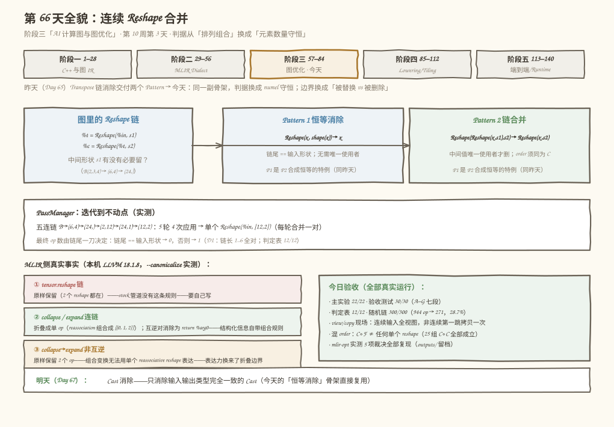
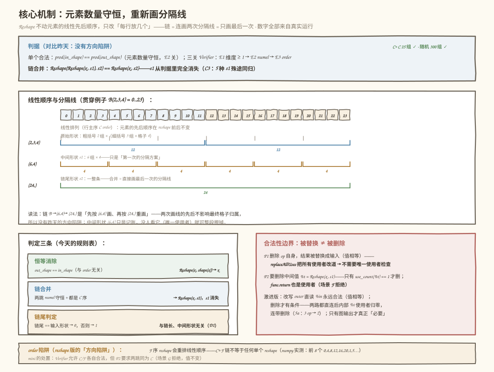
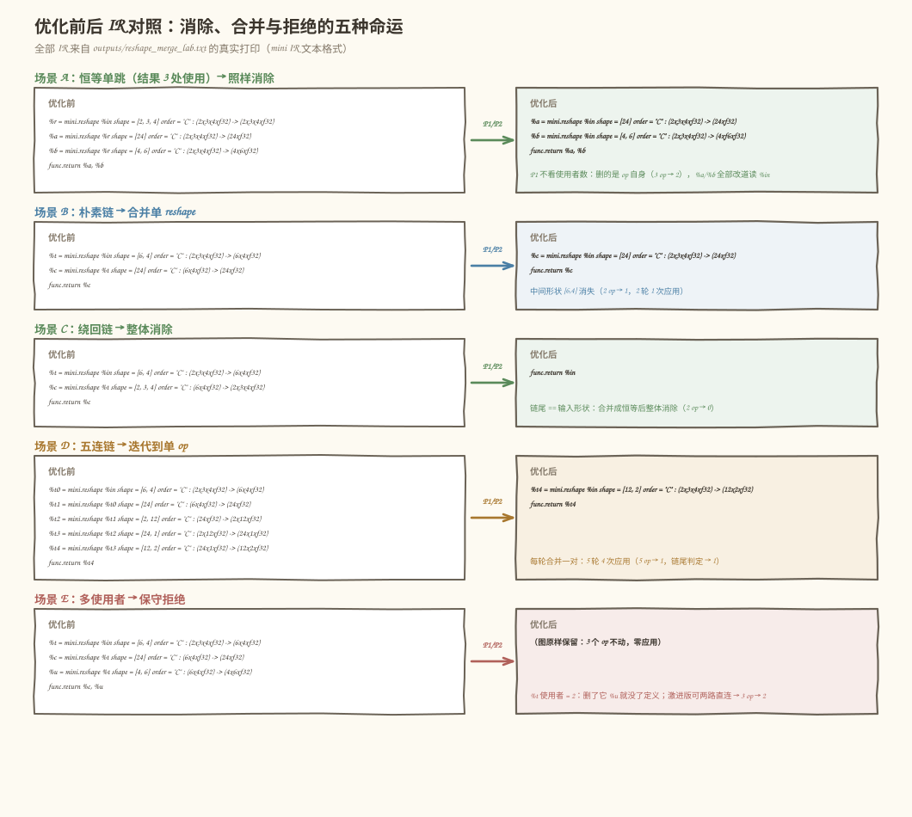
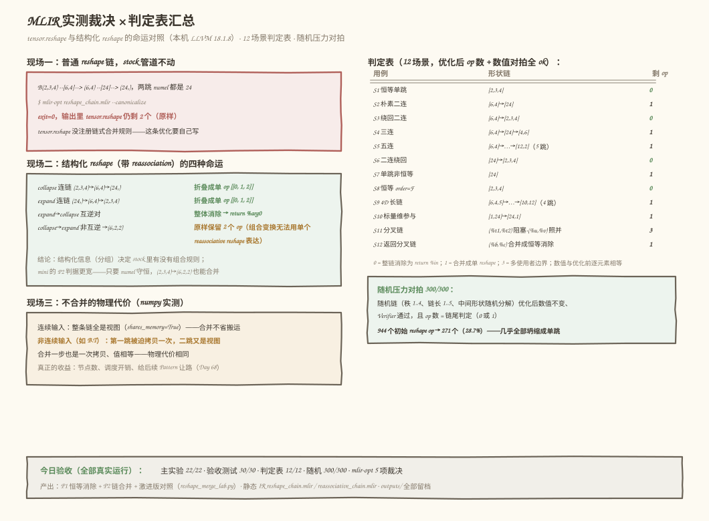

# 第 66 天：连续 Reshape 合并——只看元素数量，跳过中间形状

> **今日目标**：完成本教程后，你能钉死 Reshape 链合并的**唯一判据**——元素数量守恒 `prod(in_shape) == prod(out_shape)`（C 序下 reshape 只是「给线性排列的元素重新画分隔线」，合并 = 直接画最后一次的分隔线，中间形状 `s1` 从判据里完全消失，也没有昨天排列组合那样的方向陷阱）；能实现**两个 RewritePattern**（恒等消除 `Reshape(x, shape(x)) → x`——**不需要**唯一使用者检查，因为被删除的只是 op 自身、它的结果被整体替换走；链合并 `Reshape(Reshape(x, s1), s2) → Reshape(x, s2)`——中间值唯一使用者才允许删，`func.return` 也算使用者）；能说清**被替换的值与被删除的值**在合法性上的区别（昨天预告的「微妙」就藏在这里）；并能在本机 LLVM 18.1.8 上复现一组真实对照——**`--canonicalize` 原样保留 `tensor.reshape` 链，却会把 `tensor.collapse_shape`／`tensor.expand_shape` 链组合成单 op、把互逆对消除成 `return %arg0`**——结构化信息（reassociation）决定 stock 管道里有没有这条规则。
> **预计时间**：学习 40 分钟＋实践 45 分钟
> **前置准备**：第 65 天的两个 Pattern 骨架（链匹配 → 唯一使用者检查 → 替换删除 → PassManager 不动点迭代）与 `use_count`/`replace_all_uses` 工具今天全部复用；第 52 天「融合的多使用者限制」的结论继续上岗；第 64 天「视图 vs 物理搬运」的区分今天第二次兑现（reshape 合并省的主要是节点，不是搬运）。工具：Python 3.10+ 与 numpy（本机 3.11.4 / 1.26.4）、`mlir-opt`（本机 Ubuntu LLVM 18.1.8，`/usr/lib/llvm-18/bin/mlir-opt`）。不需要 NPU。
> **今日产出**：两个 RewritePattern（`eliminate_identity_reshape` + `merge_consecutive_reshape`，`code/reshape_merge_lab.py`）、三关 Verifier 与 numel 反例、多使用者／被 return／混 order 三类反例、独立验收测试（`code/test_reshape_merge.py`）、12 场景判定表＋300 组随机链压力对拍、可复跑的 MLIR IR 文件（`reshape_chain.mlir` 与 `reassociative_chain.mlir`，实测 canonicalize 的 5 项裁决）、`outputs/` 全部真实输出，以及 4 张示意图。

## 1. 今天解决什么问题？

Reshape 链在真实图里比转置链还常见：框架给算子喂输入要摊平、算子输出要摆回原形，用户代码里的 `view(-1)`、`reshape(N, -1)` 再叠上去——一条边上来回三四个 reshape 是常态。昨天（Day 65）我们把连续转置还原成排列的代数、写出了消除它的两个 Pattern；今天同一个骨架换一个算子，要回答的问题是：**连续 reshape 什么时候可以坍缩成一个？判据是什么？中间结果什么时候必须保留？**

先看两个真实现场（都在本机复现过，完整输出存 `code/outputs/`）：

```text
现场一（MLIR，本机 LLVM 18.1.8 实测）：
    tensor.reshape 链 in(2x3x4) --[6,4]--> (6,4) --[24]--> (24,)
    （两跳元素数量都是 24，语义上就是一个 reshape %in → (24,)）交给 stock 管道：
      mlir-opt reshape_chain.mlir --canonicalize
        → exit=0，输出里 tensor.reshape 仍剩 2 个——IR 原样保留
    而同一个命令处理结构化 reshape（带 reassociation 分组）完全是另一副面孔：
      collapse 连链 (2,3,4)→(6,4)→(24,)  → 折叠成单 op [[0, 1, 2]]
      expand 连链 (24,)→(6,4)→(2,3,4)   → 折叠成单 op [[0, 1, 2]]
      expand→collapse 互逆对            → 整体消除，剩 return %arg0
      collapse→expand 非互逆 →(6,2,2)     → 原样保留 2 个 op
    普通 tensor.reshape 的链合并规则在 stock 管道里不存在，要自己写。

现场二（正确性，构造于今天主实验第 6 节）：
    reshape 有个「order」属性（行主序 C / 列主序 F）。把链
    B(2,3,4) --C 序--> (6,4) --F 序--> (24,) 交给「不看 order」的合并：
      合并产物 Reshape(B, (24,)) 的值是 0,1,2,3,4,5,6,7…
      真实链的值是                  0,4,8,12,16,20,1,5…（元素被 F 序重排过）
      numpy 终审：C∘F 链不等于任何单个 reshape（C 或 F 都不是）
    昨天的陷阱是「组合方向」，今天的陷阱换了地方：元素的线性顺序只在
    同一种 order 下才保持不变。
```

现场一说明**这条优化要么看结构化信息、要么自己写**（mini 的选择是后者，判据反而比 MLIR 的结构化折叠更宽）；现场二说明**写它的第一道坎是 order**。今天的解法：先把判据钉死成一个数——元素数量（第 3 节），再把「被替换」和「被删除」的合法性区别装进两个 RewritePattern（第 5 节），最后数值对拍加 MLIR 实测双重验收。

贯穿例子（延续第 64/65 天的 B，值肉眼可核对）：

```text
B(2,3,4) = arange(24)（行主序线性排列就是 0..23）
朴素链：B --reshape--> (6,4) --reshape--> (24,)   → 合并成 Reshape(B, (24,))
绕回链：B --reshape--> (6,4) --reshape--> (2,3,4) → 合并成恒等 → 整体消除
```

今天要回答三个问题：**① 单个 reshape 的合法性判据是什么、链合并为什么「没有方向陷阱」？② 中间形状 `s1` 在判据里扮演什么角色、什么时候必须保留？③ 「被替换的值」和「被删除的值」在合法性上有什么区别（昨天预告的微妙处）？**

## 2. 先看全貌：今天的内容位于哪里？



**图 1**：上半部分是课程位置——第 10 周「Layout 与冗余算子消除」的第三天：转置（Day 65）→ reshape（今天）→ Cast（明天），同一副 Pattern 骨架连用三天；中部是 reshape 链交给两个 Pattern 的裁决（恒等消除 / 链合并），各自带判据与边界；底部左边是 MLIR 侧的三个真实事实（普通 reshape 原样保留、结构化折叠、非互逆保留），右边是今日验收汇总，最底下是明天的去向。

用 4 步把全局串起来：

1. **昨天给的骨架**：链匹配 → 唯一使用者检查 → 替换/删除 → PassManager 迭代到不动点——今天原样复用；变化的只有两处：判据从「排列组合」换成「元素数量守恒」，边界从「中间值唯一使用者」细化成「被替换 vs 被删除」。
2. **今天在链路里的位置**：图优化阶段「冗余算子消除」家族的第三刀。这一族的共同套路是**找到链 → 判合法性 → 替换/删除 → 迭代到不动点**；后面 Day 68 的 Layout 传播要「穿过」逐元素算子，今天练的直连改写（激进版）正是它需要的形状。
3. **今天的产品**：`verify_reshape`（三关 Verifier）＋两个 RewritePattern＋激进版对照实验；MLIR 侧一组实测证据说明「结构化信息决定 stock 里有没有规则」，而 mini 的判据可以更宽。
4. **明天的衔接**：Day 67 Cast 消除——只消除输入输出类型完全一致的 Cast；今天的 P1（恒等消除，不需要唯一使用者检查）就是它的直接原型。


## 3. 核心概念：先用直觉，再给准确定义

先给一个贯穿全文的类比：**重新摆格子**。24 个编号 0..23 的快递按行主序排成一条线，`reshape` 不动任何一个包裹的位置编号，只是**重新画分隔线**——`(2,3,4)` 是「2 大组 ×（3 中组 × 4 格）」，`(6,4)` 是「6 组 × 4 格」，`(24,)` 是「不分组」。对应到技术上是：C 序（行主序）reshape 是元素线性顺序上的恒等映射，只改 shape 和 strides 这份「账本」；连做两次 reshape 就是连画两次分隔线，而**画线的先后不影响每个格子的最终归属**。这个类比有两处失效：①它只对同一种 order 成立——F 序（列主序）的 reshape 会真的重排线性顺序（今天现场二的实测），所以类比里的「不动位置」在混 order 时是错的；②它容易让人以为 reshape 是零成本的纯账本——在第 9 周已经钉死过，输入不连续时它是被迫的一次拷贝（今天第 5.3 节再次实测）。

### 3.1 元素数量守恒：判据只有一个数

- **一句通俗解释**：reshape 只能在「同样多个元素」的前提下改分组方式——`prod(shape)`（所有维度连乘，即 numel）前后必须相等。
- **类比**：24 个包裹怎么分组都行，但不能凭空多出或少掉一个。
- **对应到技术上是**（mini 的三关 Verifier，仿第 64/65 天风格）：

  ```text
  E1  输出形状每一维都是 ≥1 的整数（mini 不支持空形状 ()）
  E2  prod(in_shape) == prod(out_shape)     ← 核心：元素数量守恒
  E3  order ∈ {"C", "F"}（两种都合法，但见 3.3 的合并约束）
  ```

  真实框架还有 `-1`（推断一维）和 PyTorch 的 `0`（保持该维）语法，mini 不做——它只是 E1/E2 的预处理糖（练习 2 会把它补上）。
- **最小例子**：`(2,3,4)`、`(6,4)`、`(24,)`、`(1,24)` 的 numel 都是 24，互相之间随便 reshape；`(5,7)` 是 35——`(2,3,4) → (5,7)` 在 E2 被拦下（实测报 `[E2] 元素数量不守恒：输入 24 ≠ 输出 35`）。
- **常见误解**：「reshape 会搬数据，所以合并 reshape 一定省搬运」。实测（本机 numpy 1.26.4）：连续输入的整条链全是视图（`shares_memory=True`，零拷贝）；非连续输入（如 `B.T`）的第一跳被迫拷贝一次，之后的跳都是视图——**合并成一步拷贝次数完全相同**。今天合并的真实收益是 IR 节点数、调度开销和给后续 Pattern 让路，不是省搬运（这跟昨天的转置正好相反：转置合并没有省账本，省的是真实的 O(numel) 搬运）。在「每个 op 都物化输出」的运行时里（部分硬件运行时/调试模式），不合并的链才会退化成 L 次物理搬运。

### 3.2 链合并：中间形状从判据里消失

- **一句通俗解释**：连画两次分隔线，等于只画最后一次的分隔线——第一次画成什么样（中间形状 `s1`）根本不影响结果。
- **类比**：先按「6 组 × 4」摆一遍再按「一整条」重摆，跟直接按「一整条」摆，每个包裹的落点完全一样。
- **对应到技术上是**：

  ```text
  t = Reshape(x, s1)（C 序）：t 的线性顺序 == x 的线性顺序
  c = Reshape(t, s2)（C 序）：c 的值 == Reshape(x, s2) 的值
  结论：Reshape(Reshape(x, s1), s2) → Reshape(x, s2)   ← s1 完全不出现在产物里
  ```

  这就是今天比昨天**简单**的地方：没有 `r[i] = p[q[i]]` 那样的组合方向问题——合并的产物只由「输入形状 + 链尾形状」决定。实测 C3：`B → s1 → (24,)` 用 5 种不同的 `s1`（`(6,4)`、`(24,)`、`(4,6)`、`(2,12)`、`(1,24)`）跑合并，产物全部是同一个 `Reshape(%in, (24,))`、值逐元素相等。
- **恒等特例**：链尾 `s2 == shape(x)` 时，合并产物是 `Reshape(x, shape(x))`——位置上的恒等映射，整链可以消除为 `x`。与昨天同构：**P1（恒等消除）是 P2（链合并）合成恒等的特例**；今天实测「只用 P2 跑」与「双 Pattern」结果一致（测试 G3 的镜像）。注意同形状恒等与 order 无关——`Reshape_F(x, shape(x))` 读 F 序写 F 序，元素各回原位（测试 B3：order='F' 的恒等同样被消除）。
- **链尾判定规律**（今天判定表的核心观察）：C 序链的最终 op 数由链尾一刀决定——**链尾 == 输入形状 → 0，否则 → 1**，与链长和中间形状无关。对照昨天的 `L mod 阶`：转置链的消长由排列的周期决定，reshape 链没有周期——它是「一口气坍缩」。

### 3.3 合法性边界：被替换 ≠ 被删除

- **一句通俗解释**：把一个值**换成**相等的值，随便多少人看着都行；把一个仓库**拆掉**，得先确认没人还要来取货。
- **类比**：门店 A（`%r`）的货架和总仓（`%x`）一模一样，把所有提货单从 A 改到总仓（替换）谁都不受影响；但要把中转仓 `%t` 撤掉（删除），必须先确认没有第二家门店还挂靠在它名下。
- **对应到技术上是**（今天的核心新知识，RewritePattern 的两条纪律）：

  ```text
  P1 恒等消除 Reshape(x, shape(x)) → x：
      删除的是 op 自身；%r 被整体替换成 %x（值相等）
      replaceAllUses 会把 %r 的全部使用者改道 → 不需要唯一使用者检查
  P2 链合并 Reshape(Reshape(x, s1), s2) → Reshape(x, s2)：
      要删除中间值 %t = Reshape(x, s1) → use_count(%t) == 1 才允许
      ops 的输入 + func.return 都算使用（被导出的中间结果必须保留）
  ```

  昨天的约束「中间值唯一使用者」今天原样上岗，但它**只约束删除、不约束改写**——这是昨天预告的「微妙」。激进版 Pattern 把这一点推到底：把 outer 改写成直读 `%in` **永远合法**（C 序 reshape 的值只依赖输入的线性顺序，而 `%t` 与 `%in` 的线性顺序相同），删除 `%t` 才有条件（改写后 `use_count == 0` 才删）。实测 5a：多使用者图（`%t` 被 `%c`、`%u` 共用）跑激进版到不动点——**两条路径都直连 `%in` 后，内部中间值的使用者归零、被连带删除（3 op → 2）**；只有图输出（被 return 的值）才真正「必要」（5c：被 return 的 `%t` 保留）。
- **order 约束**：P2 要求两跳都是 C 序。F 序 reshape 不是线性顺序的恒等映射（它按 F 序读写，元素位置被重排），`C∘F`、`F∘C`、甚至 `F∘F` 都不能合并成单个 reshape（现场二的数值终审）。mini 的处置：Verifier 允许 C/F 各自合法（单个 op 没问题），Pattern 层面拒绝混 order 的链（场景 G 实测拒绝、值不变）。
- **常见误解/类比边界**：「多使用者就彻底没救」——不。保守拒绝（mini 默认）之外，合法且有益的改写是存在的：改写永远合法，删除才有条件（见上）；反过来「改写既然永远合法，那就不用检查任何东西」也是错的——删除 `%t` 的条件一个都不能少，否则别人的定义凭空消失。

## 4. 图解核心机制

判据、线性顺序和合法性边界怎么拼成一张图，如图 2：



**图 2**：顶部是判据——单个合法 ⟺ numel 守恒，链合并产物里 `s1` 消失；中部是线性顺序条——B 的 24 个元素（0..23）铺成一条，三种分隔方案对应三个形状，链 = 连画两次分隔线 = 只画最后一次；左下是判定三条（恒等消除 / 链合并 / 链尾判定规律）；右下是合法性边界（被替换 vs 被删除）；底部是 order 陷阱的实测现场。

按图中编号读：

1. **判据只有一个数**：`prod(in) == prod(out)`。它同时是 Verifier 的 E2、P2 的合并前提（传递性：`numel(x) == numel(s1) == numel(s2)`）和防御性自检的内容。
2. **线性顺序条把「无方向陷阱」画了出来**：分隔线画两次还是一次，格子归属一样——这就是 `s1` 从判据消失的几何解释，也是 3.2 节 C3 实验的图形版。
3. **判定三条覆盖所有 C 序链**：恒等消除（含 order=F 的同形状）、链合并、链尾判定规律（判定表 12/12、随机 300/300 都落在这三条里）。
4. **边界卡在「删除」上**：P1 删自身无约束、P2 删中间值要唯一使用者、激进版「改写永远合法 + 删除有条件」——图右下的三条对比就是今天与昨天差别的全部。

## 5. 动手实践：完成一个最小可运行例子

### 5.1 准备文件

```text
tutorials/day-066/
├── README.md
├── images/                        # 4 张示意图（本文图 1–4）
└── code/
    ├── reshape_merge_lab.py       # 主实验：numel 守恒 + 两个 Pattern + 激进版 + MLIR 对表（22 项检查）
    ├── test_reshape_merge.py      # 独立验收测试（A–G 七段 30 个测试点）
    ├── reshape_chain.mlir         # tensor.reshape 链（实测 canonicalize 原样保留）
    ├── reassociative_chain.mlir   # 结构化对照：cc/ee/ec/ce 四种命运（实测折叠/消除/保留）
    ├── make_images.py            # 生成 4 张 SVG 的脚本
    ├── run_all.sh                 # 一键复跑（环境 → 主实验 → 测试 → 静态 IR 实测）
    └── outputs/                   # 全部真实输出
        ├── reshape_merge_lab.txt          # 主实验完整输出（22/22）
        ├── test_reshape_merge.txt          # 验收测试（30/30）
        ├── reshape_chain.canon2.mlir       # tensor.reshape 链 --canonicalize 产物（IR 原样）
        ├── reassociative_chain.canon2.mlir # 结构化对照产物（折叠/消除各就位）
        └── …另有 5 份单函数裁决留档（tensor_reshape_chain / collapse_chain /
            expand_chain / expand_collapse_inverse / collapse_expand_noninverse
            的 .canon.mlir）
```

运行方式（在 `code/` 目录下）：

```bash
bash run_all.sh        # 环境 → 主实验 → 验收测试 → 静态 IR 的 mlir-opt 实测
```

### 5.2 编写代码

`reshape_merge_lab.py` 里，今天的核心产出分三层。第一层——**三关 Verifier**（判据的代码形态）：

```python
def verify_reshape(in_shape, out_shape, order="C") -> list[str]:
    errs: list[str] = []
    out = tuple(int(d) for d in out_shape)
    if len(out) == 0:
        errs.append("[E1] 输出形状为空（mini 不支持标量 ()）")
    for i, d in enumerate(out):
        if d < 1:
            errs.append(f"[E1] 输出第 {i} 维 {d} < 1（mini 每维须为 ≥1 整数）")
    if errs:
        return errs
    if numel(in_shape) != numel(out):          # ← 核心判据：元素数量守恒
        errs.append(f"[E2] 元素数量不守恒：输入 {numel(in_shape)} ≠ 输出 {numel(out)}")
    if order not in ("C", "F"):
        errs.append(f"[E3] 未知 order = {order!r}（mini 只认 'C' / 'F'）")
    return errs
```

第二层——**两个 RewritePattern**（今天的正式产出）。Pattern 1 恒等消除，注意它**没有**唯一使用者检查：

```python
def eliminate_identity_reshape(graph: MiniGraph) -> bool:
    """Reshape(x, shape == shape(x)) → x，无论 order。

    合法性论证（与昨天 P1 的关键差别）：
      - 被删除的只有 op 自身；它的结果被替换成输入（两者值相等）；
      - replaceAllUses 把 %r 的全部使用者改道到 %x——多使用者无妨；
      - 所以 P1 不需要「唯一使用者」检查。
    """
    for op in list(graph.ops):
        if op.out_shape != op.in_shape:
            continue
        graph.replace_all_uses(op.result_id, op.input_id)
        graph.erase(op.result_id)
        return True            # 本轮只做一次，留给 PassManager 迭代
    return False
```

Pattern 2 链合并（保守版，mini 默认），三道检查一个不能少：

```python
def merge_consecutive_reshape(graph: MiniGraph) -> bool:
    """Reshape(Reshape(x, s1), s2) → Reshape(x, s2)。"""
    for inner, outer in chain_of(graph):
        if graph.use_count(inner.result_id) != 1:
            continue           # 中间值有别的消费者（或被 return）→ 保守拒绝
        if inner.order != "C" or outer.order != "C":
            continue           # 混 order 的链不保持线性顺序 → 拒绝
        if tuple(outer.out_shape) == tuple(inner.in_shape):
            graph.replace_all_uses(outer.result_id, inner.input_id)
            graph.erase(outer.result_id)      # 合并成恒等 → 整体消除
            graph.erase(inner.result_id)
        else:
            # 原地把 outer 改写成直读 inner 的输入——中间形状 s1 从 IR 消失
            outer.input_id, outer.in_shape = inner.input_id, inner.in_shape
            if verify_reshape(outer.in_shape, outer.out_shape,
                              outer.order) != []:
                continue       # 产物非法就不动（防御，正常构造不出非法）
            graph.erase(inner.result_id)
        return True
    return False
```

三个设计点值得盯十秒：**①P2 改写 `outer` 而不是新建 op**——result id 不变，下游使用自动跟着走（与昨天 P2 同款；MLIR 里对应 `rewriter.replaceOp` 后 `use_empty()` 才 `eraseOp`）；**②恒等分支先查再删**——`use_count` 检查在恒等判断之前，即使合并结果恰好是恒等，中间值的使用者也已经被查过了；**③防御性自检**——合并产物再过一遍三关 Verifier（Pattern 不是法外之地）。

第三层——**激进版对照**（第 5.3 节 5a–5c 的现场，不在默认管道里），它把 3.3 节的「改写永远合法、删除才有条件」写成代码：

```python
def merge_aggressive_reshape(graph: MiniGraph) -> bool:
    for inner, outer in chain_of(graph):
        if inner.order != "C" or outer.order != "C":
            continue
        outer.input_id, outer.in_shape = inner.input_id, inner.in_shape
        if graph.use_count(inner.result_id) == 0:   # 改写后才判断要不要删
            graph.erase(inner.result_id)            # 「保留必要中间结果」
        if tuple(outer.out_shape) == tuple(outer.in_shape):
            graph.replace_all_uses(outer.result_id, outer.input_id)
            graph.erase(outer.result_id)            # 顺手做 P1 同款消除
        return True
    return False
```

图数据结构（`MiniGraph`）延续第 64/65 天的设计：`use_count`（使用计数，**含 `func.return`**）、`replace_all_uses`（全量使用替换）、`eval`（用 `np.reshape` 按拓扑序求数值——优化前后对拍的裁判）；`verify` 在 G1/G2（输入、返回值有定义）之外加了一关 G3（声明的输入形状与生产者实际形状一致）——手写 IR 最容易错的就是这里。

### 5.3 运行与观察

以下均为**本机真实执行结果**（2026-11-12，Python 3.11.4 / numpy 1.26.4 / Ubuntu LLVM 18.1.8 / aarch64，完整输出存 `code/outputs/reshape_merge_lab.txt`）。先看 MLIR 侧的裁决（`--canonicalize` 五连测）：

```text
$ bash run_all.sh   （节选，全真实运行）
== 1. 现场一：reshape 链交给 --canonicalize，stock 管道动不动？==
  ① tensor.reshape 链（今天的对照主线）
    --canonicalize exit=0：reshape 2 · collapse 0 · expand 0     ← 原样保留
  ② tensor.collapse_shape 连链
    --canonicalize exit=0：reshape 0 · collapse 1 · expand 0     ← 折叠成单 op
  ③ tensor.expand_shape 连链
    --canonicalize exit=0：reshape 0 · collapse 0 · expand 1     ← 折叠成单 op
  ④ expand→collapse 互逆对
    --canonicalize exit=0：reshape 0 · collapse 0 · expand 0     ← 整体消除为 return %arg0
  ⑤ collapse→expand 非互逆（→(6,2,2)）
    --canonicalize exit=0：reshape 0 · collapse 1 · expand 1     ← 原样保留 2 个 op
  对照读法：① 原样保留（无规则）；②③ 折叠成单 op（reassociation 组合成
  [[0, 1, 2]]）；④ 整体消除；⑤ 原样保留——组合出的变换无法用单个
  reassociative reshape 表达，stock 也不重写成 tensor.reshape
```

这段对照值得多读两遍：**MLIR 只为携带结构化信息（reassociation 分组）的 reshape 注册了组合规则**，而且折叠的前提是分组「可组合」（⑤ 就是被这个前提挡住的——`(2,3,4)→(6,2,2)` 拆开重组，没有单个 collapse/expand 能表达，stock 管道不会帮它降级成 `tensor.reshape`）。mini 的 P2 没有这个限制——判据只有 numel 守恒，⑤ 这种形状变换它照样合并。**表达力换折叠边界，结构化信息换免费规则**，这是今天 MLIR 侧最值得记住的取舍。

再看 mini 侧两个 Pattern 的现场（场景 A/B/C/D 节选）：

```text
场景 A（恒等单跳，%r 被 %a、%b 两个消费者使用——P1 不看这个）：
  %r = mini.reshape %in shape = [2, 3, 4] order = "C" : (2x3x4xf32) -> (2x3x4xf32)
  %a = mini.reshape %r shape = [24] order = "C" : (2x3x4xf32) -> (24xf32)
  %b = mini.reshape %r shape = [4, 6] order = "C" : (2x3x4xf32) -> (4x6xf32)
  func.return %a, %b
→ PassManager 2 轮、应用 1 次：
  %a = mini.reshape %in shape = [24] order = "C" : (2x3x4xf32) -> (24xf32)
  %b = mini.reshape %in shape = [4, 6] order = "C" : (2x3x4xf32) -> (4x6xf32)
  func.return %a, %b
[PASS] A：恒等消除不看使用者数（op 数 3→2），%a/%b 全部改道读 %in

场景 B（朴素链 B --(6,4)--> --(24,)-->，P2 合并跳过中间形状）：
→ PassManager 2 轮、应用 1 次：
  %c = mini.reshape %in shape = [24] order = "C" : (2x3x4xf32) -> (24xf32)
[PASS] B：朴素链合并为单 reshape（op 数 2→1，直读 %in，shape=[24]）

场景 C（绕回链 B --(6,4)--> --(2,3,4)-->，合并成恒等 → 整体消除）：
→ PassManager 2 轮、应用 1 次：
  func.return %in
[PASS] C：绕回链整体消除（op 数 2→0，链尾形状 == 输入形状）

场景 D（五连链 B→(6,4)→(24,)→(2,12)→(24,1)→(12,2)，迭代到单 op）：
→ PassManager 5 轮、应用 4 次（每轮合并一对）：
  %t4 = mini.reshape %in shape = [12, 2] order = "C" : (2x3x4xf32) -> (12x2xf32)
[PASS] D：五连链合并为单 reshape（op 数 5→1，直读 %in，shape=[12,2]）
```

三个反例（场景 E/F/G）全部按预期拒绝：

```text
场景 E（%t 被 %c、%u 两个消费方使用）：
  %t 的使用者数 = 2（%c、%u 各一）——P2 拒绝
[PASS] E：多使用者时图不动（3 个 op 原样、零应用）且数值不变
场景 F（%t 也被 func.return 导出）：
  %t 的使用者数 = 2（%c 一个 + func.return 一个）
[PASS] F：被 return 的中间值同样拒绝（op 数仍 2）
场景 G（内层 C、外层 F 的混 order 链）：
  拒绝理由：F 序 reshape 会重排线性顺序（数值证明见第 6 节）
[PASS] G：混 order 链拒绝合并（op 数仍 2）且数值不变
```

五种命运（消除 / 合并 / 迭代到单 op / 恒等链消除 / 拒绝）的优化前后 IR 对照如图 3：



**图 3**：五行分别是场景 A/B/C/D/E 的真实 mini IR 文本（左列优化前，右列优化后）。读图时注意两点：A 的 `%r` 有 3 处使用却照样消除（P1 删的是 op 自身）；B 和 D 的右列都直读 `%in`、中间形状从 IR 里消失；E 的右列标注「原样保留」——每行末尾写的是判据。

判定表与随机压力对拍（数值终审）：

```text
== 4. 判定表：12 个场景，优化前后数值对拍 ==
用例                       输入shape        形状链                              优化后op数  数值对拍
S1  恒等单跳                      (2, 3, 4)                             [2, 3, 4]       0      ok
S2  朴素二连                      (2, 3, 4)                         [6, 4] → [24]       1      ok
S3  绕回二连                      (2, 3, 4)                    [6, 4] → [2, 3, 4]       0      ok
S4  三连                        (2, 3, 4)                [6, 4] → [24] → [4, 6]       1      ok
S5  五连                        (2, 3, 4)    [6, 4] → [24] → [2, 12] → [24, 1]…       1      ok
S8  恒等单跳 order=F              (2, 3, 4)                             [2, 3, 4]       0      ok
（S6/S7/S9/S10 压缩省略，全部 ok；S9 是 4D 长链 [6,4,5]→[120]→[2,60]→[10,12] → 1）
S11 分叉链（%t1 被 %t2、%u 共用）：4 op → 3 op——被多使用者切开的两段独立判定：
    (%t1,%t2) 阻塞、(%u,%v) 照样合并，数值不变
S12 %a 被 return 的链：3 op → 1 op（%b 唯一使用者是 %c → (%b,%c) 合并成恒等后
    整体消除；%a 是图输出所以保留），数值不变
[PASS] 判定表 12/12：op 数符合预期 + 数值不变 + Verifier 通过
  规律：C 序链的最终 op 数由「链尾形状」一刀决定——链尾 == 输入形状 → 0，
  否则 → 1（与链长和中间形状无关）。

随机压力对拍（300 组随机链，秩 1..4、链长 1..5、中间形状随机分解）：
[PASS] 随机对拍 300/300：数值不变、Verifier 通过、op 数 = 链尾判定
  300 组共 944 个初始 op（平均链长 3），优化后剩 271 个（28.7%）——几乎全部坍缩成单跳
```

S11/S12 两张特殊图补上了判定表的边界：**链被多使用者切成几段后，各段独立判定**（S11 里阻塞的一段不影响另一段照常合并）；**「中间值被 return」挡住的是它自己那段，不挡下游唯一使用者的段**（S12 里 `%b`→`%c` 照样合并消除）。判定表与 MLIR 裁决的汇总如图 4：



**图 4**：左列是三个现场——普通 `tensor.reshape` 链原样保留（stock 无此规则）、结构化 reshape 的四种命运（折叠/消除/保留）、不合并的物理代价（视图与拷贝的实测）；右列是 12 场景判定表和 300 组随机对拍（944 → 271）。把「stock 不动它」和「mini 能把它压到 1」放在一起看，就是今天写 Pattern 的全部正当性。

最后是激进版现场（5a–5c）和混 order 终审（第 6 节），两组都是真实输出：

```text
== 5. 激进版现场：「改写 outer 直读 %in」永远合法，删除 %t 才有条件 ==
  5a. 多使用者图（场景 E 同款）跑激进版（迭代到不动点）：
  激进版应用 2 次后：
  %c = mini.reshape %in shape = [24] order = "C" : (2x3x4xf32) -> (24xf32)
  %u = mini.reshape %in shape = [4, 6] order = "C" : (2x3x4xf32) -> (4x6xf32)
  func.return %c, %u
  两条消费路径都改写成直读 %in（各自值不变）；内部中间值 %t 的使用者随之
  归零 → 连带删除（op 数 3→2）
  ——「必要中间结果」只有图输出（被 return 的值）才真正必要
[PASS] 5a：激进版把 %c、%u 都改道直读 %in 后删除无人的 %t（op 数 3→2，值不变）
  5b. 唯一使用者时激进版与保守版殊途同归（%t 删除，op 数 2→1）
  5c. 被 return 的 %t 保留，%c 仍被改写成直读 %in（op 数仍 2）
      ——物理拷贝次数没省，省的是 %c 这条路径的读端与后续 Pattern 的通过性

== 6. 混 order 终审：为什么 P2 要求两跳都是 C 序 ==
  C∘F 链的值前 8 个：[0, 4, 8, 12, 16, 20, 1, 5]
  单个 C 序 reshape：[0, 1, 2, 3, 4, 5, 6, 7]
  单个 F 序 reshape：[0, 6, 12, 18, 1, 7, 13, 19]
  C∘F == 单个C？ False；C∘F == 单个F？ False
[PASS] C∘F 链不等于任何单个 reshape（C 或 F）——混 order 不可合并
[PASS] C∘C 链对 25 组形状组合全部等于单个 C 序 reshape（合并规则）
```

5a 是今天最值得咀嚼的一行输出：保守版说「多使用者，拒绝」；激进版说「两条路都直连，中间值就没人要了，删」——**同一个图，两种策略的 op 数是 3 和 2**，中间隔着的正是「删除才有条件」这半句话的两种实现选择。5c 则给出激进版的诚实边界：被 return 的 `%t` 是图输出，必须物化保留，改写不省拷贝，只省路径。

### 5.4 修改一个参数再观察

**对照实验：把链尾形状从 `(24,)` 改成 `(2,3,4)`——只动一个数字，看命运从「合并成 1 个」翻到「整体消除」。**

```bash
$ python3 - <<'EOF'   （语义同主实验场景 B/C，可直接验证）
import numpy as np
B = np.arange(24, dtype=np.float32).reshape(2, 3, 4)
for tail in [(24,), (2, 3, 4)]:
    chain = np.reshape(np.reshape(B, (6, 4)), tail)
    one = np.reshape(B, tail)
    print(f"链尾 {tail}: 链 == 单个reshape? {np.array_equal(chain, one)},"
          f" 恒等? {tail == (2, 3, 4)}")
EOF
链尾 (24,): 链 == 单个reshape? True, 恒等? False        ← P2 合并成 1 个 op
链尾 (2, 3, 4): 链 == 单个reshape? True, 恒等? True      ← P1 整体消除成 0 个
```

再改一个参数看 order 的分岔：把外层 `order` 从 `"C"` 改成 `"F"`（场景 G 的现场），P2 从「合并」翻到「拒绝」——同一个数字改动，mini 侧的判据从「都是 C 序」这里拦下，而不是靠数值对拍事后发现。两个对照实验合起来读：**链尾形状决定合并后的形态（1 个还是 0 个），order 决定能不能合并**——判据的两个旋钮各管一边，这就是第 3 节的两条规则在参数层面的样子。

## 6. 常见错误与排查

**错误 1：不查中间值的使用者，直接删除**

- **现象**：两种翻车——(a) 图非法：下游 op 引用被删掉的值，`verify()` 报 `[G1] %c 的输入 %t 无定义`，`eval()` 直接 KeyError；(b) 更隐蔽：图还能跑，但另一个消费方读到的值变了或定义消失（语义破坏，测试不覆盖就流出去）。
- **原因**：`Reshape(Reshape(x, s1), s2) → Reshape(x, s2)` 要删掉 `%t = Reshape(x, s1)`，但 `%t` 可能还有别的使用者；最容易漏的是 `func.return` 也是使用者。
- **定位**：在 Pattern 改写入口打印 `use_count(inner.result_id)`；把 `use_count` 的实现翻出来，确认它统计的是「ops 的输入 + returns」两个来源（`users_of` 能直接列出使用者名单）。
- **修复**：`use_count == 1` 才允许删（保守版）；想要「多使用者也能改」见错误 3 和激进版——但删除条件一个不能少。

**错误 2：给 P1 也套上唯一使用者检查（照抄昨天的习惯）**

- **现象**：恒等 reshape 明明是无条件合法的消除，却被 Pattern 拒绝——场景 A 那种 `%r` 被 3 处使用的图，优化后 op 数停在 3 而不是 2；测试 B2（3 处使用照样消除）会替你抓住它。
- **原因**：把「删除中间生产者需要唯一使用者」（昨天 P1 删的是 inner op）错误地泛化成「删任何 op 都需要」；今天的 P1 删除的是 op **自身**，它的结果被替换成相等的输入，`replaceAllUses` 会把所有使用者改道——多使用者根本不是障碍。
- **定位**：对照读两个 Pattern 删了什么：P2 删 `%t`（别人的生产者，要查）；P1 删 `%r` 自己（结果已被整体替换，不用查）。
- **修复**：区分「被替换的值」和「被删除的值」——前者无约束，后者要 `use_count == 1`。这条区分昨天没有暴露，因为昨天的 P1 恰好也要删中间 op。

**错误 3：激进版忘了「删除才有条件」，改完顺手把还有人的 `%t` 删了**

- **现象**：图非法（`[G1]` / KeyError），或被 return 的返回值凭空消失；典型写法是把「改写 outer 直读 `%in`」和「删除 inner」捆成一个不加检查的动作。
- **原因**：改写确实永远合法（C 序 reshape 的值只依赖输入的线性顺序），这份「无条件的合法性」很容易被错误地延伸到删除上；激进版的正确顺序是**先改写、再数一遍使用者、归零才删**。
- **定位**：跑 5c 的现场（`%t` 被 return 的图）——正确实现下 `%t` 必须留在 IR 里；如果它消失了，就是删除条件漏了。
- **修复**：`merge_aggressive_reshape` 的两步纪律：`outer` 改写后 `use_count(inner.result_id) == 0` 才 `erase`；被 return 的中间结果一律保留。

**错误 4：不看 order 就合并（混 order 链）**

- **现象**：合并产物的值和原链对不上——`B(2,3,4) --C--> (6,4) --F--> (24,)` 的真实值前 8 个是 `0,4,8,12,16,20,1,5`，任何单个 reshape（C 或 F）都给不出这个排列；数值对拍一挂就现形。
- **原因**：C 序 reshape 是线性顺序上的恒等映射，F 序不是（它按列主序读写，元素被重排）；`C∘F`、`F∘C`、`F∘F` 都不保持「读进来的顺序 == 写出去的顺序」这一合并前提。
- **定位**：跑 numpy 终审：`np.array_equal(链, np.reshape(x, tail))` 和 `order='F'` 版各试一次；两边都不等就是混了 order（或判据本身错了）。
- **修复**：P2 入口加 `inner.order == "C" and outer.order == "C"`；真实编译器里对应的检查是 reshape/collapse 的 order 或 layout 属性一致。另注意：不是 order 的锅却数值对不上时，先查 E2（numel）——`(5,7)` 这种构造期就该被 Verifier 拦下的形状，漏检会伪装成「合并出 Bug」。

## 7. 今日练习

### 必做练习

拿贯穿例子练手，**先笔算再跑**：

1. **笔算链尾判定**：给定 `B(2,3,4)` 和四条链 `→(6,4)→(24,)`、`→(6,4)→(2,3,4)`、`→(24,)→(2,12)→(24,1)`、`→(1,24)→(24,)→(2,3,4)`，先写出每条的最终 op 数（0 还是 1）和合并产物的 shape attr，再跑 `python3 test_reshape_merge.py` 的 D1 核对（提示：只看链尾和输入形状，中间形状是烟雾弹）。
2. **给 mini 加 `-1` 推断**：仿真实框架，允许 `out_shape` 里出现至多一个 `-1`（如 `[6, -1]`），Verifier 在 E2 之前把它推断成具体值（`numel(x) / prod(其余维)`）。要求：改造 `verify_reshape` 后，`Reshape(Reshape(x, [6, -1]), [24])` 这条链照常合并（产物是显式的 `[24]`）；再写一个反例：两个 `-1`（`[−1, −1]`）必须被拒绝（推断不唯一）。跑原有 30 项测试确认不回归。
3. **构造多使用者反例并预测**：仿照场景 S11，给链 `%in → %t1(24,) → %t2(6,4) → %t3(24,)` 的**中间** `%t2` 加一个消费方 `%u = Reshape(%t2, (2,12))`，先预测 PassManager 会消掉哪几个 op、保留哪几个（提示：链被切成两段，`(%t1,%t2)` 这段被谁挡住？`(%t2,%t3)` 和 `(%t2,%u)` 呢？），再跑核对。
4. **复跑全链**：`bash run_all.sh`，确认主实验 22/22、验收测试 30/30、静态 IR 实测 `reshape_chain.mlir --canonicalize` 原样保留（2 个 `tensor.reshape`）、`reassociative_chain.mlir` 的四个函数各就各位（cc/ee 折叠成 1 个、ec 消除成 `return %arg0`、ce 保留 2 个）；打开 `outputs/reassociative_chain.canon2.mlir` 找到 `[[0, 1, 2]]`——两个 reassociation 是怎么组合成一个的，对照 `@cc` 的原 IR 读一遍。

### 选做挑战

实现**激进版 + DCE 的完整闭环**：mini 目前没有死代码消除，想象在激进版之后接上第 25 天的 DCE Pass。要求：(a) 论证「激进版改写 + DCE」与「保守版」在什么图上等价、什么图上更强（提示：唯一使用者的链上两者等价——5b 实测 IR 相同；多使用者的内部中间值上更强——5a 的 3→2 本质是 Pattern 自己做了一次定点 DCE）；(b) 构造一张图让「保守版 + DCE」仍然不如「激进版 + DCE」（提示：S11 的分叉链——保守版连改写都不做，`(%t1,%t2)` 那段的两跳原样保留；激进版能让 `%t2` 也直连 `%t1` 的输入）；(c) 回答：既然激进版合法又更强，为什么生产编译器常默认保守版？（提示：改写会改变 IR 的形态，可能影响其它 Pattern 的匹配顺序与调试可读性——「动了的才合法」之外还有「动了要值回票价」的工程判断。）改完跑 `python3 reshape_merge_lab.py`，原有 22 项检查必须仍然全过。

## 8. 今日验收

- [ ] 我能用自己的话解释判据：单个 reshape 合法 ⟺ `prod(in) == prod(out)`，链合并 `Reshape(Reshape(x,s1),s2) → Reshape(x,s2)` 里 `s1` 完全消失——并能说清为什么没有昨天那样的方向陷阱（C 序 reshape 是线性顺序的恒等映射，「画两次分隔线 = 画最后一次」）；
- [ ] 我能说清「被替换」与「被删除」的区别：P1 恒等消除不需要唯一使用者检查（删的是 op 自身、结果被 `replaceAllUses` 整体改道），P2 链合并要 `use_count(%t) == 1` 且 `func.return` 也算使用者（场景 E/F 实测拒绝）；
- [ ] 我能独立实现两个 RewritePattern 和激进版对照，并复述激进版的纪律：「改写 outer 直读 `%in` 永远合法，删除 `%t` 才有条件」——5a 的 3→2（内部中间值使用者归零连带删除）和 5c 的保留（图输出）就是这条纪律的两个出口；
- [ ] 我能解释 order 在合并里的角色：C/F 各自合法（E3 只查认不认），但 P2 要求两跳同为 C——`C∘F` 不等于任何单个 reshape（numpy 实测 `0,4,8,12,16,20,1,5` 的现场）；
- [ ] 我能复述 MLIR 侧的实测事实及其含义：`tensor.reshape` 链 `--canonicalize` 原样保留（stock 无此规则），而 collapse/expand 连链折叠成 `[[0, 1, 2]]`、互逆对消除为 `return %arg0`、非互逆保留——结构化信息决定 stock 里有没有规则，mini 的 numel 判据反而更宽；
- [ ] 我能独立运行 `bash code/run_all.sh` 复现全部结果（22/22 + 30/30 + 静态 IR 实测），并定位今天列出的四类错误（漏使用者检查、P1 多余约束、激进版漏删除条件、混 order）各自的证据；
- [ ] 我保存了两个 RewritePattern 与激进版（`code/reshape_merge_lab.py`）、30 项验收测试（`code/test_reshape_merge.py`）、两份静态 IR 文件、全部真实输出（`code/outputs/`）和 4 张示意图。

## 9. 一句话总结与明天预告

今天的问题从「元素数量明明守恒的 reshape 链，stock 管道却原样保留」开始（实测：`tensor.reshape` 链 `--canonicalize` 原样保留，而带 reassociation 的结构化 reshape 却能折叠、互逆对直接消除——结构化信息决定 stock 里有没有规则），答案是把 reshape 链还原成**线性顺序上的分隔线游戏**：判据只有一个数（numel 守恒，三关 Verifier 的 E2），合并产物里中间形状 `s1` 完全消失（没有昨天的方向陷阱），链尾形状一刀决定最终 op 数（0 或 1，判定表 12/12、随机 300/300）。实践侧交付了两个 RewritePattern 和激进版对照，边界纪律是「被替换的值随便多少人用、被删除的值必须唯一使用者（含 `func.return`）」——激进版把这半句话推到「改写永远合法、删除才有条件」，实测多使用者图 3 op → 2。物理代价的诚实结论：连续输入全视图、非连续输入至多第一跳拷贝一次，合并不省搬运，省的是节点、调度和给后续 Pattern 让路。

明天（Day 67）讲 **Cast 消除**：只消除输入输出类型完全一致的 Cast——今天的 P1（恒等消除、不需要唯一使用者检查）就是它的直接原型；而「可能改变数值的合并」（精度扩展/缩减链）则要像今天的混 order 一样，先划清不许动的边界再动手。
