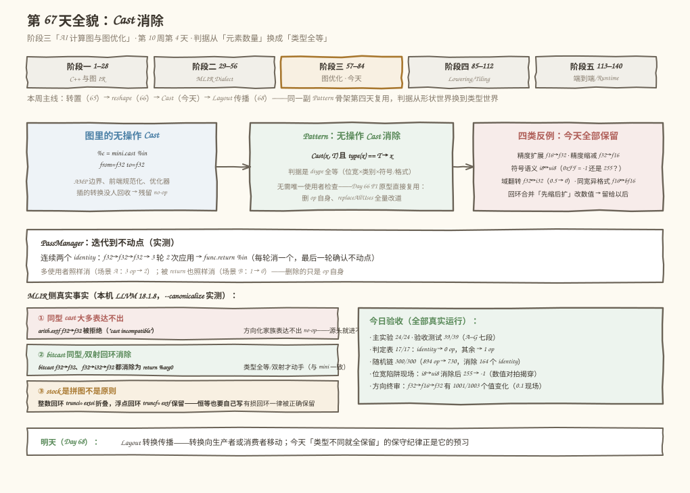
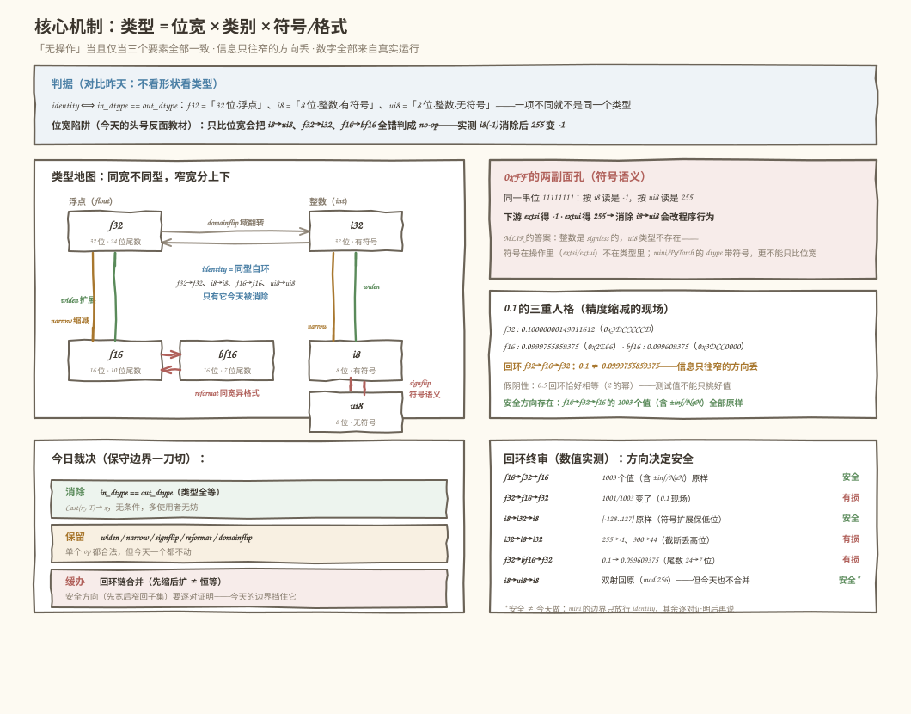
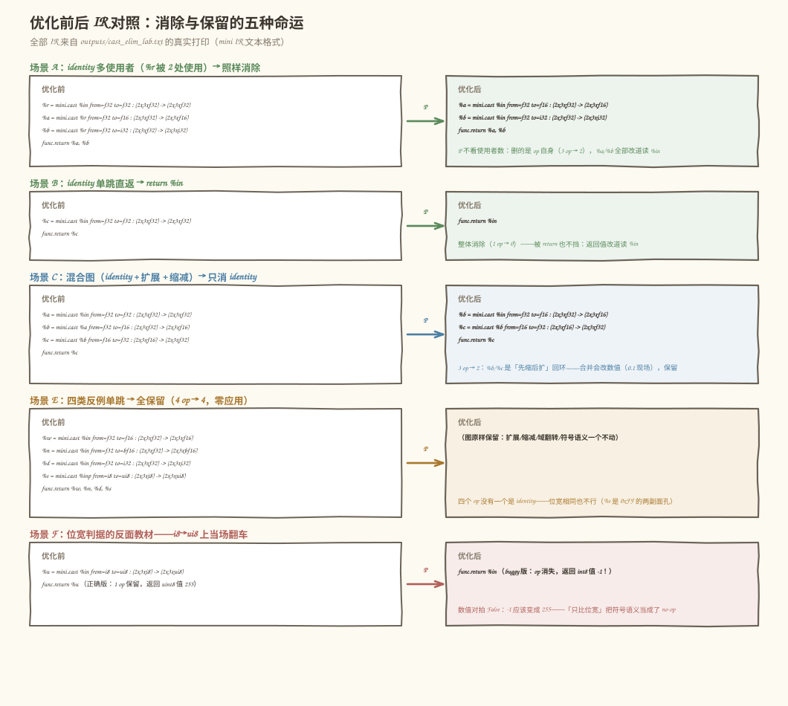
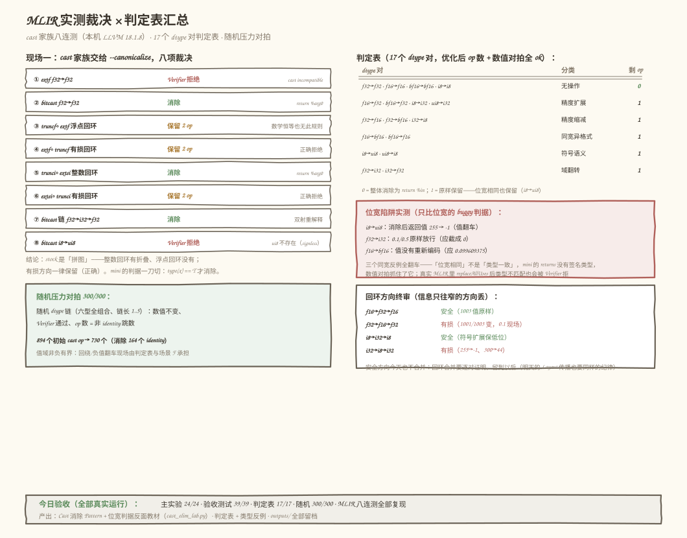

# 第 67 天：Cast 消除——类型完全一致才动手，其余全保留

> **今日目标**：完成本教程后，你能钉死「无操作 Cast」的**唯一判据**——`in_dtype == out_dtype`，即类型三要素（位宽 × 类别 × 符号/格式）全部一致，`f32` 和 `i32` 同为 32 位却**不是**同一个类型，`i8` 和 `ui8` 同为 8 位、位模式都是 `0xFF` 时一个读出 `-1` 一个读出 `255`；能把所有 cast 归入五类（无操作 identity／精度扩展 widen／精度缩减 narrow／符号语义 signflip（含同宽异格式 reformat）／域翻转 domainflip），并说清**为什么今天只消除第一类**——回环链「先缩后扩」会改变数值（`0.1` 走一圈回来变成 `0.0999755859375`），「先宽后窄回到子集」虽安全但要逐对证明，保守边界一并挡住；能实现 **Cast 消除 Pattern**（`Cast(x, T) 且 type(x) == T → x`——昨天 P1 恒等消除的原型直接复用，**不需要**唯一使用者检查）；能识破**位宽陷阱**（只比位宽的判据会把 `i8→ui8` 当 no-op 消除，实测返回值从 255 变 -1）；并能在本机 LLVM 18.1.8 上复现一组真实裁决——**`arith.extf f32 to f32` 被 Verifier 直接拒绝（方向化家族表达不出无操作扩展）、`arith.bitcast f32 to f32` 消除为 `return %arg0`、整数回环 `trunci∘extsi` 有折叠、浮点回环 `truncf∘extf` stock 却没有这条规则**——stock 的规则是拼图而不是原则。
> **预计时间**：学习 40 分钟＋实践 45 分钟
> **前置准备**：第 66 天的 Pattern 骨架（恒等消除 → replaceAllUses → PassManager 不动点）与「被替换 vs 被删除」的结论今天全部复用——恒等消除删的是 op 自身、结果被整体替换，所以不需要唯一使用者检查。f32/f16/bf16 的位布局不在本周前置里（第 12 周才系统展开），今天需要的「尾数位数」这一个事实在 3.1 节的三要素表里现场补齐。工具：Python 3.10+ 与 numpy（本机 3.11.4 / 1.26.4）、`mlir-opt`（本机 Ubuntu LLVM 18.1.8，`/usr/lib/llvm-18/bin/mlir-opt`）。不需要 NPU。
> **今日产出**：Cast 消除 Pattern ＋ 只比位宽的反面教材（`code/cast_elim_lab.py`）、五分类与 17 个 dtype 对的判定表、位宽陷阱的翻车现场（`255 → -1`）、回环方向终审（安全 3 条 / 有损 4 条的数值证据）、独立验收测试（`code/test_cast_elim.py`，39 项）、可复跑的 MLIR IR 文件（`cast_chain.mlir`，八项裁决实测）、`outputs/` 全部真实输出，以及 4 张示意图。

## 1. 今天解决什么问题？

前三天的冗余算子消除都在**形状世界**里做：转置是排列、reshape 是分隔线、判据都是 numel 或排列组合。今天换到**类型世界**：图里还有一种 op 只改 dtype 不改 shape——Cast（类型转换，如 PyTorch 的 `tensor.to(dtype)`、TOSA 的 `tosa.cast`）。它最常见的形态恰恰是**什么都没做的那种**：`from=f32 to=f32`。这种「无操作 Cast」从哪来？工程里反复出现的三个来源：**混合精度的边界**——训练框架在算子前后插 `f32↔f16` 转换，算子换成原生 f16 支持后转换就悬空成 no-op；**前端导入的规范化**——框架导入器按接口约定「保险地」插转换，两端约定相同时就剩同型转换；**优化器自己插的转换没人回收**——多遍优化各自插类型转换，前一遍把消费端改掉之后，转换就成了残留。要回答的问题是：**什么样的 Cast 可以安全删除？判据是什么？哪里是绝对不能碰的边界？**

先看两个真实现场（都在本机复现过，完整输出存 `code/outputs/`）：

```text
现场一（MLIR，本机 LLVM 18.1.8 实测，--canonicalize）：
    想表达「无操作扩展」： %r = arith.extf %x : f32 to f32
      → 交给 mlir-opt 直接被 Verifier 拒绝：
        error: 'arith.extf' op operand type 'f32' and result type 'f32'
               are cast incompatible
      —— arith 把 cast 按方向拆成 extf/truncf/extsi/extui/trunci，
         方向化的家族表达不出「不扩不缩」，no-op 在源头就进不了 IR
    而能表达同型转换的 bitcast 是另一副面孔：
      arith.bitcast %x : f32 to f32          → 消除为 return %arg0
      arith.bitcast 链 f32→i32→f32          → 消除为 return %arg0
    链式回环的裁决却不对称：
      trunci∘extsi（i8→i32→i8，恒等）       → 消除为 return %arg0
      truncf∘extf（f16→f32→f16，恒等）      → 原样保留 2 个 op！
      extf∘truncf（f32→f16→f32，有损）      → 原样保留（正确）
    整数回环有折叠、浮点回环没有——stock 的规则是拼图，不是原则。

现场二（数值，构造于今天主实验第 3/6 节）：
    0.1 的三重人格（同一个十进制数在三种类型里的真身）：
      f32 : 0.10000000149011612（0x3DCCCCCD，24 位尾数）
      f16 : 0.0999755859375（0x2E66，10 位尾数）
      bf16: 0.099609375（0x3DCC0000，7 位尾数，截断）
    把链 f32→f16→f32 当恒等消除，0.1 就变成 0.0999755859375；
    0xFF 的两副面孔：按 i8 读是 -1，按 ui8 读是 255——
    位宽相同、位模式相同，值却不是同一个值。
    昨天的陷阱是「order」，今天的陷阱换了地方：类型。
```

现场一说明**同型 cast 在 MLIR 里大部分表达不出来、能表达的部分有现成消除，而回环折叠是拼图**——要自己写规则就得自己定边界；现场二说明**写它的第一道坎是「类型一致」和「位宽一致」的区别**。今天的解法：先把类型拆成三要素、把所有 cast 归入五类（第 3 节），再把消除判据钉死成一行 `in_dtype == out_dtype`（第 5 节），最后数值对拍加 MLIR 实测双重验收，回环链的方向终审用 7 条证据划清「以后才能做」的领地。

贯穿例子（延续本周的 2×3 小张量，值肉眼可核对）：

```text
B32(2,3) = [[0.1, 0.5, 2.75], [-3.25, 100.0, 0.0]]（f32）
B8(2,3)  = [[-1, 0, 127], [-128, 5, 42]]（i8，含负数与边界值）
同型跳：Cast(B32, f32→f32)        → 消除，B32 原样透传
换号跳：Cast(B8, i8→ui8)          → 保留，-1 变 255（0xFF 换了副面孔）
回环链：f32→f16→f32               → 保留，0.1 变 0.0999755859375
```

今天要回答三个问题：**① 「无操作 Cast」的精确判据是什么，为什么「位宽相同」不够？② 五类 cast 各自的语义和风险是什么，为什么今天只动第一类？③ 回环链「走一圈回原类型」为什么不等于恒等，方向在其中的作用是什么？**

## 2. 先看全貌：今天的内容位于哪里？



**图 1**：上半部分是课程位置——第 10 周「Layout 与冗余算子消除」的第四天：转置（Day 65）→ reshape（Day 66）→ Cast（今天）→ Layout 传播（Day 68），同一副 Pattern 骨架连用四天，判据从形状世界换到类型世界；中部左边是问题（无操作 Cast 的三个来源），中间是今天的 Pattern（类型全等 → 消除，无需唯一使用者检查），右边是四类反例的保留裁决；底部左边是 MLIR 侧的三个真实事实（同型大多表达不出／bitcast 同型消除／stock 是拼图），右边是今日验收汇总，最底下是明天的去向。

用 4 步把全局串起来：

1. **昨天给的骨架**：恒等消除 → `replace_all_uses` → PassManager 迭代到不动点——今天原样复用；变化的只有判据：从「形状全等」换成「类型全等」，边界从「被替换 vs 被删除」细化成「五分类里只动 identity」。
2. **今天在链路里的位置**：图优化阶段「冗余算子消除」家族的第四刀。这一族的共同套路依旧是**找到 op → 判合法性 → 替换/删除 → 迭代到不动点**；但 Cast 与前三刀有本质区别：转置/reshape 是形状世界的**无损重排**，cast 跨类型时是**有损变换**——所以今天的判据必须比「数学上成立」更保守。
3. **今天的产品**：五分类 `classify_cast` ＋ 一个 RewritePattern ＋ 一个反面教材（位宽判据）；MLIR 侧一组实测证据说明「同型 no-op 在 arith 里表达不出、bitcast 有消除、回环折叠是拼图」，而 mini 的判据一刀切。
4. **明天的衔接**：Day 68 Layout 转换传播——转换要「穿过」算子向生产者或消费者移动；今天「类型不同就全保留」的保守纪律正是它的预习：移动转换和消除转换一样，先划清不能动的边界再动手。

## 3. 核心概念：先用直觉，再给准确定义

先给一个贯穿全文的类比：**快递单的单位换算**。同一箱货，「12 件」写成「一打」还是「12 件」——货物没动，只是标签换了：这就是无操作 Cast。把「300 件」誊写进「最多记 127 的小本子」，只能写成 44（本子装不下，高位撕掉）：这是精度缩减。反过来，「本子里的 44」誊回大账本，还是 44——**但最初那 300 已经找不回来了**。对应到技术上是：类型转换分无损与有损两界——**值集扩大的方向（widen）信息不丢，值集缩小的方向（narrow）可能永久丢信息**；而「标签换算」这个类比在 `i8→ui8` 上彻底失效：位的排列一根没动（都是 `0xFF`），但「这箱货算欠账还是溢出」的**解释**变了——符号不在位里，在类型里。这个类比也提醒我们：无操作 Cast 的「无操作」是指**值的解释完全不变**，不只是位宽对得上。

### 3.1 类型三要素与 identity 判据：位宽相同 ≠ 类型一致

- **一句通俗解释**：类型 = **位宽 × 类别 × 符号/格式**三个要素的乘积；`Cast(x, T)` 是「无操作」当且仅当 `x` 的类型与 `T` **三个要素全部一致**。
- **类比**：`f32` 和 `i32` 是「同样大的两张纸」，但一张记小数、一张记整数——纸一样大，账本不一样。
- **对应到技术上是**（今天主实验 `classify_cast` 的核心，六种 dtype 的三要素表）：

  ```text
  dtype  位宽  类别    符号/格式
  f32     32   float   1+8+23（尾数 24 位）
  f16     16   float   1+5+10（尾数 10 位）
  bf16    16   float   1+8+7（尾数 7 位，截断版仿真）
  i32     32   int     有符号
  i8       8   int     有符号
  ui8      8   int     无符号     ← 与 i8 位宽相同、类别相同、符号不同
  ```

  identity 判据一行：`in_dtype == out_dtype`。它比昨天的 numel 判据还简单——cast 不改 shape（逐元素转换），合法性检查全在类型上（两关 Verifier 的 C1：dtype 都认识；图级 G3：声明输入类型与生产者实际类型一致——手写 IR 最容易错的就是这里）。
- **最小例子**：`f32→f32` 是 identity（消除）；`i8→ui8` 位宽相同但符号不同（保留，`-1 → 255`）；`f32→i32` 位宽相同但类别不同（保留，`0.5 → 0`）；`f16→bf16` 位宽、类别都相同但**格式**不同（保留——尾数 10 位重排成 7 位，值要重新编码）。
- **常见误解**：「32 位对 32 位，转了个寂寞，删掉」。实测（场景 F）：只比位宽的判据把 `i8→ui8` 消除后，返回值从 `uint8 的 255` 变成 `int8 的 -1`——数值对拍当场揭穿。MLIR 的对照答案很妙：它的整数类型是 **signless** 的（`ui8` 根本不是合法类型，实测报 `must be signless-integer-or-float-like`），符号在**操作**（`extsi`/`extui`）里而不在类型里——两套设计殊途同归：**符号语义不能被位宽判据吞掉**。

### 3.2 五分类：一个 dtype 对一张脸

- **一句通俗解释**：把六种 dtype 两两配对，每对 cast 都能归入五类之一——今天的学习产出就是这张分类表。
- **类比**：食堂窗口分类——「原样打包」（identity）、「换大碗」（widen）、「硬塞小碗」（narrow）、「换个名堂读」（signflip/reformat）、「换楼层」（domainflip）。
- **对应到技术上是**（主实验第 2 节的 17 对全表，判定表 17/17 实测）：

  ```text
  identity    f32→f32、f16→f16、bf16→bf16、i8→i8     值的解释完全不变 → 今天消除
  widen       f16→f32、bf16→f32、i8→i32、ui8→i32     值集扩大、信息不丢
  narrow      f32→f16、f32→bf16、i32→i8              值集缩小、可能永久丢信息
  signflip    i8↔ui8                                  位不变、有符号解释变（0xFF 两副面孔）
  reformat    f16↔bf16                                同宽浮点换格式（尾数/指数位宽重分配）
  domainflip  f32↔i32                                  浮点↔整数（0.5 → 0，2.75 → 2）
  ```

  分类的作用不是好看：**它就是消除边界的形状**。identity 无条件合法；widen/narrow/signflip/reformat/domainflip 各自有独立的失败现场（第 5.3 节场景 E/F 的数值证据）；而跨类的**链**（回环）要按方向单独审（3.3 节）。
- **最小例子**（沿用贯穿例子）：`Cast(B32, f32→f32)` 消除后 B32 原样透传；`Cast(B8, i8→ui8)` 保留后 `-1` 变 `255`、`-128` 变 `128`；`Cast(B32, f32→i32)` 保留后 `0.1/0.5` 都截成 `0`、`2.75` 截成 `2`。
- **常见误解**：「widen 安全，所以 widen 的链也能随便合并」。错——安全性是**逐对、逐方向**的属性：`f16→f32→f16` 安全（f16 值集 ⊆ f32，1003 个值含 ±inf/NaN 全部原样），`f32→f16→f32` 不安全（1003 个值里 1001 个变了）。「换大碗再倒回小碗」没事的前提是**货本来就是小碗的**。

### 3.3 信息单向门：回环链的方向终审

- **一句通俗解释**：类型转换走一圈回到原类型，**不等于**什么都没发生——信息只在**变窄的方向**丢失，走出窄门的那一步就已经回不去了。
- **类比**：大房间（f32）和小房间（f16）之间只有一扇单向门：从小房间进大房间随便走（值原样），从大房间进小房间要「裁掉行李」（尾数 24 位裁成 10 位）——裁完再搬回大房间，裁掉的部分**不会长回来**。
- **对应到技术上是**（主实验第 6 节的 7 条数值终审）：

  ```text
  f16→f32→f16   安全：f16 值集 ⊆ f32（1003 个值含 ±inf/NaN 全部原样）
  i8→i32→i8     安全：符号扩展保低位（[-128,-1,0,127] 原样）
  i8→ui8→i8     安全：同宽双射（mod 256 双射，[-128..127] 回原）
  f32→f16→f32   有损：0.1 → 0.0999755859375（1001/1003 个值变化）
  i32→i8→i32    有损：255 → -1、300 → 44（高位丢失）
  f32→bf16→f32  有损：0.1 → 0.099609375（尾数 24 → 7 位）
  f32→i32→f32   有损：[0.5, 2.75, -3.25] → [0, 2, -3]（小数蒸发）
  ```

  规律一句话：**先窄后宽 ≠ 恒等（第一个窄跳已经丢信息）；先宽后窄回到子集才是恒等（中间类型是原类型值集的超集）**。今天的选择：即使「安全方向」的回环（`truncf∘extf`、`trunci∘extsi`）数学上可消除，mini 也**一个都不做**——回环合并要求逐对证明超集/双射关系，而 MLIR 实测显示 stock 自己都是拼图（整数回环有折叠、浮点回环没有）。把「可做但今天不做」和「绝不能做」关在同一个门里，是今天最重要的工程纪律。
- **常见误解/类比边界**：「安全方向的回环消除是免费的」。首先它不是 identity 判据能覆盖的（两端类型相同但**中间**换了类型，被删的是两个 op）；其次安全性证明是**逐对**的（`f16→f32` 安全是因为 f16 恰好 ⊆ f32，换成 `f32→f64→f32` 同样成立，但 `bf16` 的舍入模式、`fptosi` 的超范围行为都得单独查）；最后，方向要看清「窄跳在哪头」——安全回环（`f16→f32→f16`）先宽后窄，而场景 C 的 `f32→f16→f32` 恰好相反：**窄跳在链头**，第一跳就把信息丢了。数值终审（第 6 节）就是防这个的。

## 4. 图解核心机制

类型三要素、五分类和单向门怎么拼成一张图，如图 2：



**图 2**：顶部是判据——identity ⟺ 三要素全部一致，位宽陷阱（只比位宽会把 `i8→ui8`、`f32→i32`、`f16→bf16` 全错判成 no-op）是头号反面教材；中部是类型地图——浮点列与整数列各按位宽分层，绿色上箭头是 widen、橙色下箭头是 narrow，红色短箭头是同宽的 signflip（i8↔ui8）与 reformat（f16↔bf16），灰色虚线是 domainflip（f32↔i32）；右上「0xFF 的两副面孔」画出符号语义的坑与 MLIR signless 设计的答案；右下「0.1 的三重人格」画出精度缩减的数值现场；底部左边是今日三条裁决（消除/保留/缓办），右边是回环终审表——安全 3 条、有损 4 条。

按图中编号读：

1. **类型地图是判据的几何版**：identity 只存在于每个节点的「自环」上——向上（widen）、向下（narrow）、横向（signflip/reformat）、跨列（domainflip）四类箭头没有一条能被消除；今天动刀的只有自环。
2. **0xFF 的两副面孔解释为什么位宽判据必翻车**：`0xFF` 按 i8 读是 -1、按 ui8 读是 255，下游 `extsi` 得 -1、`extui` 得 255——消除 `i8→ui8` 等于偷偷改掉下游的行为；MLIR 干脆不设 ui8 类型，把符号语义锁进操作里。
3. **0.1 的三重人格解释为什么回环不能当恒等**：三个真身（0.10000000149011612 / 0.0999755859375 / 0.099609375）都是「0.1」，但它们互不相等——走窄门的那一刻值就换了。
4. **底部三条裁决就是今天的 Pattern 语义**：identity 无条件消除、四类全保留、回环缓办——「缓办」不是「不能做」，而是「没证明之前不做」。

## 5. 动手实践：完成一个最小可运行例子

### 5.1 准备文件

```text
tutorials/day-067/
├── README.md
├── images/                        # 4 张示意图（本文图 1–4）
└── code/
    ├── cast_elim_lab.py           # 主实验：五分类 + Pattern + 位宽陷阱 + 方向终审 + MLIR 八连测（24 项检查）
    ├── test_cast_elim.py          # 独立验收测试（A–G 七段 39 个测试点）
    ├── cast_chain.mlir            # 静态 IR：六个函数的 cast 链（实测 canonicalize 裁决）
    ├── make_images.py             # 生成 4 张 SVG 的脚本
    ├── run_all.sh                 # 一键复跑（环境 → 主实验 → 测试 → 静态 IR 实测）
    └── outputs/                   # 全部真实输出
        ├── cast_elim_lab.txt              # 主实验完整输出（24/24）
        ├── test_cast_elim.txt             # 验收测试（39/39）
        ├── cast_chain.canon.mlir          # 静态 IR 的 canonicalize 产物（6 个 cast op 保留 + 3 个函数消除）
        ├── extf_same.reject.txt           # 同型扩展被 Verifier 拒绝的报错原文
        └── …另有 6 份单函数裁决留档（bitcast_same / trunc_ext / ext_trunc /
            truncsi_extsi / extsi_trunc / bitcast_chain 的 .canon.mlir）
```

运行方式（在 `code/` 目录下）：

```bash
bash run_all.sh        # 环境 → 主实验 → 验收测试 → 静态 IR 的 mlir-opt 实测
```

### 5.2 编写代码

`cast_elim_lab.py` 里，今天的核心产出分三层。第一层——**五分类**（学习产出的代码形态）：

```python
def classify_cast(in_t: str, out_t: str) -> str:
    if in_t == out_t:
        return "identity"                 # ← 今天的消除对象：三要素全等
    ki, ko = DTYPE_INFO[in_t]["kind"], DTYPE_INFO[out_t]["kind"]
    if ki != ko:
        return "domainflip"               # 浮点 ↔ 整数（0.5 → 0）
    if ki == "float":
        if in_t == "f32":
            return "narrow"               # f32 → f16/bf16
        if out_t == "f32":
            return "widen"                # f16/bf16 → f32
        return "reformat"                 # f16 ↔ bf16（同宽换格式）
    bi, bo = DTYPE_INFO[in_t]["bits"], DTYPE_INFO[out_t]["bits"]
    if bo > bi:
        return "widen"                    # i8/ui8 → i32
    if bo < bi:
        return "narrow"                   # i32 → i8
    return "signflip"                     # i8 ↔ ui8（0xFF 两副面孔）
```

第二层——**Cast 消除 Pattern**（今天的正式产出）。注意它与昨天 P1 的血缘：删的是 op 自身、结果被整体替换，所以**没有**唯一使用者检查：

```python
def eliminate_identity_cast(graph: MiniGraph) -> bool:
    """Pattern：无操作 Cast 消除。Cast(x, T) 且 type(x) == T → x。

    合法性论证（昨天 P1 的结论原样复用）：
      - 被删除的只有 op 自身；它的结果被替换成输入（两者值相等）；
      - replaceAllUses 把 %c 的全部使用者改道到 %x——多使用者无妨；
      - 所以不需要「唯一使用者」检查。
    判据是 dtype 全等（位宽、类别、符号/格式一项不同都不行）——
    只比位宽的版本见 eliminate_bitwidth_cast_bug（反面教材）。
    """
    for op in list(graph.ops):
        if classify_cast(op.in_dtype, op.out_dtype) != "identity":
            continue
        graph.replace_all_uses(op.result_id, op.input_id)
        graph.erase(op.result_id)
        return True            # 本轮只做一次，留给 PassManager 迭代
    return False
```

第三层——**反面教材**（不在任何管道里，专门用来翻车给读者看）。它和正确版的差别只有一行判据：

```python
def eliminate_bitwidth_cast_bug(graph: MiniGraph) -> bool:
    """只比位宽的「无操作」判据：位宽相同就消除。
    它会把 i8→ui8（符号语义）、f16→bf16（同宽异格式）、f32→i32（域翻转）
    全部当 no-op 消除——第 5.3 节场景 F 用数值对拍当场揭穿。"""
    for op in list(graph.ops):
        if DTYPE_INFO[op.in_dtype]["bits"] != DTYPE_INFO[op.out_dtype]["bits"]:
            continue
        graph.replace_all_uses(op.result_id, op.input_id)
        graph.erase(op.result_id)
        return True
    return False
```

图数据结构（`MiniGraph`）延续本周设计：`use_count`（含 `func.return`）、`replace_all_uses`、`eval`（按拓扑序用 numpy `astype` 求数值——优化前后对拍的裁判）；`verify` 的 G3 是类型版一致性检查（声明输入类型 == 生产者实际类型），另有 `input_dtypes` 显式声明入参类型——**bf16 用「低 16 位清零的 f32」仿真**，类型记账在 op 上而不从数组猜（0.125 这类好值的低 16 位本来就是 0，靠位模式猜类型会认错）。bf16 转换本身用位运算模拟硬件最朴素的截断舍入：

```python
def to_bf16(arr) -> np.ndarray:
    """f32 → bf16（截断版仿真：低 16 位清零）。numpy 1.26 没有原生
    bfloat16；值集上与 bf16 一致（0.1 → 0.099609375 = 0x3DCC0000）。"""
    a = np.array(arr, dtype=np.float32, copy=False)
    if not a.flags["C_CONTIGUOUS"]:
        a = np.ascontiguousarray(a)
    return (a.view(np.uint32) & np.uint32(0xFFFF0000)).view(np.float32)
```

### 5.3 运行与观察

以下均为**本机真实执行结果**（2026-11-12，Python 3.11.4 / numpy 1.26.4 / Ubuntu LLVM 18.1.8 / aarch64，完整输出存 `code/outputs/cast_elim_lab.txt`）。先看 MLIR 侧的八连测（`--canonicalize` 裁决）：

```text
$ bash run_all.sh   （节选，全真实运行）
== 1. 现场一：cast 家族交给 --canonicalize，stock 管道动不动？==
  ① extf f32→f32（无操作扩展）
    --canonicalize Verifier 拒绝（exit=1）
    error: 'arith.extf' op operand type 'f32' and result type 'f32' are cast incompatible
  ② bitcast f32→f32（无操作重解释）
    --canonicalize 消除为 return %arg0
  ③ truncf∘extf f16→f32→f16（安全回环）
    --canonicalize 原样保留 2 个 cast op
  ④ extf∘truncf f32→f16→f32（有损回环）
    --canonicalize 原样保留 2 个 cast op
  ⑤ trunci∘extsi i8→i32→i8（安全回环）
    --canonicalize 消除为 return %arg0
  ⑥ extsi∘trunci i32→i8→i32（有损回环）
    --canonicalize 原样保留 2 个 cast op
  ⑦ bitcast 链 f32→i32→f32（双射回环）
    --canonicalize 消除为 return %arg0
  ⑧ bitcast i8→ui8（符号进类型？）
    --canonicalize Verifier 拒绝（exit=1）
    error: 'arith.bitcast' op result #0 must be signless-integer-or-float-like
           or memref of signless-integer or float, but got 'ui8'
  对照读法：②⑦ bitcast 的同型/双射回环会被消除；⑤ 整数回环（trunci∘extsi）
  有折叠；③ 浮点回环（truncf∘extf）stock 没有这条规则——数学上恒等也要
  自己写；④⑥ 有损方向一律原样保留（正确）；①⑧ 表达不出的 op 直接被
  Verifier 拦在门外。
```

这段对照值得多读两遍：**同型 no-op 在 arith 里大部分表达不出来**（①：方向化家族里「扩展」必须有更宽的目标），能表达的是 bitcast（②：会消除）；**回环折叠是拼图**（⑤ 整数回环有规则，③ 浮点回环没有——同样的数学恒等，stock 厚此薄彼）；**有损方向 stock 全部正确保留**（④⑥：`extf∘truncf` 和 `extsi∘trunci` 原样留着）。mini 的选择比 stock 更整齐：identity 一刀切，回环无论方向全部缓办。

再看 mini 侧 Pattern 的现场（场景 A/B/C/D 节选）：

```text
场景 A（identity 多使用者：%r 被 %a、%b 两个消费者使用——Pattern 不看这个）：
  %r = mini.cast %in from=f32 to=f32 : (2x3xf32) -> (2x3xf32)
  %a = mini.cast %r from=f32 to=f16 : (2x3xf32) -> (2x3xf16)
  %b = mini.cast %r from=f32 to=i32 : (2x3xf32) -> (2x3xi32)
  func.return %a, %b
→ PassManager 2 轮、应用 1 次：
  %a = mini.cast %in from=f32 to=f16 : (2x3xf32) -> (2x3xf16)
  %b = mini.cast %in from=f32 to=i32 : (2x3xf32) -> (2x3xi32)
  func.return %a, %b
[PASS] A：identity 消除不看使用者数（op 数 3→2），%a/%b 全部改道读 %in

场景 B（identity 单跳直返 → 整体消除为 return %in）：
→ PassManager 2 轮、应用 1 次：
  func.return %in
[PASS] B：identity 单跳整体消除（op 数 1→0，return %in）

场景 C（混合图：identity + 精度扩展 + 精度缩减 → 只消 identity）：
  %a = mini.cast %in from=f32 to=f32 : (2x3xf32) -> (2x3xf32)
  %b = mini.cast %a from=f32 to=f16 : (2x3xf32) -> (2x3xf16)
  %c = mini.cast %b from=f16 to=f32 : (2x3xf16) -> (2x3xf32)
  func.return %c
→ PassManager 2 轮、应用 1 次：
  %b = mini.cast %in from=f32 to=f16 : (2x3xf32) -> (2x3xf16)
  %c = mini.cast %b from=f16 to=f32 : (2x3xf16) -> (2x3xf32)
  func.return %c
  %a 消除后 %b 直读 %in；%b/%c 原样保留——f32→f16→f32 链是「先缩后扩」，
  合并会改数值（第 6 节）
[PASS] C：混合图只消 identity（op 数 3→2），widen/narrow 原样保留

场景 D（连续两个 identity：f32→f32→f32 → 迭代到 0）：
→ PassManager 3 轮、应用 2 次（每轮消一个）：
  func.return %in
[PASS] D：连续 identity 迭代消除（op 数 2→0，2 次应用 + 1 轮不动点确认）
```

场景 C 是今天最值得盯的输出：消除 `%a` 之后，剩下的 `%b→%c` 恰好是 `f32→f16→f32` 的「先缩后扩」链——**昨天如果学了链合并的惯性，今天就会在这里翻车**（0.1 走一圈回来是 0.0999755859375）。今天保留它，正是判据边界的价值。

四类反例与位宽陷阱（场景 E/F）：

```text
场景 E（四类反例单跳：widen/narrow/signflip/domainflip → 全保留）：
  %w = mini.cast %in from=f32 to=f16 : (2x3xf32) -> (2x3xf16)
  %n = mini.cast %in from=f32 to=bf16 : (2x3xf32) -> (2x3xbf16)
  %d = mini.cast %in from=f32 to=i32 : (2x3xf32) -> (2x3xi32)
  %s = mini.cast %inp from=i8 to=ui8 : (2x3xi8) -> (2x3xui8)
→ PassManager 1 轮、应用 0 次：图原样（4 op → 4）
  四个 op 分别是精度扩展（f16）、精度缩减（bf16）、域翻转（i32）、
  符号语义（ui8）——没有一个是 identity，全保留
[PASS] E：四类反例全保留（op 数 4→4，零应用）且数值不变

场景 F（反面教材：只比位宽的 buggy 版在 i8→ui8 上翻车）：
  正确版（dtype 全等）：op 数 1→1，返回值 dtype uint8，值[0,0] = 255
  buggy 版（只比位宽）：op 数 1→0，返回值 dtype int8，值[0,0] = -1
  数值对拍：正确版 == 优化前 True；buggy 版 == 优化前 False
  （-1 应该变成 255，buggy 版还是 -1）
[PASS] F：正确判据保留 i8→ui8（值 255 不变）；位宽判据当场翻车（255 → -1）
[PASS] F2：位宽判据同样放过 f32→i32（0.1/0.5 变成 0）——位宽不是类型
```

五种命运（多使用者照样消 / 直返整体消 / 混合图只消 identity / 四类反例全留 / 位宽判据翻车）的优化前后 IR 对照如图 3：



**图 3**：五行分别是场景 A/B/C/E/F 的真实 mini IR 文本（左列优化前，右列优化后）。读图时注意三点：A 的 `%r` 有 2 处使用却照样消除（删的是 op 自身）；C 的右列保留了 `f32→f16→f32` 的「先缩后扩」链——判据只认 identity，链的合法性今天不审；F 的右列是**反面教材的翻车现场**——buggy 判据把 `i8→ui8` 消除后返回值类型和数值都变了（255 → -1），红框就是「位宽不是类型」的证词。

判定表与随机压力对拍（数值终审）：

```text
== 5. 判定表：17 个 dtype 对，优化前后数值对拍 ==
  in → out      分类          优化后op数  数值对拍
   f32 → f32   无操作   （identity  ）       0      ok
   f16 → f16   无操作   （identity  ）       0      ok
  bf16 → bf16  无操作   （identity  ）       0      ok
    i8 → i8    无操作   （identity  ）       0      ok
   f16 → f32   精度扩展  （widen     ）       1      ok
  bf16 → f32   精度扩展  （widen     ）       1      ok
    i8 → i32   精度扩展  （widen     ）       1      ok
   ui8 → i32   精度扩展  （widen     ）       1      ok
   f32 → f16   精度缩减  （narrow    ）       1      ok
   f32 → bf16  精度缩减  （narrow    ）       1      ok
   i32 → i8    精度缩减  （narrow    ）       1      ok
   f16 → bf16  同宽异格式 （reformat  ）       1      ok
  bf16 → f16   同宽异格式 （reformat  ）       1      ok
    i8 → ui8   符号语义  （signflip  ）       1      ok
   ui8 → i8    符号语义  （signflip  ）       1      ok
   f32 → i32   域翻转   （domainflip）       1      ok
   i32 → f32   域翻转   （domainflip）       1      ok
[PASS] 判定表 17/17：identity → 0 op，其余 → 1 op，数值全不变

随机压力对拍（300 组随机 dtype 链，链长 1..5，六型全组合）：
[PASS] 随机对拍 300/300：数值不变、Verifier 通过、op 数 = 非 identity 跳数
  300 组共 894 个初始 cast op，消除 164 个 identity，保留 730 个类型变换
  ——保留的每个都有类型理由
```

随机对拍里值域取非负有界（int 0..127 / float 0.125..8.125）：随机链会自然产生「负浮点转无符号」（如 `i32→i8` 回绕出负数再进 ui8）这类 C 语言未定义行为的组合，对拍口径会被污染——**回绕与负值的翻车现场由判定表和场景 F 显式承担**，随机对拍只看守「消除只发生在 identity 跳上」。判定表与 MLIR 裁决的汇总如图 4：



**图 4**：左上是八连测裁决表（拒 2 / 消 3 / 留 3），左下是随机压力对拍（894 → 730，消除 164 个 identity）；右上是 17 对判定表（按分类归并成 6 行），右中是位宽陷阱的三个翻车现场，右下是回环方向终审——安全 3 条与有损 4 条并排放着，「方向决定安全」一眼可见。

最后是回环方向终审（第 6 节）：

```text
== 6. 回环终审：信息只往窄的方向丢（方向决定安全）==
  回环链                  数值现场                                    裁决
  f16→f32→f16     1003 个值（含 ±inf/NaN）全部原样         安全：f16 值集 ⊆ f32
  f32→f16→f32     1003 个值里 1001 个变了                  有损：f16 值集 ⊄ f32
                  （0.1 → 0.0999755859375）
  i8→i32→i8       [-128,-1,0,127] 全部原样                 安全：符号扩展保低位
  i32→i8→i32      [255→-1, 300→44] 高位丢了                 有损：截断丢高位
  f32→bf16→f32    0.1 → 0.099609375（截断版 bf16）          有损：尾数 24 → 7 位
  i8→ui8→i8       [-128..127] 双射回原（mod 256）            安全：同宽双射（但今天也不合并）
  f32→i32→f32     [0.5, 2.75, -3.25] → [0, 2, -3]          有损：小数部分蒸发
[PASS] 方向终审：先窄后宽 ≠ 恒等（f32→f16→f32、i32→i8→i32、
       f32→bf16→f32、f32→i32→f32 全部改变数值）
[PASS] 方向终审：先宽后窄回到子集才安全（f16→f32→f16、i8→i32→i8）
       ——即便如此，今天也只做 identity，回环合并留给以后
[PASS] 方向终审：同宽双射（i8→ui8→i8）数学上安全，但需要逐对证明
       ——mini 的保守边界把它一并挡在门外
```

`f32→f16→f32` 一行里 1003 个值只有 2 个幸存（±inf 恰好还是 inf）——「大部分值没变」从来不是合并的借口，**一个值变了就不能当恒等**。

### 5.4 修改一个参数再观察

**对照实验一：把测试值从 0.1 换成 0.5——只动一个数字，「有损回环」当场假装自己没丢东西。**

```bash
$ python3 - <<'EOF'   （语义同主实验第 3 节，可直接验证）
import numpy as np
for v in (0.1, 0.5):
    a = np.float32(v)
    rt = np.float32(np.float16(a))
    print(f"{v}: 回环 == 原值? {rt == a}"
          f"（{float(a)!r} vs {float(rt)!r}）")
EOF
0.1: 回环 == 原值? False（0.10000000149011612 vs 0.0999755859375）
0.5: 回环 == 原值? True（0.5 vs 0.5）
```

0.5 是 2 的幂，在 f16 里精确表示——**同一个有损变换，对不同值的命运不同**。推论：验证 cast 类优化的测试值不能只挑好值（2 的幂、小整数都是「好值」），要用随机值加特殊值（±inf/NaN/边界值），这正是随机对拍 300 组配 0.1/0xFF 现场的原因。

**对照实验二：把消除判据从「dtype 全等」换成「位宽相等」——正确版保留的图在 buggy 版上当场翻车。**

```bash
$ python3 - <<'EOF'   （语义同主实验场景 F）
import numpy as np
x = np.array([[-1, 0, 127], [-128, 5, 42]], dtype=np.int8)
correct = x.astype(np.uint8)          # 保留 i8→ui8：位不变、值换解释
print("保留 cast：dtype", correct.dtype, "值[0,0] =", correct[0, 0])
print("消除 cast：dtype", x.dtype,      "值[0,0] =", x[0, 0])
EOF
保留 cast：dtype uint8 值[0,0] = 255
消除 cast：dtype int8 值[0,0] = -1
```

两个对照实验合起来读：**值挑错了，有损会假装无损；判据写宽了，符号语义会假装 no-op**——判据和验证是 cast 优化的两条腿，缺一条就摔。

## 6. 常见错误与排查

**错误 1：判据只比位宽（今天的头号反面教材）**

- **现象**：`i8→ui8` 被当 no-op 消除，下游读到的值从 255 变 -1（场景 F 实测）；更惨的 `f32→i32` 也被消除，0.5 原样流进整数算子。数值对拍一挂就现形，但没对拍的图就流出去了。
- **原因**：把「32 位转 32 位」理解成「没转」。类型是位宽 × 类别 × 符号/格式三要素的乘积，位宽只是其中一维；`i8→ui8` 位不变但有符号解释变（0xFF 的两副面孔），`f16→bf16` 位宽、类别都同但格式变（尾数 10 位重排成 7 位）。
- **定位**：跑场景 F 的对照（正确版保留、buggy 版翻车），或在 Pattern 入口打印 `classify_cast(op.in_dtype, op.out_dtype)` 看它是不是 identity。
- **修复**：判据回到 `in_dtype == out_dtype` 一行。MLIR 的参照答案：整数类型 signless、符号在操作里——**符号语义永远不能被位宽判据吞掉**。

**错误 2：把「回环链」当恒等消除（方向读反）**

- **现象**：`Cast(Cast(x, f32→f16), f16→f32)` 被折叠成 `x`，0.1 变 0.0999755859375——误差悄悄进了权重或激活里，绝对值小、单测可能全绿（0.5 这类好值根本测不出来），上线后精度对不上才炸。
- **原因**：看链的两端都是 f32，以为「走一圈回原类型 = 没发生」。信息只在变窄的方向丢：**第一个窄跳（f32→f16，尾数 24→10 位）已经永久丢信息**，后面的宽跳只是把损失定格。
- **定位**：跑第 6 节的方向终审——`f32→f16→f32` 的 1003 个值里 1001 个变了；把 `0.1` 塞进链里比 0.5 灵敏得多。
- **修复**：今天根本不做回环合并（保守边界）。将来要做也分两档：「先宽后窄回子集」（`truncf∘extf`）逐对证明后可做；「先窄后宽」（`extf∘truncf`）永远不许。MLIR 实测里 stock 对这两档也是区别对待的（⑤ 消除、④ 保留）。

**错误 3：测试值挑了「好值」（假阴性陷阱）**

- **现象**：用 0.5、1.0、2 这类值测精度缩减，回环全部相等，测试全绿——切到真实数据精度就崩。
- **原因**：2 的幂和短尾数的小整数在 f16/bf16 里精确表示（0.5 = 2⁻¹ 的尾数是 0）。「大部分值不变」掩盖了「个别值必变」；有损变换的测试要看它**丢不丢**，不是看它能不能碰巧不丢。
- **定位**：把测试值换成 0.1（实测：f32/f16/bf16 三个真身互不相等）或随机值配特殊值（±inf/NaN/越界整数 300）。
- **修复**：验证集三件套——随机值（本实验 300 组对拍）+ 特殊值（±inf/NaN）+ 反例值（0.1、0xFF、300）。今天主实验与测试的数值现场全部按这个口径构造。

**错误 4：不看目标语义就定转换规则（回绕/饱和/未定义）**

- **现象**：两个都对 cast 做了「合法消除」的编译器，在同一张图上跑出不同结果——一个把 `i32(300)→i8` 变 44（回绕），一个变 127（饱和）；`fptosi` 超范围时有的硬件给 poison、有的给 0；负浮点转无符号整数是 C 的未定义行为（本实验随机对拍里实测撞到过：`i32→i8` 回绕出负数再转 ui8，numpy 直接警告）。
- **原因**：cast 的**语义**是目标运行时的属性，不是「位宽搬运」这么简单——mini 仿真里用的 numpy C cast（回绕）只是一种约定，真实硬件（如 NPU 的 Cast 算子、ARM 的饱和指令）各有各的表。
- **定位**：查目标 ISA/运行时文档的转换表；在 mini 里把行为写进 `convert()` 并在文档里标注约定（bf16 用「截断」仿真，就是显式选了一种并写明）。
- **修复**：消除规则只承诺「**不改语义**」的改写（identity 判据天然满足这一点）；涉及数值变换的合并（回环、跨类型折叠）在做之前必须先钉死每一段转换的运行时语义。今天随机对拍把值域压到非负有界，就是把「未定义行为」从验证口径里剔出去——这不是回避，是把翻车现场交给专门测试它的人。

## 7. 今日练习

### 必做练习

拿贯穿例子练手，**先笔算再跑**：

1. **笔算五分类**：对 12 个 dtype 对——`f32→f16`、`f16→f16`、`ui8→i32`、`i32→ui8`、`bf16→f32`、`f32→f32`、`i8→ui8`、`f16→bf16`、`i32→i32`、`f32→i32`、`ui8→ui8`、`bf16→bf16`——先写出每对的分类（identity/widen/narrow/signflip/reformat/domainflip）和消除裁决（0 还是 1 个 op），再跑 `python3 test_cast_elim.py` 的 A1/E2 核对（提示：先看类别是否跨 float/int，再看位宽，最后看符号/格式）。
2. **预测翻车现场**：把场景 F 的输入从 `B8 = [[-1, 0, 127], [-128, 5, 42]]` 换成全非负的 `[[1, 2, 127], [0, 5, 42]]`，先预测 buggy 位宽判据还翻不翻车（提示：`i8→ui8` 对 0..127 的值位不变、值也不变——**数值对拍这时候会放行**，但返回值 dtype 从 uint8 变 int8 还在；符号语义的错误只在负值上「显形」，这正是值域单一的测试抓不住符号 bug 的原因），再改 `cast_elim_lab.py` 场景 F 验证你的预测。
3. **构造回环反例**：仿照判定表，构造链 `Cast(Cast(B32, f32→f16), f16→f32)`（先缩后扩）和 `Cast(Cast(np.float16 的 B32, f16→f32), f32→f16)`（先扩后缩），先预测两条链的值变不变（提示：用 0.1 和 0.5 各想一遍——一条链两个值的结论可能不同），再用 numpy 三行验证。最后回答：哪条链将来可以作为 `truncf∘extf` 风格的安全回环消除？哪条永远不能？
4. **复跑全链**：`bash run_all.sh`，确认主实验 24/24、验收测试 39/39、静态 IR 实测 `cast_chain.mlir --canonicalize` 留下 6 个 cast op（`@trunc_ext`/`@ext_trunc`/`@extsi_trunc` 各 2 个）和 3 个 `return %arg0`（`@bitcast_same`/`@truncsi_extsi`/`@bitcast_chain`）；打开 `outputs/extf_same.reject.txt` 找到 `cast incompatible` 的原文——同型扩展连 IR 都进不去，这是 MLIR 给「无操作 Cast」的第一道答案。

### 选做挑战

实现**安全回环消除**（`truncf∘extf` 风格）：`(a)` 给 mini 加一个 Pattern `eliminate_safe_roundtrip`，只消除「先宽后窄回到子集」的链——`Cast(Cast(x, T→W), W→T)` 当 `T 的值集 ⊆ W` 时折叠为 `x`（查 `DTYPE_INFO` 之外还要一张「精确表示」表：f16 ⊆ f32、bf16 ⊆ f32、i8/i32 ⊆ i32；`i8→ui8→i8` 是双射但值集互不包含，**不在此表**）。要求：先用 numpy 对 1000 个随机值 + ±inf/NaN 证明每对都恒等，再写 Pattern；`(b)` 用 MLIR 八连测的 ③⑤ 验证你的边界与 stock 的差别：stock 折叠了整数回环（⑤），你的 Pattern 也该折 `i8→i32→i8`；stock 没折叠浮点回环（③），你的会折 `f16→f32→f16`——**说明「谁更强」**；`(c)` 回答：`f32→bf16→f32` 该不该在表里？（提示：bf16 的舍入模式——截断还是就近——决定答案；今天 mini 的仿真选了截断。）改完跑 `python3 cast_elim_lab.py`，原有 24 项检查必须仍然全过（新 Pattern 用独立管道测，不进默认 PATTERNS）。

## 8. 今日验收

- [ ] 我能用自己的话解释类型三要素（位宽 × 类别 × 符号/格式）和 identity 判据：`in_dtype == out_dtype` 一刀切——`f32↔i32` 同宽跨类别、`i8↔ui8` 同宽换符号、`f16↔bf16` 同宽换格式，全都不是无操作（位宽陷阱实测：buggy 判据让 `i8→ui8` 的返回值从 255 变 -1）；
- [ ] 我能把任意 cast 归入五类并说出各自的数值现场：widen 值集扩大不丢信息、narrow 可能永久丢（0.1 的三重人格：0.10000000149011612 / 0.0999755859375 / 0.099609375）、signflip 是 0xFF 的两副面孔、domainflip 让 0.5 变 0——判定表 17/17；
- [ ] 我能独立实现 Cast 消除 Pattern 并说清它为什么不需要唯一使用者检查（删的是 op 自身、结果被整体替换——昨天 P1 的结论直接复用；场景 A 实测 2 处使用者照样消除）；
- [ ] 我能说清回环方向性：先窄后宽 ≠ 恒等（`f32→f16→f32` 的 0.1 变 0.0999755859375，1003 个值里 1001 个变了）、先宽后窄回子集才安全（`f16→f32→f16` 的 1003 个值含 ±inf/NaN 全部原样）——以及为什么今天连安全回环也不做（逐对证明 + 0.5 假阴性警示）；
- [ ] 我能复述 MLIR 侧的实测事实及其含义：`arith.extf f32→f32` 被 Verifier 拒（方向化家族表达不出 no-op）、`bitcast` 同型与双射链消除、整数回环 `trunci∘extsi` 有折叠而浮点回环 `truncf∘extf` 没有、`ui8` 类型不存在（整数 signless，符号在 op 不在类型）——stock 是拼图，mini 的判据更整齐；
- [ ] 我能独立运行 `bash code/run_all.sh` 复现全部结果（24/24 + 39/39 + 静态 IR 八项裁决），并定位今天列出的四类错误（位宽判据、回环当恒等、测试值挑好值、运行时语义差异）各自的证据；
- [ ] 我保存了 Cast 消除 Pattern 与位宽判据反面教材（`code/cast_elim_lab.py`）、39 项验收测试（`code/test_cast_elim.py`）、静态 IR 文件（`cast_chain.mlir`）、全部真实输出（`code/outputs/`）和 4 张示意图。

## 9. 一句话总结与明天预告

今天的问题从「图里残留的 `from=f32 to=f32` 到底能不能删」开始，答案是把类型拆成**位宽 × 类别 × 符号/格式**三要素、把 cast 归入五类（identity/widen/narrow/signflip/reformat/domainflip），然后**只在 identity 上动刀**：`Cast(x, T) 且 type(x) == T → x`，判据一行、无需唯一使用者检查（昨天 P1 的血缘）；其余四类全保留，回环链无论方向今天一律缓办——数值终审给出 7 条证据，规律是**信息只往窄的方向丢**（`f32→f16→f32` 的 0.1 变 0.0999755859375，而 `f16→f32→f16` 的 1003 个值含 ±inf/NaN 全部原样）。位宽陷阱是今天的头号反面教材：只比位宽的判据让 `i8→ui8` 的返回值从 255 变 -1——0xFF 的两副面孔提醒我们**符号住在类型里**；MLIR 用另一种设计给出同一答案（整数 signless、`extf f32→f32` 连 IR 都进不去）。实测双重验收：mini 主实验 24/24、验收测试 39/39、判定表 17/17、随机链 300/300；MLIR 八连测复现了 stock 的拼图现实——整数回环有折叠、浮点回环没有，同型 bitcast 会消除、方向化家族表达不出 no-op。

明天（Day 68）讲 **Layout 转换传播**：把转换向生产者或消费者移动的基本思想与收益——今天「类型不同就全保留」的保守纪律就是它的预习：移动转换和消除转换一样，判据钉死之前，宁可让转换多留一跳，也不能让语义溜走。
