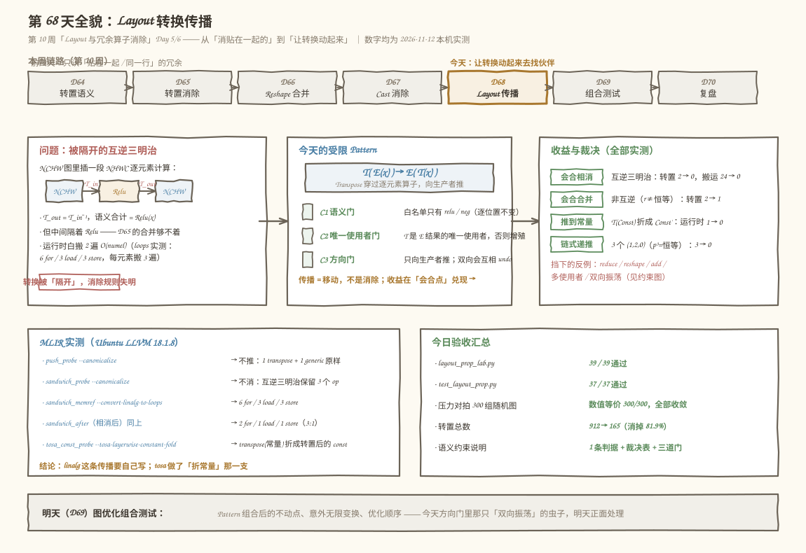
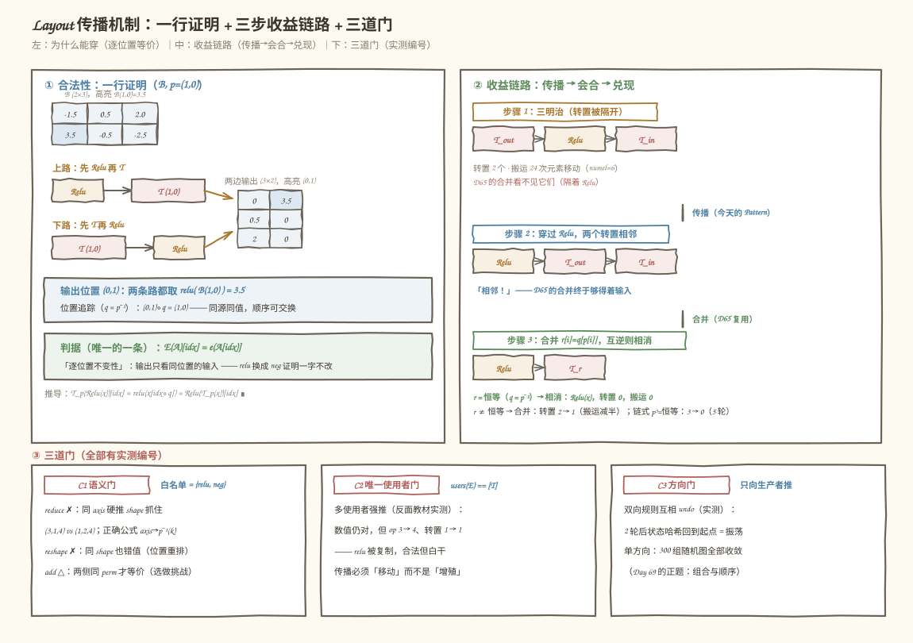
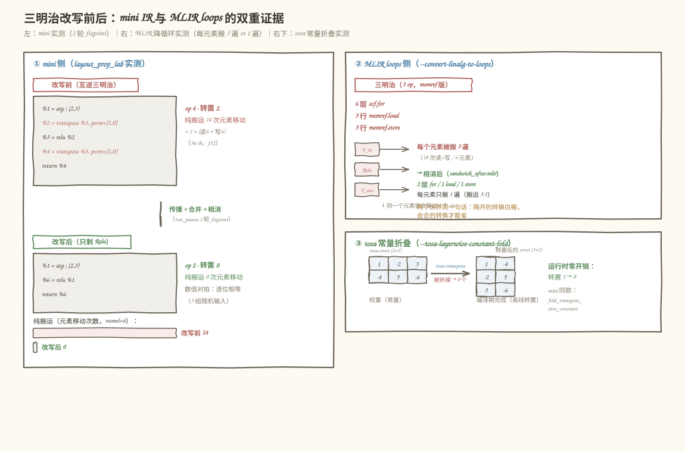
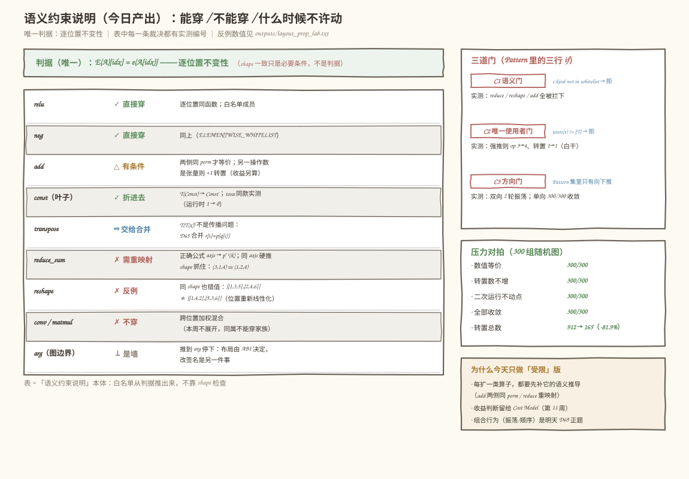

# 第 68 天：Layout 转换传播——让转置穿过逐元素算子去找它的伙伴

> **今日目标**：完成本教程后，你能**手工推导** Transpose 穿过逐元素算子的等价形式——`T_p(Relu(x)) ≡ Relu(T_p(x))`，并把整条合法性压缩成一句话：**逐位置不变性** `E(A)[idx] = e(A[idx])`（每个输出位置的值只由同位置的输入值决定）；能说清**传播与消除的分工**——Day 65 的合并/相消只对「贴在一起」的转置生效，今天让转换**动起来**：向生产者方向推，穿过逐元素算子去和另一侧的转换会合（三明治 `T_p(Relu(T_q(x)))` → 传播 → 合并 → `Relu(T_r(x))`，`r[i] = q[p[i]]`，互逆时整体相消，转置 2 → 0）；能实现**受限 Pattern** 并守住三道门——**C1 语义门**（白名单 relu/neg，reduce/reshape/add/conv 一律拦下，各有实测反例）、**C2 唯一使用者门**（无视它强推，数值不会错但算子增殖：实测 op 3 → 4、转置 1 → 1，白干一场）、**C3 方向门**（只向生产者推；双向规则同时在场会互相 undo，实测 2 轮即检测到振荡——Day 69 的正题）；并能分清**收益的三个来源**——会合相消（纯搬运 24 → 0 次元素移动）、会合合并（2 → 1 个转置）、推到常量边上折叠成编译期值（1 → 0）；最后在本机 LLVM 18.1.8 上复现一组真实裁决——**`--canonicalize` 不把 `linalg.transpose` 穿过逐元素 `linalg.generic`、互逆三明治原样保留 3 个 op、降循环后每个元素被搬 3 遍（6 层 for / 3 行 load / 3 行 store，相消后 2/1/1）、而 `--tosa-layerwise-constant-fold` 会把 `tosa.transpose(常量)` 折成转置后的 `tosa.const`**——「推到常量边上」这条收益路径在真实编译器里真实存在。
> **预计时间**：学习 40 分钟＋实践 45 分钟
> **前置准备**：第 64 天的转置约定（`out_shape[i] = in_shape[perm[i]]`，与 `np.transpose` 一致）和第 65 天的排列组合（`T_q(T_p(x))` 合并为 `r[i] = p[q[i]]`，互逆消除是一般合并的特例）今天全部复用；第 52 天的「多使用者限制」今天第二次正式上岗（Day 65 用过一次）。工具：Python 3.10+ 与 numpy（本机 3.11.4 / 1.26.4）、`mlir-opt`（本机 Ubuntu LLVM 18.1.8，`/usr/lib/llvm-18/bin/mlir-opt`）。不需要 NPU。
> **今日产出**：Layout 传播 Pattern（`push_transpose_through_elementwise`，白名单 + 唯一使用者 + 单方向）、语义约束说明（逐位置不变性判据 + 能穿/不能穿裁决表 + 三道门 + reduce 重映射公式与 reshape 反例）、三明治收益链路（相消 2 → 0 / 合并 2 → 1 / 常量折叠 1 → 0）、300 组随机图压力对拍（数值等价 300/300，转置 912 → 165，消掉 81.9%）、独立验收测试（`code/test_layout_prop.py`，37/37 通过）、5 个可复跑的 MLIR 探针（实测 stock 管道的真实裁决）、`outputs/` 全部真实输出，以及 4 张示意图。

## 1. 今天解决什么问题？

本周前四天的冗余算子消除有一个共同的局限：**只认贴在一起的冗余**。转置合并（Day 65）要求两个转置相邻，Cast 消除（Day 67）要求类型在同一行——可真实图里的转换偏偏是**被隔开的**。最典型的现场：框架在 NCHW 图里插进一段 NHWC 逐元素计算，两头各补一个转置：

```text
        NCHW ──T_in──> NHWC ──Relu──> NHWC ──T_out──> NCHW
```

`T_out` 和 `T_in` 互为逆排列、语义合计为零，但中间隔着 Relu——Day 65 的合并 Pattern **看不见它们**。这张图运行时要做两次完整的 O(numel) 数据搬家，而它想做的计算只是 `Relu(x)`。要回答的问题是：**怎么让被隔开的转换相遇？转换什么时候可以「穿过」一个算子、什么时候绝对不行？移动本身不减少算子数，收益到底从哪来？**

先看两个真实现场（都在本机复现过，完整输出存 `code/outputs/`）：

```text
现场一（MLIR，本机 LLVM 18.1.8 实测）：
    互逆三明治 in 2x3 --[1,0]--> 3x2 --ReLU--> 3x2 --[1,0]--> 2x3
    （语义合计 = ReLU(x)，两个转置白搬两遍）交给 stock 管道：
      mlir-opt sandwich_probe.mlir --canonicalize
        → exit=0，IR 原样保留：linalg.transpose 2 个 + generic 1 个
      mlir-opt sandwich_memref.mlir --convert-linalg-to-loops
        → 6 层 scf.for、3 行 memref.load、3 行 memref.store
          （每行在 numel=6 的循环里执行：每个元素被搬 3 遍）
    对照「相消之后」的图（sandwich_after.mlir，只剩 ReLU）：
      → 2 层 scf.for、1 行 load、1 行 store（每元素只搬 1 遍）
    单独推一个转置也不行：
      mlir-opt push_probe.mlir --canonicalize
        → transpose(ReLU(x)) 原样保留——stock 没有「穿过」这条规则

现场二（mini，构造于今天主实验第 2/4 节）：
    忽略「唯一使用者」约束强行传播（反面教材）：
      Relu 结果被 transpose 和 neg 同时使用，强推后——
        数值没算错（对拍仍逐位相等）
        但 op 从 3 个变 4 个、转置还是 1 个：
        relu 被复制了一份，转置一个没少——合法但白干
    「双向规则同时在场」的最小翻车（方向门）：
      向下推 T(Relu(x)) → Relu(T(x))，向上推 E(T(x)) → T(E(x))，
      两条规则互相 undo：2 轮后状态哈希回到起点——永不收敛
      （这正是 Day 69「意外无限变换」要正面处理的问题）
```

现场一说明**「让隔开的转换相遇」这件事 stock 管道不做，要自己写**（linalg 没有注册任何 transpose 传播规则——这是实测结论，不是猜测）；现场二说明**写它的坑不在数学在边界**——传播的合法性一行就能证完，翻车全在唯一使用者和方向选择上。今天的解法：先把「穿过」的数学钉死成逐位置不变性这一条判据（第 3 节），再实现只向生产者方向推的受限 Pattern（第 5 节），让 Day 65 的合并规则在会合点自动接手，最后数值对拍加 MLIR 实测双重验收。

贯穿例子（延续本周的 B 家族，值肉眼可核对）：

```text
B(2,3) = [[-1.5, 0.5, 2.0], [3.5, -0.5, -2.5]]（f32）
单穿：  T(Relu(B)) 与 Relu(T(B))  逐位相等（第 1 节现场推导）
三明治：B --T_(1,0)--> (3,2) --Relu--> (3,2) --T_(1,0)--> (2,3)
        两个 (1,0) 互逆（对合排列），整链坍缩为 Relu(B)
链式：  B3(2,3,4) 三个 T_(1,2,0) 夹两个逐元素——p³ = 恒等（3-循环阶 3），
        传播让三个转置全部会合相消
```

今天要回答三个问题：**① Transpose 穿过逐元素算子为什么合法、判据怎么一句话说清？② 传播本身不删算子，收益从哪来、什么时候反而是劣化？③ 哪些算子绝对不能穿、边界用什么机制守住？**

## 2. 先看全貌：今天的内容位于哪里？



**图 1**：上半部分是课程位置——第 10 周「Layout 与冗余算子消除」的第五天：前四天（转置消除 → reshape 合并 → Cast 消除）都只会消「贴在一起」的冗余，今天补上「让转换动起来去找伙伴」的传播能力；中部左边是问题的形状（被逐元素算子隔开的互逆三明治），中间是今天的受限 Pattern（白名单 + 唯一使用者 + 向生产者单方向），右边是三道门挡下的反例；底部左边是 MLIR 侧的四个真实事实（canonicalize 不推／三明治原样保留／loops 每元素搬 3 遍 vs 1 遍／tosa 折常量），右边是今日验收汇总，最底下是明天的去向。

用 4 步把全局串起来：

1. **前四天给的零件**：Day 64 的转置语义（排列属性、`out_shape[i] = in_shape[perm[i]]`）、Day 65 的合并/互逆消除（`r[i] = p[q[i]]`）、Day 66/67 的「找到链 → 判合法性 → 替换/删除 → 迭代到不动点」骨架——今天全部变成传播的零件；合并规则不改一行，只是**终于够得着它的输入了**。
2. **今天在链路里的位置**：图优化阶段「冗余算子消除」家族的第五刀，也是视角升级的一刀：前四刀都是**局部匹配**（相邻、同位置），今天引入**移动**——把转换向生产者方向推，穿过逐元素区域，在另一侧与别的转换会合。生产编译器里 TF Grappler 的 layout optimizer、TVM 的 layout rewrite 都在做同构的事。
3. **今天的产品**：一个 RewritePattern（`push_transpose_through_elementwise`）＋一份语义约束说明（逐位置不变性判据、能穿/不能穿裁决表、三道门）＋三明治收益链路；MLIR 侧一组实测证据划清「stock 不做」与「tosa 做了常量那一支」的边界。
4. **明天的衔接**：Day 69 图优化组合测试——今天的「双向振荡」现场正是组合行为的预告：Pattern 组合后的不动点、意外无限变换和优化顺序，明天正面处理。

## 3. 核心概念：先用直觉，再给准确定义

先给一个贯穿全文的类比：**搬家公司整理房间**。你在新家（NHWC）整理衣服，衣服原装箱单是旧家的（NCHW），搬家公司在门口按新家的箱单重新装了一遍箱（`T_in`）。你整理的方式是「每件衣服单独叠一下」——**哪件衣服在哪个箱子里，不影响你怎么叠它**。既然如此，让搬家公司**先别装箱**：你直接按旧箱单逐件叠好（`Relu` 在 NCHW 上做），再让门口按新箱单**一次装完**（合并后的 `T_r`）。要是两份箱单互为逆（`T_out = T_in⁻¹`），搬家公司干脆什么都不用做（相消为 0）。对应到技术上是：逐元素算子对「位置」不敏感——`E(A)[idx] = e(A[idx])`，输出只看同位置的输入，所以**转换放在它前面还是后面等价**；这个类比的边界在「跨位置」的算子上：叠衣服时如果把三箱衣服倒进一个大箱再按新箱单分装（reshape 的重新线性化）、或者把同季的衣服合并计数（reduce 的跨位置求和），「先整理还是先装箱」就不再随便换了——第 4 节的反例全部长在这条边界上。

### 3.1 逐位置不变性：一句话的合法性判据

- **一句通俗解释**：一个算子可以「被穿过」，当且仅当它的每个输出位置的值**只由同位置的输入值决定**——位置换了，函数照旧。
- **类比**：上面的叠衣服——逐件处理的活儿和装箱顺序无关。
- **对应到技术上是**（今天第 1 节现场证明的全部内容）：

  ```text
  约定（Day 64）：T_p(A) 的第 i 根轴 = A 的第 p[i] 根轴，
                  取值时索引按轴对应关系跟着换（记 q = p⁻¹）：
                  T_p(A)[i0..in-1] = A[i_{q(0)}..i_{q(n-1)}]

  左边：T_p(Relu(x))[idx] = Relu(x)[idx∘q] = relu( x[idx∘q] )
                                ~~~~~~~~~~~~ 逐元素：Relu(A)[任何位置] = relu(A[该位置])
  右边：Relu(T_p(x))[idx]  = relu( T_p(x)[idx] ) = relu( x[idx∘q] )
  两边逐位置相等。∎

  全部合法性 = 一条性质：E(A)[idx] = e(A[idx])
  ```

  注意证明里**没有用到 relu 的任何具体性质**——把 relu 换成 neg、换成任何逐位置函数，一行不用改。反过来，谁没有这条性质，谁就不能穿：reduce 混合多个位置、reshape 重新线性化位置、conv/matmul 跨位置加权——它们的反例都在 3.3 节和第 4 节。
- **最小例子**（贯穿例子 B，第 1 节实测输出）：

  ```text
  T(Relu(B)) = [[0.  3.5]        Relu(T(B)) = [[0.  3.5]
                [0.5 0. ]]                      [0.5 0. ]]
                [2.  0. ]]                      [2.  0. ]]
  位置追踪（q = p⁻¹ = (1,0)）：
    输出位置 (0,1) ← 两边都取 relu(B(1,0)) = relu(3.5)  = 3.5
    输出位置 (2,0) ← 两边都取 relu(B(0,2)) = relu(2.0)  = 2.0
    输出位置 (2,1) ← 两边都取 relu(B(1,2)) = relu(-2.5) = 0.0
  ```

- **常见误解**：「逐元素 = 能穿过，所以 add 也能直接穿」。对一半：`T_p(Add(a,b)) = Add(T_p(a), T_p(b))` 数学上成立（实测逐位相等），**但**第二个操作数也得配一个同 perm 的转置——它要是常量可以折进常量（免费），要是张量就要新增一个转置（收益要另算）。所以今天的白名单只收**一元**逐元素算子，add 留给选做挑战（第 7 节）。

### 3.2 传播、会合、相消：三明治的收益链路

- **一句通俗解释**：传播本身不删任何东西——它只是把转换**搬到能被消除的地方**：搬到另一个转换旁边（合并）、搬到互逆伙伴旁边（相消）、搬到常量上（折叠）。
- **类比**：两笔可以互相抵消的账，一笔在 A 柜台一笔在 B 柜台，中间隔着排队——你消不掉它们不是因为账不能抵，是因为**够不着**；换到同一个柜台（传播）才谈得上抵消。
- **对应到技术上是**（今天第 3 节的完整链路，实测 `2 轮 fixpoint`）：

  ```text
  三明治：z = T_p(Relu(T_q(x)))
  第 1 步 传播（今天的 Pattern）：T 穿过 Relu
          z = Relu(T_p(T_q(x)))          ← 两个转置终于相邻
  第 2 步 合并（Day 65 的 Pattern 复用）：
          r[i] = q[p[i]]（内层 q 先作用）
          z = Relu(T_r(x))
  第 3 步 相消（合并的特例）：若 r = 恒等（q = p⁻¹）
          z = Relu(x)                    ← 转置 2 → 0
  收益记账（numel=6，f32，实测）：
          纯搬运 24 次元素移动（= 2 转置 × 读6 + 写6）→ 0 次
  ```

  三明治不是构造出来凑数的形状——第 1 节的 NCHW/NHWC 场景里，`T_in` 和 `T_out` 恰好互逆（框架补的两个转换本来就是「一去一回」），逐元素区域整段穿过之后**整段区域的转换开销归零**。
- **最小例子**（非互逆的对照）：`p = q = (1,2,0)` 时 `r[i] = q[p[i]] = (2,0,1) ≠ 恒等`，实测转置 `2 → 1`（合并收益）；三个同向 `(1,2,0)` 夹两个逐元素（3-循环的阶是 3，`p³ = 恒等`），实测 `5 轮 fixpoint`、转置 `3 → 0`。
- **常见误解**：「传播总是有益」。三个反例全在今天的实测里：**多使用者**（Relu 结果另有人用，强推后 relu 被复制，op `3 → 4` 而转置 `1 → 1`）、**没有会合对象**（推到 arg 边上就停——图边界是 ABI，mini 里 arg 是墙）、**方向选错**（双向规则互相 undo，永不收敛）。传播是「移动」不是「消除」，收益要靠会合点兑现——这一课在 Cost Model 一周（第 11 周）会正式展开。

### 3.3 不能穿的算子：反例长什么样

- **一句通俗解释**：跨位置的算子（求和、重排、加权混合）把「位置」和「值」搅在一起，转换放前放后**不等价**。
- **类比**：把三箱衣服倒进一个大箱再重新分装（reshape）——先叠后倒和先倒后叠，最后每箱装的衣服不一样。
- **对应到技术上是**（今天第 4 节的实测反例）：

  ```text
  reshape 反例（同 shape 也错值，最危险的一类）：
    x = [[1,2,3],[4,5,6]]（2x3）
    左边：x --reshape--> 3x2 --T--> 2x3 = [[1,3,5],[2,4,6]]
    右边：x --T--> 3x2 --reshape--> 2x3 = [[1,4,2],[5,3,6]]
    shape 都是 (2,3)，值对不上——reshape 把位置重新线性化，
    「先换位置再重排」≠「先重排再换位置」

  reduce 反例（shape 检查能抓住的幸运，和「碰巧正确」的陷阱）：
    x (2,3,4)，axis=0 求和，p=(1,0,2)：
      正确结果 shape (3,1,4)；同 axis 硬推 shape (1,2,4) ← 被抓住
    但若 p 恰好固定 k（如 p=(0,2,1)），重映射 p⁻¹(k)=k 与原 axis
    重合——shape 对得上、值也碰巧对——「碰巧正确」不能证明合法

  reduce 的正确推法（今天只推导、不实现）：
    T_p(reduce_sum(x, k)) = reduce_sum(T_p(x), p⁻¹(k))
    —— 轴要跟着重映射（实测 20 组随机全对）
  ```

- **最小例子**：`T_p(Add(a,b))` 只 perm 一侧时结果不等（或 shape 直接不匹配）——「两侧同 perm」是 add 的硬约束。
- **常见误解**：「shape 对得上就能穿」。reshape 反例专门打这条：**shape 一致只是必要条件，逐位置不变性才是判据**——这就是为什么 mini 的 Pattern 用白名单（语义判据）而不是 shape 检查（形式判据）。

## 4. 图解核心机制



**图 2**：左边是合法性的全部内容——同一条「取值路径」画两遍：上路 `T(Relu(x))`、下路 `Relu(T(x))`，标出的位置 `(0,1)` 在两条路上都落在 `relu(B(1,0))` 上，逐位置不变性一行证完；右边是收益链路的三步流水：三明治（转置被隔开）→ 传播（穿过 Relu，两个转置相邻）→ 合并（`r = q∘p`）/ 相消（`r = 恒等`）/ 折常量（推到常量上），每步下面标着实测的转置数变化；最下面是三道门——语义门（白名单）、唯一使用者门（多使用者强推 → relu 复制、白干）、方向门（双向 undo → 振荡）。

按图中编号逐步讲解：

1. **为什么等价（左）**：转置只改「哪个轴叫什么」（排列属性），不改值；逐元素算子只看「同位置的值」。两者一个动位置、一个动值，互不干涉——所以交换顺序无损。图中虚线圈出的位置追踪是整条证明的可核对版本。
2. **传播怎么触发（中）**：Pattern 匹配 `T(E(x))`：E 在白名单里、T 是 E 结果的唯一使用者，就把 `T` 挪到 E 的输入侧（`E(T(x))`）。这一步**不减少算子数**——它改变的是转置的位置，为会合创造条件。
3. **收益在哪兑现（右）**：会合点有三处——另一个转置旁边（合并，Day 65 复用）、互逆伙伴旁边（相消，合并的特例）、常量上（折叠成编译期值）。mini 实测：互逆三明治 `2 轮 fixpoint`、转置 `2 → 0`、纯搬运 `24 → 0` 次元素移动。
4. **门为什么必须有三道（下）**：语义门挡住跨位置算子（3.3 节反例）；唯一使用者门挡住「复制算子」的劣化（实测 op `3 → 4`）；方向门挡住振荡（实测双向规则 `2 轮` 即检测到状态回环）。三道门挡下的东西，图里各配了一个实测编号。

## 5. 动手实践：完成一个最小可运行例子

### 5.1 准备文件

```text
tutorials/day-068/
├── README.md                     本教程
├── images/                       4 张手绘风 SVG 信息图
└── code/
    ├── layout_prop_lab.py        主实验（mini IR + Pattern + 约束 + MLIR 对表）
    ├── test_layout_prop.py       独立验收测试（A–G 七段）
    ├── push_probe.mlir           探针 1：stock 会不会推 transpose 穿过逐元素
    ├── sandwich_probe.mlir       探针 2：互逆三明治会不会被相消
    ├── sandwich_memref.mlir      探针 3a：三明治降循环后的物理搬运
    ├── sandwich_after.mlir       探针 3b：相消后（只剩 ReLU）的循环面貌
    ├── tosa_const_probe.mlir     探针 4：tosa 会不会折 transpose(常量)
    ├── run_all.sh                一键复跑
    └── outputs/                  全部真实输出
```

环境：Python 3.10+ 与 numpy；MLIR 探针需要 `mlir-opt`（本机用 Ubuntu LLVM 18.1.8 的 `/usr/lib/llvm-18/bin/mlir-opt`）。没有 NPU 要求。

### 5.2 编写代码

主实验约 1000 行，四个关键件（完整实现在 `code/layout_prop_lab.py`，此处摘最核心的）。

**mini 图 IR**——与本周各天同构：`Op` 带 kind/inputs/perm，`Graph` 支撑 topo 序、使用计数、shape 推断（四关 Verifier）和 numpy 数值执行，`render()` 打印类 SSA 伪 IR：

```python
@dataclass
class Op:
    kind: str          # arg/const/transpose/relu/neg/add/reduce_sum/reshape
    inputs: list = field(default_factory=list)
    name: str = ""
    perm: tuple = ()   # transpose
    ...

ELEMENTWISE_WHITELIST = ("relu", "neg")   # C1 语义门：白名单只有一元逐元素
```

**今日主产出：受限传播 Pattern**——匹配 `T(E(x))`，两道检查后把转置挪到 E 的输入侧：

```python
def push_transpose_through_elementwise(g, whitelist=ELEMENTWISE_WHITELIST,
                                       respect_unique=True) -> bool:
    for idx, t in enumerate(g.ops):
        if t.kind != "transpose" or len(t.inputs) != 1:
            continue
        e = g.by_name(t.inputs[0])
        if e is None or e.kind not in whitelist or len(e.inputs) != 1:
            continue                                  # C1 语义门
        if respect_unique and g.users(e.name) != [t]:
            continue                                  # C2 唯一使用者门
        t2 = Op("transpose", [e.inputs[0]], perm=t.perm, name=g._new())
        e2 = Op(e.kind, [t2.name], name=g._new())
        _splice(g, idx, [t2, e2], {t.name: e2.name})  # 全图改引用
        g.dce()
        return True
    return False
```

`_splice` 把 `t` 的位置替换为 `(t2, e2)` 并全图改名——改写后 `E` 的旧结点因唯一使用者已换成 `t` 而被 DCE 回收，**转置移动、算子不增殖**。`respect_unique=False` 的版本是反面教材（第 6 节的翻车现场之一）。

**会合点的两个既有规则**——Day 65 的合并（`r[i] = p_inner[p_outer[i]]`，恒等时透传）一字不改地复用；新增一个常量折叠（`T(Const) → Const'`，对应 tosa 的 layerwise-constant-fold）：

```python
def merge_adjacent_transposes(g) -> bool:          # Day 65 原样复用
    ...
    r = tuple(t1.perm[t2.perm[i]] for i in range(len(t2.perm)))
    ...

def fold_transpose_into_constant(g) -> bool:       # 新增：推到常量边上
    ...
    c2 = Op("const", [], value=np.transpose(c.value, t.perm).copy(), ...)
```

**PassManager 与振荡检测**——规范化状态哈希（op 按位置重命名）判回环，这是第 4 节方向门实验的基础：

```python
def run_passes(g, patterns, max_rounds=40):
    seen = {g.state_hash()}
    rounds = 0
    while rounds < max_rounds:
        fired = any(p(g) for p in patterns)
        if not fired:
            return rounds, "fixpoint"
        rounds += 1
        h = g.state_hash()
        if h in seen:                # 状态回环 = 互相 undo = 振荡
            return rounds, "oscillation"
        seen.add(h)
    return rounds, "max_rounds"
```

### 5.3 运行与观察

```bash
cd tutorials/day-068/code
bash run_all.sh          # 一键：主实验 + 验收测试 + 5 个 MLIR 探针
```

主实验 39/39 通过、验收测试 37/37 通过（本机 Python 3.11.4 / numpy 1.26.4 / LLVM 18.1.8，2026-11-12 实测，完整输出存 `outputs/layout_prop_lab.txt`、`outputs/test_layout_prop.txt`）。关键观察点依次是：

**观察 1：单次传播（不删东西，只挪位置）**——`T(Relu(x))` 改写前后：

```text
改写前：                          改写后：
%1 = arg            ; (2, 3)     %1 = arg            ; (2, 3)
%2 = relu %1        ; (2, 3)     %4 = transpose %1, perm=[1, 0]  ; (3, 2)
%3 = transpose %2   ; (3, 2)     %5 = relu %4        ; (3, 2)
return %3                        return %5
```

算子数没变（3 个）、数值逐位相等（3 组随机输入对拍）——**传播是移动，不是消除**。

**观察 2：三明治整体相消**——互逆对 `p = q = (1,0)`：

```text
改写前（4 op，转置 2）：           改写后（2 轮 fixpoint，转置 0）：
%1 = arg                          %1 = arg
%2 = transpose %1, perm=[1,0]     %6 = relu %1
%3 = relu %2                      return %6
%4 = transpose %3, perm=[1,0]
return %4
收益记账：纯搬运 24 次元素移动 → 0 次（96 B → 0 B）
```

**观察 3：MLIR 侧对照（5 个探针，全部实测）**：

```text
mlir-opt push_probe.mlir      --canonicalize                  → 不推：1 transpose + 1 generic 原样
mlir-opt sandwich_probe.mlir  --canonicalize                  → 不消：2 transpose + 1 generic 原样
mlir-opt sandwich_memref.mlir --convert-linalg-to-loops       → 6 for / 3 load / 3 store（每元素搬 3 遍）
mlir-opt sandwich_after.mlir  --convert-linalg-to-loops       → 2 for / 1 load / 1 store（每元素搬 1 遍）
mlir-opt tosa_const_probe.mlir --tosa-layerwise-constant-fold → 折掉：transpose 0 个，
                                                                 tosa.const 的值变成转置后的 dense<[[1,-4],[-2,5],[3,-6]]>
```



**图 3**：左边是 mini 侧的三明治改写前后（IR 与转置数、纯搬运次数的真实读数）；右边是 MLIR 侧的循环面貌对照——降循环后三明治是 6 层 `scf.for` + 3 行 load + 3 行 store（每个元素被搬 3 遍），相消后只剩 2 层 for + 1 行 load + 1 行 store；最右下角标着 tosa 常量折叠的实测值（权重离线转置）。两个世界说的是同一件事：**隔开的转换白搬数据，会合的转换才能省**。

**观察 4：压力对拍（300 组随机图）**：

```text
随机图 300 组（rank 2~4，链长 4~9，25% 常量起点）：
  数值等价        300/300     转置数不增      300/300
  二次运行不动点  300/300     全部收敛        300/300
  转置总数        912 -> 165（消掉 747 个，81.9%）
```

压力对拍守住的是「数值不变 + 转置单调不增 + 一定收敛」三条底线；「哪些算子能穿、哪些门在拦」的完整裁决如图 4：



**图 4**：主体是九行裁决表——✓ 直接穿（relu/neg）、✓ 折进去（const）、⇒ 交给合并（transpose 本身）、△ 有条件（add 两侧同 perm）、✗ 需重映射（reduce，正确公式 `axis → p⁻¹(k)`）、✗ 反例（reshape，同 shape 错值）、✗ 不穿（conv/matmul）、⊥ 是墙（arg 图边界）；右列是 Pattern 里的三道门（各带实测编号）与压力对拍汇总，底部解释为什么今天只做「受限」版——每扩一类算子都要先补语义推导，收益判断留给第 11 周的 Cost Model。

### 5.4 修改一个参数再观察

把三明治的 `p_out` 从 `(1,0)`（与 `p_in` 互逆）换成 `(1,2,0)` 作用在 3D 输入上（与 `p_in` 同向、不互逆），其余不动：

```text
互逆配置：  p_out = (1,0),   p_in = (1,0)   → r = 恒等     → 转置 2 → 0
非互逆配置：p_out = (1,2,0), p_in = (1,2,0) → r = (2,0,1) → 转置 2 → 1
```

改一行就能看到收益链路在「合并」这一档停下（实测 `2 轮 fixpoint`、数值等价对拍仍全对）——**相消是合并的特例，传播 Pattern 本身对两者一视同仁**；决定终点的是排列的组合结果。再试把 `ELEMENTWISE_WHITELIST` 加上 `"add"`（不改其他逻辑）：观察 Pattern 是否触发——**不会**，匹配条件里还有 `len(e.inputs) == 1` 这道一元检查；要让 add 真的穿过去，必须同时给另一个操作数补一个同 perm 的转置（常量则直接折）——这正是选做挑战的内容，也是白名单只收一元的原因。

## 6. 常见错误与排查

**错误 1：无视唯一使用者，见 `T(E(x))` 就推**
- **现象**：数值对拍全对，但某张图优化后反而变慢——算子数 `3 → 4`，转置数 `1 → 1` 一个没少（今天实测的反面教材）。
- **原因**：`E` 的结果还有别的消费者，推完后旧 `E` 死不掉，等于把 `E` 复制了一份——传播变成了增殖。
- **定位**：在 Pattern 里打印 `g.users(e.name)`；不是 `[t]` 就该拒绝。
- **修复**：加 C2 门（`respect_unique` 分支）；或者更通用的做法——把「是否有会合对象」也纳入收益判断（Cost Model 一周的入口）。

**错误 2：把双向规则放进同一个 Pass**
- **现象**：PassManager 永不收敛，或轮数打满 `max_rounds`（实测：双向规则 2 轮即状态回环）。
- **原因**：`T(E(x)) → E(T(x))` 和 `E(T(x)) → T(E(x))` 互为逆改写，谁都能把谁撤销。
- **定位**：给图算规范化状态哈希（op 按位置重命名，否则 SSA 名字递增会骗过你），看到哈希重复就是回环。
- **修复**：今天只保留生产者方向；要双向就得配优先级/记账（哪个方向已经在哪条边上推过），这是 Day 69 的正题。

**错误 3：用 shape 检查代替语义判据**
- **现象**：自测全绿上线，某个 reshape 图上结果悄悄错了——shape 全对、值不对（今天实测：`[[1,3,5],[2,4,6]]` vs `[[1,4,2],[5,3,6]]`）。
- **原因**：reshape 重新线性化位置，`T(Reshape(x))` 与 `Reshape(T(x))` 可以同 shape 不同值；shape 一致只是必要条件。
- **定位**：数值对拍（同 shape 不同值的反例必须用值抓）；排查时看 Pattern 匹配条件里有没有 `kind in whitelist`。
- **修复**：白名单改为语义来源（逐位置不变性），shape 检查只当 Verifier 的最后一道防线。

**错误 4：把「碰巧正确」当合法（reduce 的陷阱）**
- **现象**：reduce 推穿过转置的测试在小图上全对，换排列就崩——`p=(0,2,1)` 时全对，`p=(1,0,2)` 时 shape 直接对不上（今天实测）。
- **原因**：`p` 恰好固定 reduction 轴时，重映射 `p⁻¹(k) = k` 与原 axis 重合，推法碰巧正确；这不覆盖一般情况。
- **定位**：随机排列 + 随机 axis 的对拍（20 组就能揭穿）；正确公式是 `T_p(reduce(x,k)) = reduce(T_p(x), p⁻¹(k))`。
- **修复**：要么按公式重映射 axis 再推，要么（今天的做法）直接禁掉、留文档。

## 7. 今日练习

### 必做练习

在 `code/layout_prop_lab.py` 的第 3 节后追加一个实验：构造 `T_(0,2,1)(Neg(T_(1,2,0)(x)))`（3D 输入 `(2,3,4)`，两个排列**不**互逆），先手算合并排列 `r[i] = q[p[i]]`，再跑 `run_passes` 验证：① 最终转置数是不是 1；② `r` 与你手算是否一致；③ 数值对拍是否全对。预期产出：3 行以内的结论（转置数、r 的值、对拍结果）。提示：`q=(1,2,0)` 内层先作用，`r[0] = q[p[0]] = q[0] = 1`……把剩下的两个算完。

### 选做挑战

把二元算子 `add` 纳入传播，但要守住语义约束：① 推导并实测 `T_p(Add(a,b)) = Add(T_p(a), T_p(b))`（两侧同 perm）；② 给 Pattern 加「另一个操作数是 const」的守卫（常量侧用 `fold_transpose_into_constant` 免费折掉）；③ 构造 `b` 为 arg 的反例，实测转置数 `1 → 2` 的劣化，把这个边界写进你的语义约束说明。不要求处理 broadcast（mini 的 Verifier 本来就要求 add 两侧同 shape）。

## 8. 今日验收

- [ ] 我能用自己的话解释「逐位置不变性」，并用它一句话证明 `T(Relu(x)) ≡ Relu(T(x))`
- [ ] 我能独立运行 `bash run_all.sh`，并指出输出里三明治相消（2 → 0）和部分合并（2 → 1）分别在哪一行
- [ ] 我能把 `p_out` 换成非互逆排列，并**预测**最终转置数（1）和合并排列 `r`，再跑一遍验证预测
- [ ] 我能定位「多使用者强推」和「双向振荡」两类翻车现场，说清各自的门（C2 / C3）挡住了什么
- [ ] 我能说出 reduce 的正确重映射公式 `p⁻¹(k)` 和 reshape 同 shape 错值的反例，解释为什么白名单不收它们
- [ ] 我保存了传播 Pattern、语义约束说明、37 项验收测试和 5 个 MLIR 探针的真实输出

## 9. 一句话总结与明天预告

**问题**：被逐元素算子隔开的转换（三明治）白搬数据，而只认相邻冗余的消除规则够不着它们。**机制**：逐位置不变性给「穿过」一行证的合法性；传播把转换向生产者推，在会合点由 Day 65 的合并规则兑现收益——相消（2 → 0）、合并（2 → 1）、折常量（1 → 0）。**实践**：受限 Pattern（白名单 + 唯一使用者 + 单方向）＋三道门，mini 侧 300 组随机图数值全对、转置消掉 81.9%；MLIR 侧 5 个探针实测 stock 不推也不消、降循环每元素搬 3 遍 vs 1 遍、tosa 折常量真实存在。**验证**：39+37 项检查全过，收益记账与 loops 计数互相印证。明天（Day 69 图优化组合测试）把本周的 Transpose、Reshape、Cast 和融合 Pass 组合到一张图上——今天方向门里那只「双向振荡」的虫子，明天要在完整管道里正面处理：不动点、意外无限变换和 Pass 顺序。
