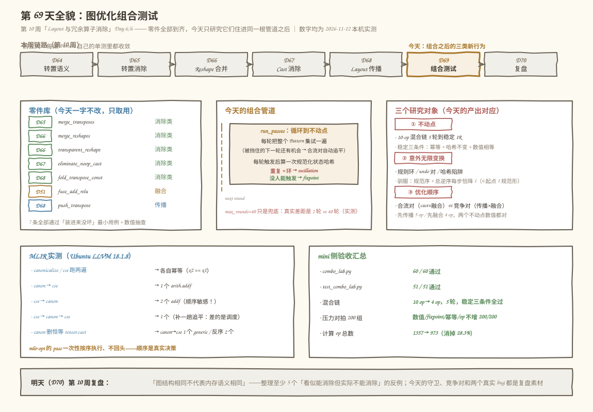
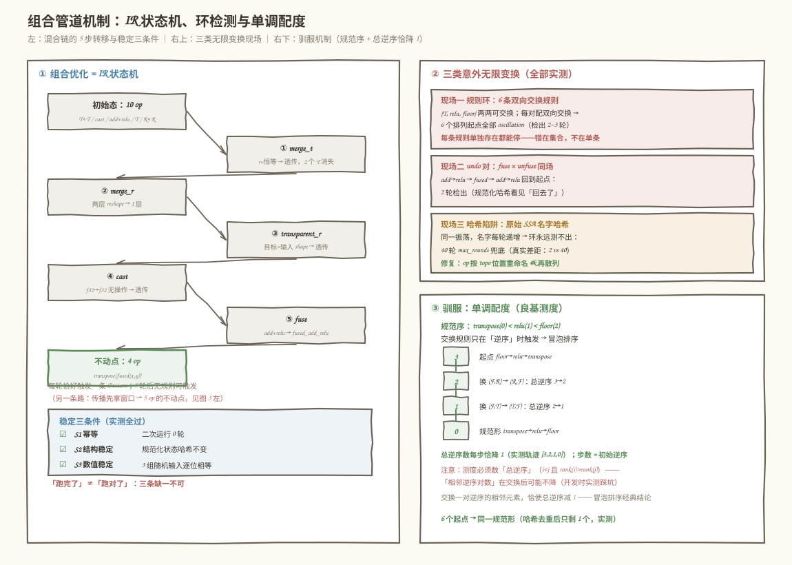
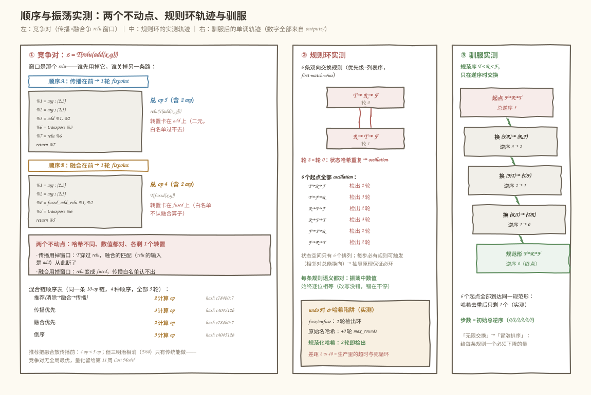
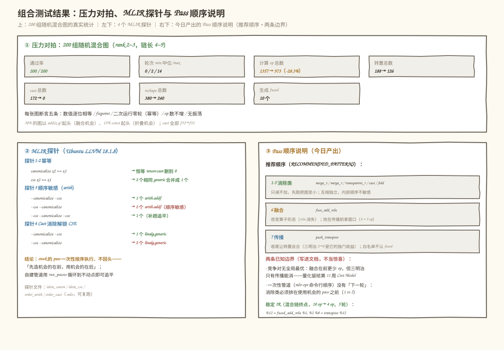

# 第 69 天：图优化组合测试——当所有 Pattern 住进同一根管道

> **今日目标**：完成本教程后，你能把本周与第 8 周攒下的全部消除/传播/融合 Pattern（Transpose 合并、Reshape 合并、Cast 消除、常量折叠、Layout 传播、Add+Relu 融合）**装进同一根管道**并回答三个组合才会暴露的问题——**①不动点**：跑几轮才停？停下来之后的东西是不是「稳定 IR」（再跑一遍零轮次、状态哈希不变、数值逐位相等）？**②意外无限变换**：每条规则单测都收敛，为什么组合后会永不停机？你能用状态哈希抓住振荡，说清「规范化重命名」为什么是检测的前提（SSA 名字递增会骗过你），并用**单调配度**（良基测度：每步严格下降）把无限变换驯服成有界排序；**③优化顺序**：哪些 Pattern 组合是**合流的**（confluent，换顺序只是多几轮、终点相同，实测 Cast 消除×融合），哪些是**竞争的**（换顺序换终点，实测传播×融合争同一个「窗口」：`T(relu(add))` 先传播得 5 op、先融合得 4 op，两个不动点数值都正确）；最后能在本机 LLVM 18.1.8 上用 4 个真实探针复现「一次性管道会漏钱」——`--canonicalize` 与 `--cse` 各自幂等（跑两遍 = 跑一遍），`--cse --canonicalize` 留 2 个 `arith.addf` 而 `--canonicalize --cse` 只留 1 个（补一趟 `--cse` 又能追平），`--canonicalize` 会删掉恒等 `tensor.cast` 从而把 2 个 `linalg.generic` 交给 CSE 合成 1 个（反过来跑就合不成）。
> **预计时间**：学习 40 分钟＋实践 45 分钟
> **前置准备**：本周的全部零件今天只取不改：Day 65 的转置合并（`r[i] = p_inner[p_outer[i]]`，恒等透传）、Day 66 的 Reshape 合并、Day 67 的无操作 Cast 消除、Day 68 的受限传播（白名单 + 唯一使用者 + 单方向）与带振荡检测的 `run_passes`；第 8 周的 Add+Relu 融合（Day 51/54）。工具：Python 3.10+ 与 numpy（本机 3.11.4 / 1.26.4）、`mlir-opt`（本机 Ubuntu LLVM 18.1.8，`/usr/lib/llvm-18/bin/mlir-opt`）。不需要 NPU。
> **今日产出**：一根组合管道（7 条正式 Pattern + 推荐顺序）、一条 10-op 混合链的**稳定 IR**（两种顺序两个不动点，均数值逐位相等、二次运行零轮次）、三类**意外无限变换**的现场与驯服（规则环：6 条交换规则让 6 个排列起点全部振荡、fuse/unfuse 互相 undo、原始名哈希漏检只能靠 max_rounds 兜底）、200 组随机混合图压力对拍、独立验收测试 `test_combo_lab.py`、4 个可复跑的 MLIR 顺序/幂等探针，以及一份 **Pass 顺序说明**（合流表 + 竞争对 + 推荐顺序及理由），全部输出存 `code/outputs/`。

## 1. 今天解决什么问题？

这周的每一天都在单独立项：Day 65 合并相邻转置、Day 66 合并 Reshape 链、Day 67 消除无操作 Cast、Day 68 让转置穿过逐元素算子——每条 Pattern 都有自己的单测，都收敛，都「正确」。第 8 周的融合也是这样验收的。可真实编译器的图优化阶段不是 7 根各自为政的管道，而是**一根管道里住着所有 Pattern**。组合那一刻起，三个单测根本测不出来的问题同时出现：

```text
问题一（顺序）：同一张图，Pattern 列表的先后不同，终点可能不同——
    z = T( relu( add(x, y) ) )
    先传播：T 穿过 relu → relu( T( add(x, y) ) )     ← 5 op，转置卡在 add 上
    先融合：add+relu → fused → T( fused(x, y) )       ← 4 op，转置卡在 fused 上
    两个都是「没有任何 Pattern 能再触发」的不动点，数值都正确，但 IR 不同。
    融合把 relu 吞进 fused_add_relu，传播的白名单（relu/neg/floor）从此认不出它——
    谁先用掉这个 relu，谁就关掉另一条路。

问题二（无限）：Day 68 已经预告过现场——向下推与向上推两条规则同时在场，
    2 轮后状态哈希回到起点（互相 undo，实测）。这不是孤例：只要规则集里
    存在「能互相撤销」或「能绕圈」的成员，每个成员单测收敛也救不了你。

问题三（稳定）：跑到底停下 ≠ 稳定。今天要求的不动点要同时满足：
    再跑一遍零轮次（幂等）、状态哈希不变、数值逐位相等——缺一条都叫「侥幸」。
```

先看两个真实现场（MLIR 侧均为本机 2026-11-12 实测，完整命令与输出见 `code/outputs/`；mini 侧现场构造于今天主实验）：

```text
现场一（MLIR 18.1.8，一次性管道会漏钱）：
    %c1 = arith.constant 4.0
    %r1 = addf %x, %c1
    %c2 = arith.constant 2.0
    %c3 = mulf %c2, %c2            ← canonicalize 能折成 4.0
    %r2 = addf %x, %c3             ← 语义上和 %r1 一模一样
    交给 stock 管道（两个 pass，顺序对调）：
      --canonicalize --cse   → 1 个 addf（return %0, %0）   ← 先折常量，CSE 认出双胞胎
      --cse --canonicalize   → 2 个 addf（return %0, %1）   ← CSE 先跑时 %c3 还不是常量
    再补一趟：--cse --canonicalize --cse → 1 个 addf        ← 「追平」说明差的是调度不是能力

现场一'（MLIR 18.1.8，Cast 消除解锁 CSE，正是本周 Cast 的组合现场）：
    relu(x) 与 relu( tensor.cast(x) )（恒等 cast，同类型同 shape）
      --canonicalize --cse   → 1 个 linalg.generic（cast 被删，双胞胎合并）
      --cse --canonicalize   → 2 个 linalg.generic（CSE 先跑时操作数还不同）
    --canonicalize 单独跑 → tensor.cast 计数 0：恒等 cast 被 stock 管道真实删除

现场二（mini，Day 68 遗留，今天正面处理）：
    向下推 T(E(x))→E(T(x)) 与向上推 E(T(x))→T(E(x)) 同场：
      2 轮后状态哈希回到已见过的值 → 判定 oscillation，永不收敛
    今天还要再加两类新现场（第 4 节实测）：
      ① 交换规则环：3 个可交换算子 × 双向交换规则（共 6 条），
        6 个排列起点全部振荡——没有一个起点能到达不动点
      ② 哈希陷阱：用原始 SSA 名字做状态哈希 → 名字每轮递增，环永远测不出来，
        只有 max_rounds 兜底能在 40 轮处「假装收敛」
```

现场一说明**stock 管道的 pass 是一次性按序执行的**——`--cse --canonicalize` 并不是能力不够，是 CSE 跑的时候机会还没被造出来，而它没有第二次机会；今天 mini 的 `run_passes` 用「循环到不动点」正面回答这个问题。现场二说明**组合行为的坑不在单条规则的数学**（每条都一行可证），在规则集的**整体调度性质**：能不能互相撤销、有没有一个每步严格下降的量。今天的解法：把「稳定」定义成可检验的三条（幂等 + 哈希不变 + 数值相等），把「终止」交给状态哈希环检测 + 单调配度，把「顺序」变成一份写清楚合流/竞争关系的文档，而不是玄学。

贯穿例子（今天所有实验共用的一条 10-op 混合链，值可逐步核对）：

```text
%x  = arg (2,3)
%y  = arg (2,3)
%t1 = transpose %x,  perm=(1,0)    ; (3,2) ┐ Day65：合并 r=恒等 → 透传
%t2 = transpose %t1, perm=(1,0)   ; (2,3) ┘
%c  = cast %t2, f32→f32           ; (2,3)   Day67：无操作 → 透传
%a  = add %c, %y                  ; (2,3)
%r  = relu %a                     ; (2,3)   ← 传播与融合争夺的「窗口」
%T  = transpose %r,  perm=(1,0)   ; (3,2)   Day68：从它开始向下传播
%s1 = reshape %T,  to=(6,)        ; (6,)
%s2 = reshape %s1, to=(3,2)      ; (3,2)   Day66：合并 → 目标=输入shape → 透传
return %s2                        ; (3,2)
```

10 个 op（2 个 arg + 8 个计算 op）把本周五种冗余全占齐。今天要回答三个问题：**① 这条链在组合管道里跑几轮停下？停下来的 IR 满足稳定三条件吗？② 哪些 Pattern 组合会合流、哪些会竞争——竞争时两个不动点各长什么样？③ 什么样的规则集会无限变换？用什么机制检测和驯服？**

## 2. 先看全貌：今天的内容位于哪里？



**图 1**：上半部分是课程位置——第 10 周「Layout 与冗余算子消除」的第六天：左边是零件库（第 8 周的融合 + 本周四天的消除/传播，今天全部原样取用），中间是今天的组合管道（PassManager 循环调度 + 状态哈希环检测），右边是三个研究对象与对应产出；底部左边是 MLIR 侧四个真实探针的结论（两个幂等、两个顺序敏感，其中一趟能追平），右边是 mini 侧验收汇总，最底下是明天复盘的去向。

用 4 步把全局串起来：

1. **零件不动、只管组装**：Day 65/66/67 的三条消除规则、Day 68 的传播与振荡检测 `run_passes`、第 8 周 Day 51/54 的 `Add+Relu → fused_add_relu`——今天不重写任何一条，只研究它们**住在一起**之后的行为。
2. **今天在链路里的位置**：图优化阶段的「集成测试」层：单条 Pattern 是单元，组合管道是系统；生产编译器在同一层面对同一类问题——MLIR 的 pass pipeline 顺序、TF Grappler 的 phase 划分、TVM 的 pass 依赖声明（`PassContext` 的 required passes），全是「组合行为」的工程化。
3. **今天的产品**：一条 10-op 混合链的**稳定 IR**（两种顺序两个不动点 + 三条件验收）、三类**无限变换**现场与驯服（规则环、undo 对、哈希陷阱）、一份 **Pass 顺序说明**（合流表 + 竞争对 + 推荐顺序），外加 200 组随机图的压力对拍和 4 个 MLIR 探针。
4. **明天的衔接**：Day 70 第 10 周复盘——本周攒下的「看似能消除但实际不能消除」的反例全部收编成册；今天的顺序说明会直接成为复盘里的工程一课。

## 3. 核心概念：先用直觉，再给准确定义

先给一个贯穿全文的类比：**小区门口的快递柜**。Pattern 是「整理动作」（把同一单元的包裹挪到同一格），PassManager 是「整理流程」（一整套动作按顺序过一遍）。三个问题分别是：整理到**再整理也没有可挪的包裹**才算完（不动点）；两套动作里有一步是「A 挪进去」另一步是「A 挪出来」，谁也不让谁，整理就**永远停不下来**（无限变换）；先分拣再上架还是先上架再分拣，**最后的柜面长相可能不同**（顺序）。对应到技术上是：IR 是状态、Pattern 触发是状态转移、PassManager 的循环调度决定转移序列——但类比的边界在「目标」上：快递柜有唯一正确答案，图优化没有——两个不动点可以都合法，选哪个是收益问题（第 11 周 Cost Model），今天只负责把行为测清楚。

### 3.1 不动点与稳定 IR

- **一句通俗解释**：不动点（fixpoint）是「没有任何 Pattern 还能触发」的 IR 状态；**稳定**是不动点之上再加三条可检验的约束。
- **类比**：上面的「再整理也没有可挪的包裹」。
- **对应到技术上是**（今天把「稳定」定义成三条，全部可自动检验）：

  ```text
  稳定三条件（缺一不可）：
  S1 幂等     再跑一遍管道 → 0 次触发（rounds == 0）
  S2 结构稳定 状态哈希不变（op 按 topo 位置规范化重命名后逐位相同）
  S3 数值稳定 与改写前在多组随机输入下逐位相等（np.array_equal）

  混合链实测：5 次触发后到达不动点；
  S1/S2/S3 全部通过（outputs/combo_lab.txt 第 2 节）
  ```

  为什么 S1 单独不够：一个 Pattern 若在不动点上还能「触发但什么也没改」，轮次是 0 而图仍在变（例如改了名字没改结构）——S2 把它拦住；为什么 S1+S2 不够：改写本身写错值时结构可以完美稳定——S3 把它拦住。三条合起来，「跑完了」才是「跑对了」。
- **最小例子**：10-op 混合链在推荐顺序下 5 次触发（merge_t → merge_r → transparent_r → cast → fuse，每轮恰好触发一个），终点是 `transpose(fused_add_relu(x, y))`——总 op 10 → 4，二次运行零轮次。
- **常见误解**：「跑到不动点 = 不能再优化了」。错。不动点是**这套规则集的**不动点：换一套顺序可能到另一个不动点（3.3 节的 5 op vs 4 op 两个都「无规则可触发」），换一条规则（比如把 fused 加入传播白名单）又能继续。不动点是局部终点，不是最优证明。

### 3.2 意外无限变换：检测与驯服

- **一句通俗解释**：每条规则单测都收敛，组合后却永不停机——因为规则集里存在**能互相撤销**或**能绕圈**的成员；「无限」不是单条规则的错，是集合的错。
- **类比**：两个整理员一个要「按单元分」一个要「按大小分」，每人单独干都能收工，两人同时干就互相拆台。
- **对应到技术上是**（今天实测的三类现场）：

  ```text
  现场一 规则环：{transpose, relu, floor} 两两可交换（先数值验证），
        每对配双向交换规则共 6 条 → 6 个排列起点全部 oscillation，
        检出轮次 2~3（轨迹是 2-环）；每条规则单独存在都能停。
  现场二 undo 对：fuse_add_relu 与 unfuse_add_relu（后端不支持
        融合算子时的物化）同场 → 2 轮后状态哈希回到起点。
  现场三 哈希陷阱：同样的 fuse/unfuse 振荡，改用原始 SSA 名字哈希
        → 40 轮 max_rounds（名字每轮递增，环永远「新鲜」）。
  ```

  检测机制是**规范化状态哈希**：把 op 按 topo 位置重命名为 `#0, #1, ...` 再散列，于是「结构回到过去」必然撞上已见过的哈希——这与名字无关。驯服机制是**单调配度**（monotone measure / 良基测度）：找到一个非负整数，每次触发严格下降——`SWAP_RANK = {transpose:0, relu:1, floor:2}`，只在「逆序」时交换，每步恰好消掉一个**总逆序数**，终止步数 = 初始逆序数（实测：起点 `floor→relu→transpose` 逆序 3，3 步排好；6 个起点全部到达同一规范形）。
- **最小例子**：`relu→floor→transpose`（逆序 2）的驯服轨迹是 `[2, 1, 0]`——每步降 1，3 步中 2 步是交换、第 3 步无事可做；不驯服的同一链在 6 条双向规则下 oscillation。
- **常见误解**：「设个 max_rounds 就安全了」。它只是**兜底**不是**答案**：max_rounds 到顶时你不知道是「真的需要 40 轮」还是「第 2 轮就在转圈」——现场三实测了两者的差距（2 轮 vs 40 轮），生产编译器里这个差距就是秒级超时和死循环的区别。另一个隐蔽的坑：**逆序数必须数「总逆序」而不是「相邻逆序」**——本教程第一版实现就数错了（交换一对逆序后「相邻逆序」可以不降），冒泡排序的严格下降性质只对总逆序数成立（第 6 节错误 3）。

### 3.3 优化顺序：合流与竞争

- **一句通俗解释**：有些 Pattern 先后无所谓（终点相同，只差轮次），有些先后**决定终点**——后者才是 Pass 顺序说明要记录的东西。
- **类比**：先洗手再削皮还是先削皮再洗手，结果一样（合流）；先切菜再开火还是先开火再切菜，火候就是两盘菜（竞争）。
- **对应到技术上是**（今天实测的两张裁决表）：

  ```text
  合流对（confluent）——换顺序只影响过程：
    cast 消除 × add+relu 融合：cast 卡在 add 与 relu 之间时挡住融合；
    两个顺序都在 2 轮内到达同一个 fused_add_relu 终点（哈希相等）。
    原因：run_passes 每轮把整个 Pattern 集试一遍，被挡住的模式
    下一轮还有机会——循环调度天然「修复」合流对的顺序。

  竞争对——换顺序换终点：
    传播 × 融合，争夺 z = T(relu(add(x,y))) 里那个 relu「窗口」：
    先传播：T 穿过 relu → relu(T(add(x,y)))   5 op（含 2 arg）
    先融合：relu 吞进 fused → T(fused(x,y))   4 op（含 2 arg）
    两个都是不动点、数值都对、哈希不同。
    机制：融合把 relu 变成 fused_add_relu，传播白名单（relu/neg/floor）
    认不出 fused；传播把 T 推到 relu 输入侧，融合的匹配
    （relu 的输入是 add）也断了——谁先用掉窗口，谁关掉另一条路。
  ```

  今天 mini 的实测裁决：**融合在前 op 更少**（4 < 5，转置同样剩 1 个）；但传播的价值在别处——三明治（`T_out(relu(T_in(x)))`）没有融合机会，只有传统能让两个转置会合相消（Day 68 的 2 → 0）。两条都要保留，谁在前取决于当张图的形状——这属于 Cost Model（第 11 周）。今天的**推荐顺序**把融合放在传播之前（第 5 节给出顺序说明与实测表）。
- **最小例子**：MLIR 侧同款现象（第 6 节探针 3/4）：`--canonicalize --cse` → 1 个 `arith.addf`，`--cse --canonicalize` → 2 个；补一趟 `--cse` 又追平——**mlir-opt 的 pass 按命令行顺序一次性执行，不回头**，这是「竞争关系在真实编译器里的存在证明」。
- **常见误解**：「循环到不动点就不需要操心顺序」。合流对确实不用（自动追平），竞争对不行——`run_passes` 每轮虽然把全部 Pattern 试一遍，但**先触发的那条已经把窗口用掉了**，后来者永远失去机会；顺序的影响从「多几轮」升级成「终点不同」。

## 4. 图解核心机制



**图 2**：左边把组合管道画成状态机——IR 状态是节点、Pattern 触发是边，混合链从 10 op 的初始态出发 5 步走到不动点，左下蓝框里是稳定三条件的逐条打勾；中间是三类无限变换的现场——规则环（6 排列全部振荡）、undo 对（2 轮检出）、哈希陷阱（原始名哈希只能 max_rounds）；右边是驯服机制——规范序（transpose < relu < floor）+ 总逆序数每步恰降 1（实测轨迹 3→2→1→0），6 个起点全部到达同一规范形。

按图中编号逐步讲解：

1. **为什么用状态机看（左）**：单条 Pattern 的单测只覆盖「一次触发对不对」，组合行为是**整条转移序列**的性质——终止性（有没有环）、终点（到哪个不动点）、稳定性（到了之后还动不动）。把 IR 看成状态、触发看成边，这三个问题一次变成图论问题：有没有出度为 0 的节点、路径分叉、回到走过的节点。
2. **混合链的 5 步（左）**：每轮恰好触发一条 Pattern（merge_t → merge_r → transparent_r → cast → fuse），顺序就是「消除类把图变小 → 融合改变算子形态 → 传播收尾」的缩影；走到 `transpose(fused_add_relu(x,y))` 后没有任何规则再触发——但旁边那条路（先传播）会到另一个 5-op 不动点。
3. **三类现场为什么必须分开（中）**：规则环是「规则集太大」（双向都能换）；undo 对是「规则集里进了逆规则」（物化与融合对着干）；哈希陷阱是「检测器本身坏了」（名字不规范化，环测不出来）。检测和修复的层次不同：前两者删/改规则或加单调配度，第三个改的是哈希函数。
4. **单调配度为什么能驯服（右）**：交换规则不再「双向都许」，而是只在逆序时交换——规则集从「6 条双向」缩成「3 条单向」，每步恰消一个总逆序，步数有上界（= 初始逆序），终点唯一（规范形）。这就是把「无限变换」变成「冒泡排序」的全部秘密：**给每条规则一个必须下降的量**。

## 5. 动手实践：完成一个最小可运行例子

### 5.1 准备文件

```text
tutorials/day-069/
├── README.md                     本教程
├── images/                       4 张手绘风 SVG 信息图
└── code/
    ├── combo_lab.py              主实验（零件清点 + 混合链 + 顺序研究
    │                                 + 无限变换 + 压力对拍 + MLIR 对表）
    ├── test_combo_lab.py         独立验收测试（A–G 七段）
    ├── idem_canon.mlir           探针 1：--canonicalize 幂等吗
    ├── idem_cse.mlir             探针 2：--cse 幂等吗
    ├── order_arith.mlir          探针 3：顺序敏感（常量折叠解锁 CSE）
    ├── order_cast.mlir           探针 4：Cast 消除解锁 CSE
    ├── run_all.sh                一键复跑
    └── outputs/                  全部真实输出
```

环境：Python 3.10+ 与 numpy；MLIR 探针需要 `mlir-opt`（本机用 Ubuntu LLVM 18.1.8 的 `/usr/lib/llvm-18/bin/mlir-opt`）。没有 NPU 要求。

### 5.2 编写代码

主实验约 1370 行，关键件如下（完整实现在 `code/combo_lab.py`）。

**mini 图 IR**——在 Day 68 的 `Op/Graph` 上扩了三种算子：`cast`（带 `(src, dst)` 类型对，无操作时透传）、`floor`（今天为了构造「可交换算子族」新增，`relu∘floor = floor∘relu` 先数值验证再上规则）、`fused_add_relu`（Day 51 的融合算子搬进来，`eval` 为 `relu(a+b)`）。`state_hash` 沿用 Day 68 的规范化重命名，并新增 `raw_hash`（原始 SSA 名字）专供哈希陷阱实验：

```python
def state_hash(self) -> str:
    """规范化结构哈希：op 按 topo 位置重命名为 #k——振荡检测的前提。"""
    canon = {op.name: f"#{i}" for i, op in enumerate(self.ops)}
    ...   # 名字全部换成 #k，属性（perm/axis/new_shape/dtypes/const 值）保留

def raw_hash(self) -> str:
    """反面教材：原始 SSA 名字哈希（render 里 %N，N 只增不减）。"""
    return hashlib.md5(self.render().encode()).hexdigest()
```

**组合管道与推荐顺序**——7 条正式 Pattern 一字不改地取自各天，顺序本身是今天的产出之一：

```python
RECOMMENDED_PATTERNS = [
    merge_adjacent_transposes,           # D65  消除类
    merge_adjacent_reshapes,             # D66  消除类
    eliminate_transparent_reshape,       # D66  消除类
    eliminate_noop_cast,                 # D67  消除类
    fold_transpose_into_constant,        # D68  消除类
    fuse_add_relu,                       # D51/54  融合
    push_transpose_through_elementwise,  # D68  传播
]
```

**PassManager**——Day 68 的 `run_passes` 原样复用（循环到不动点 + 状态哈希环检测），今天加了 `run_passes_traced`（记录每轮的算子序列与哈希，看轨迹用）和可注入的 `hash_fn`（喂 `raw_hash` 就是哈希陷阱实验）：

```python
def run_passes(g, patterns, max_rounds=40, hash_fn=None):
    hash_fn = hash_fn or Graph.state_hash
    seen = {hash_fn(g)}
    rounds = 0
    while rounds < max_rounds:
        fired = any(p(g) for p in patterns)
        if not fired:
            return rounds, "fixpoint"       # 不动点：没人能触发
        rounds += 1
        h = hash_fn(g)
        if h in seen:
            return rounds, "oscillation"    # 回到走过的状态 = 环
        seen.add(h)
    return rounds, "max_rounds"             # 兜底：40 轮还没停
```

**驯服机制**——给可交换算子定规范序，只在逆序时交换（`canonical_swap`），终止性由总逆序数每步恰降 1 保证：

```python
SWAP_RANK = {"transpose": 0, "relu": 1, "floor": 2}

def canonical_swap(g) -> bool:
    for idx, v in enumerate(g.ops):
        if v.kind not in SWAP_RANK or len(v.inputs) != 1:
            continue
        p = g.by_name(v.inputs[0])
        if (p is None or p.kind not in SWAP_RANK
                or SWAP_RANK[p.kind] <= SWAP_RANK[v.kind]):
            continue                          # 已在规范序，不动
        if g.users(p.name) != [v]:
            continue                          # 唯一使用者门
        ...                                   # 交换 P、V（_splice）

def inversions(g) -> int:
    """链上算子的总逆序数：i<j 且 rank(i)>rank(j)。
    冒泡排序经典结论：交换逆序的相邻对恰使它减 1——良基测度。"""
    ranks = [SWAP_RANK[op.kind] for op in g.ops if op.kind in SWAP_RANK]
    return sum(1 for i in range(len(ranks))
               for j in range(i + 1, len(ranks)) if ranks[i] > ranks[j])
```

**一个今天开发中真实踩过的坑**（保留在代码注释里）：`merge_adjacent_reshapes` 第一版在「两层目标相同」时直接把 `Reshape(Reshape(x,t),t)` 换成了 `x`——错，它等于 `Reshape(x,t)`，只有 `t` 恰好等于 `shape(x)` 时才能透传（那一步交给 `eliminate_transparent_reshape`）。这个 bug 在 200 组压力对拍里被 Verifier 当场抓住（`[V1] perm (0,) 对 rank 2 不合法`——上游 reshape 被错误透传后，紧随其后的 rank-1 转置接到了 rank-2 输入上）。组合测试的价值就在这里：**单条规则的单测全绿，错误也只在组合时现形**。

### 5.3 运行与观察

```bash
cd tutorials/day-069/code
bash run_all.sh          # 一键：主实验 + 验收测试 + 4 个 MLIR 探针
```

主实验 60 项检查、验收测试 51 项全部通过（本机 Python 3.11.4 / numpy 1.26.4 / LLVM 18.1.8，2026-11-12 实测，完整输出存 `outputs/combo_lab.txt`、`outputs/test_combo_lab.txt`）。关键观察点依次是：

**观察 1：混合链的 5 步与稳定三条件**——10-op 混合链跑推荐顺序：

```text
改写前（10 op：2 arg + 8 计算）：       改写后（5 轮 fixpoint）：
  %1  = arg            ; (2,3)           %1  = arg                    ; (2,3)
  %2  = arg            ; (2,3)           %2  = arg                    ; (2,3)
  %3  = transpose %1   ; (3,2)           %12 = fused_add_relu %1, %2  ; (2,3)
  %4  = transpose %3   ; (2,3)           %8  = transpose %12          ; (3,2)
  %5  = cast %4        ; (2,3)           return %8
  %6  = add %5, %2     ; (2,3)
  %7  = relu %6        ; (2,3)     5 次触发：merge_t（r=恒等）→ merge_r
  %8  = transpose %7   ; (3,2)              → transparent_r → cast → fuse
  %9  = reshape %8     ; (6,)      稳定三条件：二次运行 0 轮（幂等）
  %10 = reshape %9     ; (3,2)                哈希不变（结构稳定）
  return %10                    数值逐位相等（3 组随机输入）
```

剩下的 1 个转置卡在 `fused_add_relu` 上：传播的 C1 白名单只有 `relu/neg/floor`——这是竞争关系留下的痕迹（融合先用了窗口）。

**观察 2：竞争现场的两个不动点**——`z = T(relu(add(x,y)))`，只换 Pattern 顺序：

```text
顺序A（传播在前）：1 轮 fixpoint      顺序B（融合在前）：1 轮 fixpoint
  %1 = arg            ; (2,3)          %1 = arg                    ; (2,3)
  %2 = arg            ; (2,3)          %2 = arg                    ; (2,3)
  %3 = add %1, %2     ; (2,3)          %6 = fused_add_relu %1, %2  ; (2,3)
  %6 = transpose %3   ; (3,2)          %5 = transpose %6           ; (3,2)
  %7 = relu %6        ; (3,2)          return %5
  return %7
  总 op 5（含 2 arg）                 总 op 4（含 2 arg）
```

两个不动点哈希不同、数值都对、都剩 1 个卡住的转置。混合链上的顺序表（同一条链、4 种顺序）：

```text
推荐(消除->融合->传播)   5 轮 fixpoint   计算 op 2   hash c784b0c7  数值对
传播优先                5 轮 fixpoint   计算 op 3   hash c404512b  数值对
融合优先                5 轮 fixpoint   计算 op 2   hash c784b0c7  数值对
倒序                    5 轮 fixpoint   计算 op 3   hash c404512b  数值对
```



**图 3**：左边是竞争对的两个不动点（真实 IR 摘录，5 op vs 4 op，谁先用掉 relu 窗口谁关掉另一条路）；中间是规则环的实测轨迹——6 条双向交换规则下，6 个排列起点全部 oscillation（检出 2~3 轮，轨迹为 2-环），比如 `transpose→relu→floor` 与 `relu→transpose→floor` 来回摆；右边是驯服后的单调轨迹——规范序交换让总逆序 3→2→1→0 每步恰降 1，6 个起点全部到达同一规范形 `transpose→relu→floor`。

**观察 3：无限变换三类现场**（完整轨迹存 `outputs/combo_lab.txt` 第 4 节）：

```text
规则环：  6 排列起点 × 6 条双向规则 → 全部 oscillation（检出 2~3 轮）
undo 对：  fuse 与 unfuse 同场 → 2 轮检出（add→relu → fused → add→relu 回到起点）
哈希陷阱： 同一振荡改用原始 SSA 名字哈希 → 40 轮 max_rounds（环永远测不出）
驯服：    规范序交换 → 逆序轨迹 [3,2,1,0] / [2,1,0] / [1,0] / [0]，
          步数 = 初始逆序，6 个起点同一规范形（canonical form）
```

**观察 4：压力对拍（200 组随机混合图）**：

```text
随机图 200 组（rank 2~3，链长 4~9，30% add 起头、15% const 起头）：
  数值等价 + fixpoint + 幂等 + op 不增     200/200
  轮次分布：min=0 中位=2 max=14
  计算 op 总数：1357 -> 973（消掉 384，28.3%）
  转置 188 -> 126；cast 172 -> 0；reshape 380 -> 240；生成 fused 10
```



**图 4**：上面是 200 组随机混合图的真实统计——通过率 200/200、轮次分布 0/2/14、五类计数的前后对比（cast 全消、计算 op 减 28.3%）；左下是 4 个 MLIR 探针的裁决表（两个幂等、两个顺序敏感，全部有可复跑的 `.mlir` 文件）；右下是今日产出的 Pass 顺序说明——三个档位的推荐顺序与理由、两条已知边界，以及混合链稳定 IR 的最后一行。

**观察 5：MLIR 探针（4 个，全部实测）**：

```text
mlir-opt idem_canon.mlir --canonicalize --canonicalize == 单跑一次     → 幂等
mlir-opt idem_cse.mlir   --cse --cse               == 单跑一次        → 幂等
mlir-opt order_arith.mlir --canonicalize --cse     → 1 个 arith.addf
mlir-opt order_arith.mlir --cse --canonicalize     → 2 个 arith.addf（顺序敏感）
mlir-opt order_arith.mlir --cse --canonicalize --cse → 1 个（补一趟追平）
mlir-opt order_cast.mlir  --canonicalize           → tensor.cast 剩 0（恒等 cast 被删）
mlir-opt order_cast.mlir  --canonicalize --cse     → 1 个 linalg.generic
mlir-opt order_cast.mlir  --cse --canonicalize     → 2 个 linalg.generic
```

### 5.4 Pass 顺序说明（今日产出）

推荐顺序与理由（每一行都有上面的实测编号背书）：

| 顺位 | Pattern | 为什么在这个位置 |
| --- | --- | --- |
| 1–5 | 消除类（merge_t / merge_r / transparent_r / cast / fold_const） | 只减不加、不改变算子形态，先跑把图变小，给后面的匹配减负；互相独立，内部顺序不敏感 |
| 6 | fuse_add_relu | 改变算子形态（relu 消失），必须在传播之前抢到窗口，否则传播把 T 推到 relu 下、融合永远够不着（观察 2：4 op vs 5 op） |
| 7 | push_transpose | 收尾：让转置去和伙伴会合（三明治相消 2→0 是它的独门收益，Day 68）；白名单不认 fused，放最后不与融合冲突 |

两条已知边界（写进文档，不当惊喜）：① 竞争对没有全局最优解——混合链上融合在前更少 op，但带三明治的图只有传统能消转置（两个收益来源不同，量化留给第 11 周 Cost Model）；② 一次性管道（如 `mlir-opt` 的命令行顺序）没有「下一轮再试」，消除类必须排在使用机会的 pass 之前（探针 3/4 的 1 vs 2）。

### 5.5 修改一个参数再观察

把混合链里 `%c = cast %t2` 的类型对从 `f32→f32` 改成 `f32→f16`（只改一行），其余不动：**noop Cast 消除从此拒绝触发**（`dtypes[0] != dtypes[1]`，精度语义变了）——终点从 4 op 退化为 5 op：cast 消不掉，以 `fused_add_relu` 操作数的身份留在最终 IR 里（融合仍会发生，因为 cast 不在 add 与 relu 之间）；数值对拍**仍然逐位相等**——f16 截断是改写前后共有的真实语义，优化只是不再假装它不存在。这个对照实验说明：**消除规则的守卫不是官僚作风，是语义边界**——第 67 天的裁决今天在组合管道里兑现。再试把 `RECOMMENDED_PATTERNS` 里 `fuse_add_relu` 挪到列表第一位（`patterns.insert(0, patterns.pop(5))`）：混合链终点不变（hash `c784b0c7`，消除类与融合合流）；但把 `push` 挪到第一位就会换终点（`c404512b`，3 个计算 op）——合流对怎么换都行，竞争对一换就变。

## 6. 常见错误与排查

**错误 1：把一次性管道当成不动点调度**
- **现象**：`mlir-opt order_arith.mlir --cse --canonicalize` 留下 2 个 `arith.addf`，而 `--canonicalize --cse` 只留 1 个；同一组 pass、同一输入，产物不同。
- **原因**：mlir-opt 的 pass 按命令行顺序**一次性**执行、不回头——CSE 先跑时常量折叠还没造出「双胞胎」，它没有第二次机会（今天探针 3 实测，补一趟 `--cse` 即追平）。
- **定位**：对调两个 pass 的顺序各跑一次，`diff` 输出；再在尾部追加一次前一个 pass，看是否「追平」——追平说明差的是调度不是能力。
- **修复**：写进 Pass 顺序说明——「先造机会的在前，用机会的在后」；自建管道时像 `run_passes` 一样**循环到不动点**（每轮把整个 Pattern 集试一遍，被挡住的模式下一轮还有机会——今天 cast×融合合流对的实测）。

**错误 2：用原始 SSA 名字做状态哈希，振荡测不出来**
- **现象**：fuse/unfuse 明明 2 轮就在转圈，检测器却跑了 40 轮报 `max_rounds`（今天哈希陷阱实验实测：2 轮 vs 40 轮）。
- **原因**：每次改写都生成新的 `%N`，名字只增不减——结构回到过去，哈希却每次都「新鲜」。
- **定位**：把每轮的状态哈希打出来肉眼比对；规范化后（op 按 topo 位置重命名为 `#k`）哈希出现重复 = 真环。
- **修复**：状态哈希一律用规范化重命名（`state_hash`）；`raw_hash` 只能当反面教材保留。

**错误 3：拿「相邻逆序数」当终止性测度（今天开发中真实踩坑）**
- **现象**：驯服实验的检查失败——逆序轨迹出现 `[2, 1, 1, 0]`，交换触发后测度**没有下降**。
- **原因**：交换一对逆序的相邻算子，受影响的不只这一对——与两侧邻居形成的逆序可能新生一个。「相邻逆序对数」不满足严格下降；冒泡排序的经典结论只对**总逆序数**成立（`i<j` 且 `rank(i)>rank(j)` 全部数出来）。
- **定位**：在每次触发后打印测度，看到不降的步就是测度选错了。
- **修复**：`inversions()` 改数总逆序——实测每个起点步数 = 初始逆序，轨迹严格递减到 0（`[3,2,1,0]`）。

**错误 4：`Reshape(Reshape(x,t),t)` 直接透传成 `x`（今天开发中真实踩坑之二）**
- **现象**：200 组压力对拍里 Verifier 报 `[V1] perm (0,) 对 rank 2 不合法`——一个 rank-1 转置接到了 rank-2 输入上。
- **原因**：`merge_adjacent_reshapes` 第一版在两层目标相同时特判成 `repl = x`；但 `Reshape(Reshape(x,t),t) = Reshape(x,t)`，不等于 `x`（除非 `t` 恰好等于 `shape(x)`）。错误透传后下游算子的 rank 假设全被破坏。
- **定位**：单测全绿、只在组合压力对拍里现形（错误透传的 reshape 上游恰好还有一层 reshape 链时才触发）；Verifier 的 shape 推断把非法 rank 当场拦下。
- **修复**：合并永远替换为 `Reshape(x, 外层目标)`，「同 shape 才透传」交给 `eliminate_transparent_reshape` 单独把关。这个 bug 是「组合测试存在的意义」的最好注脚。

## 7. 今日练习

### 必做练习

在 `combo_lab.py` 的竞争用例上追加一个实验：构造 `z = T_out( relu( add( T_in(x), y ) ) )`（`x` 先转置再进 add，2D 输入，`T_in = T_out = (1,0)`）。先**手算**两种顺序（传播在前 / 融合在前）各自的终点——各剩几个转置、几个 op、哈希是否相同（提示：`T_out` 永远过不了 add 这个二元算子，两个终点的差别只剩「relu 窗口给谁用」；`T_in` 与 `T_out` 中间隔着 add，永远无法会合）——再用 `run_passes` 跑两种顺序验证你的预测。预期产出：3 行以内的结论（两顺序的 op 数、转置数、哈希异同）。

### 选做挑战

给组合管道写一个「测度记账」：为每条 Pattern 定义一个非负整数的贡献（例如：`transpose` 数、`cast` 数、`reshape` 数、「可融合对」数的加权和），在主实验的 200 组随机图上，逐次触发后检查总测度**严格不增、且至少一维下降**。如果找到违反单调性的 Pattern（提示：想想 `push_transpose_through_elementwise`——它一维都不降，只是移动），把它标成「移动类」并讨论：什么样的加权（比如「到最近同类的距离」）能让移动类也单调？这是把今天驯服交换规则的办法推广到整根管道，也是第 11 周 Cost Model 的入口。

## 8. 今日验收

- [ ] 我能用自己的话解释「不动点」和「稳定三条件」（幂等 / 哈希不变 / 数值相等），说明为什么每一条都不能删
- [ ] 我能独立运行 `bash run_all.sh`，指出混合链的 5 次触发、稳定三条件验证和 4 行顺序表分别在输出的哪一段
- [ ] 我能构造一个竞争对（传播×融合）并**预测**两种顺序的终点（5 op vs 4 op），再运行验证预测
- [ ] 我能定位三类无限变换现场（规则环 / undo 对 / 哈希陷阱），说清各自的检测机制（规范化哈希）与驯服机制（单调配度）
- [ ] 我能解释推荐顺序的三个档位（消除 → 融合 → 传播）及每档的理由，说出两条已知边界（竞争对无全局最优 / 一次性管道必须先造机会）
- [ ] 我保存了稳定 IR、51 项组合测试和 Pass 顺序说明的真实输出（`code/outputs/`）

## 9. 一句话总结与明天预告

**问题**：单测全绿的 Pattern 装进同一根管道后，出现单测测不出的三类组合行为——顺序敏感、意外无限变换、「跑完了不等于跑对了」。**机制**：把 IR 看成状态机——规范化状态哈希抓住环（规则环、undo 对当场检出，原始名哈希的漏检也实测在案），单调配度（规范序 + 总逆序数每步恰降 1）把无限交换驯服成有界排序；合流对（cast×融合）在循环调度下自动追平，竞争对（传播×融合争 relu 窗口）换序换终点，两个不动点数值都对。**实践**：7 条 Pattern 的组合管道 + 10-op 混合链的稳定 IR（稳定三条件验收）+ 200 组随机图压力对拍（数值/fixpoint/幂等/op 不增全过，计算 op 消掉 28.3%）。**验证**：主实验 60 项 + 验收测试 51 项全部通过；MLIR 侧 4 个探针实测 stock 管道幂等、顺序敏感（addf 1 vs 2、generic 1 vs 2、补趟追平）——「先造机会的在前」在真实编译器里同样成立。明天（Day 70 第 10 周复盘）把本周的主题收拢成一句「图结构相同不代表内存语义相同」，整理至少 5 个「看似能消除但实际不能消除」的反例——今天守卫们拦下的一切（精度 Cast、非连续 Reshape、多使用者、竞争窗口）都是复盘的素材。


