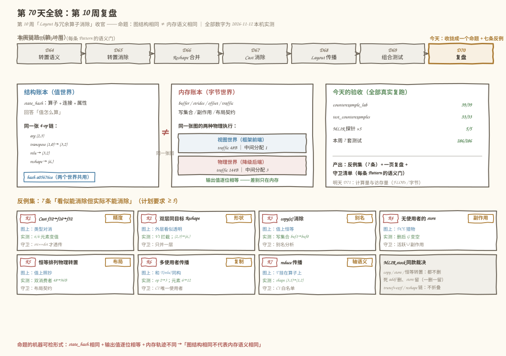
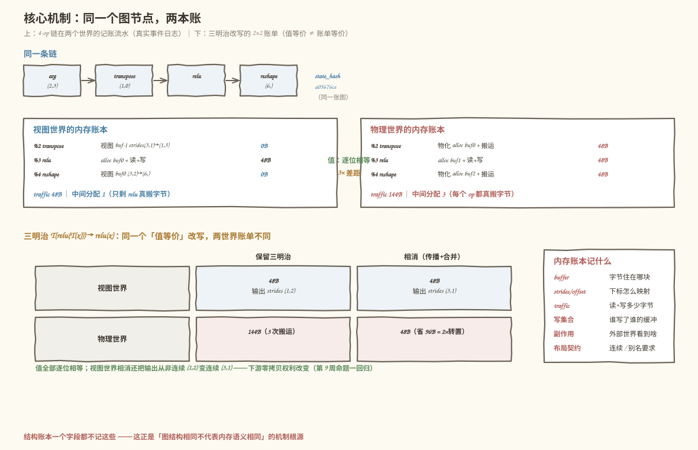
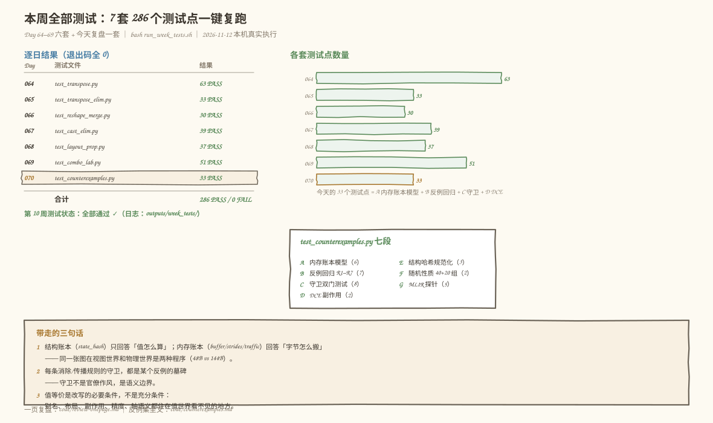

# 第 70 天：第 10 周复盘——图结构相同，不代表内存语义相同

> **今日目标**：完成本教程后，你能把第 10 周六天（Day 64–69：Transpose 语义、转置消除、Reshape 合并、Cast 消除、Layout 传播、组合测试）收拢成一句话——**图结构相同不代表内存语义相同**——并用机器可检的形式证明它：同一个 `state_hash`（结构账本）的图，在「视图世界」（框架前端，transpose/reshape 是 0 字节的记账戏法）和「物理世界」（降级后端，每个算子都真搬字节）跑出**两种内存轨迹**（同一条 4-op 链实测：48B/1 次分配 vs 144B/3 次分配，输出值逐位相等）。然后整理出 **7 个「看似能消除但实际不能消除」的反例**（计划要求 ≥5）：精度 Cast 往返（f32→f16→f32 实测 6/6 元素变值）、双层同目标 Reshape（Day 69 真实 bug 复现：透传错版被 Verifier 拦截）、Copy 消除（消除后下游原地写污染输入，写集合从 buf1 变 buf0）、无使用者的 Store（naive DCE 误删、带副作用模型的 DCE 保留）、恒等排列的物理转置（值上照抄、内存上是从 strided 到连续的物化点，双消费者下删掉它 traffic 48B→96B 翻倍）、多使用者传播（转置一个没少、逐元素计算翻倍）、非逐元素传播（`T(reduce(x,axis=0))` 推过去 shape 从 (3,1) 变 (1,2)，轴必须跟着 perm 换）。每个反例都配「图结构视角为什么诱人 → 内存/数值语义为什么不行 → 守卫怎么写」三段，再用 5 个 MLIR 探针对照 stock 编译器的答案（truncf/extf 不折叠、memref.copy 不删、死 addf 删 / memref.store 留、恒等排列 linalg.transpose 不删、reshape 链 stock 不并）。
> **预计时间**：学习 40 分钟＋实践 45 分钟
> **前置准备**：本周六天的内容今天只取不改：Day 64 的转置三态（维度排列 / 视图 / 物理移动）、Day 65 的 Permutation 合并律 `r[i]=p1[p2[i]]`、Day 66 的 Reshape 合并（numel 守恒 + 只并一层）与透传判据（目标 == 输入 shape）、Day 67 的无操作 Cast 限定（src==dst）、Day 68 的传播双门 C1（逐元素白名单）C2（唯一使用者）、Day 69 的组合管道与「守卫是语义边界」。第 9 周的偏移公式 `物理偏移 = offset + Σ idx×stride`（Day 57）是今天的内存账本底座。工具：Python 3.10+ 与 numpy（本机 3.11.4 / 1.26.4）、`mlir-opt`（本机 Ubuntu LLVM 18.1.8，`/usr/lib/llvm-18/bin/mlir-opt`）。不需要 NPU。
> **今日产出**：一个主实验（`code/counterexample_lab.py`：两本账本对照 + 7 个反例逐个复现 + 守卫清单，全部真实运行）、**反例集**（`code/counterexamples.md`，7 条，每条含结构视角/语义视角/证据/守卫）、独立验收测试（`code/test_counterexamples.py`）、本周全部测试一键复跑（`code/run_week_tests.sh`，Day 64–69 六套 + 今天一套）、一页复盘（`code/review-onepage.md`）以及 4 张示意图。

## 1. 今天解决什么问题？

第 10 周的六天，每天都在往消除/传播的工具箱里放一件新工具：Day 64 转置的三种身份、Day 65 转置合并、Day 66 Reshape 合并、Day 67 Cast 消除、Day 68 Layout 传播、Day 69 组合管道。每件工具都带着守卫（白名单、唯一使用者、src==dst……），Day 69 甚至在压力对拍里被自己的 bug 咬了一口（`Reshape(Reshape(x,t),t)` 透传错版被 Verifier 拦下）。复盘日要防的病不是「忘了某条守卫」，而是一个更根本的错觉：**只要图上看起来冗余，就能删**。

先看两个真实失败现场（都在本机复现过，完整输出存 `code/outputs/`）：

```text
现场一（两本账本）：同一条 4-op 链 arg(2,3) → transpose(1,0) → relu → reshape(6,)，
    state_hash = a05676ce，输出值逐位相等——
    在「视图世界」（框架前端）执行：traffic 48B，中间分配 1 次
    在「物理世界」（降级后端）执行：traffic 144B，中间分配 3 次
    问：这是同一个程序吗？图说是；内存说不。

现场二（守卫的来历）：Day 69 的真实 bug——
    Reshape(Reshape(x,(6,)),(6,)) 的外层「看似透明」，
    第一版改写直接透传成 x，压力对拍当场爆炸：
      [V1] %4 perm (0,) 对 rank 2 不合法
    代数事实：Reshape(Reshape(x,t),t) = Reshape(x,t) ≠ x。
    图结构（外层目标==当前 shape）说能删，形状语义说不许。
```

今天的解法是把这句「图结构相同不代表内存语义相同」变成**机器可检的形式**，再把它反过来用：既然图上看不出来，那就给每条「看似能消除」的规则找一个**反例**——图结构视角说能删、内存/数值语义说不能删的现场。计划要求至少 5 个，今天实际整理出 **7 个**（R1–R7），覆盖 7 个不同的语义维度：精度、形状、别名、副作用、布局、复制、轴语义。

贯穿全文的例子就是上面那条 4-op 链，外加它的三明治变体 `T(relu(T(x)))`——今天所有实验都在这两个图和它们的改写版上做，值可以逐步核对。

## 2. 先看全貌：今天的内容位于哪里？



**图 1**：顶部是第 10 周七天的日程条（D64→D70，今天高亮）；中排左边是**结构账本**（`state_hash`，值世界），中间是**内存账本**（buffer/strides/traffic，字节世界）——同一张 4-op 链在两个世界的实测账单（48B/1 vs 144B/3，值逐位相等）；右边是今天的验收汇总与明天预告；底部是 7 条反例卡片（图上诱人处 / 实测证据 / 守卫）和 MLIR stock 的同款裁决。

用 4 步把全局串起来：

1. **本周六天的分工**：Day 64 立案「转置 = 维度排列 / 视图 / 物理移动三件事」；Day 65/66/67 各拿一种冗余开刀（转置链、Reshape 链、无操作 Cast）；Day 68 让转置穿过逐元素算子（C1/C2 双门）；Day 69 把所有 Pattern 装进同一根管道，发现「守卫是语义边界」。
2. **今天是收口**：把六天的守卫倒过来看——每条守卫都对应一个「不守就会翻车」的反例；把「图 vs 内存」形式化成两本账本，命题从口号变成可以跑出来的数字（48B vs 144B）。
3. **本周位置**：第 10 周是「图优化」的中段——第 9 周铺了 Shape/Stride/Layout 地基，本周在地基上做消除与传播，第 11 周要做的常量折叠、死代码消除、Cost Model 全都要先过今天这一关：**判断一次改写动没动存储、有没有观察者，依据是内存账本，不是图长相**。
4. **明天的衔接**：Day 71 讲计算量与访存量（FLOPs / 字节 / 算术强度）——今天的 traffic 计量正是它的直接前站。

## 3. 核心概念：先用直觉，再给准确定义

先给一个贯穿全文的类比：**同一份乐谱，两种排练**。结构账本是乐谱（哪些音符、什么顺序——`state_hash`）；内存账本是排练记录（谁搬了几次谱架、动了谁的乐器）。同一份乐谱，室内乐版（视图世界：transpose 是翻页，0 字节）和搬运工版（物理世界：每个音符都要从旧谱架搬到新谱架）是两场完全不同的体力活，但**听众听到的音乐一模一样**。对应到技术上是：结构哈希相同的图，可以在「视图模式」（transpose/reshape 按记账处理，0 字节）和「物理模式」（每个算子分配新 buffer 并逐元素搬运，Day 68 的 linalg 世界）下执行，输出值逐位相等、内存轨迹完全不同。这个类比到两处就失效：现实中没有「负步长谱架」也没有「步长为 0 的谱架」（第 9 周已经见过，strides 是数学参数）；更重要的是乐谱的「演奏方式」只有一种，而 IR 的执行世界**至少有两种**（前端视图 / 后端物化），改写规则在两个世界的收益甚至合法性都可以不同——这正是今天反例 R5 的主题。

### 3.1 结构账本与内存账本

- **一句通俗解释**：结构账本记「图长什么样」（算子、连接、属性，规范化哈希）；内存账本记「字节怎么搬」（每个值的 buffer/strides/offset，每个 op 的物理动作、写集合、副作用）。
- **类比**：乐谱 vs 排练记录（见上）。
- **对应到技术上是**：今天给 mini IR 实现了 `run_trace(g, mode)`——执行图的同时维护 `MemRec(buf, strides, offset)` 和事件日志（`视图 0B` / `alloc + 搬运 24B×2` / `原地写 buf-1 ← 写进了外部输入！`），汇总出 `traffic`（读+写总字节）、中间分配数、被写过的输入 buffer 集合、外部全局 `G` 的最终内容。同一张图 `mode="view"` 与 `mode="physical"` 各跑一遍，命题就有了机器可检的形式：**state_hash 相同 + 输出值逐位相等 + 内存轨迹不同**。
- **最小例子**：4-op 链的实测——视图世界只有 relu 真搬字节（48B），物理世界三个 op 各搬一遍（144B），恰好 3 倍。
- **常见误解**：「内存账本是性能分析，属于第 11 周」。不对——它首先是**正确性**账本：R3 的写集合、R4 的副作用、R5 的布局契约都住在里面，删错 op 是正确性事故，不是性能损失。

### 3.2 值等价是必要条件，不是充分条件

- **一句通俗解释**：改写前后「输出值逐位相等」只证明你没算错数，不证明你没改变程序的行为——别名、副作用、布局、精度都不体现在输出值里。
- **类比**：两家外卖送到同一份菜（值相同），一家用了你的餐具（别进了你的厨房），另一家用一次性餐盒（自有缓冲）——菜一样，后果不一样。
- **对应到技术上是**：R3 的实验是这句话的 executable 版本——`return x, relu(copy(x))`，纯函数 eval 下「消除 copy」前后逐位相等（R3a PASS）；换成 in-place 后端的内存账本，消除后 relu 写进 buf-1（外部输入），return 的 x 变成了 relu(x)（R3b/R3d）。**值世界看不见的差别，内存账本看得见**。
- **最小例子**：`y = x.copy(); y[0] += 99` 与 `y = x; y[0] += 99`——后者污染 x。
- **常见误解**：「只要加了数值对拍就安全」。对拍只覆盖值世界；R3/R4/R5 三条反例在对拍下全部绿灯。

### 3.3 守卫是反例的墓碑

- **一句通俗解释**：每条消除/传播规则上的守卫（白名单、唯一使用者、src==dst……）都不是官僚作风，而是某个具体反例的「墓碑铭文」——守卫的存在本身就证明有人在这里翻过车。
- **类比**：路口的限高杆不是针对你的，它是给某辆撞过桥的卡车立的。
- **对应到技术上是**：今天的守卫清单把本周 Pattern 和三补丁列成一张表（D65 组合律、D66 numel 守恒、D67 src==dst、D68 C1/C2、D51/54 唯一使用者，加上今天补的 DCE 副作用集、copy 别名分析、恒等转置布局契约）——每一行都能在反例集里找到对应的「事故报告」。反过来读也成立：**想给一条新改写规则找守卫，就去构造它的反例**。
- **最小例子**：C2 唯一使用者门对应 R6——多使用者时传播 op 2→3、元素计算 6→12、转置数 1→1，连收益都是负的。
- **常见误解**：「守卫越严越好」。不对——守卫有代价（放过合法机会），R5 的 2×2 实验就是尺度：单消费者时删恒等转置是 traffic 中性的（该删），多消费者时物化点摊销布局转换（不该删）。守卫要卡在语义边界上，不是卡在胆子上。

## 4. 图解核心机制

两本账本怎么在一条链上记出两份账，如图 2：



**图 2**：上半部分是 4-op 链在两个世界的**真实事件日志**（左：视图世界只有 relu 搬 48B；右：物理世界三个 op 各搬 48B；中间标出「值逐位相等、3× 差距」）；下半部分是三明治改写 `T(relu(T(x)))→relu(x)` 的 2×2 账单——同一个「值等价」改写，视图世界账单不变（48B=48B）但输出 strides 从 (1,2) 变 (3,1)，物理世界省 96B；右下角是内存账本记的六件事。

按图中编号读：

1. **事件日志是逐 op 的物理动作**：`transpose 视图 buf-1 strides(3,1)->(1,3) 0B` 与 `transpose 物化 alloc buf0 + 搬运 24B×2`——同一个图节点，两行完全不同的账。第 9 周的偏移公式（`物理偏移 = offset + Σ idx×stride`）就是这两行账的记账规则。
2. **traffic 只数读+写**：arg 的外部输入、const 的离线填充不计；视图 0；搬运按「读一遍 + 写一遍」计。这条口径下 4-op 链两世界的比恰好是 48:144 = 1:3——因为链里恰好 3 个计算 op，视图世界只有 1 个（relu）非记账不可，物理世界 3 个全要搬。
3. **三明治的 2×2 是今天最重要的对照**：同一个改写（传播 + 合并，值等价，Day 68/65 的合法操作），在物理世界省 96B（两个转置 × 48B——Day 68 三明治的原始卖点）；在视图世界省 0B（转置本来就免费）**但输出布局从非连续 (1,2) 变连续 (3,1)**——下游 reshape 的零拷贝权利随之改变（第 9 周命题一回归）。改写没有变，世界的账单变了。
4. **内存账本的六个字段**就是反例集的七个语义维度的载体：buffer/strides/offset（布局）、traffic（搬运）、写集合（别名）、副作用（可观察性）——外加不在账本里的精度（值世界）和轴语义（结构世界的属性）。

## 5. 动手实践：完成一个最小可运行例子

### 5.1 准备文件

```text
tutorials/day-070/
├── README.md                        本教程
├── images/                          4 张手绘风 SVG 信息图（图 1–4）
└── code/
    ├── counterexample_lab.py        主实验：两本账本 + 7 反例 + 守卫清单
    │                                   + 5 个 MLIR 探针（39 项检查）
    ├── test_counterexamples.py      独立验收测试（A–G 七段 33 项）
    ├── counterexamples.md           反例集（今日产出之一，7 条全文）
    ├── review-onepage.md            一页复盘（今日产出之二）
    ├── probe_cast_roundtrip.mlir    探针 1：truncf/extf 往返（R1）
    ├── probe_reshape_chain.mlir     探针 2：reshape 链（R2）
    ├── probe_copy_identity.mlir     探针 3：alloc+copy+return（R3）
    ├── probe_side_effect.mlir       探针 4：store vs 死 addf（R4）
    ├── probe_identity_transpose.mlir 探针 5：恒等排列物理转置（R5）
    ├── run_all.sh                   一键复跑（主实验+测试+探针+周测试）
    ├── run_week_tests.sh            本周 7 套测试一键复跑
    ├── make_images.py               生成 4 张 SVG 的脚本
    └── outputs/                     全部真实输出
        ├── counterexample_lab.txt   主实验（39/39）
        ├── test_counterexamples.txt 验收测试（33/33）
        ├── run_all.txt / week_tests_run.txt
        ├── probe_*.mlir             探针产物
        └── week_tests/              7 套测试逐日日志
```

运行方式（在 `code/` 目录下）：

```bash
bash run_all.sh        # 主实验 → 验收测试 → 5 个探针 → 本周 7 套测试
```

环境：Python 3.10+ 与 numpy（本机 3.11.4 / 1.26.4）；探针需要 `mlir-opt`（本机 Ubuntu LLVM 18.1.8）。不需要 NPU。

### 5.2 编写代码

主实验约 1100 行，最见「复盘功力」的是两处。第一处——**内存账本的本体**：每个值一条 `MemRec`，每个 op 一条物理动作（`run_trace` 的 transpose 分支）：

```python
@dataclass
class MemRec:
    buf: int          # buffer 编号（负数 = 外部输入，0 起 = 中间分配）
    strides: tuple    # 元素步长
    offset: int       # 元素偏移
    shape: tuple
    dtype: str

elif k == "transpose":
    src = mem[op.inputs[0]]
    out_s = t_shape(src.shape, op.perm)
    new_strides = tuple(src.strides[op.perm[i]] for i in range(len(op.perm)))
    if m == "view":                      # m = 该 op 的生效世界
        rec = MemRec(src.buf, new_strides, src.offset, out_s, src.dtype)
        log(f"{op.name} transpose 视图 buf{src.buf} ... 0B")
    else:                                # 物理世界：真搬字节
        bid, out = alloc(out_s, src.dtype)
        out[...] = np.transpose(values[op.inputs[0]], op.perm)
        traffic += numel(out_s) * ELS[src.dtype] * 2
        log(f"{op.name} transpose 物化 alloc buf{bid} + 搬运 ...B×2")
```

第 9 周的偏移公式在这里落地成数据：视图分支只改 `strides/offset`（换账本不换存储），物理分支分配新 buffer 并逐元素搬运。`m` 由全局 `mode` 或单点 `force_physical` 决定——后者是 R5 混合世界（视图世界里嵌一个 linalg 节点）的开关。

第二处——**反例的标准三段式**（以 R3 为例）：诱人改写 → 值世界验明「看不见」→ 内存世界验明「翻车」：

```python
g = Graph("r3"); x = g.arg((2, 3)); y = g.copy(x); z = g.relu(y)
g.returns = [x, z]                       # 函数同时返回 x 和 relu(copy(x))
keep = run_trace(g.clone(), seed=7, mode="view", inplace_elementwise=True)
g2 = g.clone(); eliminate_copy_naive(g2)  # 诱人改写：copy 值上恒等 → 删
gone = run_trace(g2.clone(), seed=7, mode="view", inplace_elementwise=True)
check("R3a 值世界看不见差别", all(np.array_equal(a, b) for ...))   # PASS
check("R3c 写集合漂移：buf1 → buf0（外部输入）",
      keep.input_bufs_written == set() and gone.input_bufs_written == {-1})
```

`inplace_elementwise=True` 模拟「后端把逐元素算子编成原地 kernel」——这正是 bufferization 之后的世界，也是 copy 在值世界无害、在缓冲世界要命的原因。七条反例都是这个骨架，差别只在「诱人处」和「翻车证据」：R1 用 `array_equal` 抓 6/6 变值，R2 用 Verifier 抓 `[V1]`，R4 用外部全局 `G` 的内容，R5 用 2×2 的 traffic，R6/R7 用 op 计数与 shape。

### 5.3 运行与观察

以下均为**本机真实执行结果**（2026-11-12，Python 3.11.4 / numpy 1.26.4 / Ubuntu LLVM 18.1.8 / aarch64，完整输出存 `code/outputs/counterexample_lab.txt`）。先看命题的主现场（第 1 节）：

```text
$ python3 counterexample_lab.py
== 1. 两本账本：同一张图，视图世界 vs 物理世界 ==
结构账本 state_hash = a05676ce（两个世界共用同一张图）

-- 视图世界（框架前端：transpose 是 0 字节记账）--
    %2   transpose 视图 buf-1 strides(3, 1)->(1, 3)   0B
    %3   relu     alloc buf0 + 读-1 写 buf0（24B×2）
    %4   reshape  视图 buf0 (3, 2)->(6,)   0B
  汇总：traffic=48B  中间分配=1  输入被写=无

-- 物理世界（降级后端：每个算子都真搬字节）--
    %2   transpose 物化 alloc buf0 + 搬运 24B×2（读+写）
    %3   relu     alloc buf1 + 读0 写 buf1（24B×2）
    %4   reshape  物化 alloc buf2 + 搬运 24B×2
  汇总：traffic=144B  中间分配=3  输入被写=无

两个世界的输出值逐位相等吗？ True
[PASS] 1d 物理世界 traffic = 视图世界的 3 倍（这条链实测）（144B == 3×48B）
```

三明治改写的 2×2 账单（同一天输出，第 1 节后半）：

```text
  视图世界  保留: traffic=48B  输出=(2,3)(1,2)   ← 非连续（转置视图）
  视图世界  相消: traffic=48B  输出=(2,3)(3,1)   ← 连续化，下游权利改变
  物理世界  保留: traffic=144B
  物理世界  相消: traffic=48B    ← 省 96B（两个转置 × 48B）
[PASS] 1f/1g/1h 全部通过
```

七条反例的关键证据（每条一屏以内，详见 `outputs/counterexample_lab.txt` 第 2–8 节）：

```text
R1 精度   roundtrip 与原值逐位相等的元素：0/6（f16 只有 10 位尾数）
          对照：同 dtype Cast 守卫版能消，物理世界 96B -> 48B（真省 48B）
R2 形状   诱人改写后 return 的 shape：(2,3) → (6,)
          下游接 rank-1 转置：[V1] %4 perm (0,) 对 rank 2 不合法
R3 别名   保留 copy：输入被写=无     消除 copy：输入被写=[-1]
          消除后 return 的 x 变成了 relu(x)（第一个输出被污染）
R4 副作用 完整执行：G = [0.1026 4.079 3.674 -1.531 -0.894 -1.582]
          naive DCE 删掉后：G = None
R5 布局   视图世界：保留 96B / 消除 96B（真免费）
          物化世界：保留 48B / 消除 96B（翻倍——拷贝搬进每个消费者）
R6 复制   计算 op：2 -> 3；逐元素计算量：6 -> 12（翻倍）；转置数：1 -> 1
R7 轴语义 原式 shape (3,1) vs 照抄传播后 (1,2)；axis 换成 1 后逐位相等 True
          3D 一般 perm 实测：新 axis = inv_perm[旧 axis]（inv=(1,2,0)，axis=2）
```

七条反例的结构视角、语义视角与证据对照如图 3：


**图 3**：每张卡片分三栏——左栏「图结构视角」（为什么诱人：类型对消、外层看似透明、值上恒等、无使用者、值上照抄、与 T(relu) 同构、T 挂在算子上），中栏「内存/数值语义」（为什么拒绝：尾数丢位、≠x、写集合漂移、副作用、物化摊销、复制、轴要跟着换），右栏「实测证据 + 守卫」。底部注明每条反例的完整复现入口。

对着图读三个结论：

1. **七条反例覆盖七个互不重叠的语义维度**：精度（值世界的精度）、形状（逻辑身份）、别名（写集合）、副作用（可观察性）、布局（物化点）、复制（计算量）、轴语义（属性约束）——其中前五条都住在**值相等也看不见**的地方。
2. **反例的「诱人处」全是图结构的同构现象**：类型对消、外层等于内层、恒等映射、无使用者、恒等排列、传播模式同构——这正是「图结构相同」的七种长相；拒绝理由则各不相同。
3. **守卫和反例一一对应**：右栏的守卫列（src==dst、只并一层、别名分析、活跃∪副作用、布局契约、C2、C1）就是第 10 节守卫清单的镜像。

### 5.4 MLIR 探针：stock 编译器的裁决

五个探针全部真实执行（`outputs/` 下有产物），结论与 mini 侧互相印证：

```text
探针 1（R1）mlir-opt probe_cast_roundtrip.mlir --canonicalize
    → truncf+extf 共剩 2 个：stock 不折叠（精度语义）
探针 2（R2）mlir-opt probe_reshape_chain.mlir --canonicalize
    → tensor.reshape 剩 2 个：stock 不合并（mini 用带守卫的 Pattern 做）
探针 3（R3）mlir-opt probe_copy_identity.mlir --canonicalize / --cse
    → memref.copy 剩 1 / 1 个：都不删（返回 alloc 还是入参是两种别名契约）
探针 4（R4）mlir-opt probe_side_effect.mlir --cse / --canonicalize
    → store 剩 1 / 1，无使用者的纯 addf 剩 0 / 0：一删一留（副作用模型）
探针 5（R5）mlir-opt probe_identity_transpose.mlir --canonicalize / --cse
    → linalg.transpose 剩 1 / 1 个：恒等排列 + strided 输入，不删（布局语义）
```

探针 4 最值得盯十秒：**同一个函数、两个「无使用者」的 op**——纯 addf 被删、store 被留。图结构完全同构（都没人用），stock 编译器靠副作用模型把它们分开，和今天 mini 侧 naive/guarded DCE 的对照一模一样。

### 5.5 修改一个参数再观察

把 R5 图里恒等转置的**消费者从 2 个改成 1 个**（删掉 `s2 = reshape(p,(3,2))` 这一行），其余不动：物化世界的账单从「保留 48B / 消除 96B」变成「保留 48B / 消除 48B」——**消除变成 traffic 中性的了**（拷贝从转置里挪进唯一的 reshape，总数不变），op 还少一个。这个对照实验说明 R5 的守卫为什么写成「看消费者数量与布局契约」而不是一刀切的「物化点不能删」：**同一个改写的合法性/收益随上下文变化，而上下文住在内存账本里**。再把 `run_trace` 的 `inplace_elementwise` 从 False 改成 True 重跑 R3 之前的 4-op 链：relu 原地写进 buf-1——外部输入被污染、`输入被写=[-1]`——同样是「改一个参数」，值世界（eval）依旧毫无察觉。

### 5.6 本周全部测试与一页复盘

`run_week_tests.sh` 把 Day 64–69 的六套验收测试加今天的复盘测试一起复跑，逐日日志存 `code/outputs/week_tests/`。以下是**本机真实执行结果**（`outputs/week_tests_run.txt`）：

```text
$ bash run_week_tests.sh
Day    测试文件                     结果          退出码
---------------------------------------------------------------------
064    test_transpose.py            63 PASS        0
065    test_transpose_elim.py       33 PASS        0
066    test_reshape_merge.py        30 PASS        0
067    test_cast_elim.py            39 PASS        0
068    test_layout_prop.py          37 PASS        0
069    test_combo_lab.py            51 PASS        0
070    test_counterexamples.py      33 PASS        0
---------------------------------------------------------------------
合计：286 PASS / 0 FAIL / 0 SKIP（共 286 个测试点，7 套）
第 10 周测试状态：全部通过 ✓
```

今天的 `test_counterexamples.py` 用独立种子复测了全部七条反例，并补了三个全周没做过的角度：**A 段**把内存账本的 `MemRec` 与 numpy 视图的真实地址对账（offset/strides/连续性逐一核对）；**E 段**验证结构哈希的规范性（改名不改结构 → 哈希相等，改 perm → 哈希不同——「结构账本」本身要先可信）；**F 段**把命题随机化（40 组随机视图链全部「值等价 + traffic 不同」，20 组三明治全部「相消值等价 + 输出 strides (1,2)→(3,1)」）。汇总如图 4：



**图 4**：左边是逐日结果表（退出码全 0），中间是各套测试点数量的手绘条形图（今天的 33 项分 A–G 七段列出），底部橙框是带走的三句话。一页复盘在 `code/review-onepage.md`——六天速查表、两本账本的对照表、反例集速查、测试汇总，可以直接贴在工位上；反例集全文在 `code/counterexamples.md`。

## 6. 常见错误与排查

**错误 1：用「输出值对拍」当改写正确性的唯一验收**
- **现象**：R3 的 copy 消除、R4 的 store 删除、R5 的恒等转置消除，在数值对拍下全部绿灯，合入后偶发「输入被改」「全局状态丢失」「性能回退」。
- **原因**：值等价只是必要条件——别名（写集合）、副作用（外部观察）、布局（零拷贝权利）都不体现在输出值里。
- **定位**：把改写前后的 `run_trace`（或等价的内存事件日志）diff 一遍：traffic、中间分配、`输入被写`、外部 `G` 的内容，四个量哪个变了就是哪类问题。
- **修复**：验收清单加一条「内存账本不变或变化符合预期」；涉及缓冲边界的改写（copy/物化）必须过别名分析。

**错误 2：把「无使用者」直接等同于死代码**
- **现象**：DCE 之后模型的 loss 变成 0 或者 checkpoint 保存丢失——某个 store/打印/断言 op 被当死代码删了（今天 R4：naive DCE 删掉 store 后 `G = None`）。
- **原因**：DCE 的活跃集只算了 return 可达性，没算副作用 op——图结构（零使用者）和内存语义（有观察者）在这里分道扬镳。
- **定位**：在 DCE 前后各跑一次带外部全局的 trace，比对 `G`；MLIR 侧看 op 是否实现 `MemoryEffects`（`memref.store` 留、纯 `arith.addf` 删，探针 4 实测）。
- **修复**：活跃集 = return 可达 ∪ 副作用 op 集合（今天的 `guarded_dce`）；给自定义 op 标注副作用接口。

**错误 3：恒等排列的转置 / 恒等形状的 reshape 一律当 no-op 删掉**
- **现象**：删完之后某个「本来零拷贝」的下游突然开始拷贝（R5：双消费者下 traffic 48B→96B），或者 return 的 shape 变了（R2：(2,3)→(6,)，被 Verifier `[V1]` 拦下）。
- **原因**：恒等只证明**值语义是照抄**；reshape 链的代数是 `Reshape(Reshape(x,t),t)=Reshape(x,t)` 不是 `x`；转置节点可能是 strided→连续 的物化点，删掉它拷贝就搬进消费者。
- **定位**：删之前查三件事：目标是否真等于输入 shape（R2）、输入输出布局是否一致（R5）、它有几个消费者（R5 的 2×2）。
- **修复**：reshape 合并永远替换为 `Reshape(x, 外层目标)`；恒等转置按「单消费者中性、多消费者摊销」写守卫。

**错误 4：照抄「T 挂在算子上面就推过去」的传播模式**
- **现象**：把传播 Pattern 用到 reduce 上，输出的 shape 直接从 (3,1) 变 (1,2)（R7）；或者中间结果另有使用者时 op 数不降反升（R6：2→3，元素计算翻倍）。
- **原因**：传播的合法性依赖算子的**逐位置不变性**（C1 白名单）和唯一使用者（C2）——reduce 带轴语义（新 axis = `inv_perm[旧 axis]`，R7e 实测），多使用者会让传播变成复制。
- **定位**：先跑 Verifier（shape 对不上当场报错）；再数改写前后的 op 数和元素计算量。
- **修复**：白名单只放逐元素算子；带轴算子要另写「axis 跟着 perm 换」的 Pattern；传播前查 `users(E) == [T]`。

## 7. 今日练习

### 必做练习

在 `counterexample_lab.py` 的反例上继续挖掘，**先笔算再跑**：

1. **笔算 R5 的第四格**：R5 的 2×2 实验里还有一格没单独验收——「物化世界 + 单消费者」。把图改成只有一个 reshape 消费者（删掉 `s2 = g.reshape(p, (3,2))` 和对应 return），先笔算保留/消除的 traffic（提示：保留 = 转置物化 48B + reshape 视图 0B；消除 = reshape 拷贝 48B），再改代码跑 `run_trace` 核对。预期：两格都是 48B（traffic 中性），消除版少一个 op。
2. **笔算 R7 的转置不变量**：给定 `x:(4,2,6)`、`perm=(2,0,1)`、`reduce_sum(axis=1)`，写出 `T(reduce(x, axis=1))` 的 shape，和 `reduce(T(x), axis=?)` 等价时 `?` 的值（提示：新 axis = `inv_perm[旧 axis]`——旧轴被 perm 挪到了哪一位；注意在对换 perm 如 `(1,0)` 上它与 `perm[旧 axis]` 碰巧相等，一般 perm 不等）。预期：原式 `(6,4,1)`；`? = 2`（主实验 R7e 已实测，先笔算再对照）。用 `python3 -c` 构造 numpy 数组核对。
3. **构造第 8 条反例**：类别「负 stride / 翻转视图」——`A[:, ::-1]` 在图上是 `transpose` 吗？不是——它是第 57 周公式里 strides 取负值的视图。问：`flip(flip(x))` 能消除吗？`reshape(flip(x), (6,))` 是视图还是拷贝（提示：负 stride 的读序物理倒退）？把结论写成 R8 的三段式（图结构视角 / 内存语义 / 证据），跑 numpy 验证。预期：flip 链可消除（两次翻转 = 恒等，但中间结果另有使用者时同样受 R6 约束）；reshape 是拷贝。
4. **复跑全周回归**：跑 `bash run_all.sh`，把 `outputs/week_tests_run.txt` 的 7 行数字与图 4 对照；再抽查 `outputs/week_tests/day-068.txt` 里任意 3 个 `[PASS]`，回到第 68 天的教程确认你能说清它测的是 C1 还是 C2。

### 选做挑战

给 `run_trace` 加第五种计量：**峰值内存**（任一时刻存活的中间 buffer 字节数之和）。需要给每个 buffer 记「最后被读的 op」，在事件日志上扫描窗口。然后回答：三明治相消在视图世界「省 0B traffic」，那它省峰值内存吗（提示：消除前 buf0 从 relu 活到 return，消除后……）？把 2×2 表格扩成一列 peak，跑 20 组随机链（F 段的图够用）统计规律。这是从「搬运量」到「占用」的第一步，也是第 11 周 Cost Model 的入口之一。

## 8. 今日验收

- [ ] 我能用自己的话讲清**两本账本**：结构账本（state_hash）回答「值怎么算」、内存账本（buffer/strides/traffic/写集合/副作用）回答「字节怎么搬」，并报出今天的实测数字（同一条 4-op 链：48B/1 次分配 vs 144B/3 次分配，输出值逐位相等）；
- [ ] 我能独立复现**至少 5 条反例**（R1–R7 任选五条），每条都说清「图结构视角为什么诱人、内存/数值语义为什么拒绝、守卫怎么写」，并指出对应的天数（R1→D67、R2→D66、R5→D64/68、R6/R7→D68……）；
- [ ] 我能解释**值等价是必要不充分条件**，并说出三条例证（R3 写集合漂移、R4 副作用丢失、R5 布局翻倍——对拍全绿、账本翻车）；
- [ ] 我能独立运行 `bash code/run_all.sh`，复现主实验 39/39、验收测试 33/33、MLIR 探针 5/5、本周 7 套 286/286，并说清 test 里 A 段（MemRec 与 numpy 地址对账）、E 段（哈希规范性）、F 段（40+20 组随机性质）各验证了什么；
- [ ] 我能定位今天列出的四类错误：只看值对拍、无使用者≠死代码、恒等当 no-op 删、传播模式照抄——每类都能报出今天的实测证据（R3a 绿灯/R3c 红灯、G=None、48B→96B、(3,1)→(1,2)）；
- [ ] 我保存了反例集（`code/counterexamples.md`）、一页复盘（`code/review-onepage.md`）、主实验与全部测试的真实输出（`code/outputs/`，含 `week_tests/` 七份日志）和 4 张示意图（`tutorials/day-070/`）。

## 9. 一句话总结与明天预告

本周的问题从「哪些冗余能消除」开始，今天的复盘把它收成一句可检验的命题：**图结构相同不代表内存语义相同**——同一个 `state_hash` 的图在视图世界和物理世界跑出 48B/144B 两种账单（值逐位相等），三明治改写一边省 96B 一边只改输出布局。**机制**上，结构账本只记值怎么算，别名、布局、副作用、精度、轴语义全住在内存账本里；**实践**上，7 条反例（精度 Cast 往返 6/6 变值、双层 Reshape 被 `[V1]` 拦截、copy 消除污染输入、store 被 naive DCE 误删、恒等转置删除后 traffic 翻倍、多使用者传播元素计算翻倍、reduce 传播 shape 走样）把每条守卫的来历钉死；**验证**上，主实验 39/39、独立测试 33/33（含 MemRec 与 numpy 真实地址对账、40+20 组随机性质）、MLIR 五探针（copy/store/恒等转置不删、死 addf 删、cast 往返不折叠）、本周 7 套 286/286 一键复跑归档。

明天（Day 71）讲**计算量与访存量**：FLOPs、字节数、算术强度和中间 Tensor 流量——今天内存账本里的 traffic 计量，正是明天整套「 roofline 之前先会数数」的直接前站。
