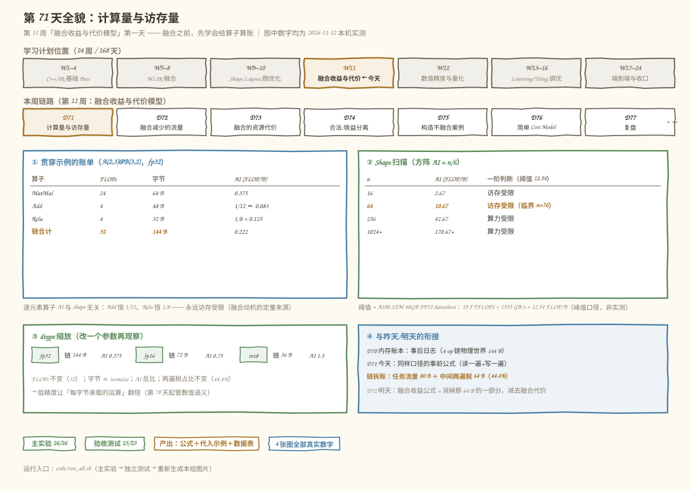
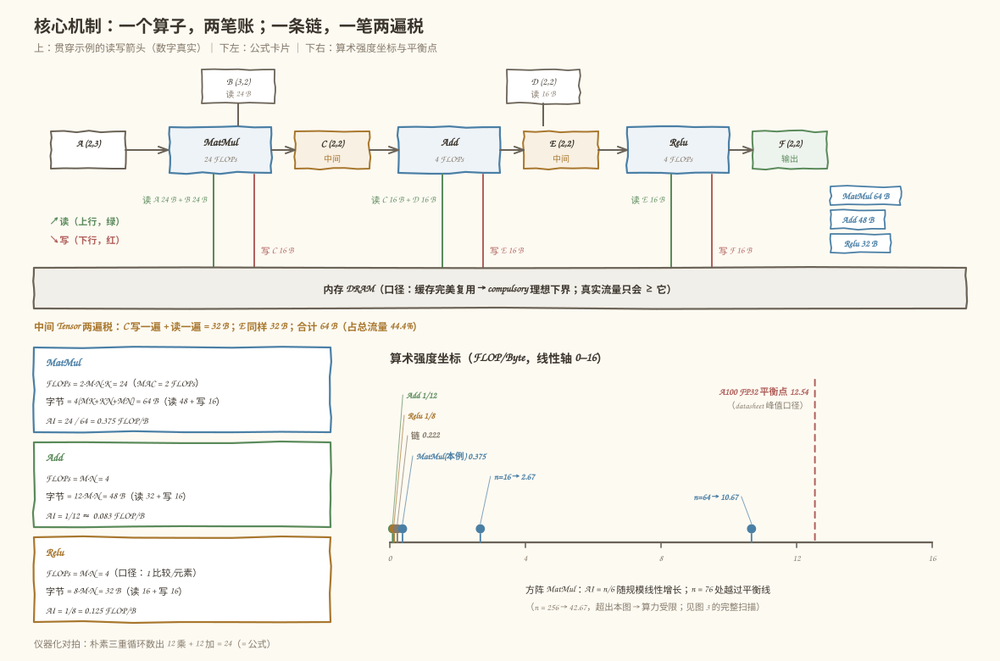
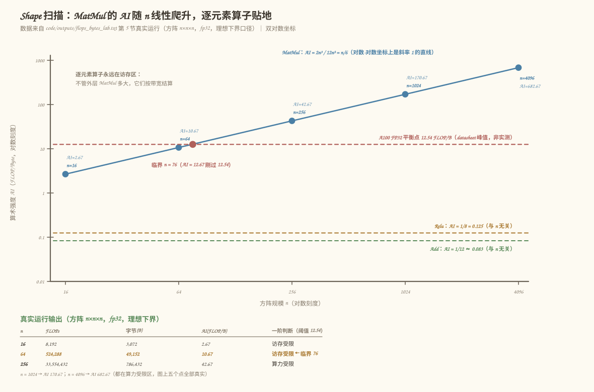
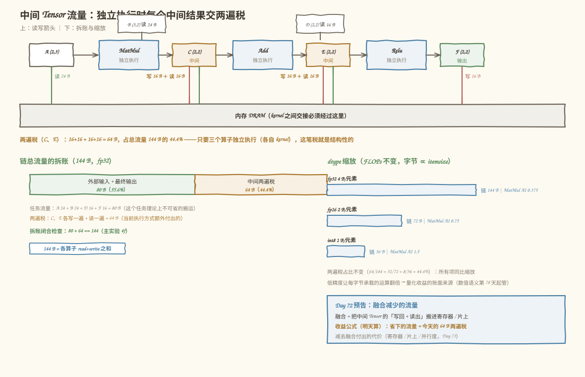

# 第 71 天：计算量与访存量——融合之前，先学会给算子算账

> **今日目标**：完成本教程后，你能为 `MatMul`、`Add`、`Relu` 三个算子**独立执行**时各记一笔「理论账」：计算量（FLOPs，浮点运算数）、访存量（必须读入＋写回的字节数）、算术强度（AI = FLOPs / Bytes，每搬一个字节能承载多少运算），以及整条 `MatMul → Add → Relu` 链独立执行时的**中间 Tensor 流量**。全部数字都能在本机跑出来并逐位核对：贯穿示例 `A(2,3) @ B(3,2) → +D(2,2) → relu` 的账单是 MatMul 24 FLOPs / 64 B（AI 0.375）、Add 4 FLOPs / 48 B（AI = 1/12）、Relu 4 FLOPs / 32 B（AI = 1/8），链合计 32 FLOPs / 144 B，其中中间 Tensor（写一遍＋读一遍）占 64 B = **44.4%**——这正是明天融合要消的账。你还能用 shape 扫描表回答「多大的矩阵乘才吃得满算力」：方阵 AI = n/6，对 A100 FP32 的平衡点 12.54 FLOP/B，**n ≥ 76 才转向算力受限**，而逐元素算子的 AI 恒为 1/12、1/8，与 shape 无关、永远访存受限。
> **预计时间**：学习 35 分钟＋实践 40 分钟
> **前置准备**：只需要两块旧地基：第 57 天的 `元素字节 = numel × itemsize`（今天所有字节公式的底座）和第 70 天复盘的「内存账本」口径——traffic 按「读一遍＋写一遍」计。工具：Python 3.10+ 与 numpy（本机 3.11.4 / 1.26.4，aarch64）。不需要 MLIR、不需要 NPU；引用的 A100 数字是公开 datasheet 峰值口径，非本机实测（实测基准是第 107/109 天的事）。
> **今日产出**：一套**计算公式**（三个算子的 FLOPs / 读写字节 / AI，口径写死在代码里）、一个**代入示例**（`2×3 @ 3×2` 链的逐算子账单，仪器化实现真的数了一遍运算次数来对拍）和一张**数据表**（方阵 n = 16～4096 的扫描表＋临界规模 n = 76，以及 fp32/fp16/bf16/int8 的 dtype 对照）。代码在 `code/flops_bytes_lab.py`（26 项检查）、`code/test_flops_bytes.py`（23 项独立验收），全部真实运行；另有 4 张手绘风示意图。

## 1. 今天解决什么问题？

第 10 周结束时，图优化工具箱已经能消除转置、合并 Reshape、传播 Layout——第 70 天的复盘把它们收成一句「图结构相同不代表内存语义相同」，并且真的记了一笔账：同一条 4-op 链在物理世界跑出 144 B 的 traffic。但那笔账是**事后记账**：先跑一遍执行器，再汇总日志。第 11 周要回答的问题反过来——**在改图之前**判断「融合值不值」，这就要先会**事前算账**：一个算子到底要做多少运算、搬多少字节？

今天先解决最基础的三问，全部围绕同一张三算子链：

```text
A(2,3) @ B(3,2) ──matmul──▶ C(2,2) ──add(D(2,2))──▶ E(2,2) ──relu──▶ F(2,2)
```

1. **这条链要做多少次浮点运算？**（MatMul 24 次，Add 4 次，Relu 4 次——共 32 次）
2. **要搬多少字节？**（MatMul 64 B，Add 48 B，Relu 32 B——共 144 B，其中 C、E 两个中间结果被写一遍再读一遍，占 64 B）
3. **每个算子被什么卡住？**（算术强度：MatMul 0.375、Add 1/12 ≈ 0.083、Relu 1/8 = 0.125 FLOP/B——都远低于任何现实硬件的平衡点，在这条小链上全员访存受限）

为什么这三个数字值得先算？因为第 11 周后面六天全都踩在它们上面：Day 72 用「中间 Tensor 写＋读两遍」算融合省多少流量，Day 73 加上寄存器／片上的资源代价，Day 74 把「合法」和「划算」拆开，Day 75–76 才组装成 Cost Model。**如果今天数错一倍，后面的收益判断就全错一倍。**

一个提醒：昨天 144 B 是执行器跑出来的，今天 144 B 是公式算出来的——数字相同纯属巧合（两条链的算子不同），但口径完全一致：每个元素从内存读一次记一次、写回内存记一次。今天要做的是把这个口径变成**公式**，并让它通过仪器化实现的逐次数数验证。

## 2. 先看全貌：今天的内容位于哪里？



**图 1**：顶部是学习进度条（W1–4 → W17–24，第 11 周「融合收益与代价模型」刚开局、高亮）；中排是本周七天的分工——今天 D71 在最左端算账，D72–D76 依次是省流量、算代价、分合法/划算、造反例、集成 Cost Model，D77 收口复盘；下排是今天的三笔账（贯穿示例的逐算子账单、方阵 AI = n/6 的扫描表、dtype 缩放）和与昨天的衔接（D70 的内存账本 → 今天的事前公式）。

用 4 步把全局串起来：

1. **本周的问题**：第 8 周实现了 `MatMul + Bias + Relu` 的融合 Pattern（能融合），第 10 周守住了语义安全（融合合法）；但「融合之后到底快多少、什么时候反而慢」一直没数——本周给这个问题建立一套可计算的模型。
2. **今天的角色**：模型的地基是计量单位。今天定义并验证四个量：FLOPs（计算量）、字节数（访存量）、算术强度（两者的比）、中间 Tensor 流量（链式执行特有的开销）。
3. **与前面的衔接**：字节公式 `numel × itemsize` 来自第 57 天；「读一遍＋写一遍」的 traffic 口径来自第 70 天的内存账本；今天把它们从「事后日志」升级成「事前公式」。
4. **与明天的衔接**：Day 72 把今天的「中间 Tensor 各写一遍＋读一遍」拿去算融合前后的流量差——今天只记独立执行的账，不做融合对照（那是明天的主线）。

## 3. 核心概念：先用直觉，再给准确定义

先给一个贯穿全文的类比：**装修队与运输队**。装修队（计算单元）干活快，材料得靠运输队（内存带宽）从仓库（DRAM）运到工地。报价要算两笔：工时（FLOPs）和车次（字节）。**算术强度**就是「每车材料能支撑多少工时」——若每车只装一小盒螺丝，装修队大部分时间在等车（访存受限）；若一车材料够干一星期，工期由手速决定（算力受限）。**机器平衡点**是手速峰值与运力峰值的比值。对应到技术上是：AI = FLOPs / Bytes，balance = 峰值算力(FLOP/s) / 峰值带宽(Byte/s)，AI 与 balance 比大小就得到一阶的受限判断。这个类比在三处失效：其一，真实芯片有多级缓存（工地内还有小仓库，今天假设所有材料都从总仓库来）；其二，搬运和干活可以重叠（Day 103 的 Double Buffering），类比是静态记账、没有时间线；其三，类比里没有「干活本身也要占工地空间」这回事，而融合真的会挤占寄存器／片上存储（Day 73 的主题）。

### 3.1 FLOPs：计算量的计数口径

- **一句通俗解释**：FLOP 是一次浮点运算（加、乘、比较各算一次），FLOPs 是一个算子要做的总次数。
- **工程类比**：装修队的工时单——不关心干得多快（那是性能），只关心要干多少件活（那是工作量）。
- **对应到技术上是**：`MatMul(M,K) @ (K,N)` 每个输出元素做 K 次乘＋K 次加（累加器从 0 起，每次 `+=` 记 1 次加），共 **2·M·N·K**；逐元素 `Add` 是 **M·N** 次；`Relu` 按今天的口径每元素记 1 次比较，**M·N** 次。注意 **MAC（multiply-accumulate，乘累加）= 1 乘＋1 加 = 2 FLOPs**——加速器规格书常用 MACs/s 或 TOPS 计算力，换算时最容易在这里差一倍。
- **最小例子**：贯穿示例的 MatMul 是 2·2·2·3 = 24 FLOPs。仪器化实现（朴素三重循环＋计数器）真的数出 12 次乘＋12 次加，和公式严丝合缝。
- **常见误解**：「Relu 是 0 FLOPs」。有的 cost model 这么记（不把比较算浮点运算），今天口径记 1——**两种口径都行，但必须写明**，否则两个模型对同一张图算出的 FLOPs 永远对不上（今天代码里留了 `count_compare` 开关）。

### 3.2 访存量：compulsory 流量的理想下界

- **一句通俗解释**：一个算子「必须从内存读进来」加「必须写回去」的字节数。
- **工程类比**：运输队的车次——不管司机怎么抄近路，材料进工地一趟、垃圾出工地一趟，是省不掉的最低运输量。
- **对应到技术上是**：假设片上缓存**完美复用**——输入每个元素只从 DRAM 读一次、输出每个元素只写回一次——这就是 compulsory traffic（强制流量）的理想下界。MatMul 读 A(M·K) + B(K·N)、写 C(M·N)，共 `4×(MK+KN+MN)` 字节（fp32）；Add 读两个输入写一个输出，`12·M·N` 字节；Relu 读一个写一个，`8·M·N` 字节。
- **最小例子**：贯穿示例的 MatMul：读 48 B（A 24 + B 24）＋写 16 B = **64 B**。numpy 侧用 `ndarray.nbytes` 逐个对账：`(2,3)` 的 fp32 数组恰好 24 B。
- **常见误解**：「公式就是真实流量」。不对——naive 三重循环没有 tile 时，B 的每一行会被反复读 M 遍，实测 DRAM 流量远超 12n²；公式是**下界**，要逼近它得靠第 94 天的 Tiling。今天的表全部标注「理想下界」口径。

### 3.3 算术强度与机器平衡点

- **一句通俗解释**：AI（Arithmetic Intensity，算术强度）= 每搬一个字节能承载多少次运算；机器平衡点（machine balance）= 硬件峰值算力除以峰值带宽。
- **工程类比**：每车材料支撑的工时 vs「手速峰值/运力峰值」——前者低于后者，工期被运输卡住。
- **对应到技术上是**：`AI = FLOPs / Bytes`。判断规则（一阶模型）：AI ≥ balance → 算力受限，AI < balance → 访存受限。引用一个公开参照点：NVIDIA A100 SXM 40GB 的 datasheet 峰值 FP32 19.5 TFLOPS ÷ HBM2 1555 GB/s ≈ **12.54 FLOP/Byte**。方阵 MatMul 的 AI = 2n³/12n² = **n/6**——n = 64 时才 10.67，在 A100 FP32 口径下**仍是访存受限**；要到 n ≥ 76 才翻过平衡点。而 Add 恒为 1/12、Relu 恒为 1/8，与 shape 无关——**逐元素算子在现实硬件上永远访存受限**，这是本周融合动机的定量来源。
- **最小例子**：贯穿示例 MatMul 的 AI = 24/64 = 0.375 FLOP/B。
- **常见误解**：「AI 高就一定快」。AI 只回答「被谁卡住」，不回答「多快」——被算力卡住的算子也可能因为实现糟糕而跑到峰值的十分之一。今天是记账，不是测量（测量在第 107/109 天）。

### 3.4 中间 Tensor 流量：链式执行的两遍税

- **一句通俗解释**：算子各自独立执行时，中间结果必须先写回内存、再被下一个算子读出来——每个中间 Tensor 挨「写一遍＋读一遍」两遍税。
- **工程类比**：两支施工队交接材料必须先运回总仓库、再申请领出——仓库进出一趟，运费翻倍；若两队同场施工（融合），材料直接手递手。
- **对应到技术上是**：链 `A@B→C、C+D→E、relu(E)→F` 独立执行的总流量 = 各算子 read+write 之和 = **144 B**；拆账后，外部输入＋最终输出（A、B、D、F）只占 80 B，中间 C、E 各 16 B × 写＋读两遍 = **64 B，占总流量 44.4%**。单使用者时每个中间 Tensor 恰好两遍；多使用者还会更多（第 52 天见过反例）。
- **最小例子**：C(2,2) fp32 = 16 B，被 matmul 写一次、被 add 读一次——16×2 = 32 B 的「过路费」。
- **常见误解**：「中间结果在寄存器里，不用算」。在**独立执行**的口径下它必须落盘（下一个算子是另一个 kernel，看不到上一个的寄存器）；能不能不落盘，正是明天 Day 72 融合收益的计算起点——今天先把独立执行的账记准。

## 4. 图解核心机制

三个算子各记两笔账、链上再记一笔「两遍税」，如图 2：



**图 2**：上半部分是贯穿示例的执行链——每个算子盒子下方标出真实的读写字节箭头（MatMul 读 A 24 B＋B 24 B、写 C 16 B；Add 读 C 16 B＋D 16 B、写 E 16 B；Relu 读 E 16 B、写 F 16 B），下方是内存带，中间 Tensor C、E 的箭头一来一回各两趟；下半部分左列是三张公式卡片（FLOPs / 字节 / AI 一行一个数），右列是算术强度坐标轴：三个算子的 AI（0.375 / 1/12 / 1/8）都挤在原点附近，远低于 12.54 的平衡线——这条小链上全员访存受限。

按图中编号读：

1. **每个箭头都是「必须发生」的字节搬运**：MatMul 的 64 B = 读 48＋写 16；Add 的 48 B = 读 32＋写 16；Relu 的 32 B = 读 16＋写 16。三个数加起来 144 B——昨天靠执行器日志记出来的量，今天公式一步到位。
2. **C 和 E 的箭头各有两趟**：写回去一趟、读出来一趟。两趟合起来 64 B，占了总流量的 44.4%——这是链式独立执行结构性的开销，不是实现失误。
3. **公式卡片上的三个数互相咬合**：AI = FLOPs ÷ 字节，代入即得（24/64 = 0.375；4/48 = 1/12；4/32 = 1/8）。逐元素算子的 FLOPs 是 O(n²)、字节也是 O(n²)，所以 AI 是**与 shape 无关的常数**；MatMul 的 FLOPs 是 O(n³)、字节是 O(n²)，所以 AI 随 n 线性增长——这就是两者命运的分岔点。
4. **平衡线是判断的分水岭，不是性能的保证**：AI 过线只说明「理论上算力能被喂饱」；真要逼近峰值算力，还需要 Tiling 把实际流量压到下界（Day 94）、需要并行度喂满计算单元（Day 73）。

## 5. 动手实践：完成一个最小可运行例子

### 5.1 准备文件

```text
tutorials/day-071/
├── README.md                    本教程
├── images/                      4 张手绘风 SVG 信息图（图 1–4）
└── code/
    ├── flops_bytes_lab.py       主实验：口径卡 + 公式 + 仪器化对拍
    │                              + 链账本 + shape 扫描 + dtype 对照（26 项检查）
    ├── test_flops_bytes.py      独立验收测试（随机 Shape 性质测试，23 项）
    ├── make_images.py           生成 4 张 SVG 的脚本
    ├── run_all.sh               一键复跑（主实验 → 测试 → 图片）
    └── outputs/                 全部真实输出
        ├── flops_bytes_lab.txt  主实验 26/26
        ├── test_flops_bytes.txt 验收测试 23/23
        └── run_all.txt          一键复跑全程记录
```

运行方式（在 `code/` 目录下）：

```bash
bash run_all.sh        # 主实验 → 验收测试 → 重新生成 4 张 SVG
```

环境：Python 3.10+ 与 numpy（本机 3.11.4 / 1.26.4，aarch64）。不需要 MLIR、不需要 NPU。

### 5.2 编写代码

主实验约 300 行，最要紧的两处。第一处——**口径写死在代码里**（第 71 天最重要的工程习惯：所有数字都能指出它的口径）：

```python
def matmul_flops(M: int, K: int, N: int) -> int:
    """C(M,N) = A(M,K) @ B(K,N)：每个输出元素做 K 次乘 + K 次加。"""
    return 2 * M * N * K

def relu_flops(M: int, N: int, count_compare: bool = True) -> int:
    """逐元素 Relu：本日口径每元素 1 次比较；记 0 的口径见 count_compare。"""
    return M * N if count_compare else 0

def matmul_rw(M: int, K: int, N: int, itemsize: int = 4):
    """返回 (读字节, 写字节)：读 A(M·K) + B(K·N)，写 C(M·N)。"""
    read = (M * K + K * N) * itemsize
    write = M * N * itemsize
    return read, write
```

三个细节值得盯：`matmul_flops` 把「MAC = 2 FLOPs」和「累加器从 0 起每次 `+=` 记 1 加」都写进 docstring——这是 2·M·N·K 的完整来历；`relu_flops` 留了 `count_compare` 开关，让「记 1 还是记 0」从隐含约定变成显式参数；读写拆开返回（而不是只给总数），因为后面拆账要用「中间 Tensor 的写一遍＋读一遍」。

第二处——**仪器化对拍**：公式不能只靠自信，用朴素三重循环真的数一遍：

```python
def naive_matmul_counted(A: np.ndarray, B: np.ndarray):
    M, K = A.shape
    K2, N = B.shape
    assert K == K2, "内维不匹配"
    C = np.zeros((M, N), dtype=A.dtype)
    mul = add = 0
    for i in range(M):
        for j in range(N):
            acc = A.dtype.type(0)
            for k in range(K):
                acc = acc + A[i, k] * B[k, j]
                mul += 1            # 每次乘法数一次
                add += 1            # 每次加法数一次（含加到 0）
            C[i, j] = acc
    return C, mul, add
```

在贯穿示例（`A = [[1,2,3],[4,5,6]]`，`B = [[7,8],[9,10],[11,12]]`）上它数出 12 乘＋12 加 = 24，与 `matmul_flops(2,3,2)` 相等；同时 `C = [[58,64],[139,154]]` 与 `A @ B` 逐位相等——**计数和数值双对拍**，公式才算站住。链账本则把三个算子的 read/write 汇总并拆账：

```python
io_bytes = (M*K + K*N + M*N + M*N) * itemsize     # A、B、D 只读，F 只写
inter_bytes = 2 * (M * N * itemsize) * 2          # C、E：各 写一遍+读一遍
# 检查项 4f：io_bytes + inter_bytes == total_bytes（拆账闭合）
```

### 5.3 运行与观察

以下均为**本机真实执行结果**（2026-11-12，Python 3.11.4 / numpy 1.26.4 / aarch64，完整输出存 `code/outputs/flops_bytes_lab.txt`）。先看公式与仪器化的对拍：

```text
== 2. 公式 vs 仪器化对拍（真的数一遍） ==
  朴素三重循环 MatMul：乘法 12 次 + 加法 12 次 = 24 FLOPs（公式 2·M·N·K = 24）
  数值与 numpy 对拍：True，C = [[58.0, 64.0], [139.0, 154.0]]
[PASS] 2a MatMul 仪器化计数 == 2·M·N·K
  Add：加法 4 次（公式 M·N = 4），E = C+D = [[-2.0, 65.0], [-61.0, 157.0]]
  Relu：比较 4 次（口径 1/元素），relu(E) = [[0.0, 65.0], [0.0, 157.0]]
[PASS] 2e Relu 计数 == M·N（口径 1/元素）
```

D 故意取了 `[[-60, 1], [-200, 3]]`，让 E 里出现负数——relu 真的在干活（两个 0），数值链 `58→-2→0` 可以全程手算核对。再看三算子账单和链账本：

```text
== 4. 三算子独立账单 + 链账本（代入示例） ==
  算子    FLOPs   读(B)  写(B)  合计(B)   AI(FLOP/B)
  MatMul     24     48     16      64    0.375
  Add         4     32     16      48    0.08333
  Relu        4     16     16      32    0.125
  链合计：FLOPs 32，字节 144 B，链 AI = 0.2222 FLOP/B
  拆账：外部输入+最终输出 = 80 B（A 24 + B 24 + D 16 + F 16）
        中间 Tensor（C、E 各写一遍+读一遍）= 64 B，占总流量 44.4%
[PASS] 4a MatMul 账单 24 FLOPs / 64 B
[PASS] 4d 链总流量 = 各算子之和 = 144 B
[PASS] 4e 中间 Tensor 流量 = 2 个 × 16 B × 写+读两遍 = 64 B
[PASS] 4f 拆账闭合：io + intermediates == 总流量
```

注意「链 AI = 0.222」这个数：比 MatMul 自己的 0.375 还低——**逐元素尾部稀释了整条链的算术强度**，这就是「融合把 Add/Relu 挂进 MatMul 的写回环节」在账面上的定性理由（定量对比留给 Day 72）。

最后是 shape 扫描数据表（方阵 n×n×n，fp32，理想下界口径）：

```text
== 5. Shape 扫描数据表（方阵 n×n×n，fp32） ==
  方阵 MatMul：FLOPs = 2n³，字节 = 12n²，AI = n/6；阈值 = A100 FP32 12.54 FLOP/B
  n      FLOPs         字节(B)     AI(FLOP/B)   一阶判断
  16            8,192        3,072        2.67   访存受限
  64          524,288       49,152       10.67   访存受限
  256      33,554,432      786,432       42.67   算力受限
  1024   2,147,483,648   12,582,912      170.67   算力受限
  4096   137,438,953,472   201,326,592      682.67   算力受限
  （Add 恒为 1/12 ≈ 0.083，Relu 恒为 1/8 = 0.125，与 n 无关——逐元素算子永远访存受限）
  临界规模：AI = n/6 ≥ 12.54 需要 n ≥ 6×12.54 = 75.24，即 n ≥ 76
[PASS] 5b n=64 时 AI = 10.67 < 12.54：仍访存受限
[PASS] 5c 临界 n = 76（ceil(6×12.54)）
```

这张表是今天最重要的产出，它把「MatMul 吃算力、逐元素吃带宽」从口号变成数字：AI 随 n **线性**爬升（每翻一档 shape，AI 翻一倍），在 n = 76 处越过 12.54 的平衡线；而 Add/Relu 是两条水平线，永远贴着地板。扫描表的完整对照如图 3：



**图 3**：横轴是方阵规模 n（16 → 4096，对数刻度），纵轴是算术强度（FLOP/Byte，对数刻度）。MatMul 的折线是真实运行输出的五个点（2.67 → 10.67 → 42.67 → 170.67 → 682.67，每个点都恰为 n/6，双对数坐标上呈一条直线），虚线是 A100 FP32 的平衡线 12.54，交点标在 n = 76；Add（1/12）和 Relu（1/8）是贴着底部的两条水平虚线。左下角附上 n = 16/64/256 三行的原始表数据。

对着图读两个结论：

1. **n = 64 的 MatMul 还在平衡线之下**——直觉上「矩阵乘是计算密集型」在中等 shape 上并不成立（A100 FP32 口径）；要吃满算力，要么把 shape 做大，要么靠缓存复用把实际流量压到理想下界（Day 94 Tiling 的动机）。
2. **Add/Relu 与 n 无关**——不管外层 MatMul 多大，挂在后面的逐元素算子永远按带宽结算，而且它们搬运的正是 MatMul 刚写出来的中间结果——「逐元素尾部稀释链 AI」的图面证据。

### 5.4 修改一个参数再观察：dtype fp32 → fp16 / int8

把链的 dtype 从 fp32 换成 fp16 再换 int8（`chain_ledger` 只改 `itemsize` 一个参数），其余不动：

```text
== 6. 改一个参数再观察：dtype fp32 → fp16 / int8 ==
  dtype  itemsize  链总字节(B)  MatMul AI  Add AI   Relu AI
  fp32          4         144      0.375  0.08333    0.125
  fp16          2          72       0.75  0.1667     0.25
  bf16          2          72       0.75  0.1667     0.25
  int8          1          36        1.5  0.3333      0.5
  （FLOPs 一律不变：24+4+4 = 32；字节随 itemsize 线性缩放，AI 反比）
[PASS] 6a fp16 链总字节 = fp32 的一半（72 B）
[PASS] 6b FLOPs 不随 dtype 变化
[PASS] 6c fp16 MatMul AI = 2× fp32 AI（0.75 vs 0.375）
```

这个对照实验说明：**FLOPs 是 dtype 无关的，字节随 itemsize 线性缩放，AI 反比**——低精度让「每字节承载的运算」翻倍，这是量化（第 81 天起）在账面上的收益来源。两个边界提醒：bf16 与 fp16 的 itemsize 相同，账单相同但**数值语义不同**（精度问题从第 78 天开始管）；int8 的字节账照算，但累加精度、缩放规则是另一套（第 81 天），今天的账不含这些。

中间 Tensor 的「两遍税」在 dtype 缩放下同样减半（64 B → 32 B），它占总流量的比例不变（44.4%）——因为所有项都同比缩放。这笔税的完整拆解如图 4：



**图 4**：上排是链的六个 Tensor（A、B、D 外部输入，C、E 中间，F 输出）与三个算子的真实读写字节（每个箭头标字节数），中间 C、E 的箭头各有一写一读两趟、用强调色描出，合计 64 B；下排左是拆账条——外部输入＋最终输出 80 B vs 中间两遍税 64 B（44.4%），下排右是 dtype 缩放条（144 B → 72 B → 36 B，两遍税占比不变），最右的框把这笔税指给明天：Day 72 将计算融合后哪些趟可以不发生。

对着图读两个结论：

1. **两遍税是结构的，不是实现的**：只要三个算子独立执行（各自一个 kernel），C、E 就必须各交一次写回＋一次读出；想省掉它，只能改变「独立执行」这个前提——这正是融合的定义，账已经记好了，明天来算能省多少。
2. **拆账口径让收益可解释**：80 B 是「这个任务理论上不可省的搬运」，64 B 是「当前执行方式额外付出的搬运」——Cost Model（Day 76）要做的就是把后者变成前者的过程中付出什么代价（Day 73）。

## 6. 常见错误与排查

**错误 1：MAC 当 FLOPs（或反过来），差一倍**
- **现象**：两份报告对同一个 MatMul 的「算力利用率」差一倍；或用 datasheet 的 TOPS 除以测得 FLOPs 得出超过 100% 的利用率。
- **原因**：加速器规格书常用 MACs/s（每秒乘累加次数）计峰值，而 roofline 惯例用 FLOP/s；1 MAC = 1 乘＋1 加 = 2 FLOPs，不换算就差一倍。
- **定位**：回到公式核对——仪器化实现数出的 `乘法 12 次 + 加法 12 次 = 24` 就是 2·M·N·K 的直接证据；再看报告单位是 MAC 还是 FLOP。
- **修复**：口径写死在代码里（`matmul_flops` 的 docstring），所有换算只走这一个函数。

**错误 2：字节只算写不算读（或反之），账差一半**
- **现象**：估计中间 Tensor 开销时报 16 B，实际口径下是 32 B；两个 cost model 对同一张图的流量对不上。
- **原因**：中间 Tensor 是「写回一遍＋读出一遍」两趟；只盯生产者（只算写）或只盯消费者（只算读）都会漏一半。外部输入只读不写、最终输出只写不读，逐算子数时也容易记串。
- **定位**：用 `chain_ledger` 的拆账闭合检查（4f：io + intermediates == 总流量）——任何一个模型算出的三块对不上，必然有趟数记漏或记重。
- **修复**：公式一律返回 `(read, write)` 二元组（`matmul_rw` 等），汇总时再相加，不提供「只给总数」的捷径。

**错误 3：把理论下界当实测流量**
- **现象**：按 12n² 估的流量和 profiling 拿到的 DRAM 带宽消耗差好几倍，尤其 naive 循环的大 B 矩阵。
- **原因**：公式是 compulsory 流量的**理想下界**（假设缓存完美复用）；naive `i/j/k` 循环里 B 的同一行被反复读 M 遍，实际流量远超下界，直到 Day 94 的 Tiling 才逼近它。
- **定位**：问自己三个问题——循环顺序是什么？B 能装进缓存吗？有没有 tile？任何一个答不上，就把「理想下界」四个字标在数字旁边。
- **修复**：报告里理论值与实测值分列，理论值注明口径；今天的表全部标注「理想下界」，实测口径留给 Day 107/109 的 benchmark。

**错误 4：Relu/Add 的 FLOPs 口径打架，对拍永远失败**
- **现象**：两个团队对同一张图的 FLOPs 估算不同，diff 出来全是逐元素算子；某天有人把 Relu 从「记 0」改成「记 1」，回归测试的期望值全变。
- **原因**：Relu 是比较不是浮点乘加，有的模型记 0、有的记 1（今天记 1），两种都自洽，混用就不自洽。
- **定位**：看代码里 `count_compare` 的值；检查两个模型对同一 shape 的 Relu FLOPs 是否一个 0 一个 M·N。
- **修复**：口径作为显式参数或项目级常量（今天的 `count_compare` 开关）；对拍前先对齐口径清单。分类结论不受影响：Relu 记 0 还是记 1，AI 都远低于平衡点。

## 7. 今日练习

### 必做练习

1. **笔算 GEMV 的账单**：`x(1,1024) @ W(1024,1024) → y(1,1024)`，fp32。先笔算 FLOPs（提示：M = 1）、字节、AI，再回答：它被什么卡住？然后运行 `python3 -c "from flops_bytes_lab import *; print(matmul_flops(1,1024,1024), sum(matmul_rw(1,1024,1024,4)))"` 核对。预期：FLOPs = 2,097,152；字节 = 4×(1024 + 1,048,576 + 1024) = 4,202,496 B；AI ≈ 0.499——即使 shape 很大也翻不过平衡点，矩阵-向量乘永远访存受限（验收测试 D2 已实测）。
2. **把 broadcast bias 加进公式**：实际模型里 Add 的第二个输入往往是 `(N,)` 而不是 `(M,N)`。给 `add_rw` 写一个带 broadcast 的版本：读 `M·N + N`、写 `M·N`。对 M = N = 1024、fp32 计算两种口径的差（提示：12·M·N vs 8·M·N + 4·N）。预期：差约 4 MB——broadcast 在账面上不是免费的，读的字节真的变少了。
3. **复跑并核对临界点**：`bash run_all.sh` 后，在扫描表输出里确认 n = 64 访存受限、n = 256 算力受限；再用 `python3 -c` 验证 n = 76 时 AI = 76/6 ≥ 12.54 而 n = 75 不够（主实验检查项 5c 的判据）。

### 选做挑战

证明并验证方阵 AI 律的**逆向问题**：给定一个假想硬件的平衡点 B₀（比如某边缘芯片 FP32 算力 1.0 TFLOPS、带宽 50 GB/s，B₀ = 20 FLOP/B），求 MatMul 转向算力受限的临界 n。先推导 n_crit = ceil(6·B₀) = 120，再写一个循环扫描验证 AI(120) ≥ 20 > AI(119)（验收测试 F 段就是模板，三个阈值 1、4、12.54 都已实测通过）。然后回答一个开放问题：如果该芯片把存储换成 fp16（字节减半、算力不变），临界 n 变成多少？（提示：AI 翻倍 → n_crit 减半；这也解释了为什么低精度对访存受限的算子是「纯赚」。）

## 8. 今日验收

- [ ] 我能用自己的话解释 FLOPs、字节、AI、balance 四个量，并报出贯穿示例的实测账单（MatMul 24/64/0.375，Add 4/48/1/12，Relu 4/32/1/8，链 32 FLOPs / 144 B）；
- [ ] 我能独立运行 `bash code/run_all.sh`，复现主实验 26/26 与验收测试 23/23，并说清测试里 A 段（25 组随机计数对拍）、D3（AI 随 K 单调有界）、F 段（临界律）各验证了什么；
- [ ] 我能解释「为什么 n = 64 的方阵 MatMul 在 A100 FP32 口径下仍访存受限」（AI = n/6 = 10.67 < 12.54，临界 n = 76），并说明这个判断的三个假设（峰值口径、理想下界、一阶模型）分别会在哪一天被细化（Day 107/109 实测、Day 94 Tiling、Day 109 Roofline）；
- [ ] 我能计算一条任意 `(M,K,N)` 的 `MatMul → Add → Relu` 链的中间 Tensor 流量（2 个中间 × 字节 × 写读两遍），并解释它占总流量 44.4% 的来历；
- [ ] 我能定位今天列出的四类错误：MAC/FLOP 混算、读漏写漏、下界当实测、Relu 口径打架——每类都能报出一个今天的实测数字作证据；
- [ ] 我保存了公式与代入示例（`code/flops_bytes_lab.py`）、数据表（扫描表＋dtype 对照，存 `code/outputs/flops_bytes_lab.txt`）、独立测试（`code/test_flops_bytes.py`）和 4 张示意图（`tutorials/day-071/images/`）。

## 9. 一句话总结与明天预告

今天的**问题**是：谈融合收益之前，先把「一个算子做多少运算、搬多少字节」变成可计算、可验证的公式。**机制**上：FLOPs 按计数口径逐运算累加（MatMul 2MNK，MAC = 2 FLOPs），字节按 compulsory 下界记读＋写两笔，AI = 两者之比与机器平衡点比大小——方阵 AI = n/6 随 shape 线性增长而逐元素算子恒定贴地，决定了「MatMul 吃算力、Add/Relu 吃带宽」的分工。**实践**上，仪器化三重循环真的数出 24 FLOPs、numpy nbytes 逐个对账、链账本拆出 80 B 任务流量＋64 B 中间两遍税（44.4%）。**验证**上，主实验 26/26、独立测试 23/23（25 组随机计数对拍、方阵律、GEMV 上界、dtype 缩放、临界律），全部真实运行、口径标注在案。

明天（Day 72）用今天记好的账算**融合减少的流量**：`MatMul + Bias + Relu` 融合前后各需要落盘多少中间 Tensor 字节——今天那笔 64 B 的「写一遍＋读一遍」两遍税，就是明天收益公式里的被减数。
