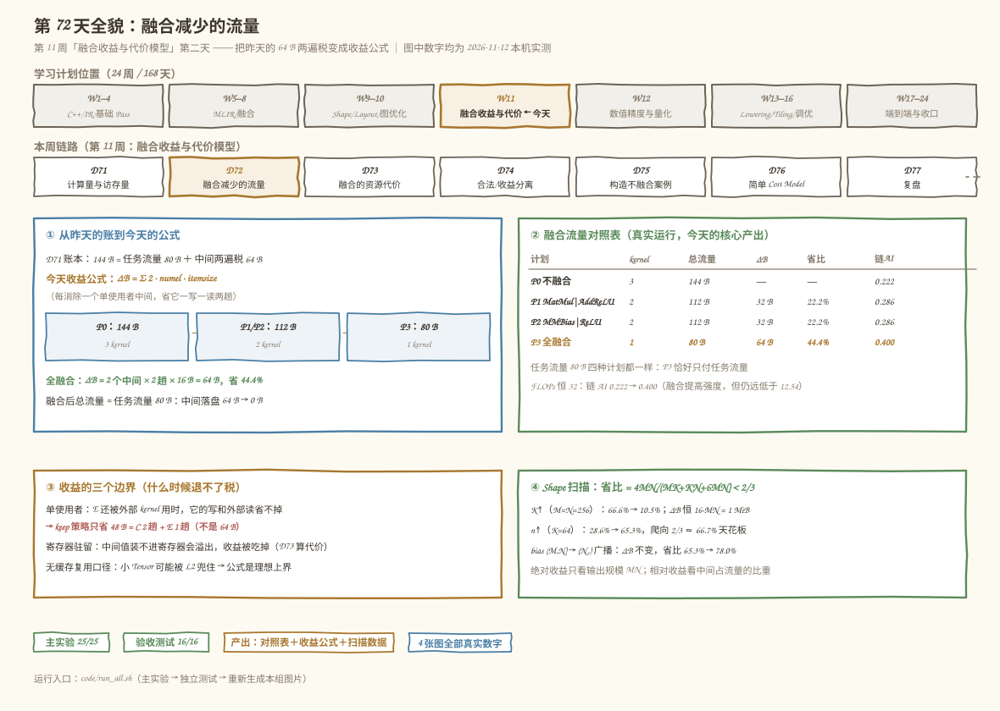
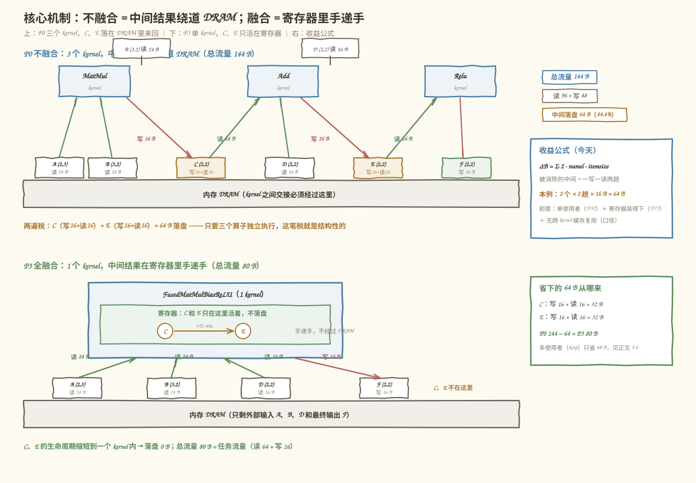
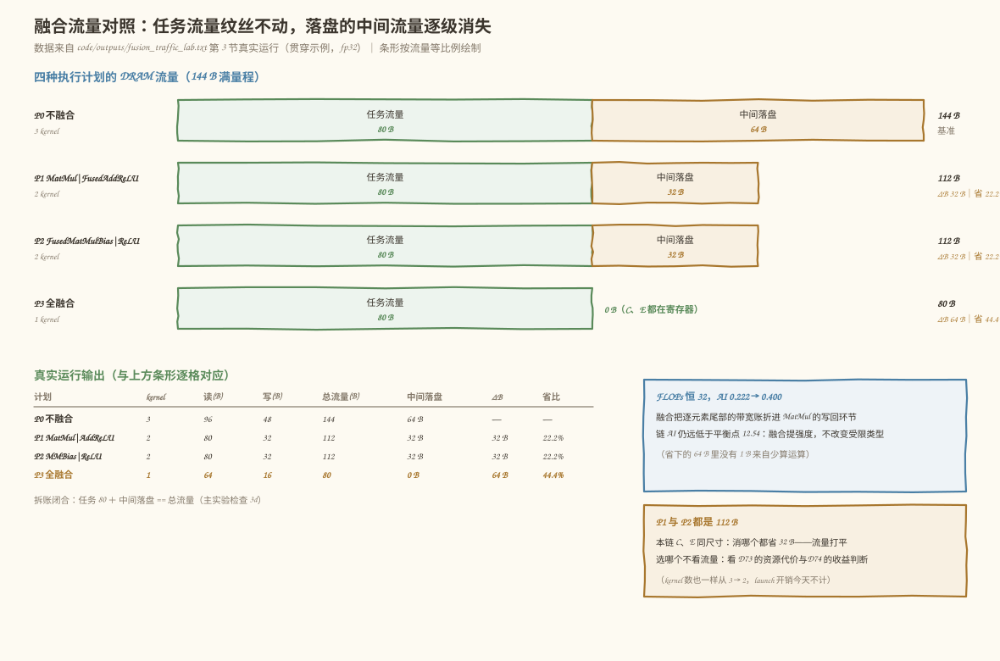
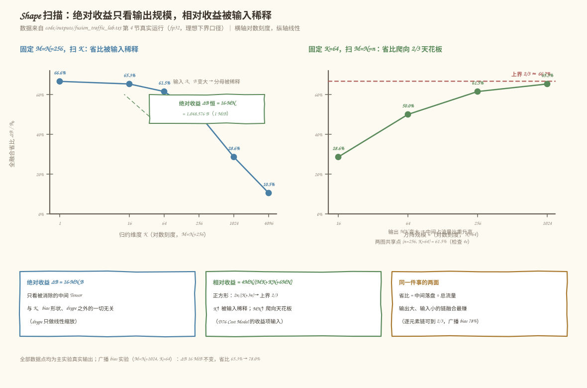

# 第 72 天：融合减少的流量——中间结果的两遍税，到底能退多少

> **今日目标**：完成本教程后，你能为 `MatMul + Bias + Relu` 链回答一个问题——**融合前后，各需要落盘多少中间 Tensor 字节？** 落盘（materialization，中间结果离开计算单元、写回全局内存）是链式独立执行的结构性开销：第 71 天已记好账，贯穿示例 `A(2,3) @ B(3,2) → +D(2,2) → relu`（fp32）不融合时中间 Tensor C、E 各交「写一遍＋读一遍」两遍税，合计 64 B、占总流量 144 B 的 **44.4%**。今天把这笔税变成**收益公式**：每消除一个单使用者中间 Tensor，省它一写一读两趟，`ΔB = 2 · numel · itemsize`。全融合（1 kernel）后总流量只剩任务流量 80 B，省 64 B（44.4%）；两种两算子融合各省 32 B（22.2%）。所有数字都能本机跑出来并逐位核对：公式与仪器化执行器在 25 组随机 `(M,K,N)` 上完全一致。你还能回答收益的边界：多使用者时 keep 策略只省 48 B（不是 64 B）；Shape 扫描给出省比公式 `4MN/(MK+KN+6MN)`——绝对收益 `16·MN` 只看输出规模，相对收益随 K 增大被稀释、随 MN 增大爬向 **2/3 的天花板**；bias 广播不改变 ΔB，只把省比推得更高（65.3% → 78.0%）。
> **预计时间**：学习 35 分钟＋实践 40 分钟
> **前置准备**：三块旧地基：第 71 天的三笔账（FLOPs／字节的 compulsory 理想下界口径、144 B 链账本、64 B 中间两遍税）、第 52 天的多使用者融合策略（默认拒绝、可选 keep 保留中间节点）、第 50 天的融合算子定义（`mini.fused_add_relu`、`mini.fused_matmul_bias_relu` 的语义）。工具：Python 3.10+ 与 numpy（本机 3.11.4 / 1.26.4，aarch64）。不需要 MLIR、不需要 NPU。
> **今日产出**：一张**融合流量对照表**（四种执行计划的读、写、总流量、ΔB、省比、链 AI）、一个**收益公式**（单使用者版 `ΔB = Σ 2·numel·itemsize`＋多使用者推广「组外使用者 > 0 时只省组内读」）和两组**扫描数据**（K 扫描：ΔB 恒 1 MiB、省比 66.6% → 10.5%；n 扫描：省比 28.6% → 65.3% 爬向 2/3）。代码在 `code/fusion_traffic_lab.py`（25 项检查）、`code/test_fusion_traffic.py`（16 项独立验收），全部真实运行；另有 4 张手绘风示意图。

## 1. 今天解决什么问题？

昨天收工时账本上留着一行刺眼的数字：三个算子独立执行，总流量 144 B，其中 **64 B 是中间 Tensor C、E 的「写一遍＋读一遍」两遍税**——占总流量的 44.4%。当时只把税记了下来，没有动手退。今天退这笔税：第 8 周已经实现了 `MatMul + Bias + Relu` 的融合算子和 Pattern（能把三个算子合成一个），融合后这笔税能退回多少？退干净了吗？有没有退不到的部分？

```text
A(2,3) @ B(3,2) ──matmul──▶ C(2,2) ──add(D(2,2))──▶ E(2,2) ──relu──▶ F(2,2)
```

今天围绕这条链回答三问：

1. **不融合、半融合、全融合各要落盘多少中间字节？**（P0 三 kernel：C、E 各两趟 = 64 B；P1/P2 两 kernel：剩一个中间 = 32 B；P3 单 kernel：0 B）
2. **收益公式长什么样，什么时候失效？**（单使用者：每个被消除的中间省两趟；E 还被外部算子用着时，它的写和外部读省不掉——keep 策略只省 48 B）
3. **省下的比例由什么决定？**（输出规模 MN 决定绝对收益 `16·MN`；K 与 MN 的比例决定相对收益，上界 2/3）

为什么这件事值得单独一天？因为它直接喂给本周后五天：Day 73 要给融合记**代价**账（寄存器、片上存储），Day 74 把「能否融合」和「是否值得融合」拆开，Day 76 组装 Cost Model——**收益侧的第一项输入就是今天的 ΔB**。如果今天把两遍税算成一遍，后面所有「值得不值得」的判断就系统性偏向融合；反过来把多使用者的损失算漏，又会做出错误拒绝。

一个口径提醒：今天说的「流量」沿用第 71 天的 compulsory 理想下界——每个元素从内存读一次记一次、写回内存记一次。且今天是**无缓存复用口径**：假设 kernel 之间交接必须经过 DRAM（中间 Tensor 大于缓存、或硬件没有跨 kernel 缓存复用时成立），所以算出的是融合收益的一阶理想值，不是任何机器上的实测承诺。

## 2. 先看全貌：今天的内容位于哪里？



**图 1**：今天的位置——把前几天的三块旧地基（第 50 天的融合算子、第 52 天的多使用者策略、第 71 天的记账口径）汇成一张**收益公式**，再把它交到第 73～76 天的代价模型手里。看图时注意：今天只算「省了多少字节」这一侧，融合要不要付出寄存器、片上存储的代价，是明天的事。

用四个步骤概括今天的推理路线：

1. **定口径**：沿用第 71 天的 compulsory 记账——kernel 输入各读一遍、输出各写一遍，中间结果交接必须经过 DRAM；
2. **仪器化对拍**：写一个真实计算的执行器（numpy），让公式和真跑一遍的字节数逐位相等；
3. **得公式**：每个被消除的中间 Tensor 省两趟 DRAM，`ΔB = 2 · numel · itemsize`；
4. **验边界**：多使用者省不满两趟、Shape 扫描给出相对收益的天花板。

## 3. 核心概念：先用直觉，再给准确定义

### 3.1 落盘：中间结果的「两遍税」

三个算子独立执行时，每个 kernel 是独立的调度单元：MatMul kernel 算完 C，C 必须写回 DRAM；Add kernel 要用 C，必须再从 DRAM 读一遍。这就是**落盘**（materialization，中间结果离开计算单元、写回全局内存）：中间 Tensor 每被下一个 kernel 接手一次，交「一写一读」两遍税。

类比：两位同事分工处理一份报表——第一位做完必须存进共享文件夹（写），第二位必须下载打开（读）。报表本身不需要给任何人看，却来回占了两次网络。对应到技术上是：kernel 之间没有可寻址的共享寄存器，交接只能经过全局内存；但类比的边界是——真实硬件可能有跨 kernel 的 L2 缓存命中，那会削弱这笔税，所以今天采用「无缓存复用」口径，算的是收益的理想上界。

### 3.2 收益公式：每个中间 Tensor 省两趟

融合把 C、E 从 DRAM 搬进 kernel 内部的寄存器，两遍税直接消失。于是收益公式非常干净：

```text
ΔB = Σ (被消除的中间 Tensor)  2 · numel · itemsize
```

本例 2 个中间（C、E 各 4 元素 × 4 B）：`ΔB = 2 × 2 × 4 × 4 = 64 B`。**它只看两件事：消掉了几个中间 Tensor、每个多大**——不看 K、不看 bias 怎么读、不看 FLOPs。这就是第 5.4 节扫描里「绝对收益恒定」的原因。

### 3.3 任务流量与省比的天花板

融合改变不了两部分钱：输入 A、B、D 必须读，输出 F 必须写——这 80 B 叫**任务流量**，任何执行计划都要付；而 `ΔB` 是**中间落盘**，只有独立执行才付。所以总流量的拆账恒等式是：

```text
总流量 = 任务流量 + 中间落盘
```

全融合恰好只付任务流量（80 B），这是任何融合策略的**流量下界**。也正因为分母里始终有任务流量，省比有一个永远压不过的天花板（第 5.4 节用扫描数据逼近它：上界 2/3）。

## 4. 图解核心机制



**图 2**：上半部分是独立执行（3 kernel）——看 C 和 E 的路径：MatMul 写 C 落盘、Add 读 C；Add 写 E 落盘、Relu 读 E，每个中间 Tensor 在 DRAM 边界来回两次。下半部分是融合执行（1 kernel）——C、E 只存在于 kernel 内部的「寄存器」里（图中的小盒子），DRAM 边界上只剩 A、B、D 进、F 出。

按图逐步讲解：

1. **P0 独立执行**：读 A 24 + B 24 + C 16 + D 16 + E 16 = 96 B，写 C 16 + E 16 + F 16 = 48 B，总 144 B。其中 64 B 是 C、E 的两遍税；
2. **P3 融合执行**：读 A 24 + B 24 + D 16 = 64 B，写 F 16 B，总 80 B——恰好等于任务流量；
3. **消失的趟数**：C 的写 + C 的读 + E 的写 + E 的读 = 4 趟 × 16 B = 64 B，正是 ΔB。融合没有让任何计算变少（FLOPs 恒 32），它只是让中间值不经过 DRAM；
4. **寄存器是理想化**：图里 C、E 画成小盒子驻留寄存器，前提是「寄存器够用」。这条假设的代价明天（第 73 天）算——MN 大到寄存器装不下时，中间值要降级到片上存储甚至 spill 回 DRAM，收益会打折。

## 5. 动手实践：完成一个最小可运行例子

### 5.1 准备文件

```text
tutorials/day-072/
├── README.md
├── images/                        ← 4 张手绘风示意图（由 make_images.py 生成）
└── code/
    ├── fusion_traffic_lab.py      ← 主实验：25 项检查
    ├── test_fusion_traffic.py     ← 独立验收：16 项
    ├── make_images.py             ← 生成 4 张 SVG
    ├── run_all.sh                 ← 一键复跑
    └── outputs/                   ← 真实运行输出（.txt）
```

环境：Python 3.10+、numpy（本机实测 3.11.4 / numpy 1.26.4，aarch64 Linux）。进入 `code/` 目录即可运行，无需 MLIR、无需 NPU。

### 5.2 编写代码

主实验的骨架是一个**显式记账的 DRAM** 加上**四种执行计划**。先看记账器，它就是第 3.1 节口径的代码化——输入必须 `read`、输出必须 `write`，中间值不经过它就不计数：

```python
class Dram:
    """显式记账的 DRAM：kernel 的输入必须 read 一遍，输出必须 write 一遍。"""

    def __init__(self):
        self.reads = 0
        self.writes = 0

    def read(self, *arrays) -> None:
        for a in arrays:
            self.reads += a.nbytes

    def write(self, *arrays) -> None:
        for a in arrays:
            self.writes += a.nbytes
```

再看四种执行计划里的两端。注意 `P3` 里 C、E 只是局部变量（对应「寄存器」），`dram` 完全看不见它们：

```python
def run_plan(plan, A, B, D, dram):
    if plan == "P0":                    # 三个 kernel 独立执行
        C = A @ B
        dram.read(A, B); dram.write(C)
        E = C + D
        dram.read(C, D); dram.write(E)
        F = np.maximum(E, 0)
        dram.read(E);  dram.write(F)
    elif plan == "P3":                  # 全部在一个 kernel：C、E 只活在寄存器
        F = np.maximum(A @ B + D, 0)
        dram.read(A, B, D); dram.write(F)
    # P1（MatMul | FusedAddReLU）、P2（FusedMatMulBias | ReLU）见 code/fusion_traffic_lab.py
    return F
```

公式侧与它对拍。`plan_bytes` 给出四种计划的 (读, 写) 元素数（`be` 是 bias 元素数），`intermediates_bytes` 是 3.2 节的收益公式：

```python
def plan_bytes(M, K, N, itemsize=4, bias="full"):
    be = M * N if bias == "full" else N
    plans = {
        "P0": (M*K + K*N + be + 2*M*N, 3*M*N),
        "P1": (M*K + K*N + be + M*N,   2*M*N),
        "P2": (M*K + K*N + be + M*N,   2*M*N),
        "P3": (M*K + K*N + be,         M*N),
    }
    return {k: (r * itemsize, w * itemsize) for k, (r, w) in plans.items()}

def intermediates_bytes(M, N, itemsize=4):
    """收益公式：ΔB = 2 个中间 × 2 趟 × M·N 元素 × itemsize = 16·MN 字节。"""
    return 2 * 2 * (M * N) * itemsize
```

多使用者推广（第 52 天的 keep 策略回到账上）写成一条规则：组外使用者为 0 才能省「写 + 组内读」，否则只省组内读：

```python
def fusion_savings_passes(intermediates, itemsize):
    """intermediates: [(名字, 元素数, 组内使用者数, 组外使用者数), ...]"""
    saved = 0
    for _name, elems, n_in, n_out in intermediates:
        passes = (1 + n_in) if n_out == 0 else n_in   # 写 + 组内读 / 只省组内读
        saved += passes * elems * itemsize
    return saved
```

### 5.3 运行与观察

```bash
cd tutorials/day-072/code
python3 fusion_traffic_lab.py        # 主实验：25 项检查
python3 test_fusion_traffic.py       # 独立验收：16 项
bash run_all.sh                      # 或一键复跑并把输出存进 outputs/
```

以下为本机真实运行输出（完整记录在 `code/outputs/fusion_traffic_lab.txt`）：

```text
== 2. 仪器化对拍：四种执行计划（公式 vs 真跑一遍的记账）==
  P0 不融合：读 96 B + 写 48 B = 144 B（公式 96/48/144）
  P1 MatMul | FusedAddReLU：读 80 B + 写 32 B = 112 B（公式 80/32/112）
  P2 FusedMatMulBias | ReLU：读 80 B + 写 32 B = 112 B（公式 80/32/112）
  P3 FusedMatMulBiasReLU：读 64 B + 写 16 B = 80 B（公式 64/16/80）
  四个计划的 F 逐位相等且等于手算值：True（F = [[0,65],[0,157]]）
  融合前总流量 144 B → 融合后 80 B；第 71 天的 144 B 账本对上了
```

四种计划的 F 全部等于第 71 天的手算值 `[[0,65],[0,157]]`——融合只改执行方式，不改数值。核心产出是这张**融合流量对照表**：

```text
== 3. 融合流量对照表（今天的核心产出）==
  执行计划                      kernel  读(B)  写(B)  总流量  任务  中间落盘  ΔB    省比   链AI
  P0 不融合                         3     96    48    144    80      64      —      —  0.222
  P1 MatMul | FusedAddReLU       2     80    32    112    80      32     32  22.2%  0.286
  P2 FusedMatMulBias | ReLU      2     80    32    112    80      32     32  22.2%  0.286
  P3 FusedMatMulBiasReLU         1     64    16     80    80       0     64  44.4%  0.400
```



**图 3**：左上是对照表的图解版——每个计划的总流量条都拆成「任务 80 B（四种计划相同）+ 中间落盘」。看两点：全融合 P3 的总流量条恰好只剩任务流量；两种两算子融合 P1、P2 省得一样多（本链 C、E 同尺寸）。下半部分是多使用者反例（对应 5.4 节第 3 组实验）：E 还被外部 kernel G 读走时，keep 策略省 48 B 而不是 64 B。

读表回答三个问题：

1. **ΔB 从哪来**：`任务流量 + 中间落盘 == 总流量` 对四种计划都成立（检查 3d），P0 的 64 B 中间落盘被 P3 清零；
2. **省比为什么是 4/9**：64/144 = 4/9 ≈ 44.4%（检查 3e）。注意分母含任务流量，所以即便把两遍税全退掉也到不了 100%；
3. **链 AI 为什么升**：FLOPs 恒 32 不变、字节从 144 降到 80，算术强度从 0.222 升到 0.400（检查 3f）——融合正是通过压分母把 AI 推向机器平衡点的手段之一。

### 5.4 修改一个参数再观察

三组低成本对照实验，每组只动一个参数（全部来自 `fusion_traffic_lab.py` 第 4～6 节的真实输出）：

**实验一：扫 K（绝对收益恒定，相对收益被稀释）**

```text
  (a) 固定 M=N=256，扫 K（fp32）：ΔB = 16·MN = 1,048,576 B 恒定
      K       不融合(B)       融合(B)        ΔB(B)     省比
        1     1,574,912       526,336   1,048,576    66.6%
       64     1,703,936       655,360   1,048,576    61.5%
     4096     9,961,472     8,912,896   1,048,576    10.5%
  (b) 固定 K=64，扫 M=N=n（fp32）：省比爬向 2/3 的天花板
      n      不融合(B)       融合(B)        ΔB(B)     省比
       16        14,336        10,240       4,096    28.6%
     1024    25,690,112     8,912,896  16,777,216    65.3%
```



**图 4**：左图扫 K——橙色虚线（ΔB）纹丝不动，绿色省比曲线一路下滑；右图扫 n——省比单调上升，逼近红色虚线 2/3 但永远压不过。两张图验证收益公式的推论：`ΔB = 16·MN` 只看输出规模，省比 `4MN/(MK+KN+6MN)` 由输入与输出的比例决定，正方形时 `2n/(K+3n)`，上界 2/3 ≈ 66.7%。

**实验二：多使用者（收益公式的失效边界）**

E 还被外部 kernel G 消费时，对比第 52 天的两种策略：

```text
== 5. 多使用者反例：E 还被外部 kernel G 消费（第 52 天策略回到账上）==
  策略 A 拒绝融合（第 52 天默认）：读 112 B + 写 64 B = 176 B
  策略 B 融合但保留 E（keep）  ：读 80 B + 写 48 B = 128 B
  keep 策略省 ΔB = 48 B = C 的 2 趟（32 B）+ E 的 1 趟（16 B）
```

keep 策略省的是 48 B 不是 64 B：E 的**写**必须保留（要留给 G）、**G 的读**也必须保留，能消失的只有 relu 的那次读——收益公式按 `fusion_savings_passes` 退化为「只省组内读」。这是把多使用者判断（第 52 天）和流量账（第 71 天）接在一起的关键一课。

**实验三：bias 形状 (M,N) → (N,) 广播**

```text
== 6. 改一个参数再观察：bias 形状 (M,N) → (N,) 广播 ==
    bias (M,N) 完整：不融合   25,690,112 B，融合    8,912,896 B，ΔB 16,777,216 B，省比 65.3%
    bias (N,)  广播：不融合   21,499,904 B，融合    4,722,688 B，ΔB 16,777,216 B，省比 78.0%
```

bias 从完整 (M,N) 换成广播 (N,)（真实模型里的常态），ΔB 一字不变（省几趟只看中间 Tensor）、分母变小，省比从 65.3% 升到 78.0%。旁注：fp32 换 fp16 时 ΔB 减半（1,048,576 → 524,288 B），省比完全不变——收益公式的「元素比」与 dtype 无关。

## 6. 常见错误与排查

以下是编写本日代码时真实踩过的三个坑，全部有迹可查。

**错误一：混用 `random.Random` 和 numpy Generator**

- 现象：`AttributeError: 'Random' object has no attribute 'standard_normal'`，测试一启动就崩；
- 原因：用 `random.Random(72)` 建了随机源，却按 numpy 的 API 调 `rng.standard_normal((M, K))`——两套库的方法集不同；
- 定位：traceback 直接指向 `rand_chain` 里的生成语句；
- 修复：统一改成 `rng = np.random.default_rng(72)`，整数抽样同步换成 `rng.integers(1, 33)`。教训：涉及 numpy 数组的实验，随机源一开始就用 `default_rng`。

**错误二：把「广播必然让流量变小」写成严格不等式**

- 现象：验收项 E2 `[FAIL] 广播让不融合总流量变小`，但公式明明对；
- 原因：测试里生成过 `M=1` 的随机 shape——此时 `(N,)` 广播 bias 与 `(1,N)` 完整 bias 元素数相同（`MN − N = 0`），「严格变小」在这个退化情形下不成立；
- 定位：看失败信息里「M>1 时严格变小」的提示，检查随机 shape 列表中最小的 M；
- 修复：断言放宽为「不增」（`bc0 <= full0`），严格变小只对 `M > 1` 检查。教训：验收断言要覆盖退化 shape（M=1、K=1 都值得专门进用例）。

**错误三：天花板检查的容差比收敛速度还紧**

- 现象：验收项 G3 `[FAIL] 天花板：省比 → 2/3`，而扫描数据明明单调逼近；
- 原因：断言写成 `2/3 − fn[-1] < 0.001`，但 `n=4096` 时省比 = 2·4096/(64+3·4096) ≈ 0.6632，距 2/3 还差 0.0035——不是数据错，是容差定得比该点的实际距离还小；
- 定位：手算 `2/3 − 2n/(K+3n)` 在 n=4096 处的值，与容差比较；
- 修复：把容差放到 0.0035，并保留公式等值检查 `abs(fn[-1] − 2n/(K+3n)) < 1e-12`（这部分本来就精确成立）。教训：「逼近某极限」类断言要么解析算出该点的距离，要么把 n 加大到距离小于容差。

另记一个**概念性错误**（测试替我们挡住的）：算多使用者 keep 的收益时，最容易顺手把 ΔB 写成「2 个中间 × 2 趟 = 64 B」。但 E 有组外使用者，写和外部读都省不掉——只有仪器化执行（5.4 节实验二）能给出正确答案 48 B。公式的适用条件（组外使用者 = 0）比公式本身更值得记住。

## 7. 今日练习

### 必做练习：给链加第四个算子，预测新的 ΔB

把链改成四算子：`A(2,3) @ B(3,2) → C`，`C + D1 → E`，`relu(E) → G`，`G + D2 → H`（D1、D2 都是 (2,2) 的 fp32）。**先笔算**再动代码：

1. 独立执行（4 kernel）时，C、E、G 各交几趟税？总流量是多少（提示：按 kernel 逐个数读和写，别忘了 D2 也是输入）？
2. 全融合（1 kernel）的总流量是多少？
3. 用收益公式预测 ΔB，并核对它是否等于「3 个中间 × 2 趟 × 16 B」。

然后扩展 `run_plan`（加 `P0x`/`P4x` 两个计划）和 `plan_bytes` 复算。预期产出：一段扩展后的执行代码 + 你的笔算值与仪器化记账一致的截图或输出。**自检锚点**：ΔB 应为 96 B；若你算出的「融合后总流量 − 不融合总流量」不是它，先查中间 Tensor 的个数（3 个），再查每个的元素数（4 × 4 B）。

### 选做挑战：第二个外部使用者

在 5.4 节实验二的基础上，让 E 同时被两个外部 kernel G1、G2 消费。先预测：keep 策略的 ΔB 会不会因为多了一个使用者而变化？（提示：用 `fusion_savings_passes` 的规则——组外使用者只决定「写和外部读必须保留」，收益已经是「只省组内读」，再增加组外使用者还剩几趟可省？）然后给 `run_multi_keep` 加一个 G2 验证。预期产出：预测值 + 扩展代码 + 与预测一致的仪器化输出。

## 8. 今日验收

- [ ] 我能用自己的话解释「落盘/两遍税」，并写出收益公式 `ΔB = Σ 2 · numel · itemsize`，说出它的适用条件（中间 Tensor 没有组外使用者）
- [ ] 我能独立运行 `fusion_traffic_lab.py` 和 `test_fusion_traffic.py`，并复现 25/25 与 16/16 通过（`bash run_all.sh` 一键复跑）
- [ ] 我能解释 P0/P1/P2/P3 的总流量拆账（任务 80 B + 中间落盘），并说明全融合省比为什么是 4/9 而不是更高
- [ ] 我能解释多使用者 keep 策略为什么只省 48 B（E 的写与外部读省不掉），并用 `fusion_savings_passes` 的规则推出来
- [ ] 我能通过修改链（必做练习的四算子版）预测新 ΔB，再扩展执行器验证预测
- [ ] 我保存了融合流量对照表、收益公式和两组扫描数据（README 正文 + `code/outputs/` 的真实输出）

## 9. 一句话总结与明天预告

今天把第 71 天记下的 64 B「两遍税」变成了一条可复用的收益公式：每个被消除的中间 Tensor 省一写一读两趟 DRAM，`ΔB = Σ 2 · numel · itemsize`，仪器化执行器在 25 组随机 shape 上逐位验证了它。全融合让链流量从 144 B 降到 80 B（恰好只剩任务流量），但收益有边界：多使用者时写和外部读省不掉（keep 只省 48 B），相对收益的天花板是 2/3（省比 = 4MN/(MK+KN+6MN)，正方形时 2n/(K+3n)），bias 广播和 dtype 都不改变 ΔB、只改变省比的分母。所有数字来自真实运行：主实验 25/25、独立验收 16/16。

明天（第 73 天）算另一侧的账：**融合的资源代价**——C、E 驻留寄存器是今天的理想化假设，MN 大到寄存器装不下时中间值要降级到片上存储甚至 spill 回 DRAM。我们将设计一个简单资源估算结构，把「省 64 B」和「多占多少临时空间」放在同一张表里，为第 74 天「能否融合 vs 值得融合」的拆分备好输入。
