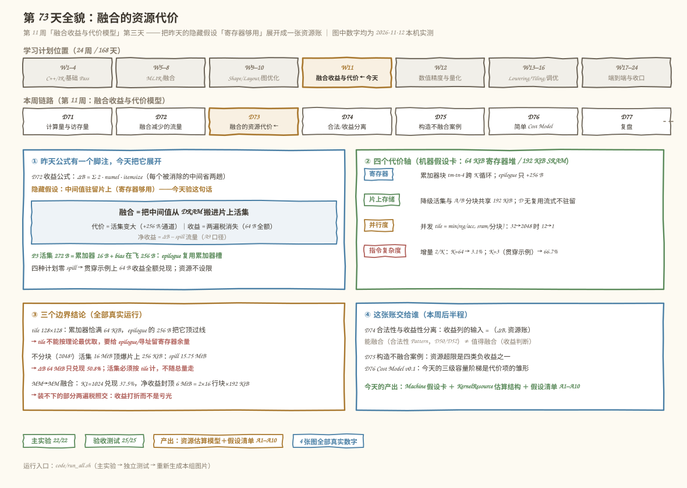
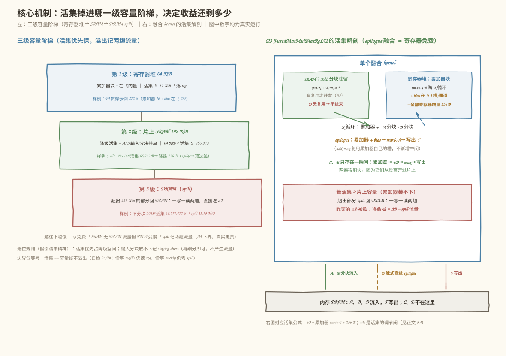
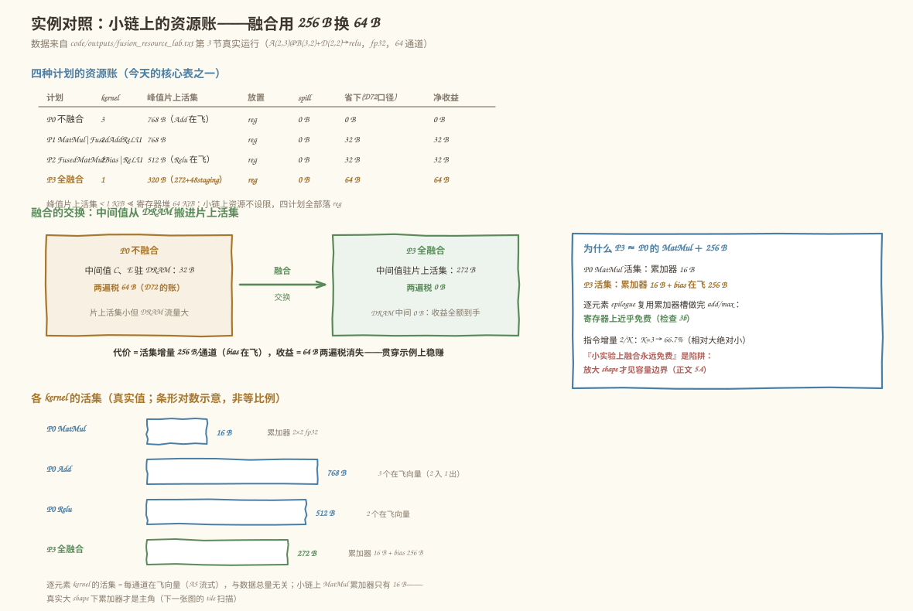
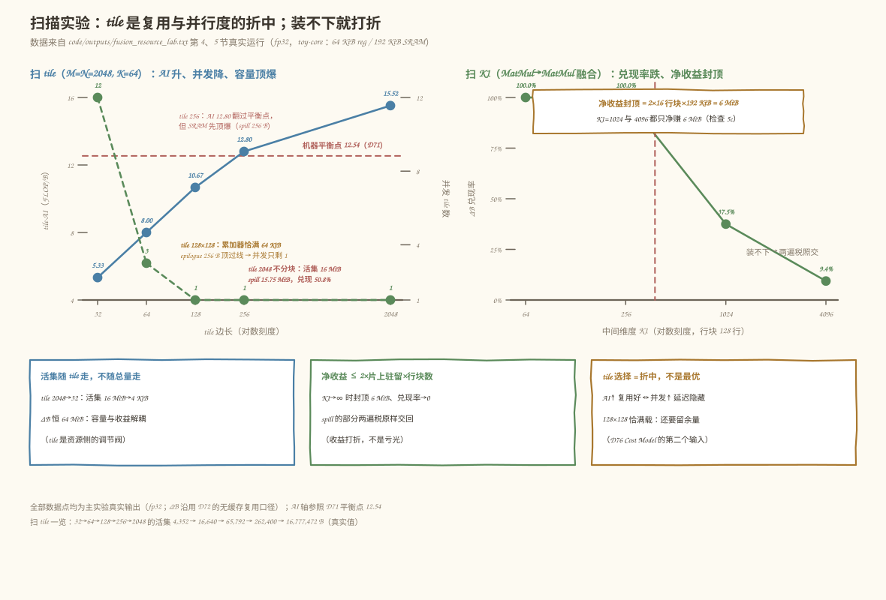

# 第 73 天：融合的资源代价——中间值装不下片上时，收益要打折

> **今日目标**：完成本教程后，你能为「融合把中间值搬进片上」回答三个问题——**片上装得下吗？装不下省多少？装下了但挤占并行度值不值？** 你会搭出一个**资源估算模型**（`Machine` 假设卡 ＋ `KernelResource` 估算记录 ＋ 容量阶梯 `place()`），并给融合算子记下**临时空间需求**（活集，任一时刻必须同时在片的中间值字节）。所有数字都能本机跑出来逐位核对：贯穿示例 `A(2,3) @ B(3,2) → +D(2,2) → relu` 上，P3 的活集只有 **272 B = 累加器 16 B ＋ bias 在飞 256 B**——epilogue 融合的寄存器增量就是每通道 1 个槽；四种计划零溢出，净收益 **0/32/32/64 B** 与第 72 天的 ΔB 列逐位一致。放大到 `M=N=2048, K=64` 后看见边界：活集**只随 tile 变、不随总量变**（32→2048 时 4,352→16,777,472 B，而 ΔB 恒 64 MiB）；tile 128×128 的累加器恰好填满 64 KiB 寄存器堆，epilogue 的 256 B 把它顶过线；不分块的贪心融合溢出 15.75 MiB，昨天的收益只兑现 **50.8%**。反例 `MatMul→MatMul` 融合里，中间 G 行块的活集被消费者的归约维 K1 钉死：K1=64→4096 时兑现率 100%→9.4%，而**净收益封顶在 6 MiB = 2×16 行块×192 KiB**——装不下的部分两遍税照交，收益打折而不是亏光。指令复杂度这一轴最便宜：epilogue 增量 = 2/K（K=64 时 3.1%）。
> **预计时间**：学习 35 分钟＋实践 45 分钟
> **前置准备**：三块旧地基：第 71 天的记账口径（compulsory 理想下界、机器平衡点 12.54 FLOP/B）、第 72 天的收益公式（`ΔB = Σ 2·numel·itemsize`，多使用者时只省组内读）、第 50/52 天的融合算子（`mini.fused_add_relu`、`mini.fused_matmul_bias_relu` 与多使用者策略）。工具：Python 3.10+ 与 numpy（本机 3.11.4 / 1.26.4，aarch64 Linux）。不需要 MLIR、不需要 NPU——今天的机器参数是一张写明的**玩具假设卡**，量级参照真实硬件，可整体替换重算。
> **今日产出**：一个**资源估算模型**（`Machine` 假设卡、`KernelResource` 结构、`place()` 容量阶梯）和一份**假设清单**（A1–A10，全部打印在实验输出里），加三张真实数据表：贯穿示例资源账（净收益 0/32/32/64 B）、tile 扫描（活集/落位/并发/tile-AI/兑现）、`MatMul→MatMul` 的 K1 扫描（兑现率与净收益封顶）。代码在 `code/fusion_resource_lab.py`（22 项检查）、`code/test_fusion_resource.py`（25 项独立验收），全部真实运行；另有 4 张手绘风示意图。

## 1. 今天解决什么问题？

昨天收工时公式很干净：每个被消除的中间 Tensor 省一写一读两趟 DRAM，`ΔB = Σ 2·numel·itemsize`。但正文里有一句小字：**「融合 kernel 的中间值驻留寄存器，不落盘（寄存器够用的理想化；代价第 73 天算）」**。第 71 天讲类比时也留过同一个尾巴：「类比里没有『干活本身也要占工地空间』这回事，而融合真的会挤占寄存器／片上存储（Day 73 的主题）」。

今天就把这个脚注展开成一张账。先看贯穿示例上「融合」到底是什么动作：

```text
不融合：C、E 驻 DRAM（各 16 B），交两遍税 64 B，片上活集很小
融  合：C、E 搬进片上活集（P3 活集 272 B），两遍税消失
```

**融合的本质是交换：用片上空间换 DRAM 流量。** 那么三个问题必须回答：

1. **片上有多大、活集有多大？**（寄存器堆和 SRAM 都是每核固定的容量；活集 = 峰值时刻必须同时在片的中间值，随 tile 尺寸走）
2. **装不下会发生什么？**（超出寄存器堆的部分降级 SRAM，再超出就溢出（spill）回 DRAM——溢出部分一写一读，正是昨天想省的两遍税原样交回）
3. **装下了但挤占并行度、堆高指令复杂度呢？**（活集越大，能同时驻留的 tile 越少；融合把消费者的指令并进来）

为什么这件事值得单独一天？因为它直接喂给本周后四天：**第 74 天要把「能否融合」和「是否值得融合」拆成两个函数**——值得侧的输入就是昨天的 ΔB 加今天的资源账；第 75 天要构造「资源超限」这类负收益案例；第 76 天组装 Cost Model 时，今天的三级容量阶梯就是代价项的雏形。如果今天不算这笔账，后面所有「值得不值得」的判断就会系统性高估融合。

一个口径提醒：今天的机器参数（寄存器堆 64 KiB/核、SRAM 192 KiB/核、64 并行通道）是**写死的玩具假设**，量级参照真实硬件（GPU 一个 SM 的寄存器堆约 256 KiB、共享存储约 48～228 KiB；NPU 的 Cube/Vector 单元配 Unified Buffer），但具体数字不是任何真实芯片的规格——结论跟着假设卡走，换卡重算。

## 2. 先看全貌：今天的内容位于哪里？



**图 1**：今天的位置——昨天算了收益侧（ΔB），今天算**代价侧**（活集、容量阶梯、并行度、指令复杂度），两者一起构成第 74 天「合法性与收益性分离」的收益列输入。看图时注意盒②：四个代价轴的顺序是有讲究的——寄存器和片上存储决定「装不装得下」（硬约束），并行度和指令复杂度决定「装下了好不好」（软代价）。

用四个步骤概括今天的推理路线：

1. **定假设**：把机器写成一张显式的假设卡（`Machine`），把口径写成 A1–A10 假设清单——结论只在这张卡上成立；
2. **公式化活集**：每种算子结构给出活集公式（MatMul 累加器块、逐元素在飞向量、融合 epilogue 的增量）；
3. **容量阶梯落位**：活集先填寄存器堆、超出的降级 SRAM、再超出的溢出记两趟流量，净收益 = ΔB − spill 流量；
4. **扫描找边界**：放大 shape 后扫 tile 和扫中间维度 K1，找出「收益打折」的两个临界点。

## 3. 核心概念：先用直觉，再给准确定义

### 3.1 活集：融合 kernel 的临时空间需求

融合把 C、E 搬进片上，但片上不是无限大的口袋。**活集**（live set，也叫临时空间需求）= 峰值时刻必须**同时**驻留在片上的中间值字节——不是「总共产生过多少中间值」，而是「同一瞬间手里攥着多少」。

类比：一个工人（计算核）在桌面（寄存器堆，64 KiB）上干活，货架（SRAM，192 KiB）放半成品，仓库（DRAM）放原料和成品。融合前的 C、E 存仓库，每次交接跑两趟仓库；融合后 C、E 全要攥在手里——**活集就是「一只手同时要攥住的东西」**。对应到技术上是：融合 kernel 内部的中间值生命周期从一个 kernel 缩短到一个循环体内，但峰值时刻的驻留字节必须同时落在寄存器堆（累加器块）或 SRAM（降级活集）里。类比的边界：桌面放不下时，工人不是「少攥点」就完事——技术上的活集由算子的**归约结构**决定（累加器块必须跨 K 循环常驻、消费者的归约行块必须整块在场），只能靠分块缩小，不能靠少攥。

贯穿示例上这个活集非常小：P3 = 累加器 2×2 fp32（16 B）＋ bias 在飞向量（每通道 1 槽 × 64 通道 × 4 B = 256 B）= **272 B**。

### 3.2 容量阶梯：reg → reg+sram → spill

活集拿去和片上容量比，落进三级阶梯：

```text
活集 ≤ 64 KiB（寄存器堆）          → 落 reg：理想情况，中间值全在寄存器
64 KiB < 活集 ≤ 256 KiB（+SRAM）  → 落 reg+sram：超出部分降级 SRAM
活集 > 256 KiB                    → 落 spill：超出片上的部分回 DRAM
```

降级到 SRAM 仍然划算：SRAM 的 RMW 慢一点，但**不产生 DRAM 流量**，昨天的收益一分不少。真正伤收益的是 spill：**溢出部分一写一读两趟**，恰好是昨天想省的那笔两遍税——于是第 72 天的公式可以推广成资源版：

```text
净收益 = ΔB − 2 × 溢出字节（A4 口径：每字节一写一读，下界；真实累加器溢出因跨 K 循环反复改写更贵）
```

这就是今天最重要的一句话：**收益公式的适用条件从「中间值没有组外使用者」加一条「活集装得进片上」——装不下的部分两遍税照交，收益打折而不是亏光。** 边界含等号：活集恰好等于容量线时不溢出（实验自检 2a/2b 专门验了这条，边界 bug 见第 6 节错误二）。

### 3.3 并行度与指令复杂度：装下了之后的两笔软账

假设活集装进寄存器堆了，还有两笔账：

- **并行度**：寄存器堆是所有并发 tile 共享的。每 tile 的累加器块越大，能同时驻留的 tile 越少：并发 tile 数 = min(寄存器堆/每 tile 活集, SRAM/每 tile 输入分块)。活集大 → 并发少 → 隐藏延迟能力差。今天用这个 proxy 把「挤占并行度」变成可计算的数（tile 32 时并发 12，tile 128 时只剩 1）。
- **指令复杂度**：融合把消费者的指令并进生产者的循环。每个输出元素 MatMul 需要 K 条 MAC 指令，epilogue（bias add + relu max）只要 2 条，**增量 = 2/K**——K=64 时 3.1%，K=3 的贯穿示例上却是 66.7%（相对大、绝对小）。另有一笔今天不计数的工程代价：融合后的 kernel 无法再直接调用高度优化的独立算子库（手写 MatMul 库、专用 Cube 指令的组合），要重写含 epilogue 的 tile 代码（假设 A8）。

而 epilogue 融合之所以**寄存器上近乎免费**，是因为逐元素的 bias/relu 不需要新的中间块：它们在累加器自己的槽位上做完加法和比较再写出，只需要每通道多 1 个在飞槽装 bias——这就是贯穿示例上「P3 = P0 的 MatMul ＋ 256 B」的定量来源。贵的不是 epilogue，是**消费者 tile 结构与生产者不匹配**的融合（第 5.4 节的 `MatMul→MatMul` 反例）。

## 4. 图解核心机制



**图 2**：左半是**三级容量阶梯**——看三个真实活集的落位：272 B（贯穿示例 P3）整个落进第 1 级寄存器堆；65,792 B（tile 128×128）的累加器恰好填满 64 KiB、epilogue 的 256 B 降级到第 2 级 SRAM；16,777,472 B（不分块的 2048²）只有 256 KiB 能留在片上，其余 15.75 MiB 掉进第 3 级 DRAM，一写一读两趟。右半是 **P3 kernel 的活集解剖**——A/B 分块因为有数据复用驻 SRAM，D 每元素只用一次所以流式直进 epilogue，累加器块跨 K 循环常驻寄存器，epilogue 复用累加器槽位。

按图中编号逐步讲解：

1. **活集先填寄存器堆**：累加器块和在飞向量是最热的数据，优先驻留最快的第 1 级；这是「融合收益的理想情况」的资源前提；
2. **超出寄存器堆降级 SRAM**：RMW 变慢但无 DRAM 流量，昨天的 ΔB 仍全额到手——所以 128×128 的 tile 虽然「满载」，收益兑现仍是 100%；
3. **再超出就 spill**：溢出部分回 DRAM 一写一读，正是昨天想消的两遍税；净收益 = ΔB − 2×溢出字节；
4. **落位规则**：活集优先占降级空间，输入分块放不下记 `staging short`（沿 k 方向再细分即可，不产生额外流量、只是复用下降）——生产者的累加器比 A/B 分块更不能让，因为 spill 它直接吃流量。

## 5. 动手实践：完成一个最小可运行例子

### 5.1 准备文件

```text
tutorials/day-073/
├── README.md
├── images/                        ← 4 张手绘风示意图（由 make_images.py 生成）
└── code/
    ├── fusion_resource_lab.py     ← 主实验：22 项检查
    ├── test_fusion_resource.py    ← 独立验收：25 项
    ├── make_images.py             ← 生成 4 张 SVG
    ├── run_all.sh                 ← 一键复跑
    └── outputs/                   ← 真实运行输出（.txt）
```

环境：Python 3.10+、numpy（本机实测 3.11.4 / numpy 1.26.4，aarch64 Linux）。进入 `code/` 目录即可运行，无需 MLIR、无需 NPU。

### 5.2 编写代码

今天的核心结构有两个。先看**机器假设卡**——今天所有资源判断的唯一依据，参数量级参照真实硬件、可整体替换：

```python
@dataclass(frozen=True)
class Machine:
    name: str = "toy-core v0"
    regfile_bytes: int = 64 * 1024      # 每核寄存器堆 64 KiB（累加器/在飞向量驻留）
    sram_bytes: int = 192 * 1024        # 每核片上 SRAM 192 KiB（降级活集 + 输入分块）
    lanes: int = 64                     # 每核 64 条并行通道（一次算 64 个元素）
    itemsize: int = 4                   # fp32

    @property
    def onchip_bytes(self) -> int:
        return self.regfile_bytes + self.sram_bytes
```

再看**单个 kernel 的资源估算记录**——「记录融合算子的临时空间需求」就是往这个结构里填数：

```python
@dataclass
class KernelResource:
    name: str
    reg_demand: int      # 必须驻寄存器的部分：累加器块 + 在飞向量
    extra_live: int = 0  # 额外活集：须驻 SRAM 的中间块（如 MM→MM 的 G 行块）
    sram_demand: int = 0 # 输入分块驻留（有复用的 A/B 分块；无复用输入为 0）
    placement: str = ""  # 容量阶梯落位："reg" / "reg+sram" / "spill"
    # ... demoted_bytes / spill_bytes / spill_traffic / concurrent_tiles / staging_ok
```

落位逻辑 `place()` 把第 3.2 节的阶梯写成代码，规则只有两条：**活集优先保**（超容量部分 spill、记两趟流量），**输入分块让路**（放不下记 `staging short`，不产生流量）：

```python
def place(res, m):
    live = res.live_bytes
    demoted = min(max(0, live - m.regfile_bytes), m.sram_bytes)
    res.spill_bytes = max(0, live - m.onchip_bytes)
    res.spill_traffic = 2 * res.spill_bytes          # A4：一写一读两趟（下界）
    res.placement = ("spill" if res.spill_bytes > 0
                     else "reg+sram" if demoted > 0 else "reg")
    ...
```

最后是三种算子结构的**活集公式**（对应假设 A5/A6）——注意逐元素 epilogue 只加每通道 1 个槽：

```python
def matmul_acc(tile_m, tile_n, m):       # MatMul 累加器块：跨 K 循环常驻
    return tile_m * tile_n * m.itemsize

def ew_live(m, n_in, n_out):             # 逐元素：每通道在飞向量，与总量无关
    return m.lanes * (n_in + n_out) * m.itemsize

def fused_matmul_epilogue(tile_m, tile_n, m):   # 融合 MatMul+Bias+Relu
    return matmul_acc(tile_m, tile_n, m) + m.lanes * m.itemsize
```

### 5.3 运行与观察

```bash
cd tutorials/day-073/code
python3 fusion_resource_lab.py        # 主实验：22 项检查
python3 test_fusion_resource.py       # 独立验收：25 项
bash run_all.sh                       # 或一键复跑并把输出存进 outputs/
```

以下为本机真实运行输出（完整记录在 `code/outputs/fusion_resource_lab.txt`）：

```text
== 3. 贯穿示例 A(2,3)@B(3,2)+D(2,2)→relu：四种计划的资源账 ==
  计划   kernel 数   各 kernel 活集(reg)     放置   spill   省下(第72天口径)  净收益
  P0      3        MatMul 16+48staging; Add 768+0staging; Relu 512+0staging   reg    0 B         0 B    0 B
  P1      2        MatMul 16+48staging; FusedAddReLU 768+0staging   reg    0 B        32 B    32 B
  P2      2        FusedMatMulBias 272+48staging; Relu 512+0staging   reg    0 B        32 B    32 B
  P3      1        FusedMatMulBiasReLU 272+48staging              reg    0 B        64 B    64 B
  峰值片上足迹：P0 768 B → P3 320 B（都远小于寄存器堆 64 KiB：小链资源不设限）
```



**图 3**：上半是四种计划的资源账表（与上方输出逐行对应），中间是今天的中心句——**融合用 272 B 片上活集换 32 B DRAM 中间驻留（C＋E）的消失**；右卡解释为什么 P3 ≈ P0 的 MatMul ＋ 256 B；下半是各 kernel 活集的对数条形（真实值）。注意 P0 的峰值活集（Add 的 768 B 在飞向量）反而比 P3 大——小 shape 上逐元素向量化占主导，这是小实验的失真，真实大 shape 下累加器才是主角。

读表回答三个问题：

1. **代价多大**：P3 比 P0 的 MatMul 多要 256 B（bias 在飞），这是 epilogue 融合的全部寄存器增量——检查 3b 验证 `P3 − MatMul == lanes × itemsize`；
2. **收益兑现吗**：四种计划零溢出，净收益 0/32/32/64 B 与第 72 天的 ΔB 列逐位一致（检查 3c）——小链上资源完全不设限；
3. **D 为什么不驻留**：bias D 每元素只用一次、没有复用，流式读入即可；有复用的 A/B 分块（48 B）才驻 SRAM（检查 3d，假设 A3）。

还有一个必须警惕的现象贯穿全表：**所有活集都小于 1 KiB**——小链上永远看不见容量边界，「融合免费」的错觉正是这么来的。必须放大 shape 才能看见代价，这就是 5.4 节。

### 5.4 修改一个参数再观察

三组低成本对照实验，每组只动一个参数（全部来自 `fusion_resource_lab.py` 第 4～6 节的真实输出）。

**实验一：扫 tile（活集随 tile 走，不随总量走）**　固定 `M=N=2048, K=64`，只改融合 kernel 的输出 tile：

```text
== 4. 放大 M=N=2048, K=64：tile 是活集的调节阀 ==
  全融合的 ΔB（第 72 天公式）= 16·MN = 67,108,864 B = 64 MiB
  tile      活集(reg)      A/B驻SRAM   放置        spill    staging  并发tile  tile-AI   ΔB兑现
  2048   16,777,472 B   1,048,576 B      spill  16,515,328 B    short       1    15.52    50.8%
   256     262,400 B    131,072 B      spill       256 B    short       1    12.80   100.0%
   128      65,792 B     65,536 B   reg+sram         0 B       ok       1    10.67   100.0%
    64      16,640 B     32,768 B        reg         0 B       ok       3     8.00   100.0%
    32       4,352 B     16,384 B        reg         0 B       ok      12     5.33   100.0%
```

三个观察：① **活集只随 tile 变**——总量 2048×2048 不变，活集从 16 MiB 缩到 4 KiB，而 ΔB 恒 64 MiB：分块让「容量压力」与「流量收益」解耦，这是融合在真实编译器里普遍可行的资源侧原因；② **tile 128×128 的累加器恰好填满 64 KiB 寄存器堆，epilogue 的 256 B 把它顶过线**——真实 tile 不能按理论最优取满，要给 epilogue/寻址/循环变量留寄存器余量（检查 4c）；③ **不分块的贪心融合把昨天收益砍掉近半**：溢出 16,515,328 B，spill 流量 33,030,656 B，净收益 64 MiB − 31.5 MiB = 34,078,208 B，兑现 50.8%（检查 4e）。同时看清折中：tile-AI 从 5.33 爬到 15.52（复用变好），并发 tile 数从 12 掉到 1（并行度变差）；tile 256 的 AI 12.80 虽然翻过第 71 天的平衡点 12.54，但 SRAM 先顶爆——**容量约束比平衡点先生效**。

**实验二：反例 MatMul→MatMul（活集被消费者的归约维钉死）**　换成 `MatMul(2048,64) → G(2048,K1) → MatMul(K1,2048)` 的融合。消费者输出 tile (128×128) 的累加器恰好 64 KiB；中间 G 行块 `(128×K1×4 B)` 必须整块驻留——K1 是消费者的归约维，缩小 tile_n 救不了它：

```text
== 5. 反例：融合 MatMul(2048,64)→G(2048,K1)→MatMul(K1,2048) ==
   K1    G行块     落位      spill/行块  驻留G   兑现率    ΔB      spill流量    净收益
     64   32,768 B   reg+sram          0 B  32,768  100.0%    1 MiB        0 B    1 MiB
    256  131,072 B   reg+sram          0 B  131,072  100.0%    4 MiB        0 B    4 MiB
   1024  524,288 B      spill    327,680 B  196,608   37.5%   16 MiB     10 MiB    6 MiB
   4096  2,097,152 B      spill  1,900,544 B  196,608    9.4%   64 MiB     58 MiB    6 MiB
```

两个结论：① **净收益封顶 = 2 × 行块数(16) × 可驻留(192 KiB) = 6 MiB**——K1=1024 和 4096 的净收益一模一样，K1 再涨封顶不动、兑现率一路降到 9.4%（检查 5c/5d）：装不下的部分两遍税照交；② **不融合时生产者可以自由分块**（G 写 DRAM，自己的累加器想多小就多小），**融合后被消费者的归约结构钉死**——这就是「能否融合」（合法性）和「值得融合」（资源/收益）必须分开判的第一现场，明天（第 74 天）的主题。

**实验三：扫 K（指令复杂度随归约长度摊薄）**　每个输出元素 MatMul 要 K 条 MAC 指令、epilogue 要 2 条：

```text
== 6. 指令复杂度：融合并进来的指令占多少 ==
   K        MAC   epilogue   增量占比
      3         3      2        66.67%
      8         8      2        25.00%
     64        64      2         3.12%
    512       512      2         0.39%
   4096      4096      2         0.05%
```

贯穿示例的 K=3 指令增量高达 66.7%（相对大、绝对小——省的是流量不是指令）；真实模型 K=64～4096 时增量 3.1%～0.05%。**重计算生产者配逐元素 epilogue，指令上近乎免费**；反过来 K=1 的外积/逐元素链融合不省指令、省的是 kernel 数和流量（launch 开销在假设 A8 里不计）。



**图 4**：左图扫 tile——蓝线（tile-AI）随 tile 增大爬升并越过红色虚线平衡点 12.54，绿虚线（并发 tile 数）从 12 一路掉到 1，右下角标注 2048 不分块的 50.8% 兑现；右图扫 K1——绿线（兑现率）在 K1=384 的驻留分界（192 KiB）后跳水到 9.4%，橙色卡片标出 6 MiB 的净收益封顶。两图合起来是今天的边界地图：**tile 决定活集（资源侧的调节阀），消费者的归约维决定活集的下界（装不下就打折）**。

## 6. 常见错误与排查

以下是编写本日代码时真实踩过的四个坑，全部有迹可查（前两个在草稿版里复现过，后两个是首跑的真实 FAIL）。

**错误一：并发数没有下限，出现「并发 0 tile」**

- 现象：tile 扫描表里 2048/256/128 三行显示「并发tile 0」——零个 tile 同时驻留，明显胡说；
- 原因：并发公式写成 `regfile // reg_demand`，当 `reg_demand > regfile`（tile 128 的 65,792 B 超 64 KiB）时整除得 0；草稿版直接复现了这一行输出；
- 定位：看表格里并发列从 3（tile 64）跳到 0（tile 128）的断崖，回读 `place()` 的最后一行；
- 修复：`max(1, reg_cap)`——降级/溢出的 tile 仍然以 1 个并发在跑（哪怕装不下）。教训：**凡是「资源数 ÷ 需求量」型公式，都要想清楚需求超过资源时语义是什么**。

**错误二：容量边界用错开闭号，0 溢出却标 spill**

- 现象：`MatMul→MatMul` 取 K1=384 时（G 行块恰 192 KiB、活集恰等片上 256 KiB），输出「placement = spill, spill_bytes = 0 B」——自相矛盾的标签；
- 原因：落位判断写成 `live >= onchip → spill`（草稿复现），等号把「恰好装满」误判成溢出；
- 定位：检查输出里 placement 与 spill_bytes 是否一致（本例 0 溢出却标 spill）；
- 修复：placement 由 `spill_bytes > 0` / `demoted > 0` **反推**而不是独立判断——标签永远从数值来，不可能再矛盾。教训：**同一事实只写一处判断**，placement 和 spill_bytes 都从一个 `spill = max(0, live − onchip)` 推出。

**错误三：断言方向与表格顺序不一致**

- 现象：首跑 `[FAIL] 4a tile-AI 随 tile 增大单调上升`、`[FAIL] 4b 并发 tile 数随 tile 增大单调不升`，而数据明明单调；
- 原因：表格为了「从贪心 zoom-in 到舒适区」按 tile 从大到小排（2048→32），断言却按「tile 增大」写成 `a < b` 的严格上升——方向反了；
- 定位：看 FAIL 的两项都在扫描段，而打印出的 AI 列肉眼可见单调；
- 修复：改成按表序断言「tile 每减半，AI 单调下降」。教训：**断言的「方向词」要和数据的「排列序」对齐**，不然检查本身成为新 bug。

**错误四：严格单调断言撞上平头序列**

- 现象：首跑 `[FAIL] 5d 兑现率随 K1 增大单调下降`——但 100%、100%、37.5%、9.4% 明明在降；
- 原因：K1=64 和 256 的兑现率都是 100%（都整块驻留），序列是**非严格**下降，`a > b` 的严格断言在第一对就失败；
- 定位：手看数据第一二行相等，与断言词「严格下降」冲突；
- 修复：改成 `a >= b` 加一条「至少存在一次严格下降」（`K1=256 的兑现率 > K1=4096 的`）。教训：**「单调」要先问严格还是非严格**；同族的另一个坑：把 50.78% 的兑现率断言成精确分数 0.5078125（首跑 4e 也 FAIL 过）——epilogue 的 256 B 也进了溢出池，占比不是干净的 1/2＋1/128，**比值断言要么用恒等式（净收益 = ΔB − 2×溢出），要么留容差**。

## 7. 今日练习

### 必做练习：换一张机器假设卡，先预测再验证

把假设卡的寄存器堆翻倍：`Machine(regfile_bytes=128 * 1024)`（SRAM 不动 192 KiB）。**先笔算**下面四个值，再写五行代码验证：

1. tile 128×128 的落位和降级字节数？（提示：累加器 65,536 B ≤ 128 KiB 了，epilogue 的 256 B 还顶得过线吗？）
2. tile 256×256 还溢出吗？（提示：活集 262,400 B 与新片上容量 320 KiB 比一比；A/B 分块 131,072 B 在降级活集占掉 131,328 B 之后还放得下吗？）
3. tile 64×64 的并发 tile 数从 3 变成几？（提示：min(寄存器上限, SRAM 上限)——哪一边先卡住？）
4. `MatMul→MatMul` 在 K1=1024 时 G 行块的驻留字节数、兑现率和净收益封顶各变成多少？（提示：`onchip − 消费者累加器` 变大了）

预期产出：四个笔算值 + 验证代码 + 与预测一致的输出。**自检锚点**：tile 256 的 spill 应变为 0 但 `staging_ok` 仍是 False；K1=1024 的净收益封顶应从 6 MiB 升到 8 MiB、兑现率 50%。如果对不上，先查「降级优先占 SRAM、staging 让路」的规则顺序。

### 选做挑战：fp16 让活集减半

把 `itemsize` 从 4 换成 2（fp16），保持 64 KiB 寄存器堆。先预测：tile 128×128 的活集、落位、并发各怎么变？`MatMul→MatMul` 的兑现率变不变？（提示：第 72 天旁注说过「元素比与 dtype 无关」——所有字节同比缩放时，**比值类结论**（兑现率、占比）应该纹丝不动，**绝对量类结论**（活集、驻留字节、净收益）应该减半。）用 `Machine(itemsize=2)` 复算核对。预期产出：预测 + 输出 + 一句「哪些结论随 dtype 变、哪些不变」。

## 8. 今日验收

- [ ] 我能用自己的话解释「活集」和「融合 = 用片上空间换 DRAM 流量」，并写出资源版净收益公式（净收益 = ΔB − 2 × 溢出字节）及其与第 72 天公式的衔接条件（活集装得进片上）
- [ ] 我能独立运行 `fusion_resource_lab.py` 和 `test_fusion_resource.py`，复现 22/22 与 25/25 通过（`bash run_all.sh` 一键复跑）
- [ ] 我能说出 P3 的活集为什么是 272 B（累加器 16 B ＋ bias 在飞 256 B），并解释「epilogue 融合寄存器上近乎免费」的定量依据（复用累加器槽）
- [ ] 我能解释 tile 128×128 为什么「恰满载又被 256 B 顶过线」，并预测 tile 64×64 在 128 KiB 寄存器堆下的并发数（必做练习）
- [ ] 我能解释 `MatMul→MatMul` 融合的净收益为什么封顶在 2×行块数×可驻留字节，说出「不融合时生产者可自由分块、融合后被消费者归约维钉死」这句话的含义
- [ ] 我保存了资源估算模型（`Machine`＋`KernelResource`＋`place()`）、假设清单 A1–A10 和三张真实数据表（README 正文 + `code/outputs/`）

## 9. 一句话总结与明天预告

今天把昨天收益公式的脚注「寄存器够用」展开成了一张资源账。**机制**上：融合把中间值从 DRAM 搬进片上活集，活集沿三级容量阶梯落位——装进寄存器堆收益全额，降级 SRAM 收益不减但变慢，溢出 DRAM 的部分一写一读、两遍税原样交回，净收益 = ΔB − 2×溢出字节。**实践**上：`Machine` 假设卡＋`KernelResource` 估算结构＋`place()` 阶梯把「临时空间需求」记成了可算的数——贯穿示例 P3 活集仅 272 B（epilogue 增量 256 B/通道），四种计划零溢出、净收益 0/32/32/64 B 与昨天逐位一致；放大到 2048² 后看见两个边界：tile 是活集的调节阀（活集只随 tile 变、ΔB 恒 64 MiB；128×128 恰满载被 256 B 顶过线，不分块兑现 50.8%），消费者的归约维钉死活集下界（`MatMul→MatMul` 兑现率 100%→9.4%、净收益封顶 6 MiB）。**验证**上：主实验 22/22、独立验收 25/25，全部真实运行；假设清单 A1–A10 把口径（spill 两趟下界、逐元素流式、staging 让路）逐条写明。

明天（第 74 天）把两件事拆开：**「能否融合」**（合法性 Pattern，第 50/52 天的活）和**「是否值得融合」**（收益性分析）分成两个函数、两个接口——收益性那一列的输入，就是昨天的 ΔB 加今天的资源账。今天末尾的 `MatMul→MatMul` 反例正是预告片：它合法（Pattern 匹配得上）、数值上也能融合，但 K1=4096 时兑现率只剩 9.4%——「合法 ≠ 值得」，明天的默认策略会保持保守。
