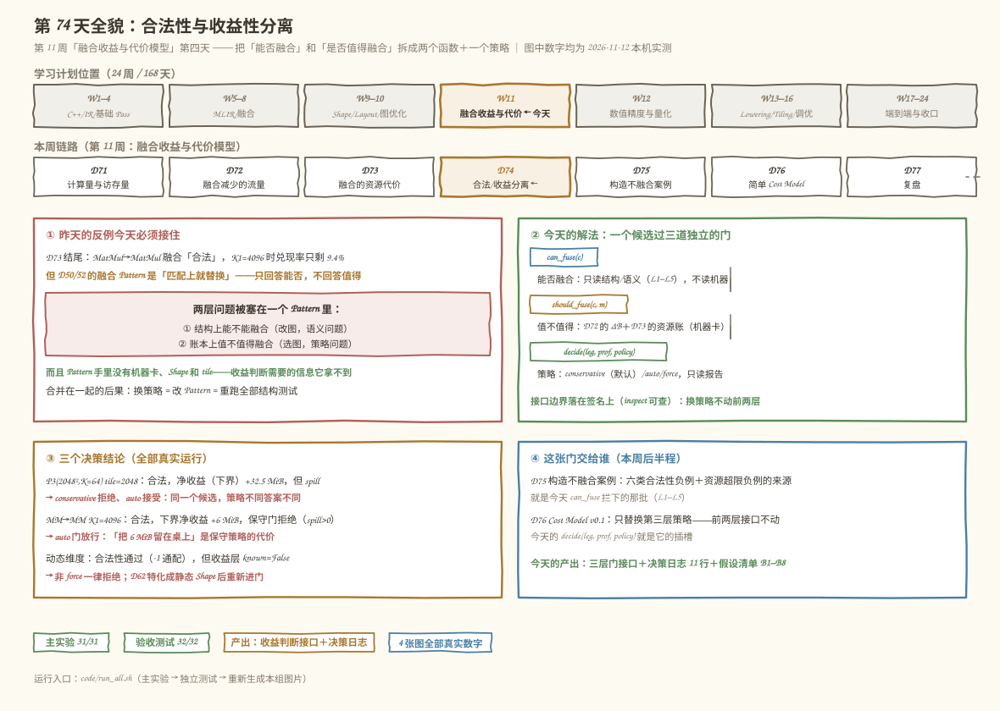
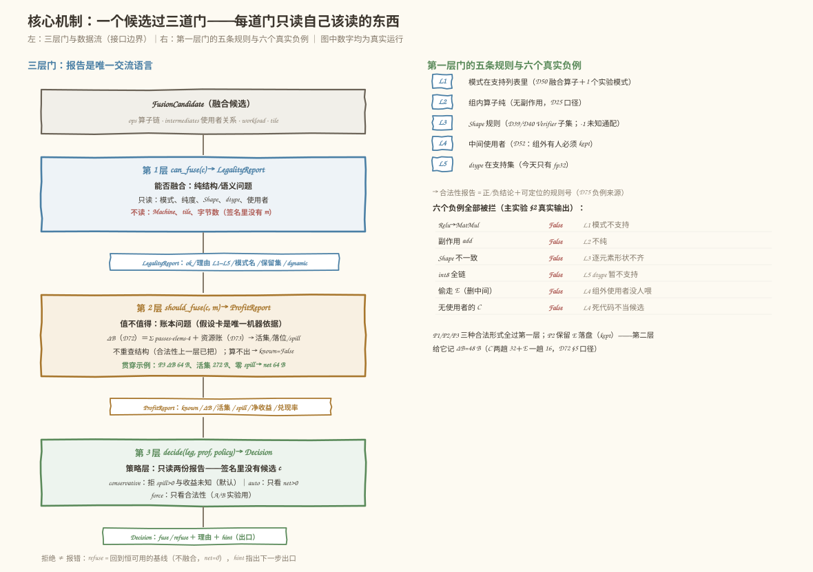
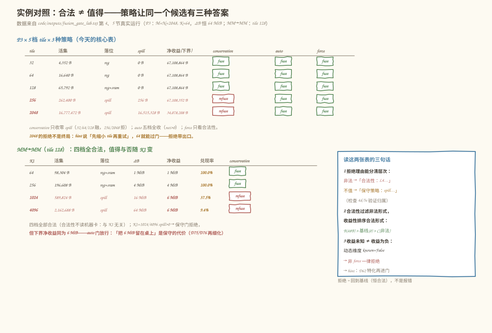

# 第 74 天：合法性与收益性分离——「能否融合」和「是否值得」不该住在同一个函数里

> **今日目标**：完成本教程后，你能把融合决策拆成**两个函数＋一个策略**：`can_fuse(c)` 只回答「结构上能不能融」（合法性 Pattern），`should_fuse(c, m)` 只回答「账本上值不值得」（收益性分析），`decide(leg, prof, policy)` 只读两份报告做最终决策（默认保守）。你会验证接口边界真的落在签名上（`can_fuse` 不吃机器卡、`decide` 不吃候选），并用一个 `M=N=2048, K=64` 的真实决策矩阵看见「合法 ≠ 值得」：同一个合法候选 P3，tile=2048 时净收益（下界）+32.5 MiB，conservative 门拒绝（spill 16,515,328 B > 0）、auto 门放行——**策略不同，答案不同，而前两层代码一行不改**。你还会拿到第二份产出：11 行决策日志，每行带理由归属（`合法性：`还是`保守策略：`）和下一步出口。
> **预计时间**：学习 35 分钟＋实践 45 分钟
> **前置准备**：三块旧地基：第 50/52 天的融合 Pattern（`mini.fused_add_relu` 等融合算子、多使用者 keep 规则），第 72 天的流量公式（`ΔB = Σ passes·elems·itemsize`，多使用者只省组内读），第 73 天的资源账（`Machine` 假设卡 64 KiB 寄存器堆 / 192 KiB SRAM、活集、三级容量阶梯）。工具：Python 3.10+（本机 3.11.4，aarch64 Linux；今天只用标准库，不需要 numpy/MLIR/NPU——机器参数是写明的玩具假设卡，可整体替换重算）。
> **今日产出**：一个**三层门**（`can_fuse` → `LegalityReport`；`should_fuse` → `ProfitReport`；`decide` → `Decision`）＋**决策日志**（11 行真实记录）＋假设清单 B1–B8。代码在 `code/fusion_gate_lab.py`（31 项检查）、`code/test_fusion_gate.py`（32 项独立验收），全部真实运行；另有 4 张手绘风示意图。

## 1. 今天解决什么问题？

昨天收工时留了一个反例：`MatMul→MatMul` 融合在 Pattern 上完全合法（第 50 天定义过模式、第 52 天管住了使用者），数值上也能算——但 `K1=4096` 时活集 2,162,688 B 顶爆片上 256 KiB，兑现率只剩 9.4%。

问题不在这一个例子，而在**我们的融合 Pass 从第一天起就把两类问题塞在了一个函数里**。回顾第 50/52 天的 RewritePattern：`Add + Relu → FusedAddRelu`，匹配上就替换。这个「匹配→替换」的动作里其实混着两个完全不同的问题：

```text
① 能否融合：改图会不会破坏语义？（结构问题——模式、纯度、Shape、dtype、使用者）
② 是否值得融合：改图会不会变慢？（账本问题——流量、活集、机器容量）
```

把两者混在一个 Pattern 里，代价昨天已经看到一半，今天看到另一半：

1. **Pattern 手里没有信息**：RewritePattern 匹配的是图结构，拿不到机器卡（`Machine`）、拿不到 tile、甚至拿不到完整的 workload——收益判断需要的输入它根本没有；
2. **换策略 = 改 Pattern = 重跑全部结构测试**：想在「保守」和「激进」之间切换，就得动匹配逻辑，第 52 天攒下的正反例全部重新验证；
3. **拒绝理由说不清**：一个候选被拒，是「非法」还是「不值」？混在一起时用户只能看到一个笼统的失败。

今天的解法把这个门拆成三道，每道门只读自己该读的东西：

```text
候选 → can_fuse（结构/语义，不读机器）→ LegalityReport
     → should_fuse（账本，读机器卡，不重查结构）→ ProfitReport
     → decide（策略，只读两份报告）→ Decision（fuse / refuse ＋ 理由 ＋ hint）
```

一个贯穿全文的具体例子（沿用第 71～73 天的贯穿链）：

```text
A(2,3) @ B(3,2) → +D(2,2) → relu      融合候选 P1/P2/P3（第 72 天的三种计划）
M=N=2048, K=64 的放大版                今天的主战场：tile 扫描 × 策略矩阵
MatMul(2048,64) → G(2048,K1) → MatMul  昨天的反例，今天进门当候选
```

预期结果先写在这里，后面全部真实跑出来核对：贯穿链上 P3 净收益 64 B、零 spill，conservative 门放行；放大版 tile=2048 净收益（下界）+32.5 MiB 仍被 conservative 拒绝；`MM→MM K1=4096` 合法、下界净收益 +6 MiB、conservative 拒绝而 auto 放行。**同一个候选，三种策略三种答案——这正是「分离」要买的东西。**

## 2. 先看全貌：今天的内容位于哪里？



**图 1**：今天的位置——本周（第 11 周）的中间站：前三天攒好了收益侧（D71 计算量/访存、D72 ΔB）和代价侧（D73 资源账），今天把它们组装成一个**接口明确的决策门**；后三天（D75 负例库、D76 Cost Model）只是往这个门的插槽里填东西。看图时注意盒①：昨天反例暴露的裂缝不是「公式错了」，是「两类问题住错了房间」；盒②：三道门各自的签名——今天的核心产出不是又一个新公式，而是**接口边界本身**。

用四个步骤概括今天的推理路线：

1. **拆问题**：把「匹配即替换」拆成 `can_fuse`（结构/语义）＋`should_fuse`（账本）＋`decide`（策略），写清每层读什么、不读什么；
2. **第一层**：用第 50/52 天的规则（模式、纯度、Shape、dtype、使用者）实现 `can_fuse`，产出带规则号 L1–L5 的合法性报告；
3. **第二层**：把 D72 的 ΔB 公式和 D73 的资源账装进 `should_fuse`，输入是机器卡，输出是账本（活集、落位、spill、净收益）；
4. **第三层**：`decide` 只读报告跑三种策略，默认 conservative——拒绝不是报错，是回到恒可用的基线。

## 3. 核心概念：先用直觉，再给准确定义

### 3.1 合法性 Pattern：只回答「改图会不会破坏语义」

一句通俗解释：**合法性是「这样做对不对」，与「这样做划算不划算」无关**。

类比：食品检验员和采购员。检验员只看「这批货能不能吃」（成分、保质期、标签合规），不管「这批货进货价贵不贵」；采购员拿着检验章去谈价格。让检验员顺便定价，两个职责都会乱：换供应商策略要动检验流程，谁都不敢再信检验章。对应到技术上是：`can_fuse` 只读候选的**结构信息**——算子链在不在支持模式里（L1）、组内算子是不是纯的（L2）、Shape/dtype 规则过不过（L3/L5）、中间 Tensor 的使用者规则满不满足（L4，D52 的口径）——**不读机器卡、不算字节数**，所以合法性判断与硬件无关。类比的边界：食品检验的规则基本不变，但合法性 Pattern 会随 Dialect 演进（比如 D82 以后量化 Cast 进组），所以报告里每条理由都带规则号 L1–L5，方便日后扩展时定位。

贯穿链上的实例：P1（`Add+Relu` 融合）、P2（`MatMul+Add` 融合、E 保留落盘喂 relu）、P3（三算子全融合）**全部合法**；而「删掉 E 的 P2 变体」非法——E 还有一个组外使用者（relu），删中间等于偷走别人的输入（L4）。注意这四种情形在 D72/D73 都出现过，今天它们进了**同一张合法性报告**。

### 3.2 收益性分析（Profitability）：只回答「账本上值不值得」

一句通俗解释：**收益性是「这样做划不划算」，输入除了候选还有一张机器假设卡**。

类比：还是那个采购员。他不管货能不能吃（检验员的事），只算账：省下的仓储费（ΔB）减掉新占的冷库费（spill），再乘上公司敢不敢赌（策略）。对应到技术上是：`should_fuse(c, m)` 的输入 = 候选的资源上下文（workload、tile、中间 Tensor 元素数）＋第 73 天的 `Machine` 假设卡；产出 = `ProfitReport`（ΔB、活集、落位、spill、净收益、兑现率）。它的**接口契约**是「不重查结构」——合法性由上一层把过关，这层只管算账；算不出来（动态维度）就如实写 `known=False`，**不编造保守猜测值**。类比的边界：真实芯片上「划算」还取决于编译时间、多核竞争、库调用损失（D73 的 A8），今天的账本只含 DRAM 流量与片上资源两项——它的误差来源写在假设清单里，D76 的 Cost Model 会继续往这个报告里加项。

贯穿链上的实例：P1/P2/P3 的 ΔB 分别是 32/32/64 B（与 D72 逐位一致），零 spill，净收益 = ΔB。

### 3.3 策略层：决策 = 合法性 ∧ 策略(收益)，默认保守

一句通俗解释：**策略是「公司敢不敢赌」——同一本账，不同风险偏好给出不同决定**。

类比：财务总监看同一份报表（ΔB +64 MiB、spill −32 MiB），激进派说「净赚 32 MiB，干」，保守派说「spill 成本是下界、真实更贵，且有更稳的 tile=64 方案，先不干」。对应到技术上是：`decide(leg, prof, policy)` 只读两份报告，`policy` 决定怎么用账本——**conservative**（默认）拒绝 `spill > 0` 或收益未知的候选；**auto** 只看净收益（下界）> 0；**force** 只看合法性（A/B 实验用，用来对照「老式匹配即替换的行为」）。类比的边界：策略不是拍脑袋——conservative 拒绝 spill 的理由是 D73 验证过的「spill 成本是下界、真实更贵」，且**拒绝 ≠ 报错**：refuse 的语义是回到恒可用的基线（不融合，净收益记 0），并带 hint 指出出口（缩小 tile / 修结构 / 特化动态维度）。

关键的一句话（今天最重要的等式）：

```text
决策 = 合法性 ∧ 策略(收益)      两个维度正交：非法的候选什么策略都救不了，
                                合法的候选答案随策略变
```

## 4. 图解核心机制



**图 2**：左半是**三层门的数据流**——候选从上往下过三道门，每道门吐一份报告，报告是层与层之间唯一的交流语言；注意三道门盒子里红字标注的「不读什么」（`can_fuse` 不读 Machine、`should_fuse` 不重查结构、`decide` 签名里没有候选 c）——接口边界不是文档约定，是**签名可查的事实**（主实验检查 1a/1b 用 `inspect` 验证）。右半是第一层门的五条规则（L1–L5）和六个真实负例的拦截结果。

按图中编号逐步讲解：

1. **候选进门**：`FusionCandidate` 只是个数据包——算子链、中间使用者关系、workload、tile；它不知道自己会被谁审；
2. **第一层审结构**：`can_fuse` 拿 L1–L5 五条规则过一遍，产出 `LegalityReport`（ok、理由、模式名、保留集、是否含动态维度）。六个负例——模式不支持、副作用算子、Shape 不一致、int8、偷中间、无使用者——**全部被拦**，理由都能定位到规则号；
3. **第二层算账**：`should_fuse` 假设合法性已过，用 D72 的 ΔB 公式加 D73 的资源账（活集 → 三级容量阶梯 → spill）算出 `ProfitReport`。贯穿示例 P3：ΔB 64 B、活集 272 B、零 spill、净收益 64 B；
4. **第三层做决策**：`decide` 只看两份报告。conservative 门对 tile=2048 的 P3 说不（spill > 0），auto 门说是（net > 0）——**前两层一行代码没改**。这是「分离」的直接证据：换策略的成本 = 重跑第三层的测试，结构测试原样复用。

## 5. 动手实践：完成一个最小可运行例子

### 5.1 准备文件

```text
tutorials/day-074/
├── README.md
├── images/                        ← 4 张手绘风示意图（由 make_images.py 生成）
└── code/
    ├── fusion_gate_lab.py         ← 主实验：三层门＋8 段演示（31 项检查）
    ├── test_fusion_gate.py        ← 独立验收测试（32 项检查）
    ├── make_images.py             ← 生成 4 张 SVG（数字取自真实运行）
    ├── run_all.sh                 ← 一键复跑：实验→测试→图片
    └── outputs/                   ← 真实运行输出（.txt）
```

运行环境：Python 3.10+（本机 3.11.4，aarch64 Linux）。只用标准库（`dataclasses`、`inspect`），无第三方依赖。

```bash
cd tutorials/day-074/code
bash run_all.sh          # 或分步：python3 fusion_gate_lab.py
```

### 5.2 编写代码

完整实现见 `code/fusion_gate_lab.py`（678 行）。这里给三道门的关键骨架和最值得看的几行。

**第一层：合法性 Pattern**（`fusion_gate_lab.py:169`）——只读结构/语义，五条规则：

```python
def can_fuse(c: FusionCandidate) -> LegalityReport:
    """能否融合：结构/语义问题，与机器无关、与收益无关。"""
    reasons: list[str] = []
    kinds = tuple(op.kind for op in c.ops)
    pattern_name = SUPPORTED_PATTERNS.get(kinds, "")

    if not pattern_name:                                    # L1 模式
        reasons.append(f"L1 算子链 {kinds} 不在支持的模式里")
    for op in c.ops:                                       # L2 纯度
        if not op.pure:
            reasons.append(f"L2 {op.kind} 有副作用，不能进融合组")
    for op in c.ops:                                       # L3/L5 Shape、dtype
        if op.dtype not in SUPPORTED_DTYPES:
            reasons.append(f"L5 dtype {op.dtype} 暂不支持")
        # ...MatMul 内维/输出形状、逐元素一致性检查（D39/D40 子集）
    for it in c.intermediates:                             # L4 使用者
        if it.out_group_users > 0 and not it.kept:
            reasons.append(f"L4 中间 {it.name} 有组外使用者且未保留落盘（D52）")
    # → LegalityReport(ok, reasons, pattern_name, kept_outputs, dynamic)
```

**第二层：收益性分析**（`fusion_gate_lab.py:244`）——D72 的 ΔB ＋ D73 的资源账：

```python
def should_fuse(c: FusionCandidate, m: Machine) -> ProfitReport:
    """是否值得融合：账本问题。输入 = 候选的资源上下文 + 机器假设卡。"""
    r = ProfitReport()
    M, K, N = c.workload if c.workload is not None else (None, None, None)
    if M is None or min(M, K, N) < 0 or any(it.elems < 0 for it in c.intermediates):
        r.known = False            # 动态维度：如实说「算不出」，不编数字
        return r
    r.delta_b = sum(_d72_passes(it) * it.elems * m.itemsize   # D72 多使用者规则
                   for it in c.intermediates)
    # ...活集 → 三级容量阶梯 → spill（D73 公式，按模式推导活集）
    r.net_gain = r.delta_b - r.spill_traffic
    return r
```

**第三层：策略**（`fusion_gate_lab.py:313`）——只读两份报告：

```python
def decide(leg: LegalityReport, prof: ProfitReport | None,
           policy: str = "conservative") -> Decision:
    """决策 = 合法性 ∧ 策略(收益)。报告是唯一输入——换策略不动前两层。"""
    if not leg.ok:
        return Decision("refuse", policy, ["合法性：" + r for r in leg.reasons],
                        "先修结构/语义，再谈收益")
    if policy == "force":
        return Decision("fuse", policy, ["合法性通过；force 只看合法性"])
    if prof is None or not prof.known:
        return Decision("refuse", policy, ["收益未知"], "D62：特化成静态 Shape 后重新进门")
    if policy == "conservative" and prof.spill_bytes > 0:
        return Decision("refuse", policy,
                        [f"保守策略：spill {prof.spill_bytes:,} B > 0"],
                        "先缩小 tile 再重试")
    # ...
```

三个值得盯住的细节：

- **接口边界写在签名上**：`can_fuse(c)` 一个参数、`should_fuse(c, m)` 两个、`decide(leg, prof, policy)` 三个——主实验用 `inspect.signature` 检查了 `can_fuse` 参数集不含机器、`decide` 参数集不含候选（检查 1a/1b）；
- **`_d72_passes`**：组外无使用者省 `(1 + 组内数)` 趟、组外有人只省组内读——第 72 天的多使用者规则**内建在收益公式里**，不用调用方操心；
- **`known=False`**：收益算不出是一种**独立的报告状态**，不是异常也不是 0——它和 `net_gain=0` 在第三层得到完全不同的拒绝理由（见第 6 节错误三）。

### 5.3 运行与观察

以下输出为 **2026-11-12 在本机的真实运行结果**（Python 3.11.4，aarch64 Linux；`bash run_all.sh` 逐段生成，完整输出在 `code/outputs/`）：

```text
$ python3 fusion_gate_lab.py
== 1. 接口卡：两个函数 + 一个策略（今天的核心产出）==
  can_fuse(c: 'FusionCandidate') -> 'LegalityReport'   → LegalityReport（结构/语义）
  should_fuse(c: 'FusionCandidate', m: 'Machine') -> 'ProfitReport'  → ProfitReport（账本）
  decide(leg: 'LegalityReport', prof: 'ProfitReport | None', policy: 'str' = 'conservative') -> 'Decision'
== 2. 合法性 Pattern：贯穿链的合法形式与四个负例 ==
  P1 FusedAddReLU        → True（mini.fused_add_relu，保留 []）
  P2 FusedMatMulBias     → True（mini.fused_matmul_bias，保留 ['E']）
  P3 全融合                 → True（mini.fused_matmul_bias_relu，保留 []）
  负例：偷走 E                → False（L4 中间 E 有 1 个组外使用者且未保留落盘）
== 3. 收益判断：贯穿示例的候选账本（基线恒 0）==
  候选                ΔB      活集(reg)  落位    spill  净收益  保守门
  P1 FusedAddReLU       32 B     768 B     reg     0 B     32 B  fuse
  P2 FusedMatMulBias    32 B     272 B     reg     0 B     32 B  fuse
  P3 全融合                64 B     272 B     reg     0 B     64 B  fuse
== 结果：31/31 项检查通过 ==
```



**图 3**：两张真实决策表——上表是 `P3(2048², K=64)` 的 5 档 tile × 3 种策略：前 3 档零 spill 三策略全放行；tile=256 溢 256 B、tile=2048 溢 15.75 MiB，conservative 拒绝而 auto/force 放行。下表是 `MM→MM` 的 K1 扫描：**四档全部合法**（合法性层不读机器卡，结论与 K1 无关），但值得与否随 K1 变——K1=1024/4096 兑现率 37.5%/9.4%，保守门拒绝；下界净收益同为 6 MiB，auto 门放行。右下三句话卡是读表的钥匙：拒绝理由能分清层次、合法性过滤而收益性排序、收益未知 ≠ 收益为负。

注意两个「对照」：贯穿示例上 P3 净收益 64 B 是 **D72 的 ΔB 列原样兑现**（资源不设限，D73 的结论）；放大版上同一个 P3 的 tile=2048 净收益只剩 34,078,208 B（50.8% 兑现，**D73 的结论**）——今天只是把它们**过了一次门**。这说明第二层没有发明新公式，只是把前两天已验证的账本装配成了接口。

### 5.4 修改一个参数再观察：策略和 tile 各拧一格

**对照实验一（拧策略）**：同一候选、同一本账，只改 `policy`：

```text
P3(2048²,K=64) tile=2048：活集 16,777,472 B，spill 16,515,328 B，净收益 34,078,208 B
  conservative → refuse（保守策略：spill > 0｜hint：先缩小 tile 再重试）
  auto         → fuse  （净收益（下界）> 0）
  force        → fuse  （只看合法性）
```

**对照实验二（拧 tile）**：策略不动（conservative），把 tile 从 2048 缩到 64：活集 16,640 B、零 spill、净收益 67,108,864 B（64 MiB 全额兑现）→ fuse。**拒绝从来不是终局**：hint 说的「先缩小 tile 再重试」在下一轮扫描里就兑现了——决策日志里 tile=32/64/128 三行都是 fuse。

```text
$ python3 test_fusion_gate.py
== D. 策略：conservative / auto / force 与理由归属 ==
[PASS] D3 同一候选 auto 放行（net 34,078,208 B > 0）——策略只换第三层
[PASS] D5 force 也不能越过合法性：负例（偷中间）在 force 下仍拒绝
[PASS] D6 「合法 ≠ 值得」：K1=4096 合法且下界净收益 +6 MiB，但保守门拒绝
== 结果：32/32 项检查通过 ==
```

顺带一个真实的小验证（本机运行，对应第 6 节错误一）：今天的 `force` 模式等价于「老式匹配即替换」的行为——`K1=4096` 的候选在 force 下**直接 fuse**。也就是说：如果第 50 天的 Pattern 保留到现在，昨天那个 9.4% 兑现率的反例会被无条件融进去；今天拆出三层之后，它被 conservative 拦在门外，而拦截它的那行代码**不在 Pattern 里**。

## 6. 常见错误与排查

以下是实现「合法性与收益性分离」时最容易踩的四个坑。前两个用今天的代码做了真实对照实验（输出为本机实际运行），后两个是接口设计层面的坑，都有可机检的依据。

**错误一：把策略留在 Pattern 里（「匹配即替换」的老路）**

- 现象：融合 Pass 对 `MM→MM K1=4096`（合法但兑现率 9.4%）无条件替换——本机验证：`decide(can_fuse(c), None, "force").action == "fuse"`，force 模式完整复现了老行为；
- 原因：RewritePattern 只回答「能否」就动手改图，收益信息它拿不到（没有机器卡、没有 tile）；
- 定位：跑今天的决策矩阵，同一候选在不同策略下动作不同（主实验 §4/§5），而 Pattern 没有这个自由度；
- 修复：Pattern 只做匹配与结构合法性（今天的 `can_fuse`），替换与否交给 `decide`。教训：**改图的权限必须和「值不值得」的判断分离，否则策略永远没有插拔的地方**。

**错误二：第二层顺手重查结构（接口边界塌回去）**

- 现象：`should_fuse` 里又写了一遍「中间有没有组外使用者」的检查——两份规则各自演化，某天 L4 改了口径，收益层忘了同步；
- 原因：写账本时「顺手」多校验一下很顺手，但结构判断从此有了**两个真相来源**；
- 定位：审查 `should_fuse` 的分支——凡是读 `intermediates` 的使用者关系来做**合法性**判断（而不是算 ΔB 趟数）的代码都是越界；
- 修复：契约写死「`should_fuse` 不重查结构」，用签名和测试钉住（验收检查 A1/A2：`can_fuse` 不吃 Machine、`should_fuse` 不产出合法性结论）。教训：**接口边界要能被机器检查**，只写在注释里的一定会塌。

**错误三：把「收益未知」当成「收益为 0」或异常**

- 现象：本机对照实验——把动态维度的候选伪造成 `net_gain=0` 的账本，conservative 门给出「净收益 0 B ≤ 0（基线是 0）」：**理由错误地归到账本，而真相是算不出账**；正确写法 `known=False` 得到「收益未知：动态维度算不出活集与 ΔB｜D62：特化成静态 Shape 后重新进门」；
- 原因：`ProfitReport` 没有「未知」状态时，只能编一个数字（误导）或抛异常（打断整条流水线）；
- 定位：看动态维度的候选在三种策略下的行为——`known=False` 时 conservative/auto 都拒绝、force 放行（主实验 §7，检查 7a–7d）；
- 修复：给报告加 `known` 字段，拒绝理由区分「收益未知 ≠ 收益为负」，hint 给出出口（D62 特化）。教训：**「不知道」是一种合法的报告状态**——编造数字比承认无知更贵。

**错误四：第三层直接读候选（`decide(c, m, policy)`）**

- 现象：`decide` 想看 tile，就把候选整个传进来——策略层从此依赖前两层的全部数据结构，D76 换 Cost Model 时要连候选定义一起改；
- 原因：偷懒省了一次「把需要的信息装进报告」的显式设计；
- 定位：看签名——`decide` 的参数集里出现 `c`/`candidate` 就越界（验收检查 A3/1b 专门断言这一点）；
- 修复：`decide` 只吃两份报告。今天 `decide(ok_leg, zero_report)` 这种**手造报告**的调用能跑通（验收检查 D9），证明第三层独立可测——这正是 D76 只换第三层的前提。教训：**可替换性是被接口逼出来的，不是被文档许诺出来的**。

## 7. 今日练习

### 必做练习：给策略层加一个 `paranoid` 模式，先预测再验证

今天的 `decide` 只认三种策略。请加第四种 `paranoid`：**只有当净收益 > ΔB 的 25%（兑现率 > 25%）且零 spill 时才融合**。先笔算三处预测，再写代码验证：

1. `P3(2048², K=64) tile=128`：零 spill、兑现率 100% → paranoid 融还是拒？
2. `MM→MM K1=1024`（tile 128）：兑现率 37.5%、spill 327,680 B → 三种旧策略加 paranoid 各是什么答案？
3. 贯穿示例 P3（64 B 全额兑现）：四种策略答案有没有分歧？

预期产出：三处笔算 ＋ `decide` 的新分支 ＋ 一段「paranoid 拒绝时的 hint 该写什么」的简短说明。**自检锚点**：paranoid 分支应该只出现在 `decide` 里——如果你发现自己在改 `should_fuse` 的公式，说明门又塌了（兑现率 `redeem_rate` 已经在 `ProfitReport` 里，直接读报告即可）。

### 选做挑战：把六类负例变成 D75 的负例库

今天的 `can_fuse` 拦下了六类负例（模式、纯度、Shape、dtype、偷中间、无使用者）。把它们整理成 `negatives/` 目录：每类一个最小 `FusionCandidate` 构造脚本＋一份「为什么非法」的一行解释，并**补两类今天没覆盖的**：例如「组内循环依赖」和「中间 Shape 与两端不匹配的 Reshape 链」。预期产出：8 个负例脚本＋一张汇总表（名称 / 规则号 / 理由）。这直接是明天（D75）「构造不融合案例」的素材库——明天还要往里加**合法但负收益**的第四类。

## 8. 今日验收

- [ ] 我能用自己的话解释「合法性」和「收益性」为什么是两个正交的维度，并说出 `can_fuse` 不吃机器卡、`decide` 不吃候选这两个**签名可查**的边界
- [ ] 我能独立运行 `fusion_gate_lab.py` 和 `test_fusion_gate.py`，复现 31/31 与 32/32 通过（`bash run_all.sh` 一键复跑，输出在 `code/outputs/`）
- [ ] 我能解释 tile=2048 的 P3 为什么 conservative 拒绝而 auto 放行（spill 16,515,328 B > 0 vs 净收益 34,078,208 B > 0），并说出「拒绝 = 回到基线，不是报错」
- [ ] 我能修改 `decide` 加一个 `paranoid` 策略并预测它对 tile=128 / K1=1024 的判决（必做练习），全程不动 `can_fuse`/`should_fuse`
- [ ] 我能定位「拒绝理由归属错误」这类问题：非法候选的理由以「合法性：」开头，spill 拒绝以「保守策略：」开头（验收检查 D8 的断言方式）
- [ ] 我保存了三层门接口（`fusion_gate_lab.py`）、决策日志 11 行（`code/outputs/fusion_gate_lab.txt` 第 8 节）和假设清单 B1–B8

## 9. 一句话总结与明天预告

今天把「匹配即替换」的老 Pattern 拆成了三道门。**机制**上：候选先过 `can_fuse`（只读结构/语义，L1–L5，产出带规则号的合法性报告），合法的再让 `should_fuse` 算账（D72 的 ΔB ＋ D73 的资源账，机器卡是唯一硬件依据，算不出就 `known=False`），最后 `decide` 只读两份报告按策略判决——决策 = 合法性 ∧ 策略(收益)，两个维度正交。**实践**上：贯穿链 P1/P2/P3 三种合法形式全部拿到账本（ΔB 32/32/64 B 与 D72 逐位一致），六类负例全部被拦且理由可定位到规则号；放大版看到分离的红利——`P3 tile=2048` 同一本账在三种策略下三种答案（conservative 拒 / auto 融 / force 融），`MM→MM K1=4096` 合法且下界净收益 +6 MiB 却被保守门拦下：**「合法 ≠ 值得」第一次有了机检的归属**。**验证**上：主实验 31/31、独立验收 32/32 全部真实运行；接口边界用 `inspect` 断言，第三层可以拿手造报告独立测试（D9），11 行决策日志构成第二份产出。

明天（第 75 天）把这些门的拒绝记录变成**案例库**：今天 `can_fuse` 拦下的六类结构负例、`should_fuse` 算出的资源超限与多使用者负收益，都要落成「图结构合法但应拒绝融合」的带理由案例——决策日志里那 11 行，就是明天的原料清单。
