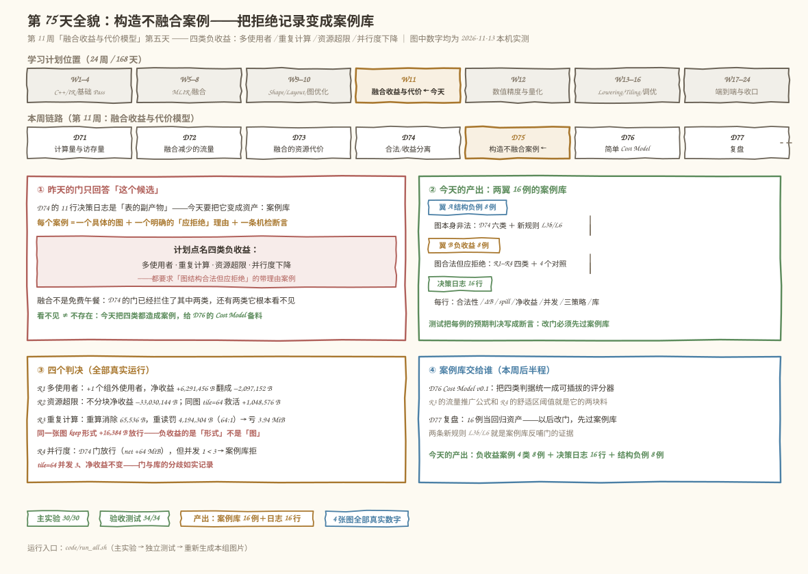
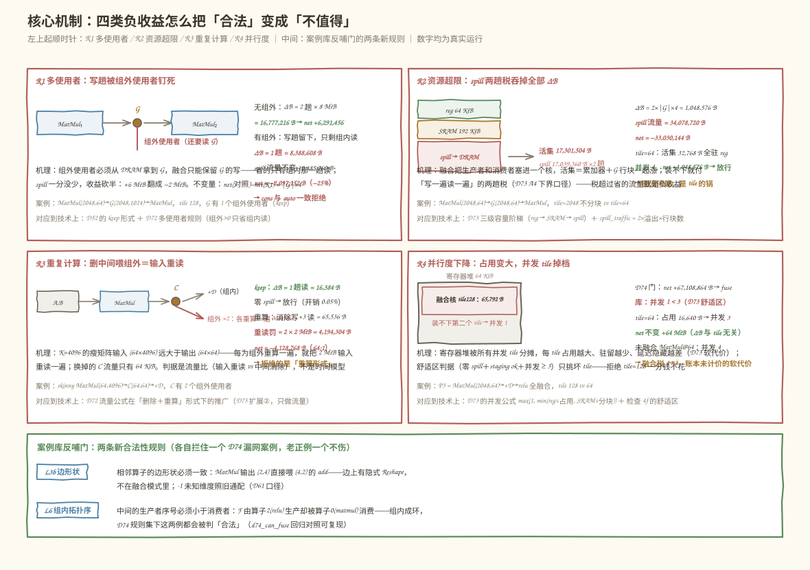
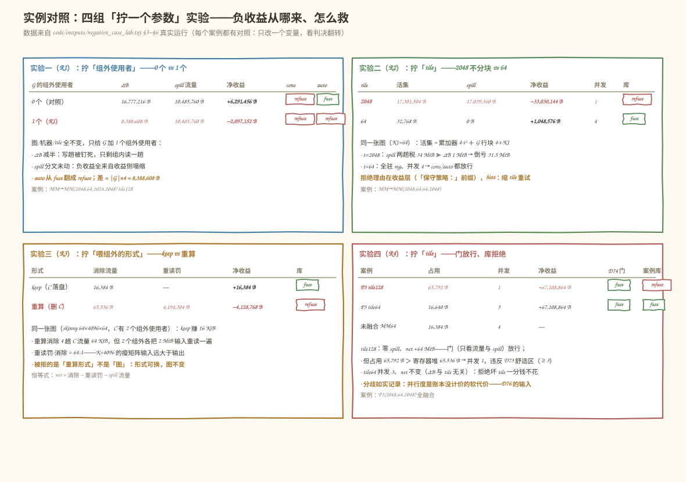
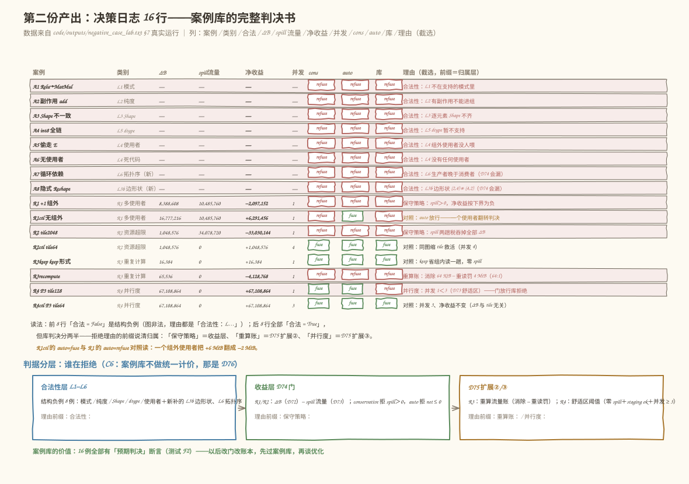

# 第 75 天：构造不融合案例——「图合法」和「应该融」之间，隔着四本账

> **今日目标**：完成本教程后，你能把第 74 天那道三层门拦下的东西变成一座**案例库**：每个案例 = 一个具体的图 ＋ 一个明确的「应拒绝」理由 ＋ 一条可机检的断言。你会亲手构造计划点名的**四类负收益**案例——**R1 多使用者**（给 G 加 1 个组外使用者，净收益从 +6,291,456 B 翻成 −2,097,152 B）、**R2 资源超限**（tile=2048 不分块，spill 两趟税 34 MiB 吞掉 ΔB 1 MiB，倒亏 33,030,144 B）、**R3 重复计算**（删中间靠重算喂组外，消除 64 KiB 却重读输入 4 MiB，64:1 必亏）、**R4 并行度下降**（D74 门放行 net +64 MiB 的候选，案例库按舒适区并发 1 < 3 拒绝）——并且用**四组只拧一个参数的对照**证明：拒绝的理由各不相同，救法也各不相同。你还会看到案例库**反哺门**：两条新合法性规则 L3b（边形状）、L6（组内拓扑序）各自拦住一个 D74 规则集会漏过的案例。第二份产出：**16 行决策日志**——每个案例的合法性、ΔB、spill、净收益、并发、三策略动作与归属理由，全部真实运行。
> **预计时间**：学习 35 分钟＋实践 45 分钟
> **前置准备**：四块旧地基：第 50/52 天的融合 Pattern 与使用者规则（keep 形式）、第 71 天的流量公式（MatMul 读 `(M·K+K·N)·itemsize`）、第 72 天的 ΔB 与多使用者规则（组外 > 0 只省组内读）、第 73/74 天的资源账与三层门（活集三级阶梯、spill 两趟税、conservative/auto/force）。工具：Python 3.10+（本机 3.11.4，aarch64 Linux；只用标准库 `dataclasses`/`inspect`，不需要 numpy/MLIR/NPU——机器参数是写明的玩具假设卡，可整体替换重算）。
> **今日产出**：`code/negative_case_lab.py`（两翼 16 例案例库＋30 项检查）、`code/test_negative_cases.py`（34 项独立验收，把每例的预期判决写成断言）、16 行决策日志（`code/outputs/negative_case_lab.txt` §7）、D75 三条扩展（L3b/L6、重算流量账、舒适区判据）＋假设清单 C1–C8，另有 4 张手绘风示意图。

## 1. 今天解决什么问题？

昨天收工时留了一句话：决策日志里那 11 行，是今天的原料清单。但原料不等于资产——**一行「refuse」如果没有可复现的图、可定位的理由、可机检的断言，它就只是一张表的副产物**：下个月有人改了门，没有任何东西能告诉你那个「refuse」还站不站得住。

更根本的问题是：我们的门到昨天为止只被两类候选考验过——**结构非法的**（can_fuse 拦）和**账面亏损的**（should_fuse 算出 spill 或负 net）。但计划里点名了四类负收益，其中两类门根本看不见：

```text
R1 多使用者：组外使用者把中间的写趟钉死 → ΔB 塌缩   ← 门能算（D72 规则内建）
R2 资源超限：活集顶爆片上容量 → spill 两趟税        ← 门能拦（D73 阶梯内建）
R3 重复计算：删中间靠重算喂组外 → 输入重读罚          ← 门看不见（没有这个账）
R4 并行度下降：每实例占用变大 → 并发 tile 掉档        ← 门看不见（软代价未计价）
```

今天的任务是把四类都造成「**图结构合法，但应拒绝融合**」的案例。注意这个词的分量：图是对的、模式是支持的、数值上也能算——拒绝的理由不在图里，在图外面的账本里。贯穿全文的具体例子还是那条熟悉的链的放大版（第 71～74 天连续使用）：

```text
MatMul(2048,64) → G(2048,K1) → MatMul(K1,2048)   R1/R2 的图（K1、tile、使用者数可拧）
MatMul(64,4096) → C(64,64) → +D                   R3 的图（瘦矩阵，C 有组外使用者）
MatMul(2048,64) → +D → relu（P3 全融合）           R4 的图（tile 可拧）
```

预期结果先写在这里，后面全部真实跑出来核对：R1 加一个组外使用者，auto 的判决从 fuse 翻成 refuse（+6 MiB → −2 MiB）；R2 同一张图 tile 从 2048 缩到 64，从 −31.5 MiB 救活成 +1 MiB；R3 同一张图 keep 形式赚 16 KiB、重算形式亏 3.94 MiB；R4 tile 从 128 缩到 64，并发从 1 回到 3、净收益一分不少。

## 2. 先看全貌：今天的内容位于哪里？



**图 1**：今天的位置——第 11 周的倒数第三天。看图时注意盒①：昨天的问题是门只回答「这个候选」，今天要回答「这一类候选」；盒②：产出是两翼 16 例——翼 A 收结构负例（图非法），翼 B 收负收益案例（图合法但应拒绝），每个 refuse 都配一个只拧一个参数的对照；盒③：四个判决就是四类负收益的实弹；盒④：案例库的下游是 D76 的 Cost Model——今天的判据是「阈值与流量账」，统一计价是明天的事。

用四个步骤概括今天的路线：

1. **建翼 A**：把 D74 的六类结构负例落成可复现的构造脚本，再补两条新规则——发现 D74 规则集有两个洞（隐式 Reshape、组内循环依赖），案例库反哺门；
2. **造 R1**：给 MM→MM 的 G 加一个组外使用者，看 ΔB 怎么塌缩、判决怎么翻转；
3. **造 R2/R3**：一个拧 tile 看 spill 两趟税，一个拧「喂组外的形式」看重读罚——同一张图、不同负收益、不同救法；
4. **造 R4 并收口**：看 D74 门放行但案例库拒绝的分歧，把 16 例落成决策日志和测试。

## 3. 核心概念：先用直觉，再给准确定义

### 3.1 负收益：融合什么时候会「合法但亏钱」

一句通俗解释：**负收益（negative gain）是「改图没错，但改完更慢」——合法性和账本是两个正交的维度（D74 的结论），今天给「账本亏钱」造出四类标本**。

类比：搬家合并两条通勤路线。路线方案本身完全可行（合法性），但合并后可能：顺路捎的人多了反而绕远（多使用者）、新路线要绕的桥太堵（资源超限）、为了捎人每天多跑一趟货（重复计算）、合并后一次只能拉一组乘客（并行度下降）。对应到技术上是：R1——中间 G 有组外使用者时，融合**不能**消除 G 的写（组外还得从 DRAM 读它），省的只有组内那一趟读，ΔB 塌缩；R2——融合让累加器和 G 行块一起驻留，活集超过 256 KiB 就付「写一遍读一遍」的两趟税；R3——删掉中间靠重算喂组外，每喂一个就把生产者输入重读一遍；R4——每实例占用变大，寄存器堆装得下的并发 tile 数变少。类比的边界：通勤的「绕远」可以直接计时比较，而我们的账本**只给流量和资源计价**（D72 的 ΔB、D73 的 spill），R3 的重读罚今天是流量账的推广、R4 的并行度干脆没有计价——只有 D73 留下的舒适区阈值。**不编数字，是今天的纪律**。

贯穿例子上的四本账（全部真实运行，见第 5 节）：

```text
R1  MM→MM(2048,64,1024,2048) tile128  无组外 ΔB 16,777,216 B、net +6,291,456 B（auto 融）
                                     +1 组外 ΔB  8,388,608 B、net −2,097,152 B（全拒）
R2  MM→MM(2048,64,64,2048)     tile2048 活集 17,301,504 B、net −33,030,144 B（全拒）
                                     tile64   活集    32,768 B、net +1,048,576 B（融，并发 4）
R3  skinny(64,4096,64) C 有 2 组外    keep：ΔB 16,384 B → 融；重算：net −4,128,768 B → 拒
R4  P3(2048,64,2048)           tile128 并发 1（门融/库拒）；tile64 并发 3、net 不变 64 MiB
```

### 3.2 案例库：把「拒绝」从一次性行为变成可复验的资产

一句通俗解释：**案例库（case library）是负例的台账——每个条目记着「怎么构造、为什么该拒、怎么自动验证」，改门之前先过账**。

类比：航空业的事故案例库。每一起事故都有「如何复现的航路＋直接原因＋整改措施」，新机型设计要先对照旧案例逐条检查——不是为了惩罚谁，是为了让同类错误**不可能再静悄悄地发生**。对应到技术上是：`CaseEntry` 记四个字段——`build`（一个零参函数，能重新构造出候选图）、`cat`（类别标签，如 R1 多使用者）、`why`（一行「为什么应拒绝」的人话）、`kind` + 预期判决（走 D74 门 / 走重算账 / 走舒适区判据，以及 gate 和库各自该输出什么）；`run_case` 把候选过门、记录一行决策日志；测试再拿 `expect` 逐条断言。类比的边界：事故库是**事后**归档，案例库是**事前**资产——今天的 16 例里有 8 例是「图合法但应拒绝」，它们不是已经发生的事故，而是**提前造出来的事故**，专门用来考验门和明天的 Cost Model。

### 3.3 判据分层：谁在拒绝，理由归谁

一句通俗解释：**今天的 16 个拒绝来自三层不同的判据，理由的前缀就是归属——分不清归属的拒绝等于没有理由**。

类比：病历上写「不手术」不够，得写清「不需要手术（观察即可）」还是「不能手术（心肺功能不耐受）」还是「不建议手术（有更便宜的疗法）」。对应到技术上是今天最重要的接口约定（检查 7b 用前缀机检）：

```text
「合法性：L…」   图非法（翼 A）：模式 / 纯度 / Shape / dtype / 使用者 / 边形状 / 拓扑序
「保守策略：…」  收益层（R1/R2）：D74 的门原样判——spill>0 拒（conservative）、net≤0 拒
「重算账：…」    D75 扩展②（R3）：流量公式在「删除＋重算」形式下的推广
「并行度：…」    D75 扩展③（R4）：D73 舒适区阈值——零 spill＋staging ok＋并发 ≥ 3
```

类比的边界：分层不是装饰——R4 的案例里 **D74 门说 fuse、案例库说 refuse**，这个分歧被如实记录而不是抹平，因为账本没给并行度计价，硬塞一个数字进去就是伪造。**把四类判据统一成可插拔的评分器，是明天（D76）Cost Model 的工作**；今天只保证每一层自己的理由干净、可机检。

## 4. 图解核心机制



**图 2**：四个象限各画一类负收益的机理——每格左边是数据通路小图、右边是真实账本，下方两行是机理与「对应到技术上」。底部横条是案例库反哺门的两条新规则。看图时先找每格的**红色数字**：那是该类负收益的「亏损点」。

按图中区域逐步讲解：

1. **R1（左上）**：G 除了喂组内的 MatMul₂，还有一个组外使用者。融合保留了 G 的写（组外要读），省的只有组内那一趟读——ΔB 从 2 趟变 1 趟（16 → 8 MiB），而 spill 分文未动（活集不看使用者数）。亏损点：`net = ΔB − spill 流量`，分子砍半、分母不变，+6 MiB 翻成 −2 MiB。**不变量：net(对照) − net(R1) = |G|×4**（被钉回来的正是写趟）；
2. **R2（右上）**：三级容量阶梯画出「装不下」的后果——活集 17,301,504 B 里只有 262,144 B 能驻片上，其余 17,039,360 B 每个行块都要「写一遍读一遍」（×16 个行块 = 34 MiB 流量税）。ΔB 只有 1 MiB，税超收益 33 倍。救法在右下角：tile=64 时活集 32,768 B 全驻寄存器、并发 4——**图没问题，是 tile 的锅**；
3. **R3（左下）**：K=4096 的瘦矩阵，输入 (64×4096)×4 B ×2 = 2 MiB，输出 C 只有 16 KiB。删掉 C 确实消除全部 C 流量（写+3 读 = 64 KiB），但两个组外使用者各要重算一遍 MatMul，各重读 2 MiB 输入——**重读罚：消除 = 64:1**。注意同一张图的 keep 形式赚 16 KiB：被拒的是「形式」，不是「图」；
4. **R4（右下）**：寄存器堆 64 KiB 被一个 65,792 B 的融合核占满，第二个 tile 装不下——并发 1，延迟隐藏变差。D74 门只看流量与 spill（都很好），放行；案例库用 D73 的舒适区阈值拒绝，救法零成本：tile=64 → 并发 3、净收益不变（**ΔB 与 tile 无关**，因为消除的是中间而不是输入分块）；
5. **底部横条**：案例库造着造着发现了 D74 门的两个洞——MatMul 输出 (2,4) 直接喂 (4,2) 的 add（边上有隐式 Reshape，逐算子检查全过、边上没查）；F 由算子 2(relu) 生产却被算子 0(matmul) 消费（组内成环，D74 只查使用者数不查方向）。两条新规则 **L3b、L6** 各补一个洞，且老正例一个不伤（检查 2d）。

## 5. 动手实践：完成一个最小可运行例子

### 5.1 准备文件

```text
tutorials/day-075/
├── README.md
├── images/                        ← 4 张手绘风示意图（由 make_images.py 生成）
└── code/
    ├── negative_case_lab.py       ← 主实验：两翼 16 例案例库＋判决日志（30 项检查）
    ├── test_negative_cases.py     ← 独立验收：把每例预期判决写成断言（34 项检查）
    ├── make_images.py             ← 生成 4 张 SVG（数字取自真实运行）
    ├── run_all.sh                 ← 一键复跑：实验→测试→图片
    └── outputs/                   ← 真实运行输出（.txt）
```

运行环境：Python 3.10+（本机 3.11.4，aarch64 Linux）。只用标准库（`dataclasses`、`inspect`），无第三方依赖。

```bash
cd tutorials/day-075/code
bash run_all.sh          # 或分步：python3 negative_case_lab.py
```

### 5.2 编写代码

完整实现见 `code/negative_case_lab.py`（约 870 行）。三道门与 D74 逐字同构（`can_fuse`/`should_fuse`/`decide` 签名没动，检查 1a 用 `inspect` 断言），今天新增的三块如下。

**扩展①：can_fuse 补两条规则**（`negative_case_lab.py:203` 与 `:218`）——结构层补漏：

```python
if l3b:                                                 # L3b（D75 新增）
    for i in range(len(c.ops) - 1):
        edge_from = c.ops[i].out_shape                 # 链上边 = 下一算子的第一个输入
        edge_to = c.ops[i + 1].in_shapes[0]
        if not _dims_compatible(edge_from, edge_to):
            reasons.append(f"L3b 边形状不匹配：算子{i} 输出 {edge_from} != "
                           f"算子{i+1} 输入 {edge_to}（隐式 Reshape 不在融合模式里）")
if l6:                                                  # L6（D75 新增）
    for it in c.intermediates:
        if it.producer is not None and it.consumers:
            bad = [k for k in it.consumers if it.producer >= k]
            if bad:
                reasons.append(f"L6 组内循环依赖：中间 {it.name} 由算子"
                               f"{it.producer} 生产、却被算子{bad} 消费")
```

两个值得盯住的细节：L3b 用的是 `_dims_compatible`（-1 未知维度照旧通配，D61 口径——测试 A5 专门断言动态维度的边不误伤）；`Intermediate` 加了可选字段 `producer/consumers`（不填就跳过 L6），所以 D74 时代的老候选全部原样通过。

**扩展②：重算形式的流量账**（`negative_case_lab.py:336`）——D72 公式的推广：

```python
def price_recompute(c: FusionCandidate, m: Machine) -> ProfitReport:
    """「删除＋重算」形式：中间彻底不落盘，代价是每个组外使用者
    都要把生产者（算子 0）的输入重读一遍。只做流量账（C3），不做时间模型。"""
    r.recompute_elim = sum((1 + it.in_group_users + it.out_group_users)
                           * it.elems * m.itemsize for it in c.intermediates)
    producer_in_elems = 0                       # 生产者输入：每个输入矩阵的元素和
    for dims in c.ops[0].in_shapes:
        e = 1
        for d in dims:
            e *= max(d, 0)
        producer_in_elems += e
    r.recompute_penalty = sum(it.out_group_users for it in c.intermediates) \
        * producer_in_elems * m.itemsize
    _resource_side(c, m, r)                     # 资源账与 keep 共用：核结构一样
    r.net_gain = r.recompute_elim - r.recompute_penalty - r.spill_traffic
```

注意 `net_gain` 的三项：**消除 − 重读罚 − spill 流量**（测试 D5 断言这个恒等式）；忘了后两项就是第 6 节的错误四。

**扩展③与案例库的分层判决**（`negative_case_lab.py:417` 的 `comfort_ok` 与 `:592` 的 `run_case`）：

```python
def comfort_ok(prof: ProfitReport) -> bool:
    """D73 检查 4f 的舒适区：零 spill ＋ staging ok ＋ 并发 ≥ 3。"""
    return prof.spill_bytes == 0 and prof.staging_ok and prof.concurrent_tiles >= 3

# run_case 里的判决分层（理由前缀 = 归属，检查 7b 机检）：
if not leg.ok:        lib_reason = "合法性：" + leg.reasons[0]
elif e.kind == "recompute": lib_reason = f"重算账：净收益 {net} B ≤ 0（消除 …− 重读罚 …）"
elif dec_cons.action == "refuse": lib_reason = dec_cons.reasons[0]        # 「保守策略：」
elif e.kind == "comfort" and not comfort_ok(prof): lib_reason = "并行度：并发 1 < 3 …"
```

判决顺序有讲究：**recompute 在 cons 之前**（重算案例要拿自己的账本说话）、**comfort 在 cons 放行之后**（R4 的门本来会融，分歧如实记录而不是抹平）。

### 5.3 运行与观察

以下输出为 **2026-11-13 在本机的真实运行结果**（Python 3.11.4，aarch64 Linux；`bash run_all.sh` 逐段生成，完整输出在 `code/outputs/`）：

```text
$ python3 negative_case_lab.py
== 2. 翼 A：结构负例 8 例（D74 六类 ＋ D75 新规则两类）==
  A1 模式不支持            False    L1 算子链 ('relu', 'matmul') 不在支持的模式里…
  A5 偷走中间             False    L4 中间 E 有 1 个组外使用者且未保留落盘（D52…）
  A7 组内循环依赖           False    L6 组内循环依赖：中间 F 由算子2 生产、却被算子[0] 消费…
  A8 边形状不匹配           False    L3b 边形状不匹配：算子0(matmul) 输出 (2, 4) != 算子1(add) 输入 (4, 2)…
  —— 两个新负例在 D74 规则集下会漏过（d74_can_fuse 回归对照）——
  A7 组内循环依赖           D74 门 → True（漏网）  D75 门 → False（拦下）
  A8 边形状不匹配           D74 门 → True（漏网）  D75 门 → False（拦下）
== 3. 翼 B-1 多使用者：R1 —— 一个组外使用者把 +6 MiB 翻成 −2 MiB ==
  R1 MM→MM K1=1024 +1 组外          8 MiB     10 MiB -2,097,152 B    1  refuse  refuse
  R1ctl MM→MM K1=1024            16 MiB     10 MiB  6,291,456 B    1  refuse  fuse
== 4. 翼 B-2 资源超限：R2 —— 不分块的活集顶爆 256 KiB ==
  R2 MM→MM K1=64 tile2048        17,301,504 B 17,039,360 B -33,030,144 B    1  refuse  refuse
  R2ctl MM→MM K1=64 tile64           32,768 B          0 B   1,048,576 B    4  fuse    fuse
== 5. 翼 B-3 重复计算：R3 —— 瘦矩阵上「删除＋重算」必亏 ==
  R3keep skinny(64,4096)       keep 形式：ΔB 16,384 B，净收益 16,384 B，epilogue 开销 0.05% → fuse
  R3recompute skinny(64,4096)  重算形式：消除 65,536 B − 重读罚 4,194,304 B = 净收益 -4,128,768 B（64:1）→ refuse
== 6. 翼 B-4 并行度下降：R4 —— 占用超寄存器堆，并发 1 < 3（软代价）==
  R4 P3 tile128              65,792 B    1   67,108,864 B  fuse      refuse
  R4ctl P3 tile64            16,640 B    3   67,108,864 B  fuse      fuse
  未融合基线（MatMul tile=64）：占用 16,384 B → 并发 4
== 结果：30/30 项检查通过 ==
```



**图 3**：四组对照实验——每组只拧一个参数（组外使用者 0→1、tile 2048→64、keep→重算、tile 128→64），另外三行全不变。读表时注意两个细节：R1 的 spill 流量两行**完全相同**（10,485,760 B——负收益全来自 ΔB 塌缩，资源分文未动）；R4 的净收益两行**完全相同**（67,108,864 B——ΔB 与 tile 无关，拒绝坏 tile 一分钱不花）。这两个「完全相同」分别是检查 3c 和 6e 的断言。



**图 4**：16 行决策日志——前 8 行是翼 A（合法 = False，理由全是「合法性：L…」），后 8 行是翼 B（全部合法 = True，但库判决分两半）。**读法看理由前缀**：「保守策略」＝D74 门、「重算账」＝D75 扩展②、「并行度」＝D75 扩展③——检查 7b 就是用这些前缀机检归属。R1ctl 行的 `auto=fuse` 与 R1 行的 `auto=refuse` 对照着读：一个组外使用者把 +6 MiB 翻成 −2 MiB。底部三张卡是判据分层速查：谁在拒绝、理由归谁、D76 要把哪几块统一计价。

独立验收把每例的预期判决写成断言（`expect_gate`/`expect_lib`），全部真实运行：

```text
$ python3 test_negative_cases.py
== B. R1 多使用者 ==
[PASS] B4 净收益翻转：+6,291,456 → −2,097,152 B；cons/auto 一致拒绝
[PASS] B5 不变量：net(对照) − net(R1) = |G|×4 = 8,388,608 B（写趟被钉回）
== E. R4 并行度 ==
[PASS] E5 融合的并行度税：未融合 MatMul@tile64 并发 4，融合后 3（−25%，软代价）
== F. 案例库与判决一致性 ==
[PASS] F2 每例的实际判决与案例库预期一致（gate 与库两列都对上）
[PASS] F6 门与库的分歧只有 R4 一处（账本未计价的软代价），且如实记录
== 结果：34/34 项检查通过 ==
```

### 5.4 修改一个参数再观察：把 R3 的组外使用者从 2 拧到 3

今天的案例库自带四组对照（图 3），这里再拧一格——`cand_skinny(64, 4096, 64, out_users=2)` 的参数 `out_users` 从 2 改成 3（重算罚的分子 = 组外使用者数）。先笔算预测：消除变 `(1+1+3)×16,384 = 81,920 B`（多救一趟外部读），重读罚变 `3×2,097,152 = 6,291,456 B`（多付一遍输入重读）。本机真实运行：

```text
>>> price_recompute(cand_skinny(64, 4096, 64, out_users=3), Machine())
out=2: elim 65,536 penalty 4,194,304 net -4,128,768
out=3: elim 81,920 penalty 6,291,456 net -6,209,536
```

净收益从 −4,128,768 B 变 −6,209,536 B——**多一个组外使用者，亏得更多**：每趟新救的读是 16 KiB，每遍新增的重读是 2 MiB（128:1）。在瘦矩阵上，重算的亏损随组外使用者数**线性放大**；而 keep 形式的 ΔB 不变（组外数不进 keep 公式的分子）——这正是 keep 在这里赢的原因。

## 6. 常见错误与排查

以下是构造负收益案例时最容易踩的四个坑。前两个用今天的代码做了真实对照实验（输出为本机实际运行），后两个是账本设计层面的坑，都有可机检的依据。

**错误一：把「合法」当「应融」——force 模式会平推一切**

- 现象：本机验证——R2（tile=2048，净收益 −33,030,144 B）在 force 下 `decide(can_fuse(r2), should_fuse(r2, m), "force").action == "fuse"`，理由只有一句「合法性通过；force 模式只看合法性」——**一个倒亏 31.5 MiB 的候选被无条件融进去**；
- 原因：force 只读合法性报告（A/B 实验用），它**故意**看不见账本；但如果日常跑批不小心用错策略，负收益案例一个都拦不住；
- 定位：跑今天的决策日志看 auto 列——R1/R2/R3 三例 auto 全拒（net ≤ 0），只有 force 会平推；再看 `code/outputs/` §7 第 15 行，R4 是门（cons）fuse、库 refuse 的分歧行；
- 修复：默认策略保持 conservative（D74 的教训），force 只用于 A/B 实验；案例库的 `expect_gate`/`expect_lib` 双列断言让策略回归可机检（测试 F2）。教训：**每类案例都该标注它考验的是哪一层判据**。

**错误二：负例不带对照——拒绝理由无法归因**

- 现象：只构造 R2（tile=2048 拒绝）不构造 R2ctl，看到「refuse」却说不清是「这张图不能融」还是「这个 tile 不能融」——两种结论的修复动作完全不同（改图 vs 缩 tile）；
- 原因：一个变量的效果要靠「其他变量全不动」的对照才能归因，单例拒绝只能证明「存在一种坏配置」；
- 定位：检查案例库——每个 refuse 行旁边应有一个只拧一个参数的 fuse 行（R1/R1ctl、R2/R2ctl、R3keep/R3recompute、R4/R4ctl），检查 3c/6e 断言两行的 spill/ΔB「完全相同」；
- 修复：翼 B 的 8 例 = 4 类 × (1 个拒绝 + 1 个对照)。教训：**拒绝案例的说服力来自它的对照，不来自它的数字大**。

**错误三：给并行度编数字——账本没计价，就不能有「倍数」**

- 现象：看到 R4 并发 1 < 3，顺手在报告里写「性能下降 3 倍」——这个 3 倍没有任何测量支撑：并发 tile 数是容量 proxy（D73 A7 的 `max(1, min(寄存器堆÷占用, SRAM÷分块))`），不是吞吐率，且延迟隐藏的效果依赖访存行为（A8 明确不计多核竞争）；
- 原因：把「阈值判据」当成「计价模型」——舒适区说「并发 < 3 不舒服」，它没说「慢多少」；
- 定位：搜索教程与日志里的倍数断言——凡是没有对应测量或下界公式的性能数字都是编的；今天的日志里 R4 行只写「并发 1 < 3（D73 舒适区；占用 65,792 B，零 spill 但延迟隐藏差）」；
- 修复：报告 `concurrent_tiles` 原始值 + 引用 D73 的舒适区阈值（comfort_ok 的三个分量：零 spill、staging ok、并发 ≥ 3）；计价留给 D76。教训：**「不知道慢多少」和「知道不舒服」是两种都诚实的结论——编数字是第三种，唯一不可接受的那种**。

**错误四：重算账漏项——只算消除不算罚（或忘了 spill）**

- 现象：R3 的重算形式如果直接套 keep 的 ΔB 公式（`passes·elems·itemsize`），会得到「消除 64 KiB、零 spill、净赚」的错误结论——本机对照：正确账本是 `net = 65,536 − 4,194,304 − 0 = −4,128,768 B`；
- 原因：D72 的公式假设「中间的读写消失」；重算形式下中间的**写和所有读**确实消失（这是它诱人的地方），但每个组外使用者的**生产者输入重读**是新流量——公式推广时只拿了收益没拿代价；
- 定位：跑测试 D5 的恒等式 `net = recompute_elim − recompute_penalty − spill_traffic`——漏掉任何一项，等式立刻不成立；再看重读罚/消除的比例（64:1）：比例远大于 1 时任何 spill 修正都救不回来；
- 修复：`price_recompute` 把罚项显式记在 `recompute_penalty` 字段（不塞进 ΔB），报告里三个数字分列。教训：**推广一个公式时，先问它的假设死在哪一行——D72 假设输入只读一遍，重算形式恰恰打破这一行**。

## 7. 今日练习

### 必做练习：给 R2 的图再扫两档 tile，先笔算再验证

今天 R2 用的是 tile=2048（拒）和 tile=64（融）。请把中间档补上：对同一张图 `MatMul(2048,64)→G(2048,64)→MatMul(64,2048)` 分别用 `tile=(256,256)` 和 `tile=(512,512)` 跑 `should_fuse`，**先笔算预测**再运行：

1. 提示——活集公式：累加器 `4·t²` ＋ G 行块 `4·t·K1`（K1=64）；spill 流量 = `2 × 溢出字节 × (2048 ÷ t)`；ΔB 恒为 `1,048,576 B`；
2. 两个问题：哪一档的净收益**恰好是 0**（auto 门的边界点：net ≤ 0 拒，net > 0 融）？哪一档亏得比 −6 MiB 还多？
3. 预期产出：两行笔算 ＋ 两行真实输出 ＋ 一句话回答「如果 auto 门恰好在这个边界点上，conservative 和 auto 的判决差在哪」（提示：conservative 还看什么）。

**自检锚点**：笔算 spill 时别忘了行块数缩放 `(2048 ÷ t)`——漏了它 tile=512 的账会差一个数量级（这正是主实验检查 3c 强调「spill 流量与活集是两个量」的原因）。

### 选做挑战：给 R1 的图算一次重算形式——预测它正还是负

今天的 R1 只给 keep 形式记了账（net −2 MiB）。但 R1 的图还有一个合法的重算形式：删掉 G，让那个组外使用者自己重算第一遍 MatMul。用今天的 `price_recompute` 给它定价，**先预测再验证**：

1. 预测提示——重算的判据是流量比：G 的消除流量（写+2 读，共 3 趟 × 8 MiB）对生产者输入重读（(2048×64 + 64×1024)×4 B，只有一趟）——这个比值和 R3 的 64:1 谁大谁小？
2. 跑出来后回答两个问题：重算形式的 net 是正还是负？conservative 为什么**仍然**拒绝它（看 spill 流量那一列，和 keep 形式比一比）？
3. 预期产出：一个预测 ＋ 一行真实输出 ＋ 一句话解释「为什么同一张图上 keep 亏、重算却账面为正，而保守策略两个都不放」——这句话就是明天 D76「统一计价、形式排序」的引子。

## 8. 今日验收

- [ ] 我能用自己的话解释四类负收益各自的亏损点（R1 写趟钉死 / R2 spill 两趟税 / R3 输入重读罚 / R4 并发掉档），并说出哪两类 D74 的门**本来就拦**、哪两类靠今天的扩展②③
- [ ] 我能独立运行 `negative_case_lab.py` 与 `test_negative_cases.py`，复现 30/30 与 34/34 通过（`bash run_all.sh` 一键复跑，输出在 `code/outputs/`）
- [ ] 我能解释 R1 的对照为什么 spill 流量「分文未动」而净收益翻负（不变量 net(对照) − net(R1) = |G|×4），并说出 R4 的对照为什么净收益「一分不少」（ΔB 与 tile 无关）
- [ ] 我能修改 `cand_skinny` 的 `out_users` 从 2 到 3 并预测重算罚的变化方向（§5.4 的拧一格），也能对 R2 的图预测 tile=256/512 的净收益符号（必做练习）
- [ ] 我能定位「拒绝理由归属」问题：合法性（L…）/ 保守策略 / 重算账 / 并行度四个前缀分别来自哪一层判据（检查 7b 与测试 F5 的断言方式）
- [ ] 我保存了两翼 16 例的案例库（`negative_case_lab.py`）、16 行决策日志（`code/outputs/negative_case_lab.txt` §7）和两条新合法性规则 L3b/L6（含 d74_can_fuse 回归对照）

## 9. 一句话总结与明天预告

今天把 D74 留下的 11 行决策日志变成了一座 16 例的案例库。**机制**上：四类负收益各有各的亏损点——R1 组外使用者把 G 的写趟钉死（ΔB 16→8 MiB，net +6,291,456 → −2,097,152 B，spill 分文未动）；R2 活集 17,301,504 B 顶爆 256 KiB（spill 两趟税 34 MiB 吞掉 ΔB 1 MiB，倒亏 33,030,144 B）；R3 瘦矩阵上重算消除 64 KiB 却重读输入 4 MiB（64:1，同一张图 keep 形式赚 16,384 B）；R4 并发 1 < 3（D74 门 fuse、案例库 refuse 的分歧行）。**实践**上：案例库还反哺了门——两条新规则 L3b/L6 各拦住一个 D74 会漏过的案例（隐式 Reshape、组内循环依赖），d74_can_fuse 回归对照可复现；每个拒绝都配了只拧一个参数的对照，理由前缀（合法性/保守策略/重算账/并行度）让归属可机检。**验证**上：主实验 30/30、独立验收 34/34 全部真实运行；16 行决策日志构成第二份产出，每行都带预期断言（测试 F2）。

明天（第 76 天）把今天的判据拼成一个 **Cost Model v0.1**：R1/R2 用的收益账、R3 的重算流量账、R4 的舒适区阈值，将变成「按减少流量与资源代价评分」的统一接口，支持强制融合和自动决策两种模式——今天每类案例的「应拒绝理由」，就是明天评分函数要复现的 ground truth。
