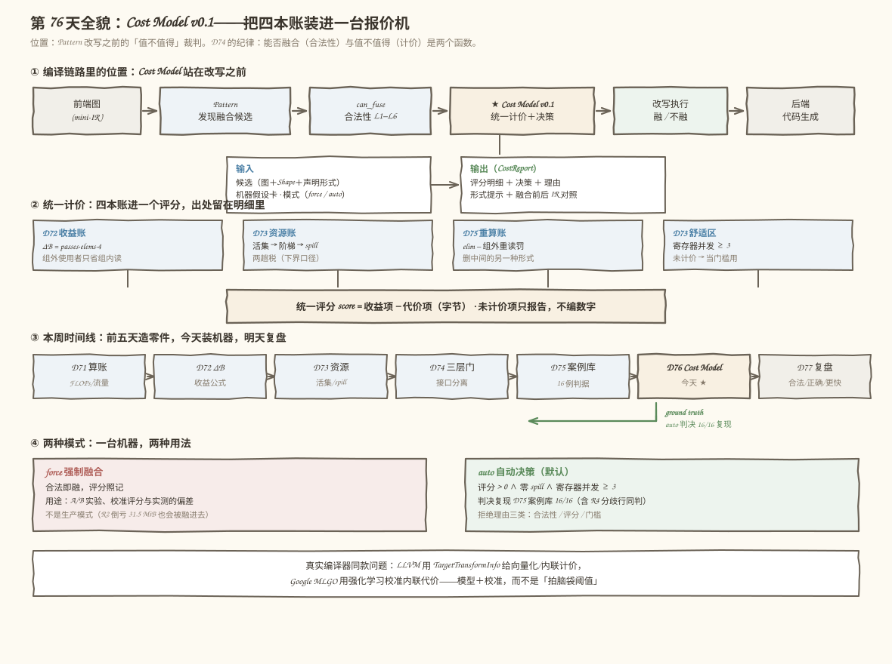
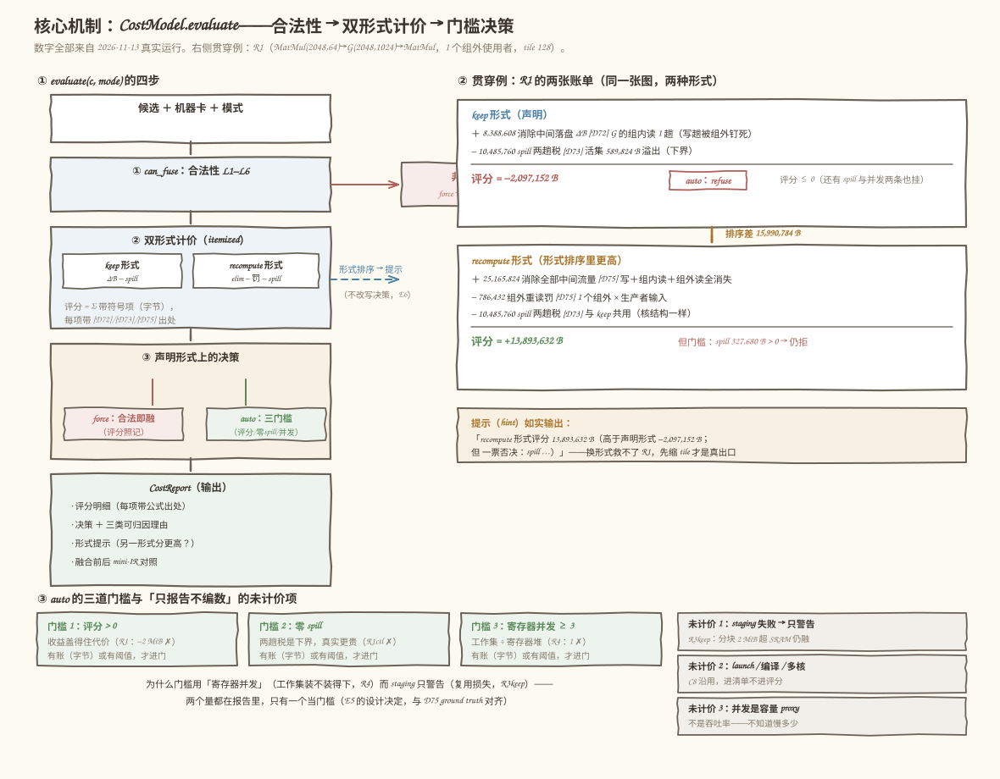
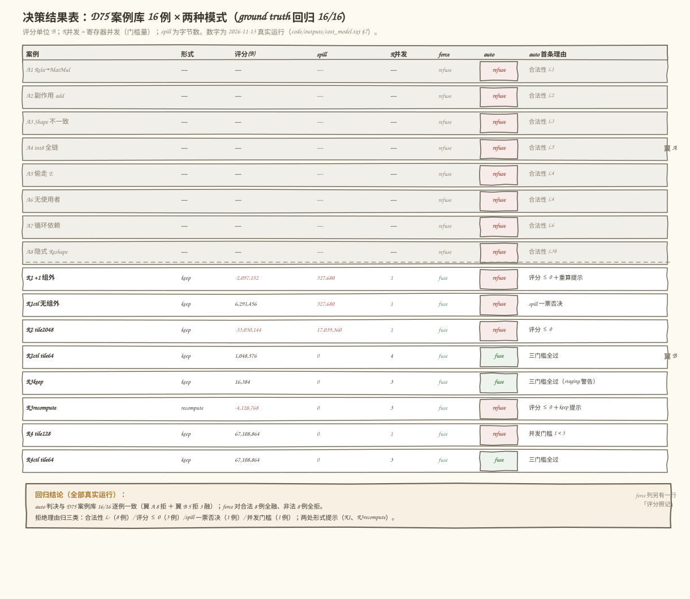
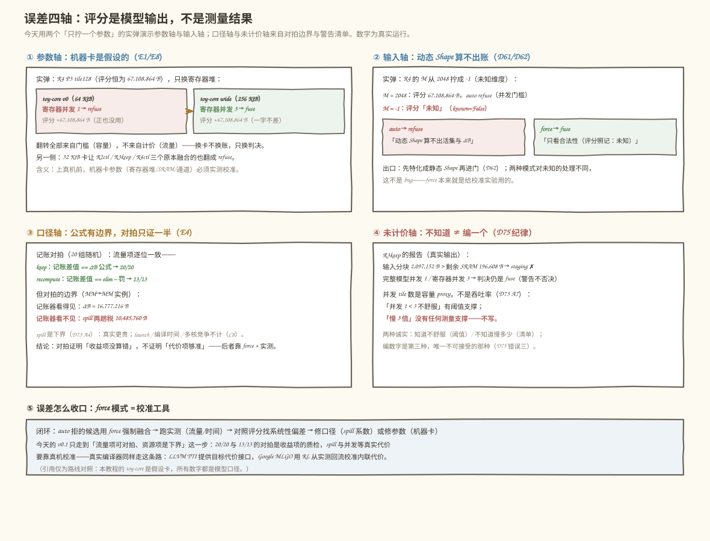

# 第 76 天：简单 Cost Model 集成——把四本账装进一台「报价机」

> **今日目标**：完成本教程后，你能把第 72～75 天的四本账（ΔB 收益账、spill 资源账、重算流量账、舒适区阈值）装进一个**统一计价的 Cost Model v0.1**：输入 = 融合候选 ＋ 机器假设卡 ＋ 模式，输出 = **评分（itemized 明细账）＋ 决策（fuse/refuse）＋ 理由（每项可追溯到公式出处）＋ 融合前后的 IR 对照**。它会用**两种模式**工作——**force 强制融合**（合法性过了就融，评分照记，是 A/B 校准的测量工具）和 **auto 自动决策**（评分 > 0 且过三个硬门槛才融）。你会验证这台报价机**复现了第 75 天案例库的全部 16 例判决**（ground truth 回归，逐例机检），看到**形式排序**怎么把 R1 的 keep 形式（−2 MiB）和重算形式（+13.25 MiB）放进同一张账单，还会用两个**只拧一个参数的实弹**理解**误差来源**：换一张 256 KiB 寄存器堆的机器卡，R4 的判决从 refuse 翻成 fuse（参数误差）；把 Shape 拧成动态（−1），评分直接变「未知」（输入误差）。所有数字都能本机跑出来逐位核对：仪器化记账器与评分公式在 20 组随机 (M,K,N,K₁,组外数) 上**逐位一致**。
> **预计时间**：学习 35 分钟＋实践 45 分钟
> **前置准备**：四块旧地基：第 72 天的 ΔB 公式（`ΔB = passes·elems·itemsize`，组外使用者只省组内读）、第 73 天的资源账（活集 → 三级容量阶梯 → spill 两趟税）与舒适区、第 74 天的三层门（`can_fuse`/`should_fuse`/`decide` 的接口分离）、第 75 天的案例库（16 例判决 + `price_recompute` 重算账 + L3b/L6 规则）。工具：Python 3.10+（本机 3.11.4，aarch64 Linux；只用标准库 `dataclasses`/`random`/`inspect`，不需要 numpy/MLIR/NPU——机器参数是写明的玩具假设卡，可整体替换重算）。
> **今日产出**：`code/cost_model.py`（Cost Model v0.1：双形式计价＋itemized 明细＋两种模式＋IR 发射器＋记账对拍，31 项检查）、`code/test_cost_model.py`（33 项独立验收：16 例 ground truth 回归＋恒等式＋门槛归因）、决策结果表（16 例 × force/auto，`code/outputs/cost_model.txt` §7）、融合前后 IR 对照（§2 与 §6）、4 张手绘风示意图。

## 1. 今天解决什么问题？

昨天收工时，第 75 天的决策日志有 16 行，每行都带理由归属——但那套判据住着**四个不同的函数**：R1/R2 走 D74 的门（`decide`）、R3 走 D75 的重算账（`price_recompute`）、R4 走舒适区阈值（`comfort_ok`）、结构负例走 `can_fuse`。四个函数四个口径，产生了三个工程问题：

```text
问题 1 无法排序：keep 形式 −2 MiB、重算形式 +13 MiB，谁好？单位一样吗？——没有统一计价就答不了
问题 2 无法调参：想把「并发 < 3」的阈值改成 2？想给 spill 加个系数？——散在四个函数里，改一处漏三处
问题 3 无法解释：老板问「这个融合为什么拒」——理由前缀是四套黑话（保守策略/重算账/并行度/合法性）
```

这在真实编译器里有个正式的名字：**profitability（收益性）**。Pattern 重写回答「能不能改」，Cost Model 回答「值不值得改」——LLVM 用 TargetTransformInfo（TTI）给向量化、内联这些变换提供目标相关的代价查询；Google 的 MLGO 更进一步，用强化学习从实测性能回流去校准内联代价。它们的共同形态是：**一个模型给出可解释的分数，一个策略决定怎么用这个分数**。今天我们造这个形态的最小版本。

贯穿全文的例子还是那张被折腾了一周的图——`MatMul(2048,64) → G(2048,1024) → MatMul(1024,2048)`，G 有 1 个组外使用者，tile=128（第 75 天的 R1）。昨天的判决是 keep 形式净收益 −2 MiB 拒绝，选做挑战里留了一句话：「同一张图上 keep 亏、重算却账面为正——这是明天统一计价的引子」。今天把话说完，预期结果先写在这里（后面全部真实跑出来核对）：

```text
keep 形式：      ＋ ΔB 8,388,608 − spill 10,485,760                    = −2,097,152 B → 拒
recompute 形式： ＋ 消除 25,165,824 − 重读罚 786,432 − spill 10,485,760 = ＋13,893,632 B → 仍拒（spill 一票否决）
```

统一计价让两种形式**第一次可以同台排序**（差 15,990,784 B），但排序赢了不等于判决翻转——spill 两形式共享，硬门槛把它拦下。这就是今天要建立的直觉：**评分负责算账，门槛负责守住没有账的底线**。三条验收主线同样先写出来：报价机复现 D75 案例库 16/16 判决；记账对拍 20/20 与 13/13 逐位一致；换一张机器卡，R4 的判决当场翻转。

## 2. 先看全貌：今天的内容位于哪里？



**图 1**：看图时注意三层。上层是编译链路：Cost Model 站在 Pattern 改写**之前**——D74 的接口纪律（`can_fuse` 与 `should_fuse` 分离）今天升级成「合法性 / 计价 / 决策」三段流水；中层是四本账进一个评分，每项的公式出处（D72/D73/D75）留在明细里；下层是本周时间线——前五天造零件，今天装机器，明天复盘，D75 案例库的 16 例判决变成今天的 ground truth。

用四个步骤概括今天的路线：

1. **定接口**：Cost Model 的输入（候选＋机器卡＋模式）与输出（评分明细＋决策＋理由＋IR 对照），机器卡绑进对象（target 绑定）；
2. **统一计价**：keep 与 recompute 两种形式各出一张 itemized 账单，score = Σ 带符号项（字节）；
3. **立门槛与模式**：auto 的三道硬门槛（评分 > 0 / 零 spill / 寄存器并发 ≥ 3）与 force 的「合法即融、评分照记」；
4. **验证与实弹**：16 例 ground truth 回归、记账对拍、换机器卡与动态 Shape 两个误差实弹，最后收进决策结果表。

## 3. 核心概念：先用直觉，再给准确定义

### 3.1 Cost Model：一台「报价机」，输入候选，输出报价单

一句通俗解释：**Cost Model（代价模型）是编译器里的报价机——你递给它一个「想做的改写」，它回你一张报价单：这个改写能省多少、要付多少、净赚多少、值不值得做**。

类比：装修队的报价单。你说「想把厨房和阳台打通」（融合候选），报价单不会只回一句「可以做」，而是列出：省掉一面墙的拆改费（收益）、新增承重梁的材料费（代价）、净省 3 万（评分）——最后写「建议做」或「不建议做」（决策）。对应到技术上是：`CostModel.evaluate(candidate, mode)` 返回 `CostReport`——**输入**是三样东西（融合候选：图结构＋Shape＋dtype＋声明的形式；机器假设卡：寄存器堆/SRAM/通道/itemsize；模式：force 或 auto），**输出**是四样东西（itemized 评分明细、fuse/refuse 决策、可归因的理由、融合前后的 mini-IR 对照）。类比的边界：装修报价单的每项价格来自市场行情（实测），我们的每项来自**公式**（D72/D73/D75 的流量与资源模型）——行情会变，公式有口径，所以今天要专门讲误差来源（3.4 节）。

贯穿例子上的第一张报价单（真实运行，P3 小链 `A(2,3)@B(3,2)→+D→relu`）：

```text
CostReport「P3 全融合」  mode=auto  form=keep  pattern=mini.fused_matmul_bias_relu
  明细账（评分 = Σ 带符号项，单位 B）：
    +          64  消除中间落盘 ΔB  [D72] 被消除中间的趟数 × 字节（组外使用者只省组内读）
  评分 = 64 B（落位 reg，寄存器并发 240，完整模型并发 240）
  判决：fuse
    理由：评分 64 B > 0 且三门槛全过（零 spill / staging ok / 寄存器并发 240 ≥ 3）
    未计价：launch / 编译时间 / 多核竞争不计（C8 沿用；E3）
    未计价：并发 tile 数是容量 proxy，不是吞吐率（D73 A7）
```

64 B 与第 72 天的 ΔB 逐位一致——这台机器没有发明新账，只是把旧账装进了新格式。

### 3.2 可解释性：每一分钱都要能回答「从哪来的」

一句通俗解释：**可解释性（interpretability）就是把总分拆成带出处的明细——拒绝一个候选时，你能指着某一行说「就是它」**。

类比：医院的费用清单。总价 8 万没法核对，但「CT 1,200 元、麻醉 2,000 元」每一行都能拿去问。对应到技术上是 `CostItem` 的五个字段：`name`（账目名）、`sign`（＋收益/−代价）、`bytes`（字节数）、`source`（公式出处：D72/D73/D75）、`why`（一句人话）。R1 的明细账里那行 `− 10,485,760  spill 两趟税 [D73]` 就是「拒绝理由」的最小单位——调参时改 spill 口径，回归测试立刻知道哪些判决会动。类比的边界：费用清单的行是**事后**记账，`CostItem` 是**事前**预测——预测的行可能错（口径问题），所以每行都要能追溯到公式，公式错了改公式，而不是改某一行的数字。

### 3.3 评分、门槛、未计价：三类信息三种待遇

一句通俗解释：**统一计价不是把所有东西都变成分数，而是给每类信息分配正确的待遇——有账的进评分，有阈值的进门，没账的只报告**。

类比：给员工发项目奖金。现金流上算得清的（省了多少差旅）直接折现进奖金（**评分**）；没法折现但底线明确的（每周 onsite 不超过 2 天）写成合同条款（**门槛**）；连阈值都没有的（「这个项目对履历有帮助」）只能在评语里提一句（**未计价报告**）。对应到技术上是今天最重要的三分法：

```text
进评分（有账，字节）：   ＋ΔB（D72）  −spill 两趟税（D73）  −组外重读罚（D75 扩展②）
进门槛建设（有阈值）：   评分 > 0 ∧ 零 spill ∧ 寄存器并发 ≥ 3（D73 舒适区的并发分量）
只报告（没账没阈值）：   staging 复用损失（警告）、launch/编译时间/多核竞争（C8 清单）
```

为什么并发门槛用**寄存器并发**（`寄存器堆 ÷ 单 tile 占用`，即 D73 的 `reg_cap`）而不是完整模型并发（`min(寄存器, SRAM 分块)`）？因为它们是两种病：寄存器并发掉到 1，说明**融合核自己的工作集**顶爆寄存器堆（R4：累加器 65,792 B > 64 KiB）——容量问题，改不了就得拒；输入分块驻不进 SRAM（R3keep：2 MiB > 192 KiB），损失的是**复用**——流量问题，警告即可。两个数都在报告里（`reg_tiles` 与 `concurrent_tiles`），只有一个当门槛——这个设计决定记在假设 E5 里，且与 D75 案例库的 ground truth 对齐（R4 拒、R3keep 融）。

两种模式是三分法的最后一层：**auto**（默认）= 评分过三门槛才融；**force** = 合法即融、评分照记。注意 force 不是「更激进的好模式」——R2 那个倒亏 31.5 MiB 的候选在 force 下会被无条件融进去。force 存在的唯一理由是**测量**：把 auto 拒掉的候选强制融合，跑实测对照评分，才能知道模型哪里不准（3.4 节）。

### 3.4 误差来源：四条轴，每条都有实弹或边界

一句通俗解释：**评分是模型的输出，不是测量的结果——误差从四个方向进来，知道方向才知道怎么校**。

类比：天气预报。气象模型有四个误差来源：模型简化（不模拟每片云）、参数（地形数据粗）、输入（测站稀疏）、未建模现象（局部小气候）。对应到技术上是今天假设清单的 E1–E8，收成四条轴：

```text
口径轴：spill 两趟税是下界（D73 A4，真实更贵）；launch/编译/多核不计（C8）——公式简化
参数轴：机器卡是假设的（toy-core v0：64 KiB 寄存器堆 / 192 KiB SRAM / 64 通道 / fp32）
输入轴：静态 Shape 假设；动态维度（-1）→ 评分未知（D61/D62：未知 ≠ 任意）
未计价轴：并发 tile 数是容量 proxy 不是吞吐率（D73 A7）；staging 失败的复用损失
```

今天用两个「只拧一个参数」的实弹演示其中两条轴（§5.4 真实运行）：**参数轴**——同一候选 R4，寄存器堆 64 KiB 换成 256 KiB，寄存器并发 1→3，判决 refuse→fuse，评分 67,108,864 B 一字不差；**输入轴**——M 从 2048 拧成 −1，评分直接变「未知」，auto 拒之门外。另两条轴的实弹在记账对拍里：**口径轴**的对拍边界（记账器看得见 ΔB、看不见 spill）、**未计价轴**的警告清单（R3keep 报告 staging 但仍融）。

## 4. 图解核心机制



**图 2**：左列是 `evaluate` 的四步流水（合法性 → 双形式计价 → 声明形式决策 → CostReport），右列是 R1 在这台流水上的完整输出——keep 与 recompute 两张账单同台排序。看图时先找右列的**红色 spill 行**：两份账单里它一模一样（10,485,760 B），这就是「资源账与形式无关」的可视化。

按图中编号逐步讲解：

1. **① can_fuse（合法性）**：D75 的规则集原样（L1–L6 含 L3b/L6），不吃机器卡。非法 → 两种模式都拒——force 也不融非法的图，这是底线；
2. **② 双形式计价**：keep 恒评；recompute 只在「有组外使用者」或「声明了」时评。每个形式产出一张 itemized 账单，`score = Σ sign·bytes`，每项带 [D72]/[D73]/[D75] 出处；
3. **③ 声明形式决策**：决策在候选**声明的形式**上做（E6）——换形式 = 改写候选图（谁读谁不读变了），是后续 Pattern 的工作，今天只输出提示。force 分叉合法即融（评分照记）；auto 分叉过三门槛；
4. **CostReport**：评分明细、决策、三类可归因理由、形式提示、IR 对照——五样东西一起返回；
5. **右列 R1**：keep 账单 −2,097,152 B（评分 ≤ 0 拒）；recompute 账单 +13,893,632 B 但 spill 一票否决。提示行如实输出「recompute 形式评分更高；但 spill > 0」——**排序赢家不等于判决赢家**，真出口是缩 tile。

## 5. 动手实践：完成一个最小可运行例子

### 5.1 准备文件

```text
tutorials/day-076/
├── README.md
├── images/                        ← 4 张手绘风示意图（由 make_images.py 生成）
└── code/
    ├── cost_model.py              ← Cost Model v0.1：计价＋门槛＋模式＋IR＋对拍（31 项检查）
    ├── test_cost_model.py         ← 独立验收：ground truth 回归＋数字＋归因（33 项检查）
    ├── make_images.py             ← 生成 4 张 SVG（数字取自真实运行）
    ├── run_all.sh                 ← 一键复跑：实验→测试→图片
    └── outputs/                   ← 真实运行输出（.txt）
```

运行环境：Python 3.10+（本机 3.11.4，aarch64 Linux）。只用标准库（`dataclasses`、`random`、`inspect`），无第三方依赖。

```bash
cd tutorials/day-076/code
bash run_all.sh          # 或分步：python3 cost_model.py
```

### 5.2 编写代码

完整实现见 `code/cost_model.py`（约 1100 行）。合法性层（`can_fuse`）与三本账（`price_keep`/`price_recompute`，`cost_model.py:334` 与 `:355`）与第 75 天逐字同构，今天新增的四块如下。

**块一：明细账的数据结构**（`cost_model.py:249` 的 `CostItem` 与 `:260` 的 `FormScore`）——可解释性的落地：

```python
@dataclass
class CostItem:
    """明细账的一行：带符号的字节数 ＋ 公式出处 ＋ 一句人话。"""
    name: str          # 账目名，如「消除中间落盘 ΔB」
    sign: int          # +1 收益 / −1 代价
    bytes: int         # 字节数（恒正；符号在 sign 里）
    source: str        # 公式出处：D72 / D73 / D75
    why: str           # 一句人话解释

@dataclass
class FormScore:
    form: str                      # "keep" | "recompute"
    known: bool = True             # 动态 Shape → False
    score: int | None = None       # = Σ sign·bytes（统一计价，字节）
    items: list[CostItem] = field(default_factory=list)
    reg_tiles: int = 1             # 寄存器并发（门槛量，D73 的 reg_cap）
    concurrent_tiles: int = 1      # 完整模型并发（报告量，min 寄存器/SRAM）
    ...
```

注意 `FormScore` 里有两个并发：`reg_tiles` 是门槛用的（工作集口径），`concurrent_tiles` 是 D73 完整模型（报告用）——一个候选的两个量可以不同（R3keep：3 与 1）。

**块二：门槛函数——不短路，返回全部失败项**（`cost_model.py:423`）：

```python
def _gate_fails(self, fs: FormScore) -> list[str]:
    fails: list[str] = []
    if not fs.known:
        fails.append("评分未知：动态 Shape 算不出活集与 ΔB（D61/D62：先特化）")
    elif fs.score <= 0:
        fails.append(f"评分 {fs.score:,} B ≤ 0（收益项盖不住代价项）")
    if fs.known and fs.spill_bytes > 0:
        fails.append(f"一票否决：spill {fs.spill_bytes:,} B > 0"
                     "（D73 A4：两趟税是下界，真实更贵）")
    if fs.known and fs.reg_tiles < self.min_concurrency:
        fails.append(f"并行度门槛：寄存器并发 {fs.reg_tiles} < {self.min_concurrency}"
                     "（D73 活集口径：工作集 ÷ 寄存器堆；未计价，只设阈值）")
    return fails
```

两个细节：`known=False` 时只报「评分未知」，不猜数字（D61/D62 的纪律）；失败项全收集而不是第一个就返回——R1 一行理由里能看到三条（评分、spill、并发全挂），归因更完整。

**块三：决策分叉与形式提示**（`cost_model.py:438` 的 `evaluate`，关键段）：

```python
if mode == "force":                     # E7：合法即融，评分照记
    rep.action = "fuse"
    score_txt = (f"{declared.score:,} B" if declared.known else "未知（动态）")
    rep.reasons = [f"合法性通过；force 只看合法性（评分照记：{score_txt}）"]
else:                                   # auto：评分门槛（E5）
    fails = self._gate_fails(declared)
    if fails:
        rep.action, rep.reasons = "refuse", fails
    else:
        rep.action = "fuse"
        rep.reasons = [f"评分 {declared.score:,} B > 0 且三门槛全过…"]

for fname, fs in rep.forms.items():    # 形式排序提示（E6：只提示，不改写决策）
    if fname != rep.form and fs.known and declared.known \
            and fs.score > declared.score:
        other_fails = self._gate_fails(fs)
        tail = ("；但 " + "；".join(other_fails)) if other_fails \
            else "；且门槛全过——值得改写候选"
        rep.hints.append(f"{fname} 形式评分 {fs.score:,} B（高于声明形式"
                         f" {declared.score:,} B{tail}）")
```

决策只看**声明形式**的 `declared`；其他形式分更高时进 `hints`，提示里还要回答「那个形式过得了门槛吗」——R1 的提示因此是完整的：「recompute 分更高；但 spill 一票否决」。

**块四：mini-IR 发射器与记账执行器**（`cost_model.py:598` 的 `emit_ir_after` 与 `:646` 的 `ledger_bytes`）——第二、三份产出的来源。IR 发射器按「链上中间 = 算子 i 的输出」约定走一遍图：融合前每个算子一个 kernel、中间显式 `memref.alloc` 落盘；融合后一个 kernel，keep 形式的 kept 中间照样 alloc（outs 里带 `%g`），recompute 不落盘（kernel 名加 `_recompute` 后缀）。记账执行器是 D72 仪器化执行器去掉数值的版本：按 kernel 边界记读写，重算形式假设组外使用者把生产者含进自己的 kernel（E4 口径）。

### 5.3 运行与观察

以下输出为 **2026-11-13 在本机的真实运行结果**（Python 3.11.4，aarch64 Linux；`bash run_all.sh` 逐段生成，完整输出在 `code/outputs/`）。

**对拍：评分的流量项 vs 逐 kernel 记账**（§3，20 组随机）：

```text
== 3. 记账对拍：评分公式 vs 逐 kernel 记账（20 组随机，E4 口径）==
  随机 20 组（p3/mm2/skinny 混合，组外 0~3 随机）：
    keep 形式：记账差值 == ΔB 公式 → 20/20
    recompute 形式（有组外使用者的 13 组）：记账差值 == elim − 罚 → 13/13
[PASS] 3c 拆账闭合（贯穿例）：独立执行 144 B、融合执行 80 B、差值 64 B（D71/D72 账本逐位对上）
[PASS] 3d 对拍的边界：记账器只看流量（差值 == ΔB 16,777,216 B），cost model 还有一笔它看不见的
      spill 两趟税 10,485,760 B——容量模型只在 cost model 里
```

读法：20/20 与 13/13 证明**收益项没算错**；但记账器差值只有 ΔB，spill 那笔它天生看不见（没有容量概念）——对拍证明了什么、没证明什么，检查 3d 把这条边界写成了断言。

**形式排序：R1 的两种形式第一次同台**（§4，输出见第 4 节图 2 右列）：

```text
  形式排序：keep -2,097,152 B  <  recompute 13,893,632 B（差 15,990,784 B）
[PASS] 4c 资源账与形式无关：两形式的 spill 同为 10,485,760 B（融合核结构一样，D75 的共用口径）
[PASS] 4e 形式提示如实输出：报告含「recompute 形式评分更高」且带门槛结论
```

**决策结果表**（§7 节选，16 例完整表见 `code/outputs/cost_model.txt`）：

```text
  案例                          形式          评分(B)       spill  R并发  force   auto
  R1 MM→MM K1=1024 +1 组外     keep        -2,097,152   327,680    1  fuse    refuse
  R1ctl MM→MM K1=1024          keep         6,291,456   327,680    1  fuse    refuse
  R2ctl MM→MM K1=64 tile64     keep         1,048,576         0    4  fuse    fuse
  R3keep skinny(64,4096)       keep            16,384         0    3  fuse    fuse
  R3recompute skinny(64,4096)  recompute   -4,128,768         0    3  fuse    refuse
  R4 P3 tile128                keep        67,108,864         0    1  fuse    refuse
  R4ctl P3 tile64              keep        67,108,864         0    3  fuse    fuse
[PASS] 7b ground truth 回归：auto 判决与 D75 案例库逐例一致（16/16）
```



**图 3**：16 行 × 两种模式的完整决策结果表。读法看三处：**auto 列的颜色**（红拒绿融）与 D75 案例库逐例一致；**R1ctl 行**（评分 +6,291,456 B 正、spill 327,680 B 非 0）和 **R4 行**（评分 +67,108,864 B 正、零 spill、R并发 1）证明三种拒绝理由真的各管一类；**R1 与 R3recompute 两行的提示**（↳ recompute/keep 形式评分更高）是统一计价带来的新信息——D75 的判决日志里没有这一列。

独立验收（`code/test_cost_model.py`）不共用主实验的任何运行结果，重新构造、重新计价，33 项检查全部通过，其中 A1 是 ground truth 回归、B 组逐个核对昨天背下来的数字、E 组重演换卡翻转。

### 5.4 修改一个参数再观察：两个误差实弹

**实弹一（参数轴）：换机器卡。** 同一候选 R4 P3 tile128，只把 `Machine.regfile_bytes` 从 64 KiB 拧到 256 KiB：

```text
  [参数轴] 同一候选 R4 P3 tile128，只换机器卡：
    toy-core v0（64 KiB 寄存器堆）：寄存器并发 1 → refuse（评分 67,108,864 B）
    toy-core wide（256 KiB 寄存器堆）：寄存器并发 3 → fuse（评分 67,108,864 B）
[PASS] 5a 参数误差实弹：寄存器堆 64→256 KiB，R4 寄存器并发 1→3，auto 判决 refuse→fuse；
      评分一字不差（67,108,864 B）
```

评分一字不差（ΔB 与机器卡无关、两卡下都零 spill），翻转全部来自并发门槛——**换卡换的是判决，不是账**。反方向同样成立：32 KiB 的窄卡让 R2ctl / R3keep / R4ctl 三个原本融合的也翻成 refuse（测试 E2 断言）。

**实弹二（输入轴）：拧动态 Shape。** 同一张图，M 从 2048 拧成 −1（未知维度，D61 口径）：

```text
  [输入轴] M 拧成 -1（动态）：评分 未知 → auto refuse；force fuse
    理由：评分未知：动态 Shape 算不出活集与 ΔB（D61/D62：先特化）
[PASS] 5b 输入误差实弹：动态 Shape → 评分未知（known=False）→ auto 拒；force 仍融（它只看合法性——模式差异）
```

注意两种模式对未知的处理不同：auto 拒（算不出账就不冒险），force 融（它本来就不看账）——这不是 bug，是模式分工。出口是 D62 的老结论：特化成静态 Shape 后重新进门。



**图 4**：四个象限各画一条误差轴。左上的参数轴和右上的输入轴是今天跑出来的两个实弹；左下的口径轴画的是对拍边界（记账器看得见 ΔB 16,777,216 B、看不见 spill 10,485,760 B）；右下的未计价轴是 R3keep 的警告清单（staging 失败仍融、并发是 proxy 不是吞吐）。底部横条给出收口路线：force 模式存在的意义就是校准——强制融合、跑实测、对照评分、修口径或修参数。


## 6. 常见错误与排查

以下是接入 Cost Model 时最容易踩的四个坑。前三个用今天的代码做了真实对照（输出为本机实际运行），第四个是口径设计层面的坑。

**错误一：把 force 当生产模式——评分照记不等于评分照看**

- 现象：本机验证——R2（tile=2048，评分 −33,030,144 B，倒亏 31.5 MiB）在 force 下 `evaluate(r2, "force").action == "fuse"`，理由是「合法性通过；force 只看合法性（评分照记：-33,030,144 B）」——**一个倒亏 31.5 MiB 的候选被无条件融进去**，评分就写在理由里，但决策根本不看它；
- 原因：force 是 A/B 校准的测量工具（E7），它**故意**不看账——但跑批脚本里模式配错一行，负收益候选一个都拦不住；
- 定位：跑决策结果表看 auto 列——R1/R1ctl/R2/R3重算/R4 五例全拒，force 列却全是 fuse（检查 7c 的断言就是干这个的）；再查调用方，默认模式必须是 auto；
- 修复：默认模式固定 auto；force 只出现在校准脚本里，且校准脚本应该成对运行（force 融合 + 实测对照）。教训：**一个模式的用途决定了它的安全边界——测量工具不该进生产管道**。

**错误二：把评分当测量——「评分 +64 MiB」不是「快了 64 MiB」**

- 现象：汇报里写「R4 融合后性能提升 64 MiB」——评分的单位是**字节**（省的 DRAM 流量），不是时间；64 MiB 流量折算成几毫秒，取决于带宽、取决于有没有其他瓶颈，模型里一个字都没有；
- 原因：混淆了「模型的输出」和「世界的测量」——今天的对拍（20/20、13/13）证明的是**流量项内部一致**（公式与记账口径相同），连真实 DRAM 都没碰过，更不用说时间；
- 定位：检查 3d 的断言就是边界声明——记账器看得见 ΔB、看不见 spill；spill 本身还是下界（D73 A4）。凡是没有测量支撑的性能断言都是编的；
- 修复：报告里写「评分（流量模型口径）+67,108,864 B」，时间结论留给 force + 实测。教训：**对拍证明公式没算错，不证明公式够准——两件事要分开说**。

**错误三：拿形式排序当自动改写——提示不是 Pass**

- 现象：看到 R1 的提示「recompute 形式评分 13,893,632 B（高于声明形式）」，直接在论文/报告里写「cost model 选择了重算形式」——决策列里 R1 的判决明明是 refuse，声明的形式还是 keep；
- 原因：`evaluate` 的决策在**声明的形式**上做（E6）——换形式意味着改写候选图（组外使用者从「读中间」变成「重算生产者」，边都变了），那是另一个 Pattern 的活；提示只是告诉改写者「值得往哪个方向改」；
- 定位：读报告的字段分工——`hints` 是提示、`reasons` 是决策理由、`action` 才是判决；检查 4d 断言「recompute 门槛也过不了」——R1 连提示的形式都被 spill 拦着；
- 修复：把提示转成 Pattern 层的工作项，改写完重新进门（新候选、新决策）。教训：**「知道哪条路好」和「把路修好」之间隔着一个 Pass**。

**错误四：给未计价项编系数——「并发 × 0.3 折扣」是从哪来的**

- 现象：为了让评分「更全面」，给并发掉档加一个折算系数（比如每掉一档扣评分 30%）——这个 30% 没有任何测量或模型支撑，纯拍脑袋；
- 原因：把「门槛思维」和「计价思维」混了——并发有阈值（D73 舒适区 ≥ 3）但**没有账**（不知道慢多少）；门槛可以拒绝，但不能折成字节；
- 定位：搜代码里的魔数——评分公式里只允许出现「有出处的字节」（[D72]/[D73]/[D75] 三种 source），任何其他系数都该被 code review 拦下；
- 修复：未计价项进 `unpriced` 清单（今天的 staging 警告就是范例）；想要真系数，走 force + 实测的校准闭环。教训（沿用 D75 错误三）：**「不知道慢多少」和「知道不舒服」都诚实，编数字是第三种——唯一不可接受的那种**。

## 7. 今日练习

### 必做练习：给 R2ctl 的图补一档 tile，先笔算再验证

今天 R2ctl 用的是 tile=64（融）、第 75 天练习算过 tile=256/512（256 恰好 net=0、512 亏 6 MiB）。请把**中间档 tile=(128,128)** 补上，对同一张图 `MatMul(2048,64)→G(2048,64)→MatMul(64,2048)` 用今天的 Cost Model 评估，**先笔算预测**再运行：

1. 提示——三笔账分开算：ΔB 恒为 `2 × (2048×64) × 4 = 1,048,576 B`（与 tile 无关）；活集 = 累加器 `128×128×4` ＋ G 行块 `128×64×4`，对照片上 256 KiB 算 spill；寄存器并发 = `65,536 ÷ (128×128×4)`；
2. 两个问题：评分是正还是负？auto 的判决是什么——**评分明明是正的，是谁把它拦下的**？再问一层：force 会怎么判？D74 的 conservative 会怎么判（提示：它只看 spill 和 net，不看并发）？
3. 预期产出：三行笔算 ＋ 一行真实输出 ＋ 一句话回答「同一个候选，D74 conservative、D76 auto、force 三个答案各是什么、为什么不同」——这句话就是门槛建模与评分建模的取舍。

**自检锚点**：笔算并发时别忘了 `max(1, ·)` 的下限和整除——65,536 ÷ 65,536 恰好等于 1，正是这道题的题眼。

### 选做挑战：32 KiB 窄卡跑全库，预测翻转清单

今天的误差实弹只演示了 64→256 KiB 的换卡（R4 翻融）。请反方向预测：把机器卡换成 `Machine(name="narrow", regfile_bytes=32*1024)`，重跑 16 例决策结果表：

1. 先笔算：哪些原本 fuse 的候选会翻成 refuse？每个翻转归因到哪个门槛（评分？spill？还是寄存器并发）？P3 小链（活集 272 B）会翻吗？
2. 验证后回答：翻转数是几个？有没有候选是**评分也变了**才翻的（对照 E3 的断言：换卡不换计价——评分变没变，为什么）？
3. 预期产出：一份预测清单 ＋ 真实运行对照 ＋ 一句话回答「如果这是真机器，换卡前后哪份决策结果表更可信」——参数轴误差的工程含义。

## 8. 今日验收

- [ ] 我能用自己的话说出 Cost Model 的输入（候选＋机器卡＋模式）和输出（评分明细＋决策＋理由＋IR 对照），并解释它与 D74 三层门的接口差别（机器卡绑进对象、决策收成 force/auto 两模式）
- [ ] 我能独立运行 `cost_model.py` 与 `test_cost_model.py`，复现 31/31 与 33/33（`bash run_all.sh` 一键复跑，输出在 `code/outputs/`），并指出 16/16 ground truth 回归在哪条检查里
- [ ] 我能解释「进评分 / 进门槛 / 只报告」三分法，并说出为什么并发门槛用寄存器并发（工作集）而 staging 只作警告（复用）——R4 与 R3keep 是分别的实弹
- [ ] 我能预测并验证两类拧参数实验：换机器卡（R4 refuse→fuse、评分不变）和动态 Shape（评分未知、auto 拒 force 融），也能完成必做练习的 tile=128 一档
- [ ] 我能定位「拒绝理由」的归属：合法性 / 评分 ≤ 0 / spill 一票否决 / 并行度门槛四类前缀各自来自哪一层，形式提示（R1、R3recompute 两处）为什么不算决策
- [ ] 我保存了 Cost Model v0.1（`cost_model.py`）、决策结果表（`code/outputs/cost_model.txt` §7）、融合前后 IR 对照（§2/§6）和四张手绘风示意图

## 9. 一句话总结与明天预告

今天把第 72～75 天的四本账装进了一台报价机。**机制**上：`CostModel.evaluate` 用一条流水回答「值不值得融合」——合法性（D75 规则集原样）→ 双形式计价（keep：ΔB − spill；recompute：消除 − 重读罚 − spill，每项带 [D72]/[D73]/[D75] 出处）→ 声明形式决策（force 合法即融、评分照记；auto 过三门槛：评分 > 0 ∧ 零 spill ∧ 寄存器并发 ≥ 3）。**实践**上：统一计价让 R1 的两种形式第一次同台排序（keep −2,097,152 B < recompute +13,893,632 B，差 15,990,784 B），但 spill 两形式共享，硬门槛把两个都拦下——排序赢家不是判决赢家；三分法（进评分 / 进门槛 / 只报告）把「不编数字」的纪律工程化。**验证**上：auto 判决与 D75 案例库 16/16 逐例一致（ground truth 回归）；记账对拍 20/20 与 13/13 逐位一致（流量项没算错），对拍边界（看不见 spill）如实写成断言；主实验 31/31、独立验收 33/33 全部真实运行；两个误差实弹（换卡翻转 R4、动态 Shape 拒之门外）让误差四轴不只是清单。

明天（第 77 天）是第 11 周复盘：用一个具体 Shape 把「融合**合法**」「融合后**正确**」「融合后**更快**」三件事彻底分开——今天的评分正好是「更快」的前半程（流量口径），复盘要看它和「正确」（数值语义）、「合法」（结构）在哪几个案例上曾经被混为一谈。
