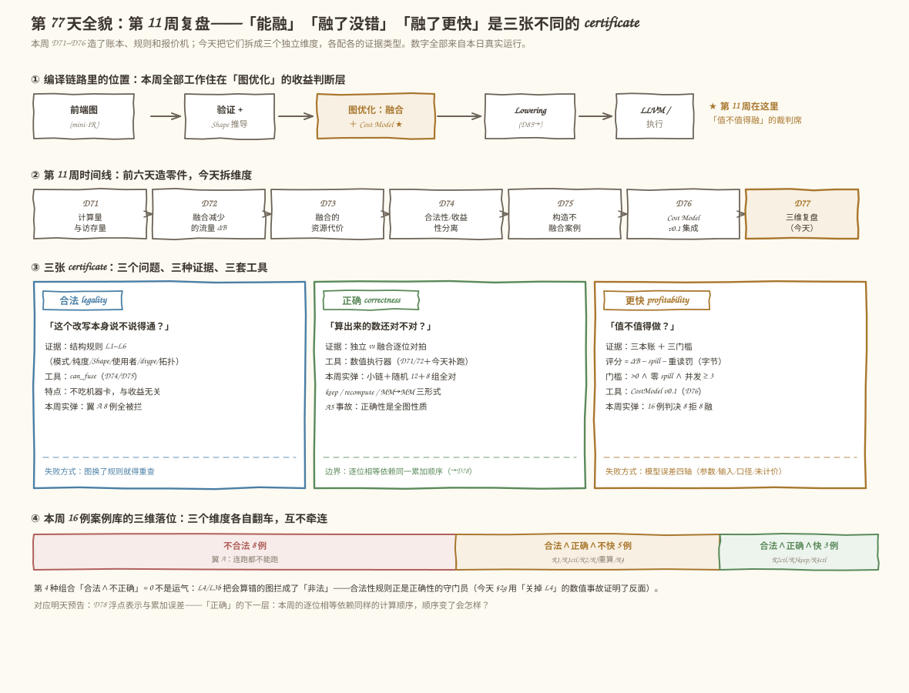
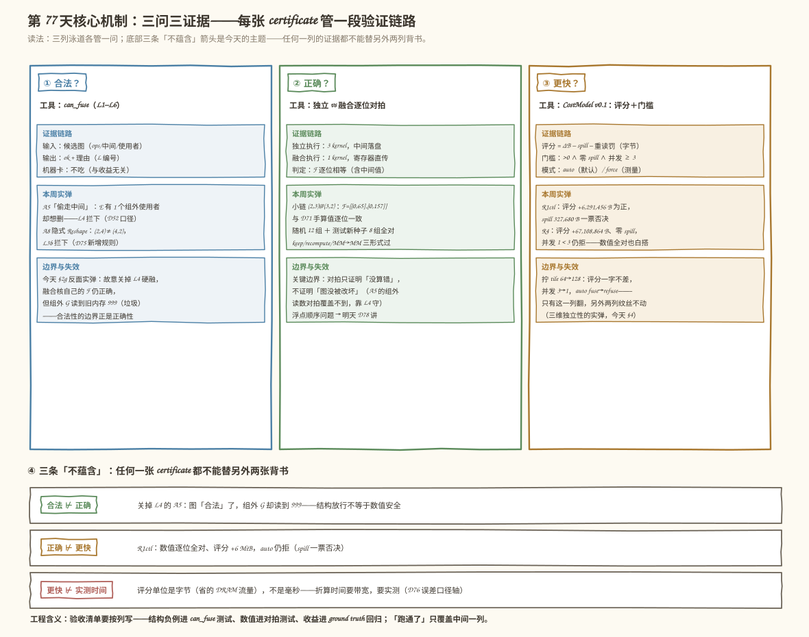
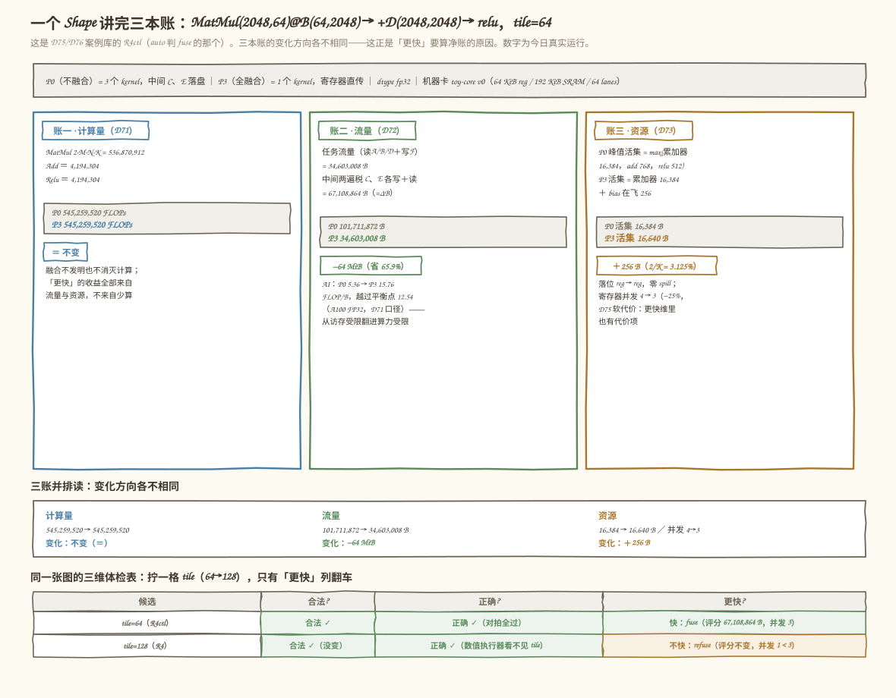
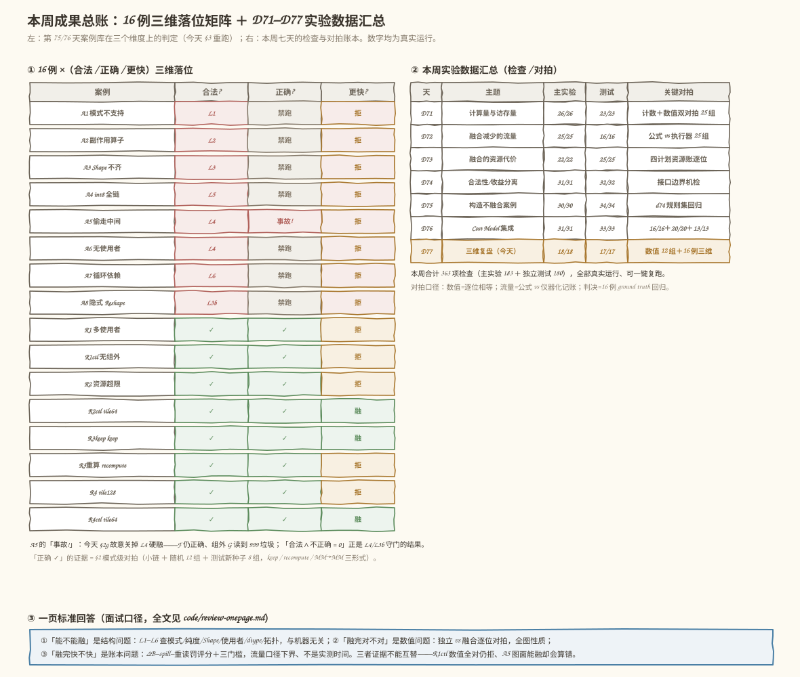

# 第 77 天：第 11 周复盘——「能融」「融了没错」「融了更快」是三张不同的 certificate

> **今日目标**：完成本教程后，你能把第 11 周六天（Day 71–76：计算量与访存量、融合流量、资源代价、合法性与收益性分离、不融合案例、Cost Model 集成）收拢成一个**三维框架**——**融合合法**（结构问题）、**融合后正确**（数值问题）、**融合后更快**（账本问题）——并做到三件事：① 用一个具体 Shape（`MatMul(2048,64)@B(64,2048)→+D→relu`，tile=64，即案例库 R4ctl）把融合前后的**计算量、流量、资源**三本账完整讲一遍（FLOPs 545,259,520 不变；流量 101,711,872 → 34,603,008 B 省 64 MiB；活集 16,384 → 16,640 B、并发 4→3；AI 5.36 → 15.76 越过平衡点 12.54）；② 补上本周一直只标一句「D50/52 已证」而没跑数的**数值正确性实弹**：独立执行 vs 融合执行逐位对拍（小链手算锚点＋随机 12 组＋keep/recompute/MM→MM 三形式），并演示「故意关掉 L4」时 A5 的**数值事故**——硬融后融合核自己的输出 F 仍然正确，但组外使用者 G 读到旧内存垃圾：**正确性是全图性质，不是单 kernel 性质**；③ 用 16 例案例库做**三维巡检**，看到组合分布 8 非法 / 3 合法∧正确∧快 / 5 合法∧正确∧不快 / 0 合法∧不正确——最后一格是 0 不是运气，L4/L3b 正是替正确性守门的合法性规则。再拧一格 tile（64→128）验证三维独立性：评分一字不差、并发 3→1、只有「更快」列翻车。
> **预计时间**：学习 35 分钟＋实践 45 分钟
> **前置准备**：本周六天的地基今天只取不改：D71 的 FLOPs/字节/算术强度公式（MatMul=2MNK、两遍税、AI=FLOPs/Bytes、A100 FP32 平衡点 12.54 FLOP/B）；D72 的 ΔB = passes·elems·itemsize 与「任务流量＋中间落盘」拆账；D73 的活集、三级容量阶梯（64 KiB/256 KiB）、spill 两趟税下界；D74 的三层门接口（`can_fuse`/`should_fuse`/`decide`）；D75 的 16 例案例库与 L3b/L6；D76 的 Cost Model v0.1（评分+门槛+双模式）。工具：Python 3.10+（本机 3.11.4，aarch64 Linux），**纯标准库**（`random`），复用 `../day-076/code/cost_model.py`；不需要 numpy/MLIR/NPU。
> **今日产出**：主实验 `code/week11_review.py`（三账体检表＋数值实弹＋16 例三维巡检＋tile 对照，18 项检查全部真实运行）、独立验收 `code/test_week11_review.py`（17 项：三账数字独立重推、新种子随机对拍、三维独立性、本周数据对照）、**一页标准回答与本周实验数据**（`code/review-onepage.md`，计划点名的复盘产出）、一键复跑 `code/run_all.sh`、4 张手绘风示意图。

## 1. 今天解决什么问题？

第 11 周的六天，每天往「要不要融合」这个问题里加了一块新证据：D71 学会数 FLOPs 和字节，D72 算出融合能省的流量 ΔB，D73 发现资源要收税（spill），D74 把「能否融」和「值不值得融」拆成两个函数，D75 用 16 例案例库证明「图合法」和「应该融」隔着四本账，D76 把四本账装进 Cost Model v0.1 这台报价机。但复盘时翻本周的判决日志，会发现三个词一直混着用：

```text
混用现场一：R4（P3 tile=128）——D74 那天的 auto 策略说「fuse」（当时只看净收益 > 0），
    D75/D76 说「refuse」（并发门槛补全后）——两天的分歧其实是「快不快」内部的口径演进，
    但日志里都只写了一个 fuse/refuse，看不出来吵的是哪一维。

混用现场二：D73–D76 四天的教程里，数值正确性全部只有一句
    「数值语义 D50/52 已证」——四天没跑过一个数。
    「融完算得对」和「融完值得做」被同一句话打发了。

混用现场三：汇报时最容易说出口的一句——「这个融合验证过了」。
    验证过什么？结构规则过了？数值对拍了？还是评分是正的？
    三件事的证据完全不同，一句「验证过了」全含糊掉了。
```

今天要做的病防不是「再学一个新工具」，而是把这三个词拆成**三张互相独立的体检表**，每张表配自己的证据类型、自己的工具、自己的失效方式。先看两个真实现场（都在本机跑出来，完整输出存 `code/outputs/`）：

```text
现场一（正确 ≠ 快）：R1ctl —— MatMul(2048,64)→G(2048,1024)→MatMul(1024,2048)，
    无组外使用者：数值上独立执行与融合执行逐位相等（今天 §2 对拍），
    评分 +6,291,456 B 为正——但 spill 327,680 B 一票否决，auto 拒。
    数值全对、账面为正，判决仍是 refuse。

现场二（合法是正确性的守门员）：A5「偷走中间」——E 有 1 个组外使用者却想删。
    can_fuse 在 L4 拦下（D52 口径）。今天故意关掉 L4 硬融一次：
    融合核自己的输出 F 仍逐位正确（[[0,65],[0,157]]），
    但组外 G 读到的 E 是旧内存 999——垃圾。
    图面上「能融」，数值上「算错」——合法性规则的边界正是正确性。
```

贯穿全文的例子有两层：**大 Shape 讲账**（R4ctl：`MatMul(2048,64)@B(64,2048)→+D(2048,2048)→relu`，tile=64——三本账数字齐全、且是 auto 判 fuse 的活案例）和**小链讲数**（`A(2,3)@B(3,2)→+D→relu`，D71 的手算老朋友——今天所有数值实弹都在它和它的变体上做，值可以全程手算核对）。

## 2. 先看全貌：今天的内容位于哪里？



**图 1**：看图时注意四层。顶层是编译链路：本周全部工作住在「图优化」的收益判断层（★ 标记）；第二层是本周时间线——D71–D73 造账本（算量/流量/资源），D74–D76 造裁判（接口分离/案例库/报价机），今天拆维度；第三层是三张 certificate 并排——**合法**（蓝，结构证据 L1–L6）、**正确**（绿，数值证据对拍）、**更快**（橙，账本证据评分＋门槛），每张写明证据、工具、实弹和失效方式；底层是 16 例案例库的三维落位分布条：8 非法 / 5 合法∧正确∧不快 / 3 合法∧正确∧快——**「合法∧不正确 = 0」不是运气，是 L4/L3b 守门的结果**。

用 4 步把今天的路线串起来：

1. **立框架**：三个问题、三种证据、三套工具（§3.1）——任何一列的证据都不能替另外两列背书；
2. **讲透一个 Shape**：R4ctl 的三本账完整过一遍（§5 实践 §1 段）——计算量不变、流量 −64 MiB、资源 +256 B，三列变化方向各不相同；
3. **补数值实弹**：独立 vs 融合逐位对拍＋三形式＋A5 事故（§5 实践 §2 段）——「正确」这一列本周第一次有了机器可检的证据；
4. **三维巡检与拧参数**：16 例组合分布 + tile 64→128 只翻「更快」列（§5 实践 §3/§4 段）——三维独立性从口号变成跑出来的对照。

## 3. 核心概念：先用直觉，再给准确定义

先给一个贯穿全文的类比：**装修的三张证**。你想把厨房和阳台打通（融合候选）：第一张是**施工许可**——物业查承重结构、管线走向，说「这面墙能动」（合法：结构说得通）；第二张是**竣工验收**——完工后水电逐一测试，说「住进来不会出事」（正确：结果对不对）；第三张是**投资回报表**——省了多少采暖费、花了多少钢结构钱，说「这钱花得值」（更快：值不值得）。三张证发证机关不同、查验方式不同、失效方式也不同——施工许可盖了章，不代表水电一定没接错；验收全过，不代表三年能回本。对应到技术上是：**合法性**由结构规则（L1–L6）判定，读图不吃机器卡；**正确性**由独立执行与融合执行的数值对拍判定，看的是每一位输出（含组外使用者读到的中间值）；**更快**由 Cost Model 的评分（字节）加门槛判定，是流量口径的模型估计。类比到两处就失效：装修的三张证由不同政府部门发（外部权威），编译器的三张证都由**我们自己**的检查产生——所以每张证的覆盖面和漏洞要自己声明（D76 的假设清单 E1–E8 就是「更快」这张证的漏洞清单）；另外装修许可一旦盖章长期有效，编译器的合法性随图改写**失效重查**（D74 的分析失效问题）。

### 3.1 三张 certificate：三个问题、三种证据、三套工具

- **合法（legality）**：一句通俗解释——「这个改写**本身**说不说得通」：算子链在支持的模式里吗？中间被组外用了吗？Shape 对得上吗？证据类型是**结构规则**：本项目的 L1 模式、L2 纯度（D25）、L3 Shape（D39/D40）、L3b 边形状、L4 使用者（D52）、L5 dtype、L6 拓扑序（后两条 D75 补）。工具是 `can_fuse(candidate)`——只读图、不吃机器卡、与收益无关。最小例子：A5「偷走中间」被 L4 拦下，理由一行：「中间 E 有 1 个组外使用者且未保留落盘」。失效方式：图换了要重查；规则漏了就放行坏图——L3b/L6 在 D74 规则集下漏过网（D75 用 `d74_can_fuse` 回归对照证实）。
- **正确（correctness）**：一句通俗解释——「算出来的数还**对不对**」。证据类型是**数值对拍**：同一份输入，独立执行（P0：三个 kernel、中间落盘）与融合执行（P3：一个 kernel、寄存器直传）的每一位输出逐位相等——注意**含组外使用者读到的中间值**，这是全图性质。工具是数值执行器（D71/D72 的对拍传统＋今天补的实弹）。最小例子：小链 `A(2,3)@B(3,2)→+D→relu` 独立与融合的 F 都是 `[[0,65],[0,157]]`，与 D71 手算逐位一致。失效方式：对拍只覆盖你构造的输入（覆盖面问题）；更深的边界是**浮点累加顺序**——本周的逐位相等依赖「融合不改每个元素的算术序列」，顺序变了就破（明天 D78 的主题）。
- **更快（profitability）**：一句通俗解释——「值不值得做」。证据类型是**账本＋门槛**：评分 = ΔB（D72 流量收益）− spill 两趟税（D73 资源代价）− 组外重读罚（D75 重算账），单位字节；auto 决策过三门槛（评分 > 0 ∧ 零 spill ∧ 寄存器并发 ≥ 3）。工具是 D76 的 `CostModel.evaluate(candidate, mode)`。最小例子：R4ctl 评分 +67,108,864 B、零 spill、并发 3 → fuse；同一张图 tile 拧 128 → 并发 1 → refuse，评分一字不差。失效方式：模型误差四轴（D76 E8：口径/参数/输入/未计价）——评分是模型输出，不是测量。

### 3.2 三者的传递与不传递：本周案例库给出的四种组合

把三个维度当成三个布尔值，理论上有 8 种组合；本周 16 例案例库实际落位 4 种（今天 §3 巡检实测）：

```text
不合法（8 例）：翼 A 全部——连跑都不能跑，正确与快慢无从谈起；
               但 A5 的「关掉 L4」实弹显示：硬融真的会算错。
合法 ∧ 正确 ∧ 不快（5 例）：R1/R1ctl/R2/R3recompute/R4——
               数值逐位对、部分连评分都是正的，仍被门槛拦下。
合法 ∧ 正确 ∧ 快（3 例）：R2ctl/R3keep/R4ctl——三门槛全过。
合法 ∧ 不正确（0 例）：    不是运气——L4/L3b 把「会算错的图」
               拦成了「非法」；把 L4 关掉，A5 立刻落进这一格。
```

三条**不蕴含**关系是今天的核心结论，每条都有本机实弹：

1. **合法 ⊬ 正确**：结构放行不等于数值安全。A5 关掉 L4 硬融——融合核自己的 F 仍正确，组外 G 读到 999 垃圾。反过来也成立：数值对拍全过也不证明结构没问题（对拍覆盖不到「另一个图里组外读不到值」这种结构性破坏）——**L4 存在的意义就是替正确性守门**；
2. **正确 ⊬ 更快**：R1ctl 数值全对、评分 +6,291,456 B 为正，spill 一票否决。「融完算得对」和「融完值得做」之间隔着资源账；
3. **更快 ⊬ 实测时间**：评分的单位是字节（省的 DRAM 流量），不是毫秒。折算成时间要带宽、要排除其他瓶颈——这是 D76 误差口径轴的老结论，复盘时它是「更快」这张证的诚实边界。

还有一个本周不存在的方向值得说破：**融合会不会改变计算量？** 不会（keep 形式下 FLOPs 逐位不变，今天 1a 检查：融合前后同为 545,259,520）——但 recompute 形式会（组外重算生产者，D75 的重读罚就是给这笔重复计算记的流量账）。所以「更快」的收益全部来自流量与资源，不来自「少算」——这句常识用三账体检表变成了机器可检的事实。

### 3.3 一页标准回答：计划点名的复盘产出

学习计划给今天点名的产出是「**一页标准回答和本周实验数据**」。全文在 `code/review-onepage.md`（面试/汇报的 3 分钟口径），骨架是：

- **结论先行**：三个独立问题、三种证据类型，谁也不能替谁背书；
- **① 合法**：结构证据 L1–L6，`can_fuse` 只读图不吃机器卡；失效 = 图换了重查、规则漏了放行坏图；
- **② 正确**：数值证据逐位对拍，**全图性质**（A5 事故：融合核对、组外读垃圾）；边界 = 浮点顺序（D78 起）；
- **③ 更快**：账本证据（ΔB − spill − 重读罚）＋三门槛；**评分是流量口径的模型下界，不是实测时间**；误差四轴如实报告；
- **数字背书**：R4ctl 三账单（FLOPs 不变 / 流量 −64 MiB / 活集 +256 B / AI 5.36→15.76 / 并发 4→3）＋ 16 例组合分布 8/3/5/0 ＋ 本周 363 项检查汇总表。

这张一页纸的用法：被问「你怎么保证融合是对的」时，先反问对方问的是哪一维——这个反问本身，就是本周训练出的直觉。

## 4. 图解核心机制



**图 2**：三条泳道各管一问，每条从上到下四段：**证据链路**（输入/输出/机器卡）、**本周实弹**、**边界与失效**。读图先看底部三条「不蕴含」箭头——那是今天的主题：**合法 ⊬ 正确**（关掉 L4 的 A5：图「合法」了，组外 G 却读到 999）、**正确 ⊬ 更快**（R1ctl 数值全对、评分 +6 MiB，仍拒）、**更快 ⊬ 实测时间**（评分单位是字节不是毫秒）。

按图中编号逐步讲解：

1. **① 合法泳道**：`can_fuse` 的输入是候选图（ops/中间/使用者关系），输出是 ok 加带 L 编号的理由，不吃机器卡。本周实弹：A5 被 L4 拦、A8 隐式 Reshape 被 L3b 拦。最下面的边界盒是今天的新证据：**故意关掉 L4 硬融，融合核自己的 F 仍正确，组外 G 读到旧内存垃圾——合法性的边界正是正确性**；
2. **② 正确泳道**：独立执行与融合执行的差别不只是「几个 kernel」——P0 是整矩阵逐算子推进，P3 是逐元素走完整条 epilogue 链，**执行调度变了，但每个元素的算术序列（k 升序累加 → 加 D → relu）不变**，所以逐位相等。本周实弹：小链手算锚点＋随机 12 组＋keep/recompute/MM→MM 三形式。边界盒写明两件事：对拍只证明「没算错」不证明「图没被改坏」（组外读数要靠 L4 守），浮点顺序问题是明天 D78 的入口；
3. **③ 更快泳道**：评分与门槛的分工（有账的进评分、有阈值的进门、没账的只报告——D76 三分法）。本周实弹：R1ctl 评分 +6,291,456 B 正、spill 一票否决；R4 评分 +67,108,864 B、零 spill、并发 1 < 3 仍拒。边界盒是三维独立性的实弹：拧 tile 64→128，评分一字不差、并发 3→1、auto fuse→refuse——**只有这一列翻，另外两列纹丝不动**；
4. **底部三条箭头**：工程含义落在验收清单上——结构负例进 `can_fuse` 测试、数值进对拍测试、收益进 ground truth 回归；「跑通了」只覆盖中间一列。

## 5. 动手实践：完成一个最小可运行例子

### 5.1 准备文件

```text
tutorials/day-077/
├── README.md
├── images/                        ← 4 张手绘风示意图（由 make_images.py 生成）
└── code/
    ├── week11_review.py           ← 主实验：三账体检＋数值实弹＋三维巡检（18 项检查）
    ├── test_week11_review.py      ← 独立验收：数字重推＋新种子对拍＋三维独立性（17 项）
    ├── make_images.py             ← 生成 4 张 SVG（数字取自真实运行）
    ├── review-onepage.md          ← 一页标准回答＋本周实验数据（计划点名的复盘产出）
    ├── run_all.sh                 ← 一键复跑：实验→测试→图片
    └── outputs/                   ← 真实运行输出（.txt）
```

运行环境：Python 3.10+（本机 3.11.4，aarch64 Linux）。主实验复用第 76 天的 `cost_model.py`（通过相对路径 `../day-076/code` 加入 `sys.path`，纯标准库，无第三方依赖）。

```bash
cd tutorials/day-077/code
bash run_all.sh                    # 或分步：python3 week11_review.py
```

### 5.2 编写代码

完整实现见 `code/week11_review.py`（约 350 行），分五段。第一段「三账体检表」把学习计划点名的实践——**用一个具体 Shape 完整讲解融合前后的计算量、流量和资源变化**——写成代码（`week11_review.py:70` 起）：

```python
M, K, N = 2048, 64, 2048
flops_total = 2 * M * N * K + M * N + M * N          # 账一：D71 口径
task_bytes = (M*K + K*N) * 4 + M*N*4 + M*N*4         # 账二：读 A/B/D ＋ 写 F
mid_bytes = (2 * M*N + 2 * M*N) * 4                  #       C、E 各「写＋读」两趟
acc = 64 * 64 * 4                                     # 账三：累加器（tile=64）
live_p3 = acc + 64 * 4                                #       ＋ bias 在飞（每通道 1 槽）
conc_p3 = 64 * 1024 // live_p3                        #       寄存器并发 = 堆 ÷ 占用
```

每笔账后面紧跟一条 `check`，与本周各天的锚点数字逐位核对：1c 核对 ΔB = 67,108,864 B 与 D76 R4ctl 评分一致，1g 用 D76 报价机（`cm.CostModel(cm.Machine()).evaluate`）从第三个方向复核评分、活集、并发三处。

第二段「数值实弹」是今天真正的新代码（`week11_review.py:167` 起）——两个执行器的**调度差异**是对拍有意义的关键：

```python
def run_independent(A, B, Dm):
    """P0：三个 kernel，中间 C、E 各自落盘再被读回。整矩阵逐算子推进。"""
    C = matmul(A, B)              # kernel 1：写 C（落盘）
    E = add(C, Dm)                # kernel 2：读 C，写 E（落盘）
    F = relu(E)                   # kernel 3：读 E，写 F
    return C, E, F

def run_fused(A, B, Dm):
    """P3：一个 kernel，每个 (i,j) 在寄存器里走完 MM→add→relu。"""
    for i in range(rows):
        for j in range(cols):
            acc_v = 0.0
            for k in range(K_):           # 与独立执行同一 k 升序
                acc_v += A[i][k] * B[k][j]
            acc_v += Dm[i][j]             # epilogue：bias 在寄存器里加
            F[i][j] = max(acc_v, 0.0)     # epilogue：relu 也在寄存器里
    return F
```

调度不同（矩阵级 vs 元素级）、每个元素的算术序列相同（k 升序累加 → 加 D → relu）——所以逐位相等**不是显然的废话，而是「epilogue 型融合不改算术序列」这件事的机器检验**。这一段还包含 keep 形式（E 落盘喂组外）、recompute 形式（组外重算生产者）、MM→MM 模式和随机 12 组对拍。

第三段是今天最有戏剧性的 8 行——**A5 数值事故**（`week11_review.py:251` 起）：

```python
SENTINEL = 999.0                             # 模拟 DRAM 里的旧内存
E_dram = [[SENTINEL, SENTINEL], [SENTINEL, SENTINEL]]
F_broken = run_fused(A0, B0, D0)             # 硬融合：只写 F，E 不落盘
G_broken = relu(E_dram)                      # 组外 G 读到的是旧内存
```

`F_broken` 依然逐位正确——**错的是别人的输入**。这就是「正确性是全图性质」的最小反例，也是 L4 存在意义的现场证明。第四、五段（三维巡检与 tile 对照）复用 D76 的 16 例案例库和报价机，每例输出三列判定；§5 汇总表把本周七天的检查数抄录核对。

### 5.3 运行与观察

以下输出为 **2026-11-13 在本机的真实运行结果**（Python 3.11.4，aarch64 Linux；`bash run_all.sh` 逐段生成，完整输出在 `code/outputs/`）。

**三账体检表**（§1 段，R4ctl）：

```text
账一 · 计算量：P0 = 545,259,520 → P3 = 545,259,520 FLOPs（不变）
账二 · 流量：任务 34,603,008 ＋ 中间两遍税 67,108,864 = P0 101,711,872 B
              → P3 34,603,008 B；AI：5.36 → 15.76 FLOP/B（平衡点 12.54）
账三 · 资源：活集 16,384 → 16,640 B（＋256 B bias 在飞，epilogue 2/K = 3.125%）
              寄存器并发 4 → 3（−25%）
[PASS] 1a 计算量守恒：融合前后 FLOPs 相等（重算不发生）  545,259,520 FLOPs
[PASS] 1c ΔB 与 D76 R4ctl 评分逐位一致（三本账对上同一笔钱）  ΔB = 67,108,864 B
[PASS] 1g D76 报价机复核：R4ctl 评分 = ΔB、活集、并发三处逐位对上
```

读法：三本账的**变化方向各不相同**——计算量不动、流量大降 64 MiB、资源微升 256 B。融合的收益全部来自流量，代价记在资源——这正是「更快」必须算净账、而不是只看「融合了就是好」的原因。



**图 3**：三栏账单并排——账一画「＝」、账二画「−64 MiB」和 AI 从 5.36 爬过平衡点 12.54 到 15.76、账三画「＋256 B」和并发 4→3。底部的三维体检表就是 5.4 节拧参数的对照基线：tile=64 那行三列全绿，tile=128 那行只有「更快」变橙。

**数值实弹**（§2 段）：

```text
2a 独立执行 C = [[58.0, 64.0], [139.0, 154.0]] → E = [[-2.0, 65.0], [-61.0, 157.0]]
   → F = [[0.0, 65.0], [0.0, 157.0]]；融合执行 F 逐位相等
[PASS] 2b 独立 vs 融合逐位相等，且等于 D71 手算值 F = [[0,65],[0,157]]
[PASS] 2c keep 形式：组外 G 读到的 E 与独立执行逐位相等（融合不偷别人的输入）
[PASS] 2d recompute 形式：重算 C' = C 逐位相等（确定性重算；顺序变了会不会破，明天 D78 讲）
[PASS] 2f 随机 12 组独立 vs 融合逐位全对  mismatch = 0
2g A5 数值事故：融合核自己的输出 F 仍然正确：True
   但组外 G 读到的 E 是旧内存 [[999.0, 999.0], [999.0, 999.0]] ≠ 期望
   [[0.0, 65.0], [0.0, 157.0]] —— 正确性是全图性质，不是单 kernel 性质
```

读法：2b/2f 证明「没算错」；2g 证明「没算错」不等于「没改坏」——组外使用者读到的值，对拍若不专门构造组外消费者就覆盖不到，这一层由 L4 守。独立验收（`code/test_week11_review.py`，新种子 8 组随机）17/17 全过，其中 C3 断言组合分布 8/3/5/0。

**三维巡检与本周数据**（§3–§5 段）：

```text
  组合分布：不合法 8 ｜ 合法∧正确∧快 3 ｜ 合法∧正确∧不快 5 ｜ 合法∧不正确 0
[PASS] 3b 更快列与 D76 auto 判决 16/16 一致（ground truth 二次回归）
[PASS] 3c 组合分布 = 8/3/5/0：合法不蕴含快（R1ctl 等 5 例），本周不存在
       「合法但数值错」——因为 L4/L3b 正是替正确性守门的合法性规则（2g 是它的反面证明）
```



**图 4**：左边是 16 例 × 三列的落位矩阵——翼 A 的「合法」列全是红色 L 编号、A5 的「正确」格标着「事故!」；翼 B 里 R2ctl/R3keep/R4ctl 三行全绿，R1ctl/R4 等五行「正确 ✓」却「更快 ✗」——**数值对与值得融的分离一眼可见**。右边是本周七天的检查/对拍账本（合计 363 项，主实验 183 ＋ 独立测试 180），底部一行是 `review-onepage.md` 的三句话骨架。

### 5.4 修改一个参数再观察：拧一格 tile，只翻一列

同一张图 `MatMul(2048,64)→+D→relu`，只把 tile 从 64 拧到 128（真实运行）：

```text
tile=64 ：合法 True｜数值 对拍✓（2a/2f）｜更快 fuse（评分 67,108,864 B，并发 3）
tile=128：合法 True｜数值 对拍✓（重跑 2f 的 12 组）｜更快 refuse（评分 67,108,864 B，并发 1）
[PASS] 4a tile 只动「更快」列：评分不变（ΔB 与 tile 无关）、并发 3→1、
       auto fuse→refuse；合法列与数值列纹丝不动
```

三个观察点：**评分一字不差**（ΔB 是流量账，与 tile 无关——D72 就建立的事实，今天从另一侧再看一次）；**翻车的是并发**（累加器 128×128×4 = 65,536 B 恰好占满 64 KiB 寄存器堆，并发 = 65,536 ÷ 65,536 = 1 < 3）；**数值列为什么不动**——今天代码里的数值执行器**根本没有 tile 参数**：tile 是资源参数，不进数值路径，这个「看不见」本身就是证据。反过来（5.4 的对称实弹在 2g）：关掉 L4 只翻「合法」列，数值事故当场出现——两颗螺丝各管各的孔。

## 6. 常见错误与排查

复盘日收的四个错，都是本周真实出现过的混淆（前三个用今天的代码可现场复现，第四个是汇报口径的坑）。

**错误一：把「数值对拍过了」当「融合安全了」——对拍有覆盖面**

- 现象：本机验证——2b/2f 全过（独立 vs 融合逐位相等，含随机 12 组），汇报里写「融合已验证」；但 2g 显示：如果图里有个组外消费者 G 读 E，而融合删掉了 E 的落盘，G 读到 999 垃圾——**对拍全过和组外读数错，可以在同一张图上同时成立**，只要你没把 G 构造进对拍用例；
- 原因：数值对拍只覆盖「你构造的执行路径」。组外使用者读中间值这条路径，对拍用例里没有就没有覆盖——这是覆盖面问题，不是对拍方法的问题；
- 定位：把「正确」列拆成两问：融合核自身的输出对了吗（对拍答）？图中其他节点读到的值对了吗（组外路径，靠 L4/kept 语义守）？2c 专门构造了组外消费者才是完整用例；
- 修复：对拍用例按图结构生成（每个组外使用者至少一条用例），结构规则与数值对拍双轨并行。教训：**「验证过了」要说清验证的是哪条路径——证据的覆盖面是证据的一部分**。

**错误二：把「更快」当实测——评分 +64 MiB 不是「快了 64 MiB」**

- 现象：汇报里写「R4ctl 融合后性能提升 64 MiB」——MiB 不是时间单位；评分是省的 DRAM 流量（字节），折算成几毫秒取决于带宽、取决于其他瓶颈，模型里一个字都没有；
- 原因：把「模型的输出」和「世界的测量」混了——D76 错误二的老病，复盘再犯一次的形态是「三个词拆清了，『更快』内部又把模型和测量混了」；
- 定位：任何性能断言问三个问题：单位是字节还是秒？来自公式还是计时器？统计口径是什么（中位数/均值/预热）？三个都答不上来就是编的；
- 修复：报告写「评分（流量模型口径）+67,108,864 B」；时间结论留给 force ＋ 实测的校准闭环（D76 建立的路线）。教训：**「更快」这张 certificate 上盖的章是「模型」，不是「秒表」**。

**错误三：三列一起验收——「跑通了」只覆盖一列**

- 现象：优化完成后只跑端到端数值（F 对了）就宣称完工——R4 的教训：数值全对、评分 +64 MiB，但 tile=128 时并发 1，真机上很可能更慢；反过来只看判决表不跑数值，A5 这类结构破坏就藏在「拒了」的影子里永远测不出；
- 原因：验收清单没有按维度拆分——「跑通了」默认只测了「正确」一列，「合法」靠 Pattern 默认、「更快」靠直觉默认；
- 定位：对照图 2 底部的分工：结构负例进 `can_fuse` 测试（16 例翼 A）、数值进对拍（含组外用例）、收益进 ground truth 回归（16 例判决）——三套测试各自存在且各自全过，才算验收完成；
- 修复：把三列写进 CI：`can_fuse` 单元测试、数值对拍（含组外路径）、16 例判决回归——今天 `test_week11_review.py` 的 A/B/C/D 四组就是模板。教训：**验收清单的结构，就是你对「正确完成」的理解**。

**错误四：复盘时把「本周没有反例」当成「永远没有」——组合 0 的两种读法**

- 现象：看到「合法∧不正确 = 0」，汇报里写「我们的融合永远不会算错」——0 是**在 L4/L3b 守门的前提下**测出来的；把守门规则关掉（2g），这一格立刻非 0；
- 原因：把「有守门员时零事故」误读成「没有守门员也零事故」——反事实没有跑过，就不能下断言；
- 定位：问自己「这个 0 的前提条件是什么」——组合分布的每一格都附带它的前提（16 例都是 fp32、epilogue 型融合、静态 Shape、组外路径被 L4 拦截）；
- 修复：把前提写进结论：「在 L1–L6 全开、fp32、epilogue 融合的范围内，合法蕴含数值可对——前提明天 D78 就要动摇一个：浮点累加顺序」。教训：**复盘的 0 和实验的 0 一样，都是带前提的 0**。

## 7. 今日练习

### 必做练习：给「正确」列补一条组外路径用例，先笔算再验证

今天 2c 的组外消费者是 `G = relu(E)`。请换一种消费者并走完整流程：

1. 构造：小链同款 `A(2,3)@B(3,2)→+D→relu`，E 的组外消费者改成 `G = E 的每个元素乘 2`（一个外部 `mul` kernel），E 有 1 个组外使用者、kept=True；
2. 先笔算三个数：独立执行的 E、G；keep 形式融合后 G 读到的 E（应与独立执行一致）；再写一句：如果这个候选被错误地当成 recompute 形式（E 不落盘、组外重算生产者），G 的数值路径是什么、对不对（提示：重算的是 matmul 生产者，G 拿到的是重算的 E——对照 2d）；
3. 验证：把三条路径写进一个 10 行以内的脚本（可复用 `week11_review.py` 的执行器），运行并记录输出；
4. 预期产出：三行笔算 ＋ 真实输出 ＋ 一句话回答「组外用例应该由谁生成——对拍框架还是图结构遍历」，并说明理由（联系错误一的覆盖面问题）。

**自检锚点**：笔算 E 时别忘了 D=[[-60,1],[-200,3]]——负数进 relu 才有 0 出现，这正是 F 手算值 [[0,65],[0,157]] 的来历。

### 选做挑战：给 A8 造数值事故，补上「L3b 守门」的现场

今天 2g 演示了关掉 L4 的数值事故。A8（隐式 Reshape：matmul 输出 (2,4) 直接喂 (4,2) 的 add）在 D75 只被结构规则拦下，没跑过数。请补上：

1. 构造：`A(2,3)@B(3,4)` 得到 X(2,4)，下游 add 期望输入是 (4,2)——硬融（不检查边形状）时，把 X 的 8 个元素按 (4,2) 重新解释，再加一个 (4,2) 的 D'；
2. 先笔算：硬融后的「F」与任何合法执行的结果差多少（提示：元素错位——X 的行变成了列，挑 2 个元素手算对比就够了）；
3. 验证后回答：这个事故和 A5 的差别在哪——A5 破坏的是**组外读者**，A8 破坏的是**融合核自己的输入解释**？哪一种更容易被端到端数值测试发现？
4. 预期产出：一个最小复现脚本 ＋ 2 个错位元素的对照 ＋ 一句话回答「L3b 检查边形状、L4 检查使用者——它们分别替哪一类数值事故守门」。

## 8. 今日验收

- [ ] 我能用自己的话说出三张 certificate 的证据类型：合法＝结构规则 L1–L6（`can_fuse`，不吃机器卡）、正确＝独立 vs 融合逐位对拍（全图性质）、更快＝评分（ΔB−spill−重读罚）＋三门槛（流量口径下界，不是实测时间）
- [ ] 我能独立运行 `week11_review.py` 与 `test_week11_review.py`，复现 18/18 与 17/17（`bash run_all.sh` 一键复跑，输出在 `code/outputs/`），并指出三维巡检表和组合分布 8/3/5/0 在哪条检查里
- [ ] 我能用 R4ctl 这个 Shape 讲完三本账：计算量 545,259,520 不变、流量 101,711,872 → 34,603,008 B（−64 MiB = ΔB = D76 评分）、资源 16,384 → 16,640 B（＋256 B bias 在飞）与并发 4→3、AI 5.36 → 15.76 越过平衡点
- [ ] 我能解释三条「不蕴含」并各举一个本周实弹：合法 ⊬ 正确（A5 关 L4 硬融，F 对、组外 G 读 999）、正确 ⊬ 更快（R1ctl 数值全对、评分 +6 MiB、spill 一票否决）、更快 ⊬ 实测（评分单位是字节）
- [ ] 我能预测并验证拧参数实验：tile 64→128 只翻「更快」列（评分不变、并发 3→1、fuse→refuse）；关掉 L4 只翻「合法」列（数值事故出现）——并说清数值执行器为什么看不见 tile
- [ ] 我保存了一页标准回答与本周实验数据（`code/review-onepage.md`，363 项检查汇总）、主实验与独立验收（`code/`，真实输出在 `outputs/`）和四张手绘风示意图

## 9. 一句话总结与明天预告

今天把第 11 周的六天收进一个三维框架。**问题**上：「融合合法」「融合后正确」「融合后更快」混用了一周——R4 在 D74 和 D75/D76 两拨判决里翻烧饼，吵的其实是「快不快」的口径；数值正确性则被一句「D50/52 已证」打发了四天。**机制**上：三个问题各有各的证据类型——合法是结构证据（L1–L6，`can_fuse` 只读图不吃机器卡）、正确是数值证据（独立 vs 融合逐位对拍，**全图性质**：融合核对不算数，组外读者读到什么也要对）、更快是账本证据（评分 ＝ ΔB − spill − 重读罚，加三门槛；流量口径下界，不是实测时间）。**实践**上：R4ctl 的三本账算清了「变化方向各不相同」（FLOPs 不变 / 流量 −64 MiB / 资源 ＋256 B）；数值实弹补齐了本周的欠账（12＋8 组随机全对、三形式全过），A5 关掉 L4 的事故现场证明「合法性的边界正是正确性」。**验证**上：16 例三维巡检的组合分布 8/3/5/0（「合法∧不正确 = 0」是 L4/L3b 守门的结果，不是运气）；拧 tile 只翻「更快」列——三维独立性从口号变成对照实验；主实验 18/18、独立验收 17/17 全部真实运行。

明天（第 78 天）进入第 12 周：浮点表示与累加误差——「正确」这张 certificate 的下一层。今天所有的逐位相等都有一个隐含前提：**融合没有改变每个元素的算术序列**（k 升序累加）。当累加顺序改变（并行归约、分块累加、recompute 形式的路径差异），FP32/FP16/BF16 的表示误差会让「逐位相等」变成「误差多大才合格」——参考实现、绝对/相对误差和 UP 的世界从这里开始。

