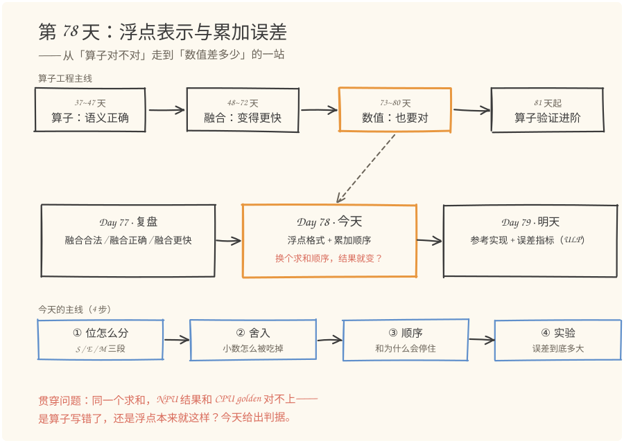
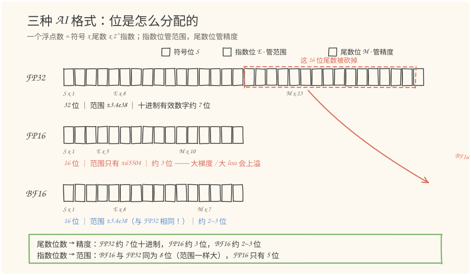
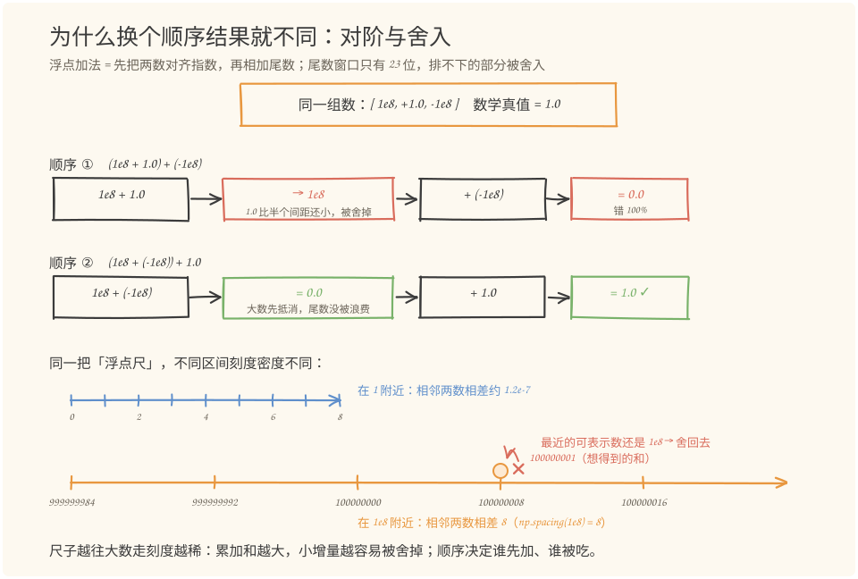
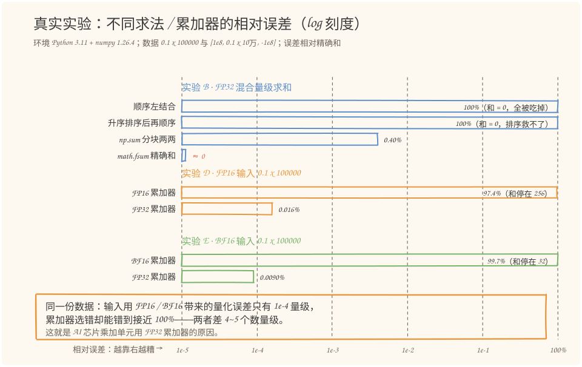

# 第 78 天：浮点表示与累加误差——为什么换了求和顺序，结果就变了

> **今日目标**：完成本教程后，你能做到三件事——不看资料画出 FP32／FP16／BF16 的位分配并说出范围与精度的差异；解释清楚为什么 `(1e8+1)+(-1e8)` 得 `0.0` 而 `(1e8-1e8)+1` 得 `1.0`；独立运行 `float_error_lab.py` 复现一张真实误差表，并说出"输入量化误差约 1e-4、累加器选错接近 100%"这句结论的依据。
> **预计时间**：学习 35 分钟＋实践 45 分钟
> **前置准备**：Python 3.11＋numpy（本文环境：aarch64 Linux，Python 3.11.4，numpy 1.26.4）。若装有 PyTorch（本文用 2.7.1+cpu 做可选交叉验证）可以跟着做 5.3 节最后一步。不需要之前 mini 工程的任何代码——今天只做数值实验。
> **今日产出**：一个可复跑的数值实验脚本 `code/float_error_lab.py`、一张五种求和方式的真实误差表、BF16 位级仿真的 torch 交叉验证，外加 4 张手绘图。

## 1. 今天解决什么问题？

设想一个真实的验收场景：你在昇腾上实现了一个 ReduceSum 算子，拿 CPU 上的 NumPy 结果当参考对账，发现小数点后几位对不上。再比如更隐蔽的一种：训练脚本里用 FP16 累加梯度，跑了一万步 loss 卡住不动。这两种现象背后是同一个问题——**浮点数的表示方式和求和顺序，都会改变计算结果**。

先看一个最小例子，它会贯穿全文：

```python
>>> import numpy as np
>>> a, b, c = np.float32(1e8), np.float32(1.0), np.float32(-1e8)
>>> (a + b) + c          # 先加 1.0
0.0
>>> (a + c) + b          # 先让两个大数抵消
1.0
```

同一组数 `[1e8, 1.0, -1e8]`，数学上无论什么顺序都等于 `1.0`，但第一种顺序算出 `0.0`——相对误差 100%。加法的交换律还在（`a+b` 和 `b+a` 相等），**结合律没了**。这不是 Python 或 NumPy 的 bug，而是 IEEE 754 浮点表示的固有属性。

所以今天要回答三个问题：浮点数到底是什么样的数（第 3 节）？小数是怎么在加法中被"吃掉"的（第 4 节）？顺序和格式各贡献多少误差（第 5 节实验）？今天不讲"怎么修"，只把"为什么"和"差多少"钉死——修复手段（误差阈值、参考实现）是明天的内容。

## 2. 先看全貌：今天的内容位于哪里？



**图 1**：看三个位置——上排是算子工程主线，前 11 周解决"语义对不对""融合快不快"，本周（第 12 周）开始解决"数值差多少"，今天的橙色框就落在这一格；中排是本周三天，Day 77 复盘融合，今天讲浮点格式与累加顺序，Day 79 建立参考实现和误差指标；下排是今天的主线四步。

把今天的主线串成 5 步：

1. **位怎么分**：一个浮点数拆成符号、指数、尾数三段，三种格式只是位数分配不同；
2. **刻度有多疏**：数越大，相邻两个可表示数之间距离越大（"刻度间距"）；
3. **小数怎么被吃**：加法先对齐指数，排不进尾数窗口的部分被舍入，太小的增量直接被舍回原值；
4. **动手跑实验**：五种求和方式 × 三种格式，得到一张真实误差表；
5. **会读误差表**：绝对误差、相对误差各在什么时候用——其中相对误差是明天 ULP 指标的地基。

这里有一条贯穿全周的逻辑：算子融合（第 8～11 周）在数学上"语义不变"，但融合和并行调度会**改变求和顺序**，所以"融合前后结果逐位一致"从来不是验收标准，"误差在阈值内"才是。要定阈值，先得懂浮点误差——这就是今天在链路里的位置。

## 3. 核心概念：先用直觉，再给准确定义

### 3.1 浮点数：一把刻度会变疏的尺子

一句通俗解释：浮点数就是**二进制的科学计数法**——把数写成 `±1.xxxxx × 2^e`，再用固定个数的二进制位存下符号、指数 `e` 和尾数 `xxx`。

类比：想象一把"越往大数走刻度越稀"的尺子——量 1 附近的长度能精确到千万分之一，量 1e8 附近的长度只能精确到个位。对应到技术上是：IEEE 754 用指数决定"当前在哪个 2 的幂区间"（一个区间称为 binade），区间内相邻可表示数的距离恒定为 `2^(指数-尾数位数)`；跨过 2 的幂边界，间距跳档翻倍。类比的边界：这把尺子不是平滑变稀，而是**按 2 的幂分档跳变**，同一档内刻度其实均匀。所以在 `[1e8, 2e8)` 这一档里，FP32 的间距恒等于 8，不随数变大而继续变疏。

"间距"可以直接查：

```python
>>> import numpy as np
>>> np.spacing(np.float32(1.0))    # 1 附近
1.1920929e-07
>>> np.spacing(np.float32(1e8))    # 1e8 附近
8.0
```

最小例子——十进制的 0.1 在 FP32 里本来就存不精确（因为 0.1 = 1.6 × 2^-4，尾数是无限循环二进制）：

```python
>>> u = np.float32(0.1).view(np.uint32).item()
>>> f"0  {u >> 23 & 0xFF:08b}  {u & 0x7FFFFF:023b}"      # 符号 指数 尾数
'0  01111011  10011001100110011001101'
```

即 `0x3dcccccd` ≈ 0.10000000149。连输入都已经是近似值，后面的加法只是在这份近似上继续近似。

常见误解：把"浮点误差"当成随机噪声，以为多加几次会互相抵消。实际上舍入误差由间距决定，是**确定性的、可预测的**——第 5 节你会看到 FP16 累加 0.1 十万次的结果精确地冻结在 256，毫无随机性。

### 3.2 三种格式：FP32／FP16／BF16 的位分配

三种格式只是"位怎么分"的三个方案：**指数位越多，范围（能表示多大／多小）越大；尾数位越多，精度（有效数字位数）越高**。



**图 2**：三行分别是三种格式的比特串——红色是符号位，蓝色是指数位（管范围），橙色是尾数位（管精度）。注意从 FP32 指下来的红色虚线框：BF16 就是把 FP32 的**低 16 位尾数砍掉**得到的，所以两者指数域完全相同、范围一样大。

| 格式 | 符号＋指数＋尾数 | 范围 | 十进制有效位 | 一句话定位 |
|---|---|---|---|---|
| FP32 | 1＋8＋23 = 32 位 | ±3.4e38 | 约 7 位 | 训练默认、累加器格式 |
| FP16 | 1＋5＋10 = 16 位 | ±65504 | 约 3 位 | 精度稍高但范围窄，大 loss 会溢出 |
| BF16 | 1＋8＋7 = 16 位 | ±3.4e38 | 约 2~3 位 | 与 FP32 同范围，牺牲一半精度 |

两个容易踩的点：

- **"都是 16 位"不等于差不多**：FP16 与 BF16 的范围差了 28 个数量级（65504 vs 3.4e38）。BF16 能直接装下 FP32 的任何指数，FP16 不行——这正是大模型训练普遍选 BF16 而不是 FP16 的原因之一。
- **BF16 的转换几乎零成本**：砍掉低 16 位（配一个就近舍入）就完成 FP32→BF16，硬件上只是一次移位截断；FP16↔FP32 则要重新计算指数域。这一点在明天做参考实现时会反复用到。

对应到昇腾这类 AI 芯片上是：Cube／Vector 计算单元接受 FP16／BF16 输入做乘加，但**累加器用 FP32**——为什么必须是 FP32，第 5 节的实验 D／E 会给出数字答案。

## 4. 图解核心机制：小数是怎么在加法中被吃掉的

浮点加法分两步：**先对齐指数**（把两个数的指数调成一样，小的那个数的尾数要整体右移），**再相加尾数并舍入**。尾数窗口有限（FP32 是 23 位），右移排不进窗口的低位会被舍入丢弃。看图：



**图 3**：上半部分是贯穿例子的两种顺序：顺序 ① 先加小数，`1.0` 在对阶时整个被舍掉，`1e8+1.0` 原样返回 `1e8`，最后减回 `0.0`；顺序 ② 先让两个 `±1e8` 抵消成 `0.0`，尾数窗口干干净净地装下 `1.0`。下半部分解释原因：同一把尺子在 1 附近间距约 1.2e-7，在 1e8 附近间距是 8——想表示 100000001，最近的可表示数还是 1e8，舍入就把它送回去了。

按图中编号逐步讲清楚：

1. **对齐**：加 `1e8 + 1.0` 时，`1.0` 的指数是 `2^0`，`1e8` 的指数是 `2^26`，两者的尾数要右移 26 位对齐——`1.0` 的有效数字全部掉出 23 位窗口；
2. **舍入**：精确和 `100000001` 落在 `100000000` 与 `100000008` 之间、更靠近左端，按"就近舍入"规则回到 `1e8`。增量小于半个间距（4）时，加法等于什么都没做，这种现象叫**吸收（absorption）**；
3. **顺序为什么救得回来**：顺序 ② 先把 `±1e8` 对消，此时和是 `0`，间距回到极小，`1.0` 完整装进尾数。**大数先对消、小数后进场，是浮点求和的基本战术**；
4. **推到累加**：求和越往后，和越大、间距越大，后面的增量越容易被吸收——所以"加得越多误差越大"不是线性的，而是会在某个点**完全冻结**（第 5 节实验 D：FP16 加 0.1，和停在 256 不再动）。

一句话机制：**浮点加法每一步都会舍入，顺序决定了"谁在什么间距下进场"**。

## 5. 动手实践：一个脚本跑五组实验

### 5.1 准备文件

今天的完整工程就两个文件（随教程已生成）：

```text
tutorials/day-078/
├── README.md
├── code/
│   ├── float_error_lab.py      # 数值实验脚本（本节主角）
│   └── make_images.py          # 生成 4 张 SVG 的绘图脚本
└── images/
    ├── 01-overview.svg
    ├── 02-formats.svg
    ├── 03-rounding.svg
    └── 04-results.svg
```

### 5.2 编写代码

`float_error_lab.py` 只依赖 numpy 和标准库，五个实验共用三件核心工具。最值得逐行读懂的是 **BF16 的位级仿真**——它把 3.2 节"BF16 就是 FP32 砍低 16 位"变成了可执行代码：

```python
def bf16(x):
    """把 FP32 数组按 round-to-nearest-even 舍入到 BF16，结果仍存成 FP32。

    BF16 = FP32 的低 16 位尾数被砍掉，只保留高 16 位（1 符号 + 8 指数 + 7 尾数）。
    本实现与 torch.tensor(x).to(torch.bfloat16).float() 逐位一致（已验证）。
    """
    u = np.asarray(x, dtype=np.float32).view(np.uint32)
    # 加 0x7FFF+低位首位的奇偶修正，等价于“四舍五入到最近偶数”
    rounded = ((u + 0x7FFF + ((u >> 16) & 1)) & 0xFFFF0000).astype(np.uint32)
    return rounded.view(np.float32)
```

三个关键点：

- `view(np.uint32)` 不改内存、只换解读方式，把 32 个比特当整数操作——这是所有位级技巧的入口；
- `+ 0x7FFF` 把"砍掉低 16 位"变成"就近舍入"：低 16 位超过一半就向前进 1；
- `+ ((u >> 16) & 1)` 是"最近偶数"修正：恰好一半时，让进位后的尾数末位是偶数，和 IEEE 754 的默认舍入模式一致（5.3 节会用 torch 验证逐位一致）。

另外两个工具很朴素：`seq_sum` 是显式的左结合顺序求和（模拟"最笨"的累加顺序）；`error_row` 把每次结果和参考值算出绝对误差、相对误差，参考值一律用 `math.fsum`——它对每个中间和保持精确、只在最后舍入一次，是 Python 标准库里的"地面真值"。完整代码见 `code/float_error_lab.py`（约 220 行，其中一半是打印排版，全部可独立运行）。

### 5.3 运行与观察

```bash
cd tutorials/day-078/code
python3 float_error_lab.py
```

以下是在本文环境（aarch64 Linux，Python 3.11.4，numpy 1.26.4）的**真实运行输出**，节选核心表格：

```text
实验 A：FP32 下 [1e8, 1.0, -1e8] 的不同相加顺序
数学真值 = 1.0，同组数据、不同顺序：
求和方式                    结果    绝对误差   相对误差
(1e8 + 1) + (-1e8)           0         1         1
(1e8 + (-1e8)) + 1           1         0         0
(1.0 + (-1e8)) + 1e8         0         1         1
np.sum(3 个元素)             0         1         1
math.fsum(精确)              1         0         0

实验 B：FP32 混合量级 [1e8, 0.1 x 100000, -1e8]
参考值 fsum = 10000.0001：
求和方式                    结果    绝对误差   相对误差
顺序左结合                   0       1e+04       1
先排序(升序)再顺序           0       1e+04       1
np.sum(分块两两相加)       9960        40     0.004
math.fsum(精确)          10000          0       0

实验 D：FP16 输入 0.1 x 100000，两种累加器
十进制真值 = 10000，存储值精确和 = 9997.56：
求和方式                    结果    绝对误差   相对误差
FP16 累加器                256      9744     0.9744
FP32 累加器            9998.41     1.59    0.000159

实验 E：BF16 输入 0.1 x 100000，两种累加器
十进制真值 = 10000，存储值精确和 = 10009.8：
求和方式                    结果    绝对误差   相对误差
BF16 累加器                 32      9968     0.9968
FP32 累加器           10000.9     0.8984   8.984e-05
```

把关键行画成一张图：



**图 4**：横轴是相对误差的 log 刻度，越靠右越糟。读三个信号——实验 B 里"全被吃掉"的两种顺序是满格 100%，而 `np.sum` 的分块两两相加只有 0.40%，**顺序本身就能差出两个数量级**；实验 D／E 里 FP16／BF16 累加器的条几乎顶满（97.4%、99.7%），FP32 累加器却缩到 1e-4 量级，**累加器格式比输入格式重要四个数量级**；四组长条都在"和冻结"处停住（256、32、0），说明这不是噪声，是吸收。

再对照脚本里的三行"过程证据"，把机制钉实：

- `FP16 里的 0.1 实际是 0.0999755859375`——输入量化偏差约 0.024%，这是"格式税"的下限；
- `FP16 顺序累加 10 万次：和停在 256`——间距 `np.spacing(256)` 在 FP16 下是 0.25，增量 0.0999 连半个间距（0.125）都不到，从 256 起每次加法都被舍回原值，第 4 节的"冻结"预测成真；
- 实验表里 `FP32 累加器` 对十进制真值的相对误差约 1.6e-4／9e-5，和输入量化同一量级——说明换对累加器后，**剩余误差几乎全部来自输入表示，累加本身基本不再贡献**。

最后做一次交叉验证：自写的 `bf16()` 和 PyTorch 官方转换是否逐位一致（本文环境已执行，torch 2.7.1+cpu）：

```python
>>> import numpy as np, torch
>>> vals = np.concatenate([np.random.default_rng(7).standard_normal(1000) * 10,
...                        np.linspace(1e-3, 1e5, 200)]).astype(np.float32)
>>> np.array_equal(bf16(vals),
...                torch.from_numpy(vals).to(torch.bfloat16).to(torch.float32).numpy())
True
```

`True`——位级仿真是可信的，后面实验 E 的结论才有底气。

### 5.4 修改一个参数再观察

把实验 D／E 里的增量从 `0.1` 改成 `1.0`（改动 `float_error_lab.py` 中 `np.full(100_000, 0.1, ...)` 的一个数字），重新运行，**真实输出**：

```text
FP16 顺序累加 0.1 x 100000 -> 256.0   (np.spacing@256 = 0.25)
FP16 顺序累加 1.0 x 100000 -> 2048.0  (np.spacing@2048 = 2.0)
BF16 顺序累加 0.1 x 100000 -> 32.0
BF16 顺序累加 1.0 x 100000 -> 256.0
```

增量变大，冻结点上移，而且**落点可以事前预测**：FP16 在 `[2048, 4096)` 档的间距是 2，增量 1.0 恰好是半个间距，"就近舍入到偶数"规则把它送回 2048（2048 是偶数倍刻度）。用一句话概括规律：**冻结点 = 刻度间距追上（半个）增量的那一档**。你可以在必做练习里用这条规律先笔算、再运行验证。

## 6. 常见错误与排查

**错误一：FP16 累加梯度／loss，训练到一半 loss 不再下降。**
现象：前几百步正常，之后 loss 纹丝不动，检查学习率、数据都没问题。
原因：和越来越大、间距越来越大，梯度增量小于半个间距，每次 `acc += g` 都被吸收——实验 D 里"和停在 256"就是它的最小复现。
定位：打印中间和以及 `np.spacing`，看增量与半个间距的比值；若比值长期小于 1，就是冻结。
修复：换 FP32 累加器（算子层）；或做 loss scaling 把损失和梯度整体放大，存回去时再缩回（框架层）；或分块累加。

**错误二：NPU 算子结果和 CPU golden 用 `==` 比较，永远失败。**
现象：ReduceSum／Mean 类算子验收时，两边小数点后几位不同，误判为算子 bug。
原因：并行归约是树形（分块两两相加），CPU 单核验证常是顺序累加，**顺序不同结果本来就不同**——实验 B 里两者相差 0.40%，完全合法。
定位：算一次相对误差；若在 1e-3 量级以内且无 NaN／inf，基本可排除 bug。
修复：改用容差比较（`np.allclose`／`math.isclose`）；正式的阈值体系和参考实现是明天 Day 79 的主题。

**错误三：BF16 和 FP16 当成同一个东西互换。**
现象：把 BF16 权重按 FP16 保存，或反过来；轻则精度崩掉，重则直接 `inf`。
原因：两者虽然都是 16 位，但指数域 8 位 vs 5 位，范围差 28 个数量级——FP16 的 65504 上限装不下 BF16 能轻松表示的数。
定位：`print(arr.max(), arr.min())` 对 65504 上下检查；或看溢出报错。
修复：按"范围需求"选格式：数值可能超过 6e4 就别用 FP16；BF16 与 FP32 范围相同，是更稳的降精度选择。

**错误四：以为"升序排序后再求和"是万能药。**
现象：数据里有正有负、量级悬殊（比如实验 B 的 `[1e8, 0.1 x 100000, -1e8]`），排序后顺序累加结果仍是 0.0。
原因：升序后 `-1e8` 排最前，它照样把后面 10 万个 0.1 全部吸收——排序只解决"同号数据"的量级问题，混合符号时需要让大数先对消。
定位：对混合符号数据，比较排序法与 `np.sum`（分块）的结果差异。
修复：用分块／树形归约（让 `±1e8` 有机会在同一块内抵消），或高精度累加器。

## 7. 今日练习

### 必做练习

把实验 D 的增量从 `0.1` 改成 `0.01`，**先笔算再运行**：FP16 里 0.01 的存储值约 0.010002，请用"冻结点 = 刻度间距追上半个增量的那一档"这条规律，预测 FP16 顺序累加十万次会停在哪里（提示：算一算 `2^k` 各档的间距 `2^(k-10)`，找半间距首次大于 0.010002 的档位）。然后把预测写下来，运行 `float_error_lab.py` 验证，记录"预测值／实际值"。预期产出：一行预测、一行实测、一句解释（若不一致，说明你哪一步算错了）。

### 选做挑战

实现 **Kahan 补偿求和**：维护一个补偿变量 `c`，每次把低位的舍入损失记下来并在下一步补回，核心只有三行——`y = item - c; t = s + y; c = (t - s) - y; s = t`。用它顺序累加实验 B 的混合量级数据，和 `np.sum`（0.40%）、`fsum`（≈0）比较误差落在哪一档，并用一句话解释"Kahan 为什么能在不换累加器格式的情况下近似出 FP32 的间距"。不引入任何新库，改完直接跑。

## 8. 今日验收

- [ ] 我能不看资料画出 FP32／FP16／BF16 的位分配，说出范围（±3.4e38／±65504／±3.4e38）和有效位（约 7／3／2~3 位）的差异；
- [ ] 我能用自己的话解释 `(1e8+1)+(-1e8)` 为什么是 `0.0`：对阶舍入、吸收、间距变疏，三个词都用得上；
- [ ] 我能独立运行 `python3 code/float_error_lab.py`，并指出表中哪一行是"顺序的贡献"、哪一行是"格式的贡献"；
- [ ] 我能先笔算预测"增量减半／加倍后 FP16 冻结点在哪"，再改参数运行验证（5.4 节规律可复用）；
- [ ] 我保存了实验脚本、`bf16()` 的 torch 交叉验证结果，以及四张图（`code/` 和 `images/` 目录）。

## 9. 一句话总结与明天预告

今天回答了一个工程上绕不开的问题：**同一个求和，为什么换个顺序、换个格式，结果就不同**。机制上，浮点数是刻度分档变疏的尺子，加法要先对阶再舍入，增量小于半个间距就被吸收——所以 `(1e8+1)+(-1e8)` 等于 0；实验上，量级悬殊时顺序能把 FP32 求和错到 100%，而 FP16／BF16 输入本身只带来 1e-4 量级的量化误差，**真正的灾难是把它们当累加器**（冻结在 256／32），这解释了 AI 芯片乘加单元坚持用 FP32 累加器。验证上，你已经会用绝对误差／相对误差读一张真实误差表。

明天（第 79 天）把这套直觉变成工具：建立 Golden Reference，实现统一的误差检查函数，并引入比相对误差更"懂浮点"的 ULP 指标——今天预测冻结点用的间距，就是 ULP 的原型。


