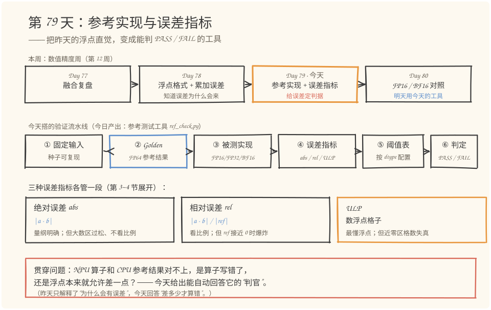
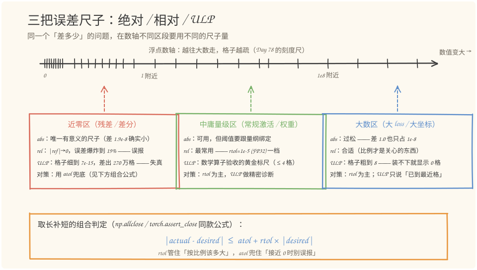
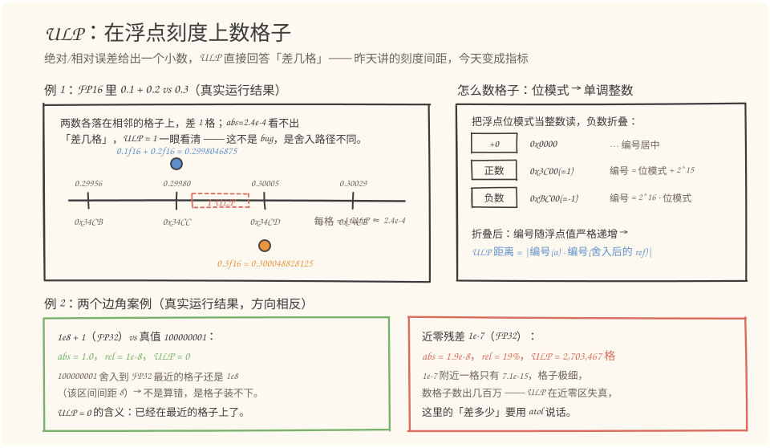
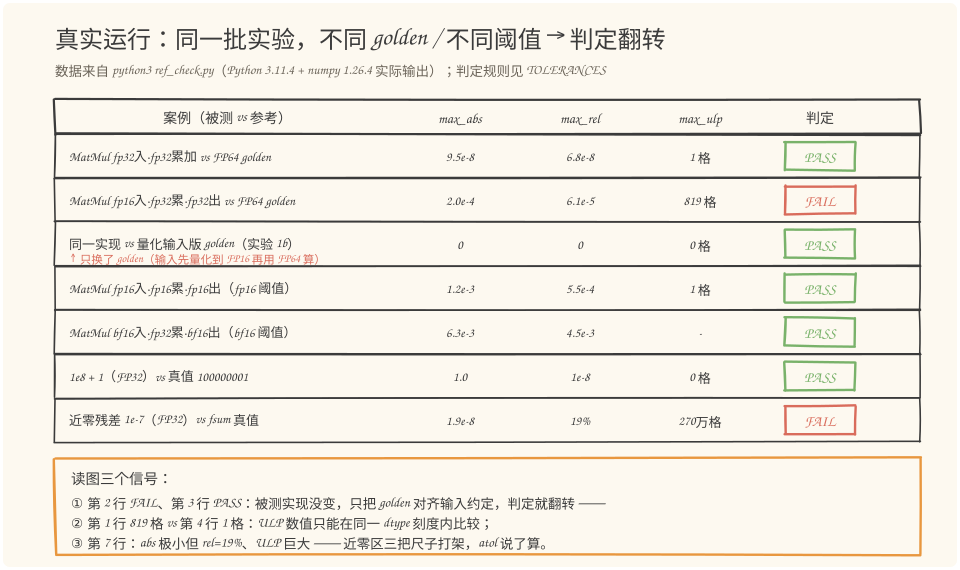

# 第 79 天：参考实现与误差指标——差多少才算错，谁来裁判

> **今日目标**：完成本教程后，你能做到三件事——说出 Golden Reference 的两个硬要求（高精度可复现、对齐输入约定），并解释为什么用 `==` 给浮点结果对账永远行不通；写出绝对误差、相对误差、ULP 三种指标的定义和各自盲区（近零爆炸、大数过松、格子失真）；独立运行 `ref_check.py` 读懂判定表，并亲手通过"换一个 golden"把一个 FAIL 翻转成 PASS。
> **预计时间**：学习 35 分钟＋实践 45 分钟
> **前置准备**：Python 3.11＋numpy（本文环境：aarch64 Linux，Python 3.11.4，numpy 1.26.4）。建议先过一遍第 78 天的"刻度尺"比喻——今天的 ULP 指标直接建立在昨天的 `np.spacing` 之上。不需要任何昇腾硬件，全部实验在 CPU 上完成。
> **今日产出**：一个可复用的参考测试工具 `code/ref_check.py`（Golden Reference ＋ 统一误差检查函数 ＋ 四种 dtype 的阈值配置）、五组实验的真实运行结果、4 张手绘图。

## 1. 今天解决什么问题？

接着昨天的验收场景往下走：你在昇腾上实现了一个算子，拿 CPU 上的 NumPy 结果当参考对账，小数点后几位对不上。昨天已经解释了**为什么会不一样**（对阶舍入、吸收、刻度变疏），但工程上真正要回答的是另一个问题——**差多少才算错**？没有判据，你就只能在"全部重写算子"和"假装没看见"之间二选一。

先看一个最小的例子，三行代码就能说明"判据"为什么不能是"相等"：

```python
>>> 0.1 + 0.2 == 0.3
False
>>> 0.1 + 0.2 - 0.3
5.551115123125783e-17
```

连 CPU 上最普通的 FP64 加法都凑不出严格相等——如果验收标准是 `==`，那么全世界没有一个浮点程序能通过验收。再回顾昨天的例子：FP32 里 `1e8 + 1.0` 得到 `1e8`，而 FP64 真值是 `100000001`，绝对差整整 1.0，但相对误差只有 1e-8。**同一个"差多少"的问题，在不同量级、不同格式下需要不同的尺子来量**——这就是今天的核心。

今天用一个贯穿全文的例子：一个 `2×3` 矩阵乘 `3×2` 矩阵的 MatMul（明天 Day 80 会继续用它做精度对照实验）：

```python
A = [[0.1, 0.2, 0.3],      B = [[0.4, 1.0],
     [1.0, 2.0, 3.0]]           [0.5, 2.0],
                                [0.6, 3.0]]
golden (FP64) = [[0.32, 1.4], [3.2, 14.0]]
```

被测的则是它的多种精度实现：FP32 全链路、FP16 输入配 FP32 累加、FP16 全链路、BF16 输入……每种实现和 golden 之间差多少、用什么尺子量、阈值定在哪——今天把这三个问题一次做成工具。

## 2. 先看全貌：今天的内容位于哪里？



**图 1**：看三个位置——上排是本周四天：Day 78 解释"误差为什么会来"，今天（橙色框）把这份理解变成**能自动判 PASS/FAIL 的工具**，Day 80 拿这个工具做 FP16/BF16 精度对照；中排是今天搭的六步验证流水线，其中蓝色高亮的"② Golden"是整条链的地基；下排三张卡片是今天的主角——三种误差指标各自的盲区。

把这条流水线串成 5 步：

1. **固定输入**：用固定种子或手写常量生成输入，保证任何人任何时刻复跑都拿到同一组数；
2. **生成 golden**：用 FP64 的 NumPy 参考实现算出期望输出——参考实现要"慢而准"，和被测实现的"快而糙"刻意相反；
3. **跑被测实现**：把同一组输入喂给 FP16/FP32/BF16 版本的实现；
4. **算误差指标**：绝对误差、相对误差、ULP 一次算完，三种尺子各有分工；
5. **查阈值表判定**：按输出 dtype 查 `TOLERANCES` 配置，逐元素套组合公式、数格子，给出 PASS/FAIL。

这五步就是"参考测试工具"的骨架，也是昇腾算子验证里 CPU 侧对账的标准形态。今天剩下的内容就是把 3、4、5 步里的概念和代码补齐。

## 3. 核心概念：先用直觉，再给准确定义

### 3.1 Golden Reference：给"标准答案"立法

一句通俗解释：Golden Reference（参考实现/黄金参考）就是**一份你自己确信算对了的期望输出**，被测实现和它对账。

类比：老师批改数学卷子前，先自己用最笨但最稳的方法把题做一遍，得到一份"标准答案"。对应到技术上是：用一个**精度更高、实现路径更简单可信**的环境（通常是 CPU 上的 FP64 NumPy，或 `math.fsum` 这类精确求和）独立算出期望结果——注意"独立"两个字：golden 最好不和被测实现共用代码，否则一错错一对，对账失去意义。类比的边界：标准答案在数学题里是"真值"，但 golden 本身也是浮点程序，也有舍入——第 5 节你会看到，FP64 golden 对 FP32 被测来说几乎是真值，对 FP64 被测来说就要小心（两边可能各差 1 格）。

golden 有两个硬要求，缺一不可：

- **可信**：精度要显著高于被测实现（被测 FP32，golden 就用 FP64；被测是求和，golden 就用 `fsum`）；
- **可复现**：随机输入必须固定种子（`np.random.default_rng(7)`），任何不确定性（线程调度、并行归约顺序）都要消除或固定——否则失败没法复现，排查会变成玄学。

还有一个今天实验会反复敲打的要点：**golden 的输入约定要和被测实现对齐**。被测实现吃的是量化到 FP16 的输入，那 golden 也应该先量化再计算——否则你测到的是"FP16 和 FP64 的格式差异"，不是"实现是否正确"（5.4 节的翻转实验就是它）。

常见误解：把"golden"当成"绝对真理"。实际上 golden 只是把不确定性压到足够低的参照物，它自己也在舍入；当被测实现和 golden 同为 FP64 时，两边差 1 ULP 是常态（马上在 3.3 的例子里看到）。

### 3.2 绝对误差与相对误差：一对互补的尺子

**绝对误差**：`abs_err = |actual - desired|`，单位就是结果本身的量纲。它回答"差了几个单位"。

**相对误差**：`rel_err = |actual - desired| / |desired|`，没有量纲。它回答"差了百分之几"。

用今天的两个真实数据感受它们的互补：

- 大数例子（实验 3）：FP32 算 `1e8 + 1` 得 `1e8`，真值 `100000001`。绝对误差 `1.0`——听起来吓人；相对误差 `1e-8`——其实只差了千万分之一。大数区**相对误差才是合适量纲**；
- 近零例子（实验 4）：两个接近的大数相减，FP64 真值 `9.99e-8`，FP32 算出 `1.19e-7`。绝对误差 `1.9e-8`——确实很小；相对误差 `19%`——看起来灾难。近零区**绝对误差才有物理意义**，相对误差在分母趋零时爆炸（分母为 0 时干脆无法定义）。

工程上的标准做法是把两把尺子拼起来用，也就是 `np.allclose` 的判定公式（对每个元素）：

```text
|actual - desired| <= atol + rtol * |desired|
```

`rtol`（相对容差）管住"按比例该多大"，`atol`（绝对容差）兜住"参考值接近 0 时别误报"。两个库的默认值值得记住（本文环境实测核实）：

| 工具 | 默认容差 |
|---|---|
| `np.allclose` | `rtol=1e-5, atol=1e-8`（对任何 dtype 一视同仁） |
| `torch.testing.assert_close` | 按 dtype 区分：FP64 `(1e-7, 1e-7)`，FP32 `(1.3e-6, 1e-5)`，FP16 `(1e-3, 1e-5)`，BF16 `(0.016, 1e-5)` |

注意 numpy 的默认值不区分 dtype——这就是为什么我们要在工具里自己维护一张按 dtype 配置的阈值表（第 5 节的 `TOLERANCES`），FP16 的合理容差比 FP32 宽三个数量级，用同一套阈值要么误杀要么漏放。

### 3.3 ULP：浮点自己的"格数"

一句通俗解释：ULP（Unit in the Last Place，最后一位单位）就是**一个浮点数到相邻可表示数的距离**——昨天反复用的 `np.spacing` 量出来的正是它。

类比：误差 1.5 米是远是近？在"米尺刻度 1 厘米"的语境下差了 150 格，很远；在"路牌按公里标注"的语境下不到一格，很近。对应到技术上是：ULP 把误差放回**该 dtype 的刻度**上数格子——`差 N 个 ULP` 意思是"如果沿着这种格式能表示的数一格一格走，从参考值走到你的结果要 N 步"。它天然公平：不偏袒大数也不苛待小数，因为格子本身就是浮点格式定义的。类比的边界：格子间距不是常数（越靠近 0 越细），所以在极接近 0 的区域，几百万格可能只对应极小的绝对差——ULP 在近零区会失真（实验 4 的真实数据：差 `1.9e-8` 却隔了 2,703,467 格）。

最小例子——`0.1 + 0.2` vs `0.3` 在三种格式下的真实结果（本文环境实测）：

```text
dtype      actual(0.1+0.2)       desired(0.3)     abs       rel      ulp
float64    0.30000000000000004   0.3              5.6e-17   1.9e-16  1
float32    0.30000001192092896   0.3000000119...  0.0       0.0      0
float16    0.2998046875          0.300048828125   2.4e-04   8.1e-04  1
```

FP64 下 abs/rel 给出 `5.6e-17` 这种"看不出意义"的小数，ULP 直接说"差 1 格"——两条舍入路径（先加后舍 vs 直接舍 0.3）只差一个最小刻度，显然不是 bug。这就是数学函数库（glibc、musl 的 libm）用 ULP 而不是相对误差验收的原因：**"差几格"比"差百分之几"更贴近浮点错误的本质**。

怎么数格子？技巧是把浮点位模式映射成单调整数（图 3 右半）：正数的编号 = 位模式加 2^(n-1)，负数折叠。映射后全体可表示数变成一根等距整数轴，两数的 ULP 距离就是编号之差。参考值（通常是 FP64）先就近舍入到被测 dtype 的格子上再数。昇腾算子验证里 ULP 的典型用法：FP32 输出的数学算子（Exp、Sin、Rsqrt 这类）验收标准常写成"误差 ≤ 4 ULP"。


## 4. 图解核心机制：三把尺子怎么分工，格子怎么数

先解决"什么时候用哪把尺子"。把数轴切成三段看：



**图 2**：上方是 Day 78 那把"越往大数走刻度越疏"的浮点数轴；下方三个放大区对应三段战场。看三行结论——近零区（红）：相对误差爆炸到 19%、ULP 数出 270 万格，只有绝对误差在说人话，对策是 atol 兜底；中庸量级区（绿）：三把尺子都好用，rtol 是主力、ULP 是精密诊断；大数区（蓝）：绝对误差过松（差 1.0 也只占 1e-8），ULP 会说"0 格"（格子粗到 8，真值根本落不进更细的格），相对误差最合适。底部橙框就是取长补短的组合公式。

再解决"格子到底怎么数"。ULP 的完整机制：



**图 3**：左半是 3.3 节那个 FP16 例子的放大图——`0.1f16 + 0.2f16` 精确和是 `0.2999267578125`，恰好落在 `0x34CC`（0.2998046875）和 `0x34CD`（0.300048828125）的正中间，"就近舍入到偶数"把它送进 `0x34CC`；而 `0.3` 直接舍入落在 `0x34CD`。两数各占相邻的格子，差 1 ULP。右半是数格子的实现：位模式按无符号整数读出，负数折叠，得到一根随浮点值严格递增的整数轴——两数编号相减就是格子数。底部两个边角案例（都是真实运行结果）方向相反：`1e8+1` 的 ULP 是 **0**（真值 100000001 舍入到 FP32 最近的格子还是 1e8，不是算错，是格子装不下）；近零残差的 ULP 是 **270 万**（1e-7 附近一格只有 7.1e-15，格子极细，数格子失去意义）。

把两张图合起来，今天最重要的一张"指标选择表"：

| 结果特征 | 主尺子 | 辅助 | 理由 |
|---|---|---|---|
| 量级稳定的中庸值（激活、权重） | rel（rtol） | ULP | 比例才是关心的东西 |
| 可能接近 0（残差、差分、对消） | abs（atol） | 组合公式 | rel 会爆炸、ULP 会失真 |
| 数学函数/算子验收（想知道舍入路径差几步） | ULP | rel | "差几格"最贴近浮点错误本质 |
| 低精度输入的实现（FP16/BF16 算子） | 按 dtype 配 rtol | — | 格式税远大于实现误差，阈值必须放宽 |


## 5. 动手实践：搭一个参考测试工具

### 5.1 准备文件

今天的完整工程就两个文件（随教程已生成）：

```text
tutorials/day-079/
├── README.md
├── code/
│   ├── ref_check.py      # 参考测试工具：golden + 统一误差检查 + dtype 阈值（本节主角）
│   └── make_images.py    # 生成 4 张 SVG 的绘图脚本
└── images/
    ├── 01-overview.svg
    ├── 02-metrics.svg
    ├── 03-ulp.svg
    └── 04-verdicts.svg
```

### 5.2 编写代码

`ref_check.py` 只依赖 numpy 和标准库，四件套结构：**阈值配置 → ULP 实现 → 统一检查函数 → golden 与被测实现**。最值得逐行读懂的是三段。

第一段，按 dtype 配置的阈值表——今天"产出"里明确要求的部分：

```python
TOLERANCES = {
    "float64":  dict(rtol=1e-12, atol=1e-12, max_ulp=1),
    "float32":  dict(rtol=1e-5,  atol=1e-6,  max_ulp=4),
    "float16":  dict(rtol=1e-3,  atol=1e-4,  max_ulp=8),
    "bfloat16": dict(rtol=1.6e-2, atol=1e-3, max_ulp=None),  # BF16 以 rtol 为主
}
```

取值参考了 3.2 节实测的两个库的默认值：FP32 的 `rtol=1e-5` 对齐 `np.allclose`，FP16 的 `1e-3`、BF16 的 `0.016` 对齐 `torch.testing.assert_close` 的 dtype 分档。`max_ulp` 是 ULP 指标的阈值（FP32 数学算子常用 ≤4 格），BF16 一格太粗、数格子意义不大，置 `None` 跳过。

第二段，ULP 距离——图 3 右半的代码化。核心是"位模式 → 单调整数"的折叠：

```python
def _monotone_uint(x, dtype_name):
    # 把位模式按无符号整数 u 读出（共 n 位）
    #   符号位为 0（正数）: m = u + 2^(n-1)
    #   符号位为 1（负数）: m = (~u & mask) + 1   即 2^n - u
    # 折叠后 m 随浮点值严格递增，全程无符号算术，FP64 也不溢出
    ...
    return np.where(u >= half, neg_m, pos_m)

def ulp_distance(actual, desired, dtype_name):
    a = quantize(actual, dtype_name)   # 被测值本就在该刻度上，量化是幂等的
    r = quantize(desired, dtype_name)  # golden 就近舍入到该 dtype 的格子
    ma = _monotone_uint(a, dtype_name)
    mr = _monotone_uint(r, dtype_name)
    return np.where(ma >= mr, ma - mr, mr - ma)
```

两个关键点：`view` 换解读不动内存，和 Day 78 的 `bf16()` 一脉相承；golden 先 `quantize`（就近舍入到被测 dtype 的格子）再数格子——所以 `1e8+1` 的案例里，FP64 真值 100000001 先舍回 1e8，与被测值同格，ULP 距离为 0。BF16 没有原生 numpy dtype，复用了 Day 78 的位级仿真 `bf16()`（已与 torch 逐位交叉验证过）。

第三段，统一检查函数，三种指标一次算完（节选关键行）：

```python
def check_close(actual, desired, *, dtype_name, name=""):
    tol = TOLERANCES[dtype_name]
    ...
    finite_ok = bool(np.all(np.isfinite(a)) and np.all(np.isfinite(d)))  # NaN/Inf 先判
    diff = np.abs(a - d)
    max_abs = float(diff.max())
    denom = np.abs(d)
    rel = np.where(denom > 0, diff / np.where(denom > 0, denom, 1.0), np.inf)  # 防除零
    max_rel = float(rel.max())
    max_ulp = int(ulp_distance(a, d, dtype_name).max())
    absrel_ok = bool(np.all(diff <= tol["atol"] + tol["rtol"] * np.abs(d)))  # 组合公式
    ulp_ok = True if tol["max_ulp"] is None else (max_ulp <= tol["max_ulp"])
    ...
```

注意判定的顺序：先查 NaN/Inf（数值错误优先于精度问题），再套组合公式，最后查 ULP。完整代码见 `code/ref_check.py`（约 300 行，一半是实验排版；`matmul_impl` 是显式三重循环，输入量化/累加器/输出三处精度都可作为参数传入）。

### 5.3 运行与观察

```bash
cd tutorials/day-079/code
python3 ref_check.py
```

以下是在本文环境（aarch64 Linux，Python 3.11.4，numpy 1.26.4）的**真实运行输出**，节选核心部分：

```text
实验 1：MatMul 2x3 @ 3x2，五种实现 vs FP64 golden
  [fp32输入·fp32累加·fp32出] PASS  dtype=float32  max_abs=9.537e-08  max_rel=6.812e-08  max_ulp=1格(≤4)
  [fp16输入·fp32累加·fp32出] FAIL  dtype=float32  max_abs=1.953e-04  max_rel=6.104e-05  max_ulp=819格(≤4)
  [fp16输入·fp32累加·fp16出] PASS  dtype=float16  max_abs=7.812e-04  max_rel=2.790e-04  max_ulp=0格(≤8)
  [fp16输入·fp16累加·fp16出] PASS  dtype=float16  max_abs=1.172e-03  max_rel=5.493e-04  max_ulp=1格(≤8)
  [bf16输入·fp32累加·bf16出] PASS  dtype=bfloat16 max_abs=6.250e-03  max_rel=4.464e-03  max_ulp=-

实验 2：数学上应该相等 —— 0.1 + 0.2 vs 0.3，三种 dtype
  float64   0.30000000000000004    0.3                5.55e-17 1.85e-16     1
  float32   0.30000001192092896    0.3000000119...    0.00e+00 0.00e+00     0
  float16   0.2998046875           0.300048828125     2.44e-04 8.14e-04     1

实验 3：格子装不下 —— FP32 计算 1e8 + 1 vs FP64 真值 100000001
  [1e8+1] PASS  dtype=float32  max_abs=1.000e+00  max_rel=1.000e-08  max_ulp=0格(≤4)

实验 4：近零残差 —— 相对误差爆炸，atol 兜底
  golden (fsum, FP64) = 9.999999994736442e-08
  actual (FP32 减法)  = 1.1920929e-07
  abs = 1.921e-08   rel = 1.921e-01   ulp = 2703467 格
  纯 rtol 检查（1e-5）: FAIL  <- 相对误差 19%，误报
  纯 atol 检查（1e-6）: PASS  <- 差 1.9e-8，物理上确实小
  组合公式 atol+rtol*|d|:  PASS  <- atol 兜住了近零
  ULP（阈值 4）:       FAIL  <- 近零区刻度极细，数格子失去意义
```

把判定结果画成一张对照矩阵：



**图 4**：每一行的数值都来自上面的真实输出。读三个信号——第一，第 2 行 FAIL 而第 3 行 PASS：**同一个被测实现**，只把参考从"全 FP64 golden"换成"输入先量化到 FP16 的 golden"，判定就翻转（5.4 节展开）；第二，第 1 行 ULP=1 格（FP32 刻度）与第 4 行 ULP=1 格（FP16 刻度）数字相同但含义不同——FP16 一格比 FP32 宽 8192 倍，**ULP 数值只能在同一 dtype 刻度内比较**；第三，最后一行三把尺子打架：abs 说小、rel 说 19%、ULP 说 270 万格——近零区听 atol 的。

实验 1 里还有一条值得单独说：`fp16输入·fp32累加·fp32出` 对全 FP64 golden 的 `max_ulp=819格` 看着吓人，其实根源是 **FP16 输入的量化税**（0.1 存进 FP16 的相对偏差就有 2.4e-4），乘开再累加，误差自然落在 1e-4 量级——这正是"golden 必须对齐输入约定"的反面教材。

### 5.4 修改一个参数再观察

做一个对照实验：**被测实现一字不动，只换 golden**。把参考实现从"FP64 直接算"改成"先把 A、B 量化到 FP16，再用 FP64 算"（即 `ref_check.py` 的实验 1b），**真实输出**：

```text
实验 1b：换一个 golden —— 参考实现先把输入量化到 FP16 再用 FP64 算
  golden2 = A16 @ B16 (FP64 计算) = [[0.3200146555900574, 1.4000244140625],
                                     [3.2001953125, 14.0]]
  [fp16输入·fp32累加 vs golden2] PASS  dtype=float32  max_abs=0.000e+00  max_rel=0.000e+00  max_ulp=0格(≤4)
```

同一个 `fp16输入·fp32累加·fp32出` 实现，实验 1 里对全 FP64 golden 是 FAIL（819 格），换 golden 后**逐元素零误差**——两个 FP16 数的乘积在 FP32 里是精确的（11 位×11 位=22 位，装得进 24 位尾数），三求和又恰好无舍入。差别全在"输入量化误差算谁的"。

工程含义：算子测试里，**golden 应该对齐被测实现的输入约定**（吃 FP16 输入的算子，就用量化后的输入算 golden），这样测的才是"实现是否正确"；格式差异（FP16 vs FP64 的固有差距）应该交给阈值表去宽容，而不是混在实现误差里。

再做一个收紧阈值的观察（改一行配置）：把 `TOLERANCES["float32"]` 从 `rtol=1e-5, atol=1e-6` 收紧到 `rtol=1e-8, atol=1e-8`，重跑实验 1——第一行 `fp32输入·fp32累加` 会从 PASS 翻成 FAIL。原因在数据里：它误差最大的元素是 `1.4` 处的 `9.5e-8`（`max_abs`），默认阈值下 `atol=1e-6` 一项就兜住了它；**只收 rtol 不够，必须两个一起收**（本文环境实测：`rtol=1e-7, atol=1e-8` 仍是 PASS，`rtol=1e-8, atol=1e-8` 才 FAIL）。这就是阈值表的意义：阈值是被测实现的精度预算，预算定了，判定就自动跟着数据走。

## 6. 常见错误与排查

**错误一：用 `==` 或 `np.array_equal` 给浮点结果对账。**
现象：验收脚本里 `assert (npu_result == cpu_result).all()`，哪怕算子完全正确也永远失败；反过来，若结果里有 NaN，`nan == nan` 是 False，倒是可以"正确地失败"。
原因：浮点加法/乘法每一步都舍入，两条计算路径几乎不可能逐位一致——第 1 节的 `0.1 + 0.2 == 0.3` 就是 `False`。
定位：把 `==` 换成打印 `np.abs(a - b).max()`，看误差量级。
修复：改用容差比较（`np.allclose` 或今天的 `check_close`），阈值按 dtype 查表。

**错误二：残差类结果只设了 rtol，测试天天红。**
现象：算子输出是两个大数的差（残差、归一化分母、对消后的和），CI 里随机挂红：绝对误差明明只有 1e-8，相对误差却 19%。
原因：参考值本身趋近 0，`|a-b|/|ref|` 的分母失控——实验 4 的最小复现。
定位：打印参考值的 `np.abs(d).min()`，若接近 0 而阈值里只有 rtol，就是它。
修复：阈值加上合理的 `atol`（组合公式 `atol + rtol*|ref|`），atol 取"该物理量级下可接受的绝对偏差"。

**错误三：阈值一刀切——FP16 实现套 FP32 阈值。**
现象：实验 1 的第二行：`fp16输入·fp32累加` 的实现被判 FAIL（`max_rel=6.1e-5` 超了 FP32 的 `rtol=1e-5`），团队以为是算子 bug，查一周无果。
原因：FP16 输入的量化税（每个输入差约 2.4e-4 相对量）是格式固有属性，不是实现错误；FP32 的阈值装不下这笔税。
定位：用实验 1b 的方法换"量化输入版 golden"重测——若立刻 PASS，说明是阈值/golden 约定问题而非实现问题。
修复：按 dtype 维护阈值表（FP16 的 rtol 放宽到 1e-3 量级）；同时让 golden 对齐被测实现的输入约定。

**错误四：golden 精度和被测一样，还想卡 ULP。**
现象：用 FP32 累加的参考实现去验收 FP32 被测实现，阈值定"≤1 ULP"，测试随机挂红；或者反过来用 FP16 golden 验收 FP16 实现，真实 bug 被淹没在 golden 自己的误差里。
原因：golden 与被测同精度时，两边各自的舍入路径不同，差 1~2 格是常态（实验 2：FP64 下 `0.1+0.2` 与 `0.3` 就差 1 格）。
定位：把 golden 换成 FP64 重跑，若 ULP 距离明显缩小，就是 golden 精度不足。
修复：golden 至少比被测高一级精度（被测 FP32 → golden FP64；被测是求和 → golden 用 `math.fsum`）；同精度对账时 ULP 阈值放宽到 2~4 格。

**错误五：没先查 NaN/Inf 就比误差。**
现象：被测输出里混进一个 `inf`（FP16 上溢）或 `nan`（`inf - inf`），手写判定 `np.any(np.abs(a-b) > tol)` 里 NaN 参与的比较返回 False，"有元素超差"检查被 NaN 骗过，测试绿灯通过。
原因：NaN 与任何数比较都是 False——无论是 `>` 还是 `<`，精度检查天然对 NaN 失明。
定位：在任何误差计算前先 `np.isfinite` 检查两边；出错时打印 `np.where(~np.isfinite(a))`。
修复：`check_close` 的做法——`finite_ok` 是第一道闸，NaN/Inf 出现直接 FAIL，不进入误差比较。

## 7. 今日练习

### 必做练习

先笔算再运行：FP16 里，十进制 `0.1` 的最近可表示数是 `0.0999755859375`。请回答两个问题——(1) `0.1`（按 FP64 精确值）和 `np.float16(0.1)` 的 ULP 距离是几格？提示：`0.1` 落在 FP16 的哪两个格子之间、更靠近哪边？(2) 把你的预测写下来，然后用一行代码验证：

```python
import sys; sys.path.insert(0, ".")
from ref_check import ulp_distance
print(ulp_distance([np.float16(0.1)], [0.1], "float16"))
```

（需要 `import numpy as np`。）预期产出：一行预测、一行实测、一句解释——若不一致，说明你对"就近舍入"的理解差在哪一步。

### 选做挑战

给 `check_close` 增加一个**逐元素 ULP 直方图**：用 `np.bincount` 统计 `ulp_distance` 的分布（0 格几个、1 格几个、……），在报告中多打一行。然后对实验 1 的 `fp16输入·fp16累加` 实现运行，观察误差是集中在 0~1 格还是拖出长尾——长尾往往意味着某几个元素走了不同的舍入路径。不引入新库，改完直接跑。

## 8. 今日验收

- [ ] 我能不看资料说出 Golden Reference 的两个硬要求（高精度可复现、对齐输入约定），并解释 `==` 对账为什么永远行不通；
- [ ] 我能写出绝对误差、相对误差、ULP 的定义，并各举一个"它最合适"和一个"它失真"的场景（近零 / 大数）；
- [ ] 我能独立运行 `python3 code/ref_check.py`，指出实验 1 每一行用的是哪把尺子、为什么 ULP 数值不能跨 dtype 比较；
- [ ] 我能复述实验 1b 的翻转条件（换 golden 而不是改实现），并实际操作让一个 FAIL 变 PASS；
- [ ] 我保存了 `ref_check.py`、`TOLERANCES` 阈值表和四张图（`code/` 和 `images/` 目录），它们是明天精度对照实验的测量仪。

## 9. 一句话总结与明天预告

今天把"结果不一样"从一句抱怨变成了一个可运行的判定：**Golden Reference** 用高一级精度（FP64 NumPy / `fsum`）给出可信、可复现的期望输出，并且要和被测实现的输入约定对齐；**三种误差指标**各管一段——绝对误差兜近零、相对误差管比例、ULP 在浮点自己的刻度上数格子；**阈值按 dtype 配置**（FP32 `rtol=1e-5`、FP16 `1e-3`、BF16 `1.6e-2`），组合公式 `|a-b| ≤ atol + rtol·|ref|` 把两把尺子取长补短。验证上，五个真实实验把每条规则都钉在了数字上——包括"换 golden 让 FAIL 翻 PASS"和"近零区三把尺子打架"这两个最容易踩的坑。

明天（第 80 天）拿今天的工具上强度：对同一个 MatMul 系统地变换输入精度和累加精度，记录误差与性能数据，产出一张精度对照表——`check_close` 和 `TOLERANCES` 就是明天的测量仪，一个字都不用改。
