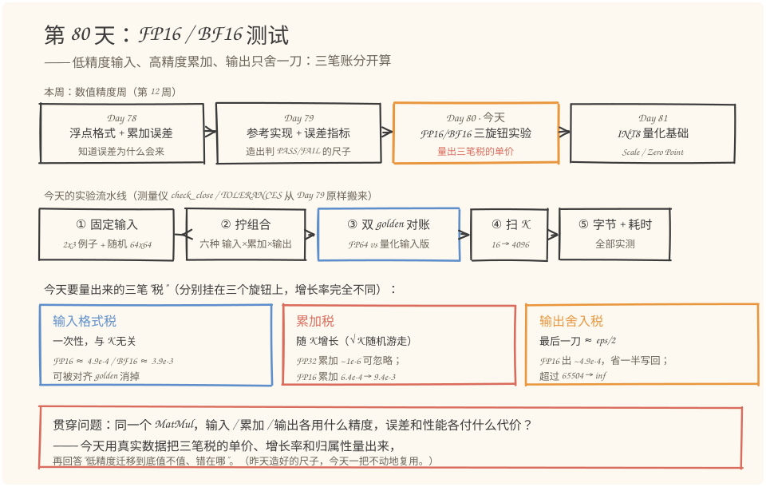
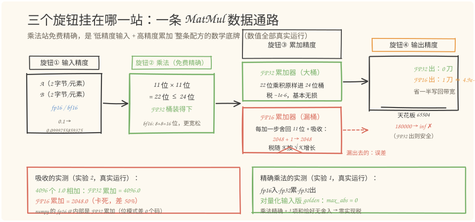
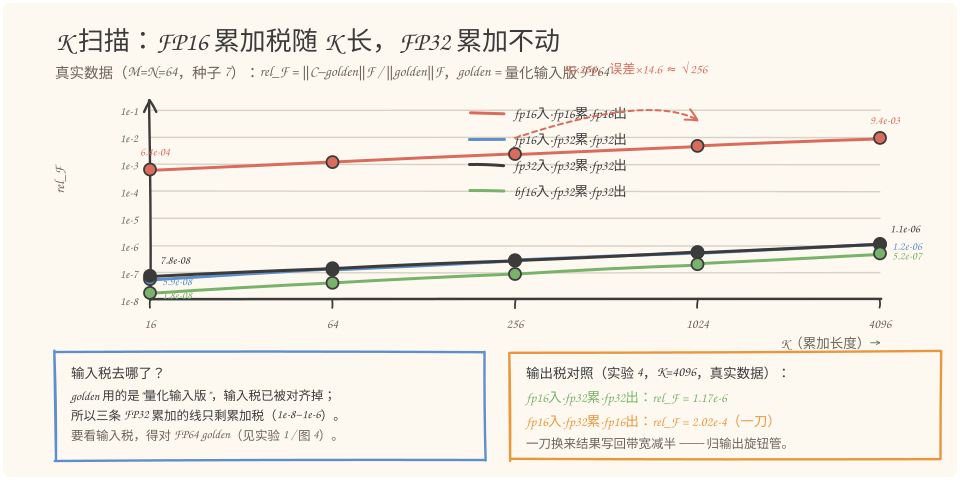
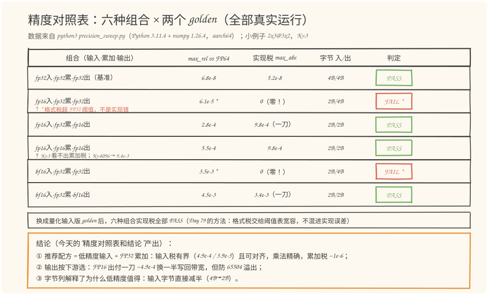

# 第 80 天：FP16／BF16 测试——三处精度旋钮，拧对两处就够

> **今日目标**：完成本教程后，你能做到三件事——说出 MatMul 里三处独立的精度选择（输入、累加、输出）各自的"税"：输入格式税 FP16≈4.9e-4／BF16≈3.9e-3 且与 K 无关、FP16 累加税随 K 按 √K 增长、输出舍入一刀≈eps/2；解释为什么"低精度输入＋高精度累加"是 Tensor Core／昇腾 Cube 的标准配方，并用双 golden 对账把它和"实现写错了"区分开；独立运行 `precision_sweep.py` 产出精度对照表，并通过改一个参数预测误差往哪边变。
> **预计时间**：学习 35 分钟＋实践 45 分钟
> **前置准备**：Python 3.11＋numpy（本文环境：aarch64 Linux，Python 3.11.4，numpy 1.26.4）。第 79 天的 `check_close`／`TOLERANCES` 是今天的测量仪，已原样搬进今天的脚本；建议回忆 Day 78 的"刻度尺"（吸收、格子变疏）和 Day 79 的"量化输入版 golden"。不需要任何昇腾硬件，全部实验在 CPU 上完成。
> **今日产出**：一个五实验脚本 `code/precision_sweep.py`（真实运行的误差＋性能数据）、一张六组合精度对照表和结论、4 张手绘图。

## 1. 今天解决什么问题？

昨天（Day 79）解决了"差多少才算错"：golden 对齐输入约定、阈值按 dtype 配置、三把尺子分工。今天轮到真正的工程决策：**模型越算越大，带宽和算力吃紧，想把 MatMul 换成 FP16／BF16——精度到底放在哪几处？**

一个 MatMul 内部其实有三处互相独立的精度旋钮：

```text
输入精度（A、B 存成什么） → 累加精度（k 维求和用什么算） → 输出精度（C 写回什么）
```

三处可以分别拧，拧法不同，误差和性能天差地别。先剧透今天的结论，再用实验把它钉死：**输入可以低（FP16／BF16），累加必须高（FP32），输出看下游（FP16 省一半写回带宽，但要防 65504 溢出）**。

为什么"输入低＋累加高"在数学上站得住？看今天的贯穿例子（沿用 Day 79 的 `2×3` 乘 `3×2`）：

```python
A = [[0.1, 0.2, 0.3],      B = [[0.4, 1.0],
     [1.0, 2.0, 3.0]]           [0.5, 2.0],
                                 [0.6, 3.0]]
golden (FP64) = [[0.32, 1.4], [3.2, 14.0]]
```

关键事实：**两个 FP16 数的有效尾数各 11 位，乘积最多 2×11＝22 位；FP32 的尾数有 24 位——装得下**（BF16 是 8 位×2＝16 位，更宽松）。所以"FP16 输入、FP32 累加"这条路上，每一次乘法都是精确的，误差只剩输入量化和最终输出舍入两笔。昨天的实验 1b 已经见过它的威力：这条路的实现税是 `0.000e+00`——逐元素零误差。

反过来，如果把累加器也写成 FP16，乘法照样精确，但**每一步加法都要舍回 11 位**——Day 78 讲过的吸收会回来：FP16 在 2048 处格子间距是 2，`2048 + 1` 落在两格正中间，就近舍入到偶数还是 2048，之后每一步都被吞掉。把 4096 个 1 加起来，FP32 累加得 4096，FP16 累加**卡死在 2048**（今天实验 2 的真实数据，差 50%）。K 越长这笔账越离谱，今天用 K 扫描把它量出来。

性能那一半问题同样有反直觉的真实数据：CPU 上 numpy 的 FP16 矩阵乘实测比 FP32 **慢 620 倍**——低精度的速度收益来自专用矩阵单元，不是格式本身。这笔账今天也要算清楚。

## 2. 先看全貌：今天的内容位于哪里？



**图 1**：看三个位置——上排是本周的日程：Day 78 解释误差为什么来、Day 79 造判据工具，今天（橙色框）**拿工具做系统实验**，Day 81 进入 INT8 量化；中排是今天的三旋钮实验流水线，蓝色高亮的"③ 双 golden 对账"直接复用昨天的 `check_close`；下排三张卡片是今天要量出来的三笔"税"——注意它们挂在不同旋钮上，增长率完全不同。

把这条流水线串成 5 步：

1. **固定输入**：机制演示沿用 Day 79 的 `2×3@3×2`；统计实验另造 `M=N=64`、种子 7 的随机矩阵，保证可复现；
2. **拧组合**：六种"输入×累加×输出"组合各跑一遍，同一组输入、同一个 golden；
3. **双 golden 对账**：FP64 golden 量总税，量化输入版 golden 只量实现税——两杯水一减，格式税现形（Day 79 的方法原样复用）；
4. **扫 K**：K 从 16 扫到 4096，看 FP16 累加税怎么随 K 增长、FP32 累加为什么不动；
5. **量字节和耗时**：字节数实测（`nbytes`）、耗时实测（预热＋中位数），两件事分开下结论。

这一套流程就是昇腾算子精度验证的日常形态：**换精度之前先知道每笔税的单价，换了之后有工具判定"没写错，只是税变了"**。

## 3. 核心概念：先用直觉，再给准确定义

### 3.1 低精度输入：一笔固定的"格式税"

一句通俗解释：把 A、B 从 FP32 换成 FP16／BF16，每个输入先被"就近舍入"到更粗的格子上，这笔偏差就是输入格式税。

类比：十吨大卡车换半吨小货车——小货车跑得快、停得进窄巷（带宽省一半、缓存装双倍、专用矩阵单元只吃这种规格的货），但每件货都得重新装进小箱子，装卸就有磕碰。对应到技术上是：FP16 每元素 2 字节（FP32 的一半），Day 71 量过的访存流量直接减半；税是"就近舍入"的最大相对误差，**有上界、可预算**：FP16 约 4.9e-4，BF16 约 3.9e-3。类比的边界：货物磕碰是随机损耗，格式税却是确定性舍入——同一个数每次量化结果完全一样（`0.1` 进 FP16 永远是 `0.0999755859375`，相对偏差 2.44e-4），所以它能被 Day 79 的"量化输入版 golden"整笔对齐掉，也不随 K 累积。

三种格式的税率和容量（本文环境实测核实）：

| 格式 | 有效尾数 | eps（格子相对宽度） | 最大相对量化税 | 最大可表示值 |
|---|---|---|---|---|
| FP32 | 24 位 | 1.19e-7 | 6.0e-8 | 3.4e38 |
| FP16 | 11 位 | 9.77e-4 | 4.9e-4 | **65504** |
| BF16 | 8 位 | 7.81e-3 | 3.9e-3 | 3.4e38（指数域与 FP32 相同） |

注意 BF16 的取巧：牺牲尾数（8 位）换取与 FP32 相同的指数域，**范围不缩水、只是格子变粗**——大模型训练偏爱 BF16 的原因就在这：不像 FP16 动不动溢出，税虽然粗一点（3.9e-3）但稳定。

常见误解："低精度＝不精确"。实际上输入税是三笔税里最温和的：有界、与 K 无关、可被对齐 golden 消掉。真正会随规模恶化的是下一笔。

### 3.2 高精度累加：乘法免费精确，加法才是漏洞

一句通俗解释：k 维求和用 FP32 累加器，22 位的乘积原样放进 24 位的桶里，**整个累加过程没有一步需要砍位**。

类比：记账。所有收支都用"万元"记总账（FP16 累加），几笔"百元"零头每次都被四舍五入吞掉；换成"用元记总账、汇报时才四舍五入到万元"（FP32 累加＋输出舍入），零头一分不丢。对应到技术上是：FP16 累加器每加一步都要舍回 11 位，除了舍入还有**吸收**——Day 78 实验 D 里"FP16 加 0.1，和冻结在 256"就是它；今天实验 2 用更极端的整数案例：4096 个 1.0，FP32 累加得 `4096.0`，FP16 累加**卡死在 `2048.0`**。类比的边界：记账的"元"是等宽刻度，浮点格子越往上越疏（Day 78 的刻度尺），所以 FP32 累加也不是零税，只是税率低了约 2^13 倍。

随机数据上，FP16 累加的误差按"每步舍入的随机游走"增长：K 扩大 256 倍，误差约扩大 √256＝16 倍——实验 3 实测 `6.4e-4 → 9.4e-3`（14.6 倍），脚印基本踩在 √K 上；而 FP32 累加全程稳在 1e-6 以下。

工程事实：GPU Tensor Core、昇腾 Cube 矩阵单元的原生配方就是"FP16／BF16 输入＋FP32 累加"——硬件设计师和上面的数学结论站在同一边。连 numpy 都懂这件事：本环境实测，numpy 的 fp16 `@` 内部用 FP32 累加、最后才舍回 FP16 输出（实验 2 里有逐位判别证据）。所以**自己手写 kernel 时把累加器写成 `float16`，是低精度迁移里最典型的翻车点**。

### 3.3 输出舍入：一刀 vs K 刀

一句通俗解释：累加完的 FP32 结果写回前舍到输出 dtype——这是**整条链路最后一次舍入**，只交一次税。

- 输出 FP32：这一刀不存在。实验 4 实测 rel_F＝1.17e-6，纯 FP32 累加税；
- 输出 FP16：交一刀，理论 ≈ eps/2 ≈ 4.9e-4（实测 rel_F＝2.02e-4），换来**结果写回带宽减半**；
- 输出 FP16 的附带风险：**上限 65504**。实验 4 的真实翻车：真值 180000，FP32 出安然无恙，FP16 出直接 `inf`，被 `check_close` 的 NaN/Inf 闸门第一时间拦截。

选择依据看下游：C 要进 loss、归约这类精度敏感路径，就 FP32 出；C 马上被下一个低精度算子吃掉，就 FP16 出省一半带宽——这也是算子融合（Day 51～54）的好搭档。混合精度训练里"权重主副本 FP32、激活和梯度 FP16"的通行做法，就是这张税表的工程版。

## 4. 图解核心机制

先把三个旋钮放回数据通路，看清楚每笔税发生在哪一站：



**图 2**：一条 MatMul 数据通路从左到右过四站——① 输入站：A、B 量化到 FP16，`0.1` 变成 `0.0999755859375`（交 2.44e-4 的格式税，一次性、与 K 无关）；② 乘法站：11 位×11 位＝22 位 ≤ FP32 的 24 位，标注"精确"——低精度乘法在高精度桶里不丢位，这是整条配方的数学底牌；③ 累加站：分成两条路，绿色 FP32 大桶一路无损，红色 FP16 漏桶画了道裂缝，标着 `2048+1→2048`（每步舍入＋吸收，误差随 K 按 √K 涨）；④ 输出站：一把剪刀——FP32 出剪 0 刀，FP16 出剪 1 刀（≈4.9e-4），旁边画着 65504 的天花板和摔出去的 `inf`。

按图走一遍今天的贯穿例子（`0.32` 这个元素，全部为真实值）：

1. **发生了什么**：`A[0,:]＝[0.1, 0.2, 0.3]`、`B[:,0]＝[0.4, 0.5, 0.6]` 量化进 FP16，其中 0.1 → 0.0999755859375、0.3 → 0.300048828125。**为什么允许**：这笔税有界（≤4.9e-4）且确定，golden 可以对齐它；
2. **发生了什么**：三对 FP16 数相乘，`0.0999755859375 × 0.39990234375` 等乘积的 22 位结果原样进 FP32 累加器。**为什么关键**：乘法站零舍入，误差不会在这里累积；
3. **发生了什么**：FP32 累加器把三个精确乘积加成 `0.3200146555900574`——正是 Day 79 实验 1b 里 golden2 的 `[0][0]` 元素（实验 1 实测：这条路径对量化输入版 golden 逐元素零误差）。**如果换成 FP16 桶**：三步舍入各砍一刀，K=3 时已经能看出 `9.77e-4` 的 max_abs，K=4096 时涨到 9.4e-3（实验 3）；
4. **发生了什么**：写回。FP32 出原样落盘 `0.3200146555900574`；FP16 出把它舍到最近的 FP16 格子 `0.320068359375`（一刀 6.8e-5，实验 1 实测 `C[0][0]`）。**风险**：值再大一点（>65504）就直接 `inf`——这一步是 FP16 输出唯一会"爆炸"的地方。

三笔税的单价、增长率和归属性，就是今天所有实验要验证的全部内容。

## 5. 动手实践：五实验精度对照

### 5.1 准备文件

今天的完整工程就两个文件（随教程已生成）：

```text
tutorials/day-080/
├── README.md
├── code/
│   ├── precision_sweep.py   # 五实验脚本：测量仪 + 三旋钮被测实现 + 实验 1~5（本节主角）
│   └── make_images.py       # 生成 4 张 SVG 的绘图脚本
└── images/
    ├── 01-overview.svg
    ├── 02-mechanism.svg
    ├── 03-ksweep.svg
    └── 04-table.svg
```

### 5.2 编写代码

`precision_sweep.py` 只依赖 numpy 和标准库。文件开头是从第 79 天 `ref_check.py` **原样搬来的测量仪**（`TOLERANCES`、`quantize`、`bf16`、`ulp_distance`、`check_close` 一个字没改），今天只换被测对象、不换尺子。今天新写的三段最值得读懂。

第一段，三旋钮参数化的被测实现——累加那一行就是图 2 里"FP16 漏桶"的代码化：

```python
def matmul_impl(A, B, in_dtype, acc_dtype, out_dtype):
    """显式 k 递进的 MatMul：输入量化 / 累加器 / 输出三处精度可控。"""
    Aq = quantize(A, in_dtype)          # 旋钮①：输入先舍到 in_dtype 的格子
    Bq = quantize(B, in_dtype)
    M, K, N = Aq.shape[0], Aq.shape[1], Bq.shape[1]
    ...
    adt = DTYPES[acc_dtype]             # 旋钮③：累加器精度
    acc = np.zeros((M, N), dtype=adt)
    for k in range(K):
        prod = np.multiply(Aq[:, k:k+1], Bq[k:k+1, :]).astype(adt)
        acc = (acc + prod).astype(adt)  # 每一步都舍回累加精度 —— FP16 漏桶就在这行
    return quantize(acc, out_dtype)     # 旋钮④：输出最后一刀
```

`acc_dtype="float16"` 时，`acc + prod` 每加一步都舍回 11 位——4096 个 1 卡死在 2048 的吸收，就是这行代码干的事；`acc_dtype="float32"` 时 22 位乘积原样进 24 位桶，整条路没有砍位。（节选里的 `...` 省略的是 `acc_dtype == "bfloat16"` 的累加分支——完整代码在 `code/precision_sweep.py`，选做练习会用到它。）

第二段，双 golden 里的"量化输入版"——把格式税从实现税里剥出来的关键（Day 79 实验 1b 的方法固化成函数）：

```python
def aligned_golden(A, B, in_dtype):
    """对齐输入约定的 golden：输入先量化到 in_dtype，再用 FP64 计算。"""
    Aq = quantize(A, in_dtype)
    Bq = quantize(B, in_dtype)
    return np.asarray(Aq, dtype=np.float64) @ np.asarray(Bq, dtype=np.float64)
```

同一个被测实现，对 FP64 golden 量出"总税"，对它量出"实现税"——两杯水一减，输入格式税现形。

第三段，K 扫描专用的整矩阵口径——Day 79 近零教训的直接应用：

```python
def rel_frobenius(actual, golden):
    """相对 Frobenius 误差：||C-G||_F / ||G||_F。

    随机矩阵乘的结果可能个别元素接近 0（Day 79 的近零教训：max_rel 会爆炸），
    所以 K 扫描用"整矩阵能量"口径，比逐元素 max_rel 稳定。
    """
    a = np.asarray(actual, dtype=np.float64)
    g = np.asarray(golden, dtype=np.float64)
    return float(np.linalg.norm(a - g) / np.linalg.norm(g))
```

### 5.3 运行与观察

```bash
cd tutorials/day-080/code
python3 precision_sweep.py
```

以下是在本文环境（aarch64 Linux，Python 3.11.4，numpy 1.26.4）的**真实运行输出**，按五个实验节选。

**实验 1**：小例子六组合 × 两个 golden——第一眼看"总税"，第二眼剥掉格式税看"实现税"：

```text
实验 1：MatMul 2x3 @ 3x2（Day 79 的贯穿例子），六种精度组合
  -- 对 FP64 golden（含输入格式税的总误差）--
  [fp32入·fp32累·fp32出] PASS  dtype=float32  max_abs=9.537e-08  max_rel=6.812e-08  max_ulp=1格(≤4)
  [fp16入·fp32累·fp32出] FAIL  dtype=float32  max_abs=1.953e-04  max_rel=6.104e-05  max_ulp=819格(≤4)
  [fp16入·fp32累·fp16出] PASS  dtype=float16  max_abs=7.812e-04  max_rel=2.790e-04  max_ulp=0格(≤8)
  [fp16入·fp16累·fp16出] PASS  dtype=float16  max_abs=1.172e-03  max_rel=5.493e-04  max_ulp=1格(≤8)
  [bf16入·fp32累·fp32出] FAIL  dtype=float32  max_abs=5.078e-03  max_rel=3.483e-03  max_ulp=37398格(≤4)
  [bf16入·fp32累·bf16出] PASS  dtype=bfloat16 max_abs=6.250e-03  max_rel=4.464e-03  max_ulp=-
  -- 对量化输入版 golden（只看实现税：累加 + 输出舍入）--
  [fp32入·fp32累·fp32出] PASS  dtype=float32  max_abs=5.215e-08  max_rel=7.544e-08  max_ulp=1格(≤4)
  [fp16入·fp32累·fp32出] PASS  dtype=float32  max_abs=0.000e+00  max_rel=0.000e+00  max_ulp=0格(≤4)
  [fp16入·fp32累·fp16出] PASS  dtype=float16  max_abs=9.766e-04  max_rel=3.052e-04  max_ulp=0格(≤8)
  [fp16入·fp16累·fp16出] PASS  dtype=float16  max_abs=9.766e-04  max_rel=5.951e-04  max_ulp=1格(≤8)
  [bf16入·fp32累·fp32出] PASS  dtype=float32  max_abs=0.000e+00  max_rel=0.000e+00  max_ulp=0格(≤4)
  [bf16入·fp32累·bf16出] PASS  dtype=bfloat16 max_abs=3.418e-03  max_rel=2.498e-03  max_ulp=-
```

读三行信号：`fp16入·fp32累·fp32出` 对 FP64 golden FAIL（819 格）但对齐后**零误差**——那 819 格全是输入格式税，不是实现错；`fp16入·fp32累·fp16出` 对齐后剩 `9.77e-4`——正是输出那一刀；`bf16入·fp32累·fp32出` 的 `37398 格` 同理是 bf16 输入税（3.9e-3 一档），对齐后归零。

**实验 2**：吸收的实锤和 numpy 的内部行为判别：

```text
实验 2：累加器吸收 —— 把 4096 个 1.0 加起来
  fp32 累加 4096 个 1.0 = 4096.0
  fp16 累加 4096 个 1.0 = 2048.0   <- 卡死在 2048
  numpy fp16 @ (ones(1,4096) @ ones(4096,1)) = 4096.0
  解释：FP16 在 2048 处的格子间距是 2，2048 + 1 落在两格正中间，
        就近舍入到偶数 -> 还是 2048，之后每一步都被吸收。
  判别 numpy 的 fp16 @ 用什么精度累加（随机 32x512x32，种子 7）：
    numpy fp16 @  vs  手写 fp32 累加 + fp16 出：位模式最大差 0 个码
    -> 本环境实测 numpy 的 fp16 @ 内部用 fp32 累加再舍回 fp16 输出；
       但自己手写 kernel 时，累加器写成 float16 就是上面 2048 的下场。
```

**实验 3**：K 扫描——今天的主戏，把"累加税随 K 增长"变成一列数字：

```text
实验 3：K 扫描 —— 同一组 fp16/bf16 输入，累加精度决定误差怎么长
      K    fp32入·fp32累    fp16入·fp32累    fp16入·fp16累    bf16入·fp32累
     16      7.806e-08      5.871e-08      6.445e-04      1.828e-08
     64      1.484e-07      1.302e-07      1.203e-03      4.294e-08
    256      2.914e-07      2.801e-07      2.390e-03      9.068e-08
   1024      5.808e-07      5.667e-07      4.754e-03      2.084e-07
   4096      1.128e-06      1.171e-06      9.379e-03      5.196e-07
```

把这张表画成图：



**图 3**：纵轴是 rel_F（对数刻度），横轴是 K（对数刻度）。看两件事——红线（FP16 累加）一路爬升，K 从 16 到 4096 扩大 256 倍，误差从 `6.4e-4` 涨到 `9.4e-3`（14.6 倍 ≈ √256），虚线箭头标的就是这个"√K 脚印"；下面三条线（都是 FP32 累加）挤在 1e-8～1e-6 里纹丝不动——**累加器一个旋钮，隔开了四个数量级**。左下角框回答"输入税去哪了"（被对齐 golden 消掉），右下角框是输出旋钮的对照（实验 4）。

**实验 4**：输出一刀和溢出：

```text
实验 4：输出舍入 —— 最后一刀的代价，和 FP16 输出的溢出
  fp16入·fp32累·float32出 vs 量化输入 golden: rel_F = 1.171e-06
  fp16入·fp32累·float16出 vs 量化输入 golden: rel_F = 2.017e-04
  溢出演示：A = [[300, 300]]，B = [[300], [300]]，真值 300*300 + 300*300 = 180000
  fp16入·fp32累·fp32出 = [[180000.0]]  （FP32 装得下 180000）
  fp16入·fp32累·fp16出 = [[inf]]  （FP16 上限 65504，溢出成 inf）
  [溢出检查] FAIL  dtype=float16  max_abs=inf  max_rel=inf  max_ulp=0格(≤8)
```

注意 `max_ulp=0格` 是个假象：180000 舍到 FP16 也是 inf，两边占了同一个"格子"——inf 面前 ULP 已失义，所以 `check_close` 的 NaN/Inf 闸门必须排在所有指标前面（Day 79 的判定顺序在这里救了场）。

**实验 5**：字节与耗时：

```text
实验 5：字节与耗时 —— 低精度的收益在哪，代价在哪
  MatMul 512x512 @ 512x512，三个矩阵 A/B/C 的总字节数（nbytes 实测）：
    fp32   每元素 4 字节，A+B+C 共 3.00 MiB
    fp16   每元素 2 字节，A+B+C 共 1.50 MiB
  numpy @ 实测耗时（预热 3 次，取 10 次中位数；同一 CPU）：
    fp32   中位数     0.63 ms   有效    425.2 GFLOPS
    fp64   中位数     1.20 ms   有效    223.6 GFLOPS
    fp16   中位数   391.29 ms   有效      0.7 GFLOPS
  实测比 fp32 慢 620 倍
```

（重复运行耗时会漂几个百分点——0.61～0.65 ms 之间都见过，但"慢两个多数量级"这个结论纹丝不动。）

把实验 1 的六组合整理成今天的核心产出——精度对照表：



**图 4**：每一格都来自上面的真实输出。读三个信号——第一，两个 FAIL 行（橙色底）都带着 `*`：对 FP64 golden 的口径下格式税超了 FP32 阈值，但实现税列是 `0（零！）`，**不是实现错，是阈值口径没对齐**；第二，"字节 入/出"列解释了低精度的动机：输入从 4B 降到 2B，搬运流量直接减半；第三，`fp16入·fp16累·fp16出` 这行在小例子（K=3）里还岁月静好，注脚提醒你 K=4096 时它的 rel_F 会涨到 9.4e-3——**小 Shape 测不出累加税，必须扫 K**。

### 5.4 修改一个参数再观察

做一个预测型对照实验：把 `exp3_k_sweep` 里的 K 元组加一个 16384（就改这一行）：

```python
    ks = (16, 64, 256, 1024, 4096, 16384)
```

先写预测再运行。√K 规律说：K 从 4096 到 16384 扩大 4 倍，FP16 累加的 rel_F 应该扩大约 √4＝2 倍，从 `9.4e-3` 到 `1.9e-2` 左右。**真实运行结果**：

```text
   4096      1.152e-06      1.165e-06      9.401e-03      5.180e-07
  16384      2.333e-06      2.278e-06      1.821e-02      1.231e-06
```

`9.401e-03 → 1.821e-02`，比值 1.94——√K 规律稳稳命中。两个附带观察：FP32 累加列翻过 K=16384 也才 `2.3e-6`；另外你会发现**所有行**的数字都和 5.3 节的表不完全一样（比如 K=16 从 `7.8e-8` 变成 `8.2e-8`）——因为基础数组的形状变了，同一个种子抽出的随机数序列也变了。**固定种子 ≠ 固定数据**：种子只保证"同形状同数据"，这是随机测试里值得记住的一个细节（Day 135 会再遇到它）。

## 6. 常见错误与排查

**错误一：手写 kernel 时，累加器精度跟着输入精度走。**
现象：FP16 版算子在小 Shape 测试全对，上线后大 K 场景精度莫名劣化；极端输入下 4096 个 1 相加结果只有 2048。
原因：`acc_dtype` 写成了和输入一样的 `float16`——每步加法舍回 11 位，误差随 K 按 √K 增长，还有吸收（实验 2、3 的最小复现）。
定位：跑 K 扫描（实验 3）：如果误差列随 K 爬升而 FP32 累加对照列不动，就是累加器。
修复：乘加单元的累加器固定用 FP32（`acc = (acc + prod).astype(np.float32)`），输入输出照旧低精度；专用硬件上就是选"FP16 入·FP32 累"的矩阵单元模式。

**错误二：FP16 输出溢出成 inf，污染下游还难定位。**
现象：算子输出偶尔全 NaN；从后往前排查发现第一个非有限值出现在某个 MatMul 的输出里——真值 180000，FP16 上限 65504（实验 4 的最小复现）。
原因：输出旋钮选了 FP16，但结果的量级没人检查；`inf` 进下游做 `inf - inf` 就变成 NaN。
定位：验收链第一道闸必须是 `np.isfinite`（`check_close` 的 `finite_ok`）；出错时打印 `np.where(~np.isfinite(C))`。
修复：结果可能超 65504 就选 FP32 出；确实要 FP16 出时做量级检查，必要时分块或缩放（混合精度训练的 loss scaling 就是这个思路的系统版）。

**错误三：在 CPU 上测低精度性能，得出"FP16 慢 620 倍，低精度没用"（或反过来迷信它更快）。**
现象：笔记本上 benchmark，FP16 比 FP32 慢两个数量级（实验 5 实测 391 ms vs 0.63 ms）。
原因：numpy 的 FP16 `@` 走软件仿真路径，BLAS 只有 FP32/FP64；低精度的速度收益来自专用矩阵单元（Tensor Core／Cube）的更大吞吐和减半的搬运，不是格式本身。
定位：看耗时量级——慢两个数量级说明没走硬件加速路径，而不是格式的问题。
修复：CPU 上只比字节（4B→2B，实测减半）和误差；性能结论必须在目标硬件上、用目标工具链重测（Day 107 的统一 Benchmark 会管这件事）。

**错误四：BF16 输入的 3.9e-3 误差被当成实现 bug。**
现象：换 BF16 输入后，对账误差从 1e-4 档跳到 3.5e-3 档（实验 1 第五行），团队以为算子写错，排查一周无果。
原因：BF16 只有 8 位尾数，输入量化税本来就有 3.9e-3 一档——这是格式的固有属性，不是实现错误。
定位：换"量化输入版 golden"重测（实验 1 第二块）：如果立刻归零，误差全是格式税。
修复：验收阈值按 dtype 配置（Day 79 的 `TOLERANCES` 里 BF16 是 `rtol=1.6e-2`）；选型时心里有税表——要精度选 FP16，要范围和训练稳定选 BF16。

## 7. 今日练习

### 必做练习

先笔算再运行：FP16 的格子间距在 `[1024, 2048)` 区间是 1、在 `[2048, 4096)` 区间是 2。请回答——**从哪个整数开始，"+1" 会被吸收？** 把预测写下来，然后用一小段代码验证：

```python
import numpy as np
for s in (1023, 1024, 2047, 2048):
    print(f"np.float16({s}) + np.float16(1) =", np.float16(s) + np.float16(1))
```

预期产出：一行预测、四行实测、一句用"格子间距"解释的话——如果预测和实测不一致，回到第 3.2 节看是哪一步理解偏了。（这个练习同时解释了实验 2 里 4096 个 1 为什么卡死在 2048。）

### 选做挑战

给 `matmul_impl` 拧一个新组合：`bf16入·bf16累·fp32出`（累加分支代码已经写好，直接传参就行），在 `M=N=64、K=1024、种子 7` 的随机输入上对量化输入版 golden 算 rel_F。先预测：它和 `fp16入·fp16累`（实测 `4.754e-03`）差几倍？提示——BF16 的 eps 是 FP16 的 8 倍，√K 规律两者相同。骨架代码：

```python
import sys; sys.path.insert(0, ".")
import numpy as np
from precision_sweep import matmul_impl, aligned_golden, rel_frobenius
rng = np.random.default_rng(7)
A = rng.uniform(-1, 1, (64, 1024)); B = rng.uniform(-1, 1, (1024, 64))
C = matmul_impl(A, B, "bfloat16", "bfloat16", "float32")
print(rel_frobenius(C, aligned_golden(A, B, "bfloat16")))
```

不引入新库，改完直接跑；预测、实测、比值，三行记录。

## 8. 今日验收

- [ ] 我能不看资料说出三笔税的单价和归属：输入税 FP16≈4.9e-4／BF16≈3.9e-3（与 K 无关）、FP16 累加税随 K 按 √K 增长（4096 时约 9.4e-3）、输出一刀≈eps/2（FP16 出≈4.9e-4 且防 65504 溢出）；
- [ ] 我能解释"FP16 输入＋FP32 累加"为什么是标准配方：11 位×11 位＝22 位 ≤ 24 位使乘法精确，FP32 累加器把每步舍入和吸收都压到 1e-6 量级；
- [ ] 我能独立运行 `python3 code/precision_sweep.py`，指出实验 1 两个 FAIL 的行错在哪个口径（格式税 vs 实现税），并用"换对齐 golden"验证；
- [ ] 我能修改 K 元组预测并验证 √K 规律（16384 时 ≈1.8e-2），并说出"固定种子 ≠ 固定数据"的原因（形状变了，抽样序列就变）；
- [ ] 我保存了 `precision_sweep.py`、六组合精度对照表（图 4）和真实运行记录，它们是明天 INT8 量化的"浮点版基准线"。

## 9. 一句话总结与明天预告

今天把"用低精度"从一个口号拆成了三笔可计算的账：**输入税**有界且与 K 无关（FP16 4.9e-4／BF16 3.9e-3），能被对齐 golden 整笔消掉；**累加税**是唯一随规模恶化的——FP16 累加按 √K 增长（6.4e-4→1.8e-2），还会吸收（4096 个 1 卡死 2048），所以累加器必须 FP32，而"11 位×11 位＝22 位 ≤ 24 位"让低精度乘法在这条路上分文不花；**输出税**只有一刀（≈4.9e-4），换一半写回带宽，代价是防 65504 溢出。验证上，五个实验全部真实运行：双 golden 把格式税和实现税分开、K 扫描钉死 √K 规律、字节减半实测、CPU 上 FP16 慢 620 倍的反直觉数据也如实记录——低精度的速度收益在专用矩阵单元，不在格式本身。

明天（第 81 天）从浮点低精度走向定点：INT8 量化的 Scale、Zero Point、对称／非对称和饱和——今天的"输入格式税"会变成一整张可设计的映射表，`quantize()` 的角色从"舍到最近格子"变成"线性映射到 256 个档位"。
