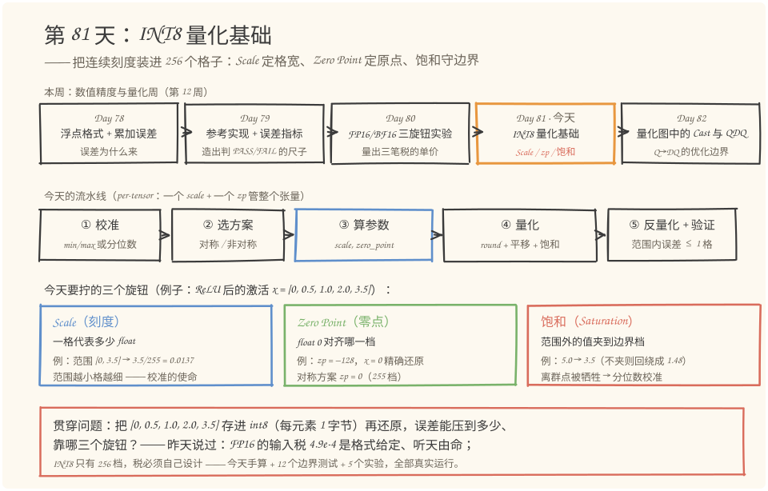
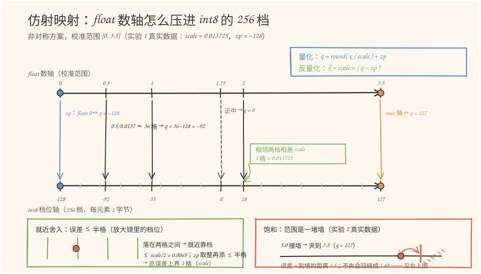
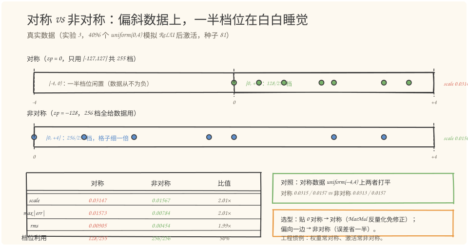
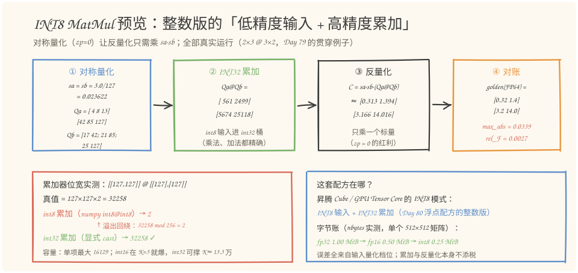

# 第 81 天：INT8 量化基础——把连续刻度装进 256 个格子

> **今日目标**：完成本教程后，你能做到四件事——说出 per-tensor 量化的三个旋钮各管什么（Scale 定格宽、Zero Point 定原点、饱和守边界），并手算 `0.5 → q = -92` 的完整映射；解释为什么范围内误差 ≤ 1 格、范围外误差 = 到边界的距离、一个离群点能把整把刻度尺撑粗 51 倍；独立运行 `quant_lab.py`（12 个边界单元测试＋5 个实验全部真实数据），并通过改一个参数（对称/非对称、校准范围、分位数）预测误差往哪边变；说明 INT8 MatMul 为什么必须 INT32 累加（`127×127×2 = 32258` 回绕成 `2` 的实测实锤）。
> **预计时间**：学习 35 分钟＋实践 45 分钟
> **前置准备**：Python 3.11＋numpy（本文环境：aarch64 Linux，Python 3.11.4，numpy 1.26.4）。今天直接站在本周前三天肩上：Day 78 的"刻度尺"（格子越远越疏）解释了浮点，今天解释整数；Day 79 的相对 Frobenius 误差口径继续沿用；Day 80 的结论"低精度输入＋高精度累加"今天是它的整数版。不需要任何昇腾硬件，全部实验在 CPU 上完成。
> **今日产出**：一个量化工具库（`compute_qparams`／`quantize`／`dequantize`，per-tensor）＋12 个边界单元测试＋5 个实验的真实数据＋4 张手绘图。

## 1. 今天解决什么问题？

昨天（Day 80）收尾时留了一句话：FP16 的输入税 4.9e-4 是 IEEE 754 格式**给定**的，格子怎么画听标准的，你只能接受。今天的问题正好反过来：**INT8 不是浮点格式，而是你自己设计的映射——把连续的 float 塞进 256 个整数档位，税率是你定的**。格子画多细、原点放哪、出了界怎么办，三个决定都归你，也都各有代价。

这就是量化（Quantization）：推理时把权重和激活从 FP32 压成 INT8，存储和带宽直接降到 1/4（后面有 `nbytes` 实测），昇腾 Cube、GPU Tensor Core 都有专门的 INT8 矩阵单元吃这种货。代价是每次读写都交一笔"档位税"——而 Day 80 那笔税有标准给的上界，这笔税的上界由你的设计决定：设计得好，误差半格；设计得差，一个离群点能让 4096 个正常值的误差恶化 51 倍（今天实验 4 的真实数据）。

用今天的贯穿例子把问题钉死。取一段 ReLU 输出风格的激活值：

```python
x = [0.0, 0.5, 1.0, 2.0, 3.5]     # 全非负，典型偏斜数据
```

任务：把它存进 int8（每元素 1 字节），需要时再还原成 float。三个子问题依次是：

1. **格子多细**——256 个档位怎么分配到 float 范围上？（Scale）
2. **原点在哪**——float 的 0 对齐哪个整数档？（Zero Point）
3. **出界怎么办**——比 3.5 大的值撞上边界，夹住还是放任溢出？（饱和）

先剧透今天的结论，再用 12 个单元测试和 5 个实验把它钉死：**校准范围取 [0, 3.5] 时，范围内误差上界是半格 0.0069、实测最大 0.0059；范围外的值被饱和夹到边界档，误差恰等于到边界的距离；忘了夹会回绕成符号翻转的灾难**。这三个数字今天全部手算加实测。

## 2. 先看全貌：今天的内容位于哪里？



**图 1**：看三个位置——上排是本周日程：Day 78 讲误差为什么来、Day 79 造判据工具、Day 80 量出浮点三笔税，今天（橙色框）**从"接受格式"跨到"自己设计税率"**，Day 82 就进入量化图的算子级优化；中排是今天的五步流水线，蓝框"③ 算参数"是核心动作——scale 和 zp 两个数决定了整把刻度尺；下排三张卡片就是贯穿例子 `x = [0, 0.5, 1.0, 2.0, 3.5]` 上三个旋钮的真实取值，注意第三张：不饱和的后果不是"大一点点"，是回绕成 1.48 的符号翻转。

把流水线串成 5 步：

1. **校准（Calibration）**：拿一批真实数据（或权重）统计范围 [xmin, xmax]，或者更稳健的分位数；
2. **选方案**：对称（zp = 0）还是非对称（zp 自由），决定用 255 档还是 256 档；
3. **算参数**：非对称 `scale = (xmax − xmin)/255`、`zp = round(−128 − xmin/scale)`；对称 `scale = amax/127`、`zp = 0`；
4. **量化**：`q = clip(round(x/scale) + zp, −128, 127)`，三件事一件不能少——除法对格、舍入靠档、饱和守界；
5. **反量化＋验证**：`x̂ = scale × (q − zp)`，检查范围内误差 ≤ 1 格、边界行为符合预期。

"Per-tensor"指的是一个张量共用一套 (scale, zp)——最简单的粒度，今天只做它；per-channel（每行一套）留作选做练习。这套五步流程在 TFLite、PyTorch 量化推理、昇腾离线量化工具里都是同一个骨架，差别只在第 1 步的校准策略和第 2 步的默认选择。

## 3. 核心概念：先用直觉，再给准确定义

### 3.1 Scale（缩放因子）：一格代表多少 float

一句通俗解释：scale 是这把"整数刻度尺"上相邻两档之间的 float 距离——尺子的分辨率。

类比：量房间用米尺（格子 1 米），画电路板用游标卡尺（格子 0.1 毫米）——同一把尺换个场合，格子疏密天差地别。对应到技术上是：非对称方案 `scale = (xmax − xmin) / 255`，校准范围除以档位总数。今天的例子范围 [0, 3.5]：`scale = 3.5/255 = 0.013725`——256 个档位每格走 0.0137。**范围越小格子越细**，这就是"校准"这个词的使命：校准范围是从真实数据里统计出来的，不是拍脑袋定的。

类比的边界：米尺的格子全尺等宽，而量化后的反量化 `x̂ = scale × (q − zp)` 也是等宽格子——这点上类比是精确的；但浮点数轴（Day 78 的刻度尺）不等宽，所以"float 数轴 → int8 档位轴"这一步是**从指数格子换到等宽格子**，两把尺的疏密规律不一样。

一个直接推论：误差上界跟着 scale 走。就近舍入最多偏半格，所以范围内 `|x̂ − x| ≤ scale/2`，再考虑 zp 取整的半格，总上界是 1 格——今天单元测试 T03 用 10000 个随机数实测 `max|err| = 0.0069 ≤ scale`，实验 2 范围正中的 1.75 误差恰好 0.0069，踩在半格上。

### 3.2 Zero Point（零点）：float 0 对齐哪一档

一句通俗解释：zp 记录"float 的 0 落在哪个整数档位"，量化和反量化都靠它平移坐标。

类比：电子秤去皮——杯子重 100 克，按"去皮"后显示 0，之后再放东西直接读数。对应到技术上是：`q = round(x/scale) + zp`，zp 就是那个"去皮键"，把 float 0 平移到整数轴的某个档位。今天的例子 zp = −128：float 0 对齐 q = −128，float 3.5 对齐 q = 127，256 个档位一根不浪费。类比的边界：电子秤的去皮是任意平移，量化里 zp 必须是整数且落在 int8 范围内——范围 [0.1, 3.7] 不含 0 时，直接算 zp = −135 超界，只能 clamp 到 −128，代价是 max 端丢一格（单元测试 T09 实测：3.7 只能还原到 3.6000）。

为什么非把 0 对齐不可？两个工程理由：**Padding**——卷积补零区参与计算，float 0 若不能精确还原（差半格），补零就变成了补噪声；**ReLU 的语义**——0 就是"关闭"，量化后必须还是"关闭"。所以参考实现（PyTorch 的 MinMaxObserver）默认 `ensure_zero=True`：把 0 纳入校准范围再算参数，一石二鸟——0 精确还原、zp 永不超界（T08 用 5 组刁钻范围验证过）。

### 3.3 对称 vs 非对称：255 档还是 256 档，原点在不在正中

一句通俗解释：对称量化强制 float 0 对齐 q = 0（尺子两头等长）；非对称允许 0 落在任意档（尺子按数据裁）。

两套参数公式并排（沿用贯穿例子，范围 [0, 3.5]）：

| | 非对称 | 对称 |
|---|---|---|
| scale | (3.5−0)/255 = **0.013725** | max(\|0\|,\|3.5\|)/127 = **0.027559** |
| zp | −128（0 对齐最左档） | 0（固定） |
| 可用档位 | 256 档（−128…127） | 255 档（−127…127，−128 没有配对） |
| 0.5 的 q | 36 − 128 = **−92** | round(18.15) = **18** |
| 实测 max\|err\| | **0.0059** | **0.0118**（约 2 倍） |

关键现象：数据全非负时，对称方案的负半轴档位**整段闲置**——4096 个 uniform(0,4) 样本上实测只用 128/255 档（50%），格子比非对称粗一倍、误差约 2 倍（实验 3 真实数据）。但对称有两个工程红利：**zp = 0 让 MatMul 反量化只需乘一个标量 `sa×sb`**（第 4 节实验 5 会用到）；权重天然贴 0 对称，所以工程惯例是**权重量化用对称、激活量化用非对称**——各取所长。

数据真的对称时（uniform(−4,4)），两套方案实测打平（scale 0.0315 vs 0.0313、误差 0.0157 vs 0.0157）——对称方案没有吃亏的场景，只有偏斜数据上的浪费。

### 3.4 饱和（Saturation）：范围是一堵墙，撞墙就站住

一句通俗解释：超出校准范围的值被**夹到边界档**（clip），而不是任由它溢出。

这是三个旋钮里最容易被忽略、也最容易出灾难的一个。int8 是 8 位二进制，`astype(np.int8)` 遇到 236（超出 127）不报错——它**回绕**（wrap around）：236 − 256 = −20，符号直接翻转。单元测试 T05 实测了这个灾难：`x = 5.0` 不夹的话算出 q = 236，存进 int8 变 −20，反量化读回 **1.48**——一个正数变成了小一半的另一个正数，没有任何报错。夹住（clip 到 127）则是 5.0 → 3.5：有误差（1.5），但误差**等于到墙的距离**，行为可预期。

类比：停车场出口的限高杆——超高车（离群点）要么被拦住刮掉车顶（饱和，牺牲离群点保住 4096 个正常值的精度），要么连人带车翻过去砸到隔壁（回绕，符号翻转）。对应到技术上是：`np.clip(q, qmin, qmax)` 一行代码；类比的边界：限高杆是物理拦截必然生效，代码里 clip 忘写就静默失效——这正是第 6 节的错误 1。

## 4. 图解核心机制

三个旋钮在一张图里怎么配合？看仿射映射（affine mapping，"除法＋平移"的线性映射）的双数轴：



**图 2**：上面是 float 数轴、下面是 int8 档位轴，斜箭头是映射本身。按图走一遍 `0.5` 的手算全流程（真实数字）：

1. **发生了什么**：校准范围 [0, 3.5] 算出 `scale = 3.5/255 = 0.013725`、`zp = round(−128 − 0/scale) = −128`。**为什么先做这步**：先把 256 个档位等宽铺在范围上，格子粗细这一步就定死了；
2. **发生了什么**：`0.5 / 0.013725 ≈ 36.4`——0.5 在 float 数轴上离原点约 36 格半。**为什么用除法**：量化公式 `q = round(x/scale) + zp` 的第一步就是把 float 距离换算成"第几格"；
3. **发生了什么**：`round(36.4) = 36`，再加 zp：`36 + (−128) = −92`。落在两格之间就近靠档（图中放大镜），舍入最多偏半格；**zp 的加法就是坐标平移**——把"从 float 0 数起的格数"变成"int8 的档位值"；
4. **反查证**：`x̂ = 0.013725 × (−92 − (−128)) = 0.013725 × 36 = 0.4941`，与实验 1 代码输出逐位一致，误差 0.0059 ≤ 半格。

图左下角是舍入的账本：**就近舍入 ≤ 半格 ＋ zp 取整再添 ≤ 半格 ＝ 总误差上界 1 格（scale）**——这是"范围内误差"的全部来历。图右下角是饱和的墙：`5.0` 撞墙被夹到 3.5（q = 127），误差 1.5 = 到墙的距离；如果拆了这堵墙，5.0 会回绕成 1.48——错误不再"沿着墙往上堆"，而是直接翻到别处。

一句话把图 2 记住：**scale 管格子粗细，zp 管原点位置，clip 管墙——量化 = 除法取整平移，反量化 = 平移还原乘法，一进一出互为逆运算（误差 ≤ 半格的近似逆）。**

## 5. 动手实践：量化工具库＋12 个边界测试＋5 个实验

### 5.1 准备文件

今天的完整工程两个文件（随教程已生成，`quant_lab.py` 只依赖 numpy 和标准库）：

```text
tutorials/day-081/
├── README.md
├── code/
│   ├── quant_lab.py     # 量化库 + 12 个边界单元测试 + 实验 1~5（本节主角）
│   └── make_images.py   # 生成 4 张 SVG 的绘图脚本（种子 81，可复现）
└── images/
    ├── 01-overview.svg
    ├── 02-mechanism.svg
    ├── 03-sym-asym.svg
    └── 04-matmul.svg
```

### 5.2 编写代码

核心库就四个函数，`compute_qparams` 是"校准→参数"这一步的代码化：

```python
QMIN, QMAX = -128, 127          # 有符号 INT8 的取值范围
SMIN, SMAX = -127, 127          # 对称量化只用 255 档（-128 没有 +128 配对，闲置）

def compute_qparams(xmin, xmax, symmetric=False, ensure_zero=True):
    """从校准范围 [xmin, xmax] 计算 per-tensor 的 (scale, zero_point)。"""
    if ensure_zero:                       # 把 0 纳入范围：0 精确还原 + zp 永不超界
        xmin, xmax = min(xmin, 0.0), max(xmax, 0.0)
    if symmetric:
        amax = max(abs(xmin), abs(xmax))
        return (1.0, 0) if amax == 0.0 else (amax / 127.0, 0)
    if xmax <= xmin:                     # ensure_zero 后只剩 [0, 0] 一种可能
        return 1.0, 0                     # 全零张量返回 (1.0, 0) 防止除零（T07）
    scale = (xmax - xmin) / (QMAX - QMIN)
    zp = int(np.clip(round_half_away(QMIN - xmin / scale), QMIN, QMAX))
    return float(scale), zp
```

量化一行是全天的浓缩——**除法对格、就近舍入、平移、饱和**四个动作都在：

```python
def quantize(x, scale, zp, qmin=QMIN, qmax=QMAX):
    """量化：q = clip(round(x / scale) + zp, qmin, qmax)，返回 int8。

    最后的 clip 就是饱和（saturation）：校准范围外的值被夹到边界档，
    而不是任由 astype(int8) 溢出回绕（127 + 1 会变成 -128，见 T05）。
    """
    q = round_half_away(np.asarray(x, dtype=np.float64) / scale) + zp
    return np.clip(q, qmin, qmax).astype(np.int8)

def dequantize(q, scale, zp):
    """反量化：x_hat = scale * (q - zp)。"""
    return scale * (np.asarray(q, dtype=np.float64) - zp)
```

还有一个不起眼但坑过无数人的辅助函数——**舍入口径**：

```python
def round_half_away(x):
    """四舍五入（.5 远离零）—— C 语言 round() / TFLite 参考实现的口径。

    numpy 默认的 np.round 是 banker's rounding（.5 取偶）：
        np.round(0.5)=0, np.round(2.5)=2, round_half_away(0.5)=1, (2.5)=3
    两种口径混用会让同一组 (scale, zp) 在不同框架下差 1 个码（T11 有实测）。
    """
    return np.sign(x) * np.floor(np.abs(x) + 0.5)
```

`np.round(0.5)` 是 0、`round_half_away(0.5)` 是 1——`.5` 恰好落在两格正中间时，一个"取偶"一个"远离零"。今天自始至终用后者（C `round()`／TFLite 的口径），单元测试 T11 把两种口径的差拍在桌面上。（完整代码含 12 个测试和 5 个实验的 `quant_lab.py` 在 `code/` 目录，本节节选的三个函数一字未改。）

### 5.3 运行与观察

```bash
cd tutorials/day-081/code
python3 quant_lab.py
```

以下是在本文环境（aarch64 Linux，Python 3.11.4，numpy 1.26.4）的**真实运行输出**，按单元测试和五个实验节选。

先看 12 个边界单元测试——每个用例都对着"三个旋钮"的一条边界性质：

```text
单元测试：per-tensor 量化/反量化的 12 个边界用例
  T01 PASS  端点映射：0.0 -> q=-128，3.5 -> q=127
  T02 PASS  ensure_zero：x=0 反量化误差恰为 0
  T03 PASS  舍入上界：max|err|=0.006862 <= scale=0.013725
  T04 PASS  饱和：5.0 -> 3.5（夹到 qmax），-2.0 -> 0（夹到 qmin）
  T05 PASS  回绕：无 clip 时 q=236 -> int8 变 -20，5.0 -> 1.48（符号翻转灾难）
  T06 PASS  对称：scale=0.027559, zp=0, q 落在 [-127,127]
  T07 PASS  全零：scale=1.0, zp=0，不崩溃且还原为 0
  T08 PASS  zp 合法：5 组边界范围（含全正/全负）的 zp 都在 [-128,127]
  T09 PASS  clamp：范围 [0.1,3.7] 不含 0 时 zp=-128，3.7 只能还原到 3.6000
  T10 PASS  dtype：量化输出 dtype=int8，值域 [-127,127]
  T11 PASS  舍入口径：0.5 -> 1（half-away） vs np.round -> 0（half-even）
  T12 PASS  往返：对称/非对称的 max|err| 都 <= scale
  12/12 通过
```

**实验 1**：贯穿例子手算 vs 代码——上文的 −92 是手算，代码给出的整张表：

```text
实验 1：贯穿例子 x = [0, 0.5, 1.0, 2.0, 3.5]（ReLU 输出风格的偏斜数据）
  -- 非对称 per-tensor --
  scale = 0.013725, zero_point = -128, 档位范围 [-128, 127]（256 档）
  q      = [-128, -92, -55, 18, 127]
  反量化 = ['0.0000', '0.4941', '1.0020', '2.0039', '3.5000']
  误差   = ['0.0000', '0.0059', '0.0020', '0.0039', '0.0000']  max = 0.0059，用了 5 个不同档

  -- 对称 per-tensor --
  scale = 0.027559, zero_point = 0, 档位范围 [-127, 127]（255 档）
  q      = [0, 18, 36, 73, 127]
  反量化 = ['0.0000', '0.4961', '0.9921', '2.0118', '3.5000']
  误差   = ['0.0000', '0.0039', '0.0079', '0.0118', '0.0000']  max = 0.0118，用了 5 个不同档
```

读两个信号：两端（0 和 3.5）误差恰为 0——它们就是校准端点，被精确对齐到边界档；中间的值误差都不超过半格多一点。同一份数据，对称方案的 max|err|（0.0118）正好是非对称（0.0059）的 2 倍——格子粗一倍的直接后果。

**实验 2**：边界值与饱和——范围内外两种截然不同的误差行为：

```text
实验 2：边界值与饱和（校准范围 [0, 3.5]）
  范围外·下        x=-2.00 -> q=-128 -> x_hat=0.0000   误差=2.0000
  校准端点·min     x= 0.00 -> q=-128 -> x_hat=0.0000   误差=0.0000
  范围正中         x= 1.75 -> q=   0 -> x_hat=1.7569   误差=0.0069
  校准端点·max     x= 3.50 -> q= 127 -> x_hat=3.5000   误差=0.0000
  刚出界          x= 3.60 -> q= 127 -> x_hat=3.5000   误差=0.1000
  范围外·上        x= 5.00 -> q= 127 -> x_hat=3.5000   误差=1.5000
  解读：范围内误差 <= scale/2 = 0.0069；范围外被夹到边界档，误差 = 到边界的距离
```

这张表就是图 2 那堵墙的数字版：`5.0` 的误差 1.5000 恰好等于 `5.0 − 3.5`，`3.6` 的误差 0.1000 恰好等于 `3.6 − 3.5`——**饱和不是噪声，是可预测的钳位**。而 `1.75` 的 0.0069 恰是半格 scale/2——舍入误差的账本分毫不差。

**实验 3**：把 5 个数的直觉放大到 4096 个样本——对称 vs 非对称的档位利用率：

```text
实验 3：对称 vs 非对称（4096 个随机数，种子 81）
  -- 偏斜数据（ReLU 后，uniform(0,4)） --
    非对称: scale=0.01567  max|err|=0.00784  rms=0.00454  档位 256/256（100%）
    对称: scale=0.03147  max|err|=0.01573  rms=0.00905  档位 128/255（50%）

  -- 对称数据（uniform(-4,4)） --
    非对称: scale=0.03135  max|err|=0.01566  rms=0.00908  档位 256/256（100%）
    对称: scale=0.03149  max|err|=0.01574  rms=0.00902  档位 255/255（100%）
```



**图 3**：上下两条"档位条"对比。上条是对称方案：范围被拉到 [−4, +4]，可数据（绿点）全在右半——**左半的 127 个档位在白白睡觉**（128/255 = 50% 利用率），右半的格子自然粗一倍；下条是非对称：256 档全铺在 [0, +4] 上，格子细一倍。左下表格是三个口径的完整对照（scale 2.01×、max|err| 2.01×、rms 1.99×），右上是对照实验：数据真对称时两方案打平（0.0315 vs 0.0313）。右下橙框是工程选型口诀——**贴 0 对称选对称（MatMul 反量化免修正）、偏向一边选非对称（误差省一半）；惯例：权重对称、激活非对称**。

**实验 4**：离群点 vs 分位数校准——今天最有工程价值的一组数字：

```text
实验 4：一个离群点能毁掉整把刻度尺（4096 个 uniform(-1,1) + 一个 100.0）
  策略 A min-max   ：范围 [-1.0, 100.0]  scale = 0.39608
  策略 B 99.9% 分位：范围 [-1.000, 0.998]  scale = 0.00783（A 的 51 分之一）
    策略 A：4096 个正常值的 max|err| = 0.1980，rms = 0.1153
    策略 B：4096 个正常值的 max|err| = 0.0039，rms = 0.0023
    策略 B 里那个 100.0：q = 127（饱和到 qmax），还原值 = 0.995 —— 被牺牲的离群点
```

4096 个正常值挤在 [−1, 1] 里，一个 100.0 的离群点把 min-max 校准的范围撑到 100 倍——刻度尺粗了 51 倍，**每个正常值都为这一个点交 51 倍的税**。策略 B 用 99.9% 分位数把范围收回来，正常值的误差从 0.198 压到 0.0039；代价是那个离群点被饱和夹到 0.995。3.4 节那句话的数字版：**饱和是设计好的牺牲，回绕是事故**——分位数校准就是"主动选择牺牲谁"。

**实验 5**：INT8 MatMul 预览——三旋钮合起来干活，也是与 Day 80 的直接连线：

```text
实验 5：INT8 MatMul 预览 —— Day 79/80 的贯穿例子
  A/B 对称量化：sa = 0.023622，sb = 0.023622，za = zb = 0
  INT32 累加结果 Qa@Qb =
  [[  561   2499]
   [ 5674  25118]]
  反量化 C = sa*sb*(Qa@Qb) =
  [[ 0.313   1.3944]
   [ 3.1661 14.0159]]
  FP64 golden =
  [[ 0.32  1.4 ]
   [ 3.2  14. ]]
  max_abs = 0.0339，rel_F = 0.0027
  随机 64x64 对照：rel_F = 0.0056（Day 80 实测 fp16 入·fp32 累对 FP64 golden 约 1e-4~1e-3 量级）

  -- 累加器位宽：为什么必须是 INT32 --
  [[127,127]] @ [[127],[127]]：真值 = 127*127*2 = 32258
    int8 累加（numpy int8@int8 实测）  = 2  <- 溢出回绕，灾难
    int32 累加（显式 cast 后实测）      = 32258
  容量账：单项最大 127*127 = 16129；int16 累加在 K=3 就可能溢出，int32 要 K=133144 全满项才溢出

  -- 字节账（nbytes 实测，512x512 矩阵） --
    float32  1.00 MiB
    float16  0.50 MiB
    int8     0.25 MiB
```



**图 4**：左上一排四站是完整流程——① 对称量化（zp = 0 的红利在这里兑现）；② INT8 输入进 **INT32 桶**累加，`Qa@Qb` 每个乘积、每次加法都精确（整数乘整数还是整数，没有舍入）；③ 反量化只乘一个标量 `sa×sb`——对称方案 `zp = 0` 让交叉项全部消失；④ 对 FP64 golden 对账：rel_F = 0.0027，比 Day 80 实测的 fp16 配方（1e-4~1e-3）粗一个量级——**INT8 的 256 档 vs FP16 的上万格，税率差距如实呈现**。左下红框是累加器位宽的实锤：真值 32258，int8 累加实测得 **2**（回绕）；右下蓝框是这套配方的出处——昇腾 Cube／GPU Tensor Core 的 INT8 模式，字节账实测 int8 只要 fp32 的 1/4。

### 5.4 修改一个参数再观察

三个旋钮现在都是可拨动的。做两个低成本对照（都在 `code/` 目录下运行，`quant_lab.py` 的函数可以直接 import）：

**对照 1：把校准范围放宽一倍**——假装"预防出界"，看格子粗细怎么变：

```bash
python3 -c "
from quant_lab import compute_qparams, quantize, dequantize
import numpy as np
x = np.array([0.0, 0.5, 1.0, 2.0, 3.5])
s, zp = compute_qparams(0.0, 7.0)          # 放宽到 [0, 7]
q = quantize(x, s, zp)
print(f'scale={s:.6f} q={list(int(v) for v in q)}')
print(f'max|err|={np.abs(dequantize(q, s, zp) - x).max():.4f}')
print(f'5.0 -> q={int(quantize(5.0, s, zp))} x_hat={dequantize(quantize(5.0, s, zp), s, zp):.4f}')
"
```

真实运行结果：

```text
scale=0.027451 q=[-128, -110, -92, -55, 0]
max|err|=0.0137
5.0 -> q=54 x_hat=4.9961
```

预测验证：范围从 3.5 放宽到 7.0，scale 精确翻倍（0.0137 → 0.0275），老数据的最大误差从 0.0059 翻倍到 0.0137；换来的好处是 5.0 不再撞墙（q = 54，误差 0.0039）。**这就是校准的权衡本质：出界保险和格子精度是一对反向旋钮**——min-max 自动校准拿到的是"零保险的最细格子"，放宽范围买到保险但付格子变粗的税，分位数校准是两者的折中。

**对照 2：关掉 `ensure_zero`**——范围 [0.1, 3.7] 不含 0 时：

```bash
python3 -c "
from quant_lab import compute_qparams, quantize, dequantize
s, zp = compute_qparams(0.1, 3.7, ensure_zero=False)
print(f'scale={s:.6f} zp={zp}')
print(f'3.7 还原为 {dequantize(quantize(3.7, s, zp), s, zp):.4f}')
print(f'0.1 还原为 {dequantize(quantize(0.1, s, zp), s, zp):.4f}')
"
```

真实运行结果：

```text
scale=0.014118 zp=-128
3.7 还原为 3.6000
0.1 还原为 0.0988
```

理论 zp = `round(−128 − 0.1/0.0141)` = −135，超出 int8 被 clamp 到 −128——代价立刻显现：**xmax 端被挤掉一格，3.7 永远只能还原到 3.6000**（单元测试 T09 断言的正是这件事）。`ensure_zero=True`（把 0 纳入范围）用半格的原点精度换掉了这个整格的丢失，这就是参考实现默认打开它的原因。

## 6. 常见错误与排查

**错误 1：量化忘了 clip，`astype(int8)` 静默回绕。**
现象：量化结果里出现"正数变小、负数变正"的诡异值，5.0 存进去读出来是 1.48，全程无任何报错。
原因：`np.int8(236)` 不抛异常——8 位补码里 236 − 256 = −20，溢出是**静默回绕**，不是饱和。
定位：单元测试 T05 的三行演示；工程上对量化输出查 `q.min() >= qmin and q.max() <= qmax` 之外，还要查反量化往返误差有没有超过 scale。
修复：`np.clip(q, qmin, qmax).astype(np.int8)`，clip 和 astype 必须贴在一起写；超范围是校准的问题（见错误 3），不是这行代码的问题。

**错误 2：舍入口径混用，同一组 (scale, zp) 在两个框架下差 1 个码。**
现象：numpy 复现 TFLite 量化结果，个别值差 1（`0.5` 一边量化成 0、一边是 1），逐位对不上但误差又"不算大"，极难排查。
原因：`np.round` 是 banker's rounding（.5 取偶：0.5→0、2.5→2），C `round()`／TFLite 是 half-away（.5 远离零：0.5→1、2.5→3）。
定位：单元测试 T11，一行命令对照两种口径：`np.round([0.5, 2.5, -0.5])` vs `round_half_away`。
修复：统一口径——对齐部署框架的参考实现；本文全篇用 `round_half_away`。

**错误 3：校准范围被离群点绑架，整批数据精度崩盘。**
现象：量化后大多数值的误差比预期大几十倍（实验 4：0.0039 → 0.198），但 scale、zp 看起来都"合法"。
原因：min-max 校准把一个 100.0 的离群点划进范围，刻度尺被撑粗 51 倍，4096 个正常值全体买单。
定位：打印校准范围和 scale，与数据直方图对照——范围和主体分布差几个数量级就是它。
修复：分位数校准（99.9%），离群点交给饱和；接受"离群点还原不准"是设计的一部分。反过来若离群点不能牺牲（例如目标检测的置信度阈值），要么 per-channel，要么对敏感层跳过量化的保守范围。

**错误 4：INT8 矩阵乘直接用 int8 累加，结果整体错乱。**
现象：INT8 MatMul 输出和 golden 完全对不上（不是差一点，是差得离谱：真值 32258，输出 2）。
原因：K 维累加的中间值远超 int8——单项乘积最大 127×127 = 16129，int8 根本装不下，溢出回绕；int16 也只够 K = 2 的安全边际。
定位：实验 5 的位宽实测；检查 kernel 里累加器声明是 `int8_t`／`int16_t` 还是 `int32_t`。
修复：累加器一律 INT32（容量账：K = 133144 个全满项才溢出）；反量化时再乘 `sa×sb`。这是 Day 80 "低精度输入＋高精度累加"的整数版，也是昇腾 Cube INT8 模式的硬件约定。

## 7. 今日练习

### 必做练习

不跑代码，手算贯穿例子 `x = [0, 0.5, 1.0, 2.0, 3.5]` 的**对称**量化：scale = 3.5/127 = 0.0276，zp = 0，求 0.5 和 2.0 的档位 q 与反量化值；然后跑 `python3 quant_lab.py` 用实验 1 的对称输出对答案。
预期：0.5 → `round(18.15) = 18`，反量化 `0.0276 × 18 = 0.4961`；2.0 → `round(72.6) = 73`，反量化 2.0118。三个数全部命中后再想一题：为什么 3.5 → q = 127 恰好用满 255 档的上端？（提示：对称方案的 scale 就定义为 `amax/127`。）

### 选做挑战

给 `quant_lab.py` 加一个 `quantize_per_channel(W, axis=0)`：对权重矩阵 W 的每一行单独统计范围、单独算 (scale, zp)。用 4096×256、按行缩放 1×…×100 倍的合成权重对比 per-tensor 和 per-channel 的 rms 误差，观察"行间量级差大时 per-tensor 一把尺不够用"的量化证据。提示：`np.percentile` 沿 axis 参数化，反量化时 scale 要广播成列向量。

## 8. 今日验收

- [ ] 我能用自己的话解释三个旋钮各管什么：Scale 定格宽（`(xmax−xmin)/255`）、Zero Point 定原点（float 0 对齐哪一档、为什么 padding 需要）、饱和守边界（clip 与回绕的差别）
- [ ] 我能手算 0.5 → q = −92 的完整映射（除法对格 → 就近舍入 → 加 zp 平移），并用 `quant_lab.py` 实验 1 的输出逐位验证
- [ ] 我能运行 12 个边界单元测试并通过（12/12），并说出 T05（回绕）、T09（clamp 丢格）、T11（舍入口径）各自防的是什么坑
- [ ] 我能预测参数改动后的结果并实测验证：校准范围放宽一倍 → scale 精确翻倍、误差上界随之翻倍；偏斜数据换对称方案 → 档位利用率 50%、误差约 2 倍
- [ ] 我能解释 INT8 MatMul 为什么必须 INT32 累加，并给出实测证据（32258 回绕成 2）和容量账（int16 在 K=3 就可能爆、int32 撑到 K≈13.3 万）
- [ ] 我保存了 `code/quant_lab.py`（量化库＋测试＋五实验）和 4 张图，`python3 make_images.py` 可复现

## 9. 一句话总结与明天预告

今天把 Day 80"听格式安排"的精度问题翻面：INT8 的 256 个档位怎么铺，是我们自己设计的。机制上是仿射映射——**Scale 定格宽、Zero Point 定原点、饱和守边界**，`q = clip(round(x/scale) + zp)`；实践上 `quant_lab.py` 用 12 个边界测试钉死了端点还原、零点精确、舍入上界、饱和、回绕、舍入口径六类性质，5 个实验给出了真实数字：范围内误差 ≤ 1 格、范围外误差 = 到墙的距离、偏斜数据上对称方案误差 2 倍、一个离群点撑粗刻度尺 51 倍（分位数校准解救）、INT8 MatMul 必须 INT32 累加（32258 回绕成 2 的实锤）。验证口径沿用 Day 79 的 rel_F：INT8 全链路 0.0027，比 FP16 配方粗一个量级——256 档 vs 上万格的代价，换 1/4 的带宽。

明天（Day 82）从"造尺"走到"修图"：推理图里量化会产生成串的 `Quantize → Dequantize` 和 `Cast` 节点，哪些能消、哪些碰了就错——同样的饱和与口径语义，变成图优化的判定条件。
