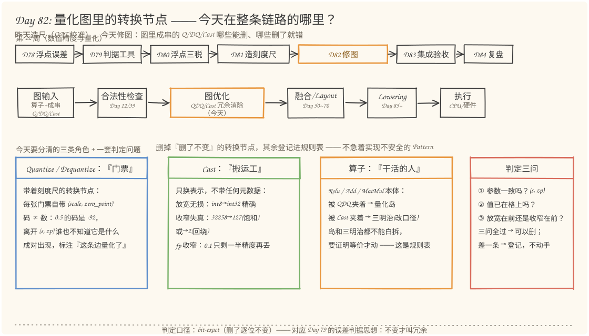
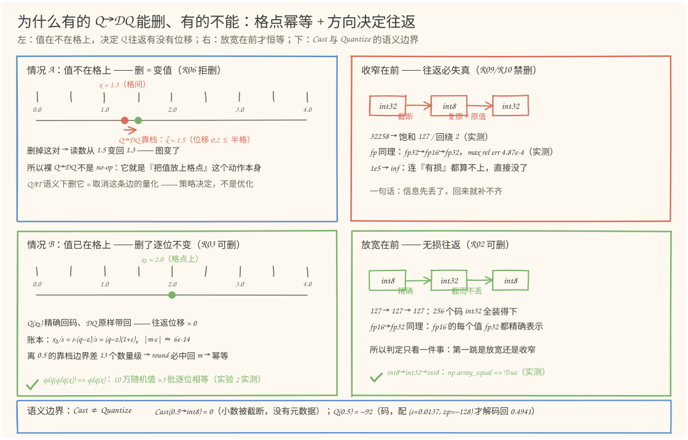
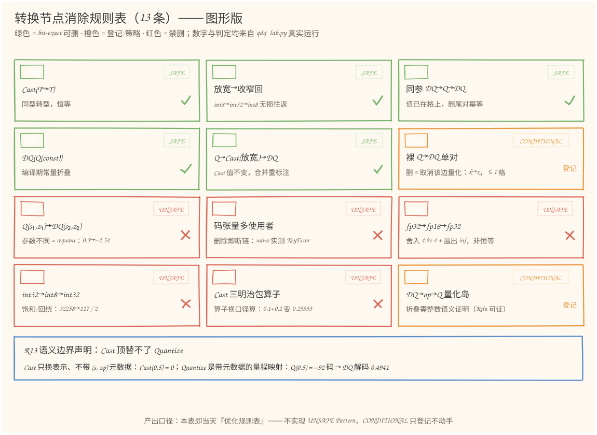
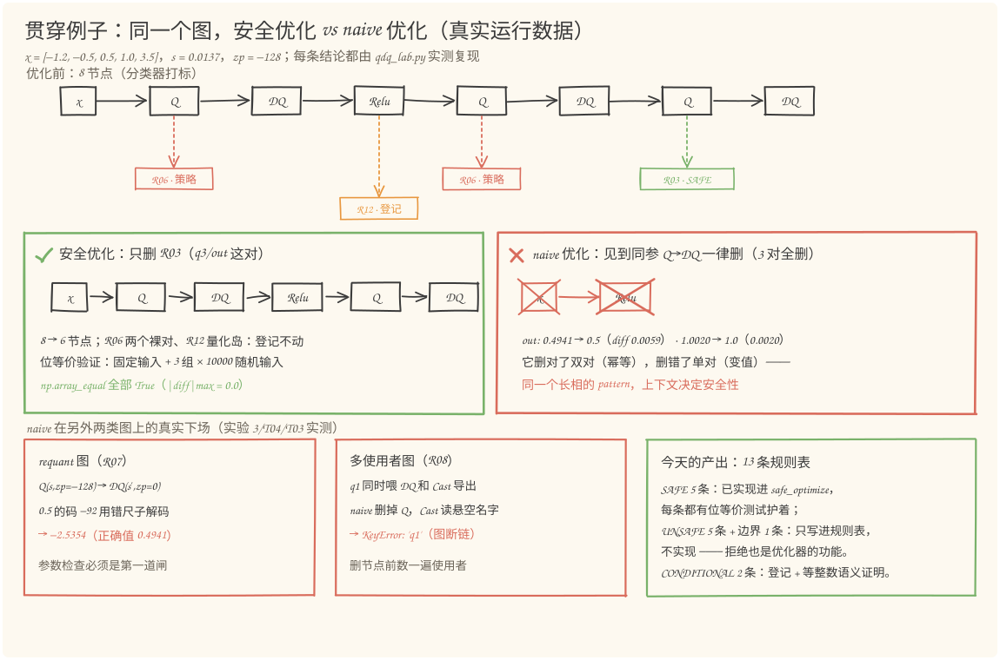

# 第 82 天：量化图中的 Cast 与 QDQ——一张规则表分清"能删"与"删了就错"

> **今日目标**：完成本教程后，你能做到四件事——用自己的话说清 Q/DQ 与 Cast 的语义差别（门票带 `(scale, zero_point)` 元数据、码 ≠ 数，搬运工无元数据、只换表示），并用 `0.5` 的两种命运（`Cast(0.5) = 0` 截断 vs `Q(0.5) = −92` 码 → 解码 `0.4941`）讲给同事听；用"判定三问"（参数一致吗？值在格上吗？放宽在前吗？）把 13 条消除规则分成 SAFE／CONDITIONAL／UNSAFE，并证明 R03 的幂等删除为什么逐位不变（`(q−z)(1+ε)` 距 0.5 靠档边界差 13 个数量级）；独立运行 `qdq_lab.py`（12 个单元测试＋5 个实验全部真实数据），用 `safe_optimize` 复现"8→6 节点、位等价 True"，再用 `naive_optimize` 亲眼看到删错的下场（max diff 0.0059、requant 把 0.5 解成 −2.5354、多使用者图直接 KeyError 断链）；解释为什么裸 `DQ(Q(x))` 不是 no-op、为什么"能删"和"建议删"必须分开登记——这是 Day 74"合法性与收益性分离"在量化图上的回响。
> **预计时间**：学习 35 分钟＋实践 45 分钟
> **前置准备**：Python 3.11＋numpy（本文环境：aarch64 Linux，Python 3.11.4，numpy 1.26.4）。今天直接站在 Day 81 肩上：`quantize／dequantize` 公式、半格误差账本、`32258` 回绕的教训全部沿用；Day 45／51 的"使用者迁移"（rewire）今天第二次上岗。不需要任何昇腾硬件，全部实验在 CPU 上完成。
> **今日产出**：一张 13 条的**优化规则表**（当天核心交付物）＋`qdq_lab.py`（mini 图 IR＋模式分类器＋安全优化器＋12 个单元测试＋5 个实验）＋4 张手绘图。

## 1. 今天解决什么问题？

昨天（Day 81）造好了刻度尺：per-tensor 量化、三个旋钮、半格误差账。但真实推理图不是一条直线——量化感知训练（QAT，Quantization-Aware Training）或转换工具产出的图里，`Quantize`／`Dequantize`／`Cast` 三种转换节点会成串出现：每个量化过的权重边、每条被标注量化的激活边，都可能长出一对 Q/DQ；混合精度转换再往里塞 Cast。这些节点绝大多数"看起来"是纯开销——不加计算语义、拖慢图遍历、挡在融合 Pattern 中间。于是一个很自然的冲动出现了：

> **"Q 进 DQ 出，一来一回不就是恒等吗？删！"**

今天整篇教程就在回答这句话为什么危险。用贯穿例子把它钉死（继续 Day 81 的数字：`s = 3.5/255 = 0.013725`，`zp = −128`，校准范围 [0, 3.5]）。一张 QAT 风格的最小量化图：

```text
x → Q → DQ → Relu → Q → DQ → Q → DQ → out
```

输入 `x = [−1.2, −0.5, 0.5, 1.0, 3.5]`。三对 QDQ **长相完全一样**（都是 `s = 0.013725, zp = −128`），结局却完全不同：

- 第一对（q1/x1）：**删了变值**——`x` 是任意输入、不在格点上，删掉这对等于把 `0.4941` 悄悄改回 `0.5`；
- 第二对（q2/x2）：同样**删了变值**，而且它和 Relu 一起构成一个"量化岛"，是折叠候选而不是删除候选；
- 第三对（q3/out）：**删了逐位不变**——它的输入 `x2` 已经是同参数 DQ 的输出、恰在格点上，Q 往返零位移。

同一种节点、同一组参数，安全性却由**上下文**决定。今天的任务不是写一个"能删更多"的优化器，而是把"哪些能删、哪些删了就错"整理成一张可检验的规则表——**UNSAFE 的规则一条都不实现**，这也是学习计划对今天的要求："不急于实现不安全 Pattern"。

判定口径提前说清楚：本文说"安全"，指 **bit-exact（逐位等价）**——优化前后对同一输入的输出用 `np.array_equal` 逐位相等，容差为零。Day 79 的 rel_F 判据回答"误差是否可接受"，今天的 bit-exact 回答"优化是否引入了任何数值变化"——后者是比前者强得多的要求，因为优化（不同于量化本身）不被允许引入哪怕一个 ulp 的漂移。

## 2. 先看全貌：今天的内容位于哪里？



**图 1**：看三个位置——上排是本周日程：Day 78 讲误差从哪来、Day 79 造判据工具、Day 80 量浮点三笔税、Day 81 自己造刻度尺，今天（橙色框）从"造尺"跨到"修图"，Day 83 集成验收、Day 84 复盘收口；中排是编译链路，今天的位置在图优化阶段的**最前面一格**——融合（Day 50~54）和 Layout（Day 64~70）都指望先有个干净的图；下排三张卡片是今天要分清的三类角色：Q/DQ 是带元数据的"门票"、Cast 是无元数据的"搬运工"、被夹住的算子是"干活的人"，右下角红卡是贯穿全天的判定三问。

把判定流程串成 5 步：

1. **找模式**：遍历图，收集所有相邻的转换节点组合——`Q→DQ`、`Cast→Cast`、`Q→Cast→DQ`、`DQ→op→Q`（量化岛）；
2. **查参数**：Q 与 DQ 的 `(s, zp)` 是否一致——不一致直接判 requant，退出；
3. **查格点**：Q 的输入是否已被证明在格点上（最常见证据：输入是同参数 DQ 的输出）——在格上才有幂等删除；
4. **查使用者**：被删节点的输出张量是否还有别的消费者——有则删除断链；
5. **分诊执行**：SAFE 才动手（使用者迁移＋删除），CONDITIONAL 登记不动，UNSAFE 写进规则表供以后引用。

这套流程在 `qdq_lab.py` 里就是 `classify()`＋`safe_optimize()` 两个函数，第 5 节逐行讲解。

## 3. 核心概念：先用直觉，再给准确定义

### 3.1 QDQ 表示：量化的"门票"

一句通俗解释：QDQ 表示法用一对**显式节点**标注"这条边量化了"——`Quantize` 把 float 值换成整数"码"，`Dequantize` 凭同一组参数把码解回 float，整张图仍然以 float 语义执行（业内叫 fake-quant，用浮点**模拟**整数行为）。推理引擎的量化图表示（如 ONNX 的 `QuantizeLinear`／`DequantizeLinear`、TensorRT 解析的 QDQ 图）就是这个风格。

类比：进量化岛的门票。票面上印着这把刻度尺的全部参数 `(scale, zero_point)`——`Q` 凭票把 `0.5` 编成码 `−92`，`DQ` 凭**同一张票**把 `−92` 解回 `0.4941`。对应到技术上是 Day 81 的两条公式：`q = clip(round(x/s) + z, −128, 127)` 和 `x̂ = s·(q − z)`——`(s, z)` 作为属性挂在节点上，就是"元数据"这个词的具体所指。

**类比的边界**：门票通常被理解为"通行证"——检完票人不变；但 QDQ 这张票**本身改值**：`0.5` 进去、`0.4941` 出来（靠档位移 0.0059）。所以"`Q→DQ` 一来一回"根本不是恒等——它是"把值放上格点"这个**动作本身**。这是今天所有判定里最重要的一句话，第 4 节图 2 的左上角专门画它。

由此立刻得到图上的一个基本结构——**量化岛（quantization island）**：`DQ → op → Q`。算子本体被夹在两道门之间，模拟"这个算子运行在量化值上"。贯穿例子里 `x1 → Relu → q2` 就是一座岛：Relu 吃的是解码后的浮点值、吐出的值又立刻被重新编码。岛的处置是**折叠**（把 op 改造成整数算子）而不是**删除**——折叠需要逐算子的等价证明，今天只登记（R12），不动手。

### 3.2 Cast：不带元数据的"搬运工"

一句通俗解释：Cast 只改变**表示**（dtype，数据类型），不携带任何 `(s, zp)` 元数据——它是纯粹的"搬运工"：把货从 A 仓库搬到 B 仓库，货物本身的含义不变。

对应到技术上是四条方向律，每条都有实测背书（第 5 节实验 4）：

| Cast 方向 | 性质 | 原因 | 实测证据 |
|---|---|---|---|
| 放宽：fp16→fp32、int8→int32、int8→fp32 | **精确** | 小值集合的每个值大集合都装得下 | `int8→int32→int8` 逐位相等 True |
| fp 收窄：fp32→fp16 | **舍入＋溢出** | 11 位尾数装不下 24 位尾数 | max rel err 4.866e-4（理论 2⁻¹¹）；`1e5 → inf` |
| int 收窄：int32→int8 | **饱和或回绕** | 32 位装不下就截断/夹紧 | `32258 → 127`（饱和）／`→ 2`（回绕，Day 81 的数字再现） |
| float→int（如 fp32→int8） | **截断小数** | C 语言 `(int8_t)f` 口径 | `Cast(0.5) = 0` |

**Cast 与 Quantize 的语义边界**——今天最容易踩、也最值得讲透的一条。看 `0.5` 的两种命运：

```text
Cast(0.5, fp32→int8)  = 0      ← 数被截断：小数部分直接扔掉，结果是"数值 0"
Q(0.5, s=0.0137, z=-128) = -92  ← 码：含义是"第 -92 档"，配 (s, zp) 才能解码回 0.4941
```

两者输出都是 int8，**含义天差地别**：Cast 的结果是一个"数"，Quantize 的结果是一个"码"。码离开刻度尺毫无意义——真实事故形态长这样：有人把 Cast 的输出 0 当成码位喂给了 DQ，解码得 `s·(0−(−128)) = 1.7569`，`0.5` 摇身一变成了 `1.76`，全程无报错（第 5 节实验 5 有完整数字）。**Cast 永远顶替不了 Quantize**，因为它没有地方安放 `(s, zp)` 这组元数据——这条边界写进规则表就是 R13。

常见误解顺带澄清："Cast(fp32→int8) 不就是量化吗？"——不是。方向不同（Cast 读"数值"、Quantize 映射"量程"）、语义不同（一个截断、一个带参缩放＋取整＋平移＋饱和四连）、元数据不同（一个无、一个有）。记住 0.5 的两种命运就够了。

### 3.3 判定三问：把"能不能删"变成可检查的条件

一句话版本：**参数一致吗？值在格上吗？放宽在前吗？**——再补一个结构性问题"有别的使用者吗？"。四问把 13 条规则全部生成出来。下面每问先给判定，再给依据。

**第一问：参数一致吗？** `Q(s1,z1)` 后面跟的 DQ 必须也是 `(s1,z1)`。不一致就是 requant（重量化）——`0.5` 的码 `−92` 被 `(s2=0.0276, z2=0)` 这把对称刻度尺错误解码，得 `0.0276×(−92) = −2.5354`：一个正数变成大 5 倍的负数。这不是"删了变值"，是**图本身已经坏了**（转换工具参数配置错误、或上次图改写弄丢了参数的产物），优化器要做的是报警（R07），删与不删都救不了它。

**第二问：值在格上吗？** 这是 SAFE 与 CONDITIONAL 的分水岭。`DQ(Q(x)) = x̂` 是 x 靠档后的结果，`x̂` 本身**恰在格点上**。于是关键性质成立——**幂等（idempotent）**：对格点上的值再做一次同参数 QDQ，一个比特都不动。为什么？账本摊开（`m = q−z`，整数且 |m| ≤ 255）：

```text
x̂/s = s·(q−z)/s = m·(1+ε)，fp 乘除两次舍入 |ε| ≤ 2⁻⁵²
|m·ε| ≤ 255 × 2.2e-16 ≈ 5.7e-14  ≪ 0.5  →  round 必中回 m，离 0.5 的靠档边界差 13 个数量级
```

所以 `Q→DQ→Q→DQ`（同参数）等于单个 `Q→DQ`，删掉一对**逐位不变**（规则 R03，实验 2 用 3 批 10 万随机值＋随机尺度实测 `np.array_equal == True`）；反过来，输入是任意值的第一对 QDQ 不满足这一问，删除会把 `x̂` 变回 `x`（R06，拒绝）。类比的边界提醒一次：说"幂等所以能删"成立的前提是**参数一致**——参数不一致时值根本不在那把尺的格点上，第二问直接挂掉。

**第三问：放宽在前吗？** 连续 Cast 的往返是否恒等，只看第一跳方向：`int8 → int32 → int8` 第一跳放宽精确、第二跳截回原值，往返恒等，可删（R02）；`int32 → int8 → int32` 第一跳就把 `32258` 挤成 `127`，回来补不齐，禁删（R10）；fp 同理（R09）。**还有一问藏在背后**：Cast 有没有把算子夹在中间（三明治）？`Cast(fp32→fp16) → Add → Cast(fp16→fp32)` 看起来像"给算子换了间小仓库"，实际把 Add 的计算口径换到了 fp16——`0.1+0.2` 从 `0.30000000000000004` 变成 `0.2999267578125`（实验 4 实测）。Day 78~80 的教训在这条规则里回声：**改变精度的不是 Cast 节点，是被 Cast 包住的算子**。

**补充问：有别的使用者吗？** 这是结构条件，不涉及数值：要删的节点产出的张量（比如码 `q3`）如果还喂给了别的节点（调试导出、额外的 DQ），删除即断链。`naive_optimize` 在多使用者图上的真实下场是求值时 `KeyError: 'q1'`（T04 实测）。修复靠 Day 45／51 的老朋友：先数使用者（`use_counts`），再迁移使用者（rewire）。

## 4. 图解核心机制

把第二问和第三问画出来，就是全天的判定核心：



**图 2**：左上／左下是一对对照。按编号走一遍：

1. **左上（R06，拒删）**：`x = 1.3` 是格间点（红点），`Q→DQ` 把它靠档到 `1.5`（绿点，位移 0.2 ≤ 半格）。**发生了什么**：值被改写；**为什么不能删**：删掉这对，读数从 `1.5` 变回 `1.3`——"把值放上格点"这个动作被撤销，QAT 校准好的数值行为漂移。真实尺度下的账：范围内删除的误差实测上界 0.0069（半格，10 万随机值），范围外更惨——`5.0` 的删除误差是 1.5，等于到墙的距离（Day 81 图 2 那堵墙的回声）。
2. **左下（R03，可删）**：`x2 = 2.0` 恰在格点上（绿点）。`Q(x2)` 精确回码、`DQ` 原样带回，**往返位移 = 0**。依据就是 3.3 节那本账：`|m·ε| ≈ 5.7e-14`，离 0.5 的靠档边界差 13 个数量级——所以同参数 `DQ→Q→DQ` 的尾对删除逐位不变。
3. **右上／右下（Cast 方向律）**：收窄在前（红），`32258 → int8 → 127`，信息有去无回；放宽在前（绿），`127 → int32 → 127`，每个码都装得下、回来还是它。fp 家族同理：`fp32→fp16→fp32` max rel err 4.87e-4（实测），`fp16→fp32→fp16` 精确。
4. **底部横幅（R13）**：`Cast(0.5) = 0` vs `Q(0.5) = −92 码`——Cast 没有元数据，装不下那把刻度尺。

一句话把图 2 记住：**"在格上，来回不动；不在格上，来回靠档；放宽在前，往返恒等；收窄在前，信息单向流失。"**

### 4.1 今天的核心产出：优化规则表（13 条）

学习计划要求今天的产出是"优化规则表，不急于实现不安全 Pattern"。下表就是交付物——判定列的三种值：**SAFE**（bit-exact，已实现进 `safe_optimize`）、**CONDITIONAL**（登记，需更强分析或策略决定）、**UNSAFE**（禁止，只写进表）。每条都标注了代码里的实测出处：

| 编号 | 模式 | 判定 | 一句话依据 | 出处 |
|---|---|---|---|---|
| R01 | `Cast(T→T)` 同型转型 | SAFE | 值原样，恒等转型 | T05 |
| R02 | `Cast(T1→T2)→Cast(T2→T1)`，第一跳为无损放宽 | SAFE | 第一跳精确、第二跳截回原值，往返恒等 | T06 |
| R03 | 同参 `DQ→Q→DQ`（或 `Q→DQ→Q→DQ`） | SAFE | 输入已在格点，Q 往返零位移（幂等，3 批 10 万值逐位验证） | T02/T12 |
| R04 | `DQ(Q(const))` 作用在常量上 | SAFE | 同样的计算提前到编译期，值逐位不变 | T09 |
| R05 | `Q→Cast(int 放宽)→DQ` | SAFE | 无损放宽不改码值，只是类型搬运；删 Cast＋类型重标注 | T10 |
| R06 | 裸 `Q→DQ` 单对（输入不保证在格上） | CONDITIONAL | 删除把 x̂ 变回 x（≤1 格，实测 0.0069），破坏 QAT 校准语义；删 = 取消该边量化，属**策略**决定 | T01/实验3 |
| R07 | `Q(s1,z1)→DQ(s2,z2)` 参数不同 | UNSAFE | 用错刻度尺解码：0.5 的码 −92 被解成 −2.5354；参数检查是第一道闸 | T03 |
| R08 | 待删码张量有其他使用者 | UNSAFE | 删除后其他消费者读悬空名字（naive 实测 KeyError 断链） | T04 |
| R09 | `Cast(fp32→fp16)→Cast(fp16→fp32)`（收窄在前） | UNSAFE | 就近舍入 max rel err 4.87e-4（实测），`1e5 → inf` 溢出 | T07/实验4 |
| R10 | `Cast(int32→int8)→Cast(int8→int32)`（收窄在前） | UNSAFE | `32258` 饱和成 127／回绕成 2，信息有去无回 | T08/实验4 |
| R11 | Cast 三明治：`Cast(收窄)→op→Cast(放宽)` | UNSAFE | op 被换到低精度口径算：0.1+0.2 变 0.2999267578125 | 实验4 |
| R12 | 量化岛 `DQ→op→Q` | CONDITIONAL | 折叠需逐算子等价证明：Relu 可证 bit-exact（格点对 max(·,0) 封闭）；MatMul 要 INT32 累加口径（Day 81）；今天只登记 | 实验1 |
| R13 | 用 Cast 顶替 Quantize 的改写 | 边界声明 | Cast 无 (s, zp) 元数据：`Cast(0.5)=0` 是截断；`Q(0.5)=−92` 是码，配元数据才解码 0.4941 | T11/实验5 |

这张表的图形版如下，判定颜色与上表一一对应：



**图 3**：看两个规律——左上五格绿色全是"结构可证"的删除（恒等、无损往返、幂等、常量、类型搬运），它们不依赖任何数值假设；下方六格红色全是"数值会被改写"或"结构会断"的禁删；中间两格橙色（R06／R12）最有意思——它们**本身没有错**，只是"能不能删"取决于上下文证据（值在不在格上）或策略（要不要保留 QAT 语义），今天的选择是不动手、登记在案。

值得停一秒的观察：R03 和 R06 是**同一个 pattern**（相邻同参 Q→DQ 对），判定却一个 SAFE 一个 CONDITIONAL——差别只在 Q 的输入是否已在格点上。**图优化里没有"看长相下结论"这回事，上下文就是语义的一部分**，这正是第 50~52 天融合合法性检查反复教过的事。

## 5. 动手实践：分类器＋安全优化器＋12 个测试＋5 个实验

### 5.1 准备文件

今天的完整工程两个文件（随教程已生成，`qdq_lab.py` 只依赖 numpy 和标准库）：

```text
tutorials/day-082/
├── README.md
├── code/
│   ├── qdq_lab.py       # mini 图 IR + 规则分类器 + 安全/naive 优化器 + 12 测试 + 5 实验（本节主角）
│   └── make_images.py   # 生成 4 张 SVG 的绘图脚本（种子 82，可复现）
└── images/
    ├── 01-overview.svg
    ├── 02-mechanism.svg
    ├── 03-rules.svg
    └── 04-before-after.svg
```

### 5.2 编写代码

先看 IR 的地基。一个设计决定提前交代：**值统一存放在 float64 容器里，dtype 只是节点上的标签**——这和 QDQ 的 fake-quant 思路完全一致（用浮点模拟整数行为），把"值语义"和"类型语义"拆开后，位等价检验就只需要盯数值：

```python
class Graph:
    def evaluate(self, feed):
        env = {}
        for n in self.nodes:                 # 建图时已按拓扑序追加
            if n.kind == "input":
                env[n.name] = np.asarray(feed[n.name], dtype=np.float64)
            elif n.kind == "quantize":
                env[n.name] = quantize(env[n.inputs[0]], n.scale, n.zp)
            elif n.kind == "dequantize":
                env[n.name] = dequantize(env[n.inputs[0]], n.scale, n.zp)
            elif n.kind == "cast":
                env[n.name] = cast_values(env[n.inputs[0]], n.src, n.dst, n.mode)
            elif n.kind == "relu":
                env[n.name] = np.maximum(env[n.inputs[0]], 0.0)
            ...
```

`cast_values` 是 3.2 节四条方向律的代码化——特别把 int 收窄的**饱和**与**回绕**两种口径都实现了（`mode` 参数），因为真实框架两种都有，Day 81 的 `32258 → 2` 就是回绕：

```python
def cast_values(x, src, dst, mode="saturate"):
    """Cast 的值语义：只换表示，不带任何 (s, zp) 元数据。"""
    x = np.asarray(x, dtype=np.float64)
    if src == dst:
        return x.copy()                                   # R01：恒等
    if src in FP and dst in FP:
        if dst == "fp16":
            with np.errstate(over="ignore"):               # 溢出 -> inf 是文档化行为
                return np.asarray(x, dtype=np.float16).astype(np.float64)
        return x.copy()                                    # fp16 -> fp32 精确
    if src in INT and dst in INT:
        if dst == "int32":
            return x.copy()                                # 放宽精确
        if mode == "saturate":
            return np.clip(x, QMIN, QMAX)
        return ((x.astype(np.int64) - QMIN) % 256 + QMIN).astype(np.float64)  # 回绕
    if src in FP and dst == "int8":
        t = np.trunc(x)                                    # C 截断：Cast(0.5) = 0
        if mode == "saturate":
            return np.clip(t, QMIN, QMAX)
        return ((t.astype(np.int64) - QMIN) % 256 + QMIN).astype(np.float64)
```

分类器的核心是 `dequantize` 分支——判定三问按顺序过堂，先参数、再多使用者、再常量／格点证据，全不过才落到 CONDITIONAL：

```python
if n.kind == "dequantize" and p is not None and p.kind == "quantize":
    if not same_qparams(p, n):                 # 第一问：参数一致吗
        report("R07", n.name, ...)
    elif uses[p.name] > 1:                     # 补充问：码有别的使用者吗
        report("R08", n.name, ...)
    else:
        src = producers.get(p.inputs[0])
        if src is not None and src.kind == "const":
            report("R04", n.name, ...)         # 常量：编译期折叠
        elif (src is not None and src.kind == "dequantize"
              and same_qparams(src, p)):
            report("R03", n.name, ...)         # 第二问：输入是同参 DQ 的输出 -> 已在格上
        else:
            report("R06", n.name, ...)         # 裸对：值不保证在格上
```

安全优化器只有一个纪律：**每轮分类，只吃 verdict 为 SAFE 的第一条，改完重扫，直到不动点**；改写靠使用者迁移（`rewire`），并且先在**副本**上动手——原图保持不动，位等价检验才有对照对象（这行 `copy_graph` 是调试时踩过的坑，5.4 节有回放）。naive 优化器是故意的反面教材：见到同参相邻 `Q→DQ` 就删，什么上下文都不看，代码比安全版短一半——**短的那一半恰恰全是判定**。

### 5.3 运行与观察

```bash
cd tutorials/day-082/code
python3 qdq_lab.py
```

以下是在本文环境（aarch64 Linux，Python 3.11.4，numpy 1.26.4）的**真实运行输出**，按单元测试和五个实验节选。

先看 12 个单元测试——每条规则一个判定用例，其中 T11 是语义边界、T12 是贯穿图端到端：

```text
单元测试：转换节点判定与安全优化的 12 个用例
  T01 PASS  裸 Q->DQ 判 R06(['R06'])，safe_optimize 不改图（3 节点）
  T02 PASS  R03 命中，5->3 节点，位等价=True
  T03 PASS  参数不同判 R07（requant），safe_optimize 拒绝
  T04 PASS  多使用者判 R08；naive 强删后求值 KeyError 断链=True
  T05 PASS  Cast(fp32->fp32) 判 R01 删除，位等价
  T06 PASS  int8->int32->int8 判 R02 删两个 Cast（剩 2 节点），位等价
  T07 PASS  fp32->fp16->fp32 判 R09 拒删；往返 |diff|max=inf（含 inf 溢出）
  T08 PASS  Cast(32258, int32->int8)：饱和=127，回绕=2（Day 81 累加器回绕再现）
  T09 PASS  DQ(Q(const)) 判 R04 常量折叠，位等价=True
  T10 PASS  Q->Cast(int8->int32)->DQ 判 R05 删 Cast（剩 3 节点），位等价
  T11 PASS  Cast(0.5)=0（数被截断）vs Q(0.5)=-92（码）；把码位当数解码 0 -> 1.7569
  T12 PASS  贯穿图判定 ['R03', 'R06', 'R12']，8->6 节点，位等价=True
  12/12 通过
```

**实验 1**：贯穿例子——分类器在 8 节点图上打出的完整标签（这是图 1 流程的一次完整执行）：

```text
实验 1：贯穿例子——QAT 风格量化岛上的模式判定
  图结构: x -> Q -> DQ -> Relu -> Q -> DQ -> Q -> DQ -> out（s=0.0137255, zp=-128）
  输入 x = [-1.2, -0.5, 0.5, 1.0, 3.5]
  q1   = [-128, -128, -92, -55, 127]
  x1   = ['0.0000', '0.0000', '0.4941', '1.0020', '3.5000']
  r    = ['0.0000', '0.0000', '0.4941', '1.0020', '3.5000']  （Relu 真干活：负值清零）
  out  = ['0.0000', '0.0000', '0.4941', '1.0020', '3.5000']

  分类器输出（转换节点模式判定）：
    [CONDITIONAL] R06 @ x1   裸 Q->DQ 单对：删除=取消该边量化（QAT 策略），非 bit-exact  输入 x 不保证在格上
    [CONDITIONAL] R12 @ q2   DQ->op->Q 量化岛：仅当 op 有精确整数语义才可折叠  x1 -> relu -> q2（r）
    [CONDITIONAL] R06 @ x2   裸 Q->DQ 单对：删除=取消该边量化（QAT 策略），非 bit-exact  输入 r 不保证在格上
    [SAFE       ] R03 @ out  同参 DQ->Q->DQ：值已在格上，删尾对 bit-exact  x2 已把值放上格点
```

读两个信号：`q1` 把 `−1.2` 夹到 `−128`、`−0.5` 夹到 `−128`——Day 81 的饱和墙在图里原样出现；四个判定正好覆盖 4.1 节规则表的四种命运，其中 `R06 @ x2` 值得注意——它的输入 `r` **其实**在格点上（`relu` 输出不是 0 就是 x̂1，都在格上），但分类器只做局部结构判定、不追数据流，所以保守放行到 CONDITIONAL。更聪明的分析能解锁这次删除（选做练习的任务）。

**实验 2**：安全优化器动刀——只删 R03，位等价三重验证：

```text
实验 2：安全优化器——只动 bit-exact 的部分
  节点数 8 -> 6（删除 q3/out 这对 QDQ）
  剩余节点: x -> q1 -> x1 -> r -> q2 -> x2
  固定输入位等价: True
  3 组 x 10000 随机输入位等价: True（|diff|max = 0.0e+00）

  幂等性验证（R03 的依据）：qdq(qdq(x)) 与 qdq(x) 逐位相等？
    批1: 固定尺度 np.array_equal=True, 随机尺度 s=0.7876: True
    批2: 固定尺度 np.array_equal=True, 随机尺度 s=1.614: True
    批3: 固定尺度 np.array_equal=True, 随机尺度 s=8.948: True
```

**实验 3**：naive 优化器翻车现场——同参 `Q→DQ` 一律当 no-op 删：

```text
实验 3：naive 优化器翻车——同参 Q->DQ 一律当 no-op 删
  naive 删除 3 对 QDQ 后: x -> r（2 节点）
  out_orig  = ['0.0000', '0.0000', '0.4941', '1.0020', '3.5000']
  out_naive = ['0.0000', '0.0000', '0.5000', '1.0000', '3.5000']
  |diff|    = ['0.0000', '0.0000', '0.0059', '0.0020', '0.0000']  max = 0.0059（半格 s/2 = 0.0069）

  requant 事故（R07 为什么连试都不能试）: Q(s=0.0137255,zp=-128) -> DQ(s=0.0275591,zp=0)
    0.5 -> 码 -92，用错刻度尺解码 -> -2.5354（正确解码 0.4941）

  裸对删除的误差账（R06 为什么不是 bit-exact）:
    范围内 100000 随机值: max|x_hat - x| = 0.006863 <= 1 格 scale = 0.013725
    范围外对照: [-1.2, 3.6, 5.0] -> ['0.0000', '3.5000', '3.5000']（误差 = 到墙的距离，Day 81 图 2 的墙）
```

注意 naive 的细节：它删对了第三对（R03，真幂等）、删错了前两对（R06，变值）——**同一个长相的 pattern，上下文决定安全性**。而 `0.0059` 这种量级的漂移在端到端测试里最阴险：它比大多数阈值都小，单测能过、精度指标慢慢掉，事后极难归因。requant 那行则是另一个教训：参数不一致的图，删不删都已经错了，优化器的职责是**报警**而不是抢救。



**图 4**：三块对照。左上：优化前的 8 节点图与分类器打的四个标签（红橙绿与图 3 一致）。左下：安全优化路径——只划掉 `q3/out` 一对（绿叉），8→6 节点，固定输入＋3 组 1 万随机输入位等价全部 True。右下：naive 路径——三对全删、`x→r` 只剩 2 个节点，看起来"优化得更多"，但输出漂移 0.0059，而且它在另外两类图上会直接翻车：requant 图删出 `0.5 → −2.5354`，多使用者图删出 `KeyError` 断链。底部三张卡片是这些真实数据的归档，右下角绿卡是今天的交付口径。

**实验 4**：Cast 往返方向律——放宽在前恒等、收窄在前失真，外加三明治实测：

```text
实验 4：Cast 往返实验——放宽在前恒等，收窄在前失真
  fp32 -> fp16 -> fp32（10^5 个对数均匀样本）:
    非恒等比例 100.0%，max rel err = 4.866e-04（fp16 半 ulp 理论 2^-11 = 4.883e-4）
    溢出: Cast(1e5) = inf
  int8 -> int32 -> int8: np.array_equal = True（放宽在前，无损往返）
  int32 -> int8 -> int32: 32258 饱和成 127、回绕成 2——收窄在前，信息有去无回

  Cast 三明治（R11）：Cast(fp32->fp16) -> Add -> Cast(fp16->fp32)
    判定: ['R11']；0.1+0.2 = 0.30000000000000004 -> 三明治后 0.29992675781250000（Add 在 fp16 里算，口径变了）
```

`4.866e-04` 与理论值 `2⁻¹¹ = 4.883e-4` 几乎重合——10 万样本碰到的最坏舍入恰好贴着半 ulp 上界，Day 78"格子"的语言在这里第三次兑现。

**实验 5**：Cast 与 Quantize 的语义边界——`0.5` 的两种命运全表：

```text
实验 5：Cast 与 Quantize 的语义边界——0.5 的两种命运
       x  Cast(fp32->int8)    Q 码   DQ(Q(x))
     0.5                 0    -92     0.4941
     1.0                 1    -55     1.0020
     2.0                 2     18     2.0039
     3.5                 3    127     3.5000

  把 Cast 的结果当码位解码（真实事故形态）: DQ(0) = 1.7569 —— 0.5 变 1.76
  结论: Cast 只换表示、不带 (s, zp) 元数据；Quantize 是带元数据的量程映射。Cast 永远顶替不了 Quantize（R13）。
```

### 5.4 修改一个参数再观察

两个低成本对照（都在 `code/` 目录运行，`build_day_graph`／`build_graph`／`classify`／`safe_optimize` 可直接 import）。先预测，再看输出。

**对照 1：把第三对里 Q 的参数改成对称刻度**——R03 应该消失、变 R07，安全优化器空手而归，且图自身输出已经坏了：

```bash
python3 -c "
from qdq_lab import *
s, z = 3.5/255, -128
spec = [('input','x',(),{}), ('quantize','q1',['x'],dict(scale=s,zp=z)),
        ('dequantize','x1',['q1'],dict(scale=s,zp=z)), ('relu','r',['x1'],{}),
        ('quantize','q2',['r'],dict(scale=s,zp=z)),
        ('dequantize','x2',['q2'],dict(scale=s,zp=z)),
        ('quantize','q3',['x2'],dict(scale=3.5/127,zp=0)),
        ('dequantize','out',['q3'],dict(scale=s,zp=z))]
g = build_graph(spec, ['out'])
print('规则:', [(r[0], r[3]) for r in classify(g)])
g2 = safe_optimize(g)
print(f'{len(g.nodes)} -> {len(g2.nodes)} 节点')
print('out =', ['%.4f' % v for v in g.run({'x':[0.5,1.0,3.5]})[0]])
print('正确值应为', ['%.4f' % v for v in build_day_graph().run({'x':[0.5,1.0,3.5]})[0]])
"
```

真实运行结果：

```text
规则: [('R06', 'x1'), ('R12', 'q2'), ('R06', 'x2'), ('R07', 'out')]
8 -> 8 节点
out = ['2.0039', '2.2510', '3.5000']
正确值应为 ['0.4941', '1.0020', '3.5000']
```

预测验证：q3 的刻度换成 `(s=0.0276, z=0)` 而 out 的 DQ 还拿着旧尺子 `(s=0.0137, z=−128)`——`R03` 消失、`R07` 顶上，安全优化器一个节点都没删（8→8，"拒绝也是优化器的功能"）。更深的教训在最后两行：**这张图在优化器动手之前就已经错了**——`0.5` 一路走完变 `2.0039`，把码 `18` 用非对称刻度尺解码的结果。R07 的正确响应是报警，不是"优化"。

**对照 2：把 q3 也导出为图输出**（模拟调试时把码存下来的常见操作）——R03 应该退化为 R08：

```bash
python3 -c "
from qdq_lab import *
g = build_day_graph()
g.outputs.append('q3')
print('规则:', [(r[0], r[3]) for r in classify(g)])
g2 = safe_optimize(g)
print(f'{len(g.nodes)} -> {len(g2.nodes)} 节点')
eq, d = verify_bit_exact(g, g2, [{'x':[0.5,1.0,3.5]}])
print('位等价:', eq)
"
```

真实运行结果：

```text
规则: [('R06', 'x1'), ('R12', 'q2'), ('R06', 'x2'), ('R08', 'out')]
8 -> 8 节点
位等价: True
```

预测验证：`q3` 多了一个使用者，`R03 → R08`，昨天还安全的删除今天就不许做了——**同一个 pattern、同一个参数，一位使用者就能翻转判定**。位等价仍为 True，但这次是"什么都没删"的平凡成立，两个对照合起来读：安全优化器行为完全由判定驱动，判定由**参数＋上下文**决定，而它从不越权。

顺带交代一个开发时的真实踩坑（也是 `copy_graph` 存在的原因）：第一版 `safe_optimize` 在原图上原地修改，位等价检验变成了"优化后的图和自己比"，`array_equal` 永远 True——**验证形同虚设**。现象是"怎么乱改测试都过"，定位靠的是故意把一个删除改错却仍然全绿。修复：优化器一律在副本上动手，原图留作对照。这个坑和第 6 节错误 1 是同一个家族：**验证逻辑先于实现**。

## 6. 常见错误与排查

**错误 1：把裸 `DQ(Q(x))` 当 no-op 删除，QAT 校准语义悄悄漂移。**
现象：端到端精度指标缓慢下降，无任何报错；逐层对比输出，差值只有 0.006 左右——比多数测试阈值都小，极易被当成"浮点噪声"放过。
原因：`DQ(Q(x)) = x̂` 是**靠档后的值**，删除这对等于把 `x̂` 变回 `x`（实验 3：范围内 10 万值实测误差 ≤ 0.0069，范围外等于到墙的距离）。QAT 训练时模型已经适应了 x̂ 的分布，部署时换回 x 就是悄悄换掉了校准。
定位：用位等价（`np.array_equal`）而不是误差阈值做回归——优化 Pass 的验收口径是"逐位不变"，容差为零；一旦全绿变红，二分关 Pass（第 136 天的预演）即可锁定。
修复：删除 QDQ 对的条件写进 Pattern——只删"输入已在格上"的对（R03）；要取消某条边的量化，走显式的策略开关（R06 的 CONDITIONAL 分支），别让优化器替你做决定。

**错误 2：参数不匹配的 `Q→DQ` 也当对消删，或参数丢失后图带着隐性 requant 继续跑。**
现象：输出"离谱地错"——0.5 变 −2.54（实验 3）或 2.00（对照 1），大小甚至符号都不对。
原因：`Q(s1,z1)` 编码用的刻度尺和 `DQ(s2,z2)` 解码用的不是同一把，码被错误解码；这类图多半来自转换工具的参数配置错误或上次图改写弄丢了属性。
定位：分类器第一问（`same_qparams`）直接报警 R07；打印相邻 Q/DQ 的 `(s, zp)` 对比一遍。
修复：优化器遇到参数不一致**拒绝一切改写并报错**；上游修参数（校准记录、QAT 配置），不要在下游"抢救"。

**错误 3：int32→int8 用 `astype` 一写了之，回绕替代了饱和。**
现象：整数截断后的结果符号翻转、错得离谱，如 `32258` 变 `2`（T08 实测），且 numpy 不给任何警告。
原因：8 位补码的溢出是回绕（Day 81 T05 的教训在 Cast 上的复刻）；有的框架饱和、有的回绕，两种口径混用更乱。
定位：单元测试里放边界值（`32258`、`−129`、`128`），断言口径；把 `mode` 作为 Cast 的显式参数打印出来。
修复：显式 `np.clip` + `astype`，并把口径写进节点属性（`mode="saturate"`）；删除往返型 Cast 前先看方向（R02 只放行"放宽在前"）。

**错误 4：删节点不数使用者，改完图直接断链。**
现象：优化后的图求值抛 `KeyError: 'q1'`（T04 实测），或更隐蔽的——消费者读到了改写前的旧张量，结果"半对半错"。
原因：待删节点产出的张量还有别的消费者（调试导出、额外的 DQ、多条激活分支），直接 `remove` 不会更新它们的输入。
定位：删除前先 `use_counts` 扫一遍全部节点输入和图输出；求值报 KeyError 时，检查被删名字的剩余引用。
修复：删除断言"输出单使用者"，多使用者一律 R08 拒绝；确实要删时，先 `rewire` 把使用者迁移到替代张量（Day 45/51 的使用者迁移），再删节点。

## 7. 今日练习

### 必做练习

不跑代码，手推贯穿图第三对 QDQ 的幂等性：`x2 = [0, 0, 0.4941, 1.0020, 3.5]`，`s = 0.013725`，`zp = −128`，逐个值计算 `q3 = round(x2/s) + zp` 并验证 `q3` 与实验 1 里的 `q2 = [-128, -128, -92, -55, 127]` 完全一致，再手算 `DQ(q3)` 是否原样带回 `x2`。然后回答一个问题：**同样是"相邻同参 Q→DQ"，分类器凭什么把第一对标 R06、把第三对标 R03？两对的输入分别是什么，差别在哪一问上？**（提示：第二问"值在格上吗"的证据从哪来。）最后跑 `python3 qdq_lab.py`，用 T12 的输出对答案。

### 选做挑战

给 `classify()` 加一条"格点传播"分析，把实验 1 里的 `R06 @ x2` 升级成 SAFE：证明 `relu` 的输出必然在格点上——输入 `x1` 在格点上，`max(x1, 0)` 的结果要么是 `x1` 本身、要么是 0，而 0 也在格点上（`0 = s·(zp − zp)`），所以 `r` 在格点上，`q2` 精确、`x2` 的对可删。实现思路：维护一个"格点闭包"集合（哪些张量的值被证明在 `(s, z)` 格上：同参 DQ 的输出直接入集合；逐元素单调算子作用于集合内张量、且算子在格点上封闭，则输出也入集合），再让 R03 的判定查这个集合而不只是查直接生产者。完成后用位等价验证你的升级没有放行错误删除，并回答：这条分析对 `Add`（两个格点值相加）成立吗？（提示：两个格点值相加还在格点上吗？相加后范围会不会出墙？）

## 8. 今日验收

- [ ] 我能用自己的话讲清 Q/DQ 与 Cast 的语义差别，并给出 `0.5` 两种命运的具体数字（`Cast(0.5) = 0` 截断；`Q(0.5) = −92` 码 → 解码 `0.4941`；把码位当数解码会得到 `1.7569`）
- [ ] 我能背出判定三问并各举一例：参数一致吗（R07：0.5 → −2.5354）、值在格上吗（R03 幂等）、放宽在前吗（R02 vs R09/R10），并解释补充问"多使用者"为什么是结构条件而非数值条件
- [ ] 我能独立运行 `qdq_lab.py` 并通过 12/12 测试，指出 T04（断链）、T08（回绕）、T11（码≠数）各自防的坑
- [ ] 我能用 `safe_optimize` 复现 8→6 节点、位等价 True，用 `naive_optimize` 复现数值漂移（max 0.0059），并说出 naive"删对了一对、删错了两对"的原因
- [ ] 我能预测参数改动／使用者改动后的判定变化并实测验证：q3 换对称刻度 → R03 变 R07、优化器空手（8→8）；q3 多一个使用者 → R03 变 R08、禁止删除
- [ ] 我保存了 `code/qdq_lab.py`（分类器＋优化器＋12 测试＋5 实验）、13 条规则表和 4 张图，`python3 make_images.py` 可复现全部图片

## 9. 一句话总结与明天预告

今天把 Day 81 造好的刻度尺搬进了计算图：图里成串的 `Q→DQ` 和 `Cast` 绝不是统一的"纯开销"——Q/DQ 是带 `(s, zp)` 元数据的门票、本身改值（靠档），Cast 是无元数据的搬运工、按方向决定往返是否恒等。机制上用判定三问（参数、格点、方向）加使用者检查，把 13 种模式分成 SAFE 五条（恒等、无损往返、幂等、常量、类型搬运——全部 bit-exact 并已实现进 `safe_optimize`）、CONDITIONAL 两条（裸对、量化岛——登记不动）、UNSAFE 六条（requant、断链、fp/int 收窄往返、三明治、Cast 顶替 Q——一条也不实现）。实践上 `qdq_lab.py` 用 12 个测试和 5 个实验钉死了所有判定：安全优化 8→6 节点位等价 True，naive 优化删出 0.0059 漂移、requant 图 0.5 变 −2.5354、多使用者图直接 KeyError；验证口径是容差为零的逐位相等——"删了不变"才叫冗余。

明天（Day 83）是第三阶段集成验收：拿出一张包含 Transpose、Reshape、MatMul、Bias、Relu 的完整图，把本周的 QDQ 规则、本周之前的融合与 Layout 优化、以及 Day 79 的参考实现验证串成一条链路——今天这张规则表会在里面第一次以"图优化管道的一环"身份上岗。


