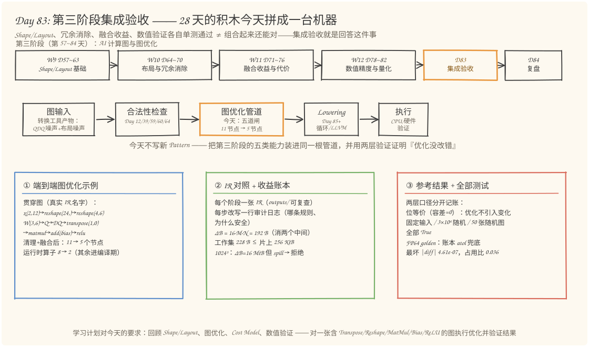
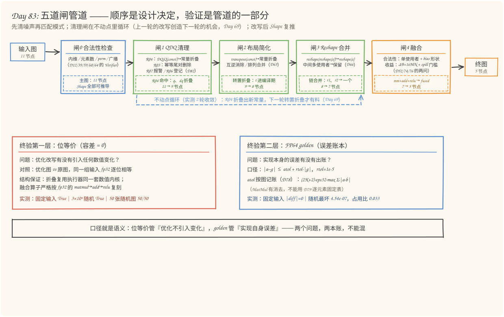
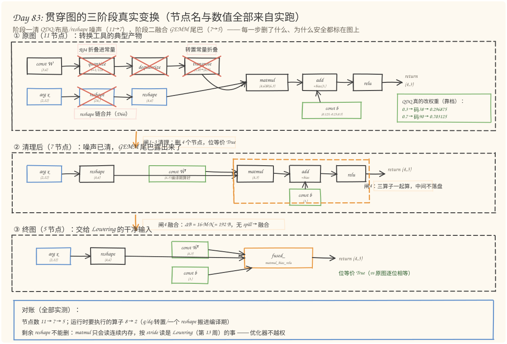
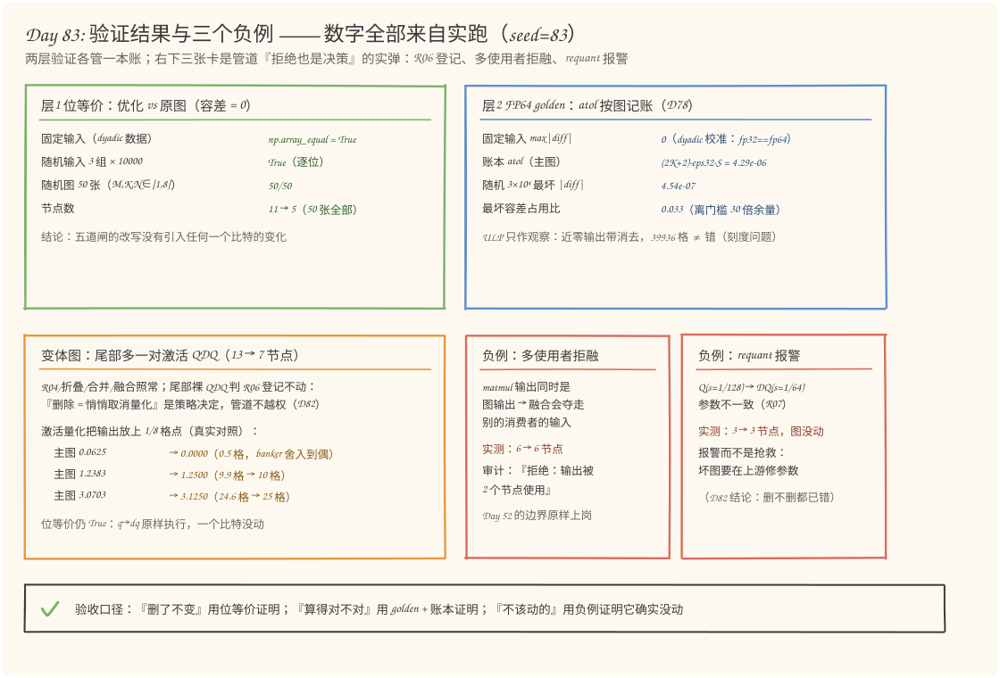

# 第 83 天：第三阶段集成验收——把 28 天的积木拼成一台"图优化小编译器"

> **今日目标**：完成本教程后，你能做到四件事——用自己的话讲清"五道闸"管道的顺序为什么是这样（先清噪声再匹配模式，清理闸在不动点里循环），并用一个真实反例证明顺序不是审美问题（布局简化抢在 QDQ 清理之前、又没有循环兜底时，终图 11→6 而不是 11→5，位等价仍 True——错过的是机会不是正确性）；讲清两层验证口径的分工（位等价容差 = 0，证明"优化没引入任何数值变化"；FP64 golden 配误差账本 atol，证明"实现自身误差在账内"），并说出为什么 MatMul 不能用 Day 79 的逐元素固定阈值；独立运行 `pipeline_lab.py`（12 个测试 + 5 个实验全部真实数据），复现贯穿图 11→7→5、运行时算子 8→2、审计日志逐行可查；预测并验证变体图（尾部多一对激活 QDQ）的结局——R06 登记不动、融合照常、13→7，且 `0.0625` 在 1/8 格点上被 banker 舍入到 `0`。
> **预计时间**：学习 35 分钟＋实践 45 分钟
> **前置准备**：Python 3.11＋numpy（本文环境：aarch64 Linux，Python 3.11.4，numpy 1.26.4）。今天直接站在第三阶段全部四周的肩膀上：Day 57~70 的 Shape/Layout 工具、Day 71~76 的收益账本、Day 78~82 的数值验证与 QDQ 规则表，全部沿用，不引入新算子、新 Pattern。
> **今日产出**：`pipeline_lab.py`（五道闸优化管道＋Verifier＋Cost Model＋两层验证＋12 个测试＋5 个实验）、三份 IR 对照与审计日志（`outputs/`）、4 张手绘图。

## 1. 今天解决什么问题？

第三阶段收尾，先盘点家底。过去 28 天你攒下的零件大概是这样的：

- **第 9~10 周**：Shape 推导、Transpose/Reshape 的语义与消除、布局传播（Day 57~70）；
- **第 11 周**：融合的合法性与收益判断——"能不能融"和"值不值得融"拆成两问（Day 71~76）；
- **第 12 周**：浮点误差、golden 参考与误差指标、量化与 QDQ 规则表（Day 78~82）。

每个零件单独都能跑，单测全绿。但**它们从来没在一张图上一起跑过**——这正是集成验收要回答的问题：单独正确的东西，组合起来还正确吗？机会之间会不会打架？验证口径会不会互相打架？

而且真实世界的图不会只长你练过的样子。学习计划给今天指定的验收对象是一张同时包含 **Transpose、Reshape、MatMul、Bias、Relu** 的图，再加上昨天 Day 82 预告里说好的"QDQ 规则以管道一环的身份上岗"，贯穿例子长这样（11 个节点，真实 IR 名字）：

```text
%x(2,12) ─reshape(24,)─reshape(4,6)──────────────matmul(4,3)─add(+bias)─relu─┐
                                                                              return
W_t(3,6) ──Q(s=1/128,zp=0)──DQ──transpose(1,0)───────────────┘    bias(3,)
```

这张图是转换工具链的典型产物：权重带着 QAT 留下的量化对（`Q→DQ`）、物理布局是 (N,K) 需要 transpose、输入被两个工具接力搬运出一条 reshape 链，GEMM 尾巴上挂着没融合的 bias 和 relu。**噪声和机会混在同一张图里**——单练任何一周的 Pattern 都只能各扫门前雪。

今天的任务：把它压到 5 个节点，且数值**逐位不变**。先立好验收的靶子（全部实测）：节点数 11 → 7 → 5；运行时要执行的算子 8 → 2（量化、反量化、转置、一个 reshape 全部搬进编译期）；位等价（容差 = 0）在固定输入、3×10000 随机输入、50 张随机图上全部通过；FP64 golden 在误差账本内通过。

## 2. 先看全貌：今天的内容位于哪里？



**图 1**：看三个位置——上排是第三阶段四周的地图：W9 造 Shape/Layout 的地基、W10 做布局与冗余消除、W11 算融合的账、W12 管数值，今天（橙色）把它们拼起来，明天 Day 84 复盘收口；中排是编译链路，今天的位置仍在图优化阶段，但不再是"某一个 Pattern"，而是"一根完整的管道"——它吐出的干净图正是第四阶段 Lowering 想要的输入；下排三张卡片是今天的三件产物：端到端示例、IR 对照＋收益账本、参考结果＋全部测试。

把管道串成五道闸：

1. **闸0 合法性检查**：先验合法再动手——matmul 内维、reshape 元素数、perm 合法性、广播兼容性（Day 12/39/59/60/64 的 Verifier 汇合）；
2. **闸1 QDQ 清理**：Day 82 的规则表上岗，只动 SAFE 的部分——`DQ(Q(const))` 折叠成常量（R04）、幂等尾对删除（R03）；参数不一致报警（R07）、裸对登记不动（R06）；
3. **闸2 布局简化**：`transpose(const)` 折叠进常量、互逆对消除、排列合并（Day 64/65）；
4. **闸3 Reshape 合并**：reshape 链拍平成一个，中间多使用者时保守保留（Day 66）；
5. **闸4 融合**：结构门（单使用者、bias 形状）＋收益门（ΔB、spill）都过了才动手（Day 52/74/76）。

闸1~3 在**不动点循环**里反复跑（实测 2 轮收敛）——这是 Day 69 教过的：R04 折叠会创造出新的常量，下一轮的转置折叠才有料可折。全部闸走完，再做两层终验：位等价（优化 vs 原图）和 FP64 golden（实现 vs 参考）。

## 3. 核心概念：先用直觉，再给准确定义

### 3.1 管道与顺序：为什么 QDQ 清理排在融合前面

一句通俗解释：**管道（pipeline）就是把多个优化 Pass 按固定顺序接在同一根传送带上**——每道闸读入一张图、吐出一张图，并且留下一行审计日志说明自己做了什么、为什么安全。

类比：流水线上的质检工位。工件先过"除锈"工位再过"精加工"工位——顺序不是随便排的：锈不除，精加工的量具就量不准。对应到技术上是**"先清噪声，再匹配模式"**：QDQ 对、无谓转置、reshape 链这类"结构噪声"会挡在融合 Pattern 的匹配窗口前面，或者让收益账本算错基数。今天的贯穿图里，权重侧的 `Q→DQ→transpose` 不清掉，`matmul` 的输入就永远是一个动态算子而非常量——**转置折叠这个机会根本不存在**。

顺序错会怎样？这是今天的真实反例（5.4 节有完整复现命令）：把布局简化排在 QDQ 清理**之前**、又只跑一轮不做不动点循环，终图是 11→**6** 而不是 11→**5**——转置折叠空手而归，但位等价仍然 True。**错过的是机会，不是正确性**；而如果保留不动点循环，第 2 轮就能把这个机会捡回来（实测 3 轮收敛到同样的 5 节点）。所以更准确的说法是：**顺序决定"这一轮能不能看见机会"，不动点循环是顺序鲁棒性的廉价保险**——但保险不免费（多跑一轮），复杂图上也未必都救得回来，顺序本身仍是设计决定。

**类比的边界**：流水线工位之间只传递工件，编译器管道里还有**信息在闸与闸之间流动**——闸1 折叠出的常量是闸2 的输入，闸0 推导出的 Shape 是闸4 收益账本的基数。每道闸改写完图，管道都会重新跑一遍 Shape 推导和验证（三次验证：动手前、清理后、融合后），这也是"验证是管道的一部分"的具体含义。

### 3.2 两层验证口径：位等价与 golden 不是同一件事

一句通俗解释：集成验收要回答两个**不同**的问题——"优化改写有没有把数改错"和"计算本身算得准不准"。两个问题，两本账：

| 口径 | 问题 | 对照对象 | 容差 |
|---|---|---|---|
| **位等价（bit-exact）** | 优化有没有引入任何数值变化？ | 优化图 vs 原图，同一组输入 | **零**（`np.array_equal`） |
| **FP64 golden** | 实现自身的误差出账了吗？ | fp32 执行 vs fp64 参考 | `atol + rtol·\|g\|` |

类比：装修验收。"新窗户和旧窗户一模一样"（位等价——工人没弄坏任何东西）和"窗户本身不漏水"（golden——窗户自身的质量）是两次独立的验收，前者合格不能推出后者合格，反过来也一样。对应到技术上是：**位等价的零容差是优化 Pass 的验收口径**——Day 82 已经证明过，删错一对 QDQ 只漂移 0.0059，任何带容差的检查都会放行它；而 **golden 的容差是数值实现的验收口径**——fp32 本来就有舍入，要求它与 fp64 逐位相等既不可能也没必要。

golden 的 `atol` 怎么定？这里有一个本周反复出现的老朋友：**Day 79 的固定阈值表是逐元素算子的口径**（float32 行：rtol=1e-5、atol=1e-6、max_ulp=4）。MatMul 不能直接套用——它有 K 次乘加，正负项还会**消去**：输出接近零时，绝对误差并不接近零（它由 Σ|a·b| 决定，不由结果决定），实测随机输入下近零输出的 ULP 距离能到 39936 格。所以今天的 golden 用 **Day 78 的误差账本逐图记账**：

```text
atol = (2K + 2) · eps32 · S，其中 S = max_ij Σ_k |x[i,k]·w[k,j]|
      （每个乘积一次舍入 + 每次累加一次舍入，量级都不超过 S）
```

主图代入：K=6，S = 2.57 → atol = 14 × 1.19e-7 × 2.57 ≈ **4.29e-06**。实测固定输入 |diff| = 0（见 3.3 的 dyadic 设计），3×10000 随机输入最坏 |diff| = 4.54e-07——**最坏容差占用比 0.033**，离门槛还有 30 倍余量。ULP 指标照算但只作观察不作门槛（近零输出的格子太小，数格子没有意义）。

### 3.3 位等价的结构保证：为什么敢承诺容差为零

位等价不是碰运气测出来的，是**构造**出来的。两根支柱：

**第一根：编译期折叠与运行时执行共用同一套数值内核。** 折叠 `DQ(Q(const))` 时调用的就是执行器里的 `v_quantize` / `v_dequantize`（同一个函数、同样的 fp32 数组、同样的 `(s, zp)` 属性）——常量折叠在数学上是"把同样的计算提前"，只要**计算过程逐位相同**，结果就逐位相同。转置折叠同理：调用的是和执行器一模一样的 `np.transpose`。

**第二根：融合算子严格按 fp32 的 matmul→add→relu 复刻。** `fused_matmul_bias_relu` 的执行体就是三个原算子的执行体原样串联——如果偷懒用 fp64 累加再舍回 fp32，对 golden 会更"准"，但对原图不再逐位相等。**口径就是语义**：融合的收益来自少搬运数据（ΔB），不来自改变计算精度——想换计算精度（比如 fp16 融合核），那是另一个要单独验收的决策。

还有一条贯穿全天的数值纪律值得单独说：**主图的量化 scale 全部取 2 的幂**（权重 s=1/128，激活 s=1/8）。原因在 6.4 展开——除以 2 的幂是浮点里的精确操作，fp32 和 fp64 的 `round` 永远落在同一格；scale 不是 2 的幂时，两个精度的取整可能在半格边界分道扬镳，golden 对比会"无缘无故"差出一个码。另外，主图数据（x、bias）全部取 2 的幂倍数，fake-quant 后的权重也落在 1/128 格点上——所有乘加都是 dyadic 精确算术，fp32 与 fp64 **逐位一致**，固定输入的 golden 检查 |diff| = 0。这不是作弊，是**先用零误差数据校准验证工具本身**（工具在零误差数据上必须报零），再换随机数据看真实误差（4.54e-07，在账本内）——两步合起来，工具和实现都验过了。

### 3.4 合法性与收益性：在管道里各就各位

第 74 天把"能不能融"和"值不值得融"拆成了两个函数，今天它们在闸4 里按序上岗：

- **结构门（合法性）**：matmul 输出和 add 输出都是单使用者（否则融合会断链，Day 52）；bias 形状是 `()`、`(N,)` 或 `(1,N)`——**add 本身合法不代表能融合**：bias 形状 `(M,N)` 的 add 是合法算子，但融合核只实现了列广播，拒绝（T11 实测 6→6 节点）；
- **收益门（Cost Model）**：Day 72 的 ΔB 账本——融合消掉两个中间张量（mm_out、add_out），每个省一次写＋一次读，`ΔB = 2 × 2 × M·N × 4 = 16·M·N` 字节；Day 73 的工作集 `(M·K + K·N + M·N + N) × 4` 与片上容量（Day 76 的机器卡：64 KiB 寄存器堆 + 192 KiB SRAM）比较，spill 直接一票否决。

主图代入：ΔB = 16×4×3 = **192 B**，工作集 228 B ≪ 256 KiB → 融合。这笔钱很小，真正的意义在放大后：M=N=1024 时 ΔB = 16 MiB，但工作集 12 MB 顶爆 256 KiB——**这时拒绝融合、等 Tiling（第四阶段）才是正确决策**。集成验收要验的不只是"能优化"，还有"该拒绝时会拒绝"。

## 4. 图解核心机制



**图 2**：看三件事。**上排**是五道闸的顺序和各自的小票（虚线框）：闸1 的 R04 把 `q、dq` 折叠进常量（11→9），闸2 把转置搬进编译期（9→8），闸3 把 reshape 链拍平（8→7），闸4 融合 GEMM 尾巴（7→5）——每张小票都能在 `outputs/audit-log.txt` 里找到对应行。**中间的蓝色虚线**是不动点循环：闸1~3 反复跑到没有改写为止（实测 2 轮）。**底部两块面板**是两层终验的分工——左红板管"优化不引入变化"（容差 = 0），右蓝板管"实现自身误差"（账本 atol），最下面一句话是全天的口径纪律：**两个问题，两本账，不能混**。



**图 3**：按编号走一遍三阶段。

1. **阶段一（11 节点）**：权重路径 `const W → Q → DQ → transpose` 上划了三道红叉——Q/DQ 被 R04 折叠、转置被常量折叠吸收；输入路径上 `reshape(24,)` 被链合并吸收。注意右下的绿框：**QDQ 真的改权重**——`0.3` 靠档到码 38、变回 `0.296875`（位移 0.003125），`0.7` 变 `0.703125`。折叠不是把这对节点"视而不见"，而是**把靠档这件事提前到编译期做**，运行时少两个算子，数值一个比特不变。
2. **阶段二（7 节点）**：噪声清完，GEMM 尾巴露出来了。权重已经是编译期算好的 `Ŵᵀ(6,3)` 常量，橙色虚线圈住 `matmul → add → relu` 三兄弟——这就是闸4 的匹配窗口。
3. **阶段三（5 节点）**：三兄弟变一个 `fused_matmul_bias_relu`，输入只剩 `reshape`、两个常量和它自己。底部对账条里有一句要划重点的话：**剩下的 reshape 不能删**——matmul 只会读连续内存，"按 stride 读任意布局"是 Lowering（第 13 周）的能力，图优化器不越权。

## 5. 动手实践：五道闸管道 + 12 个测试 + 5 个实验

### 5.1 准备文件

今天的完整工程两个文件（随教程已生成，`pipeline_lab.py` 只依赖 numpy 和标准库）：

```text
tutorials/day-083/
├── README.md
├── code/
│   ├── pipeline_lab.py    # mini 图 IR + Verifier + 五道闸管道 + Cost Model
│   │                      # + 两层验证 + 12 测试 + 5 实验（本节主角）
│   ├── make_images.py     # 生成 4 张 SVG 的绘图脚本（种子 83，可复现）
│   └── outputs/           # 运行产物：IR 对照、审计日志、完整报告
│       ├── ir-00-original.txt        # 原图 IR（11 节点）
│       ├── ir-01-after-cleanup.txt   # 清理后 IR（7 节点）
│       ├── ir-02-after-fusion.txt    # 终图 IR（5 节点）
│       ├── ir-03-variant.txt         # 变体图终图 IR（7 节点）
│       ├── audit-log.txt             # 每步改写的审计日志
│       └── report.txt                # 全部测试与实验的完整输出
└── images/
    ├── 01-overview.svg
    ├── 02-pipeline.svg
    ├── 03-transform.svg
    └── 04-verify.svg
```

### 5.2 编写代码

四个关键设计决定，先交代清楚再读代码。

**决定一：执行器带 dtype 参数，fp32 运行与 fp64 golden 走同一条路。** `run(feed, dtype)` 是唯一的执行入口——黄金参考不是另写一份 numpy 公式，而是**同一份图语义换个精度跑**，输入先落 fp32 格再升精度（Day 79 的"入乡随俗"：对比的只剩计算误差，不混入输入舍入）：

```python
def run(self, feed, dtype=np.float32):
    env = {}
    for op in self.ops:                      # 构图时已按拓扑序追加（Day 16）
        if op.kind == "arg":
            v32 = np.asarray(feed[op.name], dtype=np.float32)   # 落 fp32 格
            env[op.name] = v32 if dtype is np.float32 else v32.astype(dtype)
        elif op.kind == "const":
            env[op.name] = op.value.astype(dtype)
        elif op.kind == "quantize":
            env[op.name] = v_quantize(env[op.inputs[0]], op.scale, op.zp, dtype)
        ...
        elif op.kind == "fused_matmul_bias_relu":
            a, b, bias = env[op.inputs[0]], env[op.inputs[1]], env[op.inputs[2]]
            # 严格按 fp32 的 matmul→add→relu 复刻——口径就是语义（位等价的根基）
            env[op.name] = np.maximum(np.matmul(a, b) + bias, dtype(0))
```

最后一行是 3.3 节第二根支柱的落点：融合算子的执行体就是三个原算子的执行体原样串联，一个比特都不许差。

**决定二：编译期折叠复用执行器的数值内核。** 闸1 的 R04 折叠调用的是和执行器相同的 `v_quantize` / `v_dequantize`，闸2 的转置折叠调用相同的 `np.transpose`——"把同样的计算提前"要成立，前提是**计算过程逐位相同**：

```python
if src is not None and src.kind == "const":
    # R04：DQ(Q(const)) → const（编译期折叠，值逐位不变）
    folded = v_dequantize(v_quantize(src.value, q.scale, q.zp),
                          q.scale, q.zp)
    new = Op(kind="const", name=g._fresh(), value=folded)
    g.replace(op, new)          # 在 DQ 的拓扑位置放入新常量
    g.remove(q.name)            # 使用者已迁移（rewire），码节点安全删除
    if g.use_counts().get(src.name, 0) == 0:
        g.remove(src.name)      # 原常量没有别的使用者才删（Day 45/51 的纪律）
```

`g.replace` 在被替换节点的**原拓扑位置**放入新算子（常量没有输入，位置必然合法），再把所有使用者迁移过去——这是 Day 45/51 使用者迁移的第三次上岗。

**决定三：清理闸在不动点循环里跑。** `run_cleanup` 每轮依次执行 QDQ 清理→布局简化→转置合并→Reshape 合并，直到一整轮没有任何改写（`reported` 集合保证登记类条目只记一次，不空转刷屏）：

```python
def run_cleanup(g, max_rounds=8):
    audit, reported, rounds = [], set(), 0
    for r in range(1, max_rounds + 1):
        before, n_audit = len(g.ops), len(audit)
        pass_qdq_cleanup(g, audit, f"第{r}轮·QDQ清理", reported)
        pass_const_layout_fold(g, audit, f"第{r}轮·布局简化")
        pass_transpose_merge(g, audit, f"第{r}轮·布局简化")
        pass_reshape_merge(g, audit, f"第{r}轮·Reshape合并")
        rounds = r
        if len(g.ops) == before and len(audit) == n_audit:
            break
    return audit, rounds
```

**决定四：融合闸先过结构门再过收益门，审计先于动作。** 匹配到 `relu ← add ← matmul` 链后，先查单使用者和 bias 形状，再用 `fusion_cost` 记账——ΔB、工作集、spill 三个数先写进审计日志，然后才决定动不动手：

```python
rep = fusion_cost(a_shape, b_shape, machine)
audit.append(f"[融合] 候选 {mm.name}→{add_op.name}→{relu_op.name}："
             f"结构合法（单使用者 ✓ bias {bias_shape} ✓）；"
             f"ΔB = 16·M·N = {rep.delta_b} B，工作集 {rep.workset} B "
             f"{'≤' if not rep.spill else '>'} 片上 {machine.onchip_bytes} B"
             f"{'，无 spill' if not rep.spill else '，spill'} → {rep.decision}")
if rep.spill or rep.delta_b <= 0:
    continue          # 拒绝也是决策，写进日志
```

`optimize()` 把五道闸总装起来，三次验证夹在中间：动手前（闸0）、清理后（Shape 复推）、融合后（终验前）——任何一次验证失败直接抛 `PipelineError`，管道拒绝在坏图上继续。

### 5.3 运行与观察

```bash
cd tutorials/day-083/code
python3 pipeline_lab.py
```

以下是在本文环境（aarch64 Linux，Python 3.11.4，numpy 1.26.4）的**真实运行输出**，按 12 个测试和 5 个实验节选（完整输出在 `outputs/report.txt`）。

先看 12 个单元测试——每道闸一个正例配一个反例，T12 是端到端：

```text
[PASS] T01 Verifier 拒绝内维不匹配的 matmul（错误信息: %3: matmul 内维不匹配 (2, 3) @ (2, 4)）
[PASS] T02 Verifier 拒绝元素数不符的 reshape（错误信息: %2: reshape 元素数不符 (2, 3)→(7,)（6 ≠ 7））
[PASS] T03 Verifier 拒绝非法 transpose 排列（错误信息: %2: 非法排列 (0, 0, 1)）
[PASS] T04 互逆转置对被消除（复合排列=恒等，bit-exact）（3→1 节点）
[PASS] T05 非互逆转置对合并成一个（复合排列，bit-exact）（复合排列 (1, 2, 0)）
[PASS] T06 reshape 链合并 bit-exact；中间多使用者时保守保留（合并后 2 节点；多使用者时保留 3 节点）
[PASS] T07 DQ(Q(const)) 判 R04 折叠 bit-exact；参数不一致判 R07 报警不动（折叠后 1 节点；requant 图 3→3 节点）
[PASS] T08 同参尾对判 R03 删除 bit-exact；裸对判 R06 登记不动（尾对删除 5→3 节点；裸对保留 3 节点）
[PASS] T09 matmul+bias+relu 融合：结构+收益双门通过，bit-exact（6→4 节点）
[PASS] T10 matmul 输出多使用者时拒绝融合（Day 52 边界）（6→6 节点）
[PASS] T11 bias 形状 (2,2) 时 add 合法但拒绝融合（合法/收益分家，Day 74）（6→6 节点）
[PASS] T12 主图端到端：11→5 节点，位等价 + golden 双通过（位等价=True，golden max|diff|=0（账本 atol=4.29e-06））
```

**实验 1**：贯穿图全管道——审计日志一行一条，每步改写都有出处：

```text
输入图 11 个节点 → 清理后 7 → 终图 5 个节点
审计日志（每道闸做了什么、为什么）：
 [闸0] 合法性检查通过（11 个节点，Shape 全部可推导）
 [第1轮·QDQ清理] R04 @ %11：DQ(Q(%1)) 折叠成常量（scale=0.0078125, zp=0，编译期算完，值逐位不变）
 [第1轮·布局简化] 转置常量折叠 @ %12：transpose(%11, [1, 0]) → 常量（权重搬进编译期，运行时少一次数据移动）
 [第1轮·Reshape合并] Reshape 合并 @ %13：reshape(reshape(%x)) → 一次到 [4, 6]（纯元信息改写，元素数与数据都不动）
 [闸1~3] 清理不动点：2 轮收敛，剩 7 个节点，改写后 Shape 复推通过
 [融合] 候选 %7→%9→%10：结构合法（单使用者 ✓ bias (3,) ✓）；ΔB = 16·M·N = 192 B，工作集 228 B ≤ 片上 262144 B，无 spill → 融合
 [融合] 执行：%7+%9+%10 → %14（fused_matmul_bias_relu，fp32 口径严格复刻 matmul→add→relu）
 [闸4] 融合完成，终图 5 个节点，验证通过
```

读一个信号：审计里 R04 在第 1 轮、转置折叠**也在第 1 轮**——因为轮内顺序是 QDQ 清理在前，它折出的新常量紧接着就被同一轮的布局简化看见了。IR 对照（节选，完整三份在 `outputs/`）：

```text
--- 优化前 IR（11 节点）---
func @main(%x: tensor<2x12xf32>) -> (%10: tensor<4x3xf32>) {
  %x = arg : tensor<2x12xf32>
  %1 = const shape=[3, 6] values=[0.3, -0.25, 0.125, -0.5, …] : tensor<3x6xf32>
  %2 = quantize %1 {scale=0.0078125, zp=0} : tensor<3x6xf32>
  %3 = dequantize %2 {scale=0.0078125, zp=0} : tensor<3x6xf32>
  %4 = transpose %3 perm=[1, 0] : tensor<6x3xf32>
  %5 = reshape %x new_shape=[24] : tensor<24xf32>
  %6 = reshape %5 new_shape=[4, 6] : tensor<4x6xf32>
  %7 = matmul %6, %4 : tensor<4x3xf32>
  %8 = const shape=[3] values=[0.125, -0.25, 0.5] : tensor<3xf32>
  %9 = add %7, %8 : tensor<4x3xf32>
  %10 = relu %9 : tensor<4x3xf32>
  return %10
}

--- 终图 IR（闸4 融合后，5 节点）---
func @main(%x: tensor<2x12xf32>) -> (%14: tensor<4x3xf32>) {
  %x = arg : tensor<2x12xf32>
  %12 = const shape=[6, 3] values=[0.296875, -0.125, 0.25, -0.25, …] : tensor<6x3xf32>
  %13 = reshape %x new_shape=[4, 6] : tensor<4x6xf32>
  %8 = const shape=[3] values=[0.125, -0.25, 0.5] : tensor<3xf32>
  %14 = fused_matmul_bias_relu %13, %12, %8 : tensor<4x3xf32>
  return %14
}
```

对照两行 const：`0.3` 变成了 `0.296875`——权重靠档被折叠进了常量，这就是 3.1 节"折叠把靠档提前到编译期"的肉眼证据。

**实验 2**：两层验证——第一层位等价，第二层 golden：

```text
第一层 位等价（优化 vs 原图，容差=0）：
  固定输入: np.array_equal = True
  输出（4×3）: ['0.6953 0.3984 0.0000', '0.0000 0.0000 3.0703', '0.0000 0.0625 0.0000', '1.2383 0.0000 0.0000']
第二层 FP64 golden（Day 79 工具 + Day 78 账本 atol）：
  max|diff| = 0，max ULP = 0 → 检查 通过
  账本 atol = (2K+2)·eps32·max Σ|a·b| = 4.29e-06
  （dyadic 数据让 fp32 与 fp64 逐位一致——先用零误差数据校准工具本身）

随机输入压测（固定权重，3 组 × 10000 个输入）：
  批1: 位等价=True，golden max|diff|=3.76e-07，最坏容差占用比=0.029，max ULP=5888
  批2: 位等价=True，golden max|diff|=4.02e-07，最坏容差占用比=0.028，max ULP=39936
  批3: 位等价=True，golden max|diff|=4.54e-07，最坏容差占用比=0.033，max ULP=14848
汇总：3×10000 位等价=True；golden 最坏 |diff|=4.54e-07，最坏容差占用比=0.033（<1 即通过，离门槛还有十倍余量）
```

注意 ULP 那列：39936 格的"巨大距离"全部出现在近零输出上——带消去的累加里，输出接近零而 Σ|a·b| 不接近零，格子又小，数格子自然爆表。这正是 3.2 节说"ULP 对 MatMul 只作观察"的实测依据。



**图 4**：四块对照。左上绿板是位等价的三组数字（全部 True / 50/50）；右上蓝板是 golden 的账（最坏 4.54e-07、占用比 0.033、ULP 只观察）；左下橙板是变体图的激活量化对照——`0.0625` 在 1/8 格点上恰好落在半格（0.5 格），banker 舍入到偶数**变 0**，`1.2383` 上靠到 `1.25`；右下两张红卡是管道"拒绝也是决策"的实弹：多使用者拒融（6→6）、requant 报警不动（3→3）。

**实验 3**：融合收益账本——ΔB、工作集与 Shape 放大：

```text
Shape (M,K,N)                   ΔB           工作集  spill  决策
(4, 6, 3)                    192 B         228 B      否  融合
(64, 64, 64)              64.0 KiB      48.2 KiB      否  融合
(1024, 1024, 1024)       16.00 MiB     12.00 MiB      是  拒绝（工作集超过片上容量，需先 Tiling——第四阶段）

主图 (4,6,3)：ΔB=192 B 是小钱，真正的意义有两笔——
① 运行时算子 8 → 2（q/dq/transpose/两次 reshape/matmul/add/relu → reshape+fused）：
   权重的量化、反量化、转置全部搬进编译期（常量折叠），运行时不再执行
② 决策可解释：每一步融合/拒绝都有一行审计（什么 Shape、多少字节、哪个门槛），
   Shape 放大到 1024³ 时 ΔB=16 MiB，但工作集 12 MB 顶爆片上 256 KiB——
   这时才轮到 Tiling 出场（第四阶段），管道不抢跑
```

**实验 4**：随机 stress——50 张随机图（M、K、N 各取 [1,8] 随机、数据随机、权重 scale 取 2 的幂，seed=83）：

```text
50 张随机图（M,K,N ∈ [1,8]，seed=83）：
  位等价（容差=0）: 50/50
  golden（rtol=1e-5 + 账本 atol）: 50/50
  实测最坏 |diff| = 2.77e-07，最坏容差占用比 = 0.015，最坏 ULP = 38
  节点数：原图 11~11 → 终图 5~5
```

50 张图全部压到 5 节点——说明管道的行为不依赖某组幸运数据；两层验证 100/100。

**实验 5**：变体图——先预测再验证。变体 = 主图尾部多一对激活 QDQ（`relu → Q(1/8, zp=-128) → DQ → return`，QAT 风格的输出量化边，13 个节点）。预测：R04 / 转置折叠 / reshape 合并 / 融合照常，尾部裸 QDQ 判 R06 登记不动，13 → 7。实测：

```text
实测：13 → 7 个节点
 [第1轮·QDQ清理] R04 @ %13：DQ(Q(%1)) 折叠成常量（scale=0.0078125, zp=0，编译期算完，值逐位不变）
 [第1轮·QDQ清理] 登记 R06 @ %12：裸 Q→DQ（输入 %10 不保证在格点），删除=取消该边量化，属策略决定——管道不越权
 [第1轮·布局简化] 转置常量折叠 @ %14：transpose(%13, [1, 0]) → 常量（权重搬进编译期，运行时少一次数据移动）
 [第1轮·Reshape合并] Reshape 合并 @ %15：reshape(reshape(%x)) → 一次到 [4, 6]（纯元信息改写，元素数与数据都不动）
 [闸1~3] 清理不动点：2 轮收敛，剩 9 个节点，改写后 Shape 复推通过
 [融合] 候选 %7→%9→%10：结构合法（单使用者 ✓ bias (3,) ✓）；ΔB = 16·M·N = 192 B，工作集 228 B ≤ 片上 262144 B，无 spill → 融合
 [闸4] 融合完成，终图 7 个节点，验证通过
终图算子序列: ['arg', 'const', 'reshape', 'const', 'fused_matmul_bias_relu', 'quantize', 'dequantize']
位等价（容差=0）: True
输出（激活量化后，4×3）: ['0.7500 0.3750 0.0000', '0.0000 0.0000 3.1250', '0.0000 0.0000 0.0000', '1.2500 0.0000 0.0000']
```

对比主图输出 `['0.6953 0.3984 …', '… 3.0703 …', '… 0.0625 …', '1.2383 …']`：激活量化把每个值放上 1/8 格点——`0.6953/0.125 = 5.56` 上靠到 6 → `0.75`；`0.0625/0.125 = 0.5` 恰在半格，round-half-even 落到 **0** → `0.0000`；`1.2383/0.125 = 9.9` → 10 → `1.25`。位等价仍 True：这对 QDQ 原样执行、一个比特没动——**R06 的"登记不动"保住的正是这组量化语义**，删掉它等于悄悄把 `0.75` 改回 `0.6953`。

### 5.4 修改一个参数再观察

**对照 1（闸序反例）**：把布局简化排在 QDQ 清理之前、又只跑一轮（不做不动点循环）。先预测终图节点数，再运行：

```bash
python3 -c "
from pipeline_lab import *
import numpy as np

g = build_main_graph()
audit = []
pass_const_layout_fold(g, audit, '布局简化(先)')   # 先跑：transpose 的输入是 DQ 不是 const
pass_transpose_merge(g, audit, '布局简化(先)')
pass_qdq_cleanup(g, audit, 'QDQ清理(后)')
pass_reshape_merge(g, audit, 'Reshape合并')
pass_fuse_matmul_bias_relu(g, Machine(), audit)
print('反例管道节点数: 11 ->', len(g.ops))
print('转置折叠', '命中' if any('转置常量折叠' in a for a in audit) else '空手而归')
ok, _ = verify_bit_exact(build_main_graph(), g,
                         [{'%x': np.array(X_FLAT).reshape(2, 12)}])
print('位等价:', ok)
"
```

真实运行结果：

```text
反例管道节点数: 11 -> 6
转置折叠 空手而归
位等价: True
```

预测验证：终图 **6** 节点而不是 5——布局简化先跑时，`transpose` 的输入还是 DQ 而不是常量，模式不匹配；等 QDQ 清理折出常量，这一轮已经过去了。**但位等价仍是 True**：错过的机会只损失性能（多一个运行时转置），不损失正确性。补救也真实存在——同样的坏顺序加上不动点循环，第 2 轮就能把转置折叠捡回来（实测 3 轮收敛，终图仍是 5 节点）。两个事实合起来读：**顺序决定"这一轮看得见什么"，循环是保险，正确性由验证兜底**——三层各管各的。

**对照 2（多使用者反例）**：先让管道正常清理，再把 matmul 的输出也导出为图输出（模拟调试时导出中间结果），融合应该被拒绝：

```bash
python3 -c "
from pipeline_lab import *

g = build_main_graph()
audit, rounds = run_cleanup(g)          # 清理闸正常跑：11 → 7
mm_name = [o.name for o in g.ops if o.kind == 'matmul'][0]
g.returns.append(mm_name)               # matmul 的输出多了一个使用者（图输出）
audit2 = []
pass_fuse_matmul_bias_relu(g, Machine(), audit2)
print(audit2[-1][:60])
print('终图节点数:', len(g.ops), '（清理照常到 7，融合被拒——不再到 5）')
"
```

真实运行结果：

```text
清理后节点数: 7 （2 轮）
[融合] 拒绝：%7 的输出被 2 个节点使用，融合会夺走其他消费者的输入（Day 52）
终图节点数: 7 （清理照常到 7，融合被拒——不再到 5）
```

预测验证：清理闸不受影响（11→7 照常），但融合闸的结构门拦下了候选——`matmul` 的输出同时喂着 `add` 和图输出，融合会夺走后者的输入。**同一位使用者就能翻转闸4 的决策**，和 Day 82 对照 2 里 R03→R08 的翻转是同一个家族：结构条件和数值条件一样，都是语义的一部分。

## 6. 常见错误与排查

**错误 1：把 golden 容差当位等价用（或反过来），两层账混成一本。**
现象：优化 Pass 的回归测试用 `rtol=1e-5` 验收，全绿；上线后精度指标缓慢下降，逐层对比只差 0.006 量级——比阈值小，被当成"浮点噪声"放过（Day 82 错误 1 的回声）。
原因：位等价回答"优化有没有引入变化"，容差必须是零；golden 的容差回答"实现自身误差"，那是 fp32 的固有属性。用后者的尺子量前者，删错 QDQ 对这种 0.0059 级漂移就会漏网。
定位：看验收代码用的哪个函数——`np.array_equal`（零容差）还是 `np.allclose`（带容差）；两个问题的检查必须分成两个调用。
修复：`verify_bit_exact`（容差 = 0）管优化改写，`check_close`（rtol + 账本 atol）管实现精度；今天管道的终验就是这么分的（图 2 底部两块面板）。

**错误 2：闸序颠倒又没有不动点循环，机会悄悄溜走。**
现象：管道跑完位等价 True、验证全绿，但终图 6 节点而不是 5——审计日志里没有"转置常量折叠"这一行（5.4 对照 1 实测）。
原因：布局简化排在 QDQ 清理之前时，`transpose` 的输入还是 DQ 而不是常量，模式不匹配；等 R04 折出常量，这一轮已经过去。单次管道对顺序敏感。
定位：对比审计日志和 IR——`transpose` 的输入是不是 `const`；数终图节点数是否与预期一致。
修复：清理闸按"先清 QDQ、再做布局、最后合并 reshape"排序，并放进不动点循环（Day 69 的教训）；循环对顺序错误有补救作用（实测坏顺序 + 循环仍收敛到 5 节点），但多花一轮，顺序本身仍要讲道理。

**错误 3：优化器在原图上原地改写，位等价变成"自己和自己比"。**
现象：怎么乱改优化器，位等价测试永远 True——验证形同虚设（Day 82 开发时踩过的坑，今天的回声）。
原因：`optimize()` 若在传入的图上原地修改，调用方手里的"原图"就是优化后的图，对照对象消失了。
定位：故意把一个改写改错（比如把折叠的 scale 换掉）看测试还绿不绿；绿的就是对照失效。
修复：`optimize()` 第一行 `g0 = g.copy()`，改写一律在副本上动手，原图留作对照——这个习惯从 Day 82 保持到今天，将来接入真实 PassManager 时对应"Pass 不该偷改分析结果"。

**错误 4：量化 scale 不取 2 的幂，golden 对比"无缘无故"爆掉。**
现象：权重用常规校准 `s = max|W|/127`，位等价 True，但 golden 检查个别元素差出一个量级——不是实现错了，是参考和被测**取整分了叉**。
原因：`round(W/s)` 在 fp32 和 fp64 里分别计算——`W/s` 不是 2 的幂除法时两个精度各舍各的，真商恰好贴着半格（k+0.5）时一边进一边退。真实复现（本文环境实测）：20 万个随机权重、scale 取 `max|W|/127`，fp32 与 fp64 的码**分歧 2 个**（0.0010%），每个分歧带来整整一个 scale 的权重差（实测 0.007869）；对照组 scale 取 2 的幂，同样 20 万个元素**零分歧**——除以 2 的幂是浮点里的精确操作，两个精度看到同一个商。
定位：分歧元素的 `W/s` 一定紧贴半整数；打印 `W/s` 在两种精度下的值对比。
修复：示例与随机测试的 scale 取 2 的幂（`2^ceil(log2(max/127))`，硬件上还是纯移位）；真实校准遇到非 2 的幂 scale 时，golden 的量化步骤要和被测实现**同精度**计算（或把 atol 放宽到一个 scale），并且要知道放宽的理由——这不是放水，是账本记对了。

## 7. 今日练习

### 必做练习

不跑代码，先笔答三问，再用命令对答案：
（a）主图的权重 `W[0][0] = 0.3`、`s = 1/128`、`zp = 0`，手算它的码和 fake-quant 后的值（对照实验 1 的 IR：终图 const 第一个值应为 `0.296875`）；
（b）把闸1（QDQ 清理）从管道里去掉（保留其余闸和不动点循环），预测终图节点数，并说出哪些审计行会消失；
（c）变体图（13 节点）里 relu 的使用者从"图输出"变成了 `Q`，这会不会影响融合闸的判定？为什么？
完成后跑 `python3 pipeline_lab.py`，用实验 1 的审计日志和实验 5 的输出对答案。（提示：（b）的关键是转置折叠还等不等得到常量——想想它的输入是谁。）

### 选做挑战

`pass_fuse_matmul_bias_relu` 目前一张图只融合**第一组**候选就返回（`return` 在循环体内）。把它改成循环融合**所有**合法且有益的候选，然后构造一张图里有两个独立 GEMM 尾巴的图（例如两条 `matmul→add→relu` 链共享输入），验证：两条链都被融合、审计日志有两行候选记录、位等价仍 True。做完后回答：循环版要不要担心改写使后面的候选失效？（提示：融合删掉的节点，另一条链的 Pattern 依赖它吗——候选之间什么时候会共享节点？）

## 8. 今日验收

- [ ] 我能按顺序说出五道闸各自做什么、依据哪一天的内容，并解释"先清噪声再匹配模式"和不动点循环的关系（顺序错 + 无循环 → 11→6；坏顺序 + 循环 → 3 轮补回到 5——两组真实数据都能复述）
- [ ] 我能说清两层验证的分工：位等价容差为零、对照优化图 vs 原图；golden 用 rtol=1e-5 + 账本 atol `(2K+2)·eps32·max Σ|a·b|`（主图 4.29e-06）、对照 fp32 vs fp64——并解释为什么 MatMul 不能套 Day 79 的逐元素固定阈值（消去 + ULP 在近零处爆表）
- [ ] 我能独立运行 `pipeline_lab.py` 并通过 12/12 测试，指出 T10（多使用者拒融）、T11（bias 形状拒融）、T12（端到端 11→5）各自防的坑
- [ ] 我能复述主图的优化账：节点 11→7→5、运行时算子 8→2、ΔB = 192 B、工作集 228 B 无 spill、1024³ 时 spill 拒绝等 Tiling——以及"剩余 reshape 不能删"的理由
- [ ] 我能预测并验证变体图的结局：R06 登记不动、融合照常、13→7、位等价 True，并解释 `0.0625 → 0.0000`（半格上的 banker 舍入）
- [ ] 我保存了 `code/pipeline_lab.py`（管道 + 12 测试 + 5 实验）、`outputs/` 的三份 IR 对照与审计日志，`python3 make_images.py` 可复现全部 4 张图

## 9. 一句话总结与明天预告

今天把第三阶段 28 天的积木拼成了一台"图优化小编译器"：对一张同时含 QDQ、Transpose、Reshape 链、MatMul、Bias、Relu 的 11 节点图，五道闸（验证 → QDQ 清理 → 布局简化 → Reshape 合并 → 融合）在不动点循环里把它压到 5 节点、运行时算子从 8 个减到 2 个，每步改写留一行可查的审计。机制上有三件事值得带走：顺序是设计决定（先清噪声再匹配模式，错序 + 无循环会错过转置折叠，11→6 而非 11→5）；两层验证各管一本账（位等价容差为零证明"优化不引入变化"，golden 配误差账本证明"实现误差在账内"）；拒绝也是决策（R06 登记、多使用者拒融、requant 报警、spill 拒绝——四类不动手都有日志）。实践上 12 个测试 + 5 个实验全部真实数据：位等价在固定输入、3×10000 随机、50 张随机图上 100% 通过，golden 最坏 |diff| 4.54e-07、容差占用比 0.033。

明天（Day 84）是第 12 周复盘：用 20 分钟把当前项目讲一遍，重点补讲今天集成时讲不清楚的 Layout 或量化问题，并整理一份"优化正确性检查清单"——今天这两本账和四个负例，就是那份清单的底稿。

