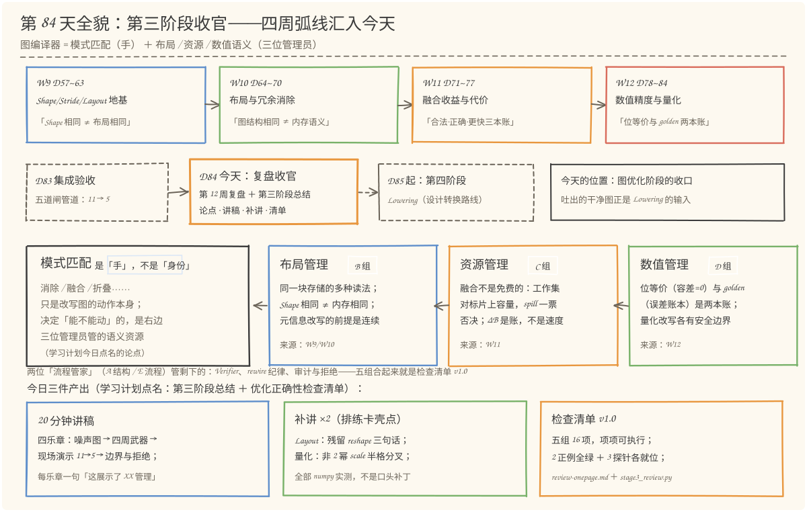
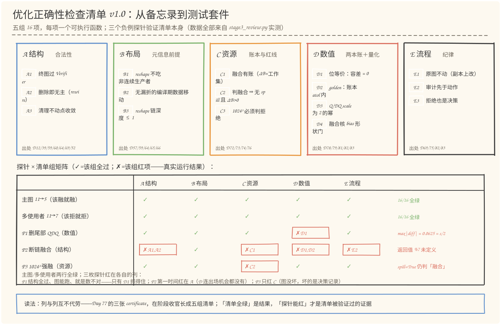
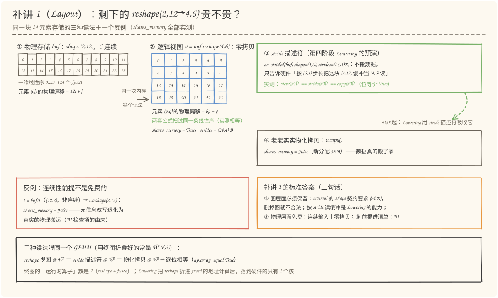
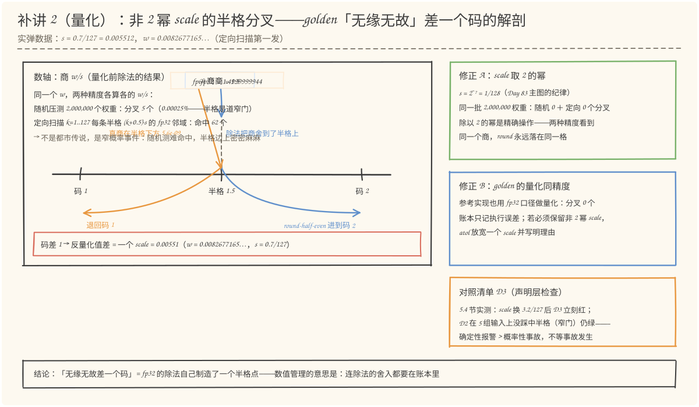

# 第 84 天：第 12 周复盘·第三阶段收官——图编译器不是模式匹配器，是布局、资源和数值语义的管理员

> **今日目标**：完成本教程后，你能做到四件事——① 用自己的话讲出第三阶段的中心论点（**模式匹配只是图编译器的"手"，它真正管理的是三类语义资源：布局（数据在内存里怎么摆）、资源（片上容量够不够）、数值（每个比特什么时候允许变）**），并为每一类给出一个"看似模式匹配、实则语义管理"的真实案例；② 按"四乐章"骨架用 20 分钟把当前项目讲一遍，每个乐章结尾都有一句"这展示了 XX 管理"，并知道卡壳的三个高发点（残留 reshape、非 2 幂 scale、验证口径）；③ 补讲 Day 83 遗留的两个缺口：终图 reshape 的三句话标准答案（图层面必须保留——matmul 的 Shape 契约；物理层面免费——同一线性序的两种记法，实测 shares_memory=True；前提进清单——转置视图上 reshape 退化为真实搬运，实测 shares_memory=False），以及非 2 幂 scale 的半格分叉机制（实弹：w=0.0082677165…，fp32 商恰为 1.5 进到码 2，fp64 商 1.4999999944 退回码 1，值差整整一个 scale=0.00551）；④ 独立运行 `stage3_review.py` 并复现：优化正确性检查清单 v1.0（五组 16 项）在主图与多使用者图两个场景 16/16 全绿，三个负例探针分别被 D 数值列（P1 删尾部 QDQ：max|diff|=0.0625=s/2）、A 结构列（P2 断链融合：返回值悬空）、C 资源列（P3 1024³ 强融：spill 仍判融合）拦下，汇总 8/8 通过。
> **预计时间**：学习 30 分钟＋实践 50 分钟（其中 20 分钟是计划点名的讲解排练）
> **前置准备**：Python 3.11＋numpy（本文环境：aarch64 Linux，Python 3.11.4，numpy 1.26.4）。今天站在第三阶段全部 28 天的肩膀上，直接复用 `../day-083/code/pipeline_lab.py`（只取不改）：图 IR、五道闸管道、Cost Model、两层验证工具全部沿用，不引入新算子、新 Pattern。不需要 MLIR、NPU 或 GPU。
> **今日产出**：`code/stage3_review.py`（可执行的优化正确性检查清单 v1.0＋三枚负例探针＋两个补讲实验＋阶段数字复跑，8 项汇总检查全绿）、`code/review-onepage.md`（**第三阶段一页总结＋优化正确性检查清单 v1.0——学习计划点名的两件产出**）、`outputs/report.txt`（全部真实输出归档）、4 张手绘图。

## 1. 今天解决什么问题？

第三阶段收官，零件全齐了：第 9~10 周造了 Shape/Layout 的地基和消除规则（Day 57~70），第 11 周给融合配了账本（Day 71~76），第 12 周管住了数值（Day 78~82），昨天 Day 83 把它们拼成一根五道闸的管道，把 11 节点的图压到 5 节点、位等价零容差通过。

但复盘的时机恰恰是最危险的时候——**零件齐全和讲得清楚是两回事**。学习计划今天点名的病根是一句话：「图编译器不仅做模式匹配，还要管理布局、资源和数值语义」。反过来读：如果有人问你"你的图优化器到底在干什么"，而你只答得出"做算子消除和融合"，那 28 天里最值钱的东西就被讲丢了。昨天集成验收时已经暴露了三个真实卡壳点：

```text
卡壳现场一（Layout）：讲稿排练到"终图 5 节点"时，听众问"那个 reshape(2,12→4,6)
    为什么不索性删掉？"——Day 83 只留了一句"图优化器不越权"，
    追问"那它到底贵不贵"就接不住了。

卡壳现场二（量化）：Day 83 错误 4 说"scale 不取 2 的幂，golden 会无缘无故差一个码"
    ——机制是什么？"无缘无故"四个字在复盘台上站不住。

卡壳现场三（验证）：被问"你怎么保证优化不改错数"，答"有测试"；
    追问"测试测的是哪个维度"就露馅——位等价、golden、Verifier、Cost Model
    各管一本账，一句"有测试"全含糊掉了（Day 77 三张 certificate 的回声）。
```

今天的任务不是再学一个新工具，而是把 28 天收拢成**一句论点、一份讲稿、一张清单**。贯穿例子继续用 Day 83 的主图（11 节点 → 5 节点），但角色变了：昨天它是"被优化的图"，今天它是**"被体检的图"**——检查清单 v1.0 的十六项检查全部套在它身上跑。靶子先立好（全部当天实测）：两个正例场景（主图 11→5、多使用者图 11→7 该拒则拒）16 项全绿；三枚故意破坏的负例探针（删尾部 QDQ、断链融合、1024³ 强融）分别被 D/A/C 三列拦下；两个补讲缺口用 numpy 实测补齐；汇总 8/8。

## 2. 先看全貌：今天的内容位于哪里？



**图 1**：看四层。**第一层**是第三阶段四周的弧线：W9 打布局地基、W10 做冗余消除、W11 算融合的账、W12 管数值语义；**第二层**是收官的时间线：昨天 D83 集成验收把四周拼成管道（11→5），今天 D84（橙色框）复盘收口，明天 D85 起进入第四阶段 Lowering——今天的产物正是 Lowering 想要的输入；**第三层**是中心论点：图编译器 = 模式匹配的手 ＋ 三个管理员（布局、资源、数值）——四周各贡献了一位管理员（另有 A/E 两位流程管家，合起来就是清单的五组）；**第四层**是三件产出：20 分钟讲稿（四乐章）、两个补讲（残留 reshape / 非 2 幂 scale）、检查清单 v1.0（五组 16 项＋三枚探针验证）。

用 5 步把今天的路线串起来：

1. **立论点**（§3.1）：模式匹配是"手"不是"身份"——三个真实案例说明每一类管理各自挡过什么坑；
2. **写讲稿**（§3.2）：四乐章骨架，每乐章配一句"这展示了 XX 管理"，卡壳点预埋答案；
3. **补讲缺口**（§5.3 实践 Part 3/4）：Layout 与量化两个"讲不清"用实测补齐；
4. **做清单**（§4＋实践 Part 1/2）：检查清单 v1.0 从备忘录变成测试套件，16 项 × 5 场景（2 正例＋3 探针）；
5. **复跑阶段数字**（实践 Part 5）：11→5、8→2、两层验证、资源红线——阶段总结的底稿全部当场重算。

## 3. 核心概念：先用直觉，再给准确定义

### 3.1 中心论点：模式匹配是「手」，不是「身份」

一句通俗解释：**模式匹配（pattern matching，在图里找到形如 X→Y 的子结构并改写它）只是图编译器的动作；决定这个动作能不能做的，是它背后管理的三类语义资源——布局、资源、数值。**

类比：物业维修工。他会拧螺丝、会拆墙（模式匹配的手艺），但物业真正管的是另外三件事：**哪面墙是承重墙**（布局——数据在内存里怎么摆，动了谁）、**材料堆放区够不够**（资源——片上存储装不装得下）、**施工前后水电气读数不能变**（数值——每个比特什么时候允许变）。手艺再好，不问这三件事就开工，砸的是整栋楼。对应到技术上是：转置折叠、算子融合、QDQ 消除这些 Pattern 本身都很简单，**每一类的"安全边界"都来自一位管理员的账**——这正是第三阶段四周分别在补的东西。

三个"看似模式匹配、实则语义管理"的真实案例（数据全部来自本阶段）：

| Pattern（手） | 背后的管理（身份） | 边界在哪里 |
|---|---|---|
| `transpose(const)` 折叠（Day 64/83） | **布局管理**：把运行时数据搬运搬进编译期 | 折叠必须复用执行器同一个 `np.transpose` 内核——否则位等价失去结构保证 |
| `matmul+bias+relu` 融合（Day 50~76） | **资源管理**：ΔB 账本＋工作集红线 | 主图 ΔB=192 B 融合；同一 Pattern 在 1024³ 时工作集 12 MiB 顶爆片上 256 KiB——拒绝 |
| `Q→DQ` 删除（Day 82） | **数值管理**：这对节点不是冗余，是该边的量化语义 | R06 登记不动；今天 P1 探针实测硬删的代价：max\|diff\| = 0.0625 = s/2 |

**类比的边界**：物业的规矩来自外部权威（国家标准、电网），编译器的三位管理员全部是**我们自己写的检查**——它们的覆盖面和漏洞要自己声明。所以清单不能只是纸面共识，得是能跑的函数、还得被故意的破坏验证过——这就是 3.3 节的主题，也是今天把"复盘"做成"测试套件"的理由。

### 3.2 20 分钟讲稿：四乐章骨架（计划点名的「讲解当前项目」）

学习计划要求"用 20 分钟讲解当前项目"。复盘的经验法则是：**讲不清的地方就是缺口**。先给骨架，再排练抓卡壳点：

| 乐章 | 时长 | 讲什么 | 结尾那句「这展示了……」 |
|---|---|---|---|
| 一、问题 | 3 min | 一张 11 节点真实噪声图：QDQ 对、转置、reshape 链、GEMM 尾巴——"噪声和机会混在同一张图里" | 这展示了**结构管理**：动手前先过 Verifier，坏图不进管道 |
| 二、武器 | 7 min | 四周各一件：W9/W10 布局（Shape 相同 ≠ 内存相同）、W11 资源（ΔB 账＋spill 红线）、W12 数值（两本账＋量化边界） | 每一周都在给"能不能动"加一类新约束——布局、资源、数值 |
| 三、演示 | 6 min | 现场跑管道：11→7→5、审计逐行念两条、两层验证、1024³ 拒绝 | 这展示了**拒绝也是决策**：四类不动手都有日志 |
| 四、边界 | 4 min | 剩下的 reshape 为什么不删（Lowering 的活）、随机图 50/50 但覆盖有限、Cost Model 是模型不是测量 | 知道不做什么，和知道做什么一样重要 |

三个高发卡壳点的"接住的话"（对应 §1 的三个现场，答案是今天两个补讲＋Day 77）：

- **"那个 reshape 为什么不删？"** → 三句话：图层面必须保留（matmul 的 Shape 契约）；物理层面免费（连续输入上零拷贝，实测）；前提进清单（B1：非连续生产者上的 reshape 是真搬运）。展开见 §5.3 补讲 1。
- **"golden 为什么会差一个码？"** → 半格机制：fp32 的除法自己制造了一个 k+0.5，banker 舍入进位；fp64 看到的商在半格下方，退回去——码差 1，值差一个 scale。展开见 §5.3 补讲 2。
- **"你怎么保证不改错数？"** → 先反问对方问哪个维度：结构（Verifier/rewire）、数值（位等价＋golden 两本账）、还是收益（ΔB＋spill）——Day 77 的三张 certificate，今天的五组清单就是它的落地。

排练方法（今天实践 50 分钟里的 20 分钟）：对着计时器讲一遍 → 标记卡壳点 → 用上面的话术和补讲材料填坑 → 再讲一遍直到四乐章都在时间内。

### 3.3 检查清单 v1.0：从备忘录到测试套件

学习计划点名今天的产出是"一份优化正确性检查清单"。最容易做成的样子是一页 checkbox 文档——**那是备忘录，不是清单**。今天的设计原则三条：

1. **可执行**：16 项里每一项都是一个函数，输入"一次优化结果的上下文"（原图、终图、审计日志、输入组、决策记录），输出通过与红项详情。接进 CI，每项就是一个测试用例；
2. **有出处**：每项标注来自哪一天（A1←D12/39/59/60/64、C2←D74/76……）——清单是 28 天的沉淀物，不是拍脑袋的灵感，后来者能顺着编号回溯每条规则的血案现场；
3. **被负例验证过**：三枚故意破坏的探针（删尾部 QDQ／断链融合／1024³ 强融）各红一列——**"清单全绿"是结果，"探针能红"才是清单被验证过的证据**。只在好图上全绿过的清单，等于没测过。

五组的分工：B/C/D 就是 3.1 的三位管理员（布局／资源／数值），A 和 E 是两位流程管家（结构合法性／改写纪律）——合起来正好把"图编译器管理什么"这个问题变成了机器可检的答案。清单全文（含每项的检查语义和出处）在 `code/review-onepage.md`，可执行版本在 `code/stage3_review.py`。

## 4. 图解核心机制



**图 2**：看两块。**上半**是五组 16 项的结构：A 结构（Verifier／rewire 纪律／不动点）、B 布局（连续性前提／无漏折／链合并）、C 资源（有账／决策一致／红线复核）、D 数值（位等价／golden／量化声明／融合核形状门）、E 流程（副本改写／审计先于动作／拒绝也是决策）——每组标了出处天数。**下半**是探针矩阵：两个正例场景（主图、多使用者图）五列全绿；P1（删尾部 QDQ）只红 D 数值列；P2（断链融合）第一时间红在 A 结构列；P3（1024³ 强融）只红 C 资源列。

按图中编号读三点：

1. **P1 行是 D 组存在理由的实弹**：删掉尾部 Q→DQ 后图完全合法、能跑、结构检查全过——只有 D1 位等价抓得住它（max|diff| = 0.0625，恰好是激活 scale 1/8 的一半：量化误差上界 s/2 的实测）。这印证 Day 82 的判断：这类改写的风险只在数值维；
2. **P2 行说明列的次序有意义**：引用悬空让图根本跑不起来（D1/D2 只能报"无法执行"），断链的融合还顺手跳过了收益账（C1）和审计（E2）——结构坏了，数值连出场的资格都没有，所以 A 列排在第一道；
3. **P3 行是"图没坏、决策坏了"**：终图本身位等价全过，红的是伪造的决策记录与资源账的矛盾（spill=True 仍判融合）——C2 检查的不是图，是"决策与账本的一致性"。

## 5. 动手实践：把复盘做成一台「清单体检机」

### 5.1 准备文件

今天的工程两个文件＋一份归档（随教程已生成，只依赖 numpy 和标准库，另复用 Day 83 的管道）：

```text
tutorials/day-084/
├── README.md
├── code/
│   ├── stage3_review.py    # 清单 v1.0（16 项）＋ 3 探针 ＋ 2 补讲 ＋ 阶段数字复跑
│   │                       # （本节主角，import ../day-083/code/pipeline_lab.py）
│   ├── make_images.py      # 生成 4 张 SVG 的绘图脚本（种子 84，可复现）
│   ├── review-onepage.md   # 第三阶段一页总结 ＋ 检查清单 v1.0（计划点名的产出）
│   └── outputs/
│       └── report.txt      # 全部真实输出归档（221 行）
└── images/
    ├── 01-overview.svg
    ├── 02-checklist.svg
    ├── 03-layout-gap.svg
    └── 04-quant-gap.svg
```

### 5.2 编写代码

三个关键设计决定，先交代清楚再读代码。

**决定一：清单项是数据，不是代码里的散落断言。** 每项是五元组 `(组, 编号, 标题, 出处, 检查函数)`，检查函数只读一个 `Ctx` 上下文——原图（对照基准）、终图、审计日志、输入组、决策记录——不碰优化器内部状态。加一项清单 = 加一行元组：

```python
CHECKLIST = [
    ("A 结构", "A1", "终图过 Verifier（Shape 可推导、引用无悬空）", "D12/39/59/60/64", ck_a1),
    ("A 结构", "A2", "被删节点无残留引用（rewire 纪律）",             "D45/51/52",     ck_a2),
    ...
    ("D 数值", "D1", "位等价：优化 vs 原图，容差 = 0",                 "D79/83",        ck_d1),
    ...
]

def ck_d1(c: Ctx):
    try:
        ok, d = verify_bit_exact(c.g_orig, c.g_opt, c.feeds)   # Day 83 的工具直接上岗
    except Exception as exc:      # 悬空引用之类：图根本跑不起来
        return False, f"优化图无法执行（{type(exc).__name__}: {exc}）"
    return (ok, f"位等价（容差=0）：{len(c.feeds)} 组输入全部逐位相等" if ok
            else f"位等价被打破：max|diff| = {d:.4g}（改写引入了数值变化）")
```

注意 `try/except`：断链的图在执行器里抛 `KeyError`——**"无法执行"本身就是一种红项**，D1 要把它和"能跑但数不对"区分开报告。

**决定二：探针是"坏优化器"，不是坏图。** 三枚探针都从正常图出发，由一段故意写坏的"优化逻辑"制造事故——模拟真实世界里最可能发生的三类手痒：

```python
def probe_p1() -> Ctx:
    """P1（数值破坏）：变体图正常优化后，手痒删掉尾部 Q→DQ。
    这正是 Day 82 规则表 R06 明确拒绝的不安全规则——删掉=悄悄取消该边量化。"""
    gv = pl.build_variant_graph()               # 13 节点：尾部多一对激活 QDQ
    ir_before = gv.dump_ir()
    res = pl.optimize(gv)                       # 正常管道：13 → 7
    g = res["graph"]
    q = [o for o in g.ops if o.kind == "quantize"][0]
    dq = [o for o in g.ops if o.kind == "dequantize"][0]
    src = g.producers()[q.inputs[0]]            # 尾对的生产者（融合核输出）
    g.returns = [src.name]                      # 不安全改写：返回未量化的值
    g.remove(dq.name)
    g.remove(q.name)                            # 7 → 5，图完全合法——祸藏在数值里
    ...
```

P2（断链融合）模拟"忘记单使用者检查的 rewire"：只迁移 relu 的使用者就删掉 matmul，而 matmul 的输出还被图输出引用着；P3（资源破坏）最轻——图不动，伪造一份 `spill=True` 仍判"融合"的决策记录。三个探针分别瞄准 D／A／C 三列，**清单必须在正确的列上红**。

**决定三：补讲实验独立成段，各自只回答一个问题。** Part 3（Layout）的全部证据是 `np.shares_memory` / `as_strided` / 偏移公式对照——回答"剩下的 reshape 贵不贵"；Part 4（量化）的核心是"同一批 fp32 权重，两种精度各算各的 `w/s` 再 round"——回答"差一个码的机制是什么"。两段都不引入新概念，只把 Day 57 和 Day 81/83 的既有知识拧到能讲清的程度。

### 5.3 运行与观察

```bash
cd tutorials/day-084/code
python3 stage3_review.py
```

以下是在本文环境（aarch64 Linux，Python 3.11.4，numpy 1.26.4）的**真实运行输出**（完整版在 `outputs/report.txt`）。

**Part 1：两个正例场景全绿**。主图（11→5）16 项逐项通过，节选四项感受一下各组的"口气"：

```text
◆ 场景：主图：该融就融（11→5）（原图 11 节点 → 终图 5 节点）
  [PASS] A2 被删节点无残留引用（rewire 纪律） —— 删除 9 个节点，无一残留引用（rewire 纪律）
  [PASS] B1 reshape 不吃非连续生产者（元信息前提） —— 无 reshape 消费非连续生产者（transpose 输出）——元信息改写的连续性前提成立
  [PASS] C2 决策一致：判融合 ⇒ 无 spill 且 ΔB>0 —— 终图融合核 1 个复算全部一致
  [PASS] D1 位等价：优化 vs 原图，容差 = 0 —— 位等价（容差=0）：3 组输入全部逐位相等
  小计：16/16 通过（全绿）

◆ 场景：多使用者图：该拒就拒（11→7）（原图 11 节点 → 终图 7 节点）
  [PASS] E3 拒绝也是决策：候选决策在审计中可查 —— 审计含 2 行候选决策（融合/拒绝/登记/报警）——拒绝也是决策
  小计：16/16 通过（全绿）
```

多使用者图值得单独说：matmul 的输出同时是图输出，融合闸正确拒绝（11→7）——**在"该拒绝"的场景里 16 项照样全绿**，因为"拒绝得对"也是一种正确。这正是清单要的口径：它验收的不是"图变小的幅度"，是"每个决策都有账、有据、没改错数"。

**Part 2：三枚探针 × 五组的命中矩阵**（真实结果）：

```text
场景/探针                         A结构    B布局    C资源    D数值    E流程
主图 11→5（全绿）                     ✓      ✓      ✓      ✓      ✓
多使用者 11→7（全绿）                   ✓      ✓      ✓      ✓      ✓
P1 删尾部QDQ                       ✓      ✓      ✓    ✗D1      ✓
P2 断链融合                    ✗A1,A2      ✓    ✗C1 ✗D1,D2    ✗E2
P3 1024³强融                      ✓      ✓    ✗C2      ✓      ✓
```

三个探针的红项详情（全部真实）：

```text
P1: [FAIL] D1 —— 位等价被打破：max|diff| = 0.0625（改写引入了数值变化）
P2: [FAIL] A1 —— 返回值 %7 未定义
    [FAIL] A2 —— 被删节点仍被引用：['%7']
    [FAIL] C1 —— 融合发生了，审计里没有 ΔB 账——先动手后算账
    [FAIL] D1/D2 —— 优化图无法执行（KeyError: '%7'）
P3: [FAIL] C2 —— 决策与资源矛盾：spill=True 仍判「融合（手痒：无视 spill）」
```

读两个信号：P1 的 `0.0625` 恰好等于激活 scale（1/8）的一半——量化误差上界 s/2 被**实测贴着上界命中**，这不是巧合，是"删掉量化边=引入最多半个 step 的误差"的直接体现；P2 的红项从 A 列一路串到 E 列——一个结构错误往往连带纪律全崩，这也解释了为什么 Verifier 要放在管道的第一道闸。

**补讲 1（Layout 缺口）**：终图剩下的 `reshape(2,12→4,6)` 到底贵不贵？用同一块 24 元素存储做三种读法（真实输出）：

```text
物理存储 buf：shape=(2, 12)，C 连续=True，共 24 个 fp32

读法一：reshape 成 (4,6) 当作视图（numpy 自动做的事）
  v = buf.reshape(4,6)：shares_memory = True，strides = (24, 4) 字节 → 零拷贝，纯元信息
读法二：stride 描述符（第四阶段 Lowering 的预演）——不给数据搬家
  as_strided(buf, (4,6), strides=(24,4)B)：shares_memory = True
读法三：老老实实物化一份新拷贝（数据真的搬了家）
  v.copy()：shares_memory = False（新分配了一块 96 B）

偏移公式对照：(i,j)→12i+j 的 24 个偏移 == (p,q)→6p+q 的 24 个偏移：True

反例（连续性前提不是免费的）：
  t = buf.T（非连续），t.reshape(2,12)：shares_memory = False → 发生了真实的数据移动

三种读法喂进同一个 GEMM（用终图里折叠好的常量 Ŵᵀ）：
  view @ Ŵᵀ == stride描述符 @ Ŵᵀ：True
  view @ Ŵᵀ == 物化拷贝 @ Ŵᵀ：True
```



**图 3**：左边是物理存储（一维线性序 0..23），中间是 (4,6) 视图——**同一块内存的另一种记法**，两套偏移公式扫过同一条线性序（图中两块网格的编号逐格相同）；右边两张卡是 Lowering 视角（stride 描述符不搬数据，实测三种读法喂 GEMM 逐位相等）和物化拷贝（真搬家，96 B）。底部红卡是 B1 检查项的由来：**转置视图上的 reshape 会退化成真实的数据搬运**——"reshape 是元信息改写"这句话有前提，前提就是连续性。

所以补讲 1 的标准答案是三句话：**① 图层面必须保留**——matmul 的 Shape 契约要求 (M,K) 输入，删掉 reshape 图就不合法，"按 stride 读任意缓冲"是 Lowering 的能力，图优化器不越权；**② 物理层面免费**——x 连续，零拷贝实测，Lowering 用 stride 描述符就能吸收它，终图名义上 2 个运行时算子（reshape＋fused），落到硬件其实只有 1 个核；**③ 前提写进清单**——B1 检查"reshape 不吃非连续生产者"，因为前提破了它就不是元信息改写。

**补讲 2（量化缺口）**：非 2 幂 scale 的半格分叉（真实输出，2,000,000 个随机权重＋定向扫描）：

```text
常规校准：s = max|W|/127 = 0.7/127 = 0.005511811024（不是 2 的幂）
随机压测：2,000,000 个 fp32 权重，fp32/fp64 取整分叉 5 个（0.000250%——半格是道窄门）
定向扫描：沿 k=1..127 每条半格 (k+0.5)·s 的 fp32 邻域逐点检查，命中 62 个分叉点

分叉点解剖：
  实弹（定向扫描第一发）：w = 0.008267716504633427（目标半格 k=1，w ≈ (k+0.5)·s）
    fp32 商 w/s = 1.5
    fp64 商 w/s = 1.4999999944120646
    半格 = 1.5（fp32 商距半格 +0.000e+00，fp64 商距半格 -5.588e-09）
    → fp32 的除法把商舍到了半格上，round-half-even 进到 2；
      fp64 看到的商在半格下方，退回 1——码差 1
    → 反量化值差 = |s·2 − s·1| = 0.00551181 = 一个 scale（s = 0.00551181）

修正 A：scale 取 2 的幂（Day 83 主图的纪律，s = 2^-7 = 1/128）
  同一批 2,000,000 个权重换 s = 1/128：随机分叉 0 个，定向扫描 0 个
修正 B：golden 的量化步骤与被测实现同精度（fp32）——分叉 0 个
```



**图 4**：看中间的数轴。同一个 w 除以 s：**fp32 的除法把商舍到了 1.5 这个半格点上**（图中蓝色，恰好落在虚线上），banker 舍入（round-half-even，0.5 进到偶数）把它进到码 2；**fp64 看到的真商在半格下方 5.6e-09**（图中橙色），退回码 1——两边各舍各的，反量化后的值差整整一个 scale（0.00551）。右边两张卡是两个修正：scale 取 2 的幂（除法精确，两精度看到同一个商，200 万随机＋定向扫描都是 0 分叉）和 golden 同精度（量化步骤零分歧，账本只记执行误差）。所谓"无缘无故差一个码"的"无缘无故"，解剖开就是：**fp32 的除法自己制造了一个半格点**——数值管理的意思是，连一次除法的舍入都要在账本里。

**Part 5：阶段数字复跑**（当场重算，作为阶段总结的底稿）：

```text
节点数：11 → 7（清理不动点）→ 5（融合后）
运行时算子：8 → 2（Q/DQ/转置/一次 reshape/matmul/add/relu → reshape + fused）
位等价（容差=0）：固定输入 + 3×1 随机输入 → True
golden：max|diff| = 0，账本 atol = (2K+2)·eps32·maxΣ|a·b| = 4.29e-06 → 通过（K=6）
融合账：ΔB = 16·M·N = 192 B，工作集 228 B ≤ 片上 256.0 KiB → 融合
红线复核：1024³ 时 ΔB = 16.00 MiB，工作集 12.00 MiB > 片上 → 拒绝（需先 Tiling——第四阶段）
```

汇总（8 项检查全部通过）：

```text
[PASS] 清单在两个正例场景全绿（16 项 × 2 场景）（2/2 场景全绿）
[PASS] P1 数值探针被 D1 位等价拦下（红项 ['D1']）
[PASS] P2 结构探针被 A 组拦下（红项 ['A1', 'A2', 'C1', 'D1', 'D2', 'E2']）
[PASS] P3 资源探针被 C2 决策一致性拦下（红项 ['C2']）
[PASS] 补讲1：视图 == stride 描述符 == 物化拷贝（位等价）
[PASS] 补讲2：常规校准 scale 分叉 > 0，2 幂 scale 分叉 = 0（常规校准：随机 5 + 定向 62；2 幂：随机 0 + 定向 0）
[PASS] 补讲2：同精度 golden 分叉为 0
[PASS] 阶段数字复跑：位等价 + golden 双通过
检查项合计：8/8 通过
```

### 5.4 修改一个参数再观察

**对照（声明层 vs 数值层的报警方式）**：把变体图的激活 scale 从 2 的幂（1/8）换成常规校准 `3.2/127`（覆盖同样范围的非 2 幂值），先预测清单会怎么红，再运行：

```bash
python3 -c "
import sys; sys.path.insert(0, '.')
import stage3_review as sr
import pipeline_lab as pl

g = pl.build_variant_graph()
for o in g.ops:
    if o.kind in ('quantize', 'dequantize') and o.scale == pl.A_SCALE:
        o.scale = 3.2 / 127.0          # 非 2 幂的常规校准
ir = g.dump_ir()
res = pl.optimize(g)
ctx = sr.Ctx('对照：激活 scale=3.2/127', g, res['graph'], res['audit'],
             sr.feeds_random(4, seed=90), ir)
r = sr.run_checklist(ctx)
"
```

真实运行结果（只看红项）：

```text
◆ 场景：对照：变体图激活 scale=3.2/127（原图 13 节点 → 终图 7 节点）
  [PASS] D1 位等价 —— 位等价（容差=0）：5 组输入全部逐位相等
  [PASS] D2 golden —— fp32 vs fp64：max|diff| = 1.31e-07 ≤ 账本 atol = 4.29e-06
  [FAIL] D3 量化声明 —— 非 2 幂 scale：[0.02519685039370079, ...]（golden 须同精度并放宽一个 scale）
```

预测验证：**D3（声明层检查）立刻红，D1/D2 却都绿**。D1 绿好理解——优化前后都在 fp32 里做同一个量化，位等价不受影响；D2 绿则暴露了数值层检查的天性：golden 的分叉是**概率性事故**（半格是道窄门，5 组输入没踩中，max|diff| 只有 1.31e-07），而 D3 是**确定性报警**——它不等你踩中半格，看到非 2 幂的声明就红。两层合起来读：D3 的价值不是替 D2 报警，是**在事故还有概率发生之前就把风险挂到墙上**（要么改 2 幂 scale，要么按"否则"分支把 golden 换同精度并放宽一个 scale 的 atol）。

## 6. 常见错误与排查

**错误 1：把复盘写成目录罗列。**
现象：阶段总结写出来是"第 9 周学了 Shape，第 10 周学了 Transpose……"——知识点齐了，但没有任何一句能回答"所以图编译器在干什么"。
原因：复盘时只回顾"学过什么"，没有提炼"它们合起来意味着什么"，更没有把结论变成可检验的东西。
定位：拿学习计划当天的中心句自测——"图编译器不仅做模式匹配，还要管理布局、资源和数值语义"——能不能为每个管理给出一个带数字的案例？给不出就是还没收拢。
修复：按今天的做法，把总结拆成"一句论点＋三个带数据的案例＋一份可执行清单"；论点写在讲稿第一乐章，数据来自复跑（Part 5），清单进 CI。

**错误 2：检查清单只在好图上验证。**
现象：16 项清单跑主图全绿，收工；后来有人往管道里加了不安全的 QDQ 删除，清单照样全绿——因为新场景根本没跑过清单。
原因：清单没有被负例校准过。"全绿"只证明了"好图能过"，没证明"坏图会红"——不测试清单本身，清单就只是装饰。
定位：故意构造三类破坏（数值／结构／资源），看红项是否落在预期的组；红错了组或根本不红，说明检查项的口径有洞。
修复：三枚探针常驻测试（`stage3_review.py` 的 Part 2），新加检查项时同步问一句"哪个探针应该能被它抓住"——答不上来的项，多半是装饰品。

**错误 3：把补讲 1 记成"reshape 都是免费的"。**
现象：讲稿里说"终图那个 reshape 反正零拷贝，无所谓"——听众推一步就问"那为什么转置后面不能随便 reshape 消掉"，接不住。
原因：把"连续输入上 reshape 是元信息改写"过度推广成了"reshape 总是元信息改写"。零拷贝的前提是输入连续，前提破了它就是真实搬运。
定位：看 `np.shares_memory(input, input.reshape(...))`——连续输入 True，转置视图 False（本文实测）。
修复：背三句话标准答案时把第③句（前提进清单，B1）当成和①②并列的部分；工程上对应"元信息改写的 Pattern 要查生产者的连续性"。

**错误 4：讲稿只讲"做了什么"，不讲"拒绝做什么"。**
现象：20 分钟讲完 11→5、位等价全过，听众的结论是"这个优化器什么都能消、什么都能融"；下一次评审有人提议删一对 QDQ"反正也是冗余"，没人有防线。
原因：四类不动手（R06 登记、多使用者拒融、requant 报警、spill 拒绝）都在审计日志里，但讲稿的演示路径全是"成功案例"。
定位：检查讲稿第三乐章有没有至少一个"拒绝"的现场——没有就是只有半台机器的故事。
修复：按 §3.2 的乐章三，把 1024³ 拒绝和 R06 登记各留 30 秒；口诀是"知道不做什么，和知道做什么一样重要"。

## 7. 今日练习

### 必做练习

不跑代码，先笔答三问，再用 `python3 stage3_review.py` 和 §5.3 的输出对答案：

（a）合上教程，默写补讲 1 的三句话标准答案（图层面／物理层面／前提），并说出 B1 检查项检查的具体是什么；
（b）`s = 0.7/127`、`w = 0.0082677165…`：手推 fp32 和 fp64 各自的 `w/s`（提示：真商在 1.5 下方约 5.6e-09，fp32 的除法结果恰好可表示为 1.5），再推两种精度的码和反量化值差；
（c）三枚探针各被清单的哪一组拦下？P1 的 A 列为什么全过——这说明了哪类风险的检测只能靠位等价？

### 选做挑战

把 P1 探针改成另一个 Day 82 拒绝实现的规则：**requant 参数不一致仍折叠**（R07 的违规版——`Q(s₁) → DQ(s₁) → Q(s₂) → DQ(s₂)` 链上，把中间一对直接删掉但保留两侧不同参数的量化语义）。先笔答预测：红项会落在哪一组、max|diff| 大约是什么量级（提示：两次量化的靠档误差会不会抵消？s₁=s=1/8、s₂=1/16 时最坏差多少？），然后在 `stage3_review.py` 里仿照 `probe_p1` 实现并验证。做完后回答：这个探针和 P1 的红项集合应该完全一样吗——如果多了或少了某项，原因是什么？

## 8. 今日验收

- [ ] 我能不看资料说出中心论点（模式匹配是手，布局/资源/数值是三位管理员），并为每位管理员举一个带真实数字的案例（转置折叠的内核复用、1024³ 的 12 MiB vs 256 KiB、P1 的 0.0625=s/2）
- [ ] 我按四乐章骨架完成了 20 分钟讲解排练，三个高发卡壳点（残留 reshape／半格分叉／验证口径）都能用一句接住的话应付，并且每个乐章结尾有一句"这展示了 XX 管理"
- [ ] 我能默写补讲 1 的三句话标准答案，并解释为什么转置视图上的 reshape 不是元信息改写（shares_memory 实测）
- [ ] 我能讲清半格分叉的机制：fp32 的除法制造了 k+0.5、banker 舍入进位、fp64 退回、码差 1＝一个 scale（0.00551），以及两个修正各自的实测效果（2 幂 scale 0 分叉、同精度 0 分叉）
- [ ] 我能独立运行 `stage3_review.py` 并复现：16 项 × 2 场景全绿、三探针各红一列（D1／A1+A2／C2）、汇总 8/8，并解释 5.4 的对照为什么 D3 红而 D2 绿（确定性报警 vs 概率性事故）
- [ ] 我保存了 `code/stage3_review.py`（清单＋探针＋补讲＋复跑）、`code/review-onepage.md`（第三阶段总结＋检查清单 v1.0——计划点名的两件产出）、`outputs/report.txt`，`python3 make_images.py` 可复现全部 4 张图

## 9. 一句话总结与明天预告

第三阶段收官：28 天收拢成一句论点、一份讲稿、一张清单。**论点**——图编译器不仅做模式匹配，还要管理布局（同一块存储的多种读法，元信息改写以连续性为前提）、资源（ΔB 是账、spill 是红线、拒绝也是决策）和数值语义（位等价与 golden 两本账，连一次除法的舍入都要在账本里）。**讲稿**——四乐章 20 分钟，每个乐章配一句"这展示了 XX 管理"，三个高发卡壳点各自有实验背书的接答。**清单**——优化正确性检查清单 v1.0：五组 16 项全部可执行、全部有出处，在主图和多使用者图两个正例场景 16/16 全绿，三枚故意破坏的探针（删尾部 QDQ／断链融合／1024³ 强融）分别被 D／A／C 三列拦下，P1 的 0.0625=s/2 和 P2 的"返回值 %7 未定义"都是真实输出。复盘的方法论也交了底：**产出的不是总结文档，是测试套件**——清单全绿是结果，探针能红才是清单被验证过的证据。

明天（Day 85）进入第四阶段：设计 `mini.matmul` 到循环表示的 Lowering 路线（DialectConversion、TypeConverter、目标与源 Operation 的职责）。今天补讲 1 的结尾正好是它的引子——图优化器按 Shape 契约留下的那个 reshape，Lowering 将用 stride 描述符把它折进地址计算；"图不越权"和"机器来接棒"的分界线，明天就从这里画起。
