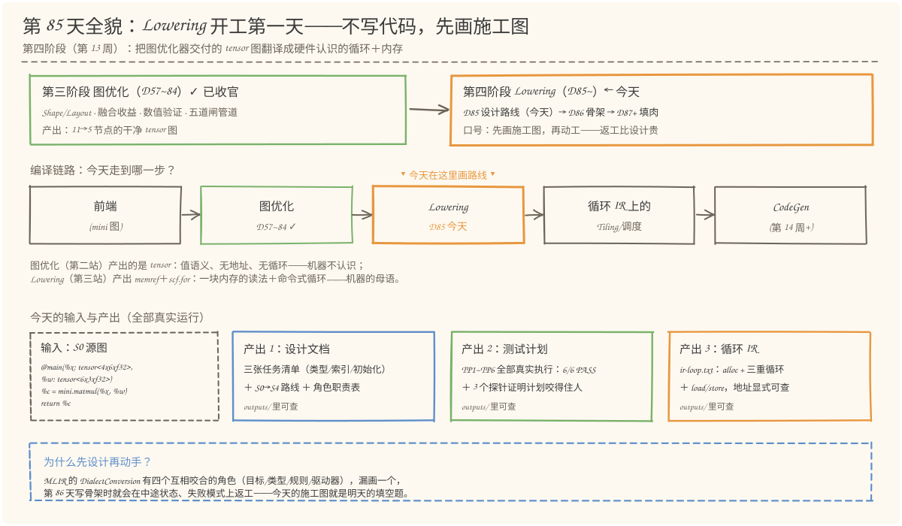
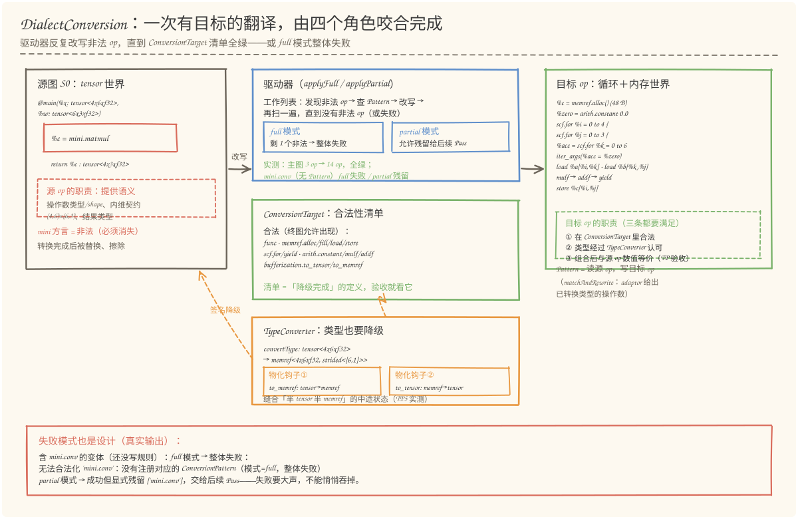
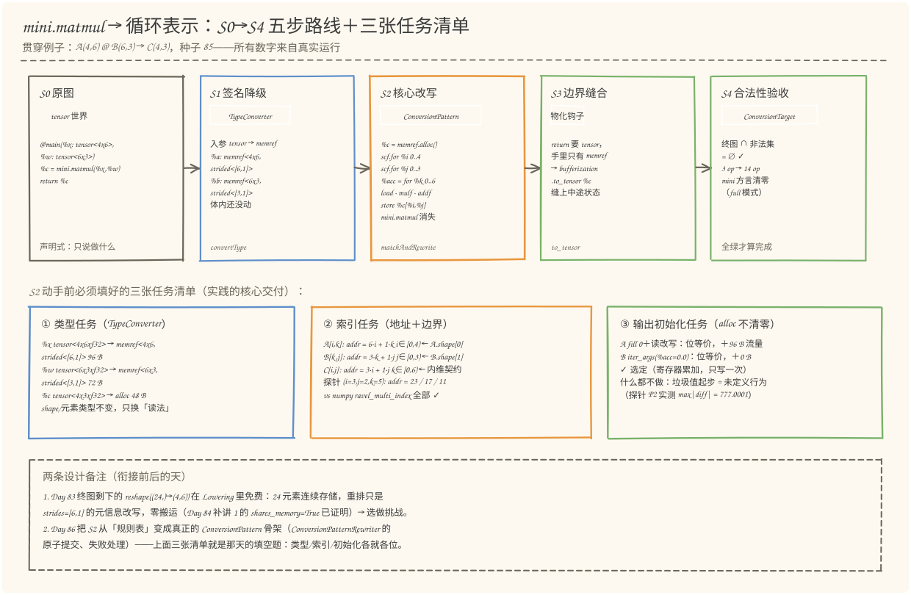
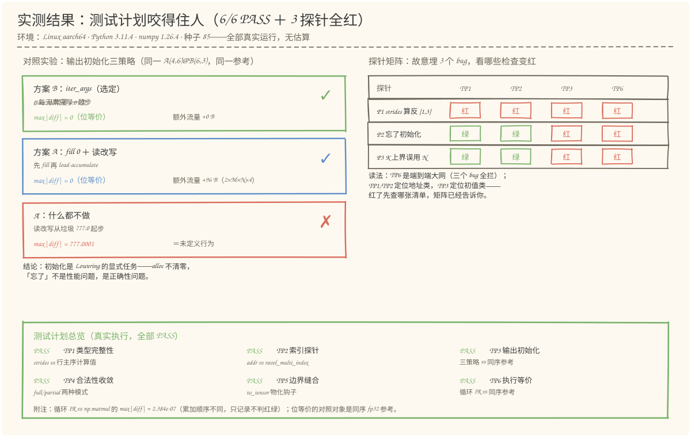

# 第 85 天：设计 Lowering 路线——把 mini.matmul 翻译成循环之前，先画好施工图

> **今日目标**：完成本教程后，你能做到四件事——用自己的话讲清 Lowering 和图优化的本质区别（同一层语言内的等价改写 vs 跨方言的单向翻译），并说出 DialectConversion 四个角色各自的职责（ConversionTarget 管合法性、TypeConverter 管类型和缝合、ConversionPattern 读源写目标、驱动器管收敛与失败）；独立填出 `mini.matmul` → 循环表示的三张任务清单（类型：tensor→memref 与 strides；索引：三类访存的线性地址公式与循环边界；输出初始化：alloc 不清零，方案 B `iter_args` 选定）；独立运行 `lowering_design.py` 复现 TP1~TP6 全部 6/6 PASS、三个探针矩阵全红（P1 strides 算反、P2 忘初始化、P3 内维边界用错），以及对照实验的真实数字（方案 B 位等价 +0 B 流量、方案 A 位等价 +96 B、A′ 从垃圾值起步 max|diff| = 777.0001）；预测换形状后三张任务清单里哪些数字会变，并用 `--shape 2 3 2` 验证。
> **预计时间**：学习 35 分钟＋实践 40 分钟
> **前置准备**：Python 3.11＋numpy（本文环境：aarch64 Linux，Python 3.11.4，numpy 1.26.4）。本机没有安装 MLIR——与 Day 57~84 一致，用 Python 复刻 MLIR DialectConversion 的角色分工与流程（仿真），不伪造 MLIR 本身的行为。内容上只需要 Day 83 的"五道闸管道"结论（图优化器交付一张干净的 tensor 图）和 Day 84 补讲 1 的"同一块存储的多种身份"。
> **今日产出**：`code/lowering_design.py`（路线＋任务清单＋测试计划＋探针，全部可运行）、`code/outputs/design-doc.md`（Lowering 设计文档）、`code/outputs/test-report.txt`（测试计划执行报告）、`code/outputs/ir-loop.txt`（降级后的循环 IR）、4 张手绘图。

## 1. 今天解决什么问题？

第三阶段收官时你手里有什么？Day 83 的五道闸管道把一张 11 节点的图压到了 5 节点，Day 84 又把它总结成一句论点、一份讲稿、一张清单。但那张终图本质上仍是**一张数学图**：`tensor` 是值语义的抽象张量——它没有地址、没有循环、没有"先算哪个后算哪个"，只有"C = A×B"这样的声明。硬件不认识声明：NPU 的计算核只认识 **load（从地址取数）、store（往地址写数）、循环和寄存器**。中间缺的那次翻译，就是 **Lowering（下降／降级）**——把高层方言的算子翻译成低层方言的组合。

那为什么今天不直接开写 Lowering Pass？因为 MLIR 给这类翻译准备了一套框架（DialectConversion），里面有四个互相咬合的角色：**ConversionTarget**（合法性清单）、**TypeConverter**（类型降级＋中途缝合）、**ConversionPattern**（读源 op、写目标 op）、**驱动器**（反复改写直到收敛，或整体失败）。这四个角色谁负责什么、转换的中途状态长什么样、失败了怎么办——任何一处画错，第 86 天写骨架时就会返工。所以学习计划把今天定为**设计日**：先画施工图，列出任务清单，再配一份测试计划，而且让测试计划真的跑起来、还能咬住故意埋的 bug。

今天的贯穿例子沿用 Day 83 终图里 GEMM 的形状——`A(4,6) @ B(6,3) → C(4,3)`。源图长这样：

```text
func @main(%x: tensor<4x6xf32>, %w: tensor<6x3xf32>) -> tensor<4x3xf32> {
  %c = mini.matmul(%x, %w) : (tensor<4x6xf32>, tensor<6x3xf32>) -> tensor<4x3xf32>
  return %c : tensor<4x3xf32>
}
```

要把它翻译成的目标，是只含 `scf`（循环）、`memref`（内存）、`arith`（算术）的命令式程序：分配一块输出内存、三重循环、按地址 load 两个操作数、乘加、store 回去。完整目标 IR 见 §5.3 的 `ir-loop.txt`。

**前置补给：tensor 和 memref 到底差在哪。** 一句话：`tensor` 是"值"——每个值逻辑上是一块崭新的、完整的、不可变的数组，你不用关心它放在哪；`memref` 是"一块已有内存的读法"——由基地址＋偏移＋shape＋strides（每维步长）四个描述符构成，可以重叠、可以只读别人内存的一个切片。Day 84 补讲 1 已经用 `shares_memory=True` 证明过：同一块 24 元素存储可以有 (24,)、(2,12)、(4,6) 三种身份——那三种身份，正是 memref 描述符能直接表达、而 tensor 描述不了的东西。

## 2. 先看全貌：今天的内容位于哪里？



**图 1**：看三处——上排是阶段地图：第三阶段（图优化，Day 57~84）已收官，今天进入第四阶段 Lowering 的第一天，角色是"画施工图"，Day 86 才动工写骨架；中排是编译链路：前端 → 图优化 → **Lowering（今天）** → 循环 IR 上的 Tiling/调度 → CodeGen，图优化交付的干净 tensor 图正是今天的输入；下排是三件产出：设计文档、测试计划、循环 IR，全部在 `code/outputs/` 里可查。

把今天的路线压缩成五步（细节在 §3、§4 展开）：

1. **定目标**：在 ConversionTarget 里写清"降级完成"的标准——终图里允许出现哪些 op、`mini` 方言整个非法；
2. **定类型表**：TypeConverter 把每个 tensor 类型翻成 memref（shape 不变，strides 用行主序）；
3. **写改写规则**：ConversionPattern 读 `mini.matmul` 的语义，产出目标 op 序列——动手前先填好类型、索引、输出初始化三张任务清单；
4. **缝边界**：外部契约还要 tensor 的地方，用物化钩子（`to_tensor`）把 memref 缝回去；
5. **验收**：驱动器反复改写直到没有非法 op；同时测试计划 TP1~TP6 从类型、地址、初值、合法性、边界、执行六个角度查账。

## 3. 核心概念：先用直觉，再给准确定义

### 3.1 Lowering：一次有方向的翻译，不是优化

一句通俗解释：**Lowering 是把"做什么"的声明翻译成"怎么做"的步骤**，方向永远从高层方言指向低层方言。

类比：菜谱翻译。高级菜谱写"宫保鸡丁"——这是给人和给后续加工看的；灶台前的操作卡写"中火、下油、颠勺 30 秒、下酱汁"——这是给灶台看的。图优化更像**编辑菜谱**（把冗余步骤删了、把两道菜并成一道），它改完还是菜谱；Lowering 是**把菜谱换成操作卡**，语言本身换了。对应到技术上是：图优化在 mini 方言内部做等价改写（Day 71~76 的融合、Day 64~66 的布局简化，改写前后都是 tensor 上的 mini op）；Lowering 跨方言——`mini.matmul`（tensor 语义）换成 `memref.alloc + scf.for + memref.load/store`（内存＋循环语义）。MLIR 术语里这叫 **progressive lowering（渐进下降）**：真实编译器里 linalg → scf+memref → vector → LLVM 方言，一层层往下走，每层只降一级。

**类比的边界**：菜谱翻译是"一对一语义等价"，编译器里的翻译不总是一对一——一个 `mini.matmul` 对应**一串**目标 op（alloc、常量、三重循环、load/store），而且目标序列不唯一（§3.4 会看到两种初始化方案就是两个合法译文）。所以 Lowering 的正确性不是"翻译没走样"一句话能保证的，要靠测试计划逐项验收。

### 3.2 DialectConversion：海关＋兑换点＋清关员

一句通俗解释：**DialectConversion 是 MLIR 提供的一套"带验收标准的翻译流水线"**——你告诉它"终图必须长什么样"（什么 op 合法），它负责反复应用你的翻译规则，直到达标或宣布失败。

类比：入境海关。ConversionTarget 是**通关清单**——清单上列的是"境内允许的物品"（目标 op），你的行李（源 op）要么被规则改造成允许的形态，要么整批被退回（full 模式失败）；TypeConverter 是**兑换点**——你的货币（类型）从旧币（tensor）换成新币（memref），而兑换进行到一半时，有人手里还是旧币、有人已经是新币，兑换点提供**临时兑换服务**（物化钩子）让交易能继续；驱动器是**清关员**——一遍遍扫行李，直到没有违禁品，或者给你开一张"某某物品无法处理"的退运单。对应到技术上是三个 MLIR 组件（都在 `mlir/Transforms/DialectConversion.h`）：`ConversionTarget` 用 `addIllegalDialect`/`addLegalOp` 声明合法性；`TypeConverter` 的 `convertType` 做类型映射，物化钩子负责转换中途的类型缝合；驱动器入口是 `applyFullConversion`（只要剩一个非法 op 就整体失败）和 `applyPartialConversion`（允许残留给后续 Pass）。

**类比的边界**：海关是"逐件检查、不合格就退运"，DialectConversion 的改写是**原子的**——Pattern 通过 ConversionPatternRewriter 提交修改，中途状态的 IR 始终保持可验证（不会出现"删了 op 但还有人在用它"的悬空引用）。这条约束今天只立牌子，Day 86 写骨架时再展开。

### 3.3 源 op 与目标 op：翻译两端的职责

一句通俗解释：**源 op 是"被翻译的原文"，职责是把语义交代完整；目标 op 是"译文"，职责是三条全过——合法、类型达标、数值等价。**

具体到今天的例子。**源 op `mini.matmul` 必须交代**：两个操作数的类型与 shape（`tensor<4x6xf32>`、`tensor<6x3xf32>`）、内维契约（A 的列数 = B 的行数 = 6，Day 12/83 闸0 验过的东西）、结果类型（`tensor<4x3xf32>`）。Pattern 靠这些决定循环边界从哪来、地址怎么算、输出缓冲多大——**源 op 信息不全，译文就无从下笔**。转换完成后源 op 被替换、擦除，终图里不再出现。**目标 op（`memref.alloc`、`scf.for`、`memref.load`…）必须满足**：①在 ConversionTarget 的合法清单里；②类型经过 TypeConverter 认可（不能自己造一个清单外的类型）；③组合起来与源 op 数值等价——这一条清单和规则都不查，**只有测试计划查**，这正是今天产出测试计划的原因。

一个常见误解：以为写 Lowering 就是"把 op 换掉"。换 op 只是 S2 一步；类型不换（S1）、边界不缝（S3）、合法性不验（S4），译文要么编译不过，要么悄悄算错。

### 3.4 三张任务清单：S2 动手前必须填完的表

这是今天实践的核心交付：把 `mini.matmul` 的翻译拆成三张可勾选的清单（全部真实数字，来自 §5.3 的运行结果）。

**① 类型任务（TypeConverter 的表）**——shape 与元素类型不变，只换"读法"：

| 值 | 源类型 | 目标类型 | strides | 大小 | 来源 |
|---|---|---|---|---|---|
| %x | `tensor<4x6xf32>` | `memref<4x6xf32, strided<[6,1]>>` | [6, 1] | 96 B | 签名降级（S1） |
| %w | `tensor<6x3xf32>` | `memref<6x3xf32, strided<[3,1]>>` | [3, 1] | 72 B | 签名降级（S1） |
| %c | `tensor<4x3xf32>` | `memref<4x3xf32, strided<[3,1]>>` | [3, 1] | 48 B | Pattern 内 alloc（S2） |

**② 索引任务（地址与边界）**——线性地址 = Σ 下标 × 步长，边界全部编译期可知：

| 访问 | 多下标 | 线性地址公式 | 所属循环边界 | 边界来源 |
|---|---|---|---|---|
| A[i,k] | (i,k) | 6·i + 1·k | i ∈ [0,4) | A.shape[0] |
| B[k,j] | (k,j) | 3·k + 1·j | j ∈ [0,3) | B.shape[1] |
| C[i,j] | (i,j) | 3·i + 1·j | k ∈ [0,6) | A.shape[1]==B.shape[0]（内维契约） |

抽样探针（i=3, j=2, k=5）：A 的地址 6×3+5=**23**，B 的 3×5+2=**17**，C 的 3×3+2=**11**——与 numpy `ravel_multi_index` 逐个比对相等（TP2 实测）。

**③ 输出初始化任务**——`memref.alloc` 分配的内存**内容未定义**（它不做清零），而 tensor 世界里"每个值生来就有内容"。这条语义落差必须由译文显式补上，有三种选择：

| 方案 | 做法 | 额外访存流量 | 位等价（实测） |
|---|---|---|---|
| A：fill＋读改写 | `memref.fill(%c, 0.0)`，k 循环外先 load C[i,j] 再累加 | +2×M×N×4 = **96 B** | ✓ |
| B：iter_args（**选定**） | 累加器是循环携带值，从常量 0.0 起步，C 每元素只写一次 | +**0** B | ✓ |
| 什么都不做 | 读改写直接从垃圾值起步 | — | ✗ 未定义行为（探针 P2：max\|diff\| = 777.0001） |

方案 B 的本质：`scf.for` 的 `iter_args`（循环携带参数）让累加器成为**寄存器里的值**而不是内存里的值——每次迭代由 `scf.yield` 回传。它给编译器把累加器放进寄存器的机会，输出 C 每个元素恰好写一次。方案 A 也不错，但比 B 多付一遍 M×N 的写＋读；"什么都不做"不是省事，是未定义行为——垃圾值是什么全凭运气，实测整个 C 都错。

## 4. 图解核心机制



**图 2**：按左右三块看。**左边**是源图（tensor 世界）和源 op 的职责——`mini.matmul` 负责把操作数类型、内维契约、结果类型交代完整，转换完成后被替换擦除；**中间**上下三个框是框架本体——驱动器（工作列表反复改写，full/partial 两种失败模式）、ConversionTarget（合法性清单，"降级完成"的定义）、TypeConverter（类型降级＋两个物化钩子，缝合"半 tensor 半 memref"的中途状态）；**右边**是目标 op 世界和它要满足的三条职责（合法、类型过 TypeConverter、数值等价）。底部红框是失败模式的真实输出：`mini.conv` 没有 Pattern 时，full 模式指名道姓地整体失败，partial 模式显式残留——失败要大声，不能悄悄吞掉。



**图 3**：这是今天实践的主图，按编号走一遍五步。

1. **S0 原图**：tensor 世界的声明式描述——只有"做什么"，没有"怎么做"；
2. **S1 签名降级**：TypeConverter 先把函数入参从 tensor 换成 memref（`strided<[6,1]>` 就是那块内存的读法），函数体内还没动——注意这一步之后，图进入"入口已是新类型、体内还是旧语言"的混合状态；
3. **S2 核心改写**：ConversionPattern 上场，`mini.matmul` 被替换为 alloc＋三重循环＋load/store 的目标 op 序列（3 op → 14 op），`mini` 方言在这里消失——替换是否正确，就靠图下方三张便签：类型、索引、初始化任务清单；
4. **S3 边界缝合**：如果外部契约（函数签名）还要求 tensor，return 处插入 `bufferization.to_tensor` 物化——把"半 tensor 半 memref"的中途状态缝上；
5. **S4 合法性验收**：终图与非法集求交，空集才算降级完成；不空则 full 模式整体失败。

底部两条设计备注各管一头：**向前衔接**——Day 83 终图剩下的 `reshape((24,)→(4,6))` 在 Lowering 里免费（连续存储重排只是 strides 元信息改写，零搬运，Day 84 补讲 1 已证明）；**向后铺垫**——Day 86 把 S2 从"规则表"变成真正的 ConversionPattern 骨架，今天的三张清单就是那天的填空题。

## 5. 动手实践：把设计跑起来——测试计划＋探针

### 5.1 准备文件

今天的工程两个脚本＋三个产出文件（随教程已生成，只依赖 numpy 和标准库）：

```text
tutorials/day-085/
├── README.md
├── code/
│   ├── lowering_design.py        # 主脚本：路线＋任务清单＋TP1~TP6＋探针
│   ├── make_images.py            # 生成 4 张 SVG（可复现）
│   └── outputs/
│       ├── design-doc.md         # 产出 1：Lowering 设计文档
│       ├── test-report.txt       # 产出 2：测试计划执行报告（真实运行）
│       └── ir-loop.txt           # 产出 3：降级后的循环 IR
└── images/                       # 4 张手绘图
```

### 5.2 编写代码：设计如何变成可执行的东西

`lowering_design.py` 约 610 行，四个关键构件对应 §3 的概念（完整代码见文件，这里讲骨架）。

**构件一：`Design` 数据类——设计即参数。** 三张任务清单里的每个数字都是它的字段，探针就是改它：

```python
@dataclass
class Design:
    shape_a: tuple          # 输入 A 的 shape (M, K)
    shape_b: tuple          # 输入 B 的 shape (K, N)
    strides: dict           # 任务①：{"A": (6,1), "B": (3,1), "C": (3,1)}
    init: str               # 任务③："iter_args" | "fill_load" | "garbage"
    k_bound: int | None     # 任务②：内维循环上界；None = 用真正的 K
```

**构件二：`addr()`＋`execute_loop_ir()`——索引任务的显式化。** 解释执行循环 IR 时，**所有访存都显式经过 `addr()` 算线性地址**（模拟 `memref.load/store`），不做任何 `A[i,k]` 式的多下标糖衣——stride 错一个，地址立刻错：

```python
def addr(strides, idx):
    return sum(i * s for i, s in zip(idx, strides))   # Σ 下标 × 步长

def execute_loop_ir(design, A, B):
    ...
    C = np.full((M, N), GARBAGE)      # memref.alloc：内容未定义（用 777 模拟垃圾）
    if design.init == "fill_load":    # 方案 A：先 fill 0
        Cf[:] = np.float32(0.0)
    for i in range(M):
        for j in range(N):
            if design.init == "iter_args":
                acc = np.float32(0.0)              # 方案 B：iter_args 从 0 起步
            else:
                acc = np.float32(Cf[addr(sc, (i, j))])   # 方案 A/A′：读改写
            for k in range(kb):
                xa = np.float32(Af[addr(sa, (i, k))])   # load %a[%i,%k]
                xb = np.float32(Bf[addr(sb, (k, j))])   # load %b[%k,%j]
                acc = np.float32(acc + np.float32(xa * xb))
            Cf[addr(sc, (i, j))] = acc                  # store %c[%i,%j]
    return C
```

**构件三：`apply_conversion()`——驱动器仿真。** op 级工作列表：合法 op 跳过、有 Pattern 的非法 op 被替换成目标 op 序列、没 Pattern 的非法 op 在 full 模式整体失败、partial 模式显式残留（对应 `applyFullConversion` / `applyPartialConversion` 的语义差别）。

**构件四：TP1~TP6＋`make_probes()`——测试计划与它的"疫苗试验"。** 六个检查各管一个角度（类型表 vs 行主序计算值、地址 vs `ravel_multi_index`、初值策略执行 vs 同序参考、合法性收敛、边界缝合、端到端位等价）；然后**故意埋三个 bug**（P1 把 B 的 strides 换成行主序的逆序、P2 忘初始化、P3 内维边界误用 N），看矩阵里谁变红——这是 Day 84 交过的方法论：清单全绿是结果，探针能红才是清单被验证过的证据。

**位等价的口径**（沿用 Day 78~83 的纪律）：对照对象是**同序 fp32 三重循环参考**——与循环 IR 是同一运算序列，所以"逐位相等"检验的是地址与初值的正确性，不是浮点的运气；`np.matmul` 的结果顺序不同，只如实记录差异、不判红绿。

### 5.3 运行与观察

```bash
cd tutorials/day-085/code
python3 lowering_design.py
```

以下为**真实运行输出**（节选，完整版在 `outputs/test-report.txt`；环境 Linux aarch64，Python 3.11.4，numpy 1.26.4，种子 85）：

```text
[PASS] TP1 类型完整性
  A: tensor<4x6xf32> -> memref<4x6xf32, strided<[6, 1]>>  ✓  [96 B, 函数入参（签名降级）]
  B: tensor<6x3xf32> -> memref<6x3xf32, strided<[3, 1]>>  ✓  [72 B, 函数入参（签名降级）]
  C: tensor<4x3xf32> -> memref<4x3xf32, strided<[3, 1]>>  ✓  [48 B, memref.alloc（Pattern 构建）]

[PASS] TP2 索引探针
  A[i,k] @ (i=3,j=2,k=5): addr=23✓
  B[k,j] @ (i=3,j=2,k=5): addr=17✓
  C[i,j] @ (i=3,j=2,k=5): addr=11✓

[PASS] TP4 合法性收敛
  主图（3 op）full 模式：成功 → 14 op，残留非法 op = 无
  含 mini.conv 变体 full 模式：按预期整体失败 → 无法合法化 'mini.conv'：
    没有注册对应的 ConversionPattern（模式=full，整体失败）
  含 mini.conv 变体 partial 模式：成功但显式残留 ['mini.conv']（交给后续 Pass）

[PASS] TP6 执行等价
  循环 IR vs 同序参考：np.array_equal = True（max|diff| = 0.0e+00）
  循环 IR vs np.matmul：max|diff| = 2.384e-07（顺序不同，只记录不判红绿）

—— 探针矩阵（验证测试计划咬得住人）——
探针 / TP1 / TP2 / TP3 / TP6
  P1（B 的 strides 写成 [1, 3]，行主序算反） / 红 / 红 / 红 / 红
  P2（忘掉输出初始化任务，读改写从垃圾值起步） / 绿 / 绿 / 红 / 红
  P3（内维 K 的循环上界误用 N） / 绿 / 绿 / 红 / 红
```

降级后的循环 IR（`outputs/ir-loop.txt`，与解释执行的是同一程序）：

```mlir
func @main(%a: memref<4x6xf32, strided<[6, 1]>>,
           %b: memref<6x3xf32, strided<[3, 1]>>) -> memref<4x3xf32> {
  %c = memref.alloc() : memref<4x3xf32, strided<[3, 1]>>
  %zero = arith.constant 0.0 : f32
  scf.for %i = %c0 to %c4 step %c1 {
    scf.for %j = %c0 to %c3 step %c1 {
      %acc = scf.for %k = %c0 to %c6 step %c1
                  iter_args(%acc = %zero) -> (f32) {
        %xa = memref.load %a[%i, %k]     // addr = 6*%i + 1*%k
        %xb = memref.load %b[%k, %j]     // addr = 3*%k + 1*%j
        %p  = arith.mulf %xa, %xb : f32
        %s  = arith.addf %acc, %p : f32
        scf.yield %s : f32
      }
      memref.store %acc, %c[%i, %j]      // addr = 3*%i + 1*%j
    }
  }
  return %c : memref<4x3xf32>
}
```

（常量下标 `%c0..%c6` 来自静态 shape：4←A.shape[0]、3←B.shape[1]、6←内维契约，1←步长；完整文件含这些常量的定义与注释。）



**图 4**：两个面板各证明一件事。**左面板**是输出初始化的对照实验：方案 B（iter_args，选定）与方案 A（fill＋读改写）都位等价，差别只在流量（+0 B vs +96 B）；A′（什么都不做）max|diff| = 777.0001——垃圾值起步是正确性问题，不是性能问题。**右面板**是探针矩阵：TP6 是端到端大网（三个 bug 全拦下），TP1/TP2 专抓地址类（P1 四项全红），TP3 专抓初值类（P2、P3 在它那里变红）——**红了先查哪张任务清单，矩阵已经给出分工**。底部六项 PASS 附一条口径注记：`np.matmul` 差 2.384e-07 是顺序差异，不是错误。

### 5.4 修改一个参数再观察：三件事各改一次

**实验一：换输出初始化策略。** 把 `Design.init` 从 `"iter_args"` 依次换成 `"fill_load"`、`"garbage"`（脚本里对照实验部分自动做了），真实结果：

```text
方案 B：iter_args 从 0 起步（设计选定）: max|diff| = 0.000000e+00  ← 位等价
方案 A：fill 0 + 读改写:               max|diff| = 0.000000e+00  ← 位等价
A′：什么都不做（探针 P2）:             max|diff| = 7.770001e+02  ← 不等价（未定义行为）
流量账：方案 A 比 B 多付 2×M×N×4 = 96 B 的读写
```

观察点：A 与 B **同样正确、代价不同**——设计选定 B；A′ 错得干脆利落（整个 C 偏 777），因为它从垃圾值起步。777 是我们模拟垃圾用的常数，真实场景里垃圾值是任意的——**"错多少"不可预测，"必错"是确定的**。

**实验二：换形状。** `python3 lowering_design.py --shape 2 3 2`（练习模式，只打印不覆盖产出），真实结果：TP1~TP6 依然 6/6 PASS，探针 P1 的错误 strides 变成 [1,2]（随形状取行主序逆序）依旧四项全红，流量账变成 2×M×N×4 = 32 B。观察点：**形状变了，三张任务清单跟着变，但清单的"栏目"不变**——这正是把设计做成 `Design` 数据类的好处。

**实验三：埋一个没有 Pattern 的 op。** TP4 里的 `mini.conv` 变体：full 模式报 `无法合法化 'mini.conv'`，partial 模式成功但残留 `['mini.conv']`。观察点：**失败模式也是设计决定**——今天选 full（宁可整体失败，不留半成品图），因为后续 Day 87+ 还没有接手的 Pass；等 mini.conv 的规则写好了再谈 partial。

## 6. 常见错误与排查

**错误一：转换到一半，IR 里同时出现 tensor 和 memref，类型对不上。**
现象：诊断信息类似 `type mismatch: return 期望 tensor<4x3xf32>，拿到 memref<4x3xf32>`（TP5 的"不设钩子"分支就是它的复刻）。原因：DialectConversion 是渐进的——S1 之后入口已是 memref，体内某些消费者（return、还没降级的 op）还要 tensor，**中途状态必然两种类型并存**；TypeConverter 的物化钩子（`to_tensor`/`to_memref`）就是为缝合它准备的，忘了注册就断裂。定位：看诊断指出的 op 和它两端的类型，判断需要哪个方向的物化。修复：在 TypeConverter 里补对应方向的物化钩子；真实 MLIR 里 bufferization 已经提供了 `bufferization.to_tensor`/`to_memref` 这对标准实现。

**错误二：`applyFullConversion` 整体失败，报"无法合法化某个 op"。**
现象：`无法合法化 'mini.conv'：没有注册对应的 ConversionPattern（模式=full，整体失败）`（TP4 的真实输出）。原因：这个 op 被标为非法（比如整个 mini 方言 `addIllegalDialect`），但没有对应的改写规则——非法是"必须消失"，不是"自动消失"。定位：诊断会指名道姓，顺着 op 名字查 Pattern 注册表。修复：三选一——补 Pattern；这个 op 其实合法，从非法清单里移除；确实要留给后续 Pass，改用 `applyPartialConversion` 并确认下游有人接手。

**错误三：结果整体偏了一个固定值（比如每个元素都偏 777）。**
现象：TP3/TP6 报不等价，且 max|diff| 恰好是那个"像常数"的值（实测 777.0001——垃圾初值的残留）。原因：输出初始化任务漏了——`memref.alloc` 不清零，读改写从垃圾值起步。这是 tensor→memref 最典型的语义落差：tensor 值"生来有内容"，memref 只是"一块内存的读法"。定位：看错误是否**全局、系统性**（所有元素错、错法一致）——索引错通常只影响部分元素或错得杂乱。修复：回到任务清单③，显式选方案 A（fill）或方案 B（iter_args）。

**错误四：只有部分元素错，且错的值像是"别的位置的数"。**
现象：位等价检查失败，仔细看错误元素恰好等于 B 里另一个位置的值（P1 的实况：strides 写反，地址 `k·1+j·3` 混进来了）。原因：stride 写反——**不越界、不报错，只是读错元素**，是最阴险的一类 bug（(6,3) 的错误 stride [1,3] 最大地址 11 < 18，永远不越界）。定位：TP2 的索引探针——抽几个 (i,j,k)，把 `addr()` 的结果和 `np.ravel_multi_index` 对表，错一个就能锁定是哪个操作数的 strides。修复：回任务清单①②，strides 必须等于行主序计算值，用公式生成而不是手写。

## 7. 今日练习

### 必做练习

不跑代码，先笔答：把贯穿例子换成 `A(2,3) @ B(3,2)`（提示——三张任务清单的**栏目**不变，**数字**全变：① A/B/C 的目标类型与 strides 怎么写？字节多少？② 三条地址公式和 i/j/k 的循环边界各是多少？③ 初始化任务的方案选择会变吗，流量账差多少？）。写完运行 `python3 lowering_design.py --shape 2 3 2` 对答案（练习模式只打印到 stdout，不会覆盖当天产出），检查 TP1~TP6 是否 6/6 PASS，并解释为什么探针 P1 的错误 strides 从 [1,3] 变成了 [1,2]。

### 选做挑战

为 `mini.reshape` 设计折叠规则，吃掉 Day 83 终图里剩下的 `reshape((24,)→(4,6))`：写出（a）匹配条件——总元素数相同且输入 memref 连续（offset 0、strides 行主序）；（b）译文——不搬运数据，产出同一块存储的新视图（base/offset 不变，shape 换成 (4,6)、strides 换成 [6,1]）；（c）一条验收检查——视图读出的 24 个数与原存储逐位相同（Day 84 补讲 1 的 `shares_memory=True` 已给过证据）。进阶：仿照 §3.4 给 `mini.conv` 列出三张任务清单的草稿（提示：索引任务多出"窗口滑动"，输出初始化任务与 matmul 同构）。

## 8. 今日验收

- [ ] 我能不看资料说出 Lowering 与图优化的区别（同层等价改写 vs 跨方言单向翻译），并画出 S0→S4 五步路线，说清每步谁负责
- [ ] 我能填出 mini.matmul → 循环表示的三张任务清单：类型（tensor→memref＋strides＋字节数）、索引（6·i+k / 3·k+j / 3·i+j 与三条边界）、输出初始化（A/B 两案与"什么都不做"的后果）
- [ ] 我能独立运行 `lowering_design.py` 并复现：TP1~TP6 全部 PASS、探针矩阵（P1 四红、P2/P3 双红）、对照实验三行真实数字（0 / 0 / 777.0001 与 +96 B 流量账）
- [ ] 我能解释四个常见错误的分工：类型断裂找物化钩子、"无法合法化"查 Pattern 注册表、整体偏常数是初始化漏了、部分元素错先查 strides（用 TP2 探针对表）
- [ ] 我能预测换形状后哪些数字变（strides、地址公式、边界、字节、流量账），并用 `--shape 2 3 2` 验证预测
- [ ] 我保存了 `code/lowering_design.py`、`outputs/design-doc.md`（设计文档）、`outputs/test-report.txt`（测试计划报告）、`outputs/ir-loop.txt`（循环 IR），`python3 make_images.py` 可复现全部 4 张图

## 9. 一句话总结与明天预告

第四阶段开工，今天交的是施工图。**问题**——图优化器交付的 tensor 图是"做什么"的声明，机器只认识"怎么做"的循环和地址，中间隔着一次有方向的翻译。**机制**——DialectConversion 四角色咬合：ConversionTarget 定义"降级完成"、TypeConverter 降类型并在中途状态上缝口（物化钩子）、ConversionPattern 读源 op 语义写目标 op、驱动器收敛或整体失败。**实践**——`mini.matmul` 的翻译拆成三张任务清单（类型：strides [6,1]/[3,1]/[3,1] 与 96/72/48 B；索引：6i+k、3k+j、3i+j 与三条静态边界；初始化：alloc 不清零，选定 iter_args 方案），编码成 `Design` 数据类后整套设计可执行。**验证**——TP1~TP6 真实运行 6/6 PASS，三个故意埋的 bug（strides 反、忘初始化、边界错）被矩阵精准拦下，`mini.conv` 无规则的失败模式也按设计大声报错——测试计划被证明咬得住人，才配当明天的验收标准。

明天（Day 86）动工：把今天 S2 的"规则表"变成真正的 ConversionPattern 骨架——用 ConversionPatternRewriter 提交改写、处理转换失败，先搭出能跑通匹配与骨架的空 Lowering Pass 和诊断测试。今天的三张任务清单就是它的填空题：类型、索引、初始化，各就各位。
