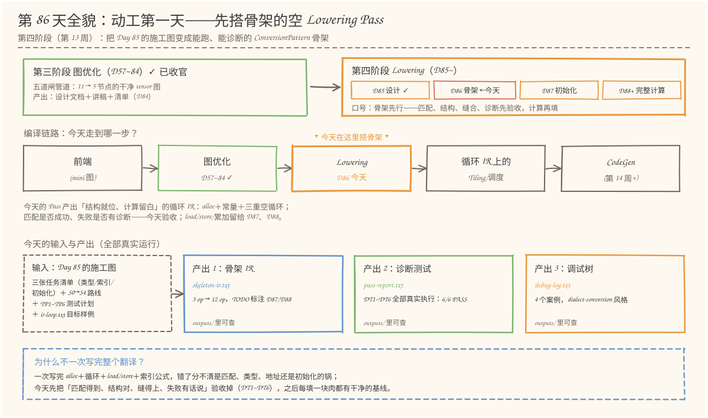
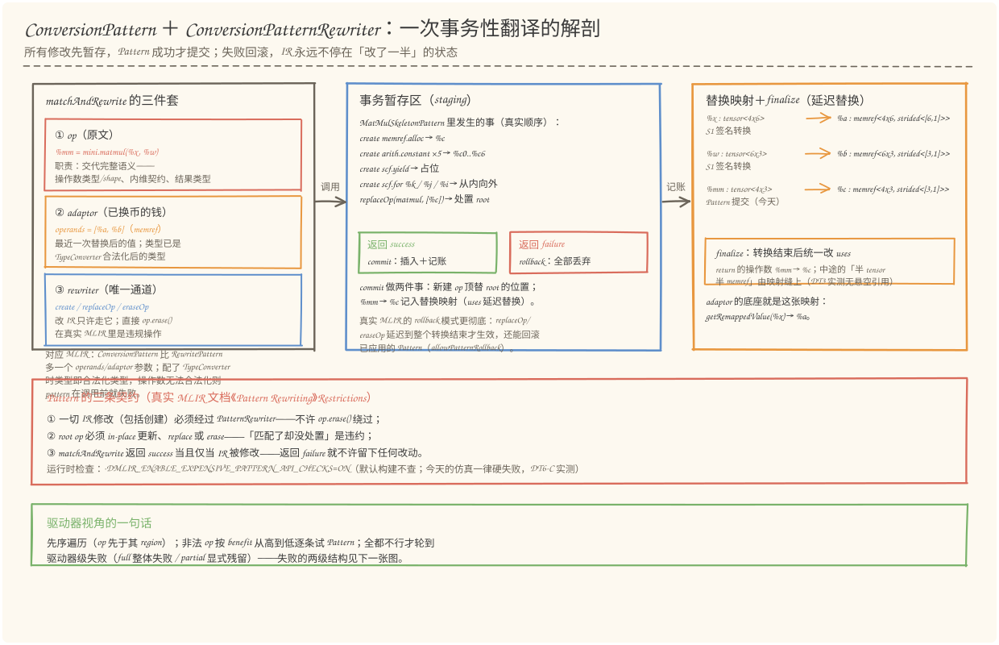
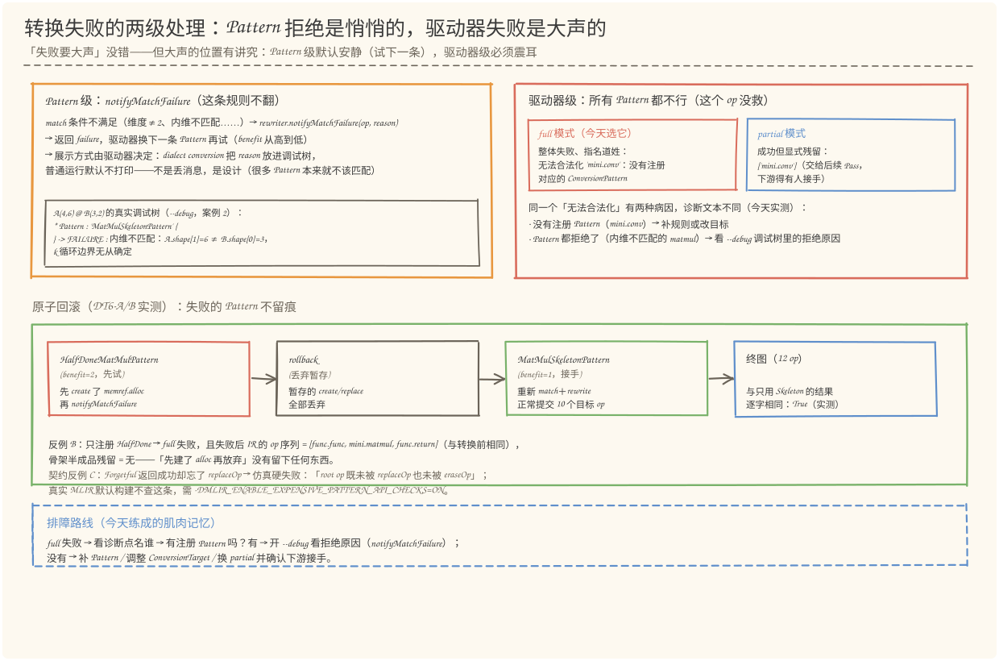
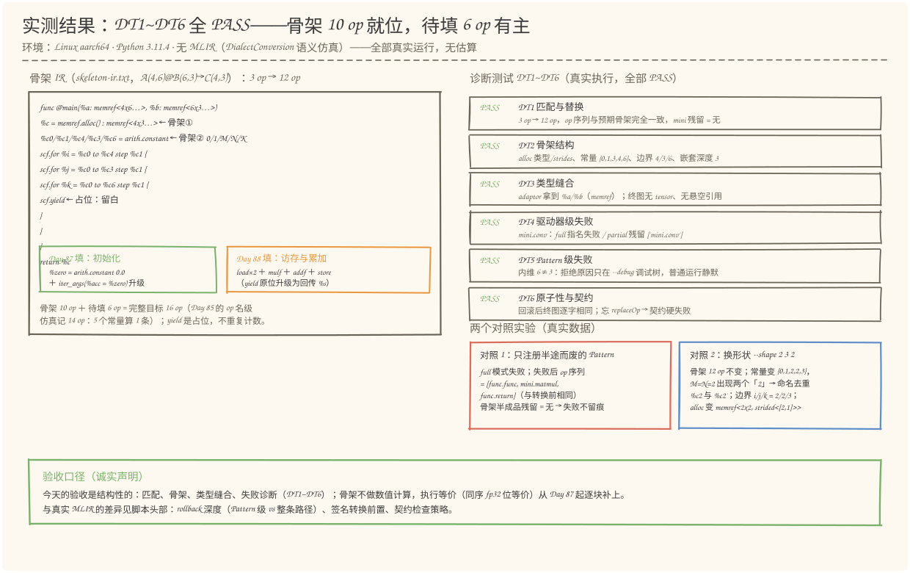

# 第 86 天：建立循环 Lowering 骨架——让 Pattern 先跑起来，失败也要有话说

> **今日目标**：完成本教程后，你能做到四件事——用自己的话讲清 ConversionPattern 和普通 RewritePattern 的差别（多一个 operands/adaptor 参数，拿到的是"最近一次替换后、类型已合法化"的操作数），并背出 Pattern 的三条契约（改 IR 必须走 rewriter、root 必须 in-place/替换/擦除、返回失败就不得留痕）；说出 ConversionPatternRewriter 的事务语义（暂存 → 成功 commit / 失败 rollback），以及它与真实 MLIR rollback 模式的差距（本仿真只做 Pattern 级事务，真实 MLIR 把 replaceOp/eraseOp 延迟到整个转换结束、还能回滚已应用的 Pattern）；区分两级失败（Pattern 级 notifyMatchFailure 默认只进调试树、驱动器换下一条规则；驱动器级 full 整体失败点名 / partial 显式残留），并用 `--debug` 调试树定位"Pattern 都拒绝"的真实原因；独立运行 `lowering_pass.py` 复现 DT1~DT6 全部 6/6 PASS（主图 3 op → 12 op、adaptor 拿到 memref 操作数、回滚后 IR 逐字不变、忘 replaceOp 触发契约诊断），并用 `--shape 2 3 2` 验证换形状的预测。
> **预计时间**：学习 35 分钟＋实践 45 分钟
> **前置准备**：Python 3.11（本文环境：aarch64 Linux，Python 3.11.4；今天只做结构性验证，**不需要 numpy**）。本机没有安装 MLIR——与 Day 57~85 一致，用 Python 复刻 MLIR DialectConversion 的 Pattern / Rewriter / 失败处理语义（仿真），不伪造 MLIR 本身的行为；文中所有 MLIR 行为描述均依据官方文档《Dialect Conversion》《Pattern Rewriting》核对（2026-11）。内容上需要 Day 85 的三张任务清单（类型、索引、输出初始化）和 S0→S4 路线——今天的骨架就是往这些空格里填的第一笔。
> **今日产出**：`code/lowering_pass.py`（空（骨架版）MatMul Lowering Pass ＋ DT1~DT6 诊断测试，全部可运行）、`code/outputs/skeleton-ir.txt`（骨架 IR：3 op → 12 op，计算留白）、`code/outputs/pass-report.txt`（诊断测试报告，真实运行 6/6 PASS）、`code/outputs/debug-log.txt`（四个案例的 dialect-conversion 风格调试树）、4 张手绘图。

## 1. 今天解决什么问题？

昨天（Day 85）交了施工图：三张任务清单（类型、索引、输出初始化）＋ S0→S4 路线 ＋ TP1~TP6 测试计划。今天按计划动工——但立刻会遇到一个工程抉择：**要不要一口气把 `mini.matmul` 的完整译文写出来？**（alloc＋三重循环＋load/store＋地址公式＋累加器，一次到位。）

不要。原因是排障：一次写完 16 个目标 op，跑错了你分不清锅在哪儿——是 Pattern 根本没匹配上？是操作数类型没换过来？是循环边界抄错了？还是初始化漏了？每种错误的修法完全不同，但症状可能一样（"转换失败"或"结果不对"）。所以今天的目标是先把**骨架**立起来：Pattern 能匹配到 `mini.matmul`，能用 Rewriter 原子地提交一个"结构正确、计算留白"的目标序列——alloc ＋ 5 个常量 ＋ 三重嵌套的空循环 ＋ yield 占位——并配上**诊断测试**验证四件事：匹配得到（DT1）、结构对（DT2）、类型缝得上（DT3）、失败有话说（DT4~DT6）。骨架验收干净之后，Day 87 填初始化、Day 88 填访存与累加，每填一块肉都有一个不掺其它变量的基线。

贯穿例子沿用 Day 85：`A(4,6) @ B(6,3) → C(4,3)`。源图（S0）：

```text
func @main(%x: tensor<4x6xf32>, %w: tensor<6x3xf32>) -> tensor<4x3xf32> {
  %mm = mini.matmul(%x, %w) : (tensor<4x6xf32>, tensor<6x3xf32>) -> tensor<4x3xf32>
  return %mm : tensor<4x3xf32>
}
```

今天 Pass 产出的骨架（完整版见 §5.3 的 `skeleton-ir.txt`）：

```mlir
%c = memref.alloc() : memref<4x3xf32, strided<[3, 1]>>
%c0/%c1/%c4/%c3/%c6 = arith.constant   // 0 / 1 / M / N / K
scf.for %i = %c0 to %c4 step %c1 {
  scf.for %j = %c0 to %c3 step %c1 {
    scf.for %k = %c0 to %c6 step %c1 {
      scf.yield                         // 占位：循环体留白
    }
  }
}
```

`scf.yield` 是空循环体的自然收尾（无操作数版本），它旁边的预留注释就是 Day 85 三张清单的占位：任务③初始化给 Day 87，任务②的访存与累加给 Day 88。**注意：骨架不做数值计算，今天不跑"执行等价"——那正是留白的意义。**

## 2. 先看全貌：今天的内容位于哪里？



**图 1**：看三处——上排是阶段地图：第四阶段 Lowering 的四步走到第二格（D85 设计 ✓ → **D86 骨架，今天** → D87 初始化 → D88+ 完整计算）；中排是编译链路：图优化交付的干净 tensor 图进来，今天在 Lowering 站里产出"结构就位、计算留白"的循环 IR；下排是输入与产出：左边的施工图（三张任务清单＋测试计划）变成右边三件产出——骨架 IR、6/6 PASS 的诊断测试报告、四个案例的调试树，全部在 `code/outputs/` 里可查。

把今天的路线压缩成五步（细节在 §3、§4 展开）：

1. **接单**：驱动器先序遍历 IR（op 先于它 region 里的 op），撞见非法的 `mini.matmul`，按 benefit 从高到低找 Pattern 试；
2. **匹配**：Pattern 从 adaptor 里读操作数——已经是签名转换后的 `%a`/`%b`（memref），shape、内维契约都在类型里，不满足就 `notifyMatchFailure` 拒绝；
3. **改写**：一切修改走 Rewriter 暂存——create 骨架 10 op ＋ `replaceOp`（`%mm` → `%c`）；
4. **提交**：返回 success → commit：新建 op 顶替 root 位置，替换记账进全局映射；返回 failure → rollback，一笔勾销；
5. **验收**：终图与非法集求交为空 → 转换完成；有 Pattern 救不了的 op → full 模式整体失败（大声点名），partial 模式显式残留。

## 3. 核心概念：先用直觉，再给准确定义

### 3.1 ConversionPattern：一条翻译规则的接口

一句通俗解释：**ConversionPattern 是一条"接单→交货"的翻译规则——接单时问清"这单我能翻吗"（match），交货时通过唯一的提交系统产出译文（rewrite）。**

类比：银行柜员接一笔换汇业务。客户递上来的外币（源 op 的 tensor 操作数）在递到你手上之前，**已经由兑换点（TypeConverter＋签名转换）换成了本币**——你看到的 `%a`/`%b` 是 memref，不是原始的 `%x`/`%w`；你审批的是"这笔业务合不合规"（维度、内维契约），而不是"汇率怎么算"（类型怎么转）。对应到技术上是：`ConversionPattern` 继承自 `RewritePattern`，但 `matchAndRewrite` 多了一个参数——

```c++
virtual LogicalResult matchAndRewrite(Operation *op, ArrayRef<Value> operands,
                                      ConversionPatternRewriter &rewriter) const;
```

这个 `operands`（便利封装叫 **adaptor**）是**最近一次替换后的值**：配了 TypeConverter 时，这些值的类型就是合法化之后的类型。官方文档还写明一个容易忽略的行为：**如果操作数的类型无法合法化，Pattern 在 `matchAndRewrite` 被调用之前就失败**——你的 hook 根本不会被调，这不是你的锅，是类型表缺项。

**类比的边界**：柜员审单是独立判断，Pattern 的试单由驱动器调度——同一个 `mini.matmul`，驱动器按 benefit 从高到低逐条试，谁先返回成功用谁；你拒绝（notifyMatchFailure）后驱动器会换下一条规则，而不是把单子退给客户。所以 Pattern 写成"宁可拒绝、不要硬翻"是安全的。

今天骨架 Pattern 的 match 就是四连问（全部来自 adaptor 里的类型，真实代码见 §5.2）：操作数恰好 2 个？都已是 memref？都是 2 维？内维契约 `A.shape[1] == B.shape[0]`？任何一问不满足，`rewriter.notifyMatchFailure(op, 原因)` 拒绝。一个常见误解：以为 Pattern 里要自己处理 tensor→memref 的类型转换——不用也不用能，adaptor 已经给好了；Pattern 该做的是**读**这些类型（shape、strides 从哪来），并决定循环边界（M、N、K 全部编译期可知，正好是 Day 85 任务清单②的"边界"列）。

### 3.2 ConversionPatternRewriter：事务性改写器

一句通俗解释：**Rewriter 是唯一合法的修改通道，而且自带会计制度——先记账（暂存），交易成功才结账（commit），撤单一笔勾销（rollback），IR 永远不停在"改了一半"的状态。**

类比：银行转账的"待清算"状态。你发起的转账先挂账——账户余额没动、对方也没收到钱；交易成功（Pattern 返回 success），清算批量执行，所有划款一次生效；交易失败（返回 failure），挂账全部取消，两个账户都当无事发生。对应到技术上是三段式事务：`create`（新建 op）、`replaceOp`（结果替换＋擦除 root）、`eraseOp` 都只写进**暂存区**；commit 时新建 op 顶替 root 的位置、替换记入全局映射；rollback 时暂存丢弃，**失败不留痕**。

为什么需要这么绕？因为 Pattern 会被反复调用、中途放弃是常态。如果 Pattern 直接改 IR，失败退出后就会留下"建了 alloc 但 matmul 还在"的半成品——下一个 Pattern 看到的就是脏现场。事务性保证：**每条 Pattern 看到的 IR 都是干净的**。

**与真实 MLIR 的差距（诚实声明）**：官方文档《Dialect Conversion》的"Immediate vs Delayed IR Modification"一节写得很细——真实 MLIR 的 rollback 模式（默认）把 `replaceOp`/`eraseOp`/`replaceAllUsesWith` **延迟到整个转换过程结束**才生效（被替换的 op 对后续 Pattern 仍可见），甚至能回滚"已经成功应用"的 Pattern（当合法化路径走进死胡同时，`ConversionConfig::allowPatternRollback`）；追求编译速度可以切 no-rollback 模式，所有修改立即生效。今天的仿真只做 **Pattern 级**事务（成功提交/失败丢弃）＋uses 的延迟替换（finalize 统一改），不模拟整条路径的回溯——够讲清楚"失败不留痕"，但别把仿真当 MLIR 本身。

除了事务性，Pattern 还背着**三条契约**（官方文档《Pattern Rewriting》的 Restrictions 小节，原文核对）：

1. **一切 IR 修改——包括创建——必须经过 PatternRewriter**。不许 `op.erase()` 绕过（驱动器维护着工作列表和映射，绕过会让它们失效）；
2. **root op 必须被 in-place 更新、replace 或 erase**。"匹配成功却什么都没处置"是违约；
3. **matchAndRewrite 返回 success 当且仅当 IR 被修改**——返回 failure 就不许留下任何改动。

这三条在真实 MLIR 里默认构建**不检查**，要开 `-DMLIR_ENABLE_EXPENSIVE_PATTERN_API_CHECKS=ON`（常配 ASan）才在运行时抓；今天的仿真把契约做成硬失败（DT6-C 实测），教学优先。

### 3.3 转换失败的两级处理

一句通俗解释：**"失败要大声"没错，但大声的位置有讲究——Pattern 级失败默认是安静的（换下一条规则），驱动器级失败必须震耳（要么整体失败点名，要么显式残留）。**

**Pattern 级（这一单我不接）**：match 条件不满足时 `rewriter.notifyMatchFailure(op, reason)`——记录原因、返回 failure，驱动器换下一条 Pattern。关键细节：**这条 remark 默认不进普通输出**。官方文档说得很清楚：notifyMatchFailure 的消息"如何展示由具体驱动器决定"，而 dialect conversion 驱动器把它放进 `-debug-only=dialect-conversion` 的调试树里，普通运行不打印。这是设计而非缺陷——同一 root 可能注册十几条规则，大多数"不匹配"是常态，逐条刷屏会淹没真正的错误。代价是：**排障时永远开着 --debug**，且拒绝时永远带上原因（静默 `return failure()` 在调试树里是一行"无诊断"，等于让未来的自己抓瞎）。

**驱动器级（这个 op 没救了）**：所有 Pattern 都试完仍无人接手——full 模式（`applyFullConversion`）整体失败，诊断指名道姓；partial 模式（`applyPartialConversion`）转换"完成"但把残留 op 明示出来，交给后续 Pass（下游得有人接手，Day 85 已定下今天选 full）。MLIR 还有第三种 analysis 模式（干跑、只记录谁能被转换），今天用不上，知道存在即可。

一个容易踩的细分：**同样是"无法合法化"，病因有两种**——①根本没有注册对应的 Pattern（Day 85 的 `mini.conv`）；②注册了但都拒绝了（内维不匹配的 `mini.matmul`）。两者的驱动器诊断文本不同（今天的仿真特意区分），修法更不同：前者补规则或改目标，后者开 `--debug` 看拒绝原因。把它俩混为一谈，排障就会南辕北辙。

## 4. 图解核心机制



**图 2**：按左右三块看。**左边**是 `matchAndRewrite` 的三件套——op 是原文（交代完整语义）、adaptor 是已换币的钱（`%a`/`%b` 已是 memref，类型合法化在调用前完成）、rewriter 是唯一合法的修改通道。**中间**是事务暂存区：今天的骨架 Pattern 按真实顺序 create（alloc → 常量×5 → yield → 三个 for 从内向外）＋ `replaceOp(matmul, [%c])`，然后二选一——返回 success 走 commit（插入＋记账），返回 failure 走 rollback（全部丢弃）；底部注明真实 MLIR 的 rollback 模式更彻底（延迟到整个转换结束、可回滚已应用的 Pattern）。**右边**是替换映射＋finalize：`%x→%a`、`%w→%b`（签名转换）和 `%mm→%c`（Pattern 提交）都先记在映射里，转换结束后统一改 uses——return 的操作数就是这样从 `%mm` 换成 `%c` 的，中途状态由映射缝合。底部红框是三条契约与它们的运行时检查开关。



**图 3**：这张图回答"失败了怎么办"。**左上**是 Pattern 级：notifyMatchFailure → 驱动器换下一条 → IR 无痕，配的是今天真实的调试树片段（内维 6≠3 的拒绝原因，普通运行看不到）。**右上**是驱动器级：full 整体失败点名 `mini.conv` / partial 显式残留 `['mini.conv']`，附两种"无法合法化"的病因对照。**下半**是原子回滚的实测流程（DT6-A）：HalfDone 先 create 了 alloc 再拒绝 → rollback 丢弃 → Skeleton 接手 → 终图与只用 Skeleton 的结果**逐字相同**；反例 B 证明只注册 HalfDone 时失败后 IR 与转换前完全一样，反例 C 证明忘 replaceOp 会被契约抓住。底部的排障路线是今天练成的肌肉记忆：full 失败 → 看点名谁 → 有没有注册 Pattern → 有则开 --debug 看拒绝原因，没有则补规则/改目标/换 partial。

## 5. 动手实践：空 Lowering Pass 与它的诊断测试

### 5.1 准备文件

今天的工程两个脚本＋三个产出文件（随教程已生成，只依赖 Python 3 标准库，**不需要 numpy**——今天只做结构性验证）：

```text
tutorials/day-086/
├── README.md
├── code/
│   ├── lowering_pass.py        # 主脚本：Pattern/Rewriter/驱动器 + 骨架 Pass + DT1~DT6
│   ├── make_images.py          # 生成 4 张 SVG（可复现）
│   └── outputs/
│       ├── skeleton-ir.txt     # 产出 1：骨架 IR（3 op → 12 op，预留标注 Day 87/88）
│       ├── pass-report.txt     # 产出 2：DT1~DT6 诊断测试报告（真实运行）
│       └── debug-log.txt       # 产出 3：四个案例的调试树
└── images/                     # 4 张手绘图
```

### 5.2 编写代码：四个构件

`lowering_pass.py` 约 900 行，四个构件对应 §3 的概念（完整代码见文件，这里讲关键段）。

**构件一：最小 SSA IR（`Value`/`Op`/`TypeConverter`）。** 每个 op 有名字、操作数、结果、属性和 region（`body`）——`scf.for` 的循环体就是它的 body，`walk()` 做先序遍历（op 先于 region 内的 op，与真实驱动器一致）。TypeConverter 只做一件事：`tensor<4x6xf32>` → `memref<4x6xf32, strided<[6, 1]>>`（Day 85 任务清单①的类型表）。

**构件二：`ConversionPatternRewriter`——三段式事务。** 核心是 `_Txn` 暂存区和三个方法：

```python
def commit(self, root_op):                       # 驱动器在 Pattern 返回 success 后调用
    txn = self._txn
    if txn.disposed is not root_op:              # 契约②：root 必须被 replace/erase
        self.rollback()
        raise PatternContractError(...)
    nested = {id(d) for o in txn.created for d in o.descendants()}
    top = [o for o in txn.created if id(o) not in nested]   # 只顶层的 op 顶替 root
    body = self.driver.body_of(root_op)
    idx = body.index(root_op)
    body[idx:idx + 1] = top                      # 新建 op 顶替 root：替换＋擦除一步完成
    self.global_replacements.update(txn.replacements)       # 记账（uses 延迟到 finalize）
    self._txn = None

def rollback(self):                              # 失败：暂存全部丢弃 → 不留痕
    self._txn = None

def notifyMatchFailure(self, op, reason):        # Pattern 级失败：进调试树，返回 False
    self.driver.match_failures.append((op, reason))
    return False
```

`finalize()` 对应真实 MLIR rollback 模式的延迟替换：转换结束后按全局映射统一改所有 uses——`return` 的操作数从 `%mm` 换成 `%c` 就发生在这一步。

**构件三：`ConversionDriver`——先序遍历＋两级失败。** `_legalize` 扫 body：合法 op 跳过（并进它的 region）；非法 op 交给 `_try_patterns`——按 benefit 从高到低逐条试，谁成功谁顶替原位置；全失败时 full 模式记下诊断整体失败、partial 模式记残留。`--debug` 打开的调试树刻意模仿 `-debug-only=dialect-conversion` 的格式（`Legalizing operation : ... { * Pattern : ... { ** Insert / ** Replace } -> SUCCESS } -> SUCCESS`），四个案例的真实输出在 `outputs/debug-log.txt`。

**构件四：`MatMulSkeletonPattern`——今天的空 Pass 本体。** match 四连问＋rewrite 建骨架：

```python
def matchAndRewrite(self, op, adaptor, rewriter):
    self.seen_adaptor = list(adaptor.operands)          # DT3 的证据：pattern 实际拿到什么
    if len(adaptor.operands) != 2:
        return rewriter.notifyMatchFailure(op, f"期望 2 个操作数，实际 {len(adaptor.operands)} 个")
    ta, tb = adaptor.operands[0].type, adaptor.operands[1].type
    sa, sb = memref_shape(ta), memref_shape(tb)
    if sa is None or sb is None:
        return rewriter.notifyMatchFailure(op, f"操作数还不是 memref（{ta} / {tb}）——检查签名转换")
    if len(sa) != 2 or len(sb) != 2:
        return rewriter.notifyMatchFailure(op, f"只支持 2 维矩阵乘，拿到 A{sa} @ B{sb}")
    if sa[1] != sb[0]:
        return rewriter.notifyMatchFailure(
            op, f"内维不匹配：A.shape[1]={sa[1]} ≠ B.shape[0]={sb[0]}，k 循环边界无从确定")
    M, K = sa; N = sb[1]
    # ---- rewrite：一切修改走 rewriter，先暂存 ----
    alloc = rewriter.create("memref.alloc", result_names=["%c"],
                            result_types=[make_memref((M, N))],
                            comments=["骨架① 输出缓冲：Day 85 任务清单①的类型表"])
    consts = [rewriter.create("arith.constant", result_names=[cname(v)],
                              result_types=["index"], attrs={"value": v})
              for v in (0, 1, M, N, K)]                  # 下界/步长/M/N/K ← 静态 shape
    lo, st, bm, bn, bk = [c.results[0] for c in consts]
    yld = rewriter.create("scf.yield", comments=["骨架占位：循环体留白",
                                                 "预留(Day 87 填): %zero + iter_args(%acc = %zero)",
                                                 "预留(Day 88 填): load ×2 · mulf · addf · yield %s · store"])
    fk = rewriter.create("scf.for", operands=[lo, bk, st], attrs={"iv": "%k"}, body=[yld])
    fj = rewriter.create("scf.for", operands=[lo, bn, st], attrs={"iv": "%j"}, body=[fk])
    fi = rewriter.create("scf.for", operands=[lo, bm, st], attrs={"iv": "%i"}, body=[fj])
    rewriter.replaceOp(op, [alloc.results[0]])           # 契约②：处置 root（%mm → %c）
    return True
```

注意三个细节：**shape 全部从 adaptor 的类型里读**（`sa[1] != sb[0]` 就是 Day 12/83 的内维契约在 Pattern 里的化身）；**从内向外 create**（外层 for 的 body 引用已创建的内层）；**create 返回 Op，放进 operands 的是它的 result**（`[c.results[0] for c in consts]`——今天调试时真在这上面栽过一跤，Value 和 Op 分不清会让循环边界全部错位）。

另有两个反面教材 Pattern 专供 DT6 使用：`HalfDoneMatMulPattern`（benefit=2，先 create 再拒绝——测回滚）和 `ForgetfulMatMulPattern`（benefit=3，返回成功却忘了 replaceOp——测契约）。

### 5.3 运行与观察

```bash
cd tutorials/day-086/code
python3 lowering_pass.py
```

以下为**真实运行输出**（节选，完整版在 `outputs/pass-report.txt`；环境 Linux aarch64，Python 3.11.4）：

```text
[PASS] DT1 匹配与替换
  转换前 3 op：func.func, mini.matmul, func.return
  full 模式：成功——转换完成（模式=full）：终图 12 op，残留非法 op = 无
  转换后 12 op：func.func + 骨架 10 op（alloc 1 ＋ constant 5 ＋ for 3 ＋ yield 1）＋ func.return
  op 序列与预期骨架完全一致：True
  mini 方言残留：无

[PASS] DT3 类型缝合（adaptor）
  adaptor 给 Pattern 的操作数：['%a: memref<4x6xf32, strided<[6, 1]>>',
                                '%b: memref<6x3xf32, strided<[3, 1]>>']
  ——是签名转换后的 %a/%b（memref），不是原始的 %x/%w（tensor）：True
  终图残留 tensor 类型：无（函数结果类型 ['memref<4x3xf32, strided<[3, 1]>>']）
  悬空引用（uses 指向已消失的值）：无——延迟替换在 finalize 统一完成

[PASS] DT5 Pattern 级失败
  A(4,6) @ B(3,2)（内维 6≠3），full 模式：按预期失败
  --debug 调试树含拒绝原因（notifyMatchFailure 的 remark）：True
  普通运行（不带 --debug）不打印拒绝原因：True（展示方式由驱动器决定——这是设计，不是丢消息）

[PASS] DT6 原子性与契约
  A. [HalfDone(benefit=2) → 拒绝并回滚] ＋ [Skeleton(benefit=1) → 接手]：成功，
     终图与只用 Skeleton 的结果逐字相同：True
  B. 只注册 HalfDone：full 模式失败 → 无法合法化 'mini.matmul'：已注册的 Pattern 都拒绝了…
     失败后 IR 的 op 序列 = ['func.func', 'mini.matmul', 'func.return']（与转换前相同：True），
     骨架半成品残留 = 无
  C. Forgetful 返回成功但忘了 replaceOp：契约硬失败
     诊断：契约违反：Pattern 'ForgetfulMatMulPattern' 返回成功，但 root op 'mini.matmul'
     既未被 replaceOp 也未被 eraseOp（契约：root 必须 in-place 更新/替换/擦除）

—— 诊断测试 6/6 PASS ——
```

骨架 IR 全文（`outputs/skeleton-ir.txt`，留白处用预留注释标出 Day 87/88 的填空题）：

```mlir
func @main(%a: memref<4x6xf32, strided<[6, 1]>>, %b: memref<6x3xf32, strided<[3, 1]>>) -> memref<4x3xf32, strided<[3, 1]>> {
  %c = memref.alloc() : memref<4x3xf32, strided<[3, 1]>>
  %c0 = arith.constant 0 : index
  %c1 = arith.constant 1 : index
  %c4 = arith.constant 4 : index      // M ← A.shape[0]
  %c3 = arith.constant 3 : index      // N ← B.shape[1]
  %c6 = arith.constant 6 : index      // K ← 内维契约 A.shape[1]==B.shape[0]
  scf.for %i = %c0 to %c4 step %c1 {
    scf.for %j = %c0 to %c3 step %c1 {
      scf.for %k = %c0 to %c6 step %c1 {
        scf.yield
        // 预留(Day 87 填): %zero = arith.constant 0.0 + iter_args(%acc = %zero)
        // 预留(Day 88 填): load %a[%i,%k] · load %b[%k,%j] · mulf · addf · yield %s · store %c[%i,%j]
      }
    }
  }
  return %c : memref<4x3xf32, strided<[3, 1]>>
}
```

调试树长什么样？`--debug` 打开后的主图路径（`outputs/debug-log.txt` 案例 1，格式模仿 `-debug-only=dialect-conversion`）：

```text
Legalizing operation : 'mini.matmul' {
  %mm = mini.matmul(%x, %w)

  * Pattern : 'MatMulSkeletonPattern' {
    ** Insert  : 'memref.alloc'
    ** Insert  : 'arith.constant'        ← ×5
    ** Insert  : 'scf.yield'
    ** Insert  : 'scf.for'               ← ×3，从内向外
    ** Replace : 'mini.matmul'
  } -> SUCCESS : pattern applied successfully
} -> SUCCESS
```

值得盯一眼的细节：Pattern 应用前，调试树里 `mini.matmul` 的操作数仍显示 `%x, %w`——**延迟替换**的现场证据（uses 要到 finalize 才统一改，和真实 MLIR rollback 模式的行为一致）；而 Insert 出来的 10 个新 op 会被驱动器逐一"Legalizing"检查合法性，全绿才走到 SUCCESS。



**图 4**：三个面板各证明一件事。**左边**是骨架 IR 的缩略与"待填分工"：骨架 10 op（alloc＋5 常量＋3 for＋yield 占位），Day 87 填 `%zero`＋iter_args 升级，Day 88 填 load×2＋mulf＋addf＋store——骨架 10 ＋ 待填 6 = 完整目标 16 op。**右上**是 DT1~DT6 六项 PASS，每项一行写明检查什么、怎么验。**右下**是两个对照实验的真实数据：只注册半途而废 Pattern 时失败后 IR 与转换前完全相同（失败不留痕）；换形状 `--shape 2 3 2` 时骨架 op 数不变、常量变成 {0,1,2,2,3}（两个"2"被去重成 %c2 和 %c2'）。

### 5.4 修改一个参数再观察：三件事各改一次

**实验一：换形状。** `python3 lowering_pass.py --shape 2 3 2`（练习模式只打印，不覆盖产出），真实结果：

```text
形状 A(2,3) @ B(3,2) -> C(2,2)
转换：成功——转换完成（模式=full）：终图 12 op，残留非法 op = 无

func @main(%a: memref<2x3xf32, strided<[3, 1]>>, %b: memref<3x2xf32, strided<[2, 1]>>) -> memref<2x2xf32, strided<[2, 1]>> {
  %c = memref.alloc() : memref<2x2xf32, strided<[2, 1]>>
  %c0 = arith.constant 0 : index
  %c1 = arith.constant 1 : index
  %c2 = arith.constant 2 : index        // M ← A.shape[0]
  %c2' = arith.constant 2 : index       // N ← B.shape[1]（同名去重）
  %c3 = arith.constant 3 : index        // K ← 内维契约
  scf.for %i = %c0 to %c2 step %c1 { … scf.for %j = %c0 to %c2' … scf.for %k = %c0 to %c3 …
```

观察点：**骨架的"栏目"不变、数字全变**——常量 {0,1,2,2,3}、边界 i/j/k = 2/2/3、alloc 变成 `memref<2x2>`（16 B）。M 和 N 恰好都是 2，命名去重产生了 `%c2` 与 `%c2'`——两个独立的 SSA 值，这正说明常量是"每个值一个 op"（16 个完整目标 op 的口径就是这么数出来的）。这是 Day 85 练习（`--shape 2 3 2` 填三张清单）在骨架层的直接延续。

**实验二：喂一张 Pattern 会拒绝的图。** DT5 的 `A(4,6) @ B(3,2)`（内维 6≠3）：普通运行只看到驱动器的"无法合法化 'mini.matmul'：已注册的 Pattern 都拒绝了这次匹配"，**拒绝原因不打印**；加 `--debug` 后调试树里出现 `FAILURE : 内维不匹配：A.shape[1]=6 ≠ B.shape[0]=3，k 循环边界无从确定`。观察点：两级失败的分工——Pattern 级的"为什么"在调试树里，驱动器级的"谁没救了"在普通输出里；排障时缺了 --debug 就等于蒙着眼修。

**实验三：让一条 Pattern 半途而废。** DT6 的三连：给驱动器同时注册 HalfDone（benefit=2）和 Skeleton（benefit=1）——HalfDone 先试、先 create 了 alloc 再拒绝、回滚，Skeleton 接手，终图与只用 Skeleton 时**逐字相同**；只注册 HalfDone——full 失败且 IR 的 op 序列与转换前一致，`%bad` 半成品无影无踪；注册 Forgetful——返回成功却没 replaceOp，仿真当场硬失败并给出契约诊断。观察点：**回滚不是"清理"，是"从未发生"**——这正是事务性想给你的保证；而契约检查在真实 MLIR 里要开 `-DMLIR_ENABLE_EXPENSIVE_PATTERN_API_CHECKS=ON`，不开的话这类 bug 会安静地生产坏 IR。

## 6. 常见错误与排查

**错误一：full 模式报"无法合法化"，但任何输出里都找不到原因。**
现象：诊断只有一行 `无法合法化 'mini.matmul'：已注册的 Pattern 都拒绝了这次匹配`，为什么拒绝只字未提（DT5 的实况）。原因：Pattern 用 `notifyMatchFailure` 拒绝时，remark 默认不进普通输出——官方文档明说展示方式由驱动器决定，dialect conversion 把它放进 `-debug-only=dialect-conversion` 的调试树；这是设计（规则不匹配是常态，不能刷屏），但排障时就是盲区。定位：加 `--debug`（真实 MLIR 加 `-debug-only=dialect-conversion`）重跑，找 `* Pattern : ...` 块末尾的 `FAILURE : 原因`。修复：按原因修 match 条件（维度、内维契约……）；如果确实该有一条能兜底的规则，补 Pattern，而不是放宽现有规则的检查。

**错误二：转换"成功"，但终图里 `mini.matmul` 还在（或它的结果悬空）。**
现象：pass 报成功，op 序列却混着旧 op；或下游报"用了未定义的值"。原因：Pattern 忘了 `replaceOp`/`eraseOp`——违反契约②（root 必须 in-place/替换/擦除）。真实 MLIR 默认构建不查这条，坏的 IR 会安静地流到下游（开 `-DMLIR_ENABLE_EXPENSIVE_PATTERN_API_CHECKS=ON` 才会在运行时抓住）；今天的仿真把它做成硬失败（DT6-C 的真实诊断：`root op 'mini.matmul' 既未被 replaceOp 也未被 eraseOp`）。定位：看契约诊断；或对比转换前后 op 序列。修复：matchAndRewrite 的成功路径必须以 `rewriter.replaceOp(op, [...])`（或 eraseOp）收尾。

**错误三：match 里读 `op.operands` 的类型，拿到的还是 tensor，Pattern 把"操作数未降级"当失败，或按 tensor 猜错了 shape。**
现象：notifyMatchFailure 报"操作数还不是 memref"，或生成的循环边界与数据对不上。原因：直读了原始操作数——ConversionPattern 的约定是**从 adaptor 取操作数**：`operands`/adaptor 参数是"最近一次替换后的值"，配了 TypeConverter 时类型已是合法化后的 memref；官方文档还写明，操作数类型若无法合法化，Pattern 在 hook 调用之前就失败，轮不到你自己报错。定位：检查 Pattern 是否用了 `adaptor.operands`（今天的 `seen_adaptor` 就是留的证据）。修复：shape、strides 一律从 adaptor 读；`op.operands` 只在确实需要"原始类型"的场合用。

**错误四：partial 模式跑过了，下游 Pass 却崩了。**
现象：本 Pass 显示成功，下一个 Pass 收到 `mini.conv` 直接报错（DT4 的 partial 分支残留 `['mini.conv']`）。原因：partial 允许残留是"明示交给后续"，不是"问题消失"——下游没人接手，残留就是定时炸弹。定位：看转换结果里的 residue 列表。修复：三选一——补上缺失的 Pattern 改回 full；确认下游真的有 Pass 接手再用 partial；或把这个 op 从非法清单里移出（它本来就该合法）。这与 Day 85 错误二同源，但今天的视角从"设计决定"落到了"驱动器的诊断与残留报告"。

## 7. 今日练习

### 必做练习

不跑代码，先笔答 `A(2,3) @ B(3,2)` 的骨架（提示——骨架的"栏目"不变、数字全变）：① 5 个常量的值和角色各是什么？② 三条 for 的边界各是多少、上界分别从哪个 shape 读的？③ alloc 的类型和字节数？④ op 总数还是 12 吗？写完运行 `python3 lowering_pass.py --shape 2 3 2` 对答案（练习模式只打印，不覆盖产出），并解释两个现象：为什么常量里出现两个"2"却必须有两个不同的名字（`%c2` 与 `%c2'`）？如果 K 不是 3 而是 2（即 `2 2 2` 的方阵乘），去重会出现几次？

### 选做挑战

二选一（都不引入大量新知识）：
（a）给 `mini.transpose` 写骨架 Pattern：match 问三个问题（2 个操作数？已是 memref？2 维？——transpose 不需要内维契约，注意和 matmul 的差别）；rewrite 建骨架（alloc 类型 `memref<NxM>`——行列互换、双重 for、yield 占位），用 `replaceOp` 收尾；构造一张含 `mini.transpose` 的图，验证它被转换、`mini.matmul` 骨架不受影响（两个 root 的 Pattern 互不干扰）。
（b）在 `MatMulSkeletonPattern` 的 match 里加一条"只接 K ≤ 8 的单"：`if K > 8: return rewriter.notifyMatchFailure(op, "K=10 超过骨架版的保守上限 8")`，构造 `A(4,10) @ B(10,3)` 的图，复现 DT5 的全套行为（full 失败、原因只在调试树、普通运行静默），再想想：这种"保守拒绝"在真实编译器里对应什么？（提示：小 shape 走特化路径、大 shape 交给更通用的 Pass——拒绝也是调度手段。）

## 8. 今日验收

- [ ] 我能不看资料说出 ConversionPattern 与普通 RewritePattern 的差别（多一个 operands/adaptor 参数——最近一次替换后的值、类型已合法化；操作数无法合法化时 Pattern 在调用前就失败），并背出三条契约（修改必须走 rewriter；root 必须 in-place/替换/擦除；返回失败不得留痕）
- [ ] 我能画出 Rewriter 的三段式事务（begin 暂存 → success 走 commit：新建 op 顶替 root＋替换记账 / failure 走 rollback：全部丢弃），并说出它与真实 MLIR rollback 模式的差距（真实：延迟到整个转换结束、可回滚已应用的 Pattern；仿真：Pattern 级事务）
- [ ] 我能区分两级失败（Pattern 级 notifyMatchFailure 默认只进 --debug 调试树、驱动器换下一条；驱动器级 full 点名整体失败 / partial 显式残留），并说出两种"无法合法化"的病因与不同修法
- [ ] 我能独立运行 `lowering_pass.py` 并复现：DT1~DT6 全部 6/6 PASS、主图 3 op → 12 op、adaptor 拿到 %a/%b（memref）、回滚后终图逐字相同、忘 replaceOp 触发契约诊断
- [ ] 我能预测换形状后骨架的常量与边界（`--shape 2 3 2`：{0,1,2,2,3}、边界 2/2/3、%c2 与 %c2' 去重、alloc 变 memref<2x2>），并运行验证预测
- [ ] 我保存了 `code/lowering_pass.py`、`outputs/` 三件产出（skeleton-ir.txt / pass-report.txt / debug-log.txt），`python3 make_images.py` 可复现全部 4 张图

## 9. 一句话总结与明天预告

今天把 Day 85 的施工图立成了骨架。**问题**——一次写完整个翻译，错了分不清是匹配、类型、结构还是初始化的锅，排障成本最高的是"不知道错在哪一层"。**机制**——ConversionPattern 从 adaptor 拿"已换币"的操作数、match 四连问决定接不接单；ConversionPatternRewriter 用三段式事务保证"成功才提交、失败不留痕"；失败分两级——Pattern 级默认安静地换下一条（原因进调试树），驱动器级必须大声（full 点名 / partial 残留）。**实践**——`lowering_pass.py` 实现了这套语义：骨架 Pattern 匹配 `mini.matmul`，提交 alloc＋5 常量＋三重空循环＋yield 占位共 10 个目标 op，配 DT1~DT6 诊断测试。**验证**——真实运行 6/6 PASS：主图 3 op → 12 op、op 序列与预期骨架逐项一致、终图无 tensor 无悬空引用、`mini.conv` 两种失败模式按设计发声、半途而废的 Pattern 回滚后 IR 逐字不变、忘 replaceOp 被契约当场抓住——匹配、结构、缝合、诊断四件事验收干净，骨架可以放心填肉了。

明天（Day 87）填第一块肉：输出初始化——`%zero = arith.constant 0.0` ＋ 把最内层 `scf.for` 升级成 `iter_args(%acc = %zero)`，处理动态维度的保守路径。今天的预留注释和 Day 85 任务清单③（alloc 不清零）就是明天的填空题。


