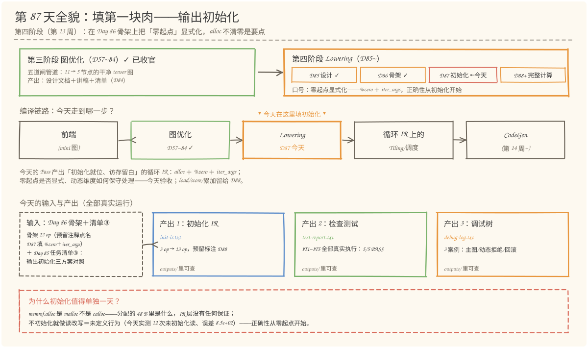
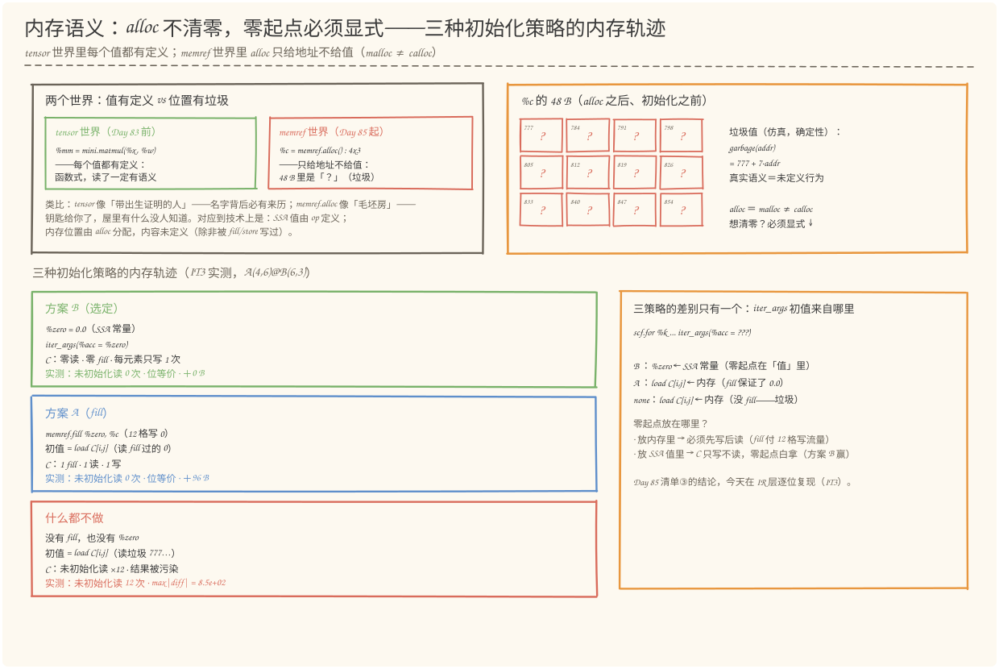
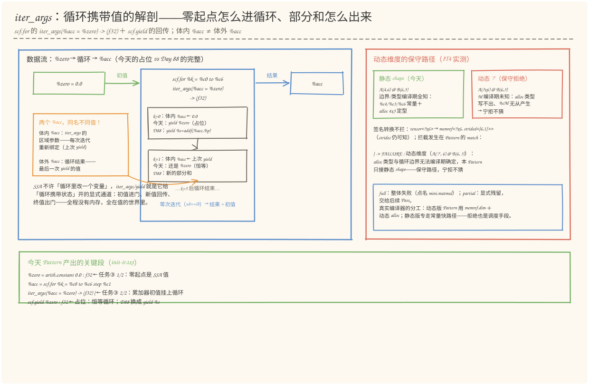
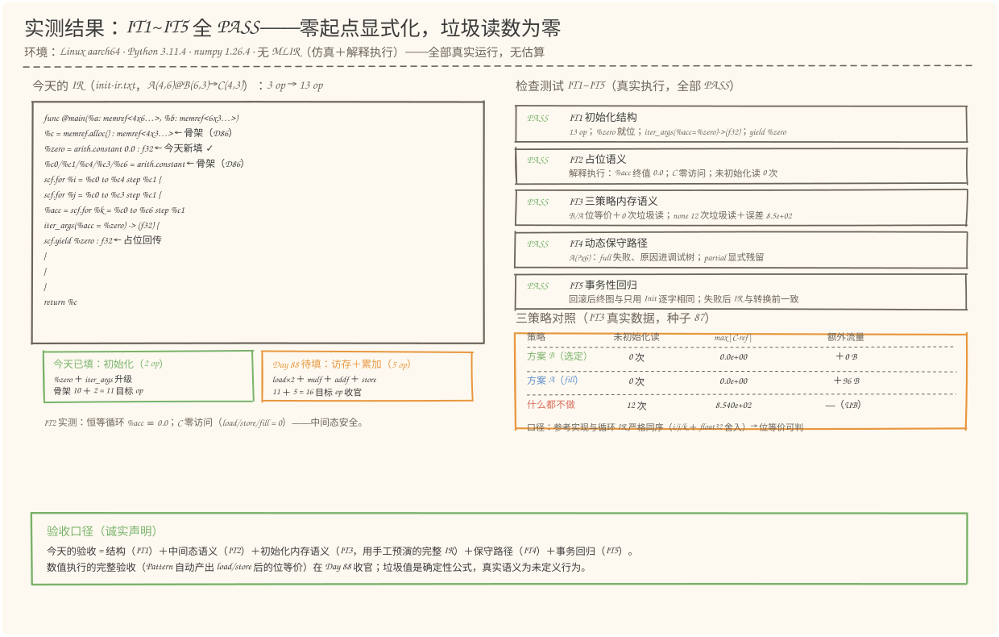

# 第 87 天：生成输出初始化——alloc 不清零，零起点必须显式交代

> **今日目标**：完成本教程后，你能做到四件事——用自己的话说清 `memref.alloc` 的内存语义（分配缓冲区但**内容未初始化**，是 malloc 不是 calloc；tensor 世界里每个 SSA 值都有定义，memref 世界里 alloc 只给地址不给值），并解释为什么"什么都不做＋读改写"是未定义行为；说出三种初始化策略的本质差别（零起点放在**内存里**＝`memref.fill`＋读改写，多付 96 B 流量；零起点放在 **SSA 值里**＝`iter_args(%acc = %zero)`，C 只写不读零流量；什么都不做＝读垃圾，今天实测 12 次未初始化读、误差 8.5e+02）；画出 `scf.for` 的 iter_args 数据流（初值进门 → 每次迭代 yield 回传 → 终值出门；体内 `%acc`（区域参数）≠ 体外 `%acc`（循环结果）；零次迭代时结果＝初值），并解释今天 `yield %zero` 占位为什么是恒等循环、Day 88 换成 `yield %s` 会发生什么；独立运行 `init_pass.py` 复现 IT1~IT5 全部 5/5 PASS（3 op → 13 op、%acc 终值 0.0、三策略位等价对照、动态维度保守拒绝、事务回归），并用 `--shape 2 3 2` 验证换形状的预测。
> **预计时间**：学习 35 分钟＋实践 45 分钟
> **前置准备**：Python 3.11＋numpy（本文环境：aarch64 Linux，Python 3.11.4，numpy 1.26.4；今天的位等价验证用 `numpy.float32`，**需要 numpy**）。本机没有安装 MLIR——与 Day 57~86 一致，用 Python 复刻 MLIR DialectConversion 的 Pattern／Rewriter／驱动器语义，并在其上加一个**解释执行器**验证内存语义（仿真），不伪造 MLIR 本身的行为；文中 MLIR 行为描述均依据官方文档《Dialect Conversion》《scf dialect》核对（2026-11）。内容上需要 Day 85 的任务清单③（输出初始化三方案）和 Day 86 的骨架（12 op、预留注释点名今天的填空）。
> **今日产出**：`code/init_pass.py`（初始化就位版 MatMul Lowering Pass ＋ 解释执行器 ＋ IT1~IT5 检查测试，全部可运行）、`code/outputs/init-ir.txt`（初始化版 IR：3 op → 13 op，访存留白）、`code/outputs/test-report.txt`（检查测试报告，真实运行 5/5 PASS）、`code/outputs/debug-log.txt`（三个案例的调试树）、4 张手绘图。

## 1. 今天解决什么问题？

昨天（Day 86）把骨架立起来了：Pattern 匹配 `mini.matmul`，事务性地提交 alloc＋5 常量＋三重空循环，12 op 的结构验收干净。但骨架里埋着一个**致命悬案**——`%c = memref.alloc() : memref<4x3xf32>` 这行分配了 48 B 的输出缓冲，可这 48 B 里**是什么**？IR 层没有任何保证。Day 85 的探针 P2 已经在 numpy 层预告过答案：如果后续计算用"读改写"（先 load C[i,j]、加上乘积、再 store 回去），而不做任何初始化，结果就是未定义行为——那次实测误差 7.77e+02。今天把这个悬案在 **IR 层**正面解决。

为什么值得单独一天？因为这是 tensor 世界和 memref 世界的**语义断层**第一次真正咬人。tensor 是函数式的：`%mm = mini.matmul(%x, %w)` 背后每个值都有定义，"读"一个 tensor 值永远有语义。memref 是位置式的：`memref.alloc` 只给你一个地址，C 标准库的行话是 **malloc 而不是 calloc**——分配≠清零。跨过这条断层，"初始化"就必须从"框架默认帮你做了"变成"IR 里显式写出来"。写在哪里、怎么写，正是 Day 85 任务清单③的三行对照：方案 A 把零起点放在**内存里**（`memref.fill` 清零，多付 96 B 流量）；方案 B 把零起点放在 **SSA 值里**（`%zero` 作为 iter_args 初值，C 只写不读，零额外流量）；什么都不做则是读垃圾。Day 85 选定了 B，今天的任务就是**把它真的写进 Pattern**。

贯穿例子不变：`A(4,6) @ B(6,3) → C(4,3)`。今天 Pass 的产出（完整版见 §5.3 的 `init-ir.txt`）：

```mlir
%c = memref.alloc() : memref<4x3xf32, strided<[3, 1]>>
%zero = arith.constant 0.0 : f32          // ← 今天的第一块肉：零起点
%c0/%c1/%c4/%c3/%c6 = arith.constant      //   0 / 1 / M / N / K（Day 86 骨架）
scf.for %i = %c0 to %c4 step %c1 {
  scf.for %j = %c0 to %c3 step %c1 {
    %acc = scf.for %k = %c0 to %c6 step %c1
            iter_args(%acc = %zero) -> (f32) {   // ← 第二块肉：初值挂上循环
      scf.yield %zero : f32                       // ← 占位回传（恒等循环）
    }
  }
}
```

相对 Day 86 骨架正好三处升级：`%zero` 常量、`iter_args(%acc = %zero)`、`scf.yield` 从无操作数升级为带操作数。op 数 12 → 13。**注意：循环体里依然没有计算**——`yield %zero` 是"回传初值"的占位（下一节解释为什么这样做是安全的），load/store/mulf/addf 四类访存与运算 op 仍是 Day 88 的填空。今天还要处理计划里点名的另一半：**动态维度的保守路径**——shape 里有 `?` 时，alloc 类型和循环边界都无法编译期确定，Pattern 必须选择保守拒绝而不是硬猜。

## 2. 先看全貌：今天的内容位于哪里？



**图 1**：看三处——上排是阶段地图：第四阶段 Lowering 的四步走到第三格（D85 设计 ✓ → D86 骨架 ✓ → **D87 初始化，今天** → D88+ 完整计算）；中排是编译链路：今天在 Lowering 站里产出"初始化就位、访存留白"的循环 IR；下排是输入与产出：左边的 Day 86 骨架（预留注释点名 D87 填空）＋ Day 85 清单③（三方案对照）变成右边三件产出——13 op 的初始化 IR、5/5 PASS 的检查测试报告、三个案例的调试树。

把今天的路线压缩成五步（细节在 §3、§4 展开）：

1. **接单**：Pattern 的 match 在 Day 86 四连问（2 操作数？memref？2 维？内维契约？）之外新增第五问——shape 必须静态，遇到 `?` 保守拒绝；
2. **零起点**：rewrite 里 create `%zero = arith.constant 0.0 : f32`——零起点是一个 SSA 值，此刻还没有碰任何内存；
3. **挂初值**：最内层 `scf.for` 升级为 `iter_args(%acc = %zero) -> (f32)`——零起点作为循环携带值的初值进门；
4. **回传口**：`scf.yield` 升级为带操作数 `yield %zero`——占位回传初值，循环是恒等的（`%acc ≡ 0.0`），Day 88 把 `%zero` 换成 `%s` 才开始真累加；
5. **验收**：结构（IT1）＋中间态语义（IT2：解释执行今天的 IR，C 零访问）＋初始化内存语义（IT3：三策略对照，用手工预演的完整 IR）＋保守路径（IT4）＋事务回归（IT5）。

## 3. 核心概念：先用直觉，再给准确定义

### 3.1 输出分配的内存语义：alloc 不清零

一句通俗解释：**`memref.alloc` 只负责"划地盘"，不负责"打扫"——它返回的缓冲区里是上一任房客留下的东西，IR 对此不做任何承诺。**

类比：交房。tensor 世界像"带出生证明的人"——每个名字背后必有来历（定义它的 op）；`memref.alloc` 像物业给你一间毛坯房的钥匙——钥匙（地址）是真的，屋里有什么没人知道，可能是上次租户留下的任何东西。对应到技术上是两条语义的对照：**SSA 值由 op 定义**，`%zero = arith.constant 0.0` 之后读 `%zero` 永远得到 0.0；**内存位置由 alloc 分配**，分配动作本身不写任何元素——C 标准库里这是 `malloc` 和 `calloc` 的差别，MLIR 的 `memref.alloc` 对应前者。想让内存里有确定的值，必须再有显式的写：`memref.fill`（整块写）或 `memref.store`（逐元素写）。

**类比的边界**：毛坯房 的垃圾是"上一个租户的家具"，每次可能不同；真实硬件上未初始化内存同样**每次可能不同**（这正是"未定义行为"的可怕之处——测试可能偶尔通过）。今天的仿真为了让垃圾**可观察、可计数、可复现**，用确定性公式 `garbage(addr) = 777 + 7·addr` 填充 alloc 的内存——真实语义仍是 UB，别把仿真公式当成硬件行为。

一个最小对照（今天 IT3 的实测数据，A(4,6)@B(6,3)，种子 87）：

```text
什么都不做（读改写从垃圾起步）：未初始化读 12 次，max|C-参考| = 8.540e+02 ← 结果被污染
方案 A（fill 0.0 后再读改写）：  未初始化读 0 次， max|C-参考| = 0.0e+00  ← 位等价
方案 B（iter_args 从 %zero 起步）：未初始化读 0 次， max|C-参考| = 0.0e+00  ← 位等价
```

### 3.2 三种初始化策略：零起点放在哪里？

一句通俗解释：**"初始化为零"的本质是给累加一个确定的起点——起点可以放在内存里（先清零再读），也可以放在 SSA 值里（初值直接进循环），唯独不能不放。**

沿用 §3.1 的房子：你要在白板上做累计统计。方案 A 是"先把白板擦干净，每轮读一眼白板、加一笔、写回去"——擦白板（fill）要付一次全板的工作量，之后每轮还有一次读；方案 B 是"从口袋里掏出一张写着 0 的卡片当起点，每轮只在卡片上累计，最后把总数一次写上白板"——白板从头到尾只被写一次、从不被读。对应到技术上是：**方案 A** 的 `iter_args` 初值来自内存——`%cij = memref.load %c[%i, %j]`（k 循环外先读，Day 85 清单③原文），因此必须先 `memref.fill %zero, %c` 保证读到 0.0，额外流量 = fill 写 M×N×4 B ＋ load C M×N×4 B = 2×M×N×4 = **96 B**；**方案 B** 的初值来自 SSA 常量——`iter_args(%acc = %zero)`，C 的每个元素只在 k 循环结束后被 `store` 一次最终值，**从不被 load、从不被 fill**，额外流量 **0 B**。

**类比的边界**：卡片（SSA 值）方案能赢有个前提——C 的每个元素**恰好只由一个 (i,j) 负责**，最后的 store 写下的就是完整结果。如果两个 (i,j) 要往同一格写（比如归约、原子累加），"只写不读"就不成立，得回到 fill 或锁。MatMul 的 C[i,j] 恰好一人一格，所以 B 成立；别的算子要重新审。这个前提检查在真实编译器里对应"输出缓冲是否独占"的分析（bufferization 里的分析之一），今天记住"**只写不读 → 不需要清零**"这条判据就够了。

### 3.3 iter_args：循环携带值的显式通道

一句通俗解释：**`iter_args` 是 SSA 给"循环里携带的状态"开的唯一合法通道——初值从门进（iter_args），每圈从窗递出来（yield），循环结束时终值从后门出去（循环结果）；没有这个通道，SSA 里根本写不出"累加器"。**

为什么需要它？SSA（静态单赋值）规定每个值只定义一次——那"第 k 轮的累加值"和"第 k+1 轮的累加值"是两个不同的值，可它们又必须前后相接。`scf.for` 的 iter_args 机制就是官方解法：

```mlir
%acc = scf.for %k = %c0 to %c6 step %c1
        iter_args(%acc = %zero) -> (f32) {   // 初值进门：体内 %acc 初始绑定 %zero
  %s = arith.addf %acc, %p : f32             // 用「这一轮的 %acc」
  scf.yield %s : f32                         // 回传：下一轮的 %acc ← %s
}                                            // 循环结束：%acc(外) = 最后一次 yield
```

对应到技术上是三个名字要分清：**等号左边的 `%acc`** 是循环**结果**（体外可见，值 = 最后一次 yield 回传的值）；**`iter_args(%acc = %zero)` 里的 `%acc`** 是**区域参数**（体内可见，每次迭代开始时重新绑定——第一轮绑初值 `%zero`，之后每轮绑上一轮 yield 的值）。两个 `%acc` 同名但**是两个不同的 SSA 值**（作用域不同），这是今天最容易混的点，也是 §6 错误三的病灶。还有一个容易被忽略的语义：**零次迭代**（上界等于下界）时循环体一次都不执行，结果就是初值——`iter_args` 的值在空循环里安全退化为 `%zero`，不会碰任何内存。

今天 Pattern 产出的是这个机制的**占位形态**：`scf.yield %zero`——回传的不是新算出的部分和，而是初值本身。于是每轮 `%acc` 都绑定 `%zero`，`%acc ≡ 0.0`，循环是**恒等**的。为什么这样是安全的？因为今天的循环体里**没有任何计算**：没有 load、没有乘加，恒等循环＋零访问＝一个"结构就位、语义为空"的中间态（IT2 实测：解释执行后 `%acc` 终值 0.0，对 C 的 load/store/fill 全部为 0 次）。Day 88 填入 `load×2 → mulf → addf %acc, %p` 之后，把 `yield %zero` 换成 `yield %s`，恒等循环就"通电"成真累加——填空的接口已经在今天留好。

### 3.4 动态维度的保守路径：宁拒不猜

一句通俗解释：**静态 shape 是"图纸上的尺寸"，编译期全能算出来；动态 `?` 是"到时候才知道的尺寸"——不知道的时候，Pattern 的正确姿势是拒绝接单，而不是猜一个数。**

对应到技术上是两套机制的差别：静态 shape 下，`A(4,6) @ B(6,3)` 的 M/N/K 在**编译期**全部可知，所以 Pattern 敢直接 create `arith.constant 4/3/6` 和 `memref<4x3xf32>`；动态 shape（比如 `tensor<?x6xf32>`，M 由运行时决定）下，alloc 的类型写不出 `memref<?x3>`（需要动态分配 `memref.alloc(%M, %N)`），循环边界也拿不到常量（需要 `memref.dim` 在运行时读维度）。注意一个细节：**类型转换不拦动态**——`tensor<?x6xf32>` 照样被签名转换成 `memref<?x6xf32, strided<[6, 1]>>`（strides 仍可知，因为 6 和 3 是静态的），拦截发生在 **Pattern 的 match**：检测到 shape 里有 `?`，`notifyMatchFailure` 说出原因（"alloc 类型与循环边界无法编译期确定……宁拒不猜"），驱动器换规则，full 模式下最终整体失败、partial 模式显式残留 `['mini.matmul']`。

**保守路径的意义**：拒绝之后图保持原样，什么坏事都没发生；硬猜的话（比如把 `?` 当 0 或当 4），生成的代码边界是错的，错误要到运行时才爆。真实编译器的做法是给动态 shape 注册**另一条** Pattern（用 `memref.dim`＋动态 alloc），静态小 shape 走常量快路径——和 Day 86 选做挑战（b）的"K≤8 才接单"一样，**拒绝也是调度手段**。今天的任务是把"拒绝"这一侧做扎实：诊断说清楚为什么、证据进调试树（IT4 实测）。


## 4. 图解核心机制



**图 2**：按上下两块看。**上块**回答"alloc 之后内存里是什么"：左边是两个世界的对照——tensor 世界每个值都有定义（函数式），memref 世界的 `memref.alloc()` 只给地址不给值；右边把 `%c` 的 48 B 画成 12 个格子，每格一个 `?`（仿真里是确定性垃圾 777＋7·addr，真实语义是未定义行为），并标注 `alloc ＝ malloc ≠ calloc`。**下块**是三策略的内存轨迹泳道（IT3 实测数据）：方案 B 的 C 零读零 fill、每元素只写一次；方案 A 先 fill 12 格写 0、k 循环外再 load 回 0；什么都不做则 load 直接读到垃圾 777…——右侧点破三策略的**唯一分叉点**：`iter_args` 初值来自 SSA 常量（B）、fill 过的内存（A）还是没 fill 的内存（none），以及"零起点放在哪里"的流量账（内存里要付写＋读，SSA 值里白拿）。



**图 3**：左右两块。**左块**解剖 `iter_args` 的数据流：`%zero` 作为初值进入 `scf.for`，体内展开两轮迭代示意——每轮 `%acc` 绑定上一轮 yield 的值，今天的占位回传 `%zero`（恒等），Day 88 回传 `%s = addf(%acc, %p)`（真累加）；右下的橙色框专门辨析**两个 `%acc`**：体内的是 iter_args 区域参数（每次迭代重新绑定），体外的是循环结果（最后一次 yield 的值）；底部还有一条重要语义——**零次迭代时结果＝初值**，iter_args 在空循环里安全退化。**右块**是动态维度的保守路径（IT4 实测）：静态 shape 走常量快路径，动态 `?` 被 Pattern 的 match 保守拒绝，拒绝原因进 `--debug` 调试树（图里是真实文本），full 整体失败／partial 显式残留；底部注明真实编译器的分工——动态版 Pattern 用 `memref.dim`＋动态 alloc，拒绝也是调度手段。底部绿色框是今天 Pattern 产出的关键 IR 段落，与 §5.3 的 `init-ir.txt` 对照阅读。

## 5. 动手实践：初始化就位版 Lowering Pass 与它的检查测试

### 5.1 准备文件

今天的工程两个脚本＋三个产出文件（随教程已生成，依赖 Python 3 标准库＋numpy——今天的位等价验证用 `numpy.float32`）：

```text
tutorials/day-087/
├── README.md
├── code/
│   ├── init_pass.py           # 主脚本：Pattern/Rewriter/驱动器（复用 D86）＋解释执行器＋IT1~IT5
│   ├── make_images.py         # 生成 4 张 SVG（可复现）
│   └── outputs/
│       ├── init-ir.txt        # 产出 1：初始化版 IR（3 op → 13 op，预留标注 Day 88）
│       ├── test-report.txt    # 产出 2：IT1~IT5 检查测试报告（真实运行）
│       └── debug-log.txt      # 产出 3：三个案例的调试树
└── images/                    # 4 张手绘图
```

### 5.2 编写代码：四个构件

`init_pass.py` 约 1200 行，四个构件对应 §3 的概念（完整代码见文件，这里讲关键段）。

**构件一：SSA IR 与打印机（复用 Day 86，两处升级）。** `Value`/`Op`/`walk`/`TypeConverter`/事务性 Rewriter/驱动器整套从 Day 86 原样复用——骨架先行的好处就是今天能专心填肉。升级两处：其一，`scf.for` 的表示——iter_args 初值追加在 `operands[3:]`，区域参数（体内可见的 `%k`/`%acc`）预建成 `Value` 存进 attrs：

```python
fk = rewriter.create(
    "scf.for", operands=[lo, bk, st, zero.results[0]],   # lb, ub, step, iter_args 初值
    result_names=["%acc"], result_types=["f32"],
    attrs={"iv": "%k", "iv_value": Value("%k", "index"),
           "iter_names": ["%acc"], "iter_args": [Value("%acc", "f32")]},
    body=[yld])                                            # 循环结果 %acc（体外可见）
```

其二，打印机支持 `iter_args(%acc = %zero) -> (f32)` 两行式打印、带操作数的 `scf.yield %zero : f32`，以及三策略预演需要的 `load`/`store`/`fill`/`mulf`/`addf`。另外 shape 解析从今天起**允许 `?`**（`row_major_strides` 遇动态维会传递 `?`，如 `(?x6)` 的 strides 仍是 `(6,1)`），这是 IT4 动态图能走到 Pattern match 的前提。

**构件二：`MatMulInitPattern`——今天的主线。** match 五连问（Day 86 四问＋静态 shape 检查），rewrite 相对骨架三处升级，全部对应 §3：

```python
zero = rewriter.create(
    "arith.constant", result_names=["%zero"], result_types=["f32"],
    attrs={"value": 0.0},
    comments=["任务③ 初始化 1/2：零起点是 SSA 值，不写内存——C 每元素只写不读"])
...
yld = rewriter.create(
    "scf.yield", operands=[zero.results[0]],          # 占位回传初值：恒等循环
    comments=["占位：恒等循环（%acc ≡ %zero）；Day 88 把 %zero 换成 %s = addf %acc, %p"])
```

match 里的静态检查是 IT4 的落点：`if not (is_static(sa) and is_static(sb)): return rewriter.notifyMatchFailure(op, "动态维度……宁拒不猜")`——注意它放在**内维契约检查之前**：动态 shape 连"内维是否匹配"都可能无法编译期判定，先拒绝最稳。

**构件三：`Interp` 解释执行器——今天的新工具，内存语义的裁判。** 它跑通 `alloc/fill/load/store/mulf/addf/scf.for(iter_args)/yield`，核心是带状态的内存模型：

```python
class Interp:
    # 每块 memref 是 list[[state, value]]，state ∈ {"uninit", "written"}
    @staticmethod
    def garbage(addr):                       # 确定性垃圾：可观察、可计数、可复现
        return np.float32(GARBAGE_BASE + 7.0 * addr)

    def exec_for(self, op):                  # scf.for 的 iter_args 语义
        lb, ub, st = (int(self.val(v)) for v in op.operands[:3])
        cur = [self.val(v) for v in op.operands[3:]]     # 初值进门（今天的重点）
        for it in range(lb, ub, st):
            self.env[id(op.attrs["iv_value"])] = it
            for rarg, v in zip(op.attrs["iter_args"], cur):
                self.env[id(rarg)] = v                   # 体内 %acc ← 当前值
            yv = self.exec_body(op.body)
            if yv is not None:
                cur = yv                                  # yield 回传 → 下一轮
        for r, v in zip(op.results, cur):
            self.env[id(r)] = v                           # 终值出门：循环结果 %acc
```

三个语义要点都在这几行里：区域参数每次迭代重新绑定（体内 `%acc`）、yield 是回传口（`cur = yv`）、零次迭代时 `cur` 保持初值（`range` 为空，结果＝初值）。`memref.load` 读到 `uninit` 元素时**记录并返回垃圾值**（不中断——UB 的模拟是"继续跑、结果错"，这样 none 策略的污染才可观测）；f32 运算全用 `numpy.float32`，与同序参考实现（§5.3）严格对齐后可以判**位等价**。

**构件四：三策略预演构造器 `build_full_ir(strategy)`。** 它手工构造**访存也填好**的完整循环 IR——`load %a[%i,%k]`、`load %b[%k,%j]`、`mulf`、`addf`、`store %acc, %c[%i,%j]` 这些 op **今天的 Pattern 并不产出**（那是 Day 88 的填空），但初始化的内存语义必须现在验证，所以预演。三策略的差别被刻意压缩到**一个分叉点**——iter_args 初值来自哪里：

```python
if strategy == "B":            # 方案 B：初值 = %zero（SSA 常量）
    init_val = zero.results[0]
    j_body_prefix = []
else:                          # 方案 A / none：初值 = load C[i,j]（k 循环外先读）
    cij = Op("memref.load", operands=[c.results[0], iv["%i"], iv["%j"]], ...)
    init_val = cij.results[0]
    j_body_prefix = [cij]      # load C 必须在 k 循环外：初值先就位，k 循环才能起步
```

两个工程细节值得注意：**`load C[i,j]` 必须放在 k 循环外**（j 循环体里、fk 之前）——iter_args 的初值在 `exec_for` 开始时就要取值，放进 k 循环体里等于"用没定义的值当初值"；**方案 A 和 none 的 IR 完全相同**，差别只在有没有前置的 `memref.fill`——这正是"读改写策略的安全性完全由 fill 决定"的实验证明。

### 5.3 运行与观察

```bash
cd tutorials/day-087/code
python3 init_pass.py
```

以下为**真实运行输出**（节选，完整版在 `outputs/test-report.txt`；环境 Linux aarch64，Python 3.11.4，numpy 1.26.4）：

```text
[PASS] IT1 初始化结构
  转换前 3 op → 转换后 13 op（Day 86 骨架 12 ＋ %zero = 13；func＋alloc＋constant×6＋for×3＋yield＋return）
  %zero = arith.constant 0.0 : f32：位置在 alloc 之后（True）
  最内层 for：iter_args(%acc = %zero) -> (f32)，结果 %acc（True）；中外层 for 无 iter_args（True）
  scf.yield 升级为带操作数：yield %zero : f32（占位回传初值，True）
  Day 86 骨架栏目保留：常量值 [0, 1, 3, 4, 6]、边界 i/j/k = [4, 3, 6]、alloc memref<4x3xf32, strided<[3, 1]>>（True）

[PASS] IT2 占位语义（解释执行）
  解释执行今天的 IR（A/B 为种子 87 的真实数据）：执行成功
  恒等循环成立：%acc 终值 = 0.0（≡ %zero，True）——yield %zero 占位的语义就是「回传初值」
  对 C 的访问：load 0 次 · store 0 次 · fill 0 次（True）——访存是 Day 88 的填空
  未初始化读：0 次（True）——中间态安全，零起点已显式化

[PASS] IT3 三策略内存语义
  方案 B（iter_args 初值 = %zero）：未初始化读 0 次，max|C-ref| = 0.0e+00 ← 位等价（PASS）
    流量：load A/B 共 144 次（A 72 ＋ B 72，M×N×K 次 each）· store C 12 次 · fill 0 次——C 零读零 fill，每元素只写一次（＋0 B）
  方案 A（fill 0.0 ＋ 初值 = load C[i,j]）：未初始化读 0 次，max|C-ref| = 0.0e+00 ← 位等价（PASS）
    流量：比 B 多付 fill 写 M×N×4 B ＋ load C M×N×4 B = 2×M×N×4 = 96 B（与 Day 85 清单③口径一致）
  探针 none（初值 = load C[i,j]，没有 fill）：未初始化读 12 次（M×N = 4×3 = 12，符合预期），max|C-ref| = 8.540e+02 ← 不等价（未定义行为，垃圾值污染）
    首个未初始化读：%c(0, 0)（线性地址 0，垃圾值 777.0）

[PASS] IT4 动态维度保守路径
  A(?x6) @ B(6x3)（M 动态），full 模式：按预期失败
  签名转换后：%a : memref<?x6xf32, strided<[6, 1]>>（strides 仍可知）——类型转换不拒绝动态，拒绝发生在 Pattern 的 match
  拒绝原因（只在 --debug 调试树）：动态维度（A('?', 6) @ B(6, 3)）：alloc 类型与循环边界无法编译期确定…保守路径，宁拒不猜（True）
  N 动态（A(4x6) @ B(6x?)），partial 模式：成功，显式残留 ['mini.matmul']（交给后续 Pass——动态版 Pattern 走 memref.dim ＋动态 alloc）

[PASS] IT5 事务性回归
  [HalfDone(benefit=2，先 create alloc＋%zero 再拒绝) → 回滚] ＋ [Init(benefit=1) → 接手]：成功，终图与只用 Init 的结果逐字相同：True
  只注册 HalfDone：full 失败，失败后 op 序列 = ['func.func', 'mini.matmul', 'func.return']（与转换前相同：True），半成品（alloc/%zero/循环）残留 = 无

—— 检查测试 5/5 PASS ——
```

三个数字值得盯一眼：**IT3 里 none 策略的 12 次未初始化读**恰好等于 M×N——C 的每个元素各读了一次垃圾，一个不多一个不少，这是"读改写策略读过 C 全部元素"的直接计数；**方案 B 的 store 恰好 12 次、fill 0 次、对 C 的 load 0 次**——"只写不读"三个数字互相印证；**load A/B 共 144 次**（A 72＋B 72）是朴素三重循环的代价（每个 (i,j,k) 各 load 一次 A[i,k] 和 B[k,j]），Day 89+ 的 Tiling 优化要对付的就是它，今天先记账。

初始化版 IR 全文（`outputs/init-ir.txt`，留白处用预留注释标出 Day 88 的填空题）：

```mlir
func @main(%a: memref<4x6xf32, strided<[6, 1]>>, %b: memref<6x3xf32, strided<[3, 1]>>) -> memref<4x3xf32, strided<[3, 1]>> {
  %c = memref.alloc() : memref<4x3xf32, strided<[3, 1]>>
  %zero = arith.constant 0.0 : f32
  %c0 = arith.constant 0 : index      // 下界 0
  %c1 = arith.constant 1 : index      // 步长 1
  %c4 = arith.constant 4 : index      // M ← A.shape[0]
  %c3 = arith.constant 3 : index      // N ← B.shape[1]
  %c6 = arith.constant 6 : index      // K ← 内维契约 A.shape[1]==B.shape[0]
  scf.for %i = %c0 to %c4 step %c1 {
    scf.for %j = %c0 to %c3 step %c1 {
      %acc = scf.for %k = %c0 to %c6 step %c1
              iter_args(%acc = %zero) -> (f32) {
        scf.yield %zero : f32
        // 占位：恒等循环（%acc ≡ %zero）；Day 88 把 %zero 换成 %s = addf %acc, %p
        // 预留(Day 88 填): load %a[%i,%k] · load %b[%k,%j] · mulf · addf · store %c[%i,%j]
      }
    }
  }
  return %c : memref<4x3xf32, strided<[3, 1]>>
}
```



**图 4**：三个面板各证明一件事。**左边**是今天的 IR 缩略与待填分工的更新账本：Day 86 骨架 10 op ＋ 今天填的 2 处（`%zero` 常量＋iter_args/yield 升级）＝ 11 目标 op，Day 88 待填 5 op（load×2、mulf、addf、store），11＋5＝16 收官。**右上**是 IT1~IT5 五项 PASS，每项一行写明检查什么、怎么验。**右下**是三策略对照表的真实数据（未初始化读 0/0/12 次、误差 0.0e+00/0.0e+00/8.540e+02、流量 ＋0 B/＋96 B/UB）——这张表就是 Day 85 清单③三行结论的 IR 层复现。

### 5.4 修改一个参数再观察：三件事各改一次

**实验一：换形状。** `python3 init_pass.py --shape 2 3 2`（练习模式只打印，不覆盖产出），真实结果：

```text
形状 A(2,3) @ B(3,2) -> C(2,2)
转换：成功——转换完成（模式=full）：终图 13 op，残留非法 op = 无
  %c    = memref.alloc() : memref<2x2xf32, strided<[2, 1]>>
  %zero = arith.constant 0.0 : f32
  %c0/%c1/%c2/%c2'/%c3 = arith.constant      // 0 / 1 / M=2 / N=2 / K=3（%c2 与 %c2' 去重）
  %acc = scf.for %k = %c0 to %c3 step %c1
          iter_args(%acc = %zero) -> (f32) { scf.yield %zero : f32 }
```

观察点：**初始化的"栏目"对形状完全免疫**——`%zero` 还是 0.0（一个 f32 常量跟 M/N/K 没有任何关系），`iter_args(%acc = %zero)` 一字不改；变的只有骨架的数字栏目（常量 {0,1,2,2,3}、边界 2/2/3、alloc 变 16 B）。这正是 Day 85 把"初始化"单列一张任务清单的原因：它和"索引"（随 shape 变）是两个正交的任务。

**实验二：换垃圾值。** 把 `init_pass.py` 顶部的 `GARBAGE_BASE` 从 777.0 改成 100.0 重跑，观察 IT3（以下为真实运行结果）：**none 策略的误差从 8.540e+02 变成 1.770e+02（首个垃圾值 100.0），但未初始化读次数纹丝不动——还是 12 次**；方案 B 和 A 的位等价结论也纹丝不动。观察点：垃圾**是什么**根本不重要，重要的是**别去读它**——B/A 两个策略连碰都不碰未初始化内存，所以对垃圾值完全鲁棒；none 的误差数字会变，"被污染"这个定性不会变。这也解释了为什么真实硬件上的 UB 偶尔能"测试通过"：垃圾恰好是 0 的时候（比如操作系统刚清过页），错误被掩盖了——**不能靠运气**。

**实验三：看动态拒绝的两副面孔。** `python3 init_pass.py --debug` 后在调试树汇总的"案例 2"里能看到完整过程：签名转换把 `tensor<?x6>` 转成 `memref<?x6, strided<[6, 1]>>`（照常通过），Pattern 的 match 段落以 `} -> FAILURE : 动态维度（A('?', 6) @ B(6, 3)）：alloc 类型与循环边界无法编译期确定，本 Pattern 只接静态 shape——保守路径，宁拒不猜…` 结束；而不带 `--debug` 的普通运行里，这行原因**不存在**——只有驱动器的"无法合法化 'mini.matmul'：已注册的 Pattern 都拒绝了这次匹配"。观察点：和 Day 86 的两级失败结构完全同构——Pattern 级的"为什么"安静地待在调试树里，排障时不开 `--debug` 就是蒙着眼修。这条肌肉记忆在动态 shape 场景里尤其值钱：你第一个该问的问题不是"为什么失败"，而是"我的 shape 是不是真的静态"。

## 6. 常见错误与排查

**错误一：把 `memref.alloc` 当 calloc 用——转换"成功"，结果却是错的。**
现象：Lowering 全绿，下游执行结果却和参考对不上，而且**换个机器、换个时刻跑，错的数字还不一样**（今天 IT3 的 none 策略：max|diff| = 8.540e+02）。原因：alloc 的语义是 malloc——分配不清零，读改写从垃圾起步是未定义行为；仿真里垃圾是确定性的 777＋7·addr，真实硬件上是"上一次留在那儿的任何东西"（偶尔恰好是 0，错误被掩盖）。定位：数未初始化读——今天的 `Interp.stats["uninit_reads"]` 就是这个探针，none 策略 12 次、正确策略 0 次；真实工程里对应 MemorySanitizer 这类工具。修复：显式给零起点——要么 `memref.fill`（方案 A，多付 96 B），要么 `iter_args` 初值（方案 B，零流量）；MatMul 这类"每元素只写不读"的算子选 B。

**错误二：iter_args 的初值类型对不上——`iter_args(%acc = %c0) -> (f32)`。**
现象：类型检查失败，或仿真里解释执行到 `scf.for` 时报类型不匹配。原因：iter_args 机制要求**三方类型一致**——初值（`%c0` 是 index！）、循环结果（f32）、每次 `scf.yield` 回传的值，必须同为 f32；把下界常量 `%c0` 当零起点是手滑（"反正都是 0"），但 index 的 0 和 f32 的 0.0 是两个世界的值。定位：打印 IR 看 `iter_args(...)` 行——初值名字后面能不能对上类型。修复：初值用 `%zero = arith.constant 0.0 : f32`（今天 Pattern 的做法），yield 回传同类型。

**错误三：以为 `yield %zero` 在累加——结果永远是 0。**
现象：Day 88 填完 load/mulf/addf 之后跑数值验证，C 全是 0（或恰好只等于最后一项）；或者反过来，今天就把 yield 写成了别的什么。原因：`yield` 回传什么，下一迭代的 `%acc` 就是什么——今天的 `yield %zero` 是**故意的恒等占位**（IT2 实测 `%acc` 终值 0.0），它是安全的唯一原因是循环体里没有任何计算；如果计算填进去了、yield 还回传初值，累加就断线了。另一个变种是把 `yield %s` 写成 `yield %acc`（回传自己）——同样是恒等，同样断线。定位：盯 yield 的操作数，问"这是新算出的部分和吗"；IT2 式的"终值 ≡ 初值"检查就是专门抓这个的。修复：Day 88 把 yield 换成 `%s = arith.addf %acc, %p` 的结果——今天 IR 里的预留注释写的正是这个填空。

**错误四：动态 shape 下 Pattern 拒绝了，你却在检查"转换为什么崩了"。**
现象：full 模式失败，诊断只有一行"无法合法化 'mini.matmul'：已注册的 Pattern 都拒绝了这次匹配"，看不出所以然。原因：shape 里有 `?` 时 Pattern 保守拒绝（alloc 类型、循环边界无法编译期确定），拒绝原因按设计只进 `--debug` 调试树（Day 86 讲过的两级失败）；容易误判成"Pattern 写坏了"。定位：先开 `--debug` 看拒绝原因——如果看到"动态维度……宁拒不猜"，问题就不在 Pattern 而在输入；再检查签名转换后的类型（`memref<?x6, strided<[6, 1]>>`——strides 仍可知，说明类型层是通的）。修复：让上游把 shape 静态化（ShapeInference／特化），或者补一条动态版 Pattern（`memref.dim` 读边界＋动态 alloc）注册给动态图——拒绝和接单都是 Pattern 的正常工作方式。

## 7. 今日练习

### 必做练习

不跑代码，先笔答 `A(2,3) @ B(3,2)` 的初始化版 IR（提示——初始化栏目对形状免疫）：① `%zero` 的值和类型各是什么？② 最内层 `scf.for` 的 `iter_args` 行完整写出来——初值是谁、结果类型是什么？③ `scf.yield` 回传的是谁？④ op 总数还是 13 吗？⑤ `yield %zero` 占位之下，`%acc` 的终值是多少？写完运行 `python3 init_pass.py --shape 2 3 2` 对答案（练习模式只打印，不覆盖产出），并回答一个思考题：**为什么 `%zero` 必须定义在 `scf.for` 之前、而不能塞进循环体里？**（提示：iter_args 的初值在循环开始前就要取值——§5.2 构件四里 `load C[i,j]` 必须放 k 循环外是同一个道理，这叫支配性，dominance。）

### 选做挑战

二选一（都不引入大量新知识）：
（a）**给 `mini.transpose` 做初始化决策**：参考 Day 86 选做（a）的 transpose 骨架，回答今天的新问题——transpose 需要 `%zero` 和 `iter_args` 吗？先笔答再验证：transpose 的循环体是纯拷贝（`load A[j,i] → store C[i,j]`），每个 C 元素**只写不读且没有累加**——所以它既不需要 fill 也不需要 iter_args（零起点这个概念对纯搬运算子不存在）。把结论写成一行 match 注释加到你的 transpose Pattern 里，并说出这条判据的一般形式："**有累加 → iter_args；只写不读且无累加 → 什么都不用；要读 → 先写**"。
（b）**把方案 A 做成可切换路径**：给 `MatMulInitPattern` 加一个 `strategy` 参数（"B"/"A"），选 A 时 rewrite 多 create 一个 `memref.fill %zero, %c`、且 j 循环体里多一个 `load C[i,j]` 作为 iter_args 初值（参考 `build_full_ir` 的分叉写法）；跑通后对比两版 IR 的 op 数差（A 比 B 多 fill＋load 共 2 个 op）和流量账（＋96 B），再用解释执行验证 A 也位等价——亲手复现 Day 85 清单③的对照表。

## 8. 今日验收

- [ ] 我能不看资料说出 `memref.alloc` 的内存语义（分配不清零，malloc ≠ calloc；tensor 世界值有定义，memref 世界 alloc 只给地址），并解释"什么都不做＋读改写"为什么是未定义行为（今天实测 12 次未初始化读、误差 8.5e+02）
- [ ] 我能说出三种初始化策略的本质差别（A：零起点在内存，fill＋读改写，＋96 B；B：零起点在 SSA 值，iter_args＋只写不读，＋0 B；none：读垃圾）和 B 成立的前提（每个输出元素恰好由一个 (i,j) 负责、只写不读）
- [ ] 我能画出 iter_args 的数据流（初值进门 → yield 回传 → 终值出门），分清体内 `%acc`（区域参数，每次迭代重新绑定）和体外 `%acc`（循环结果），并说出零次迭代的语义（结果 = 初值）
- [ ] 我能解释今天 `yield %zero` 为什么是恒等占位、为什么安全（循环体无计算＋C 零访问），以及 Day 88 换成 `yield %s` 后会发生什么（恒等循环通电成真累加）
- [ ] 我能独立运行 `init_pass.py` 并复现：IT1~IT5 全部 5/5 PASS、主图 3 op → 13 op、`%acc` 终值 0.0、三策略位等价对照（0/0/12 次未初始化读）、动态维度保守拒绝（原因在 `--debug` 调试树）、事务回归（回滚后终图逐字相同）
- [ ] 我能用 `--shape 2 3 2` 预测并验证换形状的结果（初始化栏目不变、常量 {0,1,2,2,3}、13 op），并保存了 `code/init_pass.py`、`outputs/` 三件产出，`python3 make_images.py` 可复现全部 4 张图

## 9. 一句话总结与明天预告

今天给 Day 86 的骨架填了第一块肉：输出初始化。**问题**——`memref.alloc` 是 malloc 不是 calloc，48 B 的输出缓冲里是什么 IR 层没有任何保证；tensor 值语义和 memref 位置语义的断层第一次真正咬人，不初始化就读改写＝未定义行为。**机制**——零起点必须显式交代，放的位置有两种：内存里（`memref.fill`，付 96 B）或 SSA 值里（`%zero` 作为 `scf.for` 的 `iter_args` 初值，零流量）；iter_args 是 SSA 给循环携带状态开的显式通道（初值进门、yield 回传、终值出门，体内体外两个同名 `%acc` 是两个值）；动态维度的保守路径是宁拒不猜——拒绝原因进调试树，full 失败／partial 残留。**实践**——`init_pass.py` 把 Day 86 骨架升级为 13 op（`%zero`＋`iter_args(%acc=%zero)`＋`yield %zero` 占位），新写了带未初始化读检测的解释执行器，用三策略预演 IR 复现 Day 85 清单③。**验证**——真实运行 5/5 PASS：结构 13 op 逐项一致、占位恒等循环＋C 零访问、B/A 位等价＋零垃圾读＋none 12 次垃圾读误差 8.5e+02、动态 `?` 保守拒绝、回滚不留痕——零起点显式化，垃圾读数为零，初始化这一层验收干净。

明天（Day 88）填最后一块肉、生成三重循环的完整计算：`load %a[%i,%k]`＋`load %b[%k,%j]`＋`mulf`＋`addf %acc, %p`＋把 `yield %zero` 换成 `yield %s`＋`store %acc, %c[%i,%j]`——地址公式用 Day 85 任务清单②（6·i＋k、3·k＋j、3·i＋j），先用静态 shape 收官 16 目标 op，然后让解释执行器对 Pattern 自动产出的完整 IR 做位等价终检。今天的预留注释就是明天的填空题。
