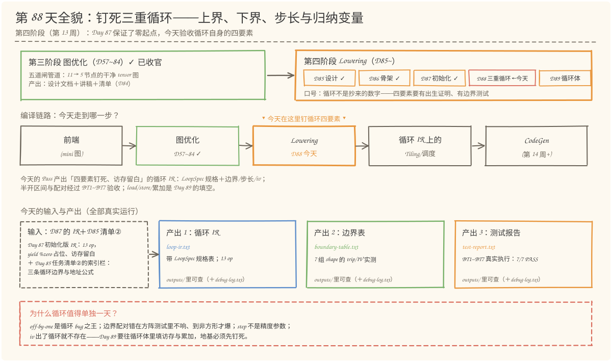
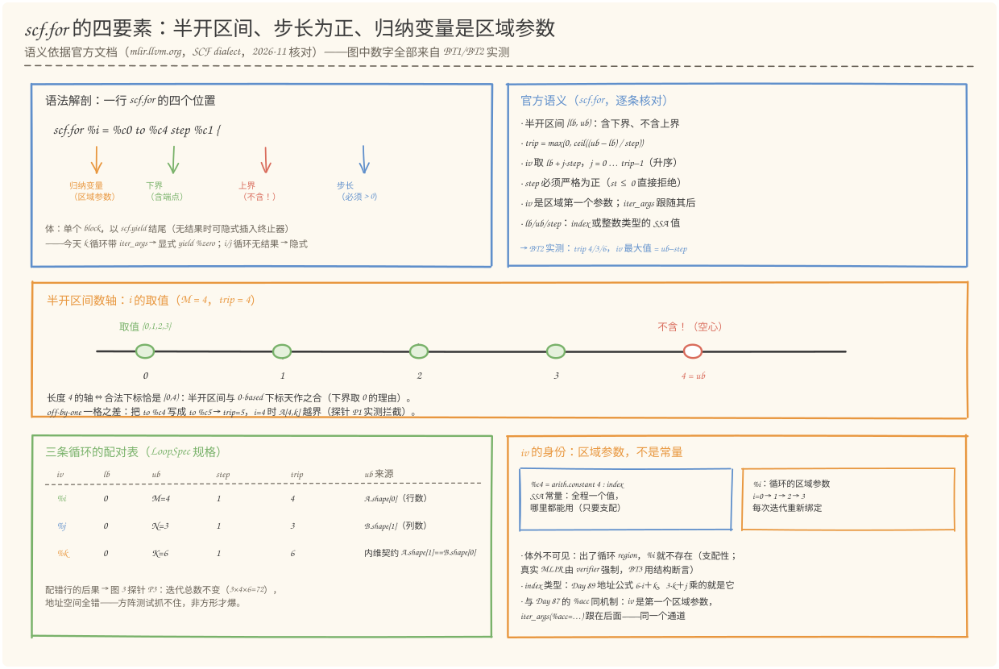
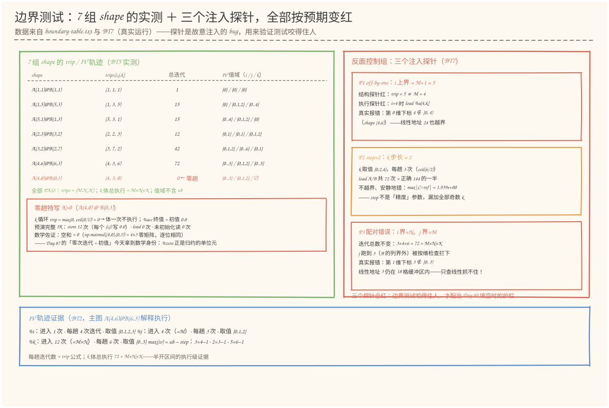
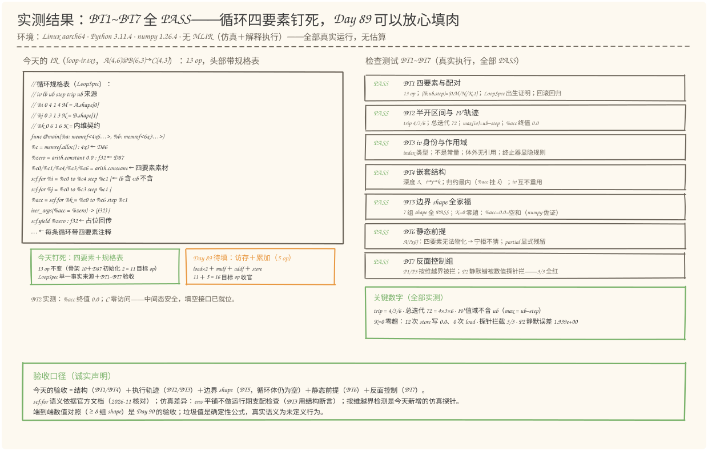

# 第 88 天：生成三重循环——上界、下界、步长和归纳变量，一个都不能含糊

> **今日目标**：完成本教程后，你能做到四件事——用自己的话说清 `scf.for` 四要素的官方语义（下界含、上界**不含**的半开区间 `[lb, ub)`；迭代次数 `trip = max(0, ceil((ub-lb)/step))`，归纳变量取 `lb + j·step`；step **必须严格为正**；iv 是循环**区域参数**，体外不可见——均依据官方 SCF dialect 文档核对，2026-11）；说出三条边界的配对依据（`i < M` ← `A.shape[0]`、`j < N` ← `B.shape[1]`、`k < K` ← 内维契约 `A.shape[1] == B.shape[0]`），并解释配对错误为什么在方阵测试里**不响**、到非方形才爆；分清 `%i` 与 `%c4`（一个是每次迭代重新绑定的区域参数、index 类型，一个是普通 SSA 常量），以及带 `iter_args` 的循环必须显式 `scf.yield`、无结果的循环终止器可隐式的官方规则；独立运行 `loop_pass.py` 复现 BT1~BT7 全部 7/7 PASS（四要素配对、IV 轨迹 4/3/6 趟与总迭代 72、作用域结构断言、嵌套归属、7 组 shape 边界表含 K=0 零趟、动态 `?` 保守拒绝、三个注入探针全被拦下），并用 `--shape 2 3 2`、`--shape 4 0 3` 验证换形状与零趟的预测。
> **预计时间**：学习 35 分钟＋实践 45 分钟
> **前置准备**：Python 3.11＋numpy（本文环境：aarch64 Linux，Python 3.11.4，numpy 1.26.4；IV 轨迹与 K=0 佐证用 `numpy.float32`，**需要 numpy**）。本机没有安装 MLIR——与 Day 57~87 一致，用 Python 复刻 MLIR DialectConversion 的 Pattern／Rewriter／驱动器语义，并在 Day 87 的解释执行器上新增两个探针（IV 轨迹、按维越界检测），不伪造 MLIR 本身的行为；文中 `scf.for` 的语义描述全部依据官方文档《Dialects › SCF › scf.for》核对（2026-11）。内容上需要 Day 85 任务清单②的索引栏（三条地址公式与循环边界）和 Day 87 的初始化版 IR（13 op、`yield %zero` 占位）。
> **今日产出**：`code/loop_pass.py`（LoopSpec 驱动的三重循环生成＋IV 轨迹／按维越界两个新探针＋BT1~BT7 边界测试，全部可运行）、`code/outputs/loop-ir.txt`（带循环规格表的循环 IR，13 op）、`code/outputs/boundary-table.txt`（7 组 shape 的 trip／IV 实测表＋K=0 零趟特写）、`code/outputs/test-report.txt`（检查测试报告，真实运行 7/7 PASS）、`code/outputs/debug-log.txt`（三个案例的调试树）、4 张手绘图。

## 1. 今天解决什么问题？

昨天（Day 87）交出的 13 op IR 里，三重循环已经"立"起来了——但只要凑近看就会发现一个悬案：`scf.for %i = %c0 to %c4 step %c1` 这行里的数字（0、1、4、3、6），是 Day 85 任务清单里**抄**来的。它们抄对了吗？更重要的是——生成它们的我们，真的说得出这些数字的**语义**吗？四个具体拷问：

1. `to %c4` 到底**含不含** 4？如果含，循环多跑一趟；如果不含，`%i` 的最后一个值是多少？（半开区间问题——off-by-one 是循环 bug 之王）
2. `i` 的上界为什么是 4（M）而不是 6（K）？把 `i`/`j`/`k` 的边界配错了，会发生什么？（配对问题）
3. `step %c1` 的 1 换成 2 行不行？哪些循环的 step 可以不是 1？（步长问题）
4. `%i` 是一个什么值？它和 `%c4` 一样是常量吗？在循环**外面**能用吗？（归纳变量问题——作用域问题）

为什么这四个问题值得单独一天？因为 Day 86 的焦点是 DialectConversion 的事务与诊断（Pattern／Rewriter／两级失败），循环只是骨架里的"结构件"；Day 87 的焦点是初始化的内存语义（alloc 不清零、iter_args 通道），循环只是零起点的"挂载点"。循环**本身**的四要素语义，一直没被正面验收过。而它恰恰是明天（Day 89）往循环体里填 `load/mulf/addf/store` 的地基——地基差一格，楼上全歪。

先对齐一下日程：Day 87 结尾预告过"明天填访存与累加"，但对表学习计划，第 88 天的正式任务是**生成三重循环**——学习循环上界、下界、步长和归纳变量，先支持静态 Shape，产出循环 IR 和边界测试；`load/mul/add/store` 是第 89 天的任务。所以今天按计划把循环这一层钉死，明天的填空反而更稳。

今天的贯穿例子不变：`A(4,6) @ B(6,3) → C(4,3)`。Pass 产出的 IR 与 Day 87 相同（13 op，计算仍留白），但循环从此有了**出生证明**——一份随 IR 一起输出的循环规格表（LoopSpec，完整版见 §5.3 的 `loop-ir.txt`）：

```text
iv   lb  ub  step  trip = max(0, ceil((ub-lb)/step))   ub 来源
%i   0   4   1     max(0, ceil((4-0)/1)) = 4           M = A.shape[0]
%j   0   3   1     max(0, ceil((3-0)/1)) = 3           N = B.shape[1]
%k   0   6   1     max(0, ceil((6-0)/1)) = 6           K = 内维契约 A.shape[1] == B.shape[0]
```

```mlir
%c = memref.alloc() : memref<4x3xf32, strided<[3, 1]>>
%zero = arith.constant 0.0 : f32          // Day 87：零起点（SSA 值）
%c0/%c1/%c4/%c3/%c6 = arith.constant      // 0 / 1 / M / N / K——今天的四要素素材
scf.for %i = %c0 to %c4 step %c1 {         // lb=0（含）· ub=4（不含）· step=1
  scf.for %j = %c0 to %c3 step %c1 {
    %acc = scf.for %k = %c0 to %c6 step %c1
            iter_args(%acc = %zero) -> (f32) {
      scf.yield %zero : f32                // 占位回传（恒等循环）；Day 89 换成 %s
    }
  }
}
```

**注意：循环体里依然没有计算**——`load/mulf/addf/store` 四类 op 是 Day 89 的填空，今天的验收对象是循环自身的四要素：边界对不对、区间开闭对不对、步长合不合法、归纳变量是什么。验收手段是今天新建的**边界测试**（BT1~BT7）：7 组形状的 trip 实测表、K=0 的零趟特写、三个故意注入的边界 bug，全部用真实执行说话。

## 2. 先看全貌：今天的内容位于哪里？



**图 1**：看三处——上排是阶段地图：第四阶段 Lowering 走到第四格（D85 设计 ✓ → D86 骨架 ✓ → D87 初始化 ✓ → **D88 三重循环，今天** → D89 循环体）；中排是编译链路：今天在 Lowering 站里把循环的四要素钉死；下排是输入与产出：左边的 Day 87 初始化版 IR（13 op）＋ Day 85 清单②的边界栏，变成右边四件产出——带规格表的循环 IR、7 组 shape 的边界表、BT1~BT7 的测试报告、三个案例的调试树。

把今天的路线压缩成五步（细节在 §3、§4 展开）：

1. **画规格**：从静态 shape 提取 M/N/K，写出三条 `LoopSpec`（iv、lb、ub、step、ub 来源）——循环的单一事实来源；
2. **物化**：每条规格物化成 `arith.constant`（0/1/M/N/K 五常量）＋ `scf.for`（iv 作为区域参数挂进循环）；
3. **嵌套**：`i` 套 `j` 套 `k`，`k` 在最内层——因为累加器 `%acc`（iter_args）挂在 k 循环上，归约必须在最里面；
4. **执行观察**：解释执行器记录 IV 轨迹——每个归纳变量进入几次、每趟几次、实际取过哪些值；
5. **边界验收**：7 组 shape 的 trip 表（含 K=0 零趟）＋ 三个注入探针（off-by-one、step=2、边界交换）全部按预期变红 ＋ 动态 `?` 保守拒绝。

## 3. 核心概念：先用直觉，再给准确定义

### 3.1 半开区间与三个边界数字：lb 为什么是 0，ub 从哪来

一句通俗解释：**`scf.for` 的迭代区间是"左闭右开"的——下界这一站要停车，上界这一站不停车；`to %c4` 的意思是"跑到 4 之前为止"，不是"跑到 4"。**

类比：楼层计数。从 0 层往上数到"4 层（不含）"，你路过的楼层是 0、1、2、3——**恰好 4 层**。对应到技术上是官方文档的两条语义（mlir.llvm.org，2026-11 核对）：区间是半开的 `[lb, ub)`——含下界、不含上界；迭代次数 `trip = max(0, ceil((ub − lb) / step))`，归纳变量依次取 `lb + j·step`（`j = 0 … trip−1`）。所以 `to %c4 step %c1` 的最后一站是 3，不是 4。半开区间和 0-based 下标是"天作之合"：长度为 n 的轴，合法下标恰好是 `[0, n)`——这既是 `lb = 0` 的理由（memref 下标从 0 开始，Day 85 的地址公式 `6·i + k` 以 0 为基点），也是 `ub = 维度长度` 的理由（Dijkstra 在 1982 年的短文《Why numbering should start at zero》里论证过：表示长度 n 的区间，`[0, n)` 是唯一让端点、长度、下标三者都自然的选择）。

那三个 ub 各自从哪来？这是**配对**问题，一张表说清（也就是 §1 规格表的"ub 来源"栏）：

| 循环 | 上界 | 来源 | 为什么 |
| --- | --- | --- | --- |
| `i` | M | `A.shape[0]`（行数） | `i` 是 C 的行号，也是 A 的行号 |
| `j` | N | `B.shape[1]`（列数） | `j` 是 C 的列号，也是 B 的列号 |
| `k` | K | 内维契约 `A.shape[1] == B.shape[0]` | 归约长度——两边必须相等（Day 85 探针 P3 抓的正是这个契约） |

**配对错误为什么阴险**：如果 M = N（方阵），把 i/j 的上界交换**不会改变任何行为**——测试全绿；只有非方形形状才暴露（越界或错值）。这就是 BT5 的 7 组形状里放了 5 组非方形、探针 P3 用 (4,6)@(6,3) 交换边界后"迭代总数不变（3×4×6 = 72）、地址全错"的原因。**测试边界配对，必须用非方形**。

一个常见误解：把"上界"当成"最后一个下标"。C 程序员最容易把 `i < 4` 的习惯写成 `i <= 4`（对应 `to %c5`）——多跑一趟，`i = 4` 时 `A[4,k]` 越界；反向的错误是把 `to %c4` 写成 `to %c3`（以为 3 是"最后一个值"）——漏掉一整行。今天探针 P1 实测了前者：trip 变 5，执行在 `load %a[4,k]` 被按维越界检查拦下。

### 3.2 步长与迭代次数：step 不是"精度"参数

一句通俗解释：**step 是"每隔几个取一个"，不是"算得多粗"——把 step 从 1 改成 2 不是降精度，是漏数据。**

类比：发扑克牌。每人发一张（step=1）是完整的一轮；隔一个人发一张（step=2），一圈下来一半的人没拿到牌——牌局看起来还在进行，但结果已经不对了。对应到技术上是：MatMul 的迭代空间是 `{(i,j,k)}`，每个点**恰好要访问一次**——A 的每个元素要被读 N 次、B 的每个元素要被读 M 次、C 的每个元素写一次，全靠 `step = 1` 的完整覆盖。今天探针 P2 实测了 step=2 的后果：`k` 只取 `{0,2,4}`，load 从 144 次掉到 72 次（正好一半），**不越界、不报错、安静地错**——`max|C−ref| = 1.939e+00`（全部奇数 k 的乘积被漏加）。"安静地错"比"响亮地崩"更危险，这类 bug 只能靠数值对照或 IV 轨迹抓（`k` 的取值集合 `{0,2,4}` 在轨迹里一眼可见）。

官方语义里 step 还有两条硬约束：**必须严格为正**（`st ≤ 0` 直接非法——想倒序遍历不是用负步长，而是交换 lb/ub）；trip 用 **ceil 除法**——`(ub−lb)` 不被 step 整除时会多出一趟。今天的循环 step=1、整除、没有尾巴；但 Day 94 的 Tiling 会让 tile 循环的 step 变成 `tile_size`，Day 95 要处理非整除的尾部——那时 `ceil` 分支才真正上场，今天先把公式钉在这里。`max(0, ·)` 分支今天就能实测：K=0 时 `ceil(0/1) = 0`，零趟循环（见 §3.3 的零趟语义和 BT5）。

### 3.3 归纳变量：循环自己定义的值，不是常量

一句通俗解释：**归纳变量（induction variable，IV）是循环"自己定义、自己管理"的值——每圈自动换一个新值，出了循环就不存在；它不是 `%c4` 那种写死的常量。**

`%i` 和 `%c4` 长得像，身份完全不同：`%c4 = arith.constant 4 : index` 是一个普通 SSA 值，定义之后全程就是 4，哪里都能用（只要满足支配性）；`%i` 是 `scf.for` 的**区域参数**——官方语义说它是循环体区域的第一个参数（`iter_args` 跟在它后面），**每次迭代开始时重新绑定**：第一圈绑定 0，第二圈绑定 1……循环结束后它就没了。"每次迭代重新绑定"这个动作你已经在 Day 87 见过——`%acc`（iter_args 区域参数）就是这么工作的；今天只是把同一个机制的第一参数讲清楚：**iv 是第一个区域参数，iter_args 是后面的区域参数，同一个通道**。

由此派生三条重要性质：

- **作用域**：`%i` 只在 i 循环的 region（含所有嵌套的内层 region）里可见。体外使用在真实 MLIR 里会被 verifier 的支配性检查（dominance）拒绝——"出了循环，%i 就不存在"。今天仿真的 env 是平铺字典、不做运行期支配检查（诚实边界），所以 BT3 用**结构断言**替代：遍历整棵 IR，确认三条循环的 region 子树之外没有任何 op 引用它们的 iv。
- **类型**：三个 iv 都是 `index` 类型——MLIR 专为下标、尺寸、偏移准备的整数类型（编译期保持抽象， lowering 到目标平台时具体化为指针宽度的整数）。Day 89 的地址公式 `6·i + k`、`3·k + j`、`3·i + j` 里乘的就是 index 值。
- **终止器**：官方规定循环体是单个 block、以 `scf.yield` 结尾；**带 iter_args 的循环必须显式 yield**（今天的 k 循环：`yield %zero`），**无结果的循环终止器可以隐式**（i/j 循环的体里只有嵌套 for，没有 yield——Day 86 打印成这样不是偷懒，是官方允许的形态）。

零次迭代的语义值得单独记一笔（Day 87 埋的伏笔今天兑现）：`trip = 0` 时循环体一次都不执行，**循环结果 = iter_args 初值**。BT5 的 K=0 实测：k 循环零趟、`%acc` 终值 = `%zero` = 0.0；而数学上 `A(4,0) @ B(0,3)` 恰好是 4×3 零矩阵（`np.matmul` 佐证，逐位相同）——**Day 87 的初值 `%zero` 拿到了它的数学身份：空归约的单位元**。零起点不是"防御性编程"，是数学正确的缺省。

### 3.4 静态前提：四要素的"物化"

一句通俗解释：**四要素要落成 IR 里的具体东西——lb/ub/step 落成 `arith.constant` 常量、iv 落成确定的区域参数绑定——前提是 shape 在编译期可知；今天的 Pattern 刻意只接静态 Shape。**

对应到技术上是两条路径的分工：静态 shape 下，`A(4,6)` 的 M/N/K 编译期全知，Pattern 敢 create `%c4/%c3/%c6` 和 `memref<4x3xf32>`；动态 `?` 下（比如 `tensor<?x6xf32>`），M 是运行时才知道的数——`%cM` 这个常量**无从产生**，alloc 类型也写不出，四要素缺了两个。此时 Pattern 的正确姿势是保守拒绝（Day 87 建立的机制，今天把拒绝理由聚焦到"四要素无法物化"）：`notifyMatchFailure` 说清楚，full 模式整体失败、partial 模式显式残留 `['mini.matmul']`。真实编译器的做法是另注册一条**动态版 Pattern**：用 `memref.dim` 在运行时读维度当 ub、动态 `memref.alloc` 分配输出——"动态"是另一条规则，不是"猜一个数"。计划里"先支持静态 Shape"的工程含义就在这：先在静态世界把语义钉死、测试咬合，再开动态分支。

## 4. 图解核心机制



**图 2**：分四块看。**左上**是一行 `scf.for %i = %c0 to %c4 step %c1` 的语法解剖——四个位置各是什么：`%i` 归纳变量（区域参数）、`%c0` 下界（含）、`%c4` 上界（不含！）、`%c1` 步长（必须 > 0）；**右上**是官方语义清单（逐条核对过），最下面一行标注 BT2 的实测对账：trip 4/3/6、iv 最大值 = ub − step。**中间**是半开区间的数轴：0～3 是实心圆（`%i` 的取值），4 画成空心虚线圈（ub，不含）——这张数轴就是"off-by-one 一格之差"的几何形态：`to %c5` 会让第 5 个位置也变实心，`A[4,k]` 应声越界。**左下**是三条循环的配对表（LoopSpec 的可视化）：iv / lb / ub / step / trip / ub 来源——注意 ub 来源那一列才是配对的"户口"，`k` 的上界来自内维契约而不是"哪个操作数的哪一维顺手"。**右下**是 iv 的身份辨析：`%c4`（SSA 常量，全程一个值）vs `%i`（区域参数，每圈重新绑定），加三条派生性质：体外不可见（支配性）、index 类型、与 `%acc` 同通道。



**图 3**：左右两栏。**左栏**是 BT5 的 7 组 shape 实测表（真实数据）：每组形状的 trips(i,j,k)、k 体总执行（= M×N×K）、三个 iv 的实际取值域——注意最后一行 `(4,0)@(0,3)`：trips (4,3,0)、总迭代 0、k 的值域是空集 ∅。表下方的红色框是零趟特写：`%acc` 终值 = 初值 0.0、预演 IR 执行 12 次 store 全写 0.0、`np.matmul((4,0),(0,3))` 逐位佐证——空和 = 0，`%zero` 就是归约的单位元。**右栏**是 BT7 的三个注入探针，每个框写明"注入了什么、症状是什么、被什么探针拦下"：P1 off-by-one（trip 5≠4 结构红＋按维越界执行红）；P2 step=2（**不越界**、load 减半、误差 1.939e+00——只有数值/轨迹探针能抓）；P3 配对交换（迭代总数不变 3×4×6=72、`load %b[k,3]` 第 1 维越界——**线性地址 3 甚至还在 B 的 18 格缓冲区内**，只有按维检查抓得住）。**底部**是 BT2 的 IV 轨迹证据：三个 iv 的进入次数、每趟迭代数、取值集合，以及 `max(iv) = ub − step` 的三组对账——半开区间的执行级证据。

## 5. 动手实践：LoopSpec 驱动的三重循环与它的边界测试

### 5.1 准备文件

今天的工程两个脚本＋四个产出文件（随教程已生成，依赖 Python 3 标准库＋numpy）：

```text
tutorials/day-088/
├── README.md
├── code/
│   ├── loop_pass.py           # 主脚本：LoopSpec＋Pattern/Rewriter/驱动器（复用 D86/87）
│   │                          #   ＋IV 轨迹/按维越界探针＋BT1~BT7
│   ├── make_images.py         # 生成 4 张 SVG（可复现）
│   └── outputs/
│       ├── loop-ir.txt        # 产出 1：循环 IR（带规格表；13 op）
│       ├── boundary-table.txt # 产出 2：7 组 shape 的 trip/IV 实测表
│       ├── test-report.txt    # 产出 3：BT1~BT7 检查测试报告（真实运行）
│       └── debug-log.txt      # 产出 4：三个案例的调试树
└── images/                    # 4 张手绘图
```

### 5.2 编写代码：四个构件

`loop_pass.py` 约 1500 行，框架（SSA IR／打印机／事务性 Rewriter／驱动器）从 Day 86/87 原样复用，今天的新东西集中在四个构件（完整代码见文件，这里讲关键段）。

**构件一：`LoopSpec` ＋ `trip_count()`——循环的出生证明。** 今天最核心的 20 行：把"一条循环"从散落在 rewrite 里的五个数字，收拢成一个带语义注解的数据类：

```python
@dataclass
class LoopSpec:
    iv: str          # 归纳变量名（区域参数）
    lb: int          # 下界（含端点）
    ub: int          # 上界（不含端点——半开区间）
    step: int        # 步长（scf.for 要求严格为正）
    ub_source: str   # 上界的配对依据（从哪来）

def trip_count(spec):
    """官方语义的 trip 公式：max(0, ceil((ub - lb) / step))；step 必须严格为正。"""
    if spec.step <= 0:
        raise ValueError(f"scf.for 的 step 必须严格为正（官方语义），拿到 {spec.step}")
    return max(0, -((spec.lb - spec.ub) // spec.step))   # 整数 ceil 除法
```

Pattern 里三条规格一眼可见——**配对关系从"代码里谁碰巧排在哪"变成"声明"**：

```python
specs = [
    LoopSpec("%i", 0, M, 1, f"M = A.shape[0] = {M}"),
    LoopSpec("%j", 0, N, 1, f"N = B.shape[1] = {N}"),
    LoopSpec("%k", 0, K, 1, f"K = 内维契约 A.shape[1] == B.shape[0] = {K}"),
]
```

`trip_count` 里的 `-((lb - ub) // step)` 是整数 ceil 除法（`ceil((ub-lb)/step)` 的无浮点写法）；`step <= 0` 的防御不是画蛇添足——官方语义要求 step 严格为正，仿真同样拒绝。BT1 会把 `pattern.specs` 和 IR 里的常量逐一对账，规格表还会印进 `loop-ir.txt` 头部。

**构件二：`MatMulLoopPattern`——规格驱动的循环生成。** rewrite 相对 Day 87 的变化只有一个：循环不再直接写常量，而是从 spec 生成，并把四要素写成 IR 注释（`loop_comments`）：

```python
def loop_comments(s):
    return [f"四要素：lb={s.lb}（含）· ub={s.ub}（不含——半开区间 [{s.lb},{s.ub})）"
            f"· step={s.step} · trip = max(0, ceil((ub-lb)/step)) = {trip_count(s)}",
            f"ub 来源：{s.ub_source}；{s.iv} 是本循环的区域参数"
            f"（index 类型，体内可见、体外不可见）"]

fk = rewriter.create("scf.for", operands=[lo, bk, st, zero.results[0]],
                     result_names=["%acc"], result_types=["f32"],
                     attrs={"iv": "%k", "iv_value": Value("%k", "index"),
                            "iter_names": ["%acc"], "iter_args": [Value("%acc", "f32")]},
                     body=[yld], comments=[*loop_comments(specs[2]), ...])
```

**op 产出与 Day 87 完全相同（13 op）**——今天不动 IR 的形状，动的是它的"可验收性"。match 五连问沿用 Day 87，只有动态拒绝的理由换成今天的聚焦点：`循环四要素的 lb/ub 要物化成 arith.constant 常量，动态 '?' 做不到……宁拒不猜`。

**构件三：解释执行器的两个新探针。** Day 87 的 `Interp` 负责"值对不对"，今天加两个"循环对不对"的探针。其一，**IV 轨迹**——`exec_for` 里五行：

```python
tr = self.iv_trace.setdefault(iv.name, {"activations": 0, "per_act": [], "values": set()})
tr["activations"] += 1
n_iter = 0
for it in range(lb, ub, st):        # 半开区间：含 lb、不含 ub（st > 0）
    self.env[id(iv)] = it           # iv：每次迭代重新绑定的区域参数
    tr["values"].add(it)
    n_iter += 1
    ...
tr["per_act"].append(n_iter)
```

`range(lb, ub, st)` 恰好就是官方半开区间语义的 Python 对应物；轨迹记录进入次数（activations）、每趟迭代数（per_act）、实际取值集合（values）——BT2/BT5 的全部证据来自这里。其二，**按维越界检测**——load/store 执行前逐维检查下标：

```python
for d, (v, dim) in enumerate(zip(vals, shape)):
    if dim != "?" and not (0 <= v < dim):
        ...raise MemRefOOBError(
            f"memref.load {m.name}{tuple(vals)}：第 {d} 维下标 {v} ∉ [0, {dim})（shape {shape}）"
            f"；线性地址 {addr} 甚至仍在缓冲区（{len(cells)} 格）内——只查线性地址抓不住这类逻辑越界")
```

注意最后那句提示：**线性地址仍在缓冲区内 ≠ 下标合法**。`B[k,3]`（B 是 6×3）的线性地址 `3·k+3` 大多小于 18——只查线性地址的边界检查会放过它，错误悄悄写进隔壁元素（Day 85 探针 P1 的"stride 写反不越界只是读错"是同一类阴险）。这个探针是 BT7 里 P1/P3 的拦截者。

**构件四：预演器的探针旋钮。** Day 87 的 `build_full_ir`（含 Day 89 才由 Pattern 产出的 load/mulf/addf/store，用于执行级验证）今天加了四个旋钮：`i_ub`/`j_ub`（覆盖上界）、`k_step`（覆盖步长）、`swap`（i/j 上界对调）。探针不是"改好的代码"，是**故意注错**的代码——边界测试要证明自己咬得住人，就得拿真 bug 喂它。

### 5.3 运行与观察

```bash
cd tutorials/day-088/code
python3 loop_pass.py
```

以下为**真实运行输出**（节选，完整版在 `outputs/test-report.txt`；环境 Linux aarch64，Python 3.11.4，numpy 1.26.4）：

```text
[PASS] BT1 四要素与配对
  转换前 3 op → 转换后 13 op（与 Day 87 相同的 13 op：func＋alloc＋constant×6＋for×3＋yield＋return）
  三条循环的 (lb, ub, step)：i(0, 4, 1) · j(0, 3, 1) · k(0, 6, 1)——lb=0（含）、ub=M/N/K（不含）、step=1（True）
  LoopSpec 出生证明：[('%i', 0, 4, 1), ('%j', 0, 3, 1), ('%k', 0, 6, 1)]（True），trip 公式 = [4, 3, 6]（True）
  ub 来源配对：i ← A.shape[0] · j ← B.shape[1] · k ← 内维契约（True）
  Day 87 栏目回归：iter_args(%acc=%zero)、yield %zero 占位、alloc 4x3、常量 {0,1,3,4,6}（True）
  回滚回归：HalfDone(先 create 再拒绝) 回滚后，终图与只用 Loop 的结果逐字相同（True）

[PASS] BT2 半开区间与 IV 轨迹
  IV 轨迹（解释执行真实记录，A/B 为种子 87 的数据）：
    %i：进入 1 次 · 每趟 4 次迭代 · 取值 {0,1,2,3}——最大值 3 = ub−step（ub=4 不含，半开区间的执行证据）
    %j：进入 4 次（=M）· 每趟 3 次迭代 · 取值 {0,1,2}——最大值 2 = ub−step
    %k：进入 12 次（=M×N）· 每趟 6 次迭代 · 取值 {0,…,5}——最大值 5 = ub−step
  每趟迭代数与 trip 公式一致：4/3/6 = max(0, ceil((ub-lb)/step))（True）；k 体总执行 72 次= M×N×K = 4×3×6（True）
  %acc 终值 = 0.0（≡ %zero，True）——Day 87 占位语义回归
  对 C 的访问：load 0 · store 0 · fill 0 · 未初始化读 0（True）——访存是 Day 89 的填空

[PASS] BT3 归纳变量身份与作用域
  三个 iv 都是 index 类型（True）——MLIR 专用于下标/尺寸的整数类型，Day 89 的地址计算（6·i+k 等）乘的就是它
  %i 不是常量：与 5 个 arith.constant 的结果均为不同 Value（True）——区域参数每次迭代重新绑定，%c4 才是常量
  体外不可见（支配性结构断言）：三条循环的 region 子树之外，没有任何 op 引用它们的 iv（True）
  体内/嵌套可见（预演 IR 正向验证）：k 体里 load %a[%i,%k]、load %b[%k,%j]、store %c[%i,%j] 全部合法引用外层 iv（True）
  终止器规则（官方）：带 iter_args 必须显式 scf.yield——k 循环有（True）；无结果可隐式——i/j 循环体末尾就是嵌套 for（True）

[PASS] BT4 嵌套结构
  嵌套链：fi.body=[fj] · fj.body=[fk] · fk.body=[yield]（True）——深度 3，i 外 · j 中 · k 内
  归约在最内层：%acc 的 iter_args 挂在 k 循环上（True）——i/j 循环不携带值（True）

[PASS] BT5 边界 shape 全家福
  7 组形状全部通过（明细见 boundary-table.txt）：trips 实测 = (M,N,K)，IV 值域 = [0,ub)（不含 ub），k 体总执行 = M×N×K
  边界成员：最小 (1,1,1) · 行向量 (1,5,3) · 内维 1 (5,1,3) · 非方形 (2,3,2)/(3,2,7) · 贯穿例 (4,6,3) · 零趟 (4,0,3)
  零趟特写 K=0（A(4,0) @ B(0,3)）：k 循环每趟 0 次迭代 → %acc 终值 = 初值 0.0；预演完整 IR 执行：store 12 次（写 0.0）· load 0 次（True）
    数学佐证：空和 = 0（归约单位元）——np.matmul((4,0),(0,3)) = 4×3 零矩阵，与同序参考实现逐位相同

[PASS] BT6 静态前提（动态拒绝）
  A(?x6) @ B(6x3)（M 动态），full 模式：按预期失败
  拒绝的焦点（今天视角）：lb/ub 要物化成 arith.constant，动态 '?' 下 %cM 无从产生——四要素缺了两个
  N 动态（A(4x6) @ B(6x?)），partial 模式：成功，显式残留 ['mini.matmul']

[PASS] BT7 反面控制组（探针）
  P1 off-by-one（i 上界 = M+1 = 5）：结构探针红——trip = 5 ≠ M = 4（True）；执行探针红——i=4 时 load %a[4,k] 按维越界（True）
    真实报错：memref.load %a(4, 0)：第 0 维下标 4 ∉ [0, 4)（shape (4, 6)）
  P2 step=2（k 步长 = 2）：不越界、安静地错——k 取值 {0,2,4}，每趟 3 次迭代（ceil(6/2)），load A/B 共 72 次（正确的 144 的一半）（True）
    数值探针红：max|C-ref| = 1.939e+00（漏加全部奇数 k 项，True）——step 不是「精度」参数，MatMul 的点循环必须逐步覆盖
  P3 配对错误（i 界=N=3、j 界=M=4）：迭代总数纹丝不动——3×4×6 = 72 = M×N×K（True），地址空间已经全错
    执行轨迹：i 只跑到 0、j 跑到 3（正是 B 的列界外）就被拦下，此前 k 完整跑完 3 趟（[6,6,6]，True）
    执行探针红：j=3 时 load %b[k,3] 第 1 维越界（True）；真实报错：memref.load %b(0, 3)：第 1 维下标 3 ∉ [0, 3)（shape (6, 3)）；线性地址 3 甚至仍在缓冲区（18 格）内——只查线性地址抓不住这类逻辑越界

—— 检查测试 7/7 PASS ——
```

循环 IR（`outputs/loop-ir.txt`——头部是规格表，每条循环带四要素注释；此处注释略有压缩，完整逐行版本见文件）：

```mlir
// 循环规格表（LoopSpec——四要素＋上界来源）：
//   iv   lb  ub  step  trip = max(0, ceil((ub-lb)/step))   ub 来源
//   %i    0   4     1  max(0, ceil((4-0)/1)) = 4       M = A.shape[0] = 4
//   %j    0   3     1  max(0, ceil((3-0)/1)) = 3       N = B.shape[1] = 3
//   %k    0   6     1  max(0, ceil((6-0)/1)) = 6       K = 内维契约 A.shape[1] == B.shape[0] = 6
func @main(%a: memref<4x6xf32, strided<[6, 1]>>, %b: memref<6x3xf32, strided<[3, 1]>>) -> memref<4x3xf32, strided<[3, 1]>> {
  %c = memref.alloc() : memref<4x3xf32, strided<[3, 1]>>
  %zero = arith.constant 0.0 : f32
  %c0 = arith.constant 0 : index      // 下界 0（含端点；memref 下标从 0 开始）
  %c1 = arith.constant 1 : index      // 步长 1（scf.for 要求 step 严格为正）
  %c4 = arith.constant 4 : index      // M ← A.shape[0]：i 的上界（不含端点）
  %c3 = arith.constant 3 : index      // N ← B.shape[1]：j 的上界（不含端点）
  %c6 = arith.constant 6 : index      // K ← 内维契约：k 的上界（不含端点）
  scf.for %i = %c0 to %c4 step %c1 {
    scf.for %j = %c0 to %c3 step %c1 {
      %acc = scf.for %k = %c0 to %c6 step %c1
              iter_args(%acc = %zero) -> (f32) {
        scf.yield %zero : f32          // 占位：恒等循环；Day 89 换成 %s = addf %acc, %p
        // 预留(Day 89 填): load %a[%i,%k] · load %b[%k,%j] · mulf · addf · store %c[%i,%j]
      }
      // 四要素：lb=0（含）· ub=6（不含——半开区间 [0,6)）· step=1 · trip = max(0, ceil((ub-lb)/step)) = 6
      // ub 来源：K = 内维契约 A.shape[1] == B.shape[0] = 6；%k 是本循环的区域参数（index 类型，体内可见、体外不可见）
    }
    // 四要素：lb=0（含）· ub=3（不含——半开区间 [0,3)）· step=1 · trip = 3；ub 来源：N = B.shape[1] = 3
  }
  // 四要素：lb=0（含）· ub=4（不含——半开区间 [0,4)）· step=1 · trip = 4；ub 来源：M = A.shape[0] = 4
  return %c : memref<4x3xf32, strided<[3, 1]>>
}
```

（上面块里省去了 alloc/%zero 处的任务注释，并把部分两行注释并作一行；op 与语义和 `outputs/loop-ir.txt` 完全一致。）



**图 4**：三个面板各证明一件事。**左边**是今天的 IR 缩略与待填分工的账本：骨架 10 op ＋ Day 87 初始化 2 op ＝ 11 目标 op，Day 89 待填 5 op（load×2、mulf、addf、store），11＋5＝16 收官——**今天的 13 op 一个没多**，多出来的是头部那张规格表和每条循环的四要素注释。**右上**是 BT1~BT7 七项 PASS，每项一行写明检查什么、怎么验。**右下**是关键数字卡（全部实测）：trip 4/3/6、总迭代 72、K=0 零趟 12 次 store 写 0.0、探针拦截 3/3、P2 的静默误差 1.939e+00。底部是验收口径的诚实声明：仿真 env 平铺不做运行期支配检查（BT3 用结构断言替代）、按维越界是仿真探针、Day 90 才做 8 组端到端数值对照。

### 5.4 修改一个参数再观察：三个实验各改一次

**实验一：换形状。** `python3 loop_pass.py --shape 2 3 2`（练习模式只打印，不覆盖产出），真实结果（节选）：

```text
形状 A(2,3) @ B(3,2) -> C(2,2)
循环规格表（LoopSpec）：
  iv    lb  ub step  trip   ub 来源
  %i     0   2    1  2      M = A.shape[0] = 2
  %j     0   2    1  2      N = B.shape[1] = 2
  %k     0   3    1  3      K = 内维契约 A.shape[1] == B.shape[0] = 3
IV 轨迹（解释执行实测）：
  %i：进入 1 次 · 每趟 2 次迭代 · 取值 {0,1}
  %j：进入 2 次 · 每趟 2 次迭代 · 取值 {0,1}
  %k：进入 4 次 · 每趟 3 次迭代 · 取值 {0,1,2}
```

观察点：**四要素的"栏目"不变、"数字"跟 shape 走**——lb 和 step 对任何形状都是 0 和 1（它们来自"下标从 0 开始、逐个覆盖"这两个与形状无关的事实），变的只有三个 ub；IR 里出现 `%c2` 和 `%c2'`（M 和 N 都是 2，常量名去重）；13 op 不变。注意这个形状 M = N = 2 是**方阵**——用它测不出配对错误（§3.1 的盲区），所以它只当练习、不进 BT5 的非方形名单。

**实验二：零趟。** `python3 loop_pass.py --shape 4 0 3`，真实结果（节选）：

```text
形状 A(4,0) @ B(0,3) -> C(4,3)
  %k     0   0    1  0      K = 内维契约 A.shape[1] == B.shape[0] = 0
IV 轨迹（解释执行实测）：
  %i：进入 1 次 · 每趟 4 次迭代 · 取值 {0,1,2,3}
  %j：进入 4 次 · 每趟 3 次迭代 · 取值 {0,1,2}
  %k：进入 12 次 · 每趟 0 次迭代 · 取值 ∅（零趟）
```

观察点：`to %c0'`（K = 0，与下界 `%c0` 同值、去重成带撇的名字）——k 循环**进入了 12 次、每趟迭代 0 次**，`%acc` 终值永远是初值 0.0。外两层循环照常跑满（i 4 次、j 12 次）：零趟只发生在 K 那一层，`max(0, ceil(0/1)) = 0` 的 `max` 分支实测成立。

**实验三：看动态拒绝的两副面孔。** `python3 loop_pass.py --debug` 后在调试树"案例 2"里能看到完整过程：签名转换照常把 `tensor<?x6>` 转成 `memref<?x6, strided<[6, 1]>>`（类型层不拦），Pattern 的 match 以

```text
} -> FAILURE : 动态维度（A('?', 6) @ B(6, 3)）：循环四要素的 lb/ub 要物化成 arith.constant 常量，动态 '?' 做不到——本 Pattern 先支持静态 Shape（今日计划），宁拒不猜（动态版 Pattern 走 memref.dim ＋动态 alloc，后续专题）
```

结束；而不带 `--debug` 的普通运行里这行**不存在**——只有驱动器的"无法合法化 'mini.matmul'：已注册的 Pattern 都拒绝了这次匹配"。这是 Day 86 讲过的两级失败结构：Pattern 级的"为什么"安静地待在调试树里。循环出问题时，第一个该问的问题是"我的 shape 是不是真的静态"——四要素里有两个（lb 的 0、step 的 1）永远静态，**会动态的只有 ub**。

## 6. 常见错误与排查

**错误一：off-by-one——`to %c4` 写成 `to %c5`（或把上界当"最后一个下标"写成 `to %c3`）。**
现象：多跑一趟时，结构检查红（trip ≠ 维度长度）或执行越界（探针 P1 实测：`i=4` 时 `load %a[4,k]` 第 0 维 4 ∉ [0,4)）；少跑一趟时更阴险——不越界、结果系统性偏小，只有数值对照能抓。原因：把"上界"理解成"最后一个下标"，或把 C 的 `i <= n-1`／Fortran 的"含端点 do 循环"习惯带进半开区间。定位：看 IV 轨迹的取值集合和最大值——`max(iv)` 必须等于 `ub − step`（今天实测 3 = 4−1、2 = 3−1、5 = 6−1）；多一个少一个都是边界错。修复：ub 永远写"维度长度"（M/N/K），不写"长度−1"；写完后用 `trip_count` 对账一次。

**错误二：边界配对搞混——i 配了 K、j 配了 M 之类。**
现象：方阵（M=N）下一切正常，换个非方形形状突然越界或结果错（探针 P3 实测：i/j 界交换后迭代总数不变、`load %b[k,3]` 第 1 维越界）；更阴险的变种是"恰好不越界但读错格子"（线性地址还在缓冲区内）。原因：配对依据是**语义**（i 是行号→A 的行数；j 是列号→B 的列数；k 是归约下标→内维契约），不是"哪个数字顺手"；从 Day 85 清单抄数字时抄对了，自己重写时最容易错位。定位：非方形形状 ＋ 按维越界检测（线性地址检查抓不住 P3 那种错）；再看 `LoopSpec.ub_source` 那一列的"户口"对不对。修复：让规格表成为单一事实来源（今天 `matmul_specs` 的做法），测试名单里永远放非方形（BT5 有 5 组）。

**错误三：把 step 当旋钮——`step %c2` 以为能"提速"或"降精度"。**
现象：不越界、不报错、结果安静地错（探针 P2 实测：k 只取 {0,2,4}，load 减半，max|C−ref| = 1.939e+00）；或者 step 写成 0／负数被直接拒绝（官方：step 必须严格为正）。原因：step 的语义是"每隔几个取一个"，不是采样精度也不是性能参数——MatMul 点循环必须逐步覆盖整个迭代空间。定位：IV 轨迹的取值集合一眼看穿（{0,2,4} 而不是 {0..5}）；load 计数对不上 M×N×K 也是信号。修复：点循环 step=1；想"跳格"只在真需要分块的地方（Day 94 的 tile 循环 step=tile_size），而且必须配 Day 95 的尾部处理。

**错误四：体外使用归纳变量——`%i` 用在循环外面。**
现象：真实 MLIR 里 verifier 直接报支配性（dominance）错误：`use of value '%i' does not dominate`；本仿真不报（env 平铺的诚实边界），但 BT3 的结构断言会红。原因：`%i` 是循环的区域参数，出了 region 就不存在——它不是 `%c4` 那种全局可见的常量；"循环结束后想知道 i 停在哪"这个需求本身就问错了对象（半开区间下循环结束后 iv 没有值）。定位：检查使用点是否在循环的 region 子树内；真需要"循环里算出的值带出循环"，走的通道是 iter_args/scf.yield（Day 87 的 `%acc` 就是范例）或 store 进内存。修复：值出循环用 iter_args；下标只在体内用。

## 7. 今日练习

### 必做练习

不跑代码，先笔答 `A(3,2) @ B(2,5)` 的四要素：① 三条 LoopSpec 完整写出来（iv、lb、ub、step、ub 来源）；② trip 各是多少，k 体总执行多少次？③ `%i`/`%j`/`%k` 的取值集合各是什么？④ 常量栏目是哪 5 个数？需要去重吗？⑤ 这个形状换到探针 P3（i/j 上界交换）会发生什么——迭代总数变吗？第一次越界发生在哪个 memref 的第几维？写完运行 `python3 loop_pass.py --shape 3 2 5` 对答案（练习模式只打印，不覆盖产出），并用一句话回答思考题：**为什么 lb=0 和 step=1 对任何形状都不变，ub 却随形状变？**（提示：前两者来自"下标从 0 开始、逐个覆盖"这两个与形状无关的事实；ub 来自"要覆盖多少"——覆盖量才是形状决定的。）

### 选做挑战

二选一（都不引入大量新知识）：
（a）**给 `mini.transpose` 写循环规格**：参考 Day 86 选做（a）的 transpose 骨架，写出它的 LoopSpec——两条循环（不是三条）、边界来源各是什么（提示：`C[i,j] = A[j,i]`，C 是 M×N，A 是 N×M——i 的上界来自**输出**的行数，和 MatMul 的"输入行数"恰好不同源，想清楚为什么 transpose 该看输出）；再回答：transpose 的循环需要 iter_args 吗？（Day 87 选做（a）的结论：纯拷贝无累加——不需要。）
（b）**自己注入第四个探针**：用 `build_full_ir` 的 `j_ub` 旋钮（函数已支持）把 j 的上界写成 N+1 = 4，先笔答预测：第一次越界发生在哪个 memref、第几维、下标是多少（提示：循环体里 load 在 store 之前执行）——然后写三行调用（参考 BT7 的 P1 写法）运行验证。再回答对比题：P1 的 i 越界线性地址 24 已经在 A 的 24 格之外（只查线性地址也能抓住）；这个探针的越界线性地址 `3·k+3` 却大多还在 B 的 18 格内——如果没有按维检查，j=3 这一趟会把 B 的哪个元素错读进来、悄悄混进结果？（提示：B 是 6×3 行主序、strides [3,1]，地址 `3·k+3` 恰好是元素 `(k+1, 0)`——下一行的第一个元素。）

## 8. 今日验收

- [ ] 我能不看资料说出 `scf.for` 四要素的官方语义：半开区间 `[lb, ub)`（含下界不含上界）、`trip = max(0, ceil((ub-lb)/step))`、iv 取 `lb + j·step`、step 必须严格为正、iv 是区域第一个参数（iter_args 跟随其后），并说出 `max(iv) = ub − step` 这条对账口诀（实测 3=4−1、2=3−1、5=6−1）
- [ ] 我能说出三条边界的配对依据（i ← A.shape[0]、j ← B.shape[1]、k ← 内维契约），并解释配对错误为什么在方阵测试里不响、到非方形才爆（P3 实测：迭代总数不变、`%b[k,3]` 按维越界而线性地址仍在缓冲区内）
- [ ] 我能分清 `%i` 与 `%c4`（区域参数每次迭代重新绑定 vs SSA 常量全程一个值）、说出 iv 的三条派生性质（体外不可见/支配性、index 类型、与 %acc 同通道），以及带 iter_args 必须显式 yield、无结果可隐式的终止器规则
- [ ] 我能独立运行 `loop_pass.py` 并复现：BT1~BT7 全部 7/7 PASS、trip 4/3/6、总迭代 72、IV 轨迹与半开区间对账、K=0 零趟（%acc = 0.0 = 空归约单位元，numpy 佐证）、动态 `?` 保守拒绝（原因在 `--debug` 调试树）、三个注入探针全被拦下
- [ ] 我能用 `--shape 2 3 2` 和 `--shape 4 0 3` 预测并验证换形状与零趟的结果（栏目不变数字变；k 循环进入 12 次、每趟 0 次迭代）
- [ ] 我保存了 `code/loop_pass.py`、`outputs/` 四件产出，`python3 make_images.py` 可复现全部 4 张图，并能指出今天 IR 与 Day 87 的差异（op 不变，多的是规格表与四要素注释——Day 89 待填 5 op 收官 16）

## 9. 一句话总结与明天预告

今天把三重循环从"骨架里抄来的数字"升级成"有出生证明、有边界测试的构件"。**问题**——Day 86/87 立起了循环结构、挂上了零起点，但四要素（上界、下界、步长、归纳变量）的语义从未被正面验收：半开区间含不含端点、边界跟哪个维度配对、step 能不能动、`%i` 是什么——循环 bug 的四大高发区全在这。**机制**——官方语义五条钉死（`[lb, ub)` 半开、`trip = max(0, ceil((ub-lb)/step))`、iv = `lb + j·step`、step 严格为正、iv 是区域第一个参数）；配对表（i←A.shape[0]、j←B.shape[1]、k←内维契约）进 LoopSpec 成为单一事实来源；静态 Shape 是物化四要素的前提，动态 `?` 宁拒不猜。**实践**——`loop_pass.py` 给解释执行器加了 IV 轨迹和按维越界两个探针，13 op 不变、规格表随 IR 输出，BT1~BT7 验收结构、轨迹、作用域、嵌套、7 组 shape 边界、动态拒绝和三个注入探针。**验证**——真实运行 7/7 PASS：trip 4/3/6、总迭代 72、`max(iv) = ub−step` 三组对账、K=0 零趟拿到数学身份（`%zero` = 空归约的单位元，`np.matmul` 逐位佐证）、P1/P3 被按维越界拦截、P2 的静默误差 1.939e+00 被数值探针抓住——地基钉死，可以放心填肉。

明天（Day 89）填最后一块肉、生成循环体的完整计算：`load %a[%i,%k]`＋`load %b[%k,%j]`＋`mulf`＋`addf %acc, %p`＋把 `yield %zero` 换成 `yield %s`＋`store %acc, %c[%i,%j]`——多维下标到线性地址的映射用 Day 85 任务清单②的公式（`6·i+k`、`3·k+j`、`3·i+j`，乘的都是今天钉死的 index 型 iv），13 op → 16 op 收官，然后让解释执行器对 Pattern 自动产出的完整 IR 做位等价终检。今天的规格表和 IV 轨迹，就是明天填空时的验收护栏。


