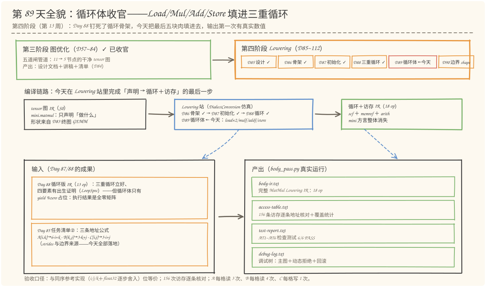
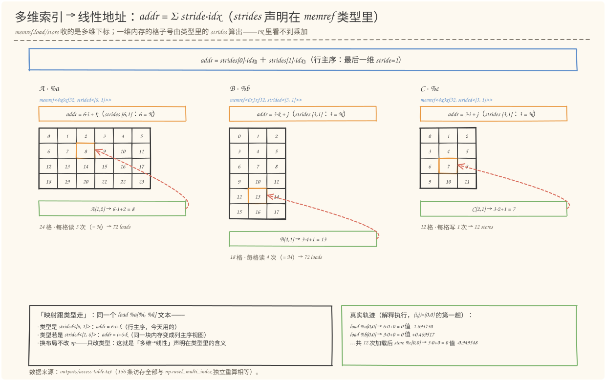
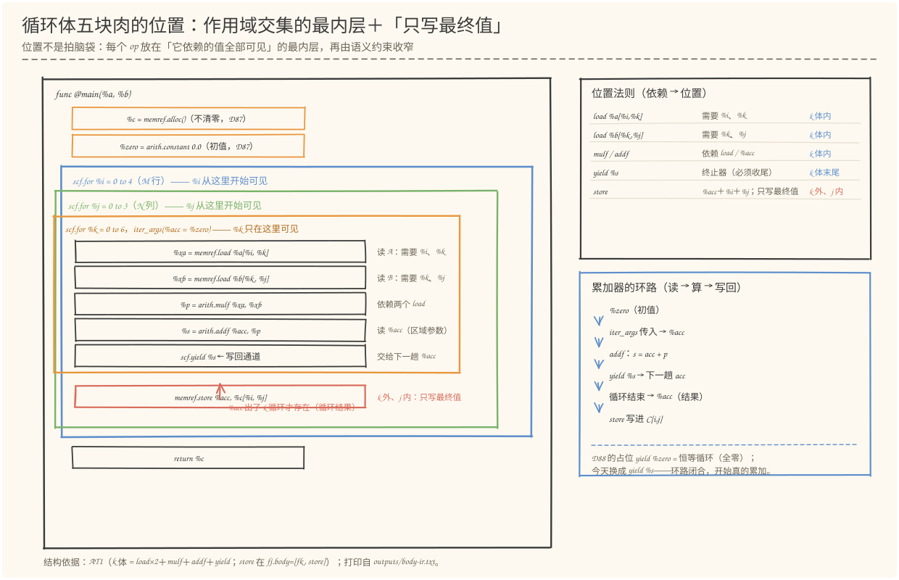
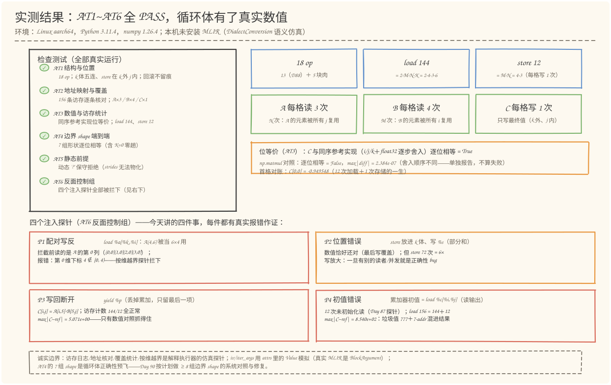

# 第 89 天：生成 Load、Mul、Add、Store——循环体收官，13 op 到 18 op 的最后五块肉

> **今日目标**：完成本教程后，你能做到四件事——说出多维索引到线性地址的映射公式 `addr = Σ stride_d · idx_d`（`A[i,k] → 6·i+k`、`B[k,j] → 3·k+j`、`C[i,j] → 3·i+j`），并指出 strides 是 **memref 类型的一部分**（`strided<[6, 1]>`——映射是声明在类型里的，IR 里看不到乘加）；用"依赖作用域交集的最内层"推导五个新 op 的位置（`load×2/mulf/addf` 在 k 体内、`store` 在 k 循环外 j 体内），并解释 store 放进 k 体为什么"数值恰好还对、访存翻 6 倍"；说清累加值的读取与写回通道（读 = iter_args 区域参数 `%acc`，写回 = `yield %s`，出循环 = 循环结果 `%acc` 落进 store——同名不同身份），以及"忘记 yield %s"为什么等于只留最后一项乘积；独立运行 `body_pass.py` 复现 AT1~AT6 全部 6/6 PASS（18 op 结构与位置、156 次访存的逐条地址核对与覆盖统计 A 每格读 3 次/B 每格读 4 次/C 每格写 1 次、与同序参考实现的位等价、7 组 shape 端到端、动态拒绝回归、四个注入探针全被拦下），并用 `--shape 2 3 2`、`--trace` 验证换形状与逐条访存轨迹。
> **预计时间**：学习 35 分钟＋实践 45 分钟
> **前置准备**：Python 3.11＋numpy（本文环境：aarch64 Linux，Python 3.11.4，numpy 1.26.4；**需要 numpy**，位等价对照用 `numpy.float32`）。本机没有安装 MLIR——与 Day 57~88 一致，用 Python 复刻 MLIR DialectConversion 的 Pattern／Rewriter／驱动器语义，不伪造 MLIR 本身的行为；文中 `memref.load/store`、`scf.for` 的语义描述依据官方文档（mlir.llvm.org，2026-11 核对）。内容上需要 Day 85 任务清单②的地址公式表（三条公式与边界来源）、Day 87 的初始化机制（alloc 不清零、`%zero`、iter_args 通道）和 Day 88 的循环四要素（LoopSpec、半开区间、iv 是 index 型区域参数）。
> **今日产出**：`code/body_pass.py`（循环体完整版 Pattern＋访存日志/地址核对/覆盖统计三个探针＋AT1~AT6 检查测试，全部可运行）、`code/outputs/body-ir.txt`（完整 MatMul Lowering IR：18 op，头部带地址公式表）、`code/outputs/access-table.txt`（156 次访存的逐条地址核对＋覆盖统计＋首个 (i,j)=(0,0) 的完整轨迹）、`code/outputs/test-report.txt`（AT1~AT6 报告，真实运行 6/6 PASS）、`code/outputs/debug-log.txt`（三个案例的调试树）、4 张手绘图。

## 1. 今天解决什么问题？

昨天（Day 88）交出的 13 op IR 已经"能跑"——循环立起来了、边界钉死了、`%zero` 也挂上了。但把它执行一遍，结果是一个 4×3 的**全零矩阵**：`k` 循环体里只有一行 `scf.yield %zero`（恒等占位），**一行真正的计算都没有**。`mini.matmul` 声明的语义是"矩阵乘"，而当前 IR 的实际语义是"输出全零"——Lowering 走到最后一步，还差五块肉：

```mlir
%acc = scf.for %k = %c0 to %c6 step %c1
        iter_args(%acc = %zero) -> (f32) {
  scf.yield %zero : f32      // ← 恒等占位：进什么出什么，永远 0.0
  // 预留(Day 89 填): load %a[%i,%k] · load %b[%k,%j] · mulf · addf · store %c[%i,%j]
}
```

按计划（第 89 天：生成 Load、Mul、Add、Store），今天把这五行填进去。但"填空"远不是把 op 糊进循环那么简单——真正要回答的是三个问题，每一个都是索引类 bug 的高发区：

1. **地址问题**：`memref.load %a[%i, %k]` 里的 `[%i, %k]` 是**二维下标**，内存却是**一维连续的 24 个格子**——`(i,k) = (1,2)` 到底落在哪一格？谁负责做这个映射？公式 `6·i+k` 里的 6 从哪来？（多维索引到线性地址的映射——今天的学习重点之一）
2. **配对问题**：A 的下标写成 `[%i,%k]` 还是 `[%k,%i]`？B 是 `[%k,%j]` 还是 `[%j,%k]`？写反了会怎样？（方阵测试不响、非方形才爆——Day 88 P3 的同款阴险，今天在访存层复现）
3. **位置问题**：五个新 op 各自该放在循环嵌套的**哪一层**？`store` 放 `k` 体内行不行？`load` 放 `k` 体外行不行？累加器的"读取"和"写回"分别走什么通道？（初始化、加载、存储位置正确——今天的实践重点）

贯穿例子不变：`A(4,6) @ B(6,3) → C(4,3)`。今天结束时，Pattern 产出的 IR 从 13 op 变成 18 op（新增 `load×2`、`mulf`、`addf`、`store`——正好五块肉），并第一次拿到**真实的数值**：解释执行它，与同序参考实现**逐位相等**。

```mlir
%acc = scf.for %k = %c0 to %c6 step %c1
        iter_args(%acc = %zero) -> (f32) {
  %xa = memref.load %a[%i, %k] : memref<4x6xf32, strided<[6, 1]>>
  %xb = memref.load %b[%k, %j] : memref<6x3xf32, strided<[3, 1]>>
  %p = arith.mulf %xa, %xb : f32
  %s = arith.addf %acc, %p : f32
  scf.yield %s : f32            // ← 写回通道：%s 交给下一趟 %acc
}
memref.store %acc, %c[%i, %j] : memref<4x3xf32, strided<[3, 1]>>
```

**验收标准也随之升级**：Day 88 验收的是循环结构（IV 轨迹、边界配对），今天验收的是**计算本身**——156 次访存（`load` 144 次＋`store` 12 次）逐条地址核对、每个格子的读写次数统计（A 每格恰好读 3 次、B 每格恰好读 4 次、C 每格恰好写 1 次）、与同序参考实现位等价。

## 2. 先看全貌：今天的内容位于哪里？



**图 1**：看三处——上排是阶段地图：第四阶段 Lowering 走到第五格（D85 设计 ✓ → D86 骨架 ✓ → D87 初始化 ✓ → D88 三重循环 ✓ → **D89 循环体，今天收官** → D90 边界 shape）；中排是编译链路：今天在 Lowering 站里把循环体填满，`mini.matmul` 的语义从"声明"变成"可执行的循环＋访存"；下排是输入与产出：左边的 Day 88 循环版 IR（13 op，体空）＋ Day 85 清单②的地址公式，变成右边四件产出——18 op 完整 IR、156 次访存的地址表、AT1~AT6 测试报告、调试树。

把今天的路线压缩成五步（细节在 §3、§4 展开）：

1. **算地址**：从三个 memref 类型里读出 strides（`[6,1]`/`[3,1]`/`[3,1]`），写下三条线性地址公式——多维下标到一维格子的映射表；
2. **配下标**：确定每条访存的下标配对（`A[%i,%k]`、`B[%k,%j]`、`C[%i,%j]`），配对依据是语义（谁是行、谁是列、谁是归约维），不是"数字顺手"；
3. **定位置**：用作用域交集推导五个 op 的层次——需要 `%k` 的进 `k` 体，需要 `%acc` 终值的在 `k` 外、`j` 内；
4. **填进 Pattern**：把五块肉作为循环体写进 `MatMulBodyPattern`，`yield %zero` 换成 `yield %s`，13 op → 18 op；
5. **执行验收**：解释执行器新增访存日志探针——逐条地址核对、覆盖统计、位等价对照，四个故意注入的访存 bug 全部拦下。

## 3. 核心概念：先用直觉，再给准确定义

### 3.1 多维索引到线性地址：映射声明在类型里，不在 op 里

一句通俗解释：**`memref.load %a[%i, %k]` 拿到的是"第 i 行第 k 列"这个二维坐标，而内存是一维的格子排——坐标变格子号，靠的是一条公式 `addr = Σ stride_d · idx_d`，这条公式就写在 memref 的类型里（`strided<[6, 1]>`），load 这行 op 里一个乘号都没有。**

类比：电影院的座位。票上写"3 排 5 号"（二维坐标），但检票员心里换算成"从入口数第几个座位"（线性编号）——每排 6 个座位，3 排 5 号就是 `6·(3−1) + 5` 号。对应到技术上是：`A(4,6)` 的类型是 `memref<4x6xf32, strided<[6, 1]>>`，strides `[6, 1]` 的意思是"行与行之间隔 6 个格子、列与列之间隔 1 个格子"，于是 `A[i,k]` 落在线性地址 `6·i + 1·k` 上——注意 `6` 不是随便来的，它恰好是 K（一行有 K 个元素），最后一维的 stride 恒为 1（列内紧挨着）。Day 85 任务清单②写下的三条公式，今天全部落地：

| 访问 | 多下标 | 线性地址公式 | strides（来自 memref 类型） | 下标取值域 |
| --- | --- | --- | --- | --- |
| A[i,k] | `(%i, %k)` | `6·i + k` | `%a: strided<[6, 1]>`（6 = K） | i∈[0,4)，k∈[0,6) |
| B[k,j] | `(%k, %j)` | `3·k + j` | `%b: strided<[3, 1]>`（3 = N） | k∈[0,6)，j∈[0,3) |
| C[i,j] | `(%i, %j)` | `3·i + j` | `%c: strided<[3, 1]>`（3 = N） | i∈[0,4)，j∈[0,3) |

一个常见误解：**"地址计算是 load op 做的"**。翻今天的 IR——`%xa = memref.load %a[%i, %k]` 这一行没有任何算术；乘加藏在类型里，由 memref 模型（运行时或后端继续 lowering 时）执行。类比的边界也在这：电影院座位是二维物理空间，内存是严格一维的连续格子；而且映射是**类型的声明**——同一个 `load %a[%i, %k]` 文本，类型配 `strided<[6, 1]>` 是行主序，配 `strided<[1, 6]>` 就变成同一块内存的**列主序视图**（Day 85 探针 P1 的"strides 写反不越界只是读错"正是这个机制的阴暗面）。**换布局不改 op，只改类型**——这就是 MLIR 把布局信息放进类型的设计意图。

### 3.2 下标配对：i 是行、k 是归约、j 是列——按语义配，不按数字顺手

一句通俗解释：**`A[%i,%k]` 还是 `A[%k,%i]`，取决于 i 和 k 在数学公式里的身份——`C[i,j] = Σ_k A[i,k]·B[k,j]` 里 A 的第一个下标是行号 i、第二个是归约下标 k，写反了就是拿 A 的列当行用。**

对应到技术上是配对表（上表第二列）：`A` 的下标对 `(i,k)`——i 是 C 的行号也是 A 的行号，k 是归约下标、落在 A 的列上；`B` 的下标对 `(k,j)`——k 落在 B 的**行**上（B 是 K×N），j 是列号；`C` 的 `(i,j)` 直接是输出坐标。注意 `B` 的两个下标顺序与 A **不同**（`[%k,%j]` 不是 `[%j,%k]`）——因为 B 在数学公式里的转置身份（`B[k,j]` 的 k 是行），这正是手写时最容易错位的一个。

配对错误有多阴险，取决于形状：**A 是方阵（M=K）时，`A[%k,%i]` 完全合法**——不越界、不报错，安静地算出 `Aᵀ·B`；只有非方形才在越界处爆（今天探针 P1 用贯穿例子实测：`A(4,6)` 被当成 6×4 用，读到第 0 列的第 4 个元素时按维越界被拦下，真实报错 `memref.load %a(4, 0)：第 0 维下标 4 ∉ [0, 4)（shape (4, 6)）`）。这与 Day 88 循环边界的配对盲区（P3）是同一族问题：**测索引配对，必须用非方形**——AT4 的 7 组 shape 里 5 组非方形，就是这个原因。

### 3.3 累加值的读取与写回：一条 SSA 通道，两个 %acc 身份

一句通俗解释：**k 循环里的累加器是一个 SSA 值在"体内"和"体外"的两个身份——体内叫 `%acc`（区域参数，每趟重新绑定，addf 从它**读**）；写回不靠赋值（SSA 没有赋值），靠 `yield %s` 把本趟结果**交还**给循环，成为下一趟的 `%acc`；循环结束后它以"循环结果 `%acc`"的身份出循环，被 store 用。**

类比：接力赛。每圈跑完，选手把接力棒（`%s`）递回给起点（`yield`），下一圈从起点接棒（`%acc` 重新绑定）；全部圈数结束后，最后一棒交给终点记录台（store）。对应到技术上是 Day 87 建立的 iter_args 机制，今天第一次**同时用到两个身份**：

- **读取通道**：`%s = arith.addf %acc, %p`——这里的 `%acc` 是 k 循环的区域参数（`iter_args(%acc = %zero)` 声明），每趟开始时重新绑定成"上一趟 yield 回来的值"（第一趟是 `%zero`）；
- **写回通道**：`scf.yield %s`——官方规则：带 iter_args 的循环**必须**显式 yield；`%s` 成为下一趟 `%acc` 的新值；
- **出循环**：循环结果 `%acc`（`scf.for` 的 result）——它只在整个 k 循环跑完后才存在，所以**只在使用点在 k 循环之外时可见**；`memref.store %acc, %c[%i, %j]` 里的 `%acc` 用的是这个身份。

两个 `%acc` 同名不同身份（区域参数 vs 循环结果），Day 87 讲机制、今天讲用途——addf 用体内身份、store 用体外身份，一通道两身份正好把"读上一趟、写下一趟、终值出门"三件事全部接通。写回通道断开的后果今天有实测（探针 P3）：`yield %p`（交回乘积而不是部分和）后，C[i,j] 恰好等于最后一项乘积 `A[i,5]·B[5,j]`（与 `np.outer` 逐位相等），`max|C−ref| = 5.071e+00`；而 Day 88 的占位 `yield %zero` 如果忘了换，症状是全零——**访存计数两个案例全正常（144/12），只有数值对照抓得住**。还有一个顺手的收获：K=0 时 k 循环零趟，`%acc` 终值 = 初值 `%zero` = 0.0——Day 87/88 论证过的"空归约单位元"，今天第一次作为**计算结果**出现在 C 里（AT4 的 `(4,0)@(0,3)`：load 0 次、store 12 次写 0.0，与 `np.matmul` 逐位相同）。

### 3.4 位置法则：作用域交集的最内层，再用语义收窄

一句通俗解释：**五个新 op 各放循环嵌套的哪一层，不是拍脑袋——每个 op 放在"它依赖的值全部可见"的最内层，然后由语义约束（只写最终值）把 store 再往外推一层。**

对应到技术上是两条规则的合取。**规则一（作用域）**：`%i` 只在 i 循环的 region（含全部内层）可见，`%j`/`%k` 同理（Day 88 的支配性）；于是——

| op | 依赖的值 | 位置 |
| --- | --- | --- |
| `load %a[%i,%k]` | `%a`、`%i`、`%k` | k 体内（%k 只在 k 体可见） |
| `load %b[%k,%j]` | `%b`、`%k`、`%j` | k 体内 |
| `%p = mulf` / `%s = addf` | 上一行的两个 load、`%acc` | k 体内（依赖链跟着走） |
| `scf.yield %s` | `%s`；且是 k 体的终止器 | k 体末尾 |
| `store %acc, %c[%i,%j]` | `%acc`（**k 循环结果**）、`%i`、`%j` | **k 外、j 内** |

**规则二（语义）**：store 依赖的 `%acc` 是 k 循环的**结果**——它只有出了 k 循环才存在，这一条已经把 store 推出 k 体；而"C[i,j] 只需要最终值"再补一刀：放在 j 体（k 外）恰好每格写 1 次，放在 k 体则写 K 次（探针 P2 实测：数值**恰好**还对——最后一趟覆盖前面的部分和——但 store 72 次 = 12 格 × 6，写放大整整 6 倍）。两条规则合起来，五个 op 的位置全部**推导**出来，不存在"感觉应该放这"：AT1 把它做成结构断言（`fj.body = [fk, store]`、k 体五连、load 只出现在 k 体）。

值得点破的一层：P2 的"数值恰好还对"依赖一个前提——**没有人在 k 循环进行中读 C**。当前 IR 里没人读 C，所以它是纯性能账；但未来任何 pass 若插入对 C 的读（比如调试打印、或者 Tiling 期间对临时缓冲的复用），"位置正确"立刻从性能问题变成正确性问题。**位置法则的正确性版本是：写最终值的位置必须在"最后一个读者之后"**——今天的 IR 里第一个读者就是函数返回，所以 k 外 j 内是安全的。

## 4. 图解核心机制



**图 2**：分三栏看。**左中右**是三块内存的真实网格（每格里的数字就是线性地址）：A 是 4×6 共 24 格（`strided<[6,1]>`，`A[1,2] → 6·1+2 = 8` 高亮）、B 是 6×3 共 18 格（`B[4,1] → 3·4+1 = 13`）、C 是 4×3 共 12 格（`C[2,1] → 3·2+1 = 7`）；每栏顶部是类型与公式——注意公式的系数全部来自类型的 strides（6 = K、3 = N），这就是 §3.1 的"映射声明在类型里"。**左下**的框是"映射跟类型走"的三行注解：同一个 load 文本，`strided<[6,1]>` 行主序、`strided<[1,6]>` 列主序视图——换布局不改 op。**右下**绿框是解释执行器记录的真实轨迹（`(i,j)=(0,0)` 这一格的前两步：`load %a[0,0] → 6·0+0 = 0` 值 −1.693730，`load %b[0,0] → 3·0+0 = 0` 值 +0.469517）——每格下面的覆盖数字（A 每格读 3 次、B 每格读 4 次、C 每格写 1 次）也是执行实测，不是理论推演。



**图 3**：分左右两半。**左边**是循环嵌套的真实结构（从 `outputs/body-ir.txt` 直接翻译）：最外 i 循环 → j 循环 → k 循环（带着 `iter_args(%acc=%zero)`），k 体里从上到下正好五块肉——两个 load、mulf、addf、yield；k 循环结束（红箭头）后、j 体里是 store——注意红箭头的注释：`%acc` 出了 k 循环才存在。**右上**是位置法则表（§3.4 的表配上"为什么"）：前四行位置都是"k 体内"（依赖 %k），最后一行 store 是"k 外、j 内"（依赖循环结果 + 语义收窄）。**右下**蓝框是累加器环路（§3.3 的六步：`%zero` 初值 → iter_args 传入 → addf 读 → yield 写回 → 循环结果出循环 → store 落进 C）——对比最后一行注解：D88 的 `yield %zero` 是断路（恒等循环、全零），今天换成 `yield %s` 环路才闭合。

## 5. 动手实践：把五块肉填进 Pattern，用 156 条访存验收

### 5.1 准备文件

今天的工程两个脚本＋四个产出文件（随教程已生成，依赖 Python 3 标准库＋numpy）：

```text
tutorials/day-089/
├── README.md
├── code/
│   ├── body_pass.py           # 主脚本：循环体完整版 Pattern＋访存日志探针＋AT1~AT6
│   ├── make_images.py         # 生成 4 张 SVG（可复现）
│   └── outputs/
│       ├── body-ir.txt        # 产出 1：完整 MatMul Lowering IR（18 op＋地址公式表）
│       ├── access-table.txt   # 产出 2：156 条访存逐条核对＋覆盖统计＋完整日志
│       ├── test-report.txt    # 产出 3：AT1~AT6 检查测试报告（真实运行 6/6 PASS）
│       └── debug-log.txt      # 产出 4：三个案例的调试树
└── images/                    # 4 张手绘图
```

### 5.2 编写代码：三个构件

`body_pass.py` 约 1700 行，框架（SSA IR／打印机／事务性 Rewriter／驱动器／LoopSpec）从 Day 86~88 原样复用，今天的新东西集中在三个构件（完整代码见文件，这里讲关键段）。

**构件一：访存日志探针——今天所有执行级验收的数据来源。** 在 Day 87/88 的解释执行器上加了五处记账：每次 `memref.load`／`memref.store` 执行时，把 `(kind, mem 名, 下标元组, 线性地址, 值)` 追加进 `access_log`：

```python
elif n == "memref.load":
    m = op.operands[0]
    addr = self._check_bounds(op)          # Day 88 的按维越界检测原样沿用
    ...
    self.access_log.append(("load", m.name, idxs, addr, np.float32(cell[1])))
```

`addr` 由 `_check_bounds` 用**类型里的 strides** 算出（`Σ stride·idx`）；AT2 再用 `np.ravel_multi_index(idx, shape, order="C")` **独立重算**一遍对账（Day 85 测试 TP2 的抽样核对，今天升级成 156 条全量）——两套算法来自不同代码路径，相等才有说服力。

**构件二：`MatMulBodyPattern` 的体生成——五块肉怎么装配。** rewrite 的骨架与 Day 88 完全相同（alloc → %zero → 5 常量 → 三重循环从内向外 create），变化集中在 k 体和 j 体：

```python
iv = {"%i": Value("%i", "index"), "%j": Value("%j", "index"),
      "%k": Value("%k", "index")}          # 循环与访存共用同一批 iv 对象
acc_arg = Value("%acc", "f32")             # iter_args 区域参数（读取通道）

xa = rewriter.create("memref.load", operands=[a, iv["%i"], iv["%k"]],   # A[%i,%k]
                     result_names=["%xa"], result_types=["f32"])
xb = rewriter.create("memref.load", operands=[b, iv["%k"], iv["%j"]],   # B[%k,%j]
                     result_names=["%xb"], result_types=["f32"])
p = rewriter.create("arith.mulf", operands=[xa.results[0], xb.results[0]], ...)
s = rewriter.create("arith.addf", operands=[acc_arg, p.results[0]], ...)  # 读 %acc
yld = rewriter.create("scf.yield", operands=[s.results[0]], ...)         # 写回 %s
k_body = [xa, xb, p, s, yld]
```

然后是位置的装配——k 体进 k 循环的 `body`，store 放在 `j_body = [fk, store]`：

```python
fk = rewriter.create("scf.for", operands=[lo, bk, st, zero.results[0]],
                     result_names=["%acc"], result_types=["f32"],
                     attrs={"iv": "%k", "iv_value": iv["%k"],
                            "iter_names": ["%acc"], "iter_args": [acc_arg]},
                     body=k_body, ...)
st_op = rewriter.create("memref.store",
                        operands=[fk.results[0], alloc.results[0],      # %acc（循环结果）
                                  iv["%i"], iv["%j"]], ...)
fj = rewriter.create("scf.for", ..., body=[fk, st_op], ...)             # k 外、j 内
```

两段代码把 §3.3／§3.4 的全部概念落了地：下标配对写在 load 的 operands 里、两个 `%acc` 身份各归各位（`acc_arg` 进 addf、`fk.results[0]` 进 store）、位置由 body 列表的装配顺序决定。op 产出 13 → 18。

**构件三：四个注入旋钮——反面教材也是 Pattern 的参数。** 与 Day 88 用预演器注入不同，今天循环体是 Pattern 自己产的，探针也直接挂在 Pattern 上（`MatMulBodyPattern(a_swap=..., store_in_k=..., yield_p=..., init_from_c=...)`）：`a_swap` 把 load %a 的下标换成 `[%k,%i]`（P1）；`store_in_k` 把 store 塞进 k 体、写 `%s`（P2）；`yield_p` 让 yield 交回乘积（P3）；`init_from_c` 把累加器初值改成 `load %c[%i,%j]`（P4）。探针不是"改好的代码"，是**故意注错**的代码——AT6 用它们证明今天的四类验收（配对、位置、写回、初值）咬得住人。

### 5.3 运行与观察

```bash
cd tutorials/day-089/code
python3 body_pass.py
```

以下为**真实运行输出**（节选，完整版在 `outputs/test-report.txt`；环境 Linux aarch64，Python 3.11.4，numpy 1.26.4）：

```text
[PASS] AT1 结构与位置
  转换前 3 op → 转换后 18 op（Day 88 的 13 ＋ 今日 5：load×2/mulf/addf/store；walk 序列与 EXPECTED_BODY 逐项相同（True））
  k 体（最内层）：['memref.load', 'memref.load', 'arith.mulf', 'arith.addf', 'scf.yield']——%xa/%xb/%p/%s/yield 依次排列（True）；yield 的操作数是 %s（addf 结果），不再是 Day 88 的 %zero（True）
  store 位置：fj.body = [fk, store]——k 外、j 内；值 = %acc（k 循环结果）、缓冲 = %c、下标 = [%i,%j]（True）；load 只出现在 k 体（2 个）
  初始化位置：%zero 在三重循环之前、iter_args 初值 = %zero（True）——Day 87 的方案 B 原样落地
  回滚回归：HalfDone(先 create alloc+load+mulf 再拒绝) 回滚后，终图与只用Body Pattern 的结果逐字相同（True）

[PASS] AT2 地址映射与覆盖
  下标配对（结构）：A[%i,%k]、B[%k,%j]、C[%i,%j]——i←行号、k←归约下标、j←列号；三个 iv 都用对了循环（True）
  地址公式（执行，156 条访存逐条核对）：addr = Σ stride·idx，与np.ravel_multi_index 独立重算全部相等（True）；strides 取自memref 类型：A(6, 1) · B(3, 1) · C(3, 1)
    样例：%a[0, 0] → 6·0+0 = 0 ； %b[0, 0] → 3·0+0 = 0 ； %a[0, 1] → 6·0+1 = 1 ； %b[1, 0] → 3·1+0 = 3
  覆盖统计（执行）：A 的 24 格每格恰好读 3 次（72 loads）· B 的 18 格每格恰好读 4 次（72）· C 的 12 格每格恰好写 1 次（12 stores）（True）——Day 88 §3.2 的理论断言今日对账
  访存总数：load 144 = 2·M·N·K = 2·4·3·6 · store 12 = M·N = 12（True）

[PASS] AT3 数值与访存统计
  位等价（执行）：C 与同序参考实现（i/j/k ＋ float32 逐步舍入）逐位相等：np.array_equal = True
  np.matmul 对照：逐位相等 = False，max|C − np.matmul| = 2.384e-07（单独报告，不算失败——舍入顺序可能不同）
  访存统计：load 144（= 2·M·N·K）· store 12（= M·N）· alloc 1 · fill 0 ·未初始化读 0（True）
  首格手算对账：C[0,0] = -0.949548 与手算逐步舍入的-0.949548 相等（True）；C 的 12 格终态全部 written（True）——alloc 的垃圾值被 12 次 store 全部覆盖

[PASS] AT4 边界 shape 端到端
  7 组形状全部端到端通过（明细见 access-table.txt）：与同序参考实现逐位相等，覆盖统计与 shape 参数一致（True）

[PASS] AT5 静态前提（动态拒绝）
  A(?x6) @ B(6x3)（M 动态），full 模式：按预期失败
  拒绝的焦点（今天视角）：访存的地址映射依赖 memref 类型里的静态 strides（strided<[6,1]> 的 6 就是 K）与 alloc 尺寸——动态 '?' 下无从物化

[PASS] AT6 反面控制组（探针）
  P1 配对写反（load %a[%k,%i]，A(4,6) 被当成 6×4 用）：转换成功（结构上完全合法——这正是它阴险的地方），执行探针红（True）
    执行证据：拦截前读了 A 的 ((0, 0), (1, 0), (2, 0), (3, 0)) ——读的是 A 的第 0 列而不是第 0 行（True）；真实报错：memref.load %a(4, 0)：第 0 维下标 4 ∉ [0, 4)（shape (4, 6)）
  P2 位置错误（store 放进 k 体、写 %s）：数值**恰好**还对——最后一趟写覆盖前面的部分和，位等价仍成立（True）；但 store 72 次 = 正确形态 12 次的 6 倍（K=6，每格写 6 遍）（True）
  P3 写回通道断开（yield %p，丢掉累加）：C[i,j] = 最后一项乘积A[i,5]·B[5,j]（与 np.outer 逐位相等，True）——访存计数144/12 全部正常（True），只有数值对照抓得住：
    max|C − ref| = 5.071e+00（True）
  P4 初值来源错误（累加器初值 = load %c[%i,%j]）：结构完全合法，但 12 次**未初始化读**全被 Day 87 的探针记录在案（True），load 总数 156 = 144＋12（True）
    垃圾值公式 777＋7·addr 混进结果：max|C − ref| = 8.540e+02（True）；正确形态是 %zero（D87 方案 B）

—— 检查测试 6/6 PASS ——
```

完整 MatMul Lowering IR（`outputs/body-ir.txt`——头部是 Day 85 清单②的地址公式表与位置法则；此处注释有压缩，完整逐行版本见文件）：

```mlir
func @main(%a: memref<4x6xf32, strided<[6, 1]>>, %b: memref<6x3xf32, strided<[3, 1]>>) -> memref<4x3xf32, strided<[3, 1]>> {
  %c = memref.alloc() : memref<4x3xf32, strided<[3, 1]>>          // 任务①：alloc 不清零（D87）
  %zero = arith.constant 0.0 : f32                               // 累加器初值（归约单位元）
  %c0/%c1/%c4/%c3/%c6 = arith.constant                           // 0 / 1 / M / N / K（D88 四要素）
  scf.for %i = %c0 to %c4 step %c1 {
    scf.for %j = %c0 to %c3 step %c1 {
      %acc = scf.for %k = %c0 to %c6 step %c1
              iter_args(%acc = %zero) -> (f32) {
        %xa = memref.load %a[%i, %k] : memref<4x6xf32, strided<[6, 1]>>
        // A[i,k] → 6·i+k：strides [6,1] 在 %a 的类型里；i←行号，k←归约下标
        %xb = memref.load %b[%k, %j] : memref<6x3xf32, strided<[3, 1]>>
        // B[k,j] → 3·k+j：k←行号，j←列号
        %p = arith.mulf %xa, %xb : f32
        %s = arith.addf %acc, %p : f32                           // 读 %acc（区域参数）
        scf.yield %s : f32                                       // 写回：下一趟的 %acc（D88 占位今日换 %s）
      }
      memref.store %acc, %c[%i, %j] : memref<4x3xf32, strided<[3, 1]>>
      // C[i,j] → 3·i+j；k 外、j 内：只写最终值，每格恰好 1 次
    }
  }
  return %c : memref<4x3xf32, strided<[3, 1]>>
}
```

（`%c0/%c1/...` 一行是六条 `arith.constant` 的缩写；op 与语义和 `outputs/body-ir.txt` 完全一致——18 op，mini.matmul 从 IR 里彻底消失。）



**图 4**：三个区域各证明一件事。**左边**是 AT1~AT6 六项 PASS——结构与位置、地址与覆盖、数值、7 组 shape、动态拒绝、四个探针。**右上**是关键数字卡（全部实测）：18 op、load 144 = 2·M·N·K、store 12 = M·N、A 每格读 3 次（N）、B 每格读 4 次（M）、C 每格写 1 次；橙框里是数值验收的两行口径——与同序参考实现**逐位相等**，与 `np.matmul` 差 2.384e-07（舍入顺序不同，单独报告不算失败；这正是"参考实现必须同序"的原因，Day 79 讲过的浮点对照原则在这里兑现）。**下排**四个红框是 AT6 的四个探针，每个框写明"注入了什么、真实证据是什么"：P1 读成第 0 列＋按维越界、P2 六倍写放大、P3 误差 5.071e+00、P4 垃圾值 8.540e+02（= 垃圾公式 777＋7·11 的最大值）。底部虚线框是诚实边界：访存日志／地址核对／覆盖统计是仿真探针，7 组 shape 是预飞——Day 90 才做 ≥8 组边界 shape 的系统对照。

### 5.4 修改一个参数再观察：三个实验各改一次

**实验一：换形状——strides 跟着 shape 走。** `python3 body_pass.py --shape 2 3 2`（练习模式只打印，不覆盖产出），真实结果（节选）：

```text
形状 A(2,3) @ B(3,2) -> C(2,2)
转换：成功——转换完成（模式=full）：终图 18 op，残留非法 op = 无

地址公式（strides 来自 memref 类型）：
  A strides(3, 1)：addr = 3·i+k（3 = K = 3）
  B strides(2, 1)：addr = 2·k+j（2 = N = 2）
  C strides(2, 1)：addr = 2·i+j（2 = N = 2）

访存统计（解释执行实测）：
  load 24（= 2·M·N·K = 24）· store 4（= M·N = 4）· 未初始化读 0
  覆盖：A 每格读 2 次（应 = N = 2）· B 每格读 2 次（应 = M = 2）· C 每格写 1 次（应 = 1）
  位等价（同序参考实现）：True；np.matmul max|diff| = 0.000e+00
```

观察点：**op 结构纹丝不动（18 op），变的只有类型里的数字**——`strided<[3, 1]>`、`strided<[2, 1]>`，地址公式的系数跟着 shape 走（K=3、N=2），IR 文本里的 load／store 一行没改。这是"映射声明在类型里"最直接的执行证据。另一个值得看的细节：这个小形状下 `np.matmul` 恰好逐位相等（0.000e+00），而贯穿例子 (4,6,3) 差 2.384e-07——**逐位相等与否取决于 np.matmul 内部的累加顺序**，形状小时可能碰巧同序；这就是 AT3 把位等价的验收对象定为"同序参考实现"、把 np.matmul 单独报告的原因。

**实验二：零趟——load 在 IR 里、不在执行里。** `python3 body_pass.py --shape 4 0 3`，真实结果（节选）：

```text
形状 A(4,0) @ B(0,3) -> C(4,3)
地址公式（strides 来自 memref 类型）：
  A strides(0, 1)：addr = 0·i+k（0 = K = 0）
  ...
访存统计（解释执行实测）：
  load 0（= 2·M·N·K = 0）· store 12（= M·N = 12）· 未初始化读 0
  位等价（同序参考实现）：True；np.matmul max|diff| = 0.000e+00
```

观察点：IR 里五个新 op **一个不少**（18 op，load 依然在 k 体里），但 k 循环零趟（Day 88 的 `max(0, ceil(0/1)) = 0`），load 一次都不执行；12 个 store 全部写 0.0——`%acc` 终值 = 初值 `%zero`，空归约的单位元第一次作为**真实计算结果**出现。对照 §1 开头那个"全零矩阵"：Day 88 的全零是**恒等占位**的副作用，今天的全零是**数学正确**的 `A(4,0) @ B(0,3)`——同样的输出，语义天壤之别。

**实验三：`--trace`——看一个格子的一生。** `python3 body_pass.py --trace` 打印首个 `(i,j)=(0,0)` 格子的逐条访存（真实记录）：

```text
访存轨迹——首个 (i,j)=(0,0) 格子的完整一生（真实记录）：
    1. load  %a[0,0] → 6·0+0 = 0   值 -1.693730
    2. load  %b[0,0] → 3·0+0 = 0   值 +0.469517
    3. load  %a[0,1] → 6·0+1 = 1   值 -0.002121
    4. load  %b[1,0] → 3·1+0 = 3   值 +0.418356
    ...
   11. load  %a[0,5] → 6·0+5 = 5   值 +0.040550
   12. load  %b[5,0] → 3·5+0 = 15  值 +1.379050
   13. store %c[0,0] → 3·0+0 = 0   值 -0.949548
  …其余 143 条见完整运行（共 156 条）
```

观察点：A 的 6 次加载地址 `0,1,2,3,4,5` **连续**（第一行扫描），B 的 6 次地址 `0,3,6,9,12,15` **跳 3**（stride 跨列）——两条地址序列就是 strides `[6,1]` 与 `[3,1]` 的执行级显影；12 次加载之后才有一条 store，写的是逐步舍入累加出来的最终值 −0.949548。这条轨迹是 §4 图 2 右下绿框的数据源，也是 §3.1 整篇讲解的实物证据。

## 6. 常见错误与排查

**错误一：下标配对写反——`load %a[%k,%i]`（或 B 的 `[%j,%k]`）。**
现象：方阵（M=K）下不报错、安静算出 `Aᵀ·B`；非方形下被按维越界拦下（探针 P1 实测：贯穿例子读到 `load %a(4, 0)` 报"第 0 维下标 4 ∉ [0, 4)"；`A(3,2)` 形状下报 `load %a(0, 2)：第 1 维下标 2 ∉ [0, 2)` 且**线性地址 2 仍在 6 格缓冲区内**——只查线性地址根本抓不住）。原因：A 在公式 `C[i,j] = Σ_k A[i,k]·B[k,j]` 里第一个下标是行号 i、第二个是归约下标 k，写反等于把 A 的列当行用；方阵下行列可互换，错误完全静默。定位：看访存日志里 A 的下标序列——P1 拦截前的记录是 `(0,0)(1,0)(2,0)(3,0)`，读的是**第 0 列**而不是第 0 行；再用非方形复现。修复：按 §3.2 配对表写（i←行、k←归约、j←列），测试名单永远放非方形（AT4 有 5 组）。

**错误二：store 位置放错——塞进 k 体（或推到 j 体外面）。**
现象：塞进 k 体时数值**恰好**还对（探针 P2 实测：位等价仍成立），但 store 72 次 = 正确形态的 6 倍（K=6，每格写 6 遍部分和）；推到 j 体外的更糟——`%j` 直接不可见（结构上挂不进去），推到 i 体则 `%j` 越界支配性。原因：忘了 store 依赖的 `%acc` 是 k 循环的**结果**（出了 k 才存在），又没把"只写最终值"的语义约束当回事。定位：看 store 计数——`stores ≠ M×N` 是位置错误的指纹（AT1 的结构断言 `fj.body = [fk, store]` 同时抓"进 k 体"和"出 j 体"两种错位）。修复：位置法则推导（§3.4）：作用域交集给出"k 外、j 内"，语义收窄确认"每格恰好写 1 次"；P2 的教训记住后半句——今天没人读 C 所以只是写放大，一旦有并发读者或后续 pass 插入对 C 的读，它立刻变成正确性 bug。

**错误三：写回通道断开——`yield` 交回错误的值（`%p`、或者忘了把 Day 88 的 `%zero` 换掉）。**
现象：访存计数完全正常（load 144、store 12），但 C 的值错——`yield %p` 时 C[i,j] = 最后一项乘积 `A[i,5]·B[5,j]`（探针 P3 实测：与 `np.outer(A[:,-1], B[-1,:])` **逐位相等**，`max|C−ref| = 5.071e+00`）；忘换 `%zero` 时 C 全零（恰好就是 Day 88 的恒等占位——"忘了填空"和"填错了"症状不同）。原因：把 yield 当成了"循环结束标记"而不是**写回通道**——iter_args 的下一趟初值完全由它决定。定位：位等价测试是唯一抓手（P3 的结构、访存、越界检查全绿）；调试时盯着 yield 的操作数问一句"这是我想交给下一趟的值吗"。修复：`yield %s`（本趟的部分和）；写完用 AT1 的断言 `yld.operands[0] is addf.results[0]` 锁住。

**错误四：累加器初值来源错误——用 `load %c[%i,%j]` 当 `%zero`。**
现象：探针 P4 实测——结构完全合法、执行不越界，但 12 次**未初始化读**全被记录在案（load 总数 156 = 144＋12），垃圾值 `777＋7·addr` 混进结果：`max|C−ref| = 8.540e+02`（恰是垃圾公式在最大地址 11 处的取值 854）。原因：把"累加"误解成"读加写"（read-modify-write）——但 C 是**输出**缓冲，alloc 不清零（Day 87 的核心教训），读它等于读未定义行为。定位：uninit-read 探针（Day 87 的遗产，今天第二次立功）；数值上表现为"整体偏移一大截常量"。修复：初值用 `%zero`（Day 87 方案 B）；并记住 RMW 什么时候才合法——当 C 本来就携带语义值（GEMM 的 `beta ≠ 0` 场景、或者故意累加多次 kernel 的结果），那时"读旧值＋加新值＋写回"才是对的。

## 7. 今日练习

### 必做练习

不跑代码，先笔答 `A(3,2) @ B(2,5) → C(3,5)`：① 三条地址公式完整写出来（strides 是多少、每个下标的取值域）；② 每个格子的读写次数——A 每格读几次？B 呢？C 呢？总 load／store 数是多少？③ 五个新 op 各放在循环嵌套的哪一层？各自的理由（依赖了谁）？④ 把探针 P1（`a_swap`：`load %a[%k,%i]`）用在这个形状上，预测：第一次越界发生在第几维、下标是多少？拦截之前会读到 A 的哪些格子？写完运行 `python3 body_pass.py --shape 3 2 5` 对答案（练习模式只打印，不覆盖产出；④ 可选上机验证：`python3 -c "import body_pass; print(body_pass.run_case([body_pass.MatMulBodyPattern(a_swap=True)], 3, 2, 5)[4])"`）。并用一句话回答思考题：**为什么 strides 是 memref 类型的一部分，而不是 load op 的属性？**（提示：同一个 `load %a[%i,%k]` 文本配 `strided<[6,1]>` 是行主序、配 `strided<[1,6]>` 是列主序视图——映射跟着"值"走还是跟着"操作"走，决定了改布局时要动多少 IR。）

### 选做挑战

二选一（都不引入大量新知识）：
（a）**给 `mini.transpose` 写循环体**：Day 88 选做（a）已为它写好 LoopSpec（两条循环、边界看**输出**的行列数）。今天补上体：几条 load、几条 store？下标配对是什么（`C[i,j] = A[j,i]`——为什么 load 的下标顺序与 MatMul 恰好相反）？需要 mulf／addf／iter_args／`%zero` 吗？（Day 87/88 两天的答案都是：纯拷贝无归约——不需要；今天你来把"为什么"讲成一句依赖分析。）可以仿照 `build_main_graph`＋`MatMulBodyPattern` 写一个 20 行的最小验证。
（b）**自己注入第五个探针 `s_swap`**（store 的下标写成 `[%j,%i]`）：参考 AT6 的写法，给 `MatMulBodyPattern.__init__` 加一个旋钮、在 store 的 `operands` 处交换两个 iv。先笔答预测（贯穿例子 4×6×3）：第一次越界发生在哪个 memref 的第几维、下标是多少（提示：store 在每趟 k 循环之后执行，想一想 i=3、j=0 时写的是 C 的哪一格）？如果**没有**按维越界检查，C 的哪些格子永远不会被写、写进去的是什么形状的结果？然后上机验证你的预测。

## 8. 今日验收

- [ ] 我能不看资料说出多维索引到线性地址的映射：`addr = Σ stride_d·idx_d`，贯穿例子三条公式（`6·i+k`／`3·k+j`／`3·i+j`），以及"strides 声明在 memref **类型**里、load 这行 op 里没有乘加"——并能说出"映射跟类型走"的一个布局换用例子（`strided<[6,1]>` vs `strided<[1,6]>`）
- [ ] 我能说出三条访存的下标配对（A[%i,%k]、B[%k,%j]、C[%i,%j]）及其语义依据（i←行号、k←归约下标、j←列号；B 的 k 在**行**上），并解释配对写反为什么在方阵下安静地错（P1 实测：非方形才爆，`A(3,2)` 下连线性地址都还在缓冲区内）
- [ ] 我能画出 k 体五连（load×2→mulf→addf→yield）和 store 的位置（k 外、j 内），并用"作用域交集的最内层＋只写最终值"两条规则推导出来——包括说出 P2 的"数值恰好还对但写放大 6×"依赖什么前提
- [ ] 我能分清累加器的一通道两身份：`%acc` 区域参数（addf 的读取通道，每趟重新绑定）vs `%acc` 循环结果（store 用的体外身份，出 k 循环才存在），以及写回靠 `yield %s` 不是靠 store——P3 实测：`yield %p` 后 C 恰好等于最后一项乘积（5.071e+00 的误差），访存计数却全正常
- [ ] 我能独立运行 `body_pass.py` 并复现：AT1~AT6 全部 6/6 PASS、18 op、load 144、store 12、A 每格读 3 次／B 每格读 4 次／C 每格写 1 次、与同序参考实现位等价、np.matmul 差 2.384e-07（单独报告）、K=0 时 load 0 次 store 12 次写 0.0、四个注入探针全被拦下
- [ ] 我保存了 `code/body_pass.py`、`outputs/` 四件产出，`python3 make_images.py` 可复现全部 4 张图，并能指出今天 IR 与 Day 88 的差异（13 → 18 op：k 体从 yield 占位换成五连、j 体多了 store、`yield %zero` 换成 `yield %s`——其余 13 个 op 逐字未动）

## 9. 一句话总结与明天预告

今天把 MatMul Lowering 的最后五块肉填进了循环体。**问题**——Day 88 立好的三重循环只有一个恒等占位（`yield %zero`），执行结果是全零矩阵：`mini.matmul` 声明的语义和 IR 实际的语义差着五块肉，而填肉的三类高危错误（下标配对、位置错放、写回断开）全都长得"结构合法"。**机制**——多维索引到线性地址的映射 `addr = Σ stride·idx` 声明在 memref 类型里（`strided<[6,1]>` 的 6 就是 K），load 这行 op 里看不到乘加；下标配对按语义（i←行、k←归约、j←列）；五个 op 的位置由"作用域交集的最内层＋只写最终值"两条规则推导（load×2/mulf/addf/yield 进 k 体，store 在 k 外 j 内）；累加值走"iter_args 读取＋yield 写回＋循环结果出门"的 SSA 通道，两个 `%acc` 身份各归各位。**实践**——`body_pass.py` 的 `MatMulBodyPattern` 产出 18 op 完整 IR，解释执行器新增访存日志探针；AT1~AT6 验收结构、位置、地址、覆盖、数值、动态拒绝和四个注入探针。**验证**——真实运行 6/6 PASS：156 条访存逐条与 `np.ravel_multi_index` 独立重算相等、A 每格恰好读 3 次而 B 每格读 4 次（Day 88 的理论断言在执行级对账）、与同序参考实现**逐位相等**（np.matmul 差 2.384e-07，单独报告）、7 组 shape 端到端全绿、P1~P4 全被拦下——从 Day 85 的设计文档到今天，`mini.matmul → 循环＋访存` 这条 Lowering 路线正式走通。

明天（Day 90）按计划做**非方形与边界 Shape 的系统压测**：M、N、K 独立取值、`1×N`、`M×1`、小 K、维度为 1——至少 8 组 shape 测试与参考结果对照。今天的 AT4 只是 7 组预飞；明天要专门去找茬：让索引和边界在更刁钻的形状下现原形，把今天"位置法则＋配对表"的验收护栏升级成一份完整的边界 shape 对照报告。


