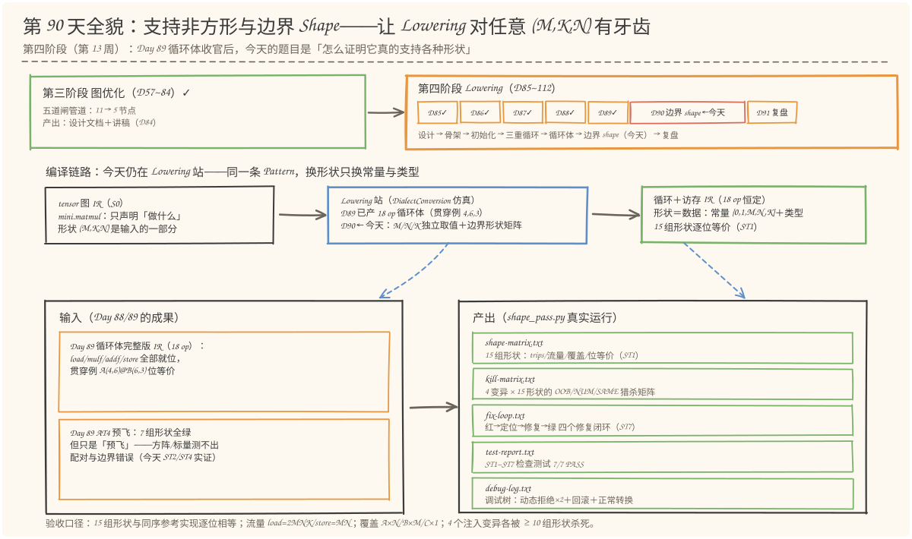
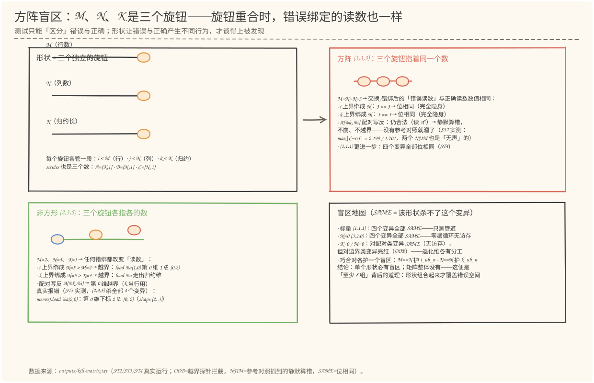
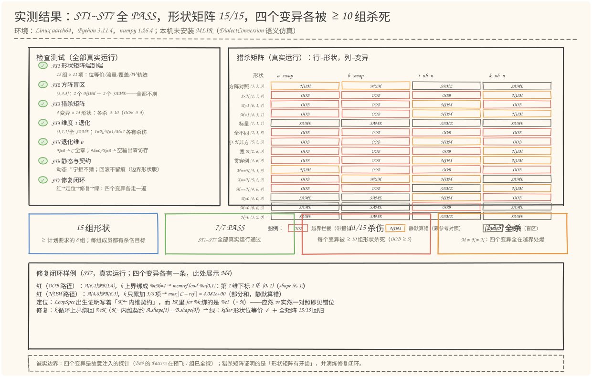

# 第 90 天：支持非方形与边界 Shape——形状矩阵、方阵盲区与猎杀矩阵

> **今日目标**：完成本教程后，你能做到四件事——说出"形状是三个独立的旋钮"各自的管辖范围（`i < M` ← `A.shape[0]`、`j < N` ← `B.shape[1]`、`k < K` ← 内维契约，strides `A=[K,1]`/`B=[N,1]`/`C=[N,1]`，流量 `load=2MNK`/`store=MN`，覆盖 `A 每格读 N 次`/`B 每格读 M 次`/`C 每格写 1 次`），并解释为什么**换形状只改常量与类型、IR 结构恒为 18 op**（形状是数据，不是代码结构）；用自己的话讲清**方阵盲区**——`M=N=K` 时边界错绑"位相同（完全隐身）"、配对写反"静默算错（不崩不越界）"，并用今天 ST2 的真实运行结果作证（4 个注入变异在 (3,3,3) 上一个都不崩：2 个 NUM、2 个 SAME）；分清**维度 1 与维度 0 的分工**——`(1,1,1)` 对四个变异全部免疫（只测管道），`K=0` 是空归约＝单位元 0（D87 `%zero` 的伏笔今日兑现），`M=0`/`N=0` 是空输出（零趟循环、无任何访存），但它们对边界类变异反而亮红；独立运行 `shape_pass.py` 复现 ST1~ST7 全部 7/7 PASS（15 组形状 × 11 项参数化检查、方阵盲区实验、4 变异 × 15 形状的 OOB/NUM/SAME 猎杀矩阵、退化维语义、动态 '?' 宁拒不猜＋回滚不留痕回归、四个"红→定位→修复→绿"闭环），并用 `--shape 2 3 5`、`--mutant i_ub_n --shape 3 3 3`（隐身）与 `--mutant i_ub_n --shape 1 7 4`（OOB 拦截）亲手复现矩阵里的任意一格。
> **预计时间**：学习 35 分钟＋实践 45 分钟
> **前置准备**：Python 3.11＋numpy（本文环境：aarch64 Linux，Python 3.11.4，numpy 1.26.4；**需要 numpy**，位等价对照用 `numpy.float32`）。本机没有安装 MLIR——与 Day 57~89 一致，用 Python 复刻 MLIR DialectConversion 的 Pattern／Rewriter／驱动器语义，并在 Day 87~89 的解释执行器（内存状态、IV 轨迹、按维越界、访存日志四个探针）上直接工作，不伪造 MLIR 本身的行为；文中 `scf.for` 半开区间与 trip 公式、`memref` strides 的语义描述依据官方文档（mlir.llvm.org，2026-11 核对）。内容上需要 Day 88 的 LoopSpec（每条循环的 ub 来源＝"出生证明"）和 Day 89 的 18 op 循环体（`load/mulf/addf/store` 与同序参考实现位等价、覆盖三定律）；不熟悉时先回看这两天的对应小节。
> **今日产出**：`code/shape_pass.py`（15 组形状矩阵＋4 个注入变异＋ST1~ST7 检查测试，全部可运行）、`code/outputs/shape-matrix.txt`（15 组 Shape 测试与参考结果对照——计划要求的"至少 8 组"落在 15 组上）、`code/outputs/kill-matrix.txt`（4 变异 × 15 形状的 OOB/NUM/SAME 猎杀矩阵＋每个变异的真实报错与盲区清单）、`code/outputs/fix-loop.txt`（四个"红→定位→修复→绿"修复闭环）、`code/outputs/test-report.txt`（ST1~ST7 报告，真实运行 7/7 PASS）、`code/outputs/debug-log.txt`（调试树：动态拒绝×2＋回滚＋正常转换）、4 张手绘图。

## 1. 今天解决什么问题？

昨天（Day 89）把循环体的最后五块肉填进去之后，留下了一个耐人寻味的尾巴：AT4 跑了 7 组形状的"预飞"——`(1,1,1)`、`(1,5,3)`、`(5,1,3)`、`(2,3,2)`、`(3,2,7)`、`(4,6,3)`、`(4,0,3)`——全部与同序参考实现逐位相等。报告的口径附注里写得很清楚："这是循环体正确性的预飞；Day 90 按计划做 ≥8 组边界 shape 的系统对照（1×N、M×1、小 K、维度 1）与修复。"

预飞全绿，是不是就可以宣布"支持非方形与边界 Shape"了？今天一开始就做了一组对照实验（就是正文里的 ST2），结果让人后背发凉：把四个**故意注入**的索引/边界错误——A 配对写反（`A[%k,%i]`）、B 配对写反（`B[%j,%k]`）、i 上界错绑成 N、k 上界错绑成 N——放到方阵 `(3,3,3)` 上跑，**四个全都不崩**：

```text
M1 a_swap：NUM——跑完不崩，max|C − ref| = 2.199e+00（静默算错：算的是 Aᵀ·B）
M2 b_swap：NUM——跑完不崩，max|C − ref| = 1.701e+00（静默算错：算的是 A·Bᵀ）
M3 i_ub_n：SAME——与参考逐位相同（M==N：错误的常量值恰好等于正确值，完全隐身）
M4 k_ub_n：SAME——与参考逐位相同（K==N：同上，完全隐身）
```

两个"位相同"意味着：**如果你只有方阵测试，这类边界 bug 连参考对照都抓不住**——因为错误的读数和正确的读数是同一个数字。两个"静默算错"意味着：**如果你的验收只是"能跑完不崩"，配对 bug 也溜了**。换句话说，"预飞全绿"只证明了管道通，没证明牙齿在。这正是学习计划第 90 天的题目——"M、N、K 独立取值和小尺寸、维度为 1 等边界情况"、"测试 1×N、M×1、小 K、非方形矩阵，修复索引和边界问题"、产出"至少 8 组 Shape 测试和参考结果对照"——真正要回答的问题是：**测试形状该怎么选，才能让"全绿"意味着"正确"？**

今天的答案分三层。**第一层**：把 7 组预飞扩成 **15 组形状矩阵**（ST1）——方阵对照、计划点名的维度 1（1×N/K=1/M×1/标量）、全不同非方形、只有一维相等的"巧合对"（M==K、K==N、M==N）、退化维 0（K=0/M=0/N=0），每组成员都带一句"为什么测它——它能杀什么 bug"。**第二层**：用 4 个注入变异 × 15 组形状的**猎杀矩阵**（ST3）证明这套形状真的有牙齿：每个变异被 ≥10 组形状杀死，其中带诊断的 OOB 拦截 ≥5 次；同时把每个变异的**盲区形状**（SAME）记录在案——单个形状必有盲区，矩阵整体没有。**第三层**：对每个变异走一遍完整的**修复闭环**（ST7）——红（真实报错/差值）→ 定位（LoopSpec 出生证明 vs 实际绑定，"应然"对"实然"）→ 修复（绑回正确来源）→ 绿（killer 形状＋全矩阵回归）——把计划里的"修复索引和边界问题"落成可操作的流程。

贯穿例子依旧是 `A(4,6) @ B(6,3) → C(4,3)`，但今天它只是 15 个成员之一；与它配套反复出现的"对比对"，是方阵 `(3,3,3)` 和全不同 `(2,3,5)`——一个展示盲区怎么形成，一个展示牙齿怎么咬合。

**验收口径也随之升级**：Day 89 验收的是"这一种形状下循环体对不对"（156 次访存逐条核对、位等价），今天验收的是"**任意** (M,K,N) 下循环体对不对"——期望值全部按 (M,K,N) 参数化（trip、流量、覆盖、IV 轨迹），15 组形状逐一过账，一个数字都不许硬编码。

## 2. 先看全貌：今天的内容位于哪里？



**图 1**：看三处——上排是阶段地图：第四阶段 Lowering 走到第六格（D85 设计 ✓ → D86 骨架 ✓ → D87 初始化 ✓ → D88 三重循环 ✓ → D89 循环体 ✓ → **D90 边界 shape，今天** → D91 周复盘）；中排是编译链路：今天仍在 Lowering 站，同一条 Pattern 不动，变的是形状与验收——左边的 tensor 图形状本来就是 (M,K,N) 的一部分，右边产出的循环＋访存 IR 结构恒为 18 op；下排是输入与产出：左边的 Day 89 完整循环体 IR（18 op）＋ AT4 的 7 组预飞（及其"只是预飞"的保留意见），变成右边五件产出——15 组形状矩阵、猎杀矩阵、修复闭环、ST1~ST7 报告、调试树。

把今天的路线压缩成五步（细节在 §3、§4 展开）：

1. **拧旋钮**：从 memref 类型逐维读出 M、K、N，确认每个旋钮各管一段——i 的上界、j 的上界、k 的上界、三组 strides、流量与覆盖公式，全部由 (M,K,N) 参数化；
2. **选形状**：设计 15 组形状矩阵——每组成员对应一类杀伤目标（方阵是盲区基线、非方形是牙齿、巧合对各护一个盲区、退化维各测一种零趟语义）；
3. **跑矩阵**：15 组 × 11 项参数化检查（ST1）——位等价、流量、覆盖、IV 轨迹，全部与 (M,K,N) 的公式对账；
4. **注入变异**：4 个索引/边界变异 × 15 形状（ST2~ST4）——OOB/NUM/SAME 三分类，杀伤统计＋盲区清单；
5. **修与验**：每个变异走"红→定位→修复→绿"闭环（ST7），退化维与动态拒绝做回归（ST5/ST6），最后全矩阵 15/15 回归。

## 3. 核心概念：先用直觉，再给准确定义

### 3.1 形状是三个独立的旋钮：换形状只改数据，不改代码

一句通俗解释：**矩阵乘的形状由三个互相独立的数字决定——M（输出行数）、N（输出列数）、K（归约长度）。它们像仪表盘上的三根指针，各管一段：`i < M`、`j < N`、`k < K`；strides 里的三个数（`A=[K,1]`、`B=[N,1]`、`C=[N,1]`）也各自由其中一根指针决定。**

类比：调音台的三根推子。低音、中音、高音各管一段频谱，你把低音推子推歪了，中音推子不会替它纠错——每根推子的错误只在自己的频段暴露。对应到技术上是：`(M,K,N)` 各自绑定到**不同**的常量、**不同**的循环上界、**不同**的 stride——`for %i` 绑 `%cM`、`for %j` 绑 `%cN`、`for %k` 绑 `%cK`，`%c2`（=M=2）、`%c5`（=N=5）、`%c3`（=K=3）是三个不同的 SSA 值。把 `for %i` 错绑到 `%c5`，错的只是 i 的行程——k 和 j 的一切照旧。类比的边界在：调音台推子是连续量，形状维度是离散的行程数——`(2,3,5)` 里把 M 和 N 弄反不是"音色变了"，而是"哪些循环跑几趟、哪些格子被读写"整个错位。

看 `(2,3,5)` 真实转换出的 IR（`python3 shape_pass.py --shape 2 3 5` 的原样输出，18 op）：

```mlir
func @main(%a: memref<2x3xf32, strided<[3, 1]>>, %b: memref<3x5xf32, strided<[5, 1]>>) -> memref<2x5xf32, strided<[5, 1]>> {
  %c = memref.alloc() : memref<2x5xf32, strided<[5, 1]>>     // 输出缓冲：M×N
  %zero = arith.constant 0.0 : f32
  %c0 = arith.constant 0 : index    // 下界
  %c1 = arith.constant 1 : index    // 步长
  %c2 = arith.constant 2 : index    // M ← A.shape[0]：i 的上界
  %c5 = arith.constant 5 : index    // N ← B.shape[1]：j 的上界
  %c3 = arith.constant 3 : index    // K ← 内维契约：k 的上界
  scf.for %i = %c0 to %c2 step %c1 {
    scf.for %j = %c0 to %c5 step %c1 {
      %acc = scf.for %k = %c0 to %c3 step %c1
              iter_args(%acc = %zero) -> (f32) {
        %xa = memref.load %a[%i, %k] : memref<2x3xf32, strided<[3, 1]>>   // 3·i+k
        %xb = memref.load %b[%k, %j] : memref<3x5xf32, strided<[5, 1]>>   // 5·k+j
        %p = arith.mulf %xa, %xb : f32
        %s = arith.addf %acc, %p : f32
        scf.yield %s : f32
      }
      memref.store %acc, %c[%i, %j] : memref<2x5xf32, strided<[5, 1]>>   // 5·i+j
    }
  }
  return %c : memref<2x5xf32, strided<[5, 1]>>
}
```

注意两件事。**第一，IR 结构和 Day 89 的贯穿例完全相同**——`walk` 出来恒为 18 op，`scf.for` 恒三层、`load` 恒两个、`store` 恒一个；变的只有三个 memref 类型（`strided<[3,1]>`/`<[5,1]>`/`<[5,1]>`）和五个常量的值（`{0,1,M,N,K}` = `{0,1,2,5,3}`）。**形状是数据，不是代码结构**——这就是"支持任意形状"的工程含义：Pattern 只写一遍，形状以常量＋类型的形式物化进 IR。**第二，三根旋钮的读数互不相等**（2 ≠ 3 ≠ 5）——这不是巧合，是设计：正是"读数互不相等"，才让任何错绑都改变行为（§3.2）。

由 (M,K,N) 参数化的四组公式（ST1 对 15 组形状逐一过账，一组都不许硬编码）：

| 量 | 公式 | (4,6,3) 贯穿例 | (2,3,5) | (1,1,1) | (6,1,4) |
| --- | --- | --- | --- | --- | --- |
| trip(i/j/k) | M / N / K | 4/3/6 | 2/5/3 | 1/1/1 | 6/4/1 |
| load 总数 | 2·M·N·K | 144 | 60 | 2 | 48 |
| store 总数 | M·N | 12 | 10 | 1 | 24 |
| 覆盖 | A 每格读 N 次、B 每格读 M 次、C 每格写 1 次 | 3/4/1 | 5/2/1 | 1/1/1 | 4/6/1 |

一个常见误解：**"维度为 1 的形状是废物形状"**。`(6,1,4)`（K=1，外积）的 trip 是 6/4/1、load 48、store 24——结构、流量、覆盖全部照常对账；它只是"少转几圈"，不是"没东西可测"。ST4 会进一步量化：维度 1 的成员各有杀伤，只有 `(1,1,1)` 这种"三数同时塌缩成 1"才彻底没有牙齿。

### 3.2 方阵盲区：测试只能区分"不同的东西"

一句通俗解释：**测试的本质是制造差异——让"错误实现"与"正确实现"产生**不同**的可观察行为（崩溃、数值、计数），才谈得上"被发现"。`M=N=K` 的方阵恰恰抹掉了这层差异：错误绑定读到的数字与正确绑定读到的数字是同一个。**

类比：三根指针的仪表盘被掰到同一个刻度。你想检查"指针 A 有没有装反"——可三根指针指着同一个数，装反了读数也一样。对应到技术上是三重巧合同时发生：

1. **边界巧合**：`for %i` 错绑 `%cN`（应绑 `%cM`）——`M==N` 时两个常量的**值**相等，错误的循环与正确的循环跑**完全相同**的趟数，产出**位相同**（bit-identical）的结果。ST2 实测：`i_ub_n` 在 (3,3,3) 上 SAME，`k_ub_n` 同理（K==N）。这不是"误差小"，是**逐位相等**——任何基于执行结果的测试都抓不住它，唯一线索是 IR 文本本身（LoopSpec 的 ub 来源注释 vs 实际绑定的常量名）。
2. **配对巧合**：`load %a[%k,%i]`（写反）在方阵上**完全合法**——两个下标的取值域相同，不越界、不报错，安静地算出 `Aᵀ·B`。ST2 实测：`max|C − ref| = 2.199`——只有**参考对照**抓得住；如果验收只是"跑完不崩"，它就溜了。
3. **stride 巧合**：A 的行 stride 是 K、C 的行 stride 是 N——`K==N` 时把两者张冠李戴，地址公式数值不变。

类比的边界在：仪表盘是"读数重合"，编译器里是"**语义不同的绑定，恰好产生相同的执行**"——SAME ≠ 正确，SAME 只是"这个形状对该错误免疫"。换个非方形 `(2,3,5)`，三重巧合全部解除：`i_ub_n` 让 i 跑到 2（越界）、`k_ub_n` 让 k 跑到 5（越界）、配对写反让 k 顶到 A 的行维（越界）——ST3 实测，`(2,3,5)` **单枪匹马杀掉全部 4 个变异**，全部走 OOB（带精确诊断）：

```text
memref.load %a(2, 0)：第 0 维下标 2 ∉ [0, 2)（shape (2, 3)）   ← a_swap：k 被当行号用，顶出行维
```

所以"三数互不相等"（M≠K≠N）是让配对/绑定错误**必然**改变行为的最小充分条件；今天的形状矩阵因此把"全不同非方形"作为中坚，方阵只留一个作**盲区基线**——它全绿什么也证明不了，它的价值是被 ST2 拿来演示"全绿≠正确"。

### 3.3 维度 1 与维度 0：退化形状的分工与各自的盲区

一句通俗解释：**退化形状（某维 = 1 或 = 0）不是"更难的形状"，而是"少转几圈或不转"的形状——零趟循环由 Day 88 的 trip 公式 `max(0, ceil((ub-lb)/step))` 一律吸收；它们测的是管道（结构、内存、执行不炸），牺牲的是配对/边界的分辨力。**

对应到技术上是三档退化，各有语义、各有盲区：

- **维度 1（`1×N`、`M×1`、K=1）**：`(1,7,4)` 的 trip 是 1/4/7——i 只转一圈；`(6,1,4)`（K=1）是外积，k 只转一圈、`C[i,j] = A[i,0]·B[0,j]`；`(4,3,1)`（M×1）的 j 只转一圈。它们照常对账流量与覆盖（如 `(6,1,4)`：load 48、store 24、A 每格读 4 次），并各有杀伤——ST3 实测 `(1,7,4)` 杀 `a_swap`/`i_ub_n`（OOB）、`(6,1,4)` 杀 `k_ub_n`/`a_swap`、`(4,3,1)` 杀 `b_swap`。**只有 `(1,1,1)` 全军覆没**：三个下标恒为 0、三条上界恒为 1——ST4 实测四个变异在它身上全部 SAME。它的价值是"最小管道测试"：18 op 结构、alloc、循环、yield、store 全走一遍。
- **K=0（空归约）**：`A(4,0) @ B(0,3) → C(4,3)`，k 循环 12 次激活、每次 0 趟——`%acc` 带着初值 `%zero` 原样出门，C 的 12 格全被 `store` 写成 **0**。ST5 实测：`np.all(C == 0) = True`、load 0、store 12。这是 Day 87 埋的伏笔今日兑现——`%zero` 不是"清零的习惯写法"，是**归约单位元**：空归约的数学结果就是 0，IR 的语义（k 零趟时 `%acc` 初值出门）与数学严丝合缝。注意 C **每格仍写 1 次**——输出照样完整落盘。
- **M=0 / N=0（空输出）**：`A(0,6)@B(6,3) → C(0,3)`——i 零趟，j/k **从未激活**，alloc 0 格，load 0、store 0；`A(3,2)@B(2,0) → C(3,0)`——j 零趟，k 从未激活。空数组 `reshape`、空 `Counter` 的 `max()` 是这里最常见的工程坑（§6 的 E1/E2 就是今天开发中真实踩到的两脚）。

一个容易忽略的细节：退化维对变异**不是一律免疫**——ST3 实测，`K=0` 的 (4,0,3) 杀 `k_ub_n`（错误上界让 k 跑 3 趟 → 第 0 趟就撞上"dim1 = 0 ∉ [0, 0)"的越界），`M=0` 的 (0,6,3) 杀 `i_ub_n`（i 错误上界 3 > 0 → i=0 就越界）——但它们对配对类变异（无访存）免疫；`N=0` 的 (3,2,0) 则是"全 SAME 行"。**退化维各有各的分工与盲区**——这再次指向同一个结论：单个形状必有盲区，矩阵整体才能无盲区。

## 4. 图解核心机制

先看今天的交付物本身——15 组形状矩阵。看图时关注两件事：**每一格卡片的迷你 A/B/C 网格**（三个张量的比例关系一眼可见——`(2,8,3)` 的宽 K、`(4,3,1)` 的细长列向量、`(4,0,3)` 的空 A/B）；**卡片下方的 trip/流量/覆盖三行**——它们全部来自 `outputs/shape-matrix.txt` 的真实运行，而且全部能从 (M,K,N) 一步算出来。


**图 2**：矩阵的五个类别各有职责——方阵对照是**盲区基线**（全绿≠正确，ST2 拿它做反面演示）；维度 1 是计划点名的 `1×N`/`M×1`/小 K（外积）加上标量；全不同非方形是**牙齿中坚**（`(2,3,5)` 单挑杀全部 4 个变异）；巧合对 `M==K`/`K==N`/`M==N` 各护一个盲区（§3.2 的三重巧合，一次只解除一部分）；退化维 0 测零趟语义。底部横幅是 15 组全部成立的参数化定律——维度为 0 时"每格读 N 次"自然退化成"零访存"，公式一个不破。

再看盲区是怎么形成的、牙齿又是怎么咬合的：



**图 3**：左上把形状画成三根独立的"旋钮"——M 管行、N 管列、K 管归约，strides 也各自由其中一根决定。右上把三根旋钮拧到同一个数（方阵）：错绑后的"错误读数"与"正确读数"数值相同——i/k 上界错绑**位相同（隐身）**，配对写反**静默算错（不崩）**，四个变异一个都不响。左下把旋钮散开（`(2,3,5)`）：任何错绑都改变读数——越界探针带着"哪一维、哪个下标、什么 shape"的完整诊断亮红。右下是盲区地图：标量与 `N=0` 是"全 SAME 行"，`K=0`/`M=0` 对配对免疫但对边界亮红，巧合对各护一个盲区——这张图就是"至少 8 组"背后的道理：**形状必须组合起来，才能覆盖错误空间**。

## 5. 动手实践：完成一个最小可运行例子

### 5.1 准备文件

今天的工程在上 Day 的基础上只新增两个文件（Day 89 的 `body_pass.py` 无需改动，它继续作为"循环体正确性"的历史验收）：

```text
tutorials/day-090/
├── README.md                    ← 本文
├── images/
│   ├── 01-overview.svg          ← 图 1～图 4（手绘风，随文生成）
│   └── ...
└── code/
    ├── shape_pass.py            ← 今天的主角：形状矩阵＋猎杀矩阵＋ST1~ST7
    ├── make_images.py           ← 生成 4 张 SVG（数字直接 import 自 shape_pass 真跑）
    └── outputs/                 ← 运行 shape_pass.py 自动生成（5 个 txt）
```

环境检查（本文真实环境）：

```bash
$ python3 --version
Python 3.11.4
$ python3 -c "import numpy; print(numpy.__version__)"
1.26.4
```

### 5.2 编写代码

`shape_pass.py` 约 1800 行：前 ~1090 行是 Day 87~89 的基础设施原样沿用（SSA IR 与打印机、TypeConverter、事务 Pattern/Rewriter、ConversionDriver、LoopSpec、`MatMulBodyPattern` 18 op 循环体、带四个探针的解释执行器、同序参考实现、`run_case` 工具），今天新增的是下面四块。

**第一块：形状矩阵——每组成员带"为什么测它"。** 这不是 15 个随手的数字，而是一张按杀伤目标设计的清单：

```python
SHAPE_MATRIX = [
    ("方阵对照", (3, 3, 3), "M=N=K：边界/配对错误的盲区形状——作对照基线，证明「全绿≠正确」"),
    ("1×N",     (1, 7, 4), "M=1（行向量输出）：i 单趟；杀 a_swap、i_ub_n（OOB）"),
    ("K=1",     (6, 1, 4), "小 K=1（外积）：k 单趟；杀 k_ub_n、a_swap（OOB）"),
    ("M×1",     (4, 3, 1), "N=1（列向量输出）：j 单趟；杀 b_swap（OOB）"),
    ("标量",     (1, 1, 1), "M=N=K=1：只测管道——对 4 个变异全部免疫（ST4 实证）"),
    ("全不同",   (2, 3, 5), "M≠K≠N：任何 M/N/K 混用都会在越界处爆（杀全部 4 个变异）"),
    ("小 K 非方", (5, 2, 3), "K<M 且 K<N：部分和类错误（k_ub_n）数值现形"),
    ("宽 K",    (2, 8, 3), "K>M 且 K>N：归约比输出长；杀 a_swap（OOB）"),
    ("贯穿例",   (4, 6, 3), "D85~89 的 A(4,6)@B(6,3)：与前几天连续对账"),
    ("M==K",    (3, 3, 5), "M==K≠N：a_swap 在此静默算错（读 Aᵀ，不越界——只能靠参考对照抓）"),
    ("K==N",    (5, 2, 2), "K==N≠M：b_swap 静默算错；k_ub_n 位相同（隐身）"),
    ("M==N",    (4, 6, 4), "M==N≠K：i_ub_n 位相同（隐身）——巧合对各有各的盲区"),
    ("K=0",     (4, 0, 3), "空归约：C 全零（单位元 0，D87 伏笔）；杀 k_ub_n（OOB）"),
    ("M=0",     (0, 6, 3), "空输出：i 零趟、alloc 0 格；杀 i_ub_n（OOB）"),
    ("N=0",     (3, 2, 0), "空输出（j 零趟）：i/k 类边界错误在此隐身——盲区也要记录"),
]
```

**第二块：四个注入变异与三分类。** 变异是打在 `MatMulBodyPattern` 上的四个"旋钮"（默认全关＝Day 89 的正确形态）：`a_swap`/`b_swap` 把 load 的下标配对写反，`i_ub_n`/`k_ub_n` 把 i/k 循环的上界绑到 N 常量。每次运行按三种结局分类：

```python
def classify(mutation_kwargs, M, K, N):
    pats = [MatMulBodyPattern(**mutation_kwargs)]
    res, interp, func, C, err = run_case(pats, M, K, N)
    if not res.ok:
        return "CONV", res.message
    if err is not None:                 # 按维越界探针拦下（Day 88 探针）
        return "OOB", err
    A, B = make_inputs(M, K, N)
    ref = reference_matmul(A, B)        # 同序参考（Day 89 口径）
    if np.array_equal(C, ref):
        return "SAME", "与同序参考逐位相同"
    diff = float(np.max(np.abs(C - ref))) if C.size else 0.0
    return "NUM", f"max|C − ref| = {diff:.3e}（静默算错）"
```

三分类的含义：**OOB**＝执行级证据（越界探针拦截，带完整诊断）；**NUM**＝只有参考对照抓得住的静默算错；**SAME**＝该形状对此变异免疫（盲区，必须记录而不是回避）。

**第三块：ST1 的 11 项参数化检查。** 每组形状过 11 道闸：转换成功、18 op 结构序列、LoopSpec 三条 `(i:0..M / j:0..N / k:0..K)`、常量多重集 `{0,1,M,N,K}`、执行无越界、同序参考位等价、`load=2MNK`、`store=MN`、覆盖三定律、无未初始化读、IV 轨迹。关键是**期望值不许硬编码**——覆盖定律的完整参数化长这样（维度 0 的语义藏在里面）：

```python
a_reads = M * K > 0 and N > 0          # A 每格读 N 次 → N==0 或 A 无格子时零访存
b_reads = K * N > 0 and M > 0          # B 每格读 M 次 → M==0 时零访存
cov_a_ok = ((not cov["%a"]) if not a_reads else
            (set(cov["%a"]) == set(range(M * K))
             and all(c == N for c in cov["%a"].values())))
# IV 取值集：循环真的跑过 ≥1 趟才等于 range(dim)——M=0 时 %j 从未激活（空集）
iv_ok = (ti["per_act"] == [M] and tj["per_act"] == [N] * M
         and tk["per_act"] == [K] * (M * N)
         and ti["values"] == (set(range(M)) if M > 0 else set())
         and tj["values"] == (set(range(N)) if (M > 0 and N > 0) else set())
         and tk["values"] == (set(range(K)) if (M > 0 and N > 0 and K > 0) else set()))
```

这两段里的"零访存分支"和"激活条件"不是过度设计——它们是今天开发时**真实踩坑后修出来的**（§6 的 E1/E2）。

**第四块：猎杀矩阵与修复闭环。** ST3 把 4 个变异在 15 组形状上各跑一遍（60 次运行），产出 OOB/NUM/SAME 网格＋每个变异的杀伤统计、真实报错与 SAME 盲区清单；ST7 为每个变异选一个 killer 形状，把"红→定位→修复→绿"各走一遍——定位靠两个"应然 vs 实然"的对照面：LoopSpec 出生证明（ub 来源印在 IR 注释里）与下标语义表（`A[i,k]`/`B[k,j]`/`C[i,j]`），与实际绑定一对照即见错位。

### 5.3 运行与观察

一条命令跑全部（真实运行，本机 aarch64 Linux，Python 3.11.4，numpy 1.26.4）：

```text
$ python3 shape_pass.py
Day 90 支持非方形与边界 Shape·检查测试报告（真实运行）
环境：Linux aarch64, Python 3.11.4, numpy 1.26.4; 本机未安装 MLIR（...）

[PASS] ST1 形状矩阵端到端（15 组）
  矩阵规模：15 组形状 ≥ 计划要求的 8 组（True）；全部 15/15 通过（True）
  每组检查 11 项：转换成功 · 18 op 结构 · LoopSpec(i<M,j<N,k<K) · 常量多重集{0,1,M,N,K}
  · 执行无越界 · 同序参考位等价 · load=2MNK · store=MN · 覆盖 A×N/B×M/C×1 · 无未初始化读 · IV 轨迹
[PASS] ST2 方阵盲区
  M1 a_swap 在 A(3,3)@B(3,3) 上：NUM——静默算错（只能靠参考对照抓）（True）：max|C − ref| = 2.199e+00
  M3 i_ub_n 在 A(3,3)@B(3,3) 上：SAME——位相同（完全隐身）（True）
  ...
[PASS] ST3 猎杀矩阵
  M1 a_swap：杀 11/15（OOB 9 ＋ NUM 2）（True）；免疫（SAME）4 组：标量、K=0、M=0、N=0
  M3 i_ub_n：杀 11/15（OOB 5 ＋ NUM 6）（True）；免疫（SAME）4 组：方阵对照、标量、M==N、N=0
  计划点名成员的牙齿：1×N(1,7,4) 杀 a_swap/i_ub_n · K=1(6,1,4) 杀 k_ub_n ·
  M×1(4,3,1) 杀 b_swap · 全不同(2,3,5) 杀全部 4 个（True）
  M≠K≠N 的 (2,3,5) 单枪匹马杀全部 4 个变异（True）
...
—— 检查测试 7/7 PASS ——
shape-matrix.txt / kill-matrix.txt / fix-loop.txt / test-report.txt / debug-log.txt 已写入 outputs/
```

**产出 1：形状矩阵**（`outputs/shape-matrix.txt`，计划要求的"至少 8 组 Shape 测试和参考结果对照"落在 15 组上）。摘录几行真实数据（完整表含每组的覆盖注与目的）：

```text
类别      形状                       trip(i/j/k)   load  store  位等价
方阵对照  A(3,3)@B(3,3)→C(3,3)      3/3/3        54     9    ✓
1×N      A(1,7)@B(7,4)→C(1,4)      1/4/7        56     4    ✓
K=1      A(6,1)@B(1,4)→C(6,4)      6/4/1        48    24    ✓
标量      A(1,1)@B(1,1)→C(1,1)      1/1/1         2     1    ✓
全不同    A(2,3)@B(3,5)→C(2,5)      2/5/3        60    10    ✓
宽 K     A(2,8)@B(8,3)→C(2,3)      2/3/8        96     6    ✓
K=0      A(4,0)@B(0,3)→C(4,3)      4/3/0         0    12    ✓
M=0      A(0,6)@B(6,3)→C(0,3)      0/3/6         0     0    ✓
```

对照 §3.1 的公式表：`(1,7,4)` 的 load 56 = 2·1·4·7 ✓、`(2,8,3)` 的 96 = 2·2·3·8 ✓、`(6,1,4)` 的 store 24 = 6·4 ✓；`np.matmul` 对照单独报告（如贯穿例 `(4,6,3)`：逐位相等 = False，max|diff| = 2.384e-07——舍入顺序不同，不算失败，Day 89 起的口径不变）。

**产出 2：猎杀矩阵**（`outputs/kill-matrix.txt`）。4 变异 × 15 形状的真实结局网格（OOB=越界拦截／NUM=静默算错／SAME=位相同）：

```text
形状                M1 a_swap   M2 b_swap   M3 i_ub_n   M4 k_ub_n
方阵对照 (3,3,3)       NUM         NUM         SAME        SAME
1×N (1,7,4)          OOB         OOB         OOB         NUM
K=1 (6,1,4)          OOB         OOB         NUM         OOB
标量 (1,1,1)          SAME        SAME        SAME        SAME
全不同 (2,3,5)        OOB         OOB         OOB         OOB
贯穿例 (4,6,3)        OOB         OOB         NUM         NUM
K==N (5,2,2)         OOB         NUM         NUM         SAME
K=0 (4,0,3)          SAME        SAME        NUM         OOB
M=0 (0,6,3)          SAME        SAME        OOB         SAME
N=0 (3,2,0)          SAME        SAME        SAME        SAME
（完整 15 行见 outputs/kill-matrix.txt）
```

三个读法：**方阵行**两个 NUM 两个 SAME——一个都不崩（ST2 的主题）；**全不同行**四列全 OOB（"三数互不相等"的威力）；**杀伤统计**——每个变异被 ≥10 组形状杀死（OOB ≥5、NUM ≥2），同时各有 4~5 组 SAME 盲区被明文记录。带诊断的真实报错示例（M4 在 `(6,1,4)` 上）：

```text
memref.load %a(0, 1)：第 1 维下标 1 ∉ [0, 1)（shape (6, 1)）；线性地址 1 甚至仍在缓冲区（6 格）内
——只查线性地址抓不住这类逻辑越界
```

**产出 3：修复闭环**（`outputs/fix-loop.txt`）。四个变异各走一遍"红→定位→修复→绿"，展示 M4 的真实记录：

```text
红（OOB 路径）：A(6,1)@B(1,4) → memref.load %a(0,1)：第 1 维下标 1 ∉ [0, 1)（shape (6, 1)）
红（NUM 路径）：A(4,6)@B(6,3) → max|C − ref| = 4.081e+00（k 只累加 3/6 项，静默算错）
定位：LoopSpec 出生证明写着「K ← 内维契约」，而 IR 里 for %k 绑的是 %c3（= N）——应然 vs 实然一对照即见错位
修复：k 循环上界绑回 %cK（K = 内维契约 A.shape[1]==B.shape[0]）
绿：同一 killer 形状用正确绑定重跑 → 与同序参考逐位相等（True）
回归：全矩阵 15/15 位等价（ST1）＋ ST2~ST6 全 PASS
```

注意一个细节：同一个变异在不同形状上走出**不同的红法**——`M4 k_ub_n` 在 `(6,1,4)` 上是 OOB（N=4 > K=1，k 多跑撞维），在 `(4,6,3)` 上是 NUM（N=3 < K=6，k 少跑算出部分和，`max|C−ref| = 4.081`）。**多跑爆在下标越界、少跑溜进错误数值**——这正是矩阵要两类成员（N>K 与 N<K）的原因。



**图 4**：左侧是 ST1~ST7 七项检查的真实运行结论；中间是猎杀矩阵的实色网格——红格 OOB（越界拦截）、橙格 NUM（静默算错）、灰格 SAME（盲区），一图读完 60 次运行的结局分布：方阵行与标量行的"全灰/半灰"、全不同行的"全红"；下方四张数字卡（15 组形状、7/7 PASS、每个变异 ≥10 杀、`(2,3,5)` 全杀）与 M4 的修复闭环样例（真实报错→出生证明定位→绑回 %cK→绿）。底部诚实边界：四个变异是**故意注入**的探针——Day 89 的 Pattern 在预飞 7 组已全绿，猎杀矩阵证明的是"形状矩阵有牙齿"并演练修复流程，不是伪造"昨天就错"的历史。

### 5.4 修改一个参数再观察

练习模式让你亲手复现矩阵里的任意一格。两组对照（都是真实运行）：

**对照一：同一个变异，方阵上隐身、边界形状上爆**——

```text
$ python3 shape_pass.py --mutant i_ub_n --shape 3 3 3
形状 A(3,3) @ B(3,3) -> C(3,3)｜变异：i_ub_n
执行结果（解释执行实测）：
  load 54（正确形态应为 2·M·N·K = 54）· store 9（正确形态应为 M·N = 9）· 未初始化读 0
  与同序参考实现位等价：True（SAME——这个形状对该变异免疫：隐身！）

$ python3 shape_pass.py --mutant i_ub_n --shape 1 7 4
形状 A(1,7) @ B(7,4) -> C(1,4)｜变异：i_ub_n
转换：成功——转换完成（模式=full）：终图 18 op，残留非法 op = 无
执行被按维越界探针拦下：memref.load %a(1, 0)：第 0 维下标 1 ∉ [0, 1)（shape (1, 7)）
（这就是猎杀矩阵里的 OOB——非方形形状抓住了索引/边界错误）
```

M==N 时 `%cN` 与 `%cM` 值相同——逐位相同；N=4 > M=1 时 i 跑出 A 的行维——探针报出"第 0 维下标 1 ∉ [0, 1)"。**一个参数（形状）的差别，决定错误"存在"还是"暴露"**。

**对照二：正确的边界形状，零趟语义肉眼可见**——

```text
$ python3 shape_pass.py --shape 6 1 4 --trace
形状 A(6,1) @ B(1,4) -> C(6,4)｜正确形态
  load 48（= 2·M·N·K = 48）· store 24（= M·N = 24）· 未初始化读 0
  与同序参考实现位等价：True
  覆盖：A 每格读 4 次（应 = N = 4）· B 每格读 6 次（应 = M = 6） · C 每格写 1 次（应 = 1）
前 8 条访存（真实记录）：
   1. load  %a[0,0] → 0+0 = 0   值 -0.224487      ← K=1：A 每格只有一列
   2. load  %b[0,0] → 4·0+0 = 0   值 +0.720956
   3. store %c[0,0] → 4·0+0 = 0   值 -0.161845     ← k 单趟：读 A、读 B、乘、加、写 C
   4. load  %a[0,0] → 0+0 = 0   值 -0.224487      ← 同一格 A[0,0] 被 4 个 j 复用（N=4）
```

K=1 让每个 `(i,j)` 格子的访存轨迹缩短到"读 A、读 B、写 C"三条，`%a[0,0]` 连续被读 4 次——覆盖定律"B 每格读 M 次、A 每格读 N 次"在访存日志里逐条可数。这就是"边界形状让机制裸奔"的教学价值。

## 6. 常见错误与排查

### E1：覆盖期望硬编码——"B 每格读 4 次"在 M=0 的形状上全红

- **现象**：ST1 的第一版在 `(0,6,3)` 上 FAIL，报 `covB`（B 覆盖检查）不通过——B 明明是 6×3、18 个格子，`cov["%b"]` 却是空的。
- **原因**：覆盖定律写的是"B 每格读 **M** 次"。M=0 时每个格子读 **0 次**——B 整块零访存是**定律的正确推论**，而我的检查写成了"K·N > 0 就必须有完整覆盖"，没有考虑"读取次数由另一维决定"的传递性。
- **定位**：诊断脚本逐项打印 11 项检查（`M=0 (0,6,3) FAILED: ['covB', 'iv']`），看到只有 B 挂了而 A/C 全绿——A 的读取次数由 N=3（非零）决定、C 由自身格子数决定，唯独 B 的次数被 M=0 归零。
- **修复**：把定律参数化到底——`b_reads = K*N > 0 and M > 0`，不满足时期望就是"零访存"（`not cov["%b"]`）。`(3,2,0)` 的 A 同理（N=0 → A 零访存）。修完 15 组全绿。**教训：边界形状最先杀死的，往往是测试自己的期望值**——这也是为什么期望必须写成 (M,K,N) 的公式而不是具体数字。

### E2：IV 取值集期望漏了"激活条件"——空集 ≠ range(N)

- **现象**：同一轮诊断里 `(0,6,3)` 与 `(3,2,0)` 的 `iv` 检查也挂了：期望 `%j` 的取值集合是 `set(range(3))`，实际是空集；`(3,2,0)` 的 `%k` 同样——期望 `{0, 1}`，实际空。
- **原因**：Day 88 建立 IV 轨迹探针时只测过"循环真的会跑"的形状，期望自然写成"取值集合 == range(dim)"。但 IV 只有在循环**被激活且跑过 ≥1 趟**时才取值：M=0 时 j 循环从未进入（i 零趟），N=0 时 k 循环从未进入（j 零趟）——`values` 是空集，而 `per_act`（每次激活的趟数）反而无条件存在（`%i` 激活 1 次、0 趟）。
- **定位**：诊断打印 `tj: [] tk: []`（per_act 为空列表）与空 values 对照预期——注意两者语义不同：**per_act 空 = 循环从未被激活；per_act=[0] = 激活了但零趟**。`(0,6,3)` 的 `%i` 是后者（`[0]`），`%j` 是前者（`[]`）。
- **修复**：期望也参数化——`values == set(range(N)) if (M > 0 and N > 0) else set()`（%k 再多一个 `K > 0`）。这一脚和 E1 同源：**"零趟"有两种零法（未激活/激活零趟），期望值得分开写**。

### E3："测试全绿"的假安全——只测方阵，四个变异一个不响

- **现象**：ST2 的对照实验——把 a_swap/b_swap/i_ub_n/k_ub_n 放在方阵 `(3,3,3)` 上，转换全成功、执行全不崩、两个还与参考逐位相同。
- **原因**：§3.2 的三重巧合。更隐蔽的是 **NUM 类结局**：`max|C−ref| = 2.199` 说明结果错了，但如果验收口径是"跑完不崩、流量覆盖都对"（结构级测试），它照样全绿——配对错误的流量与覆盖计数**完全正常**（Day 89 AT6 的 P3 同款：只有数值对照抓得住）。
- **定位**：两条路都要留——数值对照（同序参考实现）抓 NUM；IR 文本对照（LoopSpec 的 ub 来源注释 vs 实际绑定的常量）抓 SAME：出生证明写着"ub 来源：M = A.shape[0] = 2"，而 `for %i` 绑的是 `%c5`——**"应然"与"实然"两个文本一对照，隐身 bug 现形**。这就是为什么 Day 88 把 ub 来源印进 IR 注释、今天 ST7 把它当定位手段。
- **修复**：把方阵从测试集里"降级"为盲区基线，矩阵补进非方形/维度 1/退化维成员；验收口径明确为"位等价 ＋ 探针 ＋ IR 文本三层"。真实工程里对应的要求：**索引/边界类测试的形状集必须包含能区分 M/N/K 的成员**——方阵覆盖率高是假象，分辨率才是真指标。

### E4：`max()` 掏空 Counter——零访存形状下的统计打印

- **现象**：给练习模式写覆盖统计打印时，`max(cov['%a'].values())` 在 `--shape 4 0 3`（K=0，A 零访存）下会抛 `ValueError: max() arg is an empty sequence`。
- **原因**：覆盖 Counter 只在访存发生时累积——零访存形状（K=0/M=0）下 `cov["%a"]` 是空 Counter，`max()` 无从取值。Day 89 的 `practice_mode` 用 `if cov["%a"]:` 守卫躲开了这一脚（当时的 7 组预飞形状里 K=0 不打印 A 覆盖），今天形状多了，这个守卫升级成了显式的三分支（全访存／k 零趟／全零访存）。
- **定位**：报错栈直接指向 `max()` 调用行——这类错不难找，难的是**提前想到**：任何"对每个格子统计"的代码，都要先问"格子数为 0 时该打印什么"。
- **修复**：打印前判空——空则打印"A/B 无访存（k 零趟）"或"无任何访存（0 趟循环）"。ST5 现在把这类形状的语义明文验收：K=0 时 C 仍被写 M·N 次（全零），M=0/N=0 时连写都不发生。

## 7. 今日练习

### 必做练习

**(1) 先预测，再运行对答案**：对形状 `(7,2,9)`（A(7,2) @ B(2,9)）——① 写出三条 LoopSpec 的 ub 与 trip；② 算出 load/store 总数与覆盖三定律（A 每格读几次？B 呢？）；③ 判断四个变异在它身上的结局各是什么（OOB/NUM/SAME，OOB 的话报错会指向哪个 memref 的哪一维）。把预测记下来，然后运行：

```bash
python3 shape_pass.py --shape 7 2 9            # 对照①②
python3 shape_pass.py --mutant a_swap --shape 7 2 9   # 对照③ 的 a_swap 格
python3 shape_pass.py --mutant k_ub_n --shape 7 2 9   # 对照③ 的 k_ub_n 格
```

预测全对（或说清错在哪）才算过。**(2) 复现盲区**：运行 `--mutant i_ub_n --shape 7 2 9`，把真实报错抄进笔记，并用 §5.2 的两个"应然 vs 实然"对照面（IR 注释里的 ub 来源 vs 实际绑定的常量）写出一条 30 字以内的定位结论。

### 选做挑战

给 `MatMulBodyPattern` 增加第五个变异 `j_ub_k`（j 循环上界错绑到 `%cK` 而不是 `%cN`），回答两个问题再动手：① 猎杀矩阵里哪些形状能杀死它、哪些形状对它免疫（先逐格预测——提示：想想 K==N 的巧合对，以及 N=0 时 j 会跑几趟）；② 有没有形状让它走出 NUM（静默算错）而不是 OOB？实现后把 `MUTANTS` 列表扩成五项重跑 `shape_pass.py`，与预测对账。若想再进一步：把 `--mutant j_ub_k --shape 3 2 0` 的结局与 E2 的"两种零法"联系起来，用一句话解释为什么。

## 8. 今日验收

- [ ] 我能用自己的话解释"形状是三个独立的旋钮"：`i<M / j<N / k<K` 的上界来源、`strided<[K,1]>/<[N,1]>/<[N,1]>` 的来源，以及"换形状只改常量与类型、IR 结构恒为 18 op"——并能对着 `(2,3,5)` 的真实 IR 指出三根旋钮分别物化成了哪几个常量；
- [ ] 我能独立运行 `python3 shape_pass.py` 复现 ST1~ST7 全部 7/7 PASS，并说出 15 组形状矩阵的五个类别各为什么存在（方阵基线/维度 1/全不同/巧合对/退化维）；
- [ ] 我能解释 OOB/NUM/SAME 三分类的含义与证据形态，并说出"方阵上四个变异一个都不崩"的两层含义（位相同＝完全隐身；静默算错＝只有参考对照抓得住）；
- [ ] 我能修改 `--shape` 与 `--mutant` 预测任一格的结局（trip、流量、OOB 的具体哪一维），运行后与预测对账——包括维度 0 的"零访存"与"未激活"两种零法；
- [ ] 我保存了 `shape_pass.py`、`outputs/` 下五份真实运行结果（形状矩阵、猎杀矩阵、修复闭环、测试报告、调试树）和 4 张手绘图，并能指出猎杀矩阵里 `(2,3,5)` 行为什么是"全 OOB"、`(3,2,0)` 行为什么是"全 SAME"。

## 9. 一句话总结与明天预告

今天回答的问题是"**全绿能证明什么**"：Day 89 的 7 组预飞证明管道通，但方阵实验（ST2）显示 4 个注入变异在 `(3,3,3)` 上一个都不崩——两个位相同、两个静默算错。机制是"形状是三个独立的旋钮，方阵把三根旋钮拧到同一个数，错误绑定的读数与正确绑定的读数数值相同"。解法是把形状当成**测试设计的一等公民**：15 组形状矩阵让每个成员都有明确的杀伤目标（`(2,3,5)` 单挑杀全部 4 个变异；巧合对各护一个盲区；退化维各有分工），4 变异 × 15 形状的猎杀矩阵证明"每个变异被 ≥10 组杀死、同时各有 4~5 组 SAME 盲区被明文记录"——**单个形状必有盲区，矩阵整体才能无盲区**，这就是计划"至少 8 组"背后的道理。实践闭环是 60 次真实运行＋四个"红→定位（出生证明 vs 实际绑定）→修复（绑回正确来源）→绿（全矩阵回归）"；期间真实踩掉的两个坑（覆盖期望的传递性归零、IV 取值集的激活条件）恰好都是"边界形状最先杀死测试自身期望"的实例。验证口径全程参数化：位等价对同序参考、流量 `2MNK/MN`、覆盖 `A×N/B×M/C×1`、trip 公式含零趟——15/15 全过，ST1~ST7 真实 7/7 PASS。

明天是第 13 周复盘（Day 91）：手画一个 `2×3` 乘 `3×2` 的循环与索引示例，对照生成的 IR 核对每一处下标、上界与地址——这恰好是一个非方形边界例子，今天的形状矩阵正好给它当背景板；同时回顾 Day 85~90 从设计、骨架、初始化、循环、循环体到边界形状的完整 Lowering 链路。


