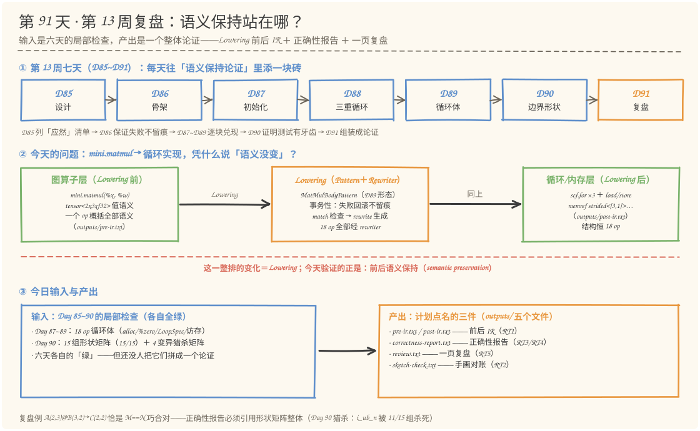
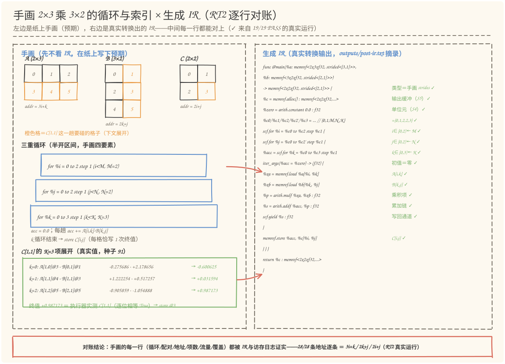
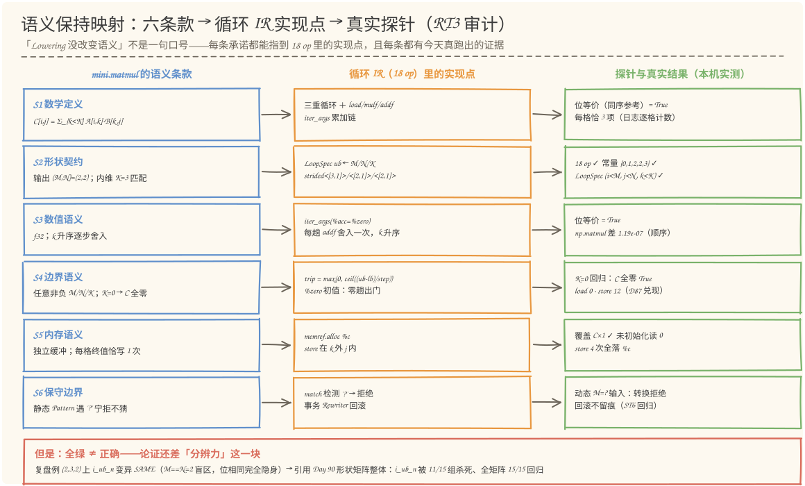
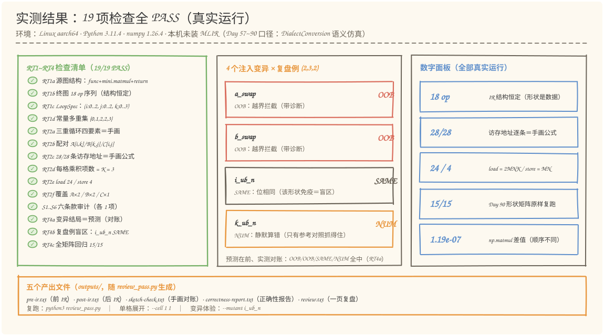

# 第 91 天：第 13 周复盘——把六天的"绿"拼成一个"语义保持"的论证

> **今日目标**：完成本教程后，你能做到四件事——用自己的话说清**语义保持**（semantic preservation）的两层含义：Lowering 前后"可观察行为不变"，且"不变"必须拆成**逐条款可验证的清单**（数学定义 S1：`C[i,j] = Σ A[i,k]·B[k,j]`；形状契约 S2：输出 `(M,N)`＋内维 K；数值语义 S3：f32 逐步舍入的确定顺序；边界语义 S4：`K=0 → C 全零`；内存语义 S5：每格终值恰写 1 次、A/B 只读；保守边界 S6：动态 `'?'` 宁拒不猜），而不是一句笼统的"结果对了"；亲手完成计划点名的实践——**手画一个 `2×3` 乘 `3×2` 的循环与索引示例**（三重循环四要素、下标配对 `A[i,k]/B[k,j]/C[i,j]`、地址算式 `3i+k / 2k+j / 2i+j`、每格 3 项、流量 `load 24 / store 4`、覆盖 `A×2 / B×2 / C×1`），并对照生成 IR 逐行对账（`review_pass.py` 的 RT2 把手画编码成预期表，28/28 条访存地址逐条核对）；独立运行 `review_pass.py` 复现 RT1~RT5 全部 **19/19 PASS**（前后 IR 快照、手画对照、六条款审计、分辨力检查、一页复盘），并解释一个关键发现——**计划点名的复盘例 `A(2,3)@B(3,2)` 恰是 M==N 巧合对**：`i_ub_n` 变异在它身上 SAME（位相同、完全隐身），所以单一形状的正确性报告必须引用 Day 90 形状矩阵整体（15/15 回归、`i_ub_n` 被 11/15 组杀死）才算数；最后把第 13 周（D85~D91）的成果整理成**一页复盘**——七天链路各往论证里添了哪块砖（应然清单、事务可信度、四个实现根、测试分辨力、整体组装）。
> **预计时间**：学习 35 分钟＋实践 45 分钟
> **前置准备**：Python 3.11＋numpy（本文环境：aarch64 Linux，Python 3.11.4，numpy 1.26.4；**需要 numpy**，位等价对照用 `numpy.float32`）。本机没有安装 MLIR——与 Day 57~90 一致，复用 Day 90 的 `shape_pass.py`（Python 复刻 MLIR DialectConversion 的 Pattern／Rewriter／驱动器语义仿真＋带四个探针的解释执行器），今天**只取不改**；文中 `scf.for` 半开区间与 trip 公式、`memref` strides 的语义描述依据官方文档（mlir.llvm.org，2026-11 核对）。内容上需要 Day 87~90 的三个名词：`%zero`（归约单位元，Day 87）、LoopSpec（循环出生证明，Day 88）、猎杀矩阵（变异 × 形状的 OOB/NUM/SAME 结局网格，Day 90）；不熟悉时先回看对应小节。
> **今日产出**：`code/review_pass.py`（RT1~RT5 检查测试，19 项全部可运行）、`code/outputs/pre-ir.txt` ＋ `post-ir.txt`（计划点名的 **Lowering 前后 IR**）、`code/outputs/correctness-report.txt`（计划点名的**正确性报告**：六条款审计＋行为等价＋分辨力）、`code/outputs/review.txt`（计划点名的**一页复盘**）、`code/outputs/sketch-check.txt`（手画预期表 × IR × 访存日志的逐行对账）、4 张手绘图。

## 1. 今天解决什么问题？

昨天（Day 90）收尾时，猎杀矩阵交出了一份漂亮但带着刺的成绩单：15 组形状全部位等价（15/15），4 个注入变异每个被 ≥10 组形状杀死、同时各有 4~5 组 SAME 盲区被明文记录。再往前数：Day 87 的初始化全绿、Day 88 的三重循环全绿、Day 89 的 18 op 循环体全绿、Day 90 的形状矩阵全绿。**六天，六份"绿"**。

但今天是要复盘的一周收官日，一个不舒服的问题浮上来：这六份"绿"是六个各自独立的检查，它们加起来，等于"`mini.matmul` 被 Lowering 成循环实现后**语义没有变**"这句话吗？

打两个问号就能看出缝隙。**第一问：每个"绿"各覆盖了什么？** Day 87 验的是初始化、Day 88 验的是循环边界、Day 89 验的是访存、Day 90 验的是形状——它们是六块砖，但还没有人把砖砌成墙：`mini.matmul` 到底向使用者承诺了哪些语义？每条承诺落在循环 IR 的哪个位置？哪条承诺由哪天的哪个探针背书？如果列不出这张表，"语义保持"就只是一句读起来顺口的口号。**第二问：全绿的证据够硬吗？** 学习计划今天点名的实践例子——手画 `2×3` 乘 `3×2`，即 `A(2,3) @ B(3,2) → C(2,2)`——恰好自己就带着答案的反面：它是 `M==N=2、K=3` 的**巧合对**（Day 90 §3.2 的盲区形状）。把 `i_ub_n` 变异（i 循环上界错绑到 N）放上去，错误的读数与正确的读数是**同一个数字**——位相同、完全隐身。换句话说：如果今天的正确性报告只验这一个例子，它连"i 绑错常量"都抓不住。全绿是语义保持的**必要条件**，不是充分条件。

今天的答案就是把复盘本身做成一个能跑的论证，三步走：

1. **列条款（应然）**：把 `mini.matmul` 的语义拆成六条可观察的承诺——S1 数学定义、S2 形状契约、S3 数值语义、S4 边界语义、S5 内存语义、S6 保守边界。每条一句普通话，能被证伪。
2. **对实现（实然＋证据）**：每条条款指认它在循环 IR（恒 18 op）里的实现点，并跑真实探针取证——今天 `review_pass.py` 的 RT3 六条款全部 PASS，包括现场复跑的 `K=0` 回归（`A(4,0)@B(0,3)`：C 全零、load 0、store 12）和动态拒绝回归。
3. **验分辨力（刺）**：正确性报告必须同时报告"测试抓得住什么"——RT4 在复盘例上复跑 4 个变异（结局 OOB/OOB/SAME/NUM，预测在前、实测对账），并把 Day 90 形状矩阵原样复跑（15/15）作为盲区的补丁。

贯穿例子就是计划点名的 `A(2,3) @ B(3,2) → C(2,2)`。手画它、对照 IR、审计条款、戳它的盲区——一周的成果全在这一手牌里。

**验收口径**：前几天验收的是"这一块对不对"（初始化/循环/访存/形状），今天验收的是"**拼起来能不能构成论证**"——六条款每条有实现点、有探针、有真实结果；手画预期表逐行对账；分辨力明文报告（包括复盘例自己的 SAME 盲区）。

## 2. 先看全貌：今天的内容位于哪里？



**图 1**：看三处——上排是第 13 周七天链路：D85 设计（列"应然"清单）→ D86 骨架（事务 Rewriter，失败不留痕）→ D87~D89 逐块兑现（零起点、三重循环、循环体）→ D90 分辨力（形状矩阵＋猎杀矩阵）→ **D91 复盘（今天）：把局部检查组装成整体论证**；中排是编译链路：左边的图算子层（`mini.matmul`＋tensor 值语义）经 Lowering 变成右边的循环/内存层（`scf.for`＋memref），红色横线标出的正是今天要验证的对象——**这一整排变化前后，语义保持**；下排是输入与产出：六天各自全绿的局部检查进来，五个产出文件出去（前后 IR、正确性报告、一页复盘、手画对账）。

把今天的路线压缩成五步（细节在 §3、§4 展开）：

1. **快照**：抓 Lowering 前后两份 IR（RT1）——前是 3 op 的 `mini.matmul` 源图（tensor 类型），后是 18 op 的循环实现（memref 类型），并验结构不变式（18 op 序列、LoopSpec、常量多重集 `{0,1,2,2,3}`）；
2. **手画对照**：把"手画的 2×3 乘 3×2"编码成预期表，与生成 IR 和访存日志逐行对账（RT2）——循环四要素、下标配对、地址算式（28/28 条逐条核对）、每格 3 项、流量、覆盖；
3. **审计条款**：六条款逐条给实现点＋真实探针（RT3）——S1~S6 全 PASS，含 K=0 回归与动态拒绝回归；
4. **验分辨力**：4 变异 × 复盘例的真实结局（RT4）——发现 M==N 盲区，用 Day 90 全矩阵回归（15/15）补上；
5. **复盘成文**：一页复盘（RT5）——七天链路各添的砖＋数字面板＋下周衔接。

## 3. 核心概念：先用直觉，再给准确定义

### 3.1 语义保持：把"结果对了"拆成"每条承诺都兑现"

一句通俗解释：**Lowering 的语义保持指的是——改写前后的程序，对使用者可观察的行为完全一致。它不是"我看了几个例子都对了"，而是把算子的语义拆成一条条可观察的承诺，逐条验证改写后仍然成立。**

类比：翻译一份合同。原文（英文合同）说"乙方应在 30 日内付款、逾期按日计息 0.05%"，译本（中文合同）必须一条不差地保留这些权利义务——不能"意思差不多"，更不能漏掉"逾期计息"这一条。合同审校的做法是把条款逐条编号，一条对着一条检查。对应到技术上是：`mini.matmul` 的"合同"有六条条款（S1~S6），循环 IR 是"译本"，验证语义保持＝逐条款指认"译本里哪句话兑现了这条"＋用探针证明这句话真的做到了。类比的边界在：自然语言合同的"等价"最终靠人的理解，边界模糊；编译器的语义条款可以写成**可机械执行的检查**——位等价、结构断言、覆盖率、探针，这就是今天 `review_pass.py` 干的事。

六条条款的具体内容（每条都设计成"能被证伪"的断言，而不是口号）：

| 条款 | `mini.matmul` 的承诺 | 一句验证思路 |
| --- | --- | --- |
| S1 数学定义 | `C[i,j] = Σ_{k<K} A[i,k]·B[k,j]`，每个输出格子是完整的 K 项内积 | 与同序参考实现位等价＋每格项数＝K |
| S2 形状契约 | 输出 `(M,N)`、元素 f32；内维 `A.shape[1]==B.shape[0]` 必须匹配 | LoopSpec 上界来源＋memref 类型 strides＋常量多重集 |
| S3 数值语义 | f32 逐步舍入；k 升序求和的顺序唯一确定 | 位等价（同序）；np.matmul 对照单独报告 |
| S4 边界语义 | 任意非负 M/N/K 合法；`K=0` → C 全零（空归约＝单位元 0） | trip 公式吸收零趟＋K=0 回归实测 |
| S5 内存语义 | 输出写进独立缓冲；C 每格终值恰写 1 次；A/B 只读；无未初始化读 | 覆盖定律 C×1＋未初始化读计数＋store 位置 |
| S6 保守边界 | 静态 Pattern 遇动态 `'?'` 宁拒不猜 | 动态输入实测：转换拒绝、回滚不留痕 |

一个常见误解：**"语义保持＝输出数值相等"**。不够。数值相等只是 S1＋S3 的结论；一个把 A/B 顺手改写（比如 transpose 原地转）的实现，即使数值全对，也违反 S5（A/B 只读）——在某些硬件上原地改写输入会破坏后续复用该输入的计算。语义是**一束**承诺，不是一个数字。

### 3.2 论证的结构：应然、实然、证据、分辨力

一句通俗解释：**一个站得住的"语义保持"论证有四块料——应然（条款清单：应该成立什么）、实然（实现指认：IR 里哪段代码兑现它）、证据（探针结果：真实运行背书）、分辨力（测试能区分错误：全绿不是碰巧）。**

对应到本周，四块料是六天分工攒出来的：

- **应然**：Day 85 的设计文档——Lowering `mini.matmul` 前先列出任务清单（类型转换、索引映射、输出初始化、循环、访存），那时写下的就是今天 S1~S6 的雏形；
- **实然**：Day 87~89 的三步兑现——`%zero`（S4 的根：归约单位元，k 零趟时初值出门）、LoopSpec（S2 的根：每条循环的上界带"出生证明"）、18 op 循环体（S1/S3/S5 的根：配对、地址映射、累加链、store 位置）；
- **证据**：贯穿一周的解释执行器四个探针（内存状态、IV 轨迹、按维越界、访存日志）——今天的 RT2/RT3 全靠它们取证；
- **分辨力**：Day 90 的猎杀矩阵——4 个注入变异 × 15 组形状，证明"全绿"不是"测试没牙"。

少了哪块，论证就瘸：没有应然，探针结果是一堆无主数字；没有实然，条款与代码对不上号；没有证据，指认只是"看起来像"；没有分辨力，全绿可能只是"错误在这个形状上隐身"。**今天（Day 91）做的事就是把四块料装配到一起**——这也是为什么复盘值得单独占一天，而不是每天顺手总结一句。

### 3.3 复盘例自带盲区：`2×3` 乘 `3×2` 是 M==N 巧合对

一句通俗解释：**计划今天点名的例子 `A(2,3) @ B(3,2) → C(2,2)`，其 (M,K,N)=(2,3,2)——M 与 N 相等。Day 90 证明过：M==N 时，把 i 循环上界错绑到 N 常量，错误的读数与正确的读数是同一个值——位相同、完全隐身。**

这可不是理论推演，今天 RT4 真跑了：`i_ub_n` 变异在 `(2,3,2)` 上 SAME（与同序参考逐位相同），而其余三个变异两个 OOB 一个 NUM。四个结局各有一句解释（预测在前，实测全中）：

```text
M1 a_swap → OOB：load %a[%k,%i] 让 k 当行号用——k=2 顶出 A 的行维（shape (2,3)）
M2 b_swap → OOB：load %b[%j,%k] 让 k 当列号用——k=2 顶出 B 的列维（shape (3,2)）
M3 i_ub_n → SAME：M==N=2，%cN 与 %cM 值相同——错误绑定读数＝正确读数（隐身）
M4 k_ub_n → NUM：k 上界错绑 N=2 < K=3，k 少跑一趟——部分和，静默算错
```

类比的边界与教训：这不是"例子选得不好"——非方形、维度互不相等的形状（如 Day 90 的 `(2,3,5)`）确实四杀全变异，但**任何单一形状都必有盲区**（Day 90 ST4 实证：`(1,1,1)` 全 SAME、`(3,2,0)` 全 SAME）。正确的姿势不是找一个"完美形状"，而是：单一形状的正确性报告（今天 RT2/RT3）＋形状矩阵整体的分辨力证据（RT4 引用 Day 90 的 15/15 回归与猎杀统计：`i_ub_n` 被 11/15 组杀死）。**复盘例自带盲区**这件事本身，就是本周最重要一课的最后一次现场教学。

## 4. 图解核心机制

先看今天的核心实践——手画 `2×3` 乘 `3×2` 的循环与索引示例，并与生成 IR 对照：



**图 2**：左半边是"手画"（纸上预期，图即其电子版）：三个网格标了每格的**线性地址**（A 是 `3i+k`：0~5；B 是 `2k+j`：0~5；C 是 `2i+j`：0~3），橙色格标出 `C[1,1]` 这一趟要碰的格子；往下是三重循环四要素（半开区间 `[0,2)×[0,2)×[0,3)`），最下面是 `C[1,1]` 的 K=3 项展开——三个真实乘积项（种子 91）逐步累加到 `+0.987173`，恰好等于执行器实测值。右半边是真实转换出的 IR（`outputs/post-ir.txt` 摘录），右侧绿色批注逐行标出它与手画的对应（`i∈[0,2) ← M ✓`、`A[i,k] ✓`……）。底部红条是 RT2 的对账结论：**28/28 条访存的线性地址逐条等于手画公式**。看图时关注一点：手画没有抄 IR——它是先于 IR 写下的预期，"预期被证实"才是语义保持的人工版本。

再看六条款如何映射到实现与证据（今天正确性报告的骨架）：



**图 3**：三列结构——左列是 `mini.matmul` 的六条语义条款（应然），中列是循环 IR 18 op 里的实现点（实然），右列是今天真跑出的探针结果（证据）。每行一条链：比如 S4 边界语义 → `trip = max(0, ceil((ub-lb)/step))` ＋ `%zero` 初值 → K=0 回归实测 `C 全零=True、load 0、store 12`。底部红色横幅是第四块料——**分辨力**：复盘例上 `i_ub_n` SAME（M==N 盲区），全矩阵 15/15 补上这个洞。这张图就是"语义保持论证"的全貌：应然、实然、证据、分辨力一列不缺。

## 5. 动手实践：完成一个最小可运行例子

### 5.1 准备文件

今天的新增工程只有一个脚本（Day 90 的 `shape_pass.py` 不动，被 `import` 复用——与前几天的"原样沿用"不同，今天连抄都不抄，跨目录取用）：

```text
tutorials/day-091/
├── README.md                    ← 本文
├── images/
│   ├── 01-overview.svg          ← 图 1～图 4（手绘风，随文生成）
│   └── ...
└── code/
    ├── review_pass.py           ← 今天的主角：RT1~RT5 五部复盘
    ├── make_images.py           ← 生成 4 张 SVG（数字 import 自真实运行）
    └── outputs/                 ← 运行 review_pass.py 自动生成（5 个 txt）
        └── （../day-090/code/shape_pass.py 被跨目录 import，只取不改）
```

环境检查（本文真实环境）：

```bash
$ python3 --version
Python 3.11.4
$ python3 -c "import numpy; print(numpy.__version__)"
1.26.4
```

### 5.2 编写代码

`review_pass.py` 约 500 行：底层全部来自 Day 90（SSA IR／打印机／ConversionDriver／LoopSpec／Pattern／解释执行器／同序参考），今天新增的是三个部分。

**第一部分：手画预期表——把"纸上画的"编码成数据。** 这是 RT2 的输入，也是计划实践"手画一个 2×3 乘 3×2 的循环与索引示例"的落点。注意每行都来自手算（画网格数格子、按行主序算 strides），而不是抄 IR：

```python
SKETCH_LOOPS = [          # 三重循环四要素（lb 含、ub 不含、step）
    ("%i", 0, 2, "M = A 的行数 = 2"),
    ("%j", 0, 2, "N = B 的列数 = 2"),
    ("%k", 0, 3, "K = 内维契约 = A 列数 = B 行数 = 3"),
]
SKETCH_PAIRINGS = [       # 三个张量的下标配对（谁乘谁、写在哪个格子）
    ("%a", ("%i", "%k"), "A[i,k]：i 当行、k 当列"),
    ("%b", ("%k", "%j"), "B[k,j]：k 当行、j 当列"),
    ("%c", ("%i", "%j"), "C[i,j]：一行对一个 i、一列对一个 j"),
]
SKETCH_STRIDES = {        # 行主序 strides（手算：最后一维 1，往前乘 shape）
    "%a": (3, 1), "%b": (2, 1), "%c": (2, 1),
}
SKETCH_K_TERMS = 3        # 每个 C[i,j] 的乘积项数 = K
SKETCH_TRAFFIC = (24, 4)  # load = 2·M·N·K = 24，store = M·N = 4
SKETCH_COVERAGE = {"%a": 2, "%b": 2, "%c": 1}   # A 每格读 N 次 / B 每格读 M 次 / C 每格写 1 次
```

一个容易手算错的地方值得点名：B 的 strides 是 `[2,1]` 不是 `[3,1]`——行主序的 `stride[0]` 等于**后面**那维的长度（B 是 3×2，列数 2），不是自己那维（行数 3）。手画时数错这一格，RT2c 会当场亮红。

**第二部分：逐行对账——预期表 × 生成 IR × 访存日志。** RT2 的核心是"每一条手画预期都要在真实工件里找到对应"，其中最硬的一条是地址逐条核对：解释执行器的访存日志记着 28 次访问（24 load ＋ 4 store）的 `(kind, mem, 下标, 线性地址, 值)`，对每条用 手画公式重算地址再比对：

```python
# 24 次访存的线性地址逐条与手画公式对账
for kind, mem, idx, addr, val in log:
    s0, s1 = SKETCH_STRIDES[mem]
    addr_total += 1
    if addr == s0 * idx[0] + s1 * idx[1]:
        addr_hits += 1
```

其余五项同理：循环四要素对照 `pattern.specs`（Day 88 的 LoopSpec 出生证明）、配对对照 IR 里 `memref.load/store` 的操作数名、每格乘积项数从日志里数（每个 `store %c` 前面恰有 K 个 `load %a`）、流量对照 `interp.stats`、覆盖对照逐格计数。

**第三部分：条款审计与分辨力。** RT3 给 S1~S6 各配一个真实探针（位等价、结构断言、K=0 现场回归、覆盖定律、动态拒绝回归），RT4 先把预测写死再跑（`PREDICT = {"M1 a_swap": "OOB", "M2 b_swap": "OOB", "M3 i_ub_n": "SAME", "M4 k_ub_n": "NUM"}`），实测对账后引用 Day 90 的 `st1_matrix()` 做 15/15 全矩阵回归——单一形状的报告由此挂上矩阵整体的分辨力。

### 5.3 运行与观察

一条命令跑全部（真实运行，本机 aarch64 Linux，Python 3.11.4，numpy 1.26.4）：

```text
$ python3 review_pass.py
第 91 天 · 第 13 周复盘：图算子到循环实现的语义保持（检查测试报告）
环境：Linux aarch64, Python 3.11.4, numpy 1.26.4; 本机未安装 MLIR（Day 57~90 口径：Python 复刻 DialectConversion 语义仿真）

—— RT1 前后 IR 快照 ——
[PASS] RT1a 源图结构：func + mini.matmul + return（Lowering 前）：源图 3 op；mini.matmul 恰好 1 个
[PASS] RT1b 终图结构：18 op 序列（结构恒定，形状是数据）：终图 18 op，残留非法 op = 无
[PASS] RT1c LoopSpec 出生证明：(i:0..2, j:0..2, k:0..3)：... %k∈[0,3) ← K = 内维契约 A.shape[1] == B.shape[0] = 3
[PASS] RT1d 常量多重集 = {0,1,M,N,K} = {0,1,2,2,3}：实测 [0, 1, 2, 2, 3]（M==N==2 → 两个 2，五个常量四个值）

—— RT2 手画对照：纸上的预期 vs 生成 IR vs 访存日志 ——
[PASS] RT2a 三重循环四要素：手画 = IR（含 ub 来源）
[PASS] RT2b 下标配对：A[i,k] / B[k,j] / C[i,j]
[PASS] RT2c 地址算式：strides 与类型一致：28/28 条访存的线性地址逐条等于手画公式（3i+k / 2k+j / 2i+j）
[PASS] RT2d 每格乘积项数 = K = 3：实测每个 C 格子前的 A-load 数 [3, 3, 3, 3]（逐格计数，来自访存日志）
[PASS] RT2e 流量：load 24 = 2·M·N·K，store 4 = M·N：实测 load 24 / store 4 / 未初始化读 0
[PASS] RT2f 覆盖三定律：A 每格读 2 次（=N）、B 每格读 2 次（=M）、C 每格写 1 次

—— RT3 语义条款审计：mini.matmul 承诺了什么，循环 IR 兑现了什么 ——
[PASS] S1 数学定义：... 与同序参考实现逐位相等 = True（RT2d 已证每格恰 3 项）
[PASS] S2 形状契约：... C.shape = (2, 2)，dtype = float32；RT1c/RT1d 已验 ub 与常量来源
[PASS] S3 数值语义：... np.matmul 对照 max|diff| = 1.192e-07（舍入顺序不同，单独报告、不算失败——Day 89 起口径）
[PASS] S4 边界语义：... A(4,0)@B(0,3) 实测：C 全零 = True，load 0、store 12（%zero 出门——D87 伏笔在复盘里再兑一次）
[PASS] S5 内存语义：... alloc 1 块、store 4 次全落 %c、未初始化读 0、%c 4 格各写 1 次
[PASS] S6 保守边界：... 动态 M=? 输入实测：转换拒绝——无法合法化 'mini.matmul'：已注册的 Pattern 都拒绝了这次匹配...

—— RT4 分辨力：正确性报告的「全绿」能证明什么 ——
[PASS] RT4a 变异结局与预测对账：OOB / OOB / SAME / NUM
[PASS] RT4b 复盘例自己的盲区：i_ub_n 在 (2,3,2) 上 SAME：M==N=2 → %cN 与 %cM 值相同——计划点名的复盘例恰是 Day 90 的 M==N 巧合对！
[PASS] RT4c 全矩阵回归：15 组形状 × 11 项参数化检查（Day 90 ST1 原样复跑）：15/15 通过

—— RT5 一页复盘 ——
一页复盘已写入 outputs/review.txt

—— 检查测试 19 PASS / 0 FAIL ——
pre-ir.txt / post-ir.txt / sketch-check.txt / correctness-report.txt / review.txt 已写入 outputs/
```

**产出 1：Lowering 前后 IR**（`outputs/pre-ir.txt` ＋ `post-ir.txt`，计划点名产出之一）。前 IR 全文只有 3 op——语义浓缩在一个图算子里，类型是 tensor（值语义）：

```mlir
func @main(%x: tensor<2x3xf32>, %w: tensor<3x2xf32>) -> tensor<2x2xf32> {
  %mm = mini.matmul(%x, %w)
  return %mm : tensor<2x2xf32>
}
```

后 IR 是 18 op 的循环实现（`post-ir.txt` 全文带 Day 87~89 的注释，核心结构）：`alloc %c(2×2)` → `%zero` ＋ 5 个 index 常量 `{0,1,2,2,3}` → 三层 `scf.for`（`i∈[0,2)`、`j∈[0,2)`、`k∈[0,3)`）→ 循环体 `load %a[%i,%k]`、`load %b[%k,%j]`、`mulf`、`addf`、`yield` → `store %c[%i,%j]`。对照着读两份 IR 是今天最值得花的三分钟：**一个 op 的语义被摊开成 18 op 的机制**，而语义保持的任务就是证明摊开的过程一条不漏。

**产出 2：正确性报告**（`outputs/correctness-report.txt`）。三段式：六条款审计（每条：承诺｜实现点｜探针实测结果）、变异 × 复盘例的结局表（预测 vs 实测，§3.3 的四行）、全矩阵回归结论。摘一段真实记录：

```text
S4 边界语义｜承诺：任意非负 M/N/K 合法，K=0 → C 全零｜实现：trip = max(0, ceil((ub-lb)/step))，
%zero 是 iter_args 初值｜探针：K=0 回归 C 全零=True、load 0、store 12
```

**产出 3：一页复盘**（`outputs/review.txt`，§7 练习的参考格式）：一句话论证（六条款全部落在恒为 18 op 的循环 IR 里，且每条都有可复跑的探针证据）＋七天链路表（D85 应然 → D86 可信度 → D87~D89 四个实现根 → D90 分辨力 → D91 组装）＋数字面板（S1..S6 全 ✓、位等价 True、np.matmul 差 1.192e-07、4 变异结局、15/15）＋下周衔接。



**图 4**：左侧是 RT1~RT4 的 19 项检查清单（含六条款各一项），全部 PASS；中间是 4 个注入变异在复盘例上的结局网格——红格 OOB（越界拦截）、橙格 NUM（静默算错）、灰格 SAME（盲区），`i_ub_n` 那格的灰色就是 §3.3 说的 M==N 隐身；右侧数字卡片给出关键实测：18 op（结构恒定）、28/28（地址逐条对账）、24/4（流量）、15/15（矩阵回归）、1.19e-07（np.matmul 对照差值，舍入顺序不同属预期）。底部是五个产出文件与三条复跑命令。

### 5.4 修改一个参数再观察

两个低成本对照（均为真实运行）。**对照一：换一个格子手画对答案**——`--cell` 把指定 C 格子的 K 项展开逐条打印（值与地址都来自真实执行）：

```text
$ python3 review_pass.py --cell 1 1
C[1,1] 的 K 项展开（真实值，种子 91；地址按手画公式 3i+k / 2k+j）：
  k=0: A[1,0]@3 · B[0,1]@1 = -0.275686 · +2.178656 → 累加 -0.600625
  k=1: A[1,1]@4 · B[1,1]@3 = +1.222254 · +0.517257 → 累加 +0.031594
  k=2: A[1,2]@5 · B[2,1]@5 = -0.905859 · -1.054888 → 累加 +0.987173
  手算终值 +0.987173 ｜ 执行器实测 C[1,1] = +0.987173 ｜ 逐位相等：True
  写回：memref.store %acc, %c[1,1] → 线性地址 3
```

地址列就是手画公式的逐项实例：`A[1,k]` 走 3、4、5（stride 3）、`B[k,1]` 走 1、3、5（stride 2）、`C[1,1]` 落在 2·1+1=3。**换 `--cell 0 1` 再跑**，你会看到 A 改走 0、1、2（i 换行了）、B 仍走 1、3、5（j 没变，B 的地址只看 k 和 j）、C 落在 1 而不是 3（i 只影响 A 的行与 C 的行，j 只影响 B 的列与 C 的列，k 只在 A 的列与 B 的行上滑动）。**对照二：亲手戳盲区**——同一个 `i_ub_n` 变异，在 Day 90 的形状上会爆、在复盘例上隐身：

```text
$ python3 review_pass.py --mutant i_ub_n
变异 i_ub_n 在 A(2,3)@B(3,2) 上的真实结局：
  SAME —— 与同序参考逐位相同（该形状对此变异免疫）

$ cd ../../day-090/code && python3 shape_pass.py --mutant i_ub_n --shape 1 7 4
执行被按维越界探针拦下：memref.load %a(1, 0)：第 0 维下标 1 ∉ [0, 1)（shape (1, 7)）
```

M==N 时 `%cN` 与 `%cM` 是同一个值——隐身；M=1、N=4 时 i 被错误的常量顶出行维——探针报出第 0 维越界。**同一份 Pattern 代码，结局由形状决定**——这就是为什么正确性报告必须挂在形状矩阵上而不是单一例子上。

## 6. 常见错误与排查

### E1：手画 B 的 strides 照抄 A——`[3,1]` 还是 `[2,1]`？

- **现象**：手画预期表里把 `%b` 的 strides 写成 `(3, 1)`（A 是 2×3 所以 `[3,1]`，B 是 3×2 顺手也写了 `[3,1]`）。RT2c 亮红：`28/28` 变成 `20/28`——8 条 B-load（k≠0 的那些）全对不上（今天真实复现过：注入后命中 20/28）。
- **原因**：行主序的 `stride[0]` 由**后面**那维的长度决定：B 是 3 行 × 2 列，`stride = [shape[1], 1] = [2, 1]`。手画时"行数"最显眼，容易错拿行数当行 stride——A 恰好因为 `[3,1]`（列数 3）写对，错觉就更深。
- **定位**：RT2c 的明细行直接给出三方对照：手画 `strides [3, 1]`｜IR 类型实测 `strided<[2, 1]>`｜✗。
- **修复**：手算口诀改成"**跨过后面所有格子才是这一步**"——`stride[d] = 后面各维长度之积`。修完 28/28 全绿。**教训：手画的价值恰恰在于它独立于 IR——错也错得独立，对账时两边不一致才能暴露真错**；如果手画时偷看 IR，这个检查就退化成抄写了。

### E2：预测变异结局时忘了"三根旋钮重合"——i_ub_n 预测成 OOB

- **现象**：写 RT4 预测表时，第一反应把 `i_ub_n` 在 `(2,3,2)` 上预测成 OOB（"上界绑错当然越界"）。
- **原因**：惯性套用了 Day 90 `(2,3,5)` 的经验（那里 M≠N，确实 OOB），忘了检查复盘例的形状关系——`(2,3,2)` 里 M==N=2，`%cN` 与 `%cM` 的**值**相同，错误绑定读数＝正确读数。
- **定位**：RT4a 对账：预测 OOB｜实测 SAME｜✗——一行就指出错在哪。
- **修复**：把预测流程改成两步——**先查三根旋钮是否重合**（M==K？K==N？M==N？任一重合就要想"哪个变异会隐身"），再按 Day 90 的三重巧合清单（边界/配对/stride）逐个过。修完后四个预测全中。**教训：盲区不是"难"，是"反直觉的巧"——预测前先看形状，是猎杀矩阵时代的基本功**。

### E3：把"常量多重集对"当成"绑定对"——SAME 类错误的唯一线索在来源里

- **现象**：复盘时有人对照 IR 只查"该有的常量都有"：`{0,1,2,2,3}` 多重集正确、18 op 结构正确、位等价 True——于是宣布 `i_ub_n` 变异的 IR"看不出问题"。
- **原因**：常量**多重集**不区分"哪个 2 绑给 i、哪个 2 绑给 j"——M==N 时两个 2 值相同，绑定信息在多重集里被压扁了。`scf.for %i = %c0 to %c2 step %c1` 里的 `%c2` 到底是"M 那个 2"还是"N 那个 2"，只能看**来源**。
- **定位**：LoopSpec 的出生证明（Day 88 印进 IR 注释的 `ub 来源：M = A.shape[0] = 2`）与实际绑定的常量名对照——应然 vs 实然一对照即见错位。这正是 Day 90 ST7 的定位手段，今天 RT2a 把它固化成"含 ub 来源"的检查。
- **修复**：对照清单加一条：**结构对≠绑定对**。凡涉及"哪个值绑给哪个使用者"的验证，必须引用值的来源（出生证明、def-use 链），不能只对多重集。真实工程里对应：检查 `memref.dim` 的结果被用在哪条循环的 ub 上，而不是只数常量个数。

### E4：复盘写成"目录式罗列"——列了六天标题，没回答"凭什么"

- **现象**：一页复盘的第一稿写成了 D85~D91 的标题加一句话摘要（"D87 学了初始化，D88 学了循环……"），看着完整，但读完仍答不上"语义保持凭什么成立"。
- **原因**：把复盘当成了**内容的索引**，而不是**论证的重述**。六天的检查各自成立不自动等于整体结论成立——缺的是装配关系（哪条条款由哪天的哪个证据背书、分辨力缺口在哪、怎么补）。
- **定位**：一个自检问题就能暴露："如果有人质疑'i 上界绑错了你抓得住吗'，这份复盘能指着哪一行回答？"目录式复盘指不出来。
- **修复**：改成论证结构——一句话主张（六条款全部有探针背书）＋七天各添的砖（应然/可信度/实现根/分辨力/组装）＋数字面板（真实运行）＋明确的分辨力声明（含复盘例自身的 SAME 盲区与矩阵补丁）。`outputs/review.txt` 就是这个格式。**教训：复盘的产出是"能被质疑的论证"，不是"不会被质疑的目录"**——这也是计划把"一页复盘"与"正确性报告"并列为产出的原因。

## 7. 今日练习

### 必做练习

**(1) 手画 `C[0,1]` 再对答案**：不看 §5.4，在纸上画出 A/B/C 三个网格，标出 `C[0,1]` 这一趟要碰的所有格子，写出三重循环中该格子激活时 i、j 的值、k 的取值序列、每次 load 的线性地址（A 走哪三个数？B 走哪三个？），以及 store 的地址。然后运行 `python3 review_pass.py --cell 0 1` 对答案——地址列、累加过程、终值逐位一致才算过。**(2) 预测再验证**：判断四个变异（`a_swap`/`b_swap`/`i_ub_n`/`k_ub_n`）在形状 `A(3,2)@B(2,2)→C(3,2)`（即 M=3、K=2、N=2，K==N 巧合对）上的结局各是什么（OOB/NUM/SAME，OOB 的话报错指向哪个 memref 的哪一维），把预测写下来，然后用 Day 90 的 `python3 shape_pass.py --mutant <名> --shape 3 2 2` 逐个对账。提示：先按 E2 的流程查"三根旋钮重合"。

### 选做挑战

给 `review_pass.py` 的手画预期表**故意注入一个错误**再跑：把 `SKETCH_STRIDES` 里 `%b` 的值改成 `(3, 1)`（E1 的复现），观察 RT2c 亮红并读它的明细（三方对照行）；然后换成把 `SKETCH_K_TERMS` 改成 4，看 RT2d 怎么报。两个问题：① 哪些检查对哪类手画错误敏感（地址错 vs 项数错 vs 流量错，分别被 RT2 的哪一行抓住）？② 有没有一种手画错误是六个 RT2 检查**全都抓不住**的（提示：想想把 `%a` 与 `%b` 的 strides 同时写反会发生什么—— `(2,3)` 与 `(3,2)` 的对称性）？把答案写进你的复盘笔记。

## 8. 今日验收

- [ ] 我能用自己的话解释"语义保持"的两层含义——"可观察行为不变"＋"逐条款可验证"，并背出六条款（S1 数学 / S2 形状 / S3 数值 / S4 边界 / S5 内存 / S6 保守）各自验证什么、分别用什么探针；
- [ ] 我能独立运行 `python3 review_pass.py` 复现 RT1~RT5 全部 19/19 PASS，并指出五份产出文件各对应计划的哪项要求（前后 IR／正确性报告／一页复盘）；
- [ ] 我手画了 `A(2,3)@B(3,2)` 的循环与索引示例（循环四要素、配对、地址、每格项数、流量、覆盖），并用 `--cell` 与 `outputs/sketch-check.txt` 逐行对账通过；
- [ ] 我能解释复盘例为什么对 `i_ub_n` 免疫（M==N 巧合对、错误读数＝正确读数），并说出正确性报告靠什么补上这个盲区（Day 90 形状矩阵 15/15 回归、`i_ub_n` 被 11/15 组杀死）；
- [ ] 我保存了 `review_pass.py`、`outputs/` 下五份真实运行结果和 4 张手绘图，并且我的一页复盘（`review.txt` 或自己的笔记）是"能被质疑的论证"而不是目录——有人质疑任何一条条款时，我能指着具体探针与数字回答。

## 9. 一句话总结与明天预告

今天回答的问题是"**六天各自全绿，拼起来等于语义保持吗**"。答案是：拼起来还不够——要成为论证，需要四块料：应然（六条款清单）、实然（条款在 18 op 循环 IR 里的实现点）、证据（真实探针：位等价 True、28/28 地址对账、K=0 回归全零、动态拒绝、覆盖定律）、分辨力（4 变异 × 复盘例的 OOB/OOB/SAME/NUM 对账＋Day 90 矩阵 15/15 回归）。机制上，语义保持被拆成逐条款的映射：`mini.matmul` 的每条承诺都指认到 `alloc/%zero/LoopSpec/load/store` 的具体位置，再由探针背书——"正确"从一句口号变成一张可复跑的清单。实践闭环是手画 `2×3` 乘 `3×2`（预期先于 IR 写下，28/28 条地址逐条对账）加 19/19 PASS 的检查套件；期间最有价值的发现是**复盘例自身就是 M==N 巧合对**——单一形状的位等价全绿抓不住 `i_ub_n`，这把 Day 90"全绿≠正确"的教训在收官日又敲了一遍钟。

明天（Day 92）进入循环顺序与局部性：`i/j/k` 的不同排列不改变语义（今天论证过的），但改变 A、B、C 的访问局部性——同一份语义、不同的访存行为。手画地址的习惯正好留作明天的分析工具：连续访问、复用、以及"A 每格读 N 次"背后的缓存故事，都从看地址序列开始。


