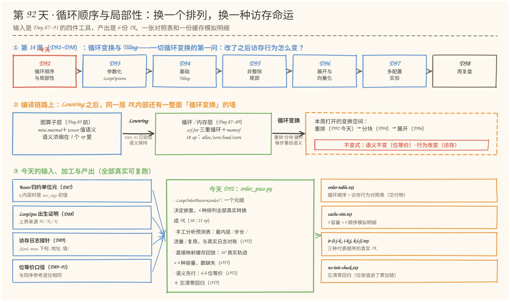
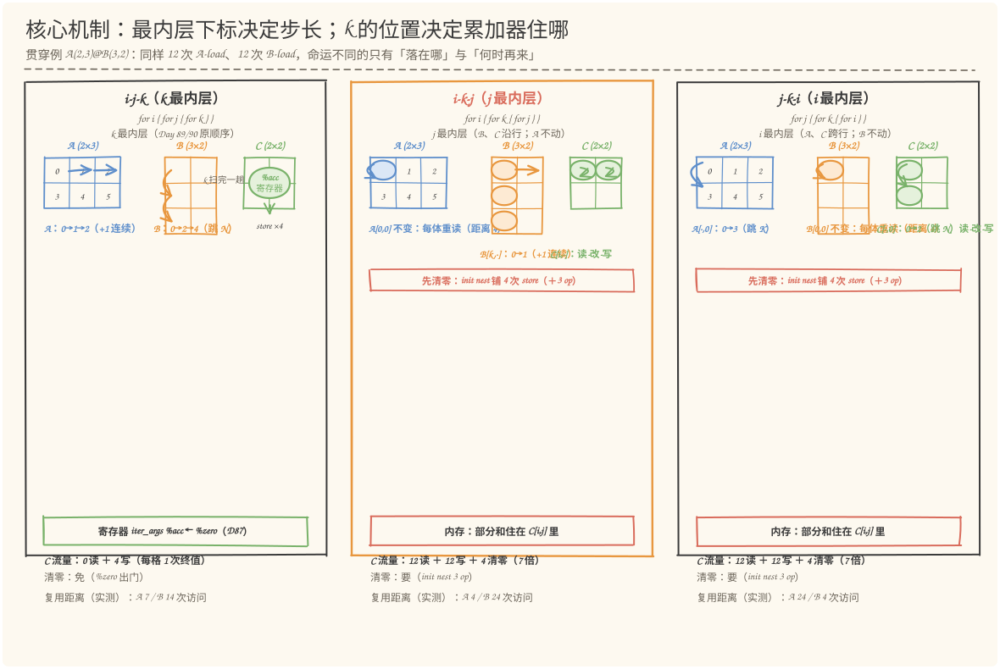
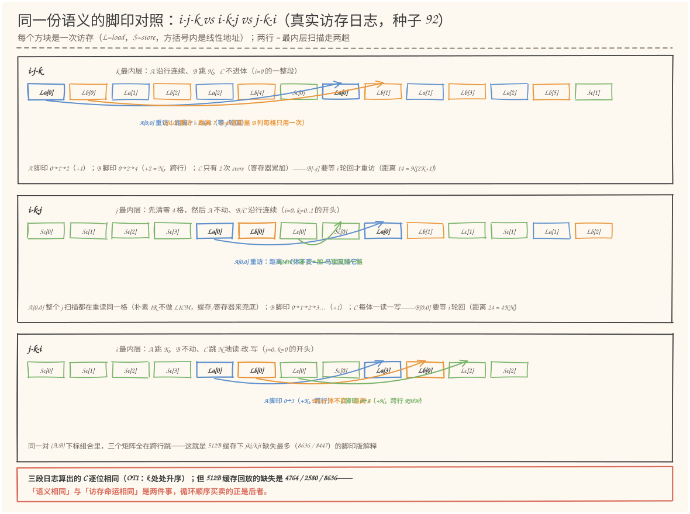
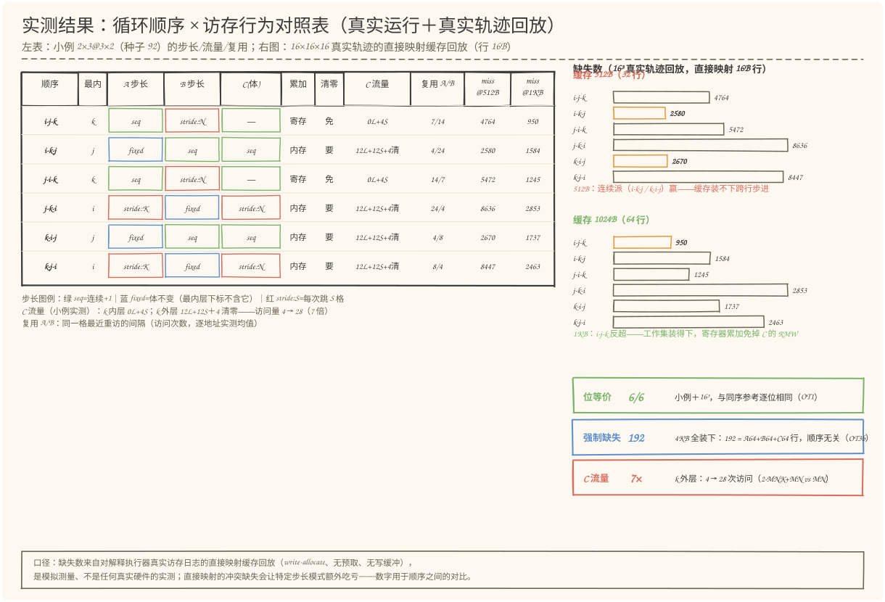

# 第 92 天：循环顺序与局部性——同一个 MatMul，6 种排列，6 种访存命运

> **今日目标**：完成本教程后，你能做到四件事——用自己的话说清**局部性**（locality）的两张面孔：**空间局部性**（下一步访问落在隔壁地址——行主序下"连续 +1"就是最好的例子）与**时间局部性**（同一格很快会被再访问——衡量指标是**复用距离**，即两次访问之间隔了多少次访存）；对 `i/j/k` 的全部 **6 种排列**逐一说清"最内层是谁 → A/B/C 各自的步长是什么（连续 +1 / 跳 N / 跳 K / 不变）→ 累加器住哪（寄存器 iter_args 还是内存 RMW）→ C 流量差多少（MN 次写 vs 2·MNK+MN 次访问）"；亲手完成计划点名的实践——**手工分析 i-j-k 与 i-k-j 两种循环顺序的连续访问与复用情况**（在 2×3 乘 3×2 上手画地址序列，先写预测再对账），并把方法推广到其余 4 种；独立运行 `order_pass.py` 复现 **OT1~OT5 全部 14/14 PASS**——包括一个会咬人的发现：**512B 缓存下连续派（i-k-j/k-i-j）缺失最少、1KB 时寄存器派（i-j-k/j-i-k）反超**，最优顺序取决于"缓存容量 vs 工作集"的相对大小，这正是 Day 94 Tiling 要根治的问题。
> **预计时间**：学习 40 分钟＋实践 50 分钟
> **前置准备**：Python 3.11＋numpy（本文环境：aarch64 Linux，Python 3.11.4，numpy 1.26.4）。本机没有安装 MLIR——与 Day 57~91 一致，复用 Day 90 的 `shape_pass.py`（Python 复刻 MLIR DialectConversion 的 Pattern／Rewriter／驱动器语义仿真＋带探针的解释执行器），今天**只取不改**；新增的 `order_pass.py` 在它之上实现参数化的 `LoopOrderPattern`。内容上需要 Day 87~91 的四个名词：`%zero`（归约单位元／iter_args 初值，Day 87）、LoopSpec（循环出生证明，Day 88）、访存日志（`(kind, mem, 下标, 线性地址, 值)` 五元组探针，Day 89）、位等价（与同序参考逐位相同，Day 89 起）；"手画地址的习惯"（Day 91 的 `3i+k / 2k+j / 2i+j`）今天是主要分析工具。缓存概念不需要真实硬件：今天的数字全部来自**对真实访存轨迹做直接映射缓存回放**的模拟测量，模型口径在图中和表头明示。
> **今日产出**：`code/order_pass.py`（6 种循环顺序的生成＋分析＋缓存模拟，OT1~OT5 十四项检查全部可运行）、`code/outputs/order-table.txt`（计划点名的**循环顺序与访存行为对照表**：6 种顺序 × 结构／步长／流量／复用／缓存）、`code/outputs/cache-sim.txt`（4 种容量 × 6 种顺序的模拟明细）、`code/outputs/ir-i-j-k.txt` ＋ `ir-i-k-j.txt` ＋ `ir-k-i-j.txt`（三种代表顺序的真实 IR）、`code/outputs/no-init-check.txt`（忘清零回归）、4 张手绘图。

## 1. 今天解决什么问题？

昨天（Day 91）复盘收尾时留下了一句话：语义保持只问"对不对"，不问"快不快"——同一份语义，`i/j/k` 换个排列就是另一份访存行为。今天就把这句话变成可测量的数字。

问题从一个具体的观察开始。Day 87~89 把 `mini.matmul` Lowering 成了固定的一种循环：`for i { for j { for k { … } } }`（k 最内层）。这个顺序不是天上掉下来的——它是"教科书默认"，但在真实的内存层级上它公平吗？把三个下标重新排列，一共 6 种嵌套（`ijk`、`ikj`、`jik`、`jki`、`kij`、`kji`）。Day 91 已经论证过其中一件事的雏形：**只要 k 仍然升序迭代，每种排列算出的 C 都与 i-j-k 逐位相同**——加法的顺序没变，f32 的舍入就一位不差。也就是说，**6 种排列在语义上是同一份程序**。

但在内存看来，它们是 6 个截然不同的程序。Day 89 的访存日志探针记录了每一次 load/store 的线性地址；把它当成"脚印序列"来看，同样是 12 次 A-load：

- `i-j-k`（k 最内层）里 A 的脚印是 `0,1,2 → 0,1,2 → 3,4,5 → 3,4,5 …`——**沿行连续**，每次 +1；
- `j-k-i`（i 最内层）里 A 的脚印是 `0,3 → 1,4 → 2,5 → 0,3 …`——**沿列跳跃**，每次 +K=3。

连续与跳跃，在 CPU/NPU 的缓存里是两种命运：连续访问能把一行 16B（4 个 f32）一次搬进来顺便用掉；跳跃访问每步都换行。更要命的是第三个角色 C：k 在最内层时，部分和住在 `iter_args` 里（Day 87 的寄存器累加），C 全程只被写 `M·N` 次；k 一旦挪到外面，部分和就得住进内存，C 变成**每趟读-改-写**——访问量从 `M·N` 暴涨到 `2·M·N·K + M·N`，还得先清零。今天的贯穿例子仍是 `A(2,3) @ B(3,2) → C(2,2)`（种子 92）：同样 12 次 A-load、12 次 B-load，C 的访问在两种顺序下分别是 **0 读 + 4 写** 与 **12 读 + 12 写 + 4 次清零**——7 倍差距，语义却逐位相同。

所以今天要回答的问题是：**"循环顺序"这个自由度，到底买卖的是什么？** 答案分三层：最内层下标决定**步长**（空间局部性）；k 的位置决定**累加器住哪**（C 流量）；外层排列决定**同一格何时重访**（时间局部性／复用距离）。今天的产出——循环顺序与访存行为对照表——就是把这三层逐格填满：6 种顺序，每一种都给出结构（18 op 还是 21 op）、A/B/C 的步长分类、流量、复用距离、以及在四种缓存容量下的真实模拟缺失数。

**验收口径**：Day 91 验收的是"拼起来能不能构成论证"，今天验收的是"同一份语义的 6 种实现，你能不能逐项说清它们在内存上的差别"——手工预测先写下来（OT2 对账），模拟数字真实可复跑（OT3），对照表能回答"512B 缓存选谁、1KB 选谁、为什么 Day 94 需要 Tiling"。

## 2. 先看全貌：今天的内容位于哪里？



**图 1**：看三处——上排是第 14 周七天链路：**D92（今天）循环顺序与局部性**是本周第一课，往下是 D93 把顺序变成配置（`LoopOptions`）→ D94~95 Tiling 与尾部 → D96 展开与向量化 → D97 多配置实验 → D98 复盘——本周的主题是"**循环变换**"，而一切循环变换的第一问都是"改了之后访存行为怎么变"，今天就是建立这把尺子；中排是编译链路：左边是 Day 85~91 已经验证过语义保持的 Lowering（`mini.matmul` → 18 op 循环 IR），右边的问号是本周要打开的变换空间——同一层 IR 内部，循环还能**重排**（今天）、**分块**（D94）、**展开**（D96），每一步都要重验"语义不变、行为改变"；下排是输入与产出：进来的是 Day 87~91 的四件工具（`%zero`、LoopSpec、访存日志、位等价口径），出去的是 6 份 IR、对照表和缓存模拟明细。

把今天的路线压缩成五步（细节在 §3、§4 展开）：

1. **生成**：写一个参数化的 `LoopOrderPattern`——`order=("i","k","j")` 一个元组决定嵌套顺序，6 种排列全部真实转换成 IR（OT1 验结构：k 内层 18 op，k 外层 21 op）；
2. **证语义**：6 种顺序在小例与 16³ 上都与同序参考**位等价**（OT1：k 处处升序 → 舍入顺序不变）——先把"对不对"钉死，才配谈"快不快"；
3. **手工分析**：在纸上对 i-j-k 与 i-k-j 画出地址序列、步长分类、复用距离，编码成预测表，与真实访存日志逐条对账（OT2）；
4. **模拟测量**：把 6 种顺序在 16×16×16 上的真实访存轨迹，回放进直接映射缓存（16B 行，512B/1KB/2KB/4KB 四种容量），数缺失（OT3）；
5. **成表**：全部数字汇成循环顺序与访存行为对照表（OT4），外加一个忘清零的错误回归（OT5）。

## 3. 核心概念：先用直觉，再给准确定义

### 3.1 空间局部性：最内层下标决定"每次访问落在哪"

一句通俗解释：**空间局部性（spatial locality）说的是"下一步要用的数据，就在刚才用过的数据旁边"**。内存搬运的最小单位不是一个 f32，而是一整条缓存行（cache line，常见 16B~64B，即 4~16 个 f32）；一次搬一行，如果接下来的访问正好落在这行里，就不用再去内存拿第二次。

类比：图书馆的书按主题排架，你借"编译原理"，管理员搬来的是整整一箱"编译原理区"的书——后面几本大概率也要借。对应到技术上是：行主序（row-major）的矩阵里，**沿行的访问步长是 +1**，四个连续的 f32 恰好挤在一条 16B 的行里，一次搬运四次受益；**沿列的访问步长是 +N**（跳过一整行），每次都落在不同的行里——搬一箱只用了其中一本。类比的边界：书架的"箱子"大小是固定的，而缓存行装进缓存后还要被后续访问**冲刷**（容量有限），所以"连续"只保证搬运划算，不保证它一直在缓存里——那是 3.2 的时间局部性管的事。

怎么把"步长"变成可检查的东西？看最内层循环的下标。三重循环里，**最内层的归纳变量每步 +1，谁的最后一个下标跟着它走，谁就沿行连续**。对 `C[i,j] = Σ A[i,k]·B[k,j]` 的三个张量逐一判断（下标配对：`A[i,k]`、`B[k,j]`、`C[i,j]`）：

| 最内层是 | A[i,k] | B[k,j] | C[i,j] |
| --- | --- | --- | --- |
| **k** | k 是 A 的**列**下标 → 沿行连续（+1） | k 是 B 的**行**下标 → 跨行（+N） | 不进循环体（见 3.3） |
| **j** | 下标不含 j → **体不变**（每趟重读同一格） | j 是 B 的列下标 → 沿行连续（+1） | 沿行连续（+1）读-改-写 |
| **i** | i 是 A 的行下标 → 跨行（+K） | 下标不含 i → **体不变** | 跨行（+N）读-改-写 |

**手工分析之一：i-j-k（k 最内层）**。在 2×3 乘 3×2 上手画地址（沿用 Day 91 的算式 `addr_A = 3i+k`、`addr_B = 2k+j`、`addr_C = 2i+j`）。固定 `i=0`，最内层 k 走一趟、j 走两趟，真实访存日志（种子 92）的前 14 条是：

```text
t0 La[0] t1 Lb[0] t2 La[1] t3 Lb[2] t4 La[2] t5 Lb[4] t6 Sc[0]   ← j=0 的 k 扫描
t7 La[0] t8 Lb[1] t9 La[1] t10 Lb[3] t11 La[2] t12 Lb[5] t13 Sc[1] ← j=1 的 k 扫描
```

- A 的脚印：`0,1,2 → 0,1,2`——**沿行连续 +1**，一条 16B 行装下 A[0,0..2] 三个 f32 还富余；
- B 的脚印：`0,2,4 → 1,3,5`——**跳 2 步（=N）**，每次都换行；`B[·,j]` 是 B 的一整列；
- C：只有 `Sc[0]`、`Sc[1]` 两次 store——循环体根本不碰 C（原因见 3.3）。

**手工分析之二：i-k-j（j 最内层）**。同例的真实日志开头（前 4 条是清零，见 3.3）：

```text
t0 Sc[0] t1 Sc[1] t2 Sc[2] t3 Sc[3]                    ← 清零：C 铺 0（沿行连续）
t4 La[0] t5 Lb[0] t6 Lc[0] t7 Sc[0]   ← i=0, k=0, j=0：读 A、读 B、读 C、写 C
t8 La[0] t9 Lb[1] t10 Lc[1] t11 Sc[1] ← i=0, k=0, j=1：A 还是同一格！
```

- A 的脚印：`0,0 → 0,0`——**差值 0，体不变**：`A[i,k]` 的下标里根本没有 j，整个 j 扫描都在重读同一格（朴素 IR 不做外提，每趟都 load 一次，但值一样——真编译器会用 LICM 把它提到循环外，或靠缓存白拿命中）；
- B 的脚印：`0,1 → 2,3 → 4,5`——**沿行连续 +1**，B 的第 k 行顺次扫过；
- C 的脚印：`0,1 → 0,1`——**沿行连续的读-改-写（RMW）**：`读 C[i,j] → 加上乘积 → 写回 C[i,j]`，每个 body 一读一写。

这两段手工分析就是计划实践"手工分析至少两种循环顺序的连续访问和复用情况"的落点——先用纸面推出"最内层是谁 → 三个张量各是什么步长"，再用日志对账（§5 的 OT2 把它做成了自动检查）。一个容易手算错的点：B 的跨行步长是 **N**（B 是 K×N，行 stride = N），不是 K——Day 91 手画 B 的 strides 时踩过的坑，今天换了个方向又出现。

### 3.2 时间局部性：复用距离——"同一格何时再来"

一句通俗解释：**时间局部性（temporal locality）说的是"刚用过的数据，很快会再用"**。度量它的是**复用距离**（reuse distance）：同一个地址相邻两次访问之间，隔了多少次别的访问——隔得越近，越可能还留在缓存里；隔得比缓存能装下的访问还多，就一定被冲掉了。

类比：做菜时盐要用五次。如果五次都在同一道菜里连着用（距离近），放在灶台上（缓存）就好；如果五道菜各用一次（距离远），每次都得跑一趟储物柜（内存）。对应到技术上是：`A[i,k]` 在 i-j-k 里每隔 `2K+1` 次访问重访一次（等 j 走一步），在 i-k-j 里**每隔 4 次就重访**（体不变，马上又读它）——同一颗数据，前一种排法它要在缓存里"活过" 2K+1 次访问，后一种 4 次就够了。类比的边界：灶台能放几样东西是容量问题，对应缓存的"能装下多少条行"；复用距离短也不保证命中（行可能被别的访问挤掉），它只是必要条件。

复用距离可以在日志上逐地址数出来（§5 的 OT2d），小例实测（均值）：

| 顺序 | A 最近重访 | B 最近重访 | 纸面公式 |
| --- | --- | --- | --- |
| i-j-k | **7** | 14 | A: 2K+1（等 j）；B: N(2K+1)（等 i） |
| j-i-k | 14 | **7** | A: M(2K+1)（等 j，跨整轮 i×k）；B: 2K+1（等 i） |
| i-k-j | **4** | 24 | A: 体不变；B: 4KN（等 i 轮回） |
| k-i-j | **4** | 8 | A: 体不变；B: 4N（等 i 一步） |
| j-k-i | 24 | **4** | A: 4KM（等 j 轮回）；B: 体不变 |
| k-j-i | 8 | **4** | A: 4M（等 j 一步）；B: 体不变 |

看表的诀窍：**每种顺序恰好宠一个张量**——最内层下标"绕着谁转"，谁就被重读得最勤（距离 4）；另外两个都得等外层轮回。i-j-k 谁也不宠（A 等 7、B 等 14）；i-k-j 宠 A；j-k-i 宠 B。注意"宠"是有代价的对偶：被宠的张量复用距离最短，但**另外两个张量的步长/流量要付出代价**——这正是 §4 要摊开的权衡。

### 3.3 k 的位置：累加器住哪——寄存器还是内存

一句通俗解释：**k 是归约下标——它每走一步，`C[i,j]` 就加一项。k 在最内层时，这个"累加中的值"可以住在一个寄存器里（`scf.for` 的 iter_args，Day 87/88 的成果）；k 一旦不在最内层，最内层每步换一个 (i,j)，累加中的值只能写回内存，下次再读出来接着加**。

这是三件事里**代价最不对称**的一件。寄存器版（k 最内层，i-j-k / j-i-k）：循环体只有 2 load ＋ 1 mulf ＋ 1 addf，k 扫完一趟后**一次 store 终值**——C 的总流量是 `M·N` 次写、零次读。内存版（k 在外两层，其余 4 种）：循环体变成 3 load ＋ 1 mulf ＋ 1 addf ＋ 1 store——`读 C[i,j] → 加 → 写回 C[i,j]` 每个执行一次，C 的总流量暴涨为 `M·N·K` 读 ＋ `M·N·K` 写。贯穿小例上：**4 次写 vs 12 读＋12 写**；16³ 上：**256 次 store vs 4096 读＋4352 写**——同一个 C，访存量差 7 倍以上。

内存版还有一个隐藏的前置条件：**必须先清零**。寄存器版的零起点是 `%zero` 作为 iter_args 初值出门（Day 87 的方案）；内存版的第一趟 `读 C[i,j]` 读到的是 alloc 后的未初始化垃圾（本仿真里是确定性公式 `garbage(addr) = 777 + 7·addr`）——不先铺 0，垃圾就进了累加链。所以 4 种 k 外层顺序的 IR 都多出一个清零 nest（`for i { for j { store %zero → C[i,j] } }`，＋3 op），先付 `M·N` 次 store 的"首付"。

值得强调的对称美：**换序不换数**。6 种顺序里 k 都升序迭代，每个 `C[i,j]` 的加法都是按 k=0,1,2 的顺序逐步 f32 舍入——寄存器累加和内存累加的舍入序列逐位相同，所以 6 种顺序的结果与同序参考**位等价**（§5 的 OT1 在小例和 16³ 上都验证了 6/6）。这是 Day 91"语义保持"论证的直接延伸：**语义（S1/S3 数值条款）对循环顺序免疫；访存行为（S5 内存条款的流量部分）完全不由语义约束**——"对"与"快"之间的整片自由度，就留给了循环变换。

### 3.4 缓存模拟的口径：回放不是实测

今天所有"缺失数"都来自**对真实访存日志做直接映射缓存回放**：把 16³ 的每一条 `(kind, mem, 下标, 地址)` 映射到扁平地址空间（A、B、C 各占一块，间隔 1 行避免共享行），然后用一个最简缓存模型数命中——行 16B（4 个 f32）、槽 = 块号 % 行数、write-allocate（store 未命中也把行装进来）、无预取、无写缓冲。

必须说清三件事：① 这是**模拟测量**，不是任何真实硬件的实测——数字用于**顺序之间的对比**，不用于预测绝对性能；② 直接映射（1 路）是最简模型，**冲突缺失**会让特定步长模式额外吃亏（后面 §5.3 会看到 j-i-k 的 B 列全军覆没，就是撞槽的典型）——真实缓存有组相联度、预取和写缓冲；③ 容量与形状是绑死的实验变量（16×16×16，A/B/C 各 1KB），换形状结论会移动——这本身是今天最重要的发现之一（§5.4）。

## 4. 图解核心机制

把 §3 的三条机制画在一张图上——三个代表顺序，每个看三样东西：网格上的脚印（步长）、循环体里的累加器（寄存器还是内存）、C 的账单（流量）：



**图 2**：三个面板分别是 i-j-k（k 最内层，Day 89/90 原顺序）、i-k-j（j 最内层，B/C 沿行连续）、j-k-i（i 最内层，A/C 跨行）。每个面板里：**A 网格**（蓝）标出最内层扫描实际踩过的格子——直箭头 = 连续 +1，弧线大跳 = 跨行（跳 N 或 K），圆圈 = 体不变；**B 网格**（橙）同理；**C 网格**（绿）在 k 内层时是一个"iter_args 寄存器"圆——k 扫完一趟才 store 一次，在 k 外层时是逐格读-改-写＋一个红色清零条。底部各有一条结论：累加器位置、C 流量、清零需求、复用距离（实测值）。看图时盯住一件事：**三个面板的积木完全相同（同样的 alloc/zero/常量/load/store），不同的只有装配顺序**——18 op 与 21 op 的差距只是那 3 个清零 op。

再看真实日志上的脚印对照（就是 §3.1 手工分析的两段，加上 j-k-i 作第三极）：



**图 3**：三个横带各是一种顺序的真实访存序列（种子 92，小例 2×3@3×2）：蓝 = A-load、橙 = B-load、绿 = C 的读/写，方括号里是线性地址。上带 i-j-k：A 脚印 `0→1→2` 连续、B 脚印 `0→2→4` 跳 N、C 只有两次 store；弧线标出 `A[0,0]` 从 t0 到 t7 的重访（距离 7 = 2K+1）。中带 i-k-j：先 4 条绿色清零 store（沿行连续），然后 `A` 反复读同一格（距离 4，体不变）、B/C 沿行连续、绿色弧线是"读 C → 加 → 写回"的 RMW 对。下带 j-k-i：A 跳 K、B 不变、C 跳 N——三格全在跨行跳。底部红条给出三种顺序在 512B 缓存回放下的缺失数（4764 / 2580 / 8636）——**脚印的形状直接写成缺失的多少**。

## 5. 动手实践：完成一个最小可运行例子

### 5.1 准备文件

今天的新增工程是两个脚本（Day 90 的 `shape_pass.py` 不动，被跨目录 import——与 Day 91 同样的"只取不改"口径）：

```text
tutorials/day-092/
├── README.md                    ← 本文
├── images/
│   ├── 01-overview.svg          ← 图 1～图 4（手绘风，随文生成）
│   └── ...
└── code/
    ├── order_pass.py            ← 今天的主角：6 种顺序的生成＋分析＋缓存回放
    ├── make_images.py           ← 生成 4 张 SVG（数字 import 自真实运行）
    └── outputs/                 ← 运行 order_pass.py 自动生成（6 个文件）
        └── （../day-090/code/shape_pass.py 被跨目录 import，只取不改）
```

环境检查（本文真实环境）：

```bash
$ python3 --version
Python 3.11.4
$ python3 -c "import numpy; print(numpy.__version__)"
1.26.4
```

### 5.2 编写代码

`order_pass.py` 约 830 行：IR 内核、Rewriter、驱动器、解释执行器全部来自 Day 90，今天新增三块。

**第一块：`LoopOrderPattern`——把"循环顺序"从常量变成参数。** 构造时传一个 `order` 元组（如 `("i","k","j")`，外→内），match 契约与 Day 90 的 `MatMulBodyPattern` 相同（静态 2D、内维匹配、动态宁拒不猜）。rewrite 按 k 的位置分两种形态——这是全篇最核心的 30 行：

```python
if o3 == "k":      # —— 形态 A：k 最内层（Day 89/90 的结构，18 op）——
    # 体：读 A、读 B、乘、加（iter_args 累加器），yield 写回
    f_in = rewriter.create("scf.for", operands=[lo, bk, st, zero.results[0]],
                           result_names=["%acc"], result_types=["f32"],
                           attrs={"iv": "%k", "iv_value": iv["k"],
                                  "iter_names": ["%acc"], "iter_args": [acc_arg]},
                           body=[xa, xb, p, s, yld], ...)
    stm = rewriter.create("memref.store",
                          operands=[f_in.results[0], alloc.results[0], iv["i"], iv["j"]], ...)
    mid_body = [f_in, stm]          # store 放中层（k 外、o2 内）——i、j 都在作用域
else:              # —— 形态 B：k 不在最内层（21 op = 18 主循环 + 3 清零）——
    # 先清零（k 外层 → 累加在内存，零起点要自己铺）
    # 体：读 A、读 B、读 C、乘、加、写 C —— 每个执行一次 RMW
    f_in = rewriter.create("scf.for", operands=[lo, buc[o3], st],
                           attrs={"iv": f"%{o3}", "iv_value": iv[o3]},
                           body=[xa, xb, cv, p, s, stm], ...)
    mid_body = [f_in]
f2 = rewriter.create("scf.for", operands=[lo, buc[o2], st],
                     attrs={"iv": f"%{o2}", "iv_value": iv[o2]}, body=mid_body, ...)
rewriter.create("scf.for", operands=[lo, buc[o1], st],
                attrs={"iv": f"%{o1}", "iv_value": iv[o1]}, body=[f2], ...)
```

要点有三：① 三个 iv 的 `Value` 对象按 `order` 复用——同一批下标值，装配顺序不同；② 形态 A 的 store 放**中层循环**尾部（i、j 都在作用域的最内层位置——Day 89 定的位）；③ 形态 B 的清零 nest 用独立的 i/j 循环先铺 `M·N` 个 0。生成的 IR 有真实注释，`outputs/ir-i-k-j.txt` 摘录：

```mlir
scf.for %i = %c0 to %c2 step %c1 {          // 清零 nest（+3 op）
  scf.for %j = %c0 to %c2' step %c1 {
    memref.store %zero, %c[%i, %j] : memref<2x2xf32, strided<[2, 1]>>
  }
}
scf.for %i = %c0 to %c2 step %c1 {          // 主循环：i-k-j
  scf.for %k = %c0 to %c3 step %c1 {
    scf.for %j = %c0 to %c2' step %c1 {
      %xa = memref.load %a[%i, %k] : ...    // 下标不含 j → 最内层扫描时不变
      %xb = memref.load %b[%k, %j] : ...    // j 是列 → 沿行连续
      %cv = memref.load %c[%i, %j] : ...    // 读-改-写：部分和住在内存里
      %p = arith.mulf %xa, %xb : f32
      %s = arith.addf %cv, %p : f32         // 加法顺序仍是 k 升序
      memref.store %s, %c[%i, %j] : ...
    }
  }
}
```

**第二块：手工分析预测表——先写预测，再对账。** `PREDICT` 字典把 §3 的纸面推理编码成数据（每种顺序的最内层、A/B/C 步长分类、累加器位置、复用距离公式），OT2 拿真实日志逐条对账——预测错一条就亮红。日志分析的三个函数都很短：步长分类（相邻地址差值的众数：+1 → `seq`、0 → `fixed`、其他 → `stride:S`）、流量计数、复用距离（每个地址相邻两次出现的序号差取均值）。

**第三块：缓存回放——对真实轨迹数缺失。** 20 行的 `cache_sim`：

```python
def cache_sim(log, m, k, n, lines, line=SIM_LINE, pad=SIM_PAD):
    base = flat_bases(m, k, n, line, pad)      # A@0，B@align(MK)+1行，C@...
    slots, per_mem, hits = {}, Counter(), 0
    for kd, mem, idx, addr, v in log:          # 真实访存日志逐条回放
        blk = (base[mem] + addr) // line       # 块号
        if slots.get(blk % lines) == blk:      # 直接映射：槽 = 块号 % 行数
            hits += 1
        else:
            slots[blk % lines] = blk           # write-allocate：store 也装行
            per_mem[mem] += 1
    ...
```

矩阵间垫 1 行（pad）是为了不让两个矩阵共享缓存行；基址对齐到行边界。这个模型刻意保持最简——它的价值不在预测绝对性能，而在让"顺序 A 比顺序 B 多缺多少"变成可复跑的数字。

### 5.3 运行与观察

一条命令跑全部（真实运行，本机 aarch64 Linux，Python 3.11.4，numpy 1.26.4）：

```text
$ python3 order_pass.py
第 92 天 · 循环顺序与局部性：i/j/k 的 6 种排列，同一份语义、6 种访存行为
环境：Linux aarch64, Python 3.11.4, numpy 1.26.4; 本机未安装 MLIR（Day 57~91 口径：…）

—— OT1 语义不变性：换个顺序，结果变吗？ ——
[PASS] OT1a i-j-k 复现 Day 89/90 的 18 op 结构：实测 18 op（alloc/zero/常量×5/for×3/load×2/mulf/addf/yield/store）
[PASS] OT1b 六种顺序结构：k 内层 18 op；k 外层 21 op（清零 nest ＋3）：结构是数据：换个排列不换积木，只换装配
[PASS] OT1c 小例 A(2,3)@B(3,2)：6/6 与同序参考位等价：k 处处升序 → 每个 C[i,j] 的加法与舍入顺序不变——换序不换数
[PASS] OT1d 大例 A(16,16)@B(16,16)：6/6 位等价（语义不变与形状无关）：含 k 外层的 4 种：内存累加也是 k 升序逐步舍入，与寄存器累加逐位相同

—— OT2 手工分析对账：纸上预测 vs 真实访存日志（小例 2×3@3×2） ——
[PASS] OT2a 最内层归纳变量 = 预测（6/6）：i-j-k→k；i-k-j→j；j-i-k→k；j-k-i→i；k-i-j→j；k-j-i→i
[PASS] OT2b A/B/C 步长分类 = 预测（6 顺序 × 4 流，真实日志逐条算）：seq=连续+1｜fixed=体不变｜stride:S=跳 S 格｜…
[PASS] OT2c 流量 = 公式（A/B 恒 MNK；C 由 k 位置决定）：k 内层：C 0 读 + MN 写；k 外层：C MNK 读 + MNK 写 + MN 清零——2×3@3×2 上即 12/12/0/4/0 与 12/12/12/12/4
[PASS] OT2d 元素级最近复用距离 = 纸面公式（均值，逐地址实测）：A：ijk 7、jik 14、ikj/kij 4、jki 24、kji 8；B：ijk 14、jik 7、ikj 24、kij 8、jki/kji 4——「体不变」的张量才是 4，其余等外层轮回

—— OT3 缓存模拟：直接映射回放（16×16×16，行 16B，矩阵间隔 1 行） ——
[PASS] OT3a 总访问数 = 公式（k 内层 2MNK+MN=8448；k 外层 4MNK+MN=16640）：访问数与顺序无关的部分先对齐——差异全部来自「落在哪里」
[PASS] OT3b 4KB（256 行）全装下：6 种顺序 miss 全部 = 数据行数：unique 行 = 192（A 64 + B 64 + C 64，pad 行不触碰）——只剩强制缺失，顺序无关
[PASS] OT3c 512B（32 行）排序 = 预测：ikj/kij < ijk < jik < kji/jki：i-k-j 2580；k-i-j 2670；i-j-k 4764；j-i-k 5472；k-j-i 8447；j-k-i 8636——缓存装不下跨行步进时，连续访问的顺序赢
[PASS] OT3d 1KB（64 行）翻转：i-j-k 反超（寄存器累加免掉 C 的 RMW 流量）：i-j-k 950；j-i-k 1245；i-k-j 1584；k-i-j 1737——工作集（A 行 4 行 + B 列 16 行）装得下时，k 内层的「不碰 C」是硬优势

—— OT4 对照表产出 ——
[PASS] OT4 对照表已写入 outputs/order-table.txt ＋ cache-sim.txt：6 种顺序 × 结构/步长/流量/复用/缓存，数字全部来自真实运行

—— OT5 忘记清零的回归：k 外层 ＋ 无 init nest ——
[PASS] OT5 k-i-j 不清零：第一趟 k 就读到 M·N 条垃圾，结果 ≠ 参考：未初始化读 4 条（只有 k=0 那趟踩雷——之后读的是错误部分和；垃圾 = 777+7·addr，Day 87 公式）；max|C−ref| = 798.0；18 op——结构看着正常，错在语义

—— 检查测试 14 PASS / 0 FAIL ——
order-table.txt / cache-sim.txt / ir-i-j-k.txt / ir-i-k-j.txt / ir-k-i-j.txt / no-init-check.txt 已写入 outputs/
```

**产出：循环顺序与访存行为对照表**（`outputs/order-table.txt` 的汇总矩阵，数字全部真实测量——小例 2×3@3×2 测流量与复用，16³ 回放测缺失）：

| 顺序（外→内） | 最内层 | A 步长 | B 步长 | C（体内） | 累加器 | 清零 | C 流量（小例） | 复用 A/B | miss@512B | miss@1KB |
| --- | --- | --- | --- | --- | --- | --- | --- | --- | --- | --- |
| i-j-k | k | **连续 +1** | 跳 N | 不进体 | 寄存器 | 免 | 0L+4S | 7 / 14 | 4764 | **950** |
| i-k-j | j | 体不变 | **连续 +1** | **连续 RMW** | 内存 | 要 | 12L+12S+4清 | **4** / 24 | **2580** | 1584 |
| j-i-k | k | **连续 +1** | 跳 N | 不进体（存跳 N） | 寄存器 | 免 | 0L+4S | 14 / 7 | 5472 | 1245 |
| j-k-i | i | 跳 K | 体不变 | 跳 N RMW | 内存 | 要 | 12L+12S+4清 | 24 / **4** | 8636 | 2853 |
| k-i-j | j | 体不变 | **连续 +1** | **连续 RMW** | 内存 | 要 | 12L+12S+4清 | **4** / 8 | 2670 | 1737 |
| k-j-i | i | 跳 K | 体不变 | 跳 N RMW | 内存 | 要 | 12L+12S+4清 | 8 / **4** | 8447 | 2463 |

读表三问（对照图 4 一起看）：

1. **纵向比步长**：最内层换成 j（i-k-j / k-i-j），B 从跳 N 变连续、C 从不进体变连续 RMW；换成 i（j-k-i / k-j-i），A、C 全在跨行跳。
2. **横向比 C 流量**：k 内层两家 0L+4S，k 外层四家 12L+12S＋4 清零——k 的位置一个决定，C 的访问量从 4 涨到 28（7 倍）。
3. **横向比缺失**：512B 时连续派（i-k-j 2580 / k-i-j 2670）最少，1KB 时寄存器派（i-j-k 950）反超——**最优顺序取决于"缓存容量 vs 工作集"的相对大小**。



**图 4**：左表就是上面的对照表（步长列着色：绿 = 连续、蓝 = 体不变、红 = 跳格），右上两组柱图是 16³ 真实轨迹在 512B / 1KB 两种容量下的缺失数（橙色高亮当时的赢家），右下三张数字卡片给出关键实测：位等价 6/6（换序不换数）、强制缺失 192（4KB 全装下时六家拉平——A 64 行＋B 64 行＋C 64 行）、C 流量 7×（k 外层的代价）。底部灰条注明口径：直接映射回放、write-allocate、无预取——是模拟测量，用于顺序之间的对比。

一个值得停下来看的细节：**512B 下 j-i-k 的 B 缺失 = 4096 = 全部 B-load 都缺**（`cache-sim.txt` 明细）。B 的复用距离只有 7（三张表里最短之一），为什么全军覆没？因为 j-i-k 里 B 列的块号步长是 4（16B 行 × N=16 跨度），与 A 行的块号在同几个槽上撞车——**直接映射的冲突缺失**，复用距离再短也救不回来。这正是 3.4 说的模型边界：真实缓存的组相联度就是为这种模式准备的。

### 5.4 修改一个参数再观察

**对照一：换缓存容量，看排名翻转。** 默认四种容量之外，`--cache` 可以任意指定行数（真实运行）：

```text
$ python3 order_pass.py --cache 48
缓存对照实验：直接映射 48 行 × 16B = 768B（16×16×16 真实轨迹回放）
  i-j-k    访问 8448    缺失 2742    命中率 67.5%   A缺 333   B缺 2345  C缺 64
  i-k-j    访问 16640   缺失 1094    命中率 93.4%   A缺 143   B缺 747   C缺 204
  j-i-k    访问 8448    缺失 3414    命中率 59.6%   A缺 854   B缺 2304  C缺 256
  j-k-i    访问 16640   缺失 5799    命中率 65.2%   A缺 2775  B缺 332   C缺 2692
  k-i-j    访问 16640   缺失 1346    命中率 91.9%   A缺 332   B缺 234   C缺 780
  k-j-i    访问 16640   缺失 5501    命中率 66.9%   A缺 2683  B缺 143   C缺 2675
```

768B 时 i-k-j（1094）仍然领先 i-j-k（2742）一倍多。把容量往上加（真实运行，摘录两行）：60 行（960B）时 i-j-k 1274 vs i-k-j 739——**i-k-j 仍赢**；64 行（1KB，恰好装下整块 B 或 C）时 i-j-k 950 vs i-k-j 1584——**i-j-k 反超**。翻转点落在 60~64 行之间：容量过了"整个矩阵"这道坎，i-j-k 的工作集（A 行 4 行 + B 列 16 行 ≈ 20 行）彻底装下，它"不碰 C"的先天优势就兑现了。**"哪种顺序好"没有脱离容量与形状的答案**——这是今天最重要的一条实测结论，也是 Day 94 Tiling 的存在理由（把工作集切小，让任何容量都像 4KB 那样宽容）。

**对照二：故意忘清零。** `--no-init` 复现 OT5 的错误（真实运行）：k 在最外层却不铺零，第一趟 k=0 读到的 C 是垃圾：

```text
$ python3 order_pass.py --no-init
—— OT5 忘记清零的回归：k 外层 ＋ 无 init nest ——
[PASS] OT5 k-i-j 不清零：第一趟 k 就读到 M·N 条垃圾，结果 ≠ 参考：未初始化读 4 条（…垃圾 = 777+7·addr…）；max|C−ref| = 798.0
```

实测的 C 是 `[[776.79, 784.51], [787.21, 799.28]]`，而正确答案是 `[[-0.209, 0.510], [-3.790, 1.275]]`——垃圾值 777+7·addr 加上正确乘积，正是 Day 87 内存模型的确定性公式。注意只有 **4 条**未初始化读（不是 12 条）：只有 k=0 那趟踩雷，之后读到的都是"错误的部分和"——**错误从第一趟就发生了，但探针只报未初始化的那几条**；判断结果对错要靠位等价，不能只看有没有报错。

**对照三：单顺序深挖。** `--order j-k-i` 把一种顺序的账本摊开——LoopSpec（外→内的嵌套与上界来源）、第一段访存脚印（逐条地址）、步长对账（实测 vs 预测）、流量、复用距离、四种容量的缺失数，一屏看完（真实运行；§3 和 §5.3 的每个数字都能这样单查）。

## 6. 常见错误与排查

### E1：把"换序不换数"当成"怎么重排都安全"

- **现象**：看完 OT1 的 6/6 位等价，有人把手里的循环重排成了"k 从 K-1 倒着到 0"（或者交换时顺手改了求和的分组方式），数值立刻和参考对不上——却以为"教程不是说换序不变吗"。
- **原因**：位等价的前提是**k 处处升序**——每个 `C[i,j]` 的加法按 k=0,1,2,… 逐步 f32 舍入，顺序一个都不能动。倒序 k 是合法的数学重排（实数加法交换律），但 f32 的舍入序列变了，结果会差 1e-7 量级；要是重排把加法树也改了（比如两两分组求和），偏差还会更大。OT1 验证的是"6 种**升序**排列位等价"，不是"任意重排安全"。
- **定位**：OT1 的位等价检查亮红（`np.array_equal` 逐位比较）；对照 `np.matmul` 的差值在 1e-7 量级属于"舍入顺序不同"（Day 89 起的口径），但对照**同序参考**必须逐位相同。
- **修复**：重排循环时保住两条不变式——k 的迭代方向不变（升序）、每次加法仍是"当前部分和 + 单个乘积"。要改求和顺序（如倒序、分组），必须把它当成**数值语义的变化**单独评估，不能混在"访存优化"里悄悄做。

### E2：k 挪到外层，忘了清零（今天真实复现）

- **现象**：把顺序从 i-j-k 换成 k-i-j 后结果全错：实测 C = `[[776.79, 784.51], …]`，正确值是 `[[-0.209, 0.510], …]`，max|C−ref| = 798；但 IR 结构看起来完全正常（18 op，`--no-init` 复现的就是它）。
- **原因**：k 在最内层时，零起点由 `%zero` 作为 iter_args 初值出门（Day 87 的方案 B）；k 挪出去之后累加落到内存，第一趟 `读 C[i,j]` 读到的是 alloc 后的未初始化垃圾（本仿真 = `777 + 7·addr`）——垃圾进了累加链，后面每一趟都在错误的部分和上继续加。
- **定位**：解释执行器的 `uninit_reads` 探针报出 4 条（只有 k=0 那趟踩雷）；位等价检查 `max|C−ref| = 798` 一锤定音。注意**不能只等探针报错**——错误的部分和是"已写过的"，探针不再报警，只有结果对照能抓全。
- **修复**：k 不在最内层的形态必须配清零 nest（`for i { for j { store %zero } }`，默认 `init=True` 就是修复后的形态；真实工程里对应先 memset 或 `beta=0` 语义的专用 kernel）。**教训：归约变量换位置，"零起点"的供给方式就要跟着换——Day 87 的伏笔在循环变换里第二次兑现**。

### E3：手算 B 的步长抄成 K（Day 91 姊妹版）

- **现象**：手工分析 j-k-i 时把 A 的跨行步长写成"跳 N"（实测 OT2b 报 `stride:3` ≠ 预测 `stride:N=2`——注意这次错的是 A 不是 B）；或者反过来，分析 k 内层时把 B 的跳步写成"跳 K=3"。
- **原因**：跨行步长 = **该矩阵行主序的 stride[0] = 后面那维的长度**：A 是 M×K，沿列走一格跳 K；B 是 K×N，沿列走一格跳 N。两个矩阵形状不同（2×3 与 3×2），跳步就不一样——"都是跳列"的直觉容易把两个跳步混成一个数。
- **定位**：OT2b 的明细行直接给出三方对照：手画预测 `stride:N`｜日志实测 `stride:3`｜✗。
- **修复**：口诀还是 Day 91 那句"**跨过后面所有格子才是这一步**"——`A[i,k]` 里 k 走一步跨过 A 的一整行（K 格），`B[k,j]` 里 k 走一步跨过 B 的一整行（N 格）。修完 OT2b 回绿。

### E4：只看命中率，忘了访问总数——"84.5% 完胜 43.6%"的陷阱

- **现象**：对照表读到"512B 下 i-k-j 命中率 84.5% > i-j-k 的 43.6%"，得出"i-k-j 全面优于 i-j-k"的结论；到 1KB 表格又发现 i-j-k 缺失最少，两头对不上。
- **原因**：命中率分母不同——i-k-j 的总访问是 16640（C 的 RMW 翻倍），i-j-k 只有 8448。真正进入内存带宽账单的是**绝对缺失数**和**总访问数**两个数：512B 时 i-k-j 缺失 2580 < i-j-k 的 4764（带宽角度 i-k-j 赢），但 i-k-j 多付了 8192 次缓存内访问（延迟/功耗角度未必赢）；1KB 时 i-j-k 缺失 950 且访问数减半，全面反超。
- **定位**：`cache-sim.txt` 每行同时给出访问数、命中、缺失、命中率四列——单看一列就是断章取义。
- **修复**：报告性能口径时固定三件套：**总访问、绝对缺失、命中率**，并注明模型（直接映射、write-allocate、无预取——§3.4 的三条边界）。比较"顺序优劣"永远要同时给出容量与形状，脱离这两个变量的排名没有意义（§5.4 的翻转就是证据）。

## 7. 今日练习

### 必做练习

**(1) 手画 j-k-i 再对答案**：不看 §3 的表格，在纸上写下 j-k-i（`for j { for k { for i } }`）的预测——最内层是 i；A、B、C 在最内层扫描时各是什么步长（连续 +1 / 跳几格 / 体不变）；累加器在哪、要不要清零；A 和 B 的最近复用距离各是多少次访问（写出公式再代 M=2、K=3、N=2 求值）。然后运行 `python3 order_pass.py --order j-k-i` 对账——步长、流量、复用距离三项全对才算过；有错的话按 E3 的口诀定位是哪个矩阵的 stride 算错了。**(2) 找翻转点**：用 `--cache` 在 56、60、62、64 行四个容量下重跑，记录每个容量下绝对缺失最少的顺序；确定 i-j-k 反超 i-k-j 的具体行数区间，并用"这个容量装得下什么工作集"解释为什么恰好在那里翻转（提示：16×16 的矩阵一行占 4 个 16B 行，整块 B 或 C 是 64 行）。

### 选做挑战

给 `cache_sim` 加一个**两路组相联**模式（改动提示：槽换成两个块的集合，命中看集合里两块任意一块，替换用最简单的"替换较旧的"即可——约 10 行）。然后回答两个问题：① j-i-k 在 512B 下的 B 缺失还是 4096 吗？如果大幅下降，证实了 §5.3 说的"冲突缺失撞槽"假说；② 其他五种顺序的数字变化大吗——组相联度对"连续派"和"寄存器派"的影响为什么不对称？把结论写进你的笔记（这个问题会一直烧到 Day 97 的多配置实验）。

## 8. 今日验收

- [ ] 我能用自己的话解释局部性的两张面孔——空间局部性（步长：连续 +1 / 跳 N / 跳 K / 体不变，由最内层下标决定）和时间局部性（复用距离：同一格下次被访问隔多少次，由外层排列决定），并说出它们各对应缓存机制的哪一半（行搬运 / 行驻留）；
- [ ] 我手工分析了 i-j-k 与 i-k-j 两种顺序的连续访问与复用情况（§3.1 的两段日志逐条能自己推出来），并把方法用到了第三种（练习 1 的 j-k-i）——OT2 的四项对账能解释每一条在验什么；
- [ ] 我能独立运行 `python3 order_pass.py` 复现 14/14 PASS，说出 OT1~OT5 各自守的门（语义不变、手工对账、缓存回放、对照表产出、忘清零回归），并指出 `outputs/order-table.txt` 里任何一格数字的测量来源（小例流量 / 16³ 回放）；
- [ ] 我能解释 512B 与 1KB 下排名翻转的原因（工作集 vs 容量；k 内层免 C 的 RMW），并说出这对 Day 94 Tiling 意味着什么；我也能定位 E2 的忘清零错误（为什么只有 4 条 uninit 读、为什么结果错得离谱）；
- [ ] 我保存了 `order_pass.py`、`outputs/` 下六份真实运行结果和 4 张手绘图，并且我的对照表能回答"三种缓存容量下各选哪种顺序、代价是什么"——不是背排名，而是能从步长、流量、复用距离三列推出来。

## 9. 一句话总结与明天预告

今天回答的问题是"**循环顺序这个自由度，买卖的是什么**"。答案是三件事：最内层下标决定**步长**（空间局部性——i-k-j 让 B、C 沿行连续，j-k-i 让 A、C 跨行跳），k 的位置决定**累加器住哪**（寄存器 iter_args vs 内存 RMW——C 流量 4 次写 vs 28 次访问，7 倍），外层排列决定**复用距离**（时间局部性——被最内层"绕着转"的张量距离 4，其余等外层轮回）。机制上，6 种排列共享同一批积木（alloc/zero/常量/load/store），只是装配不同——18 op 与 21 op 的差别只是清零 nest；且 k 处处升序保证了 6/6 位等价：**语义对顺序免疫，访存完全暴露给顺序**。实践闭环是手工分析两种顺序（预测先于日志写下，OT2 四项对账）加 14/14 PASS 的检查套件；最有价值的实测发现是**排名随容量翻转**——512B 时连续派 i-k-j 缺失最少（2580），1KB 时寄存器派 i-j-k 反超（950）——"哪种顺序好"没有脱离缓存容量与矩阵形状的答案，这正是 Tiling 要根治的问题。

明天（Day 93）把这个自由度收进配置：定义 `LoopOptions`，把循环顺序、Tile 尺寸、展开因子从代码常量变成编译配置——今天的 `LoopOrderPattern(order=...)` 已经是它的雏形（顺序已经是参数了），明天补上参数校验、默认值和配置结构，为 Day 94 的 Tiling 铺路。
