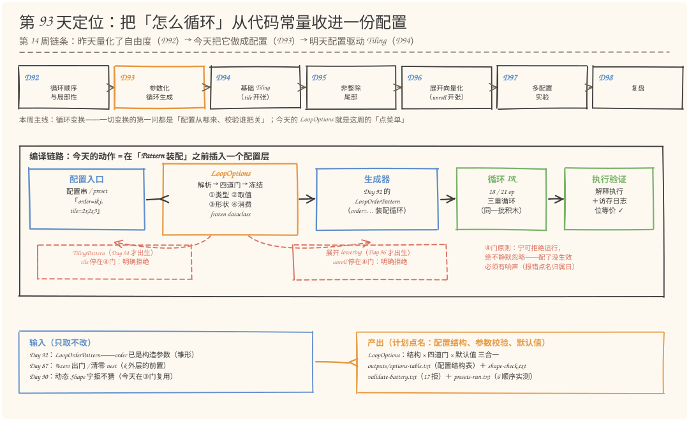
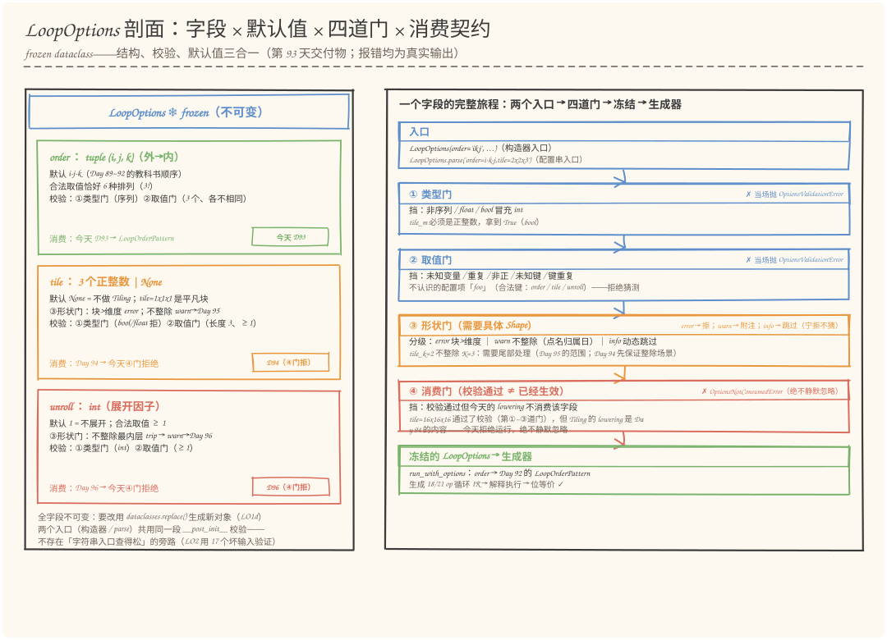
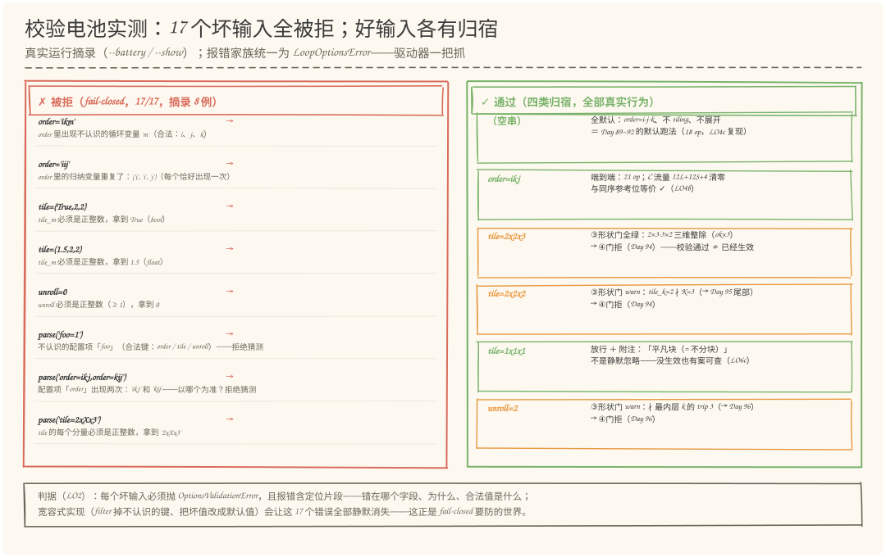
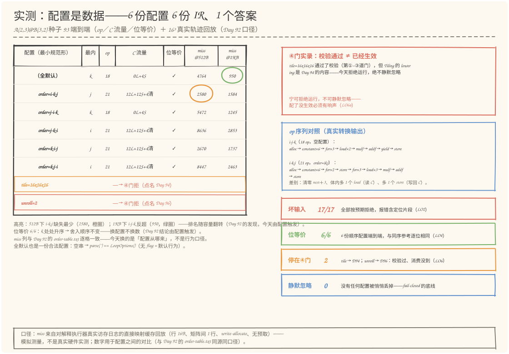

# 第 93 天：参数化循环生成——把「怎么循环」从代码常量收进一份 LoopOptions

> **今日目标**：完成本教程后，你能做到四件事——说清**为什么裸参数不够**：昨天（Day 92）的 `LoopOrderPattern(order=...)` 只有一行 `assert` 把关，而 `tile`／`unroll` 根本还没有出生；今天把**循环顺序、Tile 尺寸、展开因子**三个选择收进一个正式的编译配置对象 `LoopOptions`（frozen dataclass：**结构、校验、默认值**三合一——计划点名的交付物）；讲透 **fail-closed 四道门**：①类型门（`bool` 冒充 `int` 也拒）②取值门（`order` 的合法空间恰好 6 = 3!）③形状门（整除／越界／动态三口径，`warn` 级报错点名"这件事将来谁管"：Day 95 管尾部、Day 96 管展开余数）④消费门（**校验通过 ≠ 已经生效**：`tile`／`unroll` 今天被明确拒绝，报错点名 Day 94／96，绝不静默忽略）；独立复现 **25/25 PASS**：`LO1` 结构与默认值（空配置 = Day 89~92 的默认跑法）、`LO2` 17 个坏输入逐个被拒、`LO3` 缺省补齐与"未设置 ≠ 显式平凡"、`LO4` 6 种顺序配置端到端位等价（op 数／C 流量与 Day 92 逐格一致）、`LO5` 形状门三口径、`LO6` fail-closed 实录；最后能解释**为什么"配置了但没生效"比任何报错都危险**——这是今天最重要的一条工程原则。
> **预计时间**：学习 35 分钟＋实践 45 分钟
> **前置准备**：Python 3.11＋numpy（本文环境：aarch64 Linux，Python 3.11.4，numpy 1.26.4）。本机没有安装 MLIR——与 Day 57~92 一致，复用 Day 90 的 `shape_pass.py`（IR 内核／Rewriter／解释执行器）和 Day 92 的 `order_pass.py`（`LoopOrderPattern` 与访存日志分析），今天**只取不改**。内容上需要 Day 87~92 的四个名词：`%zero`（归约零起点，Day 87）、`iter_args`（寄存器累加器，Day 87/88）、位等价（与同序参考逐位相同，Day 89 起）、`LoopOrderPattern`（Day 92：`order` 已经是构造参数——今天的雏形）；"动态宁拒不猜"（Day 90）今天会在形状门里第二次兑现。唯一的新语言概念是 Python 的 `dataclass(frozen=True)`（不可变数据类），第一次出现时用一句话讲清。
> **今日产出**：`code/loop_options.py`（`LoopOptions` ＋ 四道门 ＋ LO0~LO6 共 25 项检查，全部可运行）、`code/outputs/options-table.txt`（计划点名的**配置结构表**：3 个字段 × 类型／默认值／合法取值／校验门／消费方 ＋ 四道门说明 ＋ preset 一览）、`validate-battery.txt`（17 个坏输入的真实报错）、`presets-run.txt`（6 种顺序端到端：op 数／C 流量／位等价／缓存缺失 ＋ fail-closed 实录）、`shape-check.txt`（形状门 findings：整除／越界／动态三口径）、4 张手绘图。

## 1. 今天解决什么问题？

昨天复盘时留了一句话：**"明天的 `LoopOptions` 已经有了雏形——`LoopOrderPattern` 的 `order` 参数就是它"**。今天把这个雏形变成正式的配置对象，先要回答：**裸参数到底差在哪？**

看昨天代码的真实状态。Day 92 的 `LoopOrderPattern` 构造器只有一行把关：

```python
assert sorted(order) == ["i", "j", "k"], f"order 必须是 i/j/k 的排列，拿到 {order}"
```

这一行 `assert` 的问题不是"校验太严"，而是它是一个**没有结构的裸参数**的全部防线，有三件真实工程里会咬人的事它都做不到：

1. **拼错得不到定位**。`assert` 只说"不是排列"，不说错在哪个分量、合法值是什么——而且 `assert` 在 `python -O` 下会被整行剔除，防线直接消失。
2. **没有默认值的台账**。每个调用方都得自己记得传全参数；传漏一个，得到的是另一种行为，而不是一个提醒。
3. **"配了但没生效"没人报**。这是三件里最危险的：设想 `tile`／`unroll` 今天以字段的形式存在（为 Day 94／96 铺路），但生成器暂时只消费 `order`——如果实现成"把不认识的字段悄悄丢掉"，用户配上 `tile=2x2x3`，程序一声不吭跑完，**用户以为 Tiling 已开，实际跑的是没改的 IR**。性能优化的世界里，静默忽略比崩溃可怕得多：崩溃至少逼你去看，静默让你带着错误的预期继续工作。

类比：这就像点菜。冲着后厨喊"少盐少辣"是裸参数——后厨可能听错、可能漏记、也可能根本不做这道菜；菜单点单是配置——辣度一栏写着"微辣（默认）／中辣／重辣"，点单员会拒绝"辣度=超辣"（不认识的取值）、会把你点的每道菜记全（缺省补默认）、更不会把你点的菜静默划掉（点了不做的菜会明确告诉你"这道今天没有"）。对应到技术上是：`LoopOptions` 把"怎么循环"写成一份**可以逐项核对的数据**——字段有类型和合法值（菜单的选项栏）、有默认值（微辣是默认）、有校验（点单员）、有消费方标注（这道菜归哪个灶）。类比的边界：餐厅菜单不会因为客人不同而变，而编译配置是**按次生成、随流水线传递的对象**——它的"点单员"（四道门）不是人，是生成器之前的一套确定性检查。

真实编译器里这是标准形态：LLVM 的 `-O2`、GCC 的 `-march=`、MLIR 的 `--pass-options='...'`（每个 Pass 用 `OptionValue` 声明自己的旗子，`mlir-opt` 负责解析与拒绝未知旗子）——**优化选择是配置数据，不是写死在代码里的常量**。今天我们在自己的仿真工程里做同构的最小版本。

贯穿全文的例子还是那份 `mini.matmul`：`A(2,3) @ B(3,2) → C(2,2)`（种子 93）。同一份语义，改一个配置字段的值就是另一份 IR：

- 配置串 **`"order=ikj"`**（其余缺省）→ 21 op、C 流量 `12L+12S+4清`、与参考位等价；
- 配置串 **`""`**（全默认）→ 18 op、C 流量 `0L+4S`、与参考位等价——**与 Day 89~92 的默认跑法逐项相同**（配置层不偷偷改变默认行为，LO4c 用 op 序列逐项验证）；
- 配置串 **`"order=ikj,tile=2x2x3"`** → 前三道门全绿（三维整除），**第④道门拒绝运行**，报错原话："tile=2x2x3 通过了校验（第①~③道门），但 Tiling 的 lowering 是 Day 94 的内容——今天拒绝运行，绝不静默忽略"。

所以今天要回答的问题是：**把"选择"从代码常量变成编译配置，这一层需要哪些部件？** 答案是四件：**结构**（字段、类型、默认值）、**校验**（四道门，fail-closed）、**默认值语义**（可省略、可审计、显式与缺省有别）、**消费契约**（每个字段谁消费、什么时候开始消费——今天的 `order`，Day 94 的 `tile`，Day 96 的 `unroll`）。

**验收口径**：Day 92 验收的是"同一份语义的 6 种实现，你能不能逐项说清访存差别"；今天验收的是"**把选择变成配置**"这一层——结构（每个字段的类型／默认／合法值）、校验（四道门各挡什么、报错怎么定位）、默认值（为什么默认 = 什么都不做）、消费（为什么校验通过 ≠ 已经生效）你能不能各自说清一件，并且 17 个坏输入、6 种顺序、3 种形状口径、2 个 fail-closed 字段的检查全部真实复现。

## 2. 先看全貌：今天的内容位于哪里？



**图 1**：看三处——上排是第 14 周七天链路：**D93（今天）参数化循环生成**夹在 D92（循环顺序与局部性——已经量化了 6 种排列的访存差别）与 D94~95（Tiling 与尾部）之间：昨天证明了"顺序是个值得买卖的自由度"，今天把这笔买卖做成**一份有结构的配置**，明天才能用配置驱动 Tiling；中排是编译链路：今天的动作是在「Pattern 装配」之前**插入一个配置层**（LoopOptions：解析 → 四道门 → 冻结），配置以数据的形式流进生成器——`order` 今天就被 Day 92 的 `LoopOrderPattern` 消费，`tile`／`unroll` 通过校验后停在消费门，报错点名 Day 94／96（虚线箭头：它们的 lowering 还没出生）；下排是输入与产出：进来的是 Day 92 的 `LoopOrderPattern`、Day 87 的 `%zero`／清零 nest 知识、Day 90 的"动态宁拒不猜"原则，出去的是 `LoopOptions`、配置结构表和四份真实运行结果。

把今天的路线压缩成五步（细节在 §3、§4 展开）：

1. **定义结构**：`LoopOptions` 三个字段（`order`／`tile`／`unroll`），全部不可变类型、全部有默认值，`frozen` 防止半路改配置（LO1）；
2. **装门**：①类型门＋②取值门放构造层（`__post_init__`，构造器与 `parse` 共用一段校验），解析层对未知键／重复键／缺 `=` 当场拒绝（LO2）；
3. **定默认值语义**：空配置串 = 全默认 = Day 89~92 的跑法；缺省自动补齐；`None`（未设置）与 `(1,1,1)`（显式平凡）是两个值（LO3）；
4. **通端到端**：6 种 `order` 配置真的驱动生成——op 数（18/21）、C 流量、位等价与 Day 92 逐格一致；空配置复现 Day 89/90 的 18 op 结构（LO4）；
5. **前瞻两个门**：形状门按整除／越界／动态三口径给分级 findings；消费门对 `tile`／`unroll` fail-closed——这是给 Day 94／96 预留的接口，也是今天最重要的行为（LO5／LO6）。

## 3. 核心概念：配置对象到底由什么组成？

### 3.1 结构：三个字段，全部不可变、全部有默认值

先给直觉：**配置是一张「点菜单」**，不是一段代码。菜单上每一栏都要能回答四个问题——这栏叫什么（字段名）、能填什么（类型与合法值）、不填默认是什么（默认值）、填了谁来做（消费方）。对应到技术上，`LoopOptions` 是一个 Python 标准库的**不可变数据类**（`@dataclass(frozen=True)`——"frozen"指对象生成后字段不许再赋值，半路改配置会直接抛异常）：

```python
@dataclass(frozen=True)
class LoopOptions:
    order: tuple[str, str, str] = ("i", "j", "k")   # 外→内；默认 = Day 89~92 教科书顺序
    tile: tuple[int, int, int] | None = None        # (tile_m, tile_n, tile_k)；None = 不 tiling
    unroll: int = 1                                  # 展开因子；1 = 不展开
```

三个默认值合起来是同一句话：**「什么都不做」**。这是默认值的第一设计原则——空配置跑出来的行为必须与 Day 89~92 完全一致（LO4c 用 op 序列逐项验证过）。第二原则是**字段类型全部不可变**（`tuple`／`None`／`int`）：Python 的可变默认值（如空列表）会 notorious 地在多个实例间共享，配置对象绝不能踩这个坑。

一个最小例子（可以直接在 `code/` 目录下试）：

```python
>>> from loop_options import LoopOptions
>>> LoopOptions(order="ikj")          # 字符串会被规整成 tuple
LoopOptions(order=('i', 'k', 'j'), tile=None, unroll=1)
>>> LoopOptions().order               # 全默认
('i', 'j', 'k')
```

常见误解：把 `tile=(1,1,1)` 当成 `tile=None`。两者**行为相同**（都是不分块）但**值不同**——前者是"用户显式说了废话"，后者是"用户没说"。`describe()` 能把它们区分开（见 §3.3），审计时"用户要的"和"程序默认的"必须分得清。

### 3.2 校验：四道门，fail-closed

「fail-closed」（默认拒绝）的反义是 fail-open（默认放行）。配置层必须 fail-closed：**任何看不懂的输入都拒绝，绝不猜**。四道门各管一段：

| 门 | 位置 | 管什么 | 拒绝方式 |
|---|---|---|---|
| ①类型门 | `__post_init__` | `bool` 冒充 `int`、`float` 不是维度、不是序列 | `OptionsValidationError` |
| ②取值门 | `__post_init__` | `order` 不是 3 个不同合法变量、`tile` 分量不是正整数 | `OptionsValidationError` |
| ③形状门 | `validate_for_shape(m,k,n)` | 块比维度大（error）、不整除（warn）、动态 Shape（info） | 分级 findings |
| ④消费门 | `consume_guard()` | **校验通过但今天的 lowering 不消费**（`tile`／`unroll`） | `OptionsNotConsumedError` |

两个入口（构造器 `LoopOptions(...)` 与解析层 `parse()`／`from_dict()`）**共用同一段 `__post_init__` 校验**——不存在"字符串入口查得松"的旁路。真实编译器同样如此：`mlir-opt` 解析 `--pass-options` 与 Pass 构造用同一套 `OptionValue` 校验。

类比③④道门的分工：形状门像**上车前的安检**（行李超尺寸 = error 当场拦下；带了液体 = warn 提示要托运）；消费门像**检票口**（票是真的，但这趟车今天不发——明确告诉你哪天发车，而不是撕了票装没事）。类比的边界：安检和检票是人，会变通；这两道门是确定性代码，同一输入永远同一结论。

### 3.3 默认值语义与最小规范形

「最小规范形」（minimal canonical form）指一份配置的**最短等价表达**——只写出与默认值不同的字段。`to_config_string()` 的真实输出：

```python
>>> LoopOptions(order=("i","k","j"), tile=(2,2,3), unroll=2).to_config_string()
'order=i-k-j,tile=2x2x3,unroll=2'
>>> LoopOptions().to_config_string()      # 全默认 → 空串
''
```

它要满足**往返性质**：`parse(to_config_string(o)) == o`（LO1c 验证）。这就是真实编译器"无 flag = 默认行为"的形式化：空配置串 `parse('')` 与 `LoopOptions()` 是同一个对象。而 `describe()` 是给**人**看的台账——编译器开跑前打印自己的配置，每个字段标注（默认值）或（显式设置）：审计时能分清"用户要的"和"程序默认的"。

## 4. 图解核心机制：一份配置的旅程



**图 2**：左上是一条真实配置串 `'order=i-k-j,tile=2x2x3'` 从解析到冻结的全过程；左侧三张字段卡是"点菜单"本体（字段名、类型、默认值、合法取值、校验门、**消费方标注**——order 今天 D93 消费，tile／unroll 分别是 D94／D96 的货，今天停在④门）；右侧是四道门的流水线，每道门旁边写着它真实拒绝的输入。看图时注意一个细节：`order` 字段卡的标签是绿色的"今天 D93"，`tile`／`unroll` 的标签是橙色／红色的"④门拒"——**消费契约写在字段上，不是写在文档里**。

按图中编号走一遍（对应 `run_with_options()`，code/loop_options.py:368）：

1. **解析**：`parse('order=i-k-j,tile=2x2x3')` 逐段切分键值对——未知键（`tilee`）、重复键（`order=` 两次）、缺 `=`（裸 `unroll`）当场抛 `OptionsValidationError`，报错原话带定位（如"不认识的配置项「tilee」（合法键：order / tile / unroll）——拒绝猜测"）。
2. **①②道门（构造层）**：`__post_init__` 依次规整三个字段——`_norm_order` 接受 `'ikj'`／`'i-k-j'`／`('i','k','j')` 三种写法但拒绝 2 个变量、未知变量、重复变量；`_norm_tile` 连 `True` 冒充 `1` 都拒（Python 里 `isinstance(True, int)` 是真的，必须先挡 `bool`）。
3. **③道门（形状门）**：`validate_for_shape(2, 3, 2)` 逐维检查 `tile_m=2 ≤ M=2 且整除`……产出分级 findings——`ok`（整除，Day 94 首选测试点）／`warn`（不整除，点名 Day 95）／`error`（块比维度大）／`info`（动态 Shape，宁拒不猜）。**error 当场拒绝，warn 降级为运行附注**。
4. **④道门（消费门）**：`consume_guard()` 检查"今天的 lowering 认不认这个字段"——`order` 认；`tile=2x2x3` 不认（Tiling 是 Day 94 的内容），抛 `OptionsNotConsumedError`，报错把归属日写在里面；唯一的例外是 `tile=1x1x1`（平凡块，数学上等于不分块）放行并附注。
5. **装配**：都过了才调用 Day 92 的 `od.run_order(options.order, ...)`——`LoopOrderPattern` 拿到 `order` 装配循环 IR；解释执行后带回真实访存日志与位等价结论。

为什么门的顺序是③在④前？这是我写第一版时真实犯过的错（见 §6 错误 2）：如果消费门先开口"通过了第①~③道门"，而形状门的 error 还没跑，这句话就是说谎——`tile=4x4x4` 会一边被形状门判 error、一边被消费门声称"通过了校验"。**报错里的每一句话都必须是真的**。

## 5. 动手实践：把 LoopOptions 跑起来

### 5.1 准备文件

今天的目录结构（`loop_options.py` 是唯一新文件，其余是引用与产出）：

```text
tutorials/day-093/
├── README.md                      # 本教程
├── code/
│   ├── loop_options.py            # 今天的主角：LoopOptions + 四道门 + LO0~LO6（874 行）
│   └── outputs/                   # 真实运行产出（下文引用的表格都在这里）
│       ├── options-table.txt      # 配置结构表（计划点名的交付物）
│       ├── validate-battery.txt   # 17 个坏输入的真实报错
│       ├── presets-run.txt        # 6 种顺序端到端 + fail-closed 实录
│       └── shape-check.txt        # 形状门 findings（三口径）
└── images/                        # 4 张手绘图
```

`loop_options.py` 通过 `sys.path` 引用前两天的工程——**只取不改**：Day 90 的 `shape_pass.py`（IR 内核／Rewriter／解释执行器）和 Day 92 的 `order_pass.py`（`LoopOrderPattern` 与访存日志分析）。环境：Python 3.11＋numpy（本机实测 aarch64 Linux，Python 3.11.4，numpy 1.26.4；未装 MLIR，沿用 Day 57 以来的"Python 复刻 DialectConversion 语义仿真"口径）。运行方式：

```bash
cd tutorials/day-093/code
python3 loop_options.py                    # 全套检查（LO0~LO6，25 项）
python3 loop_options.py --show "order=ikj" # 交互查看一份配置串的四道门旅程
python3 loop_options.py --battery          # 17 个坏输入的校验电池
python3 loop_options.py --preset ikj       # 命名配置（-O2 式入口）
```

### 5.2 关键实现

`LoopOptions` 的字段定义与①②道门在 §3.1 已经看过；这里看另外两段最关键的代码。**第一段：解析层的 fail-closed**（code/loop_options.py:219）：

```python
@classmethod
def parse(cls, text):
    opts, seen = {}, {}
    for part in text.strip().split(","):
        part = part.strip()
        if not part:
            continue
        if "=" not in part:
            raise OptionsValidationError(
                f"配置项必须是「键=值」，拿到 {part!r}（缺 '='）")
        key, _, val = part.partition("=")
        key, val = key.strip(), val.strip()
        if key not in ("order", "tile", "unroll"):
            raise OptionsValidationError(
                f"不认识的配置项「{key}」（合法键：order / tile / unroll）——拒绝猜测")
        if key in seen:
            raise OptionsValidationError(
                f"配置项「{key}」出现两次：{seen[key]!r} 和 {val!r}——以哪个为准？拒绝猜测")
        seen[key] = val
        ...   # order 直接收字符串；tile='2x2x3' 切成 (2,2,3)；unroll 转 int
    return cls(**opts)          # ← 关键：最终仍走构造器，①②道门自动生效
```

最后一行 `cls(**opts)` 是"两个入口一道门"的实现诀窍：解析层自己**不做**类型与取值校验，它只负责字符串切分，然后交给构造器——`__post_init__` 里的①②道门对两个入口一视同仁。

**第二段：第④道门，今天的灵魂**（code/loop_options.py:323）：

```python
def consume_guard(self):
    """校验通过 ≠ 已经生效。今天的 lowering 只消费 order。"""
    problems, notes = [], []
    if self.tile is None:
        pass
    elif self.tile == (1, 1, 1):
        notes.append("tile=1x1x1 是平凡块（数学上等于不分块）：按「不启用」处理")
    else:
        problems.append(
            f"tile={'x'.join(str(t) for t in self.tile)} 通过了校验（第①~③道门），"
            f"但 Tiling 的 lowering 是 Day 94 的内容——今天拒绝运行，绝不静默忽略")
    if self.unroll != 1:
        problems.append(
            f"unroll={self.unroll} 通过了校验（第①~②道门），"
            f"但展开 lowering 是 Day 96 的内容——今天拒绝运行，绝不静默忽略")
    if problems:
        raise OptionsNotConsumedError("；".join(problems))
    return notes
```

注意 `problems` 与 `notes` 的分工：**该拒绝的抛异常，可以放行的留案底**。`tile=1x1x1` 不是静默忽略——它返回附注"平凡块，按不启用处理"，用户能查到"为什么没生效"。

省略说明：形状门 `validate_for_shape`（code/loop_options.py:278）的完整实现有 40 行分支树，逻辑在 §4 第 3 步已逐条讲解，真实 findings 见 `outputs/shape-check.txt`；LO0~LO6 检查函数（code/loop_options.py:427 起）是验收脚本，正文 §5.3 直接引用其真实输出。

### 5.3 运行与观察

`python3 loop_options.py` 一次跑完 25 项检查（以下为**本机真实输出**节选，完整版在 `outputs/`）：

```text
—— LO2 参数校验电池：17 个坏输入逐个被拒（fail-closed） ——
[PASS] LO2 17 个坏输入全部被 OptionsValidationError 拒绝（报错含定位片段）
—— LO4 端到端：6 种顺序配置驱动生成（小例 2×3@3×2 种子 93 ＋ 16³ 回放） ——
[PASS] LO4a 六种顺序全部端到端：op 数 k 内层 18 / k 外层 21：与 Day 92 口径一致
[PASS] LO4b 6/6 与同序参考位等价：配置换的是装配顺序，k 处处升序 → 舍入顺序不变
[PASS] LO4c default 配置复现 Day 89/90 的 18 op 结构（op 序列逐项相同）
—— LO6 fail-closed 消费：校验通过 ≠ 已经生效 ——
[PASS] LO6a tile=16x16x16 过了前三道门，被第④道门拒绝（点名 Day 94）
[PASS] LO6b unroll=2 同样被拒（点名 Day 96）
[PASS] LO6c tile=1x1x1 是平凡块：放行并附注（不是静默忽略）

—— 检查测试 25 PASS / 0 FAIL ——
```

17 个坏输入是什么样？挑几条真实报错（`--battery` 可复现全部）：

```text
✗ 拒绝：order='ikm'：不认识 m  →  order 里出现不认识的循环变量 'm'（合法：i、j、k）
✗ 拒绝：tile=(True,2,2)：bool 冒充 int  →  tile_m 必须是正整数，拿到 True（bool）
✗ 拒绝：parse('foo=1')：未知键  →  不认识的配置项「foo」（合法键：order / tile / unroll）——拒绝猜测
✗ 拒绝：parse('order=ikj,order=kij')：同一键两次  →  以哪个为准？拒绝猜测
```



**图 3**：左列是 17 个坏输入的真实归宿，按三组着色——类型门 6 例（序列／float／bool／分量数……）、取值门 5 例（未知变量／重复／非正……）、解析层 6 例（未知键／键重复／缺 `=`／坏值）；右列是"好输入各有归宿"：全默认、显式平凡、平凡块放行、动态跳过。这张图想说明的不是"17 这个数字"，而是**每一类坏输入都有专门为它设计的报错**——报错文本里带定位片段（哪个分量、合法值是什么、拿到的是什么），而不是一句"不是排列"。

### 5.4 修改一个参数再观察：配置是数据的直接证据

用 `--show` 做一组对照实验——**同一份语义，只改配置串**（以下全部为本机真实输出）：

```text
$ python3 loop_options.py --show "order=ikj,tile=2x2x3"
LoopOptions（第 93 天 · 循环生成配置）
  order  = i-k-j（外→内；显式设置）
  tile   = 2x2x3（块尺寸 tile_m×tile_n×tile_k；显式设置）
  unroll = 1（展开因子；默认值）
形状感知校验（A(2,3)@B(3,2)，第③道门）：
  [ok] tile_m=2 整除 M=2：整除场景，Day 94 的首选测试点
  [ok] tile_k=3 整除 K=3：整除场景，Day 94 的首选测试点
✗ tile=2x2x3 通过了校验（第①~③道门），但 Tiling 的 lowering 是 Day 94 的内容——今天拒绝运行，绝不静默忽略

$ python3 loop_options.py --show "tile=1x1x1"
✓ 端到端（A(2,3)@B(3,2)，种子 93）：18 op；C 流量 0L+4S；与同序参考位等价 = True
  附注：tile=1x1x1 是平凡块（数学上等于不分块）：按「不启用」处理
```



**图 4**：左表是 6 种 `order` 配置的端到端实测——每行一份配置（`最小规范形`列就是 `to_config_string()`，全默认也是一行合法配置），四列结果全部与 Day 92 的 order-table 逐格一致：op 数只由"k 在不在最内层"决定（18／21）、C 流量 `0L+4S` vs `12L+12S+4清`、位等价 6/6、miss@512B 最少的是 `i-k-j`（2580，橙圈）而 miss@1KB 反超的是 `i-j-k`（950，绿圈）——**排名随缓存容量翻转**是 Day 92 的发现，今天由配置触发；右侧是④门实录：`tile-16`／`unroll-2` 两个 preset 通过了校验却被明确拒绝，报错点名 Day 94／96。读表三件事：① 改一个配置字段的值就得到另一份 IR、同一个答案——"配置是数据"的物证；② miss 列与昨天逐格一致——今天换的是"配置从哪来"，不是行为口径；③ 空串与全默认等价——无 flag = 默认行为。

## 6. 常见错误与排查

### 错误 1：`tile=(True, 2, 2)` 混过了类型门

- **现象**：`LoopOptions(tile=(True, 2, 2))` 不报错，`True` 被当成 `tile_m=1` 用了。
- **原因**：Python 里 `bool` 是 `int` 的子类——`isinstance(True, int)` 返回 `True`，`True < 1` 也是合法比较（`False < 1` 成立）。只写 `isinstance(v, int)` 的类型门挡不住布尔值。
- **定位**：`--battery` 第 9 例就是这条输入（`tile=(True,2,2)：bool 冒充 int`）；复现命令 `python3 loop_options.py --battery`，或直接看 `outputs/validate-battery.txt` 的"bool 冒充 int"一行。
- **修复**：类型检查写成 `isinstance(v, bool) or not isinstance(v, int)` 就拒绝（code/loop_options.py:144）——**先挡 `bool`，再认 `int`**。这是 Python 配置代码的通用坑，今天之后所有带数值字段的配置层都该这么做。

### 错误 2：消费门抢在形状门之前开口

- **现象**：`--show "tile=4x4x4"` 的输出一边说"[error] tile_m=4 > M=2：块比维度还大"，一边又说"tile=4x4x4 通过了校验（第①~③道门）"——自相矛盾。
- **原因**：第一版 `run_with_options()` 先跑 `consume_guard()` 再跑 `validate_for_shape()`：消费门的报错文本里写死了"通过了第①~③道门"，但形状门的 error 当时还没判——**报错在说一句没验证过的话**。
- **定位**：任何"报错文本与门序矛盾"都指向这个问题；复现命令 `python3 loop_options.py --show "tile=4x4x4"`。
- **修复**：调整门序——形状门 error 当场抛 `OptionsValidationError`（"第③道门（形状门）拒绝：……"），warn 降级为附注，然后才轮到消费门（code/loop_options.py:376）。原则：**报错里的每一句话都必须已经被验证过**。

### 错误 3：解析层对未知键做"宽容过滤"

- **现象**：`parse('tilee=2x2x2')` 不报错，程序正常跑完——用户以为 tiling 开了，实际配置被悄悄丢掉，跑的是默认 IR。
- **原因**：图省事的写法是解析成 dict 后 `opts = {k: v for k, v in d.items() if k in LEGAL}`——把不认识的键**过滤掉**。这正是 §1 说的三件祸事里最危险的一件：静默忽略比崩溃可怕，用户带着"Tiling 已开"的错误预期继续工作。
- **定位**：判断标准只有一条——**未知键是否产生响声**。`from_dict` 同理，绝不 `filter`。
- **修复**：未知键、重复键、缺 `=` 全部当场抛错，报错列出合法键集合（code/loop_options.py:238）。真实报错："不认识的配置项「tilee」（合法键：order / tile / unroll）——拒绝猜测"。

### 错误 4：对 frozen 对象直接赋值

- **现象**：`opts.order = ("j", "k", "i")` 抛 `FrozenInstanceError: cannot assign to field 'order'`。
- **原因**：这不是 bug，是 `frozen=True` 在工作——配置一经生成不可变。但要明白它防的是什么：编译跑到一半换配置，前后两段 IR 用的是不同假设，调试时无法复现。
- **定位**：任何想在流水线中途改配置的冲动都该先自问"这个改动为什么不在入口就做完"。
- **修复**：用 `dataclasses.replace(opts, order="jki")` 生成**新对象**（原对象不动，审计有源头）——LO1d 验证的正是这条路。

## 7. 今日练习

### 必做练习：预测四份配置串的命运

下面四份配置串都在 `A(2,3)@B(3,2)`（种子 93）上运行。**先不看电脑**，在纸上为每一份写出三行预测：① `describe()` 会标注哪个字段"显式设置"；② 第③道门（形状门）会给出什么级别的 finding；③ 最终是"端到端跑完（多少 op）"还是"被第几道门拒绝（报错点名哪天）"。

```text
(a) "order=kij"
(b) "tile=3x3x3"
(c) "order=ikj,unroll=3"
(d) "tile=2x2x2"
```

预期产出：一张 4 行 × 3 列的预测表＋验证记录（`python3 loop_options.py --show "<配置串>"` 逐条对照）。判分口径：四份分别考察"合法 order 的端到端"、"块比维度大（形状门 error）"、"展开整除检查吃 order 语义（最内层换成 j，查 N 不查 K）＋④门拒绝"、"不整除 warn＋④门拒绝"——正好覆盖今天四道门的全部路径。

### 选做挑战：为 Day 95 预演一个新字段

给 `LoopOptions` 加第 4 个字段 `tail: str = "loop"`（尾部处理策略：`'loop'` 剩余循环／`'mask'` 掩码——Day 95 的两个候选方案）。要求沿用今天的四件套：① 类型门＋取值门（只认这两个值）；② 消费门 fail-closed（今天的 lowering 不消费 `tail`，报错点名 Day 95，文本自拟但要包含"通过了校验"和"拒绝运行"两个要素）；③ 默认值语义（`tail='loop'` 进最小规范形时省略）；④ `--battery` 加两个坏输入（如 `tail='fast'`、`tail=1`）。全部通过后再回答一个问题：`tail` 的形状门应该查什么？（提示：只有 `tile` 不整除时 `tail` 才有意义——这道题没有标准答案，写下你的理由即可。）

## 8. 今日验收

- [ ] 我能用自己的话解释"配置是数据"：`LoopOptions` 的四件组成（结构／校验／默认值／消费契约）各解决 §1 三件祸事中的哪一件
- [ ] 我能说清四道门各挡什么：①类型（含 `bool` 冒充 `int`）②取值（`order` 恰好 6 种）③形状（error／warn／ok／info 四级口径）④消费（校验通过 ≠ 已经生效）
- [ ] 我能独立运行 `python3 loop_options.py` 得到 25 PASS / 0 FAIL，并指出 `outputs/` 四份文件分别对应哪组检查
- [ ] 我能在不运行的情况下预测一份配置串的命运（§7 必做），并用 `--show` 验证预测
- [ ] 我能定位"配了但没生效"类问题：说出消费门的报错原文、它点名的归属日，以及为什么静默忽略比报错危险
- [ ] 我保存了今天的代码（`code/loop_options.py`）、四份真实输出（`code/outputs/`）和 4 张图（`images/`）

## 9. 一句话总结与明天预告

今天回答的问题是：**把"怎么循环"从代码常量变成编译配置，这一层需要哪些部件**。机制上，`LoopOptions` 用 frozen dataclass 把三个选择（`order`／`tile`／`unroll`）收进一份可逐项核对的数据，两个入口（构造器／`parse`）共用①②道门，③形状门按整除／越界／动态三口径给分级 findings，④消费门对暂无 lowering 的字段 fail-closed；实践上，6 种顺序配置端到端的 op 数、C 流量、位等价、缓存 miss 与 Day 92 逐格一致——空配置精确复现 Day 89~92 的默认行为；验证上，25 项检查全过、17 个坏输入全部带定位被拒、2 个"校验通过但不消费"的字段全部被点名拒绝。今天最重要的一条工程原则值得再说一遍：**宁可拒绝运行，不可静默忽略**。

明天（Day 94）实现基础 Tiling：`TilingPattern` 出生后，④道门对 `tile` 字段放行——`tile=2x2x3` 这份今天被拒绝的配置将真正驱动三维循环分块；今天的形状门 findings（"整除场景，Day 94 的首选测试点"）就是明天的测试清单。
