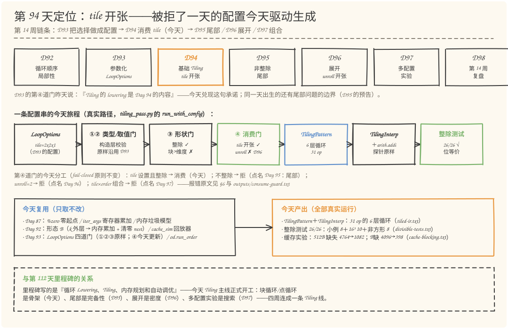
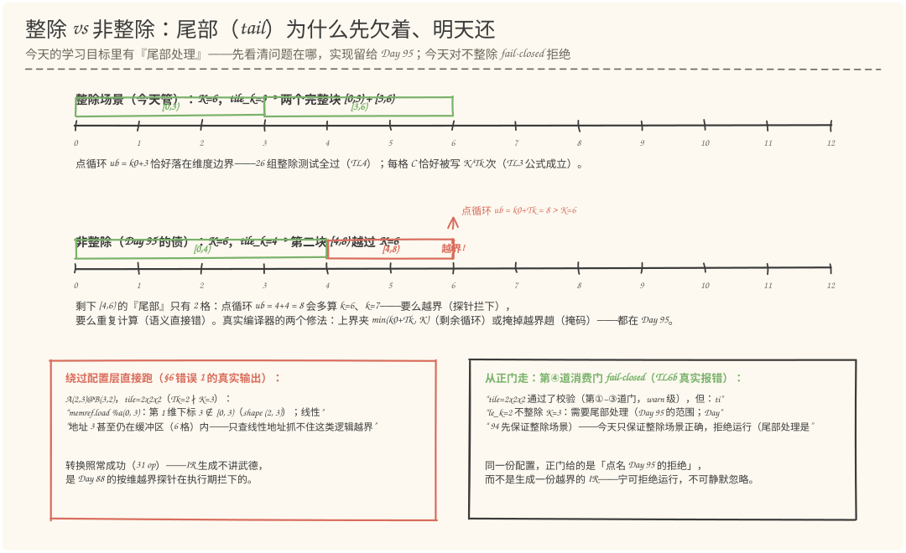
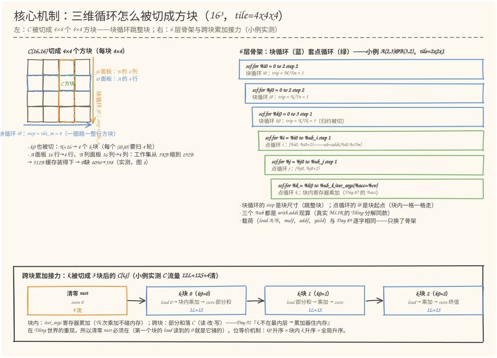
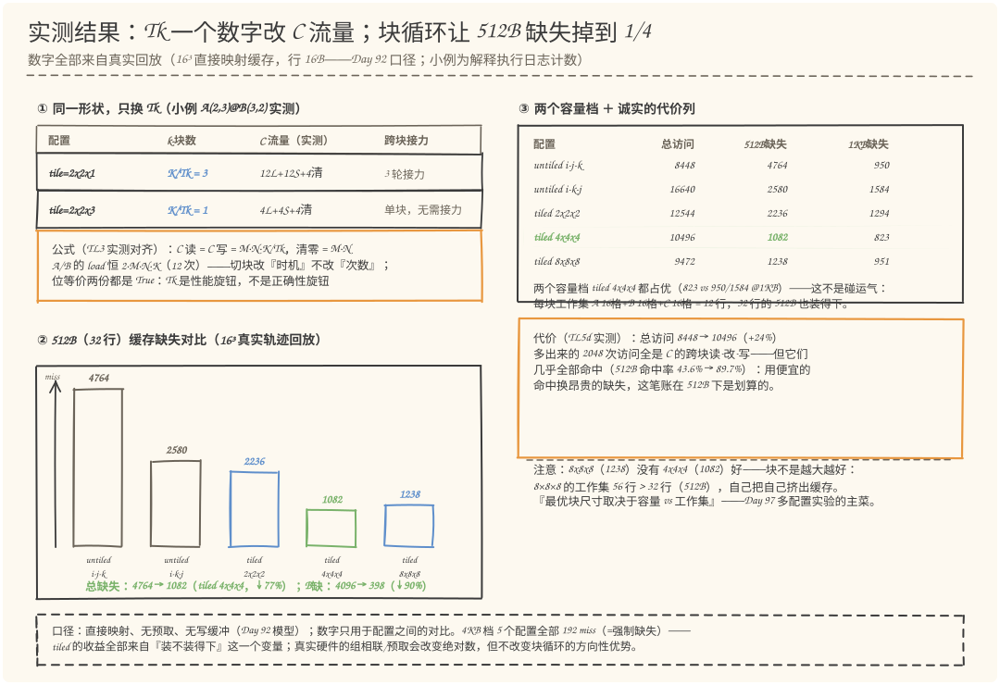

# 第 94 天：实现基础 Tiling——把三维循环切方块，块内走寄存器、跨块落内存

> **今日目标**：完成本教程后，你能做到四件事——说清**块循环（tile loop）和点循环（point loop）的分工**：块循环 `step = 块尺寸` 每圈跳一整块，点循环 `[块起点, 块起点+块尺寸)` 在块内一格一格走，两者的 trip 分别是 `维/块` 和 `块尺寸`；讲透**今天最难的一步——跨块累加**：k 被切成 K/Tk 个块后，(i,j) 点循环被外层 k0 反复重访，寄存器存不下 Tm×Tn 个部分和，于是累加器分成两条通道（**块内走 iter_args 寄存器、跨块走 C 的读-改-写**），清零 nest 因此必须回来——这是 Day 92「k 不在最内层 → 累加器住内存」在 Tiling 世界的重现；独立复现 **29 项检查**：恒 31 op 的结构不变量、小例 8 种＋16³ 十种＋非方形 8 组共 **26 组整除测试全部位等价**（从真实访存日志重建的 (i,j,k) 三元组恰好全覆盖一次）、C 流量公式 `读=写=M·N·K/Tk`、16³ 缓存回放 **512B 缺失 4764 → 1082、B 缺失 4096 → 398**；最后能解释**为什么今天只保证整除场景**：不整除时点循环上界 `k0+Tk` 会越过 K——尾部处理是 Day 95 的内容，今天由消费门 fail-closed 拒绝（宁可拒绝运行，不可静默生成越界 IR）。
> **预计时间**：学习 35 分钟＋实践 45 分钟
> **前置准备**：Python 3.11＋numpy（本文环境：aarch64 Linux，Python 3.11.4，numpy 1.26.4）。本机没有安装 MLIR——与 Day 57~93 一致，复用三个只取不改的工程：Day 90 的 `shape_pass.py`（IR 内核／Rewriter／解释执行器）、Day 92 的 `order_pass.py`（untiled 基线与缓存回放器）、Day 93 的 `loop_options.py`（LoopOptions 与四道门）。内容上需要四个名词：`%zero`（归约零起点，Day 87）、`iter_args`（寄存器累加器，Day 87/88）、形态 B（k 不在最内层 → 内存累加＋清零 nest，Day 92）、`LoopOptions`（Day 93 的配置对象：昨天第④道消费门把 `tile=2x2x3` 拒之门外，报错点名「Tiling 的 lowering 是 Day 94 的内容」）。今天的新面孔只有一个算子：`arith.addi`（index 加法）——点循环的上界 `起点+块尺寸` 每圈都要现算，真实 MLIR 的 Tiling 分解生成的正是它。
> **今日产出**：`code/tiling_pass.py`（`TilingPattern` ＋ `TilingInterp` ＋ 更新后的消费门 ＋ TL1~TL6 共 29 项检查，全部可运行）、`code/outputs/tiled-ir.txt`（计划点名的 **Tiled IR**：两份配置、31 op 的 6 层循环）、`code/outputs/divisible-tests.txt`（计划点名的**整除测试**：26 组全部位等价）、`cache-blocking.txt`（缓存收益实验：真实轨迹回放）、`consume-guard.txt`（消费契约实录）、4 张手绘图。

## 1. 今天解决什么问题？

昨天有两句铺垫，今天全部要兑现。Day 92 的对照表结尾写着：「**最优顺序取决于『缓存容量 vs 工作集』的相对大小，这正是 Tiling 要解决的问题（Day 94）**」；Day 93 的第④道消费门把 `tile=2x2x3` 拒之门外，报错原话：「**Tiling 的 lowering 是 Day 94 的内容——今天拒绝运行，绝不静默忽略**」。所以今天的问题很具体：**把 MatMul 的三维循环切成方块之后，IR 长什么样？语义还等价吗？局部性真的变好了吗？**

先看「为什么必须切块」。Day 92 用 16³ 的真实轨迹回放过直接映射缓存：`i-j-k` 顺序在 512B（32 行）下缺失 4764 次，其中 **B 独占 4096 次**——内层 k 扫 B 的列（步长跳 16 格），一行还没复用完就被 16 列轮着挤出去；换成 `i-k-j` 让 B 连续，1KB 下又反过来输给 `i-j-k`。循环顺序这个自由度只能安排「**什么时候**」访问，**工作集还是整个矩阵**（A 1KB＋B 1KB＋C 1KB）——缓存装不下，怎么排顺序都有人受害。类比：仓库再怎么调整取货顺序，一次要用的零件摊满三张桌子，桌面（缓存）只有半张，怎么摆都掉地上。对应到技术上是：**Tiling（分块）直接把「一次要用多少」改小**——`i0/j0/k0` 三层块循环圈出一个方块，方块内 A 只碰 4 行、B 只碰 4 列、C 只碰 4×4 的一角，工作集从 3KB 缩到不到 200B；块与块之间靠块循环跳转。类比的边界：桌面大小不变（缓存还是 512B），但「一次摊开的东西」变了——这正是硬件术语 cache blocking 的本义，今天我们把它做成 IR 结构，而不是口头建议。

贯穿全文的例子还是那份 `mini.matmul`：`A(2,3) @ B(3,2) → C(2,2)`（种子 94）。今天的主配置是 **`tile=2x2x1`**（tile_m=2 整除 M=2，tile_n=2 整除 N=2，tile_k=1 切 K=3 成 3 块）——它小到可以手算，又恰好把「跨块累加」暴露出来：3 个 k-块意味着 C 的每个格子要经过 3 轮「读部分和 → 块内乘加 → 写回」。同一份语义，对照配置是 Day 93 拒过的 **`tile=2x2x3`**（单块，K/Tk=1）：两份 Tiled IR 结构完全相同（恒 31 op）、答案逐位相同，**C 的跨块读-改-写却差 3 倍**（`12L+12S` vs `4L+4S`，另加 `4清`）——块尺寸是数据，性能随它变、正确性不随它变。

所以今天要回答的问题是：**切方块之后的循环骨架怎么搭？归约维被切断之后累加器放哪？怎么证明切完语义没变？** 答案分四件：**结构**（3 层块循环套 3 层点循环，恒 31 op）、**累加**（块内寄存器＋跨块内存的双通道，配清零 nest）、**验证**（位等价的机械解释：k0 升序 × 块内 k 升序 = 全局 k 升序）、**边界**（整除契约——不整除的部分今天明确欠着，Day 95 还）。

**验收口径**：Day 93 验收的是「配置层」（结构／校验／默认值／消费契约）；今天验收的是「**配置驱动的第一个真实 lowering**」——`tile=2x2x3` 这份昨天被拒的配置今天端到端跑通且位等价（TL6a），26 组整除测试全部通过（TL4），16³ 缓存回放给出 Day 92 预言的收益（TL5），而所有今天的 lowering 管不到的路径（不整除 → Day 95、unroll → Day 96、tile×order 组合 → Day 97）全部 fail-closed 拒绝并点名归属日。

## 2. 先看全貌：今天的内容位于哪里？



**图 1**：看三处——上排是第 14 周七天链路：**D94（今天）基础 Tiling** 夹在 D93（把选择做成配置——tile 字段昨天刚被第④道门拒绝）与 D95~D97（尾部／展开／多配置实验——今天在消费门报错里逐一点名的三个归属日）之间；中排是一条配置串今天的真实旅程：`tile=2x2x1` 走 Day 93 原样的①②类型/取值门、③形状门（整除 ✓）→ 第④道消费门**今天对 tile 开张**（unroll 仍拒，点名 Day 96）→ `TilingPattern` 生成 31 op 的 6 层循环 → `TilingInterp`（今天补上 `arith.addi`）解释执行 → 整除测试与缓存实验；下排左边是今天**只取不改**的三份家底（Day 87 的零起点/iter_args、Day 92 的形态 B 与缓存回放器、Day 93 的 LoopOptions 四道门），右边是四份产出文件。

把今天的路线压缩成五步（细节在 §3、§4 展开）：

1. **搭骨架**：`TilingPattern` 把 Day 89 的三重循环改造成 6 层——3 层块循环（step = 块尺寸）套 3 层点循环（lb = 块起点，ub = `addi(起点, 块尺寸)` 现算），载荷一字不改（TL1：恒 31 op）；
2. **接累加**：k 被切成 K/Tk 块 → 累加器分两通道（块内寄存器、跨块内存），清零 nest 回归（Day 92 形态 B 的教训）；
3. **验证语义**：位等价有机械解释——k0 升序 × 块内 k 升序 = 全局 k 升序，舍入顺序不变；26 组整除测试全部通过（TL2/TL4）；
4. **量化收益与代价**：C 流量公式 `读=写=M·N·K/Tk`（Tk 独家决定）；16³ 缓存回放 512B 缺失 4764 → 1082、B 缺 4096 → 398，代价是总访问 +24%（TL3/TL5）；
5. **守住边界**：消费门对不整除／unroll／tile×order 组合全部 fail-closed 拒绝并点名归属日——今天只兑现「整除」这一半契约（TL6）。

## 3. 核心概念：块循环、点循环与跨块累加

### 3.1 块循环与点循环：一次「套娃」式改造

先给直觉：**切方块就是把每层循环拆成「跳整块的粗循环」和「块内走格子的细循环」两层**。原来 `for %i = 0 to M step 1` 一层管完 M 行；现在 `for %i0 = 0 to M step tile_m`（块循环）每圈跳一整块，再由 `for %i = %i0 to %i0+tile_m step 1`（点循环）把这一块走完。类比对折纸：原来一格一格数 16 行，现在先按 4 行一组折出 4 条折痕（块循环），再沿每条折痕数 4 格（点循环）。对应到技术上是两条 LoopSpec 的配合：**块循环的四要素是 `[0, M) step tile_m`，trip = M/tile_m；点循环的四要素是 `[%i0, %i0+tile_m) step 1`，trip 恒 = tile_m**——注意点循环的 lb 是块循环的归纳变量 `%i0`，ub 是每圈现算的 `arith.addi(%i0, %cTm)`，这两个「动态」边界正是 Tiling 的 IR 签名（真实 MLIR 的 Tiling 分解同样生成 addi 算块内上界）。

一个最小例子（`code/tiling_pass.py` 的小例实测）：`A(2,3)@B(3,2)` 配 `tile=2x2x1`，三层块循环的 trip 分别是 M/tile_m=1、N/tile_n=1、K/tile_k=3——**总共 1×1×3 = 3 个 (i0,j0,k0) 方块**，每个方块内点循环各走 2、2、1 格。三层各拆两层后，循环从 3 层变 6 层，但乘加载荷（load A、load B、mulf、addf、yield）**与 Day 89 逐字相同**——Tiling 改的是骨架，不是载荷。

常见误解：「块循环套在外面、点循环在里面」看起来只是把一个循环写成两个，何必多此一举。区别在**上界的语义**：块循环的 step 是块尺寸（跳整块），点循环的上界是 `起点+块尺寸`（**每圈都变**）——正是这个动态上界把「下一块从哪开始」和「这一块走几格」拆开，才让「一次只用一小方块」成为 IR 结构里的事实，而不只是一句优化建议。

### 3.2 跨块累加：k 被切断之后，部分和住哪？

这是今天最难也最重要的一步。Day 87 的方案是：k 在最内层，累加器走 `iter_args`——Tk 次乘加在寄存器里完成，C 每格只写一次终值。切块之后问题来了：**k 也被切成 K/Tk 个块**，循环结构是 `k0（块）套 i（点）套 j（点）套 k（点）`——对同一个 (i,j)，两次 k 访问之间隔着整整一圈方块扫描，寄存器里那一个 `%acc` 根本活不过这么久（想全用寄存器就得同时养活 Tm×Tn 个部分和——那是真正的 GEMM 内核才做的事）。

所以累加器必须分两条通道，这正是 Day 92 形态 B 结论的重现：**块内**——k 点循环仍然带 `iter_args(%acc = %cv)`，块内 tile_k 次乘加不碰内存（寄存器通道）；**跨块**——每块开始时 `%cv = load C[i,j]` 把上一块留下的部分和读回来当初值，块末 `store` 落盘（内存通道）。跨块累加 = 内存累加，于是**清零 nest 必须回来**：第一个 k-块的 `load C[i,j]` 读到的 0，就是清零 nest 提前铺好的（Day 92 OT5 用垃圾值演示过忘记它的下场，今天 §6 错误 3 在 Tiled 世界复验）。类比的边界：接力赛交接棒——块内是运动员自己跑完的一棒（寄存器），跨块是交接区里棒必须离手（落内存）——「棒离手」不是失误，是规则；但第一棒起跑时的那根「零号棒」（清零）必须有人提前放到交接区。

代价算得清清楚楚：C 的每格每块被读一次、写一次，加上清零一次——**C 读 = C 写 = M·N·K/Tk，清零 = M·N**（TL3 实测逐项对齐）。主配置 `tile=2x2x1` 在小例上是 `12L+12S+4清`（3 块），对照 `tile=2x2x3` 是 `4L+4S+4清`（1 块）——**只有 tile_k 进公式**，tile_m/tile_n 不影响流量（它们影响的是 §5.4 的缓存行为）。而 A、B 的 load 总数永远是 2·M·N·K：**切块改的是访问的「时机」，不是「次数」**——这句话是 Tiling 收益的全部来源，也是它代价的全部来源。

### 3.3 整除契约与尾部：今天明确欠下的那笔债

点循环的上界是 `起点+块尺寸`。要让它不越过维度，必须**每一维都有 块尺寸 | 维度**——这就是**整除契约**（tile divides dimensions）：`tile_m | M ∧ tile_n | N ∧ tile_k | K`。主配置 `2x2x1` 在 `A(2,3)@B(3,2)` 上满足契约（2|2、2|2、1|3）；Day 93 拒过的 `2x2x3` 也满足（3|3），所以今天都能跑。**不满足契约时会发生什么**，看图：



**图 3**：上半是整除场景（K=6，tile_k=3）：两个完整块 `[0,3)+[3,6)`，点循环上界恰好落在维度边界——今天的 26 组测试全部在这一侧。下半是非整除（K=6，tile_k=4）：第二块 `[4,8)` 越过 K=6，剩下 `[4,6)` 这条**尾部（tail）**只有 2 格——点循环 ub = 4+4 = 8 会多算 k=6、k=7：要么越界（被 Day 88 的按维探针拦下，左下红框是绕过配置层直跑的真实报错），要么重复计算（语义直接错）。真实编译器的两个修法——**上界夹 `min(k0+Tk, K)`**（剩余循环）或**掩掉越界趟**（掩码思想）——都是 Day 95 的内容；今天从正门走，第④道消费门 fail-closed 拒绝（右下框，报错点名 Day 95）。

所以今天的边界是刻意的三层设计：**形状门（Day 93）**对不整除只给 warn（因为它不阻止配置存在）；**消费门（今天）**把 warn 升级为拒绝（因为今天的 lowering 生成不了正确的尾部代码）；**尾部 lowering（Day 95）**才把 warn 降回附注。每一层的宽容度都跟「这一层能负多大的责任」对齐——宁可拒绝运行，不可静默生成越界 IR。

## 4. 图解核心机制



**图 2**：左半是 16³ 配 `tile=4x4x4` 时 C 的方块视图——C(16,16) 被切成 4×4 个方块，蓝色横带是块循环 i0 圈住的 A 行面板（4 行），橙色竖带是 j0 圈住的 B 列面板（4 列），绿方块是当前 C 方块：**每块工作集从整个矩阵缩到 12 行缓存行**（A 4 行＋B 4 行＋C 4 行），这是图 4 里 B 缺失塌缩的结构原因。右半是小例 `tile=2x2x1` 的 6 层骨架——蓝框是块循环（step = 块尺寸），绿框是点循环（lb = 块起点，ub = addi 现算）。下半是跨块累加的接力图：清零 nest 把 0 铺进 C → k-块 0「load 0 → 块内乘加 → store 部分和」→ k-块 1 → k-块 2 写终值，每站标注了实测流量。

按图中结构走一遍生成过程（对应 `TilingPattern.matchAndRewrite`，code/tiling_pass.py:182）：

1. **match：与 Day 89~92 同一套契约**——2 维、静态、内维匹配，一字不改；拿到的还是 M、K、N 三个数。
2. **常量区**：Day 89 的 5 个常量（0、1、M、N、K）之外新增 3 个块尺寸常量 `%cTm/%cTn/%cTk`——**块尺寸从 `LoopOptions.tile` 来，作为常量写进 IR**（配置是数据，Day 93 的交付今天第一次被「编译」进结果）。
3. **清零 nest**：`for i { for j { store %zero → C[i,j] } }`——跨块累加的零起点（Day 92 形态 B 的原班积木）。
4. **块循环三层**：`for %i0 = 0 to M step tile_m`（trip = M/Tm）、`%j0`、`%k0`——注意 `%k0` 也被切：归约维同样有块循环（这是 Tiling 区别于「只切 i/j」的关键，也制造了 §3.2 的累加问题）。
5. **点循环三层**：每层先 `arith.addi` 算上界（`%ub_i = addi(%i0, %cTm)`……——真实编译器会把它们外提到各自的块循环层，解释器每圈重算，语义相同），再 `for %i = %i0 to %ub_i step 1`——**lb 直接引用块循环的 iv**。
6. **载荷四件套＋读写端**：`%cv = load C[i,j]`（跨块读端）→ k 点循环 `iter_args(%acc = %cv)` 内 `load A / load B / mulf / addf / yield`（块内寄存器通道，与 Day 89 逐字相同）→ `store %acc → C[i,j]`（跨块写端）。

为什么点循环的 `iter_args` 初值是 `%cv` 而不是 `%zero`？这是今天最容易写错的一行（§6 错误 2 用真实运行演示了写错的下场）：`%zero` 会让**每个块都从 0 重新累加**——前面所有块的部分和凭空消失，结果只剩最后一个 k-块。`%cv` 是接力棒：块末 store 落盘、下块 load 读回，`float32` 的存取不损失任何比特，整条链上每个 C[i,j] 的加法序列仍然是 `(((0+x₀)+x₁)+…)`——与 Day 89 完全相同的舍入顺序。这就是位等价的机械解释，TL2e 从真实日志重建了每个 (i,j) 的 k 序列逐个验证过。

## 5. 动手实践：把 Tiled IR 跑起来

### 5.1 准备文件

今天的目录结构（`tiling_pass.py` 是唯一新文件，其余是引用与产出）：

```text
tutorials/day-094/
├── README.md                      # 本教程
├── code/
│   ├── tiling_pass.py             # 今天的主角：TilingPattern + TilingInterp + 消费门 + TL1~TL6
│   ├── make_images.py             # 4 张手绘图的生成器（数据同源）
│   └── outputs/                   # 真实运行产出（下文引用的表格都在这里）
│       ├── tiled-ir.txt           # Tiled IR（计划点名的交付物）
│       ├── divisible-tests.txt    # 整除测试 26 组（计划点名的交付物）
│       ├── cache-blocking.txt     # 缓存收益实验（真实轨迹回放）
│       └── consume-guard.txt      # 消费契约实录
└── images/                        # 4 张手绘图
```

`tiling_pass.py` 通过 `sys.path` 引用前三天的工程——**只取不改**：Day 90 的 `shape_pass.py`、Day 92 的 `order_pass.py`、Day 93 的 `loop_options.py`。今天对旧工程只做两处**扩展**（不是修改）：给 `TARGET_LEGAL` 注册表登记新算子 `arith.addi`（等价于真实 MLIR 的 `ConversionTarget::addLegalOp`——新 lowering 需要新算子时注册它，Day 90 的文件一行不动，code/tiling_pass.py:81），以及给解释执行器子类补上 `addi` 的语义。运行方式：

```bash
cd tutorials/day-094/code
python3 tiling_pass.py                          # TL1~TL6 全跑（29 项），写 outputs/
python3 tiling_pass.py --config "tile=2x2x1"    # 一份配置串的完整旅程（四道门 → 端到端）
python3 tiling_pass.py --demo nondiv            # 复现「非整除越界」（§6 错误 1）
python3 tiling_pass.py --demo acczero           # 复现「跨块累加丢失」（§6 错误 2）
python3 tiling_pass.py --demo noinit            # 复现「忘记清零」（§6 错误 3）
```

### 5.2 关键实现

**第一段：解释器扩展**——Day 87 的执行器不认识整数加法，而点循环的上界每圈都要现算（code/tiling_pass.py:116）：

```python
class TilingInterp(Interp):
    """Day 87 执行器原样 ＋ 今天的 arith.addi（子类覆写，父类一行不动）。"""
    def exec_op(self, op):
        if op.name == "arith.addi":
            self.env[id(op.results[0])] = (int(self.val(op.operands[0]))
                                           + int(self.val(op.operands[1])))
            return
        super().exec_op(op)      # 其余 op 全部走 Day 87~90（含三个探针）
```

**第二段：跨块累加的读端/写端**——`TilingPattern` 的骨架搭建与 Day 92 的 `LoopOrderPattern` 同一套事务式写法（由内往外建），真正今天新生的只有三行（code/tiling_pass.py:182 的 rewrite 内）：

```python
        cv = rewriter.create("memref.load", operands=[alloc.results[0], iv["i"], iv["j"]],
                             result_names=["%cv"], result_types=["f32"],
                             comments=["读 C：上一个 k-块留下的部分和——跨块累加的读端"])
        ub_k = rewriter.create("arith.addi", operands=[iv0["k"], consts["cTk"].results[0]],
                               result_names=["%ub_k"], result_types=["index"],
                               comments=["%ub_k = %k0 + tile_k——点循环上界每圈现算"])
        acc_init = zero.results[0] if self.acc_from_zero else cv.results[0]
        f_k = rewriter.create("scf.for",
                              operands=[iv0["k"], ub_k.results[0], consts["c1"].results[0], acc_init],
                              result_names=["%acc"], result_types=["f32"],
                              attrs={"iv": "%k", "iv_value": iv["k"],
                                     "iter_names": ["%acc"], "iter_args": [acc_arg]},
                              body=[xa, xb, p, s, yld], ...)
        stm = rewriter.create("memref.store", operands=[f_k.results[0], alloc.results[0],
                                                         iv["i"], iv["j"]], ...)
```

四个操作数的位置正是 `scf.for` 的官方语义：`[lb=%k0（块起点）, ub=%ub_k（现算上界）, step=%c1, iter_args 初值=%cv（上一块终点）]`——§3.2 的双通道全部落在这三行里。

**第三段：消费门今天更新**——`run_with_config()` 沿用 Day 93 的门序（③形状门在前、④消费门在后），第④道对 tile 开张，其余照旧 fail-closed（code/tiling_pass.py:447）：

```python
    if opts.unroll != 1:
        raise lo.OptionsNotConsumedError("…展开 lowering 是 Day 96 的内容——今天拒绝运行，绝不静默忽略")
    if opts.tile is None:                       # 回退：不切块 → Day 92 路径（口径不变）
        run = od.run_order(opts.order, m, k, n, seed=seed)
        ...
    if opts.order != ("i", "j", "k"):
        raise lo.OptionsNotConsumedError("tile×非默认 order 的组合实验是 Day 97 的内容——绝不静默忽略")
    if warns:                                   # 形状门的 warn（不整除）今天升级为拒绝
        raise lo.OptionsNotConsumedError("…今天只保证整除场景正确，拒绝运行（尾部处理是 Day 95 的内容）")
    run = run_tiled(opts.tile, m, k, n, seed=seed)     # ← tile 开张：今天的新路径
```

省略说明：`TilingPattern` 的 match 段与 Day 92 逐字相同（四条契约拒绝路径）；清零 nest 与块循环骨架是 `rewriter.create` 的常规装配，完整版在 code/tiling_pass.py:182~330；TL1~TL6 检查函数（code/tiling_pass.py:496 起）是验收脚本，正文 §5.3 直接引用其真实输出。

### 5.3 运行与观察

`python3 tiling_pass.py` 一次跑完 29 项检查（以下为**本机真实输出**节选，完整版在 `outputs/`）：

```text
—— TL1 结构不变量：Tiled IR 恒 31 op（形状与块尺寸都是数据） ——
[PASS] TL1a 贯穿例 tile=2x2x1：walk 序列逐项对照（31 op）
[PASS] TL1c LoopSpec 四要素：块循环 step=块尺寸 trip=维/块；点循环 step=1 trip=块尺寸
—— TL2 语义不变性：切块之后，结果一个比特都不变 ——
[PASS] TL2b 小例全部 8 种整除 tile 位等价（1/2 × 1/2 × 1/3 的笛卡尔积）
[PASS] TL2e 每个 (i,j) 的 k 加法顺序 == 0..K-1（位等价的机械解释）
—— TL3 流量公式：A/B 的 load 总数与 tile 无关；C 的 RMW 由 Tk 独家决定 ——
[PASS] TL3c Tk 换档实验：tile 2x2x1 → 2x2x3，C 流量 12L+12S → 4L+4S
—— TL4 整除测试：静态 Shape ＋ 整除场景全过（计划点名的交付物） ——
[PASS] TL4d 汇总：26/26 全部位等价、恒 31 op
—— TL5 缓存收益：16³ 真实轨迹回放，untiled vs tiled ——
[PASS] TL5a 512B（32 行）：tiled 4x4x4 缺失 < untiled i-j-k：实测 1082 vs 4764
[PASS] TL5b B 的缺失塌缩：实测 B缺 398 vs 4096
—— TL6 消费契约：tile 开张；不整除/组合/展开仍然 fail-closed ——
[PASS] TL6a Day 93 的报错原文今天兑现：tile=2x2x3 端到端跑通且位等价

—— 检查测试 29 PASS / 0 FAIL ——
```

用 `--config` 看一份配置串的完整旅程（真实输出）：

```text
$ python3 tiling_pass.py --config "tile=2x2x1"
LoopOptions（第 93 天 · 循环生成配置）
  order  = i-j-k（外→内；默认值）
  tile   = 2x2x1（块尺寸 tile_m×tile_n×tile_k；显式设置）
形状感知校验（A(2,3)@B(3,2)，第③道门）：
  [ok] tile_m=2 整除 M=2：整除场景，Day 94 的首选测试点
  [ok] tile_k=1 整除 K=3：整除场景，Day 94 的首选测试点
✓ 端到端（A(2,3)@B(3,2)，种子 94）：31 op；C 流量 12L+12S+4清；与参考位等价 = True
  附注：tile=2x2x1 已消费（今天开张）：1×1×3 个块，Tiled IR 31 op
```

「Day 94 的首选测试点」这句话就是 Day 93 形状门写下的预言——今天它成了验收清单。Tiled IR 本体（31 op，含全部注释）在 `outputs/tiled-ir.txt`，两份配置各一份——结构逐项相同、`%cTk` 的常量值不同（1 vs 3）：**块尺寸只活在三个常量里**，这就是「配置是数据」编译进 IR 后的样子。

### 5.4 修改一个参数再观察：Tk 是性能旋钮，不是正确性旋钮

第一组对照（小例，零成本）：同一份 `A(2,3)@B(3,2)`，只把 Tk 从 1 换成 3——

```text
$ python3 tiling_pass.py --config "tile=2x2x1"
✓ …：31 op；C 流量 12L+12S+4清；与参考位等价 = True
$ python3 tiling_pass.py --config "tile=2x2x3"
✓ …：31 op；C 流量 4L+4S+4清；与参考位等价 = True
```

k-块数从 3 变 1，C 的读-改-写跟着从 3 轮变 1 轮（公式 `C读=C写=M·N·K/Tk`），**位等价两份都是 True**——Tk 只改性能不改正确性。

第二组对照（16³，回答 Day 92 留下的问题）：



**图 4**：左上是小例的 Tk 换档实测表（§5.4 第一组）；左下是 512B 缓存缺失柱状图（16³ 真实轨迹回放）：`untiled i-j-k` 4764 → `tiled 4x4x4` **1082**（↓77%），B 缺失 4096 → **398**（↓90%）——Day 92「i-j-k 在 512B 下 B 列全缺失」的灾难被块循环根治；右上是两个容量档的全表：1KB 下 tiled 4x4x4 是 823，**同时**优于 untiled ijk（950）和 ikj（1584）——Day 92 里「排名随容量翻转」的两难，被切块变成了「两个档都赢」；右中是诚实的代价列：总访问 8448 → 10496（+24%，全部来自 C 的跨块 RMW），但这些多出来的访问几乎全部命中（512B 命中率 43.6% → 89.7%）——**用便宜的命中换昂贵的缺失**。

注意图里还有个不讨喜但极有价值的读数：**8x8x8（缺失 1238）没有 4x4x4（1082）好**。块不是越大越好：8×8×8 的每块工作集约 56 行缓存行，超过 512B 的 32 行——自己把自己挤出缓存。这正是 Day 92「容量 vs 工作集」定律在块尺寸维度上的重现，也是 Day 97 多配置实验要系统搜索的对象。

## 6. 常见错误与排查

### 错误 1：非整除的 tile 绕过配置层直跑 → 探针拦下越界

- **现象**：`python3 tiling_pass.py --demo nondiv`（真实输出）：转换照常成功（31 op——IR 生成不讲武德），执行阶段被 Day 88 的按维越界探针拦下：`memref.load %a(0, 3)：第 1 维下标 3 ∉ [0, 3)（shape (2, 3)）；线性地址 3 甚至仍在缓冲区（6 格）内——只查线性地址抓不住这类逻辑越界`。
- **原因**：`tile=2x2x2` 的 tile_k=2 不整除 K=3。k0 走到 2 时点循环上界 `%ub_k = 2+2 = 4` 越过 K=3，k=3 那圈直接读出矩阵外。在没有探针的真实硬件上，这是读垃圾＋多算一次乘加——**静默的错误结果**。
- **定位**：报错自带定位（哪个 memref、哪个下标、shape 是多少）；正门复现：`python3 tiling_pass.py --config "tile=2x2x2"`——消费门先拒绝并点名 Day 95（TL6b 的真实报错）。
- **修复**：不要绕过配置层。第④道消费门对不整除 fail-closed（code/tiling_pass.py:447 的 `if warns` 分支）；真正的修复在 Day 95：上界夹 `min(k0+Tk, K)` 或掩码。

### 错误 2：跨块累加丢失——iter_args 初值写成 %zero

- **现象**：`--demo acczero`（真实输出）：`tile=2x2x1`（3 个 k-块）下把 acc 初值从 `%cv` 改成 `%zero`：与参考位等价 = False，`max|C−ref| = 1.759`；且实测 **C 里只剩下最后一个 k-块（k=2）的贡献**——前两个块的和凭空消失。
- **原因**：每个 k-块都从 0 重新累加，块末 store 又把之前的成果覆盖掉——「接力棒」没有接，每棒都从起点重跑。这是**所有 Tiling 实现都会踩一次的经典 bug**：归约维一旦被切，`%zero` 只能出现在第一个块的初值里（而第一个块的初值来自清零 nest 铺好的 `%cv`）。
- **定位**：症状很特异——结果恰好等于「最后一个 k-块的部分和」；用 `--demo acczero` 可复现，错误的行在 code/tiling_pass.py 的 `acc_init = zero.results[0] if self.acc_from_zero else cv.results[0]`（旋钮开着就是错误形态）。
- **修复**：iter_args 初值接 `%cv`（读端），块末 store 回 C（写端）——接力棒从上一块的终点开始。位等价的机械保证（TL2e）依赖这条链完整。

### 错误 3：忘记清零 nest——Day 92 OT5 的教训在 Tiling 世界复验

- **现象**：`--demo noinit`（真实输出）：`tile=2x2x1` 且 `init=False`：未初始化读 4 条（第一个 k-块的 `%cv` 全部读到垃圾 777+7·addr），与参考位等价 = False——垃圾进了跨块累加链。
- **原因**：跨块累加 = 内存累加，但 `memref.alloc` 不清零（Day 87）；第一个 k-块的 `load C[i,j]` 必须读到 0，而那个 0 只能由清零 nest 提前铺。Tiling 让这个 Day 92 的教训**从「k 不在最内层才有」变成「k 被切块就有」**——出现条件放宽了。
- **定位**：解释器的 `uninit_reads` 探针直接列出 (memref, 下标, 地址)；复现命令 `python3 tiling_pass.py --demo noinit`。
- **修复**：清零 nest 必须在（默认 `init=True` 就是修复后的形态）。判别口径：**只要存在跨块读端（%cv），就必须有零起点来源**——这条从 Day 87 延续到今天的因果链值得写进你的工程笔记。

## 7. 今日练习

### 必做练习：预测四份配置的 C 流量与块数

下面四份配置串都在 `A(2,3)@B(3,2)`（种子 94）上运行。**先不看电脑**，在纸上为每一份写出三行预测：① 块数三元组（M/tile_m × N/tile_n × K/tile_k）；② C 流量（读、写、清零各多少次——公式 `C读=C写=M·N·K/Tk`、`清零=M·N`）；③ 端到端是「跑通（位等价 True/False）」还是「被第几道门拒绝（报错点名哪天）」。

```text
(a) "tile=1x2x1"
(b) "tile=1x2x3"
(c) "tile=2x1x1"
(d) "tile=2x2x2"
```

预期产出：一张 4 行 × 3 列的预测表＋验证记录（`python3 tiling_pass.py --config "<配置串>"` 逐条对照）。判分口径：(a)(c) 考察 Tm/Tn 不进流量公式（块数变了、C 流量不变）；(b) 考察「单 k-块 → 无接力轮」；(d) 考察整除契约——不整除的消费门拒绝（点名 Day 95）。四题正好覆盖 §3.2 流量公式的三个变量和 §3.3 的契约边界。

### 选做挑战：手算工作集，预测 512B 的排名

不改代码，只算账：对 16³ 配 `tile=2x2x2`，算出**一个 (i0,j0) 全扫期间**（k0 八轮）的工作集——提示：A 面板是 2 个矩阵行（每行 16 个元素 = 4 条缓存行）→ 8 条；B 列面板是 16 个矩阵行 × 2 列（j0 对齐到 2，不跨行，每行 1 条）→ 16 条；C 方块是 2×2 → 2 条。三个数加起来和 512B 的 32 行比一比；再同样算 `4x4x4`（A 16＋B 16＋C 4 = 36 条）和 `8x8x8`（A 32＋B 16＋C 8 = 56 条）。然后**先写下你对三者 512B 缺失数的排名预测**，再打开 `outputs/cache-blocking.txt` 对答案（真实数字：2236 / 1082 / 1238）。如果排名或差距与你的预期不符，用「工作集 vs 容量」＋「总访问数」两把尺子解释差异（注意 2x2x2 的 K/Tk=8 带来多得多的 C 流量）。这道题是 Day 97 多配置实验的预演。

## 8. 今日验收

- [ ] 我能用自己的话解释块循环与点循环的分工：step 各是什么、trip 各是多少、点循环的 lb/ub 从哪来（`addi(块起点, 块尺寸)`）
- [ ] 我能讲清跨块累加的双通道：块内为什么还能用 iter_args、跨块为什么必须落内存、清零 nest 为什么必须回来——并说出它和 Day 92 形态 B 的对应关系
- [ ] 我能独立运行 `python3 tiling_pass.py` 得到 29 PASS / 0 FAIL，并指出 `outputs/` 四份文件分别对应哪组检查（tiled-ir→TL1/TL2，divisible-tests→TL4，cache-blocking→TL5，consume-guard→TL6）
- [ ] 我能不运行就预测一份配置的命运：块数、C 流量（`M·N·K/Tk`）、以及不整除/unroll/组合配置会被哪道门拒绝、报错点名哪天（§7 必做）
- [ ] 我能用 `--demo nondiv/acczero/noinit` 复现三个真实错误，并说出各自的「现象 → 原因 → 修复」
- [ ] 我能解释 16³ 实测的收益与代价：512B 缺失 4764→1082（B 缺 4096→398）、总访问 +24% 为什么反而划算、以及 8x8x8 为什么输给 4x4x4（工作集 56 行 > 32 行）
- [ ] 我保存了今天的代码（`code/tiling_pass.py`）、四份真实输出（`code/outputs/`）和 4 张图（`images/`）

## 9. 一句话总结与明天预告

今天回答的问题是：**把三维循环切成方块，IR 怎么搭、语义怎么保、收益怎么量**。机制上，`TilingPattern` 把三重循环改造成 3 层块循环（step = 块尺寸）套 3 层点循环（lb = 块起点、ub = `arith.addi` 现算），归约维被切断后累加器分成「块内 iter_args 寄存器、跨块 C 读-改-写」两条通道，清零 nest 随之回归——Day 92 形态 B 的结论在 Tiling 世界重现；验证上，恒 31 op 的结构不变量、26 组整除测试全部位等价（k0 升序 × 块内 k 升序 = 全局升序的机械解释）、C 流量公式 `读=写=M·N·K/Tk` 逐项对齐；收益上，16³ 缓存回放给出 Day 92 预言的兑现：512B 缺失 4764 → 1082、B 缺 4096 → 398，代价是总访问 +24%——用便宜的命中换昂贵的缺失。今天最重要的一条边界原则值得再说一遍：**今天的 lowering 只保证整除契约，管不到的路径全部 fail-closed 拒绝并点名归属日**——宁可拒绝运行，不可静默生成越界 IR。

明天（Day 95）处理非整除尾部：今天被消费门拒绝的 `tile=2x2x2`（Tk=2 ∤ K=3）将获得它的 lowering——上界夹 `min(k0+Tk, K)` 的剩余循环，或者掩掉越界趟的掩码思想；§3.3 的数轴图就是明天的施工图，26 组整除测试会扩成带尾部的边界用例。
