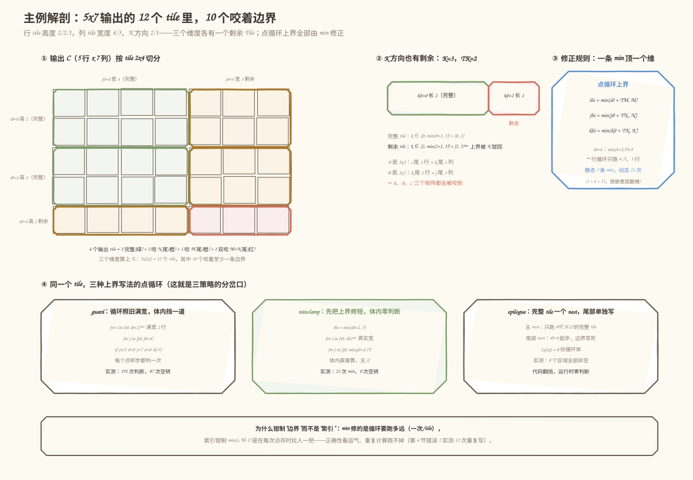
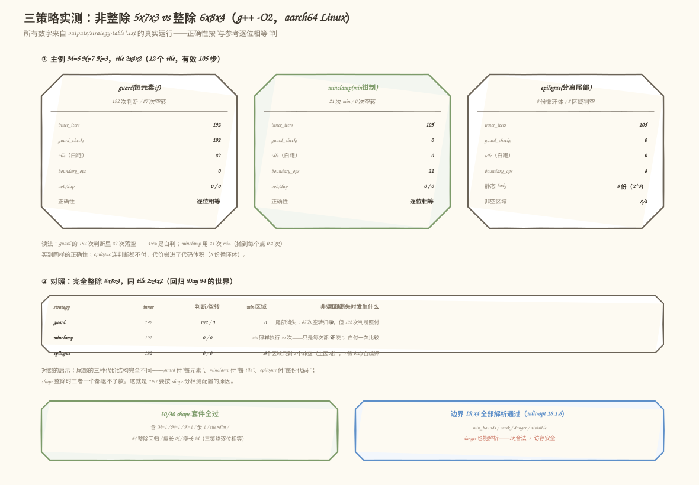
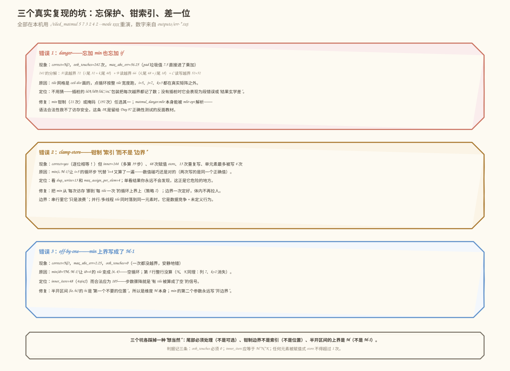

# 第 95 天：处理非整除尾部——tiling 从"只敢整除"到"什么 Shape 都算得对"

> **今日目标**：完成本教程后，你能对任意 M、N、K 说出 ceil-div tile 网格里哪里会产生剩余 Tile；能写出三种尾部处理方案（每元素判断、min 边界钳制、分离尾部循环）并说出各自的真实代价；能用插桩程序实测越界与重复计算，并用 `run_all.sh` 一键复现 30/30 的非整除测试和 4 份通过 `mlir-opt` 解析验证的边界 IR。
> **预计时间**：学习 35 分钟＋实践 55 分钟
> **前置准备**：第 88～89 天的三重循环与 load/store 累加语义（`C[i][j] += A[i][k] * B[k][j]`）；第 93 天的 `LoopOptions`（tile 尺寸从哪里来）；第 94 天的基础 tiling（ceil-div 网格怎么画）。工具只要 `g++`（本文环境：GCC 9.4，aarch64 Linux）和上游 `mlir-opt`（Ubuntu LLVM 18.1.8，`/usr/lib/llvm-18/bin/mlir-opt`）——今天不写 Pass，不改方言。
> **今日产出**：`code/` 下 600 余行可复现实验（对照程序＋IR 生成器＋一键脚本，全部插桩计数）、`ir/` 下 4 份边界 IR（`min` 钳制版／掩码版／无保护版／整除对照版）、`outputs/` 下 9 份真实运行记录，其中包含一份**上游 `linalg.matmul` tiling 的对照输出**——上游也在用 `min` 处理尾部。

## 1. 今天解决什么问题？

第 94 天我们把 MatMul 的三重循环套上了 tile 外壳，但当时立了一条规矩：**只跑 M、N、K 都被 Tile 整除的 shape**。规矩立得住吗？拿一个最普通的 GEMM 问一下：`C = A·B`，其中 `A` 是 `5×3`、`B` 是 `3×7`，tile 取 `2×4×2`——`5 % 2 = 1`，`7 % 4 = 3`，`3 % 2 = 1`，三个维度**没有一个整除**。这不是故意刁难：第 90 天测过的 `1×N`、瘦长矩阵、维数为 1 的边界 shape，在真实模型里天天出现；LLM 的 hidden dimension 也常常和 Tile 尺寸差一截。只会整除的 tiling，等于只会给"好身材"的矩阵服务。

不整除时会发生什么？ceil-div 网格（`tile 数 = ⌈M/TM⌉×⌈N/TN⌉×⌈K/TK⌉`）会把最后一圈 tile 的一半"伸出"矩阵外。如果点循环照旧按整 tile 宽度跑，就是两种结局：

- **越界访问（out-of-bounds，OOB）**：读到 `A[5][k]`、`B[3][j]`、写进 `C[5][7]`——矩阵只有 5 行 7 列。今天实测：无保护版本一共发生 **242 次**越界访存，错误结果的最大绝对误差 **56.25**；
- **重复计算（redundant computation）**：如果不用 min 钳制"边界"，而是每次访存时钳制"索引"（`min(i, M-1)`），越界是没了，但两个循环步会算出同一个元素——今天实测：**13 次重复写**、单元素最多被写 **4 次**，而且结果**碰巧还是对的**——更危险，因为它不报错。

今天的目标只有一个：**让 tile 化的循环对任意 M、N、K 都算得对**。贯穿全文的主例固定为 `5×3 · 3×7 → 5×7`，tile `2×4×2`：输出 5×7 的网格切成 3 行 tile × 2 列 tile，K 方向切成 2 段，一共 12 个 tile——其中只有 **2 个**是完整 tile，其余 **10 个都咬着边界**。尾部不是事故，是 ceil-div 的必然后果；处理它有三个标准姿势，代价结构完全不同，今天全部实测一遍。

## 2. 先看全貌：今天的内容位于哪里？


**图 1**：看三个位置——上排是第 14 周的时间线，今天补的是 D94 基础 tiling 与 D96 展开向量化之间的"正确性窟窿"；中间是 tiling 主线流程，今天动的是"ceil-div 网格画完之后、点循环跑之前"的那一格：**这个 tile 实际算多宽**；下排是三种策略的一句话画像和今天的真实产出。

把主线串成 5 步：

1. 输入 shape `M=5, N=7, K=3` 和第 93 天 `LoopOptions` 里的 tile `2×4×2`；
2. ceil-div 画出 tile 网格：`⌈5/2⌉×⌈7/4⌉×⌈3/2⌉ = 3×2×2 = 12` 个 tile；
3. **（今天）决定每个 tile 的实际边界**：完整 tile 用满宽度，剩余 tile 用 `min` 钳制或掩码收窄；
4. 点循环在真实边界内做 `C[i][j] += A[i][k]·B[k][j]`，正好 105 步（`M·N·K`），零越界、零重复；
5. 交给第 96 天的展开与向量化——注意：**尾部处理直接决定点循环是否连续规整**，向量化吃的就是这个红利（明天详说）。

为什么这一格必须在展开/向量化之前补上？因为 D96 的展开会复制循环体：尾部处理选"每元素判断"，展开后每个副本都带着判断；选"分离尾部"，展开的是整 tile 的主循环、判断最少——尾部的策略会放大或缩小明天的收益。这是"先正确、后优化"的顺序问题，不是可以回头再补的小事。

## 3. 核心概念：先用直觉，再给准确定义

### 3.1 剩余 Tile：ceil-div 网格的"零头"

一句通俗解释：把矩阵按固定尺寸切块，最后一圈块往往不够大——那块小的、不够整尺寸的，就是**剩余 Tile（remainder tile）**。

类比：铺地砖。房间宽 7 米、砖宽 4 米，横着铺第一块正好 4 米，第二块需要 3 米——你不会买 4 米的硬塞进去，也不会只铺 4 米不管剩下 3 米，而是把最后一块砖**裁短**。对应到技术上是：ceil-div 网格里最后一个 tile 的实际尺寸是 `min(T, 维度 - 起点)`，而不是恒定的 `T`——裁短瓷砖对应到 tile 上，就是把点循环的上界从"起点 + T"改成"min(起点 + T, 维度)"。类比的边界：地砖裁短是改变物理尺寸，而 tile 不需要"真的变小"——它只需要让**循环少跑几步**。

主例的账算清楚（后面所有数字都从这个网格来）：

```text
行 tile（TM=2）：3 个，高度 2 / 2 / 1   ← i0 = 0, 2, 4；i0=4 的 tile 只剩 1 行
列 tile（TN=4）：2 个，宽度 4 / 3       ← j0 = 0, 4；j0=4 的 tile 只剩 3 列
K 段  （TK=2）：2 个，长度 2 / 1        ← k0 = 0, 2；k0=2 的段只剩 1 个 k
输出网格 3×2 = 6 个 tile：2 完整 + 2 咬 N 尾 + 1 咬 M 尾 + 1 双咬
三维合计 3×2×2 = 12 个 tile：完整 tile 只有 2 个，10 个咬边界
```

### 3.2 边界条件：一条 min 顶一个维度

**边界条件（boundary condition）**这个词在循环语境下指：循环边界在"越界"和"漏算"之间怎么取。今天的主角是其中最常用的一种——**钳制（clamping）**：

```text
ihi = min(i0 + TM, M)      // 点循环上界：tile 起点往前走 TM 步，但不超过 M
```

为什么一行 `min` 就够？因为越界只会发生在**每圈最后一个 tile**：前面的 tile 起点 + TM 必然 ≤ M（否则它才是最后一个）。`min` 在完整 tile 上"永远不咬"，在尾部 tile 上"自动裁短"——两种情况被同一个公式覆盖，这就是它能当默认方案的原因。

关键量级直觉：`min` 是**每个 tile 付一次**，不是每个元素付一次。主例 12 个 tile、三条维度，`min` 动态执行 `3 + 6 + 12 = 21` 次（i 维每 tile 一次共 3 次；j 维被 i 循环包着共 3×2 次；k 维被两层包着共 3×2×2 次）；而它伺候的是 105 步有效计算——**摊到每个点积步不到 0.2 次**。

一个常见误解："shape 整除时 min 就免费了"。错——`min` 的两个操作数里有一个是循环变量 `i0`，编译期不是常量，整除时它照样执行，只是结果永远取左分支。今天用 `mlir-opt -canonicalize` 实测过：整除配置的 IR 里 `arith.minsi` 一条都折叠不掉（见 5.3 节）。想真正免掉这 21 次，得靠"shape 专精"的特化编译——那是第 97 天多配置实验的用武之地。

### 3.3 掩码思想：把"做不做"从"跑多远"里拆出来

**掩码（mask）/谓词执行（predication）**：循环照常满宽度跑，循环体前面挡一道条件，只有条件为真才算——相当于给每次计算盖"入场章"。

类比：剧场检票，观众按号入座，但只有票面日期是今天的才放行。对应到技术上是：`if (i < M && j < N && k < K)` 里的三个比较就是"票"，循环次数一点没少，只是不合格的步子被跳过。类比的边界：检票员是**每张票都查**，所以掩码的代价是每元素一次判断；而硬件上的"掩码"（如向量指令的 masked load/store）把检票内置进指令、一次放行一整排——那是第 96 天向量化时掩码真正的价值，今天的标量版本只是朴素形态。

掩码和钳制的关系：**它们解决同一个问题，付钱的位置不同**。钳制把钱付在"每 tile 一次"的边界计算上（21 次）；掩码把钱付在"每元素一次"的判断上（主例实测 192 次判断，其中 87 次落空）。掩码换来的灵活性是：判断条件可以任意复杂——对齐、叠加偏移、多矩阵同时判——这是 `min` 做不到的；而钳制换来的性能是：**循环体内零分支**，点循环规整连续，向量化友好。

### 3.4 正确性的两条底线：不越界、不重复

今天所有方案都要过两道验收，缺一不可：

- **零越界**：任何 `A[i][k]`、`B[k][j]`、`C[i][j]` 的索引都必须满足 `0 ≤ i < M`、`0 ≤ k < K`、`0 ≤ j < N`。越界读会吸进垃圾值（今天 pad 区的垃圾值 7.5 让最大误差冲到 56.25），越界写在真实内存模型下是未定义行为；
- **零重复计算**：每个输出元素在一次完整计算里**逻辑上只被赋值一次**（`+=` 累加除外——累加语义允许 K 分段多次读写同一元素，但每段 `k` 的贡献必须恰好一次）。重复计算不只是浪费：串行下它"碰巧正确"，并行下两个 tile 同时写一个元素就是数据竞争。

为什么"碰巧正确"最危险？今天的错误 2 复现里，钳索引版本结果逐位正确、没有任何报错，唯一暴露的方式是计数器：`duplicate_writes=13`、`max_assign_per_elem=4`。**正确的结果掩盖了错误的算法**——测试若只对结果，它永远过；一旦并行化或换 shape，它随时变脸。

## 4. 图解核心机制：剩余 Tile 长什么样，min 怎么裁



**图 2**：左边是输出 C 的 5×7 网格按 2×4 切分后的样子——绿色是 2 个完整 tile，橙色是只咬一条边的剩余 tile，红色是 M、N 两边都咬的双尾 tile；中间是 K 方向的 2+1 切分和两个 `k ∈ [起点, min(…))` 区间；右上是钳制公式卡；下排是同一个 tile 在三种方案下的点循环写法——三策略的分岔口就在"循环上界怎么写"。

按图逐步讲：

1. **剩余 tile 是三维的，不是只看输出**：图中间画了 K 方向——`k0=2` 的段只有 1 个 k。这意味着咬边的 tile 里，`A` 的 k 列、`B` 的 k 行同时悬空，连"完整 tile"（图上绿色那两个）内部也要跨两个 k 段两次进入循环体。**K 尾影响所有 12 个 tile，M/N 尾只影响自己那行/列**——这是 K 常被单独处理（比如做 K 剩余段的 epilogue）的原因；
2. **`min` 裁的是"终点"，上游裁的是"尺寸"，同一个钳制**：我们写 `上界 = min(起点+Tile, 维度)`；今天 5.4 节实测的上游 `linalg.matmul` tiling 写的是 `尺寸 = min(Tile, 维度-起点)`（`affine.min` 映射 `(d0) -> (2, -d0 + 5)`）。`起点 + 尺寸` 与 `终点` 是同一个数——两种写法等价，见到的都是"它"；
3. **钳制边界 ≠ 钳制索引**（图底部的结论）：`min` 放在循环上界，一次 tile 付一次、体内干净；`min` 放在每次访存的索引上，每次都付、还会把多个循环步引到同一元素——第 6 节错误 2 实测的 13 次重复写就是这么来的；
4. **清零循环不需要保护**（图左上没画 grid 的那圈）：`C` 的清零循环用精确边界 `0..M × 0..N`，一个 `min` 都不用——它不受 tile 网格约束。**保护只加在会越界的地方**，这是尾部处理的工程美学：不多不少。

## 5. 动手实践：三种策略全部实测

### 5.1 准备文件

```text
tutorials/day-095/code/
├── tiled_matmul.cpp          # 对照实验程序：3 策略 + 3 错误复现，全部插桩计数
├── tilegen.py                # 边界 IR 生成器：把策略写成真正的 MLIR scf 方言
├── upstream_tile_check.mlir  # 上游对照：linalg.matmul 交给 transform tiling
├── run_all.sh                # 一键复现全部实验（下述所有输出都由它生成）
├── ir/                       # 生成的 4 份边界 IR（min 钳制/掩码/无保护/整除对照）
└── outputs/                  # 9 份真实运行记录
```

两步跑起来（不依赖本仓库任何其他目录；`MLIR_OPT` 缺省取 `/usr/lib/llvm-18/bin/mlir-opt`，可环境变量覆盖）：

```bash
cd tutorials/day-095/code
bash run_all.sh
```

### 5.2 编写代码

`run_all.sh` 第 1 步就是 `g++ -O2 -std=c++17 -Wall -Wextra -o tiled_matmul tiled_matmul.cpp`，无第三方依赖。程序里最重要的两块设计：

**插桩访存**——所有访问经过包装函数，越界一次记一次，pad 区预填垃圾值 7.5，让"越界"从"看运气的段错误"变成"可数的、结果可观察的错误"：

```cpp
float ldA(int i, int k) {
    if (i < 0 || i >= M || k < 0 || k >= K) oob++;
    return A[(size_t)i * pk + k];      // pk 是垫高后的缓冲列数，pad 在里面
}
void stC(int i, int j, float v, bool assign = false) {
    if (i < 0 || i >= M || j < 0 || j >= N) oob++;
    C[(size_t)i * pn + j] = v;
    if (assign)                         // 只有赋值式 store 才计入重复写统计
        wc[...]++;                      // wc：每个真实元素被"赋值"的次数
}
```

**策略 2 的完整实现**（策略 1、3 同构，完整代码见 `tiled_matmul.cpp`；关键差异在循环上界和判断位置）：

```cpp
for (int i0 = 0; i0 < M; i0 += TM) {
    int ihi = std::min(i0 + TM, M);        // 边界条件：每 tile 一次
    m.boundary_ops++;
    for (int j0 = 0; j0 < N; j0 += TN) {
        int jhi = std::min(j0 + TN, N);
        m.boundary_ops++;
        for (int k0 = 0; k0 < K; k0 += TK) {
            int khi = std::min(k0 + TK, K);
            m.boundary_ops++;
            for (int i = i0; i < ihi; i++)       // 点循环：上界是钳制值
                for (int j = j0; j < jhi; j++)
                    for (int k = k0; k < khi; k++) {
                        m.inner_iters++;
                        stC(i, j, ldC(i, j) + ldA(i, k) * ldB(k, j));  // 无 if
                    }
        }
    }
}
```

注意三点：tile 循环用 `for (i0 = 0; i0 < M; i0 += TM)`——`i0 < M` 保证最后一个 tile 的起点一定在矩阵内（这正是 ceil-div 的含义）；`min` 的计数 `boundary_ops` 在嵌套里逐层累加，主例实测 `3+6+12=21`；所有策略的 k 都是升序累加、与参考实现顺序一致，所以正确策略与参考**逐位相等**（`e != 0.0` 即失败），而不是"误差足够小"。

**边界 IR 生成**（`tilegen.py` 把策略 1/2 写成 `scf.for` + `arith.minsi` / `scf.if` + `arith.cmpi`，节选 min 钳制版的核心几层）：

```mlir
// ir/matmul_min_bounds.mlir（tilegen.py 生成，mlir-opt 18.1.8 解析通过）
scf.for %i0 = %c0 to %cM step %cTM {
  %i1 = arith.addi %i0, %cTM : index
  %ihi = arith.minsi %i1, %cM : index        // ← 边界条件进了 IR
  scf.for %j0 = %c0 to %cN step %cTN {
    %j1 = arith.addi %j0, %cTN : index
    %jhi = arith.minsi %j1, %cN : index
    scf.for %k0 = %c0 to %cK step %cTK {
      %k1 = arith.addi %k0, %cTK : index
      %khi = arith.minsi %k1, %cK : index
      scf.for %i = %i0 to %ihi step %c1 {    // ← 点循环上界用钳制值
        scf.for %j = %j0 to %jhi step %c1 {
          scf.for %k = %k0 to %khi step %c1 {
            %a = memref.load %argA[%i, %k] : memref<5x3xf32>
            // … mulf/addf/store，体内零判断
```

掩码版（`ir/matmul_mask.mlir`）的唯一差别：点循环上界回到整宽 `%i1`，体内先做三条 `arith.cmpi slt` + 两次 `arith.andi`，再 `scf.if %msk { … }`。无保护版（`ir/matmul_danger.mlir`）把 `min` 和 `if` 都去掉——它照样能通过 `mlir-opt` 解析，这个"能解析"本身就是第 6 节错误 1 的伏笔。

### 5.3 运行与观察

`bash run_all.sh` 一次跑完 7 步。先看主例的策略对照表（**本机真实运行结果**，GCC 9.4 / aarch64 Linux，记录在 `outputs/strategy-table.txt`）：

```text
shape: M=5 N=7 K=3, tile: TM=2 TN=4 TK=2, useful_flops(M*N*K)=105, tiles=12
strategy                   correct  inner_iters    guard/idle   boundary        oob  dup_write  max/elem
guard(每元素if)             yes          192  192/87                0          0          0         0
minclamp(min钳制)            yes          105    0/0                21          0          0         0
epilogue(分离尾部)         yes          105    0/0                 8          0          0         0
== 正确性：3/3 全部逐位相等（与参考逐位比较） ==
```



**图 3**：上排三张卡是主例的插桩计数（判断次数、空转次数、边界操作数）；中表是完全整除的 6×8×4 对照——尾部消失时三种代价谁也退不了款；下排两个徽章是今天两份"防回归"的产出：30/30 shape 套件和 4 份解析通过的边界 IR。

读表（每个数字都对应 3.2/3.3 的一个论断）：

1. **guard：192 次判断、87 次空转**。内层迭代跑满 `⌈5/2⌉·2 × ⌈7/4⌉·4 × ⌈3/2⌉·2 = 6×8×4 = 192` 步，其中只有 `M·N·K = 105` 步干活，**45% 的判断是白判**——这 87 次空转就是"掩码朴素形态"的全部代价；
2. **minclamp：105 步、21 次 min、零空转**。钳制让循环"不多跑一步"，21 次 min 摊到 105 步上不到 0.2 次/步。注意 21 = 3+6+12，嵌套越深的 `min` 执行越频繁（k 维在最里层）——如果未来做"K 整除的特化"，省得最多的是最里层那 12 次；
3. **epilogue：105 步、8 次区域判空、0 次运行时判断，但静态循环体有 8 份**（2³ 区域分解：每个维度切成"主段/尾段"两截，三个维度组合出 8 个矩形区域，每个区域边界写死）。运行时代价最低、代码体积最贵——8 份循环体等着第 96 天的展开再翻几倍，这就是它在真实编译器里通常只对最内层维度做的原因。

非整除测试套件（`--suite`，10 个 shape × 3 策略 = 30 项，`outputs/shape-suite.txt`）：

```text
5x7x3 | 2x4x2                  三个维度都有尾部   PASS(逐位相等)   PASS(逐位相等)   PASS(逐位相等)
1x7x3 | 2x4x2                  M=1                        PASS(逐位相等)   PASS(逐位相等)   PASS(逐位相等)
5x1x3 | 2x4x2                  N=1                        PASS(逐位相等)   PASS(逐位相等)   PASS(逐位相等)
5x7x1 | 2x4x2                  K=1                        PASS(逐位相等)   PASS(逐位相等)   PASS(逐位相等)
9x9x9 | 4x4x4                  每个维度余 1          PASS(逐位相等)   PASS(逐位相等)   PASS(逐位相等)
7x7x7 | 8x8x8                  Tile 比维度还大       PASS(逐位相等)   PASS(逐位相等)   PASS(逐位相等)
64x64x64 | 16x16x16            完全整除（回归 Day 94） PASS(逐位相等)   PASS(逐位相等)   PASS(逐位相等)
65x63x33 | 16x16x16            大 shape 全带尾        PASS(逐位相等)   PASS(逐位相等)   PASS(逐位相等)
3x100x2 | 2x32x5               瘦长 N                   PASS(逐位相等)   PASS(逐位相等)   PASS(逐位相等)
100x3x17 | 16x2x3              瘦长 M                   PASS(逐位相等)   PASS(逐位相等)   PASS(逐位相等)

== suite 结果：30/30 通过 ==
```

边界 IR 的验证记录（`outputs/ir-check.txt`）：

```text
PARSE OK  matmul_danger.mlir  (1919 bytes)
PARSE OK  matmul_mask.mlir  (2226 bytes)
PARSE OK  matmul_min_bounds_divisible.mlir  (1993 bytes)
PARSE OK  matmul_min_bounds.mlir  (2055 bytes)

静态保护指令计数：
  matmul_min_bounds.mlir   arith.minsi x3     ← 静态 3 条，动态执行 21 次
  matmul_mask.mlir         arith.cmpi x3 / arith.andi x2
  matmul_danger.mlir       保护指令 x0
```

两个值得记住的观察：**静态 3 条 `min` vs 动态 21 次执行**——IR 小不代表执行少；**`-canonicalize` 对整除版也折叠不掉这 3 条 `min`**（实测两个文件各剩 3 条），因为操作数里的 `i0` 是循环归纳变量，不是常量——想免掉它们只能按 shape 特化重新生成循环，这正好把话题推给第 97 天。

### 5.4 修改一个参数再观察

两个低成本对照实验，改一个数、跑一条命令：

**实验 A：把 shape 换成完全整除的 6×8×4（其余不动）**，`outputs/strategy-table-divisible.txt`：

```text
shape: M=6 N=8 K=4, tile: TM=2 TN=4 TK=2, useful_flops(M*N*K)=192, tiles=12
strategy                   correct  inner_iters    guard/idle   boundary        oob  dup_write  max/elem
guard(每元素if)             yes          192  192/0                 0          0          0         0
minclamp(min钳制)            yes          192    0/0                21          0          0         0
epilogue(分离尾部)         yes          192    0/0                 8          0          0         0
== 正确性：3/3 全部逐位相等（与参考逐位比较） ==
```

尾部消失时：guard 的 87 次空转归零，但 **192 次判断一次不少**；minclamp 的 **21 次 min 照付**（永远取左分支）；epilogue 的 8 个区域只剩 1 个非空（主区域），**7 份循环体白编译**。三种代价结构（每元素/每 tile/每份代码）在"没有尾部"时一个都退不了款——这就是尾部方案要按 shape 分布权衡、而不是无脑选一家的原因。

**实验 B：把同一主例交给上游 MLIR tiling**（`upstream_tile_check.mlir` + `mlir-opt --test-transform-dialect-interpreter`，完整输出在 `outputs/upstream-tiling.txt`）：

```text
#map  = affine_map<(d0) -> (2, -d0 + 5)>    // min(2, 5 - i0)：i 维 tile 尺寸
#map1 = affine_map<(d0) -> (4, -d0 + 7)>    // min(4, 7 - j0)：j 维
#map2 = affine_map<(d0) -> (2, -d0 + 3)>    // min(2, 3 - k0)：k 维

scf.for %arg3 = %c0 to %c5 step %c2 {        // i-tile 循环：0..5 step 2
  %0 = affine.min #map(%arg3)
  …
  %subview = memref.subview %arg0[%arg3, %arg5] [%0, %2] [1, 1] : memref<5x3xf32> to memref<?x?xf32, …>
  linalg.matmul ins(%subview, …) outs(%subview_7, …)                        // 每个 tile 一个子视图 matmul
```

上游把 tile 尺寸钳成 `min(Tile, 维度 - 起点)`，再交给 `memref.subview` 切出"裁短后的瓷砖"。**同一个钳制、另一种写法**：我们算终点 `min(起点+Tile, 维度)`，上游算尺寸 `min(Tile, 维度-起点)`，两者相加是同一个数。这不是巧合——钳制是所有 tiling 实现的公共底座，第 3.2 节的 21 次代价，上游同样要付（三条 `affine.min` 在 3/6/12 的嵌套位置上执行）。

## 6. 常见错误与排查

以下三个错误都在本机**真实复现**（`./tiled_matmul 5 7 3 2 4 2 --mode xxx`，输出逐字来自 `outputs/err-*.txt`）。



**图 4**：三张卡各是一个坑——红卡是无保护的越界全家桶（242 次怎么分解的画了出来）；橙卡是"结果对但算法错"的钳索引（最阴险，靠计数器抓）；蓝卡是差一位（一次都没越界、安静地错）。

**错误 1：忘加 min 也忘加 if（mode=danger）**
- 现象：

  ```text
  danger(无任何保护)   NO   192  0/0   0   oob=242   max_abs_err=56.250
  ```

- 原因：tile 网格是 ceil-div 画的，点循环按整 tile 宽度跑，`i=5`、`j=7`、`k=3` 都在真实矩阵之外。242 次越界的分解：`A` 读越界 72（i 尾 32 + **k 尾 40**——A 的 k 列也会越界，最容易漏想）＋ `B` 读越界 66（k 尾 48 + j 尾 18）＋ `C` 读写越界 52+52；
- 定位：不用猜——插桩的 `ldA/ldB/ldC/stC` 把每次越界都记了数，还能按矩阵分解；没有插桩时它会表现成段错误（撞到未映射页）或"结果玄学地差"（撞进别人的合法数据）。另一个扎心的事实：`ir/matmul_danger.mlir` 能被 `mlir-opt` 顺利解析——**IR 语法合法救不了访存安全**；
- 修复：min 钳制（21 次）或掩码（192 次）任选其一；三者的取舍看 5.3 的表，不看心情。

**错误 2：钳制"索引"而不是"边界"（mode=clamp-store）**
- 现象：

  ```text
  clamp-store(钳索引)   yes   144  0/0   0   dup_write=13   max_assign_per_elem=4   max_abs_err=0.000
  ```

- 原因：`min(i, M-1)` 让 `i=5` 的循环步"代替" `i=4` 又算了一遍。结果**逐位正确**——两次写进同一元素的是同一个正确值（本复现里 k 不分 tile、升序累加，专门隔离这一个变量）；代价是 144 步里 39 步白算、48 次赋值 store 里有 13 次重复、角落元素被写 4 次；
- 定位：**不能靠结果**（它是对的）。看 `dup_write` 和 `max_assign_per_elem` 两个计数器；以及一个心法——`inner_iters` 若大于 `M·N·K`，一定有人在不属于自己的位置上算东西；
- 修复：把 `min` 从"每次访存"挪到"每 tile 一次"的循环上界上（策略 2）。边界一次定好，体内不再拉人。这条在并行场景是硬性的：多个 tile 同时落到同一元素，重复写就是数据竞争，不再是"浪费"而是"错误"。

**错误 3：min 上界写成 M-1（mode=off-by-one）**
- 现象：

  ```text
  off-by-one(min(..,M-1))   NO   48  0/0   21   oob=0   max_abs_err=2.250
  ```

- 原因：`min(i0+TM, M-1)` 让 `i0=4` 的 tile 变成空区间 `[4, 4)`——第 5 行整行没算；N、K 同理，列 7 和 `k=2` 一起消失。内层迭代从 105 步掉到 48 步（4×6×2）；
- 定位：`oob=0` 但 `correct=NO`，且 `inner_iters (48) ≠ M·N·K (105)`——**步数骤降就是"有 tile 被算成空"的信号**；从 48 = 4×6×2 反推出消失的正是各维最后一个位置；
- 修复：半开区间 `[lo, hi)` 的 `hi` 是"第一个不要的位置"，所以 `min` 的第二个参数是**维度本身**（`M`），不是 `M-1`。口诀：**min 钳开边界，不钳闭边界**。

## 7. 今日练习

### 必做练习：预测新 shape 的尾部账本

不改代码，先在纸上算：`M=9, N=9, K=9`，tile `4×4×4`。预测：(a) 每维 tile 数和剩余 tile 的实际尺寸；(b) 三维共多少个 tile、其中几个完整；(c) 三种策略的 `inner_iters`、`guard` 的空转数、`minclamp` 的 `boundary_ops`（提示：按 3/6/12 的嵌套规律推，注意每维 tile 数都是 3）。写完运行 `./tiled_matmul 9 9 9 4 4 4 --all` 对照。判分点：(c) 里 boundary_ops 应等于 `⌈M/TM⌉ + ⌈M/TM⌉·⌈N/TN⌉ + ⌈M/TM⌉·⌈N/TN⌉·⌈K/TK⌉`——能说出这个公式，就说明你真的知道 `min` 住在循环嵌套的哪一层。

### 选做挑战：给 tilegen.py 加第四种变体

仿照 `mask` 变体的写法，给 `tilegen.py` 增加 `epilogue` 变体：主循环只跑完整 tile（i-tile 循环上界改为 `floor(M/TM)*TM`），尾部用第二个循环 nest 从 `floor(M/TM)*TM` 起步、配 `min` 钳制。生成 IR 后用 `mlir-opt` 验证解析。对照点：主循环 nest 里一条 `min` 都不该有；两条 nest 的循环体加起来应≈ `min_bounds` 版——这正是"运行时零判断 vs 代码翻倍"在 IR 层面的长相。

## 8. 今日验收

- [ ] 我能用自己的话说清"剩余 Tile 为什么必然存在"（ceil-div），并画出 5×7 按 2×4 切分后的 6 个 tile，指出哪 2 个完整、哪个双咬；
- [ ] 我能写出 min 钳制公式，并解释 `boundary_ops=21` 的来历（3+6+12 与嵌套层数的关系）；
- [ ] 我能独立运行 `bash run_all.sh`，复现策略表 3/3、套件 30/30 和 4 份 IR 的 `PARSE OK`；
- [ ] 我能预测"换成整除 shape"后三个数字的变化（空转归零、判断照付、min 照付），并用 `--mode` 参数实测定位三种错误（242 越界 / 13 重复写 / 空区间）；
- [ ] 我保存了 `tiled_matmul.cpp`、`tilegen.py`、`upstream_tile_check.mlir`、`ir/` 下 4 份边界 IR 和 `outputs/` 下 9 份运行记录。

## 9. 一句话总结与明天预告

今天回答的问题是"tile 不整除怎么办"：尾部是 ceil-div 的必然产物，主例 12 个 tile 里 10 个咬边。机制上只补了一格——**点循环的上界从"整 tile 宽度"变成"钳制后的真实宽度"**——但它有两个等价写法（算尺寸的 `min(T, dim-start)`、算终点的 `min(start+T, dim)`）和一种兜底替代（掩码判断），三者的代价分别落在每元素（192 次判断/87 空转）、每 tile（21 次 min）、每份代码（8 个区域）上，实测数字全在 `outputs/` 里；上游 `linalg.matmul` 的 tiling 用的正是同款 `affine.min` 钳制。正确性上守住两条底线：零越界（danger 复现 242 次的反面教材）、零重复计算（钳索引复现"结果对但 13 次重复写"的反面教材）。明天（第 96 天）做循环展开与向量化准备：min 钳制让点循环连续规整、体内零分支，正是向量化的入场券；而 epilogue 的 8 份循环体在展开后还会继续膨胀——尾部策略的选择将直接影响明天的收益，数字继续用今天的插桩框架量。
