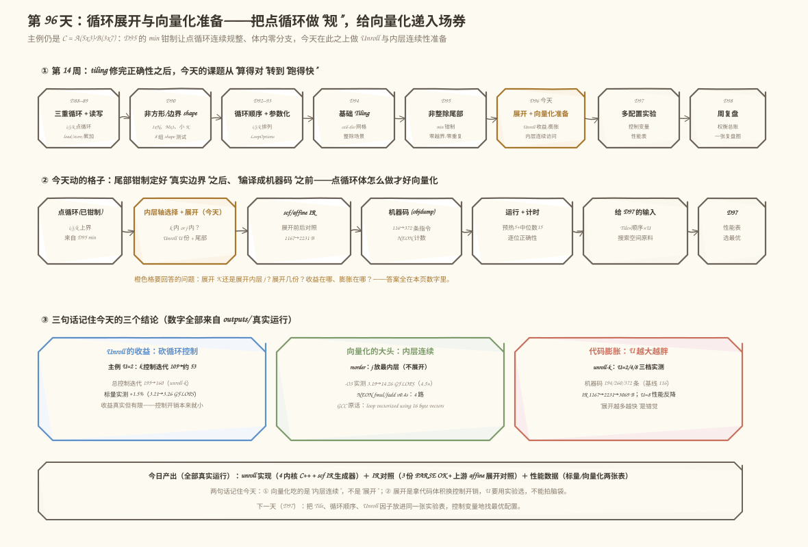
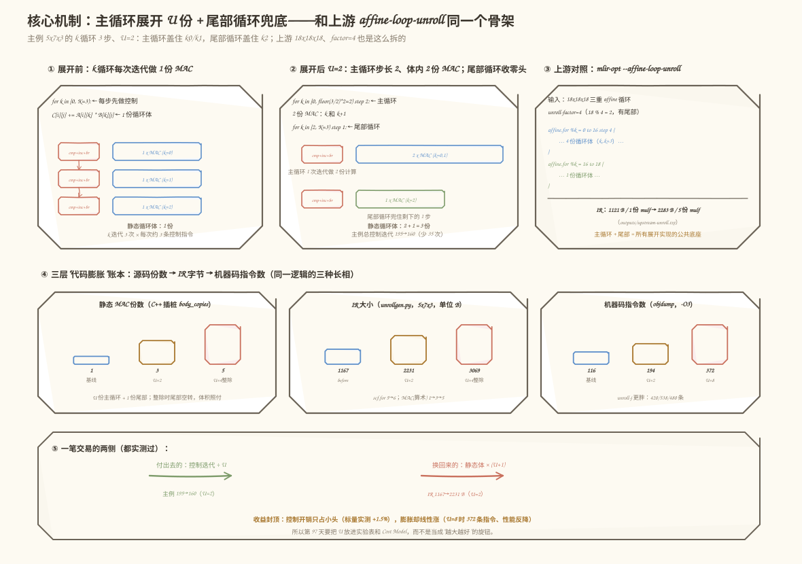
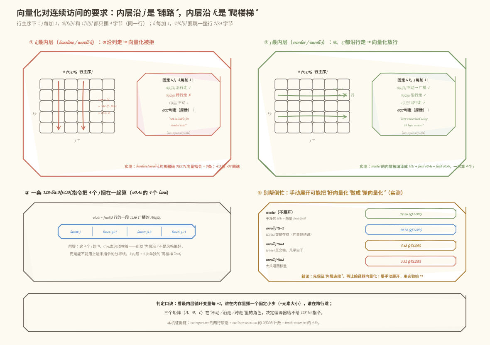
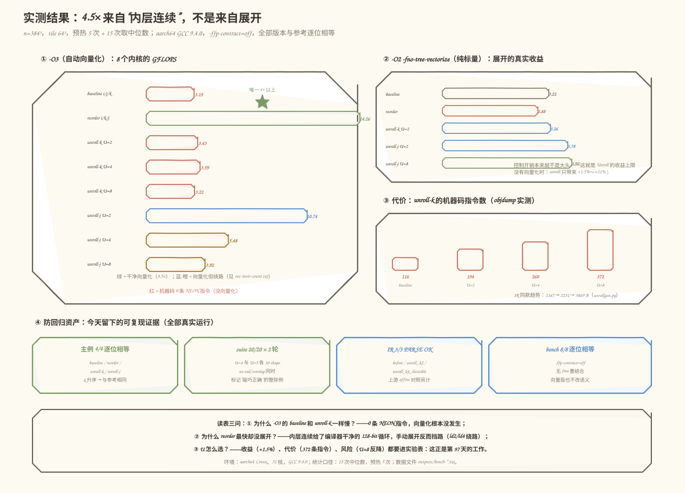

# 第 96 天：循环展开与向量化准备——把点循环做"规"，给向量化递入场券

> **今日目标**：完成本教程后，你能写出"主循环展开 U 份 + 尾部循环兜底"的标准展开结构并解释它与上游 `affine-loop-unroll` 的同构性；能用三层账本（源码份数、IR 字节、机器码指令数）说清展开的代码膨胀代价；能解释为什么内层沿 j 连续、沿 k 跨步决定了编译器敢不敢用 NEON 向量指令；能用 `run_all.sh` 一键复现 20/20 正确性套件、两种错误复现和两份性能表（标量 vs 自动向量化）。
> **预计时间**：学习 35 分钟＋实践 55 分钟
> **前置准备**：第 95 天的 `min` 钳制尾部（点循环如何在任意 shape 上算得对）；第 88～89 天的三重循环与 load/store 累加语义。工具只要 `g++`（本文环境：GCC 9.4.0，aarch64 Linux）和上游 `mlir-opt`（Ubuntu LLVM 18.1.8，`/usr/lib/llvm-18/bin/mlir-opt`）——今天仍不写 Pass，重点是把"展开"这件事的收益、代价和向量化门槛用实测数据钉死。
> **今日产出**：`code/` 下 940 行可复现实验（主实验 626 行：4 个正确内核＋2 个错误复现内核＋插桩计数＋bench＋suite；另含 IR 生成器与一键脚本）、`ir/` 下 3 份通过 `mlir-opt` 解析验证的对照 IR、`outputs/` 下 15 份真实运行记录——其中最有说服力的一份是：**同一份源码，标量版 3.2 GFLOPS，`-O3` 版 14.3 GFLOPS，4.5 倍差距全部来自"内层循环沿哪个维度走"，与展开无关**。

## 1. 今天解决什么问题？

第 95 天结束时，我们的 tile 化 MatMul 对任意 M、N、K 都算得对了。但"算得对"离"跑得快"还差两步，而且这两步都卡在**点循环**身上：

- **循环控制开销**：点循环每走一步，CPU 都要执行"比较—自增—分支"这套控制动作。主例 `C = A(5×3)·B(3×7)`、tile `2×4×2` 里，105 步有效计算（`M·N·K`）外面挂着 **195 次循环控制迭代**（今天实测，见 5.3 节）——控制迭代几乎是有效计算的两倍。类比成快递员：每送一件包裹都要回站点签一次到，包裹只送 105 件，签到却签了 195 次。对应到技术上是：每次循环迭代消耗若干条非计算指令（`cmp`＋自增＋分支，现代 CPU 上分支还可能预测失败），这些指令不产生任何 FLOPS。
- **访存不连续**：点循环最内层沿 k 走时，`B[k][j]` 每换一个 k 就要跳过一整行（`N×4` 字节）——今天实测 GCC 对它的诊断是 **"not suitable for strided load"（跨步访存，拒绝向量化）**；而把 j 换到最内层后，同样的乘加变成了 **"loop vectorized using 16 byte vectors"（用 128-bit 向量指令向量化）**，性能直接 4.5 倍。

今天的课题就这两个：**用循环展开（loop unroll）摊薄控制开销；用内层连续性给向量化铺路**。这是第 14 周从"算得对"转向"跑得快"的第一天。

贯穿全文的主例仍然固定为 `5×3 · 3×7 → 5×7`，tile `2×4×2`（第 95 天的原班人马），展开因子 `U=2`。今天所有的账——控制迭代数、IR 字节数、机器码指令数、GFLOPS——都从这个配置算出来。先剧透一个反直觉的实测结论，作为今天的悬念：**标量模式下展开 j 能快 ~17%，展开 k 几乎白干；而 `-O3` 自动向量化模式下，一分钱不花、只把循环换序的 reorder 拿走 4.5 倍，手动展开反而把编译器的向量化搅黄了**。展开不是免费的午餐，它是给向量化递入场券——递的姿势不对，券会被撕掉。

## 2. 先看全貌：今天的内容位于哪里？



**图 1**：看三个位置——最上排是第 14 周的时间线，昨天（D95）补完非整除尾部的正确性，今天开始动性能；中间是今天的两条主线，左边"主循环＋尾部"是展开的结构问题，右边"连续访存"是向量化的门票问题；下排是三种度量口径的真实产出（源码份数、IR 字节、机器码指令），以及一笔交易的两侧：控制迭代 ÷U 换静态体 ×(U+1)。

把主线串成 5 步：

1. 输入是 D95 的 `min` 钳制版点循环：任意 shape 下体内零分支、逐位正确——这是今天所有实验的地基；
2. **（今天·线一）展开**：把点循环改成"主循环一次跨 U 步（体内 U 份 MAC）＋尾部循环走余数"，K 和 j 两个维度各做一版；
3. **（今天·线二）连续性**：把 j 换到最内层（reorder），让 `B`、`C` 的访问都落在同一行上，观察 GCC 的向量化决策变化；
4. 用三层账本量化展开的代价：C++ `body_copies`、MLIR IR 字节数、objdump 机器码指令数——三个视角互相印证；
5. 交给第 97 天的多配置实验：今天证明了"哪个维度值得展开"依赖编译器行为，明天把 tile、顺序、展开因子做成可扫描的配置空间。

为什么展开要放在向量化之前讲？因为现代后端（包括 LLVM、也包括昇腾的 AI Core 编译链路）里，**展开很少自己直接提速，它的真实作用是改变后续 Pass 看到的循环形状**：内层足够规整、步数足够多，向量化才敢下手。不理解这层关系，就会犯今天实测出来的那个错误——手动展开反而挡住了自动向量化（5.4 节）。

## 3. 核心概念：先用直觉，再给准确定义

### 3.1 循环展开：一次办 U 件事，少跑 U－1 圈

一句通俗解释：**循环展开（loop unroll）**就是把循环体复制 U 份、循环步长放大 U 倍——原来"每次迭代办 1 件事、办 K 次"，变成"每次迭代办 U 件事、办 ⌊K/U⌋ 次＋余数"。

类比：超市收银。顾客排成一队，收银员可以一位一位扫码（每次一位、往返 K 次），也可以一次接过 4 位的商品连着扫（往返次数除以 4）。对应到技术上是：k 循环 `for (k = 0; k < K; k++) body(k)` 变成 `for (k = 0; k + U <= K; k += U) { body(k); body(k+1); … body(k+U-1); }`——"扫 4 位商品"就是体内 U 份 MAC，"少跑的往返"就是省掉的控制迭代。类比的边界：收银员一次拿 4 位的商品没有额外成本，但循环体每复制一份，**代码体积就真实地涨一份**（3.3 节），而且最后剩下的零头顾客（K % U ≠ 0）需要"单独结账"——这就是尾部循环。

主例的最小账（K=3，U=2，先不算 tile）：

```text
展开前：for k in [0, 3)：每步 1 份 MAC          → 3 次控制迭代，3 步
展开后：for k in [0, 2) step 2：体内 2 份 MAC   → 1 次控制迭代，盖住 k=0,1
        for k in [2, 3)：尾部，1 份 MAC         → 1 次控制迭代，盖住 k=2
```

一个常见误解："展开就是把循环写胖点，肯定更快"。今天标量实测：控制迭代从 195 降到 160（unroll-k U=2，－18%），性能只从 3.213 涨到 3.262 GFLOPS（**＋1.5%**）。因为主例的循环体本身就是一条 MAC，控制开销占比本来就小——**展开的收益上限 = 控制开销在总指令里的占比**，这个占比不大时，展开就是白忙。真正的大头在 3.4 节。

### 3.2 尾部循环：K % U ≠ 0 时的"第二段"

展开只对**整除部分**有效：`⌊K/U⌋×U` 步可以打包进主循环，剩下的 `K % U` 步（主例 K=3、U=2 时余 1 步）必须由一段**步长为 1 的尾部循环（tail/epilogue loop）**兜底。所以展开后的静态循环体是 `U + 1` 份：主循环体内 U 份＋尾部 1 份。

这和第 95 天的"剩余 Tile"是同一类问题、不同的余数来源，值得并排看清：

| | D95 剩余 Tile | D96 展开尾部 |
|---|---|---|
| 余数来源 | Shape 对 Tile 取余（`M % TM`） | 循环界对 U 取余（`K % U`） |
| 发生位置 | 每圈最后一个 tile 的边界 | 每个点循环的最后几步 |
| 标准解法 | `min(i0 + TM, M)` 钳制上界 | 分离"主循环＋尾部循环"两段 |
| 错误代价 | 越界 / 重复计算（D95 实测 242 次越界） | 丢尾部 = 漏算；伸过界 = 越界＋重算（今天实测见第 6 节） |

为什么展开的尾部不用 `min` 钳制、而要分离两段循环？因为钳制解决的是"上界在哪"，展开解决的是"体内有几份"——主循环体内写死了 U 份 MAC，靠钳制上界救不了"最后 1 步只有 1 份活"的情况；硬让主循环盖住尾部，就会让 `k + U` 伸过 `khi`（第 6 节的 overlap 错误）。上游 MLIR 的选择也一样：`mlir-opt --affine-loop-unroll` 遇到 `18 % 4 = 2` 时，直接把 k 循环拆成 `0 to 16 step 4` 和 `16 to 18` 两段（今天实测，5.3 节）——**主循环＋尾部循环是所有展开实现的公共底座**。

### 3.3 代码膨胀：同一笔账的三种长相

**代码膨胀（code bloat）**：展开用静态代码体积换动态控制次数。这笔账在三个层面都能看到，今天的实验把它做成了三联账本：

1. **源码层**：静态 MAC 语句数（`body_copies`）。unroll-k U=2 是 3 份（主循环 2 份＋尾部 1 份），U=4 整除时是 5 份；
2. **IR 层**：`unrollgen.py` 生成的 MLIR 从展开前 1167 字节涨到 U=2 的 2231 字节（1.9 倍）、U=4 整除版 3069 字节（2.6 倍）；`scf.for` 从 5 个变 6 个（k 循环一分为二），`arith.mulf` 从 1 条变 3 条、5 条；
3. **机器码层**：objdump 实测，`p_unrollk<2/4/8>` 的指令数是 194 / 260 / 372 条，基线 116 条——**U=8 时体积涨到 3.2 倍**。

类比：把"每次只带一份工具出门、来回 8 趟"改成"一次背 8 份工具、只跑 1 趟"——路程确实短了，但背包重了 8 倍，而且不管这趟活是不是正好 8 份，背包都得按 8 份的规格买（整除时尾部循环空转，体积照付）。类比的边界：背包重只是"累"，机器码膨胀的后果是具体的——**指令缓存（I-cache）压力、编译时间、寄存器分配压力**，U=8 的 unroll-j 在 `-O3` 下就因为体积失控掉到了 3.92 GFLOPS（5.4 节）。

### 3.4 向量化的连续访问门槛：j 是铺路，k 是爬楼梯

**向量化（vectorization）**：把"一次算 1 个数"的标量指令换成"一次算 4 个 float"的向量指令（aarch64 上是 NEON 的 `v0.4s`，128-bit）。收益是乘法器利用率直接 ×4——但有个硬门槛：**被向量化的那一维在内存里必须连续**。

行主序（row-major）下看主例的两个访存对象（`B` 是 `K×N`，`C` 是 `M×N`）：

```text
内层沿 j：B[k][j] → B[k][j+1] 地址只 +4 字节（同一行里挪一格）＝ 铺路
          C[i][j] → C[i][j+1] 同样 +4 字节
内层沿 k：B[k][j] → B[k+1][j] 地址 +N×4 字节（跳一整行）＝ 爬楼梯
```

为什么跨步就不行？因为向量 load 指令（如 `ld1 {v0.4s}`）要求**取出的 4 个 float 地址连续**；沿 j 走时 4 个 `B[k][j..j+3]` 正好是连续 16 字节，一条指令搬完；沿 k 走时 4 个元素散在 4 行里，要么用 4 条标量 load 拼（没省），要么先做数据重排（反而更贵）。今天 GCC 的原话（`-fopt-info-vec-missed`，`outputs/vec-report.txt`）：

```text
unroll_matmul.cpp:382:79: missed: not vectorized:not suitable for strided load
    ↑ 基线内核，k 最内层，B 的跨步 load 被拒
unroll_matmul.cpp:398:44: optimized: loop vectorized using 16 byte vectors
    ↑ reorder 内核，j 最内层，128-bit 向量化成功
```

这就解释了第 1 节的悬念：reorder（只把 j 换到最内层，不展开）在 `-O3` 下被编译成 `ld1r ＋ fmul v0.4s ＋ fadd v0.4s`（objdump 实测），14.26 GFLOPS，是基线的 **4.5 倍**；而所有 unroll-k 版本（k 仍是最内层）机器码里**一条向量指令都没有**（0/0/0），性能纹丝不动。**展开改变"跑多少圈"，连续性决定"每圈能坐几人"——后者才是数量级的差距。**

## 4. 图解核心机制



**图 2**：输入是展开前的 k 点循环（每次迭代 1 份 MAC），输出是"主循环＋尾部循环"两段结构。看四个位置——①② 对比展开前后：主例 k 有 3 步，U=2 时主循环 1 次迭代盖住 k0/k1（体内 2 份 MAC），尾部循环 1 次盖住 k2；③ 是这笔交易的账：控制迭代 195→160，静态体 1→3 份；④ 是同一笔膨胀在三层度量上的长相（源码份数 1→3→5、IR 字节 1167→2231→3069、机器码指令 116→194→372）；⑤ 总结交易两侧——左边绿色是省掉的控制迭代，右边红色是换来的体积。

按图中编号串一遍机制：

1. **展开前**（①）：`for k in [0, K=3)`，每步先付一次控制（比较＋自增＋分支），再做 1 份 MAC。105 步有效计算对应 195 次控制迭代（tile 外壳也计入）；
2. **展开后**（②）：主循环 `for k in [0, 2) step 2` 体内写 2 份 MAC（k 和 k+1），尾部循环 `for k in [2, 3)` 兜住余数。**k 仍然严格升序串行累加**——这是逐位正确性的来源：加法顺序和参考实现完全一致，今天所有正确内核与参考全部逐位相等（不是"误差小于阈值"，是一位都不差）；
3. **账本**（④）：三层度量互相印证同一件事——展开是"动态次数换静态体积"。注意 U=4 整除版的机器码是 260 条，比 U=2 的 194 条还多 66 条：整除只是让尾部循环空转（0 次迭代），那份静态代码照付；
4. **上游同构**（图中②的对照）：`mlir-opt --affine-loop-unroll="unroll-factor=4"` 处理 `18×18×18` 时把 k 循环拆成 `0 to 16 step 4` ＋ `16 to 18`——和我们手写的结构一模一样，展开的实现没有别的形状。

## 5. 动手实践：完成一个最小可运行例子

### 5.1 准备文件

```text
tutorials/day-096/
├── README.md                        ← 本文
├── images/                          ← 4 张图（本文全部数据来自 outputs/）
└── code/
    ├── unroll_matmul.cpp            ← 主实验：6 个内核＋插桩计数＋bench＋suite
    ├── unrollgen.py                 ← IR 生成器：展开前 / unroll-k U=2 / U=4 整除版
    ├── affine_unroll_check.mlir     ← 上游对照输入（18x18x18，affine 方言）
    ├── run_all.sh                   ← 一键复现（约 40 秒，产出 15 份记录）
    ├── ir/                          ← 生成的 3 份 MLIR
    └── outputs/                     ← 15 份真实运行记录（下文全部引用自此）
```

运行方式（本文环境：aarch64 Linux、GCC 9.4.0、LLVM 18.1.8 的 `mlir-opt`；无昇腾硬件依赖）：

```bash
cd tutorials/day-096/code
bash run_all.sh          # 一键复现全部实验，真实输出落进 outputs/
```

`run_all.sh` 做九件事：编译两个版本（标量 `-O2 -fno-tree-vectorize`、向量 `-O3`，都带 `-ffp-contract=off`）→ 主例四内核对照 → 10 个 shape 的正确性套件（U=4、U=5 两轮）→ 两种错误复现 → 两份性能表 → GCC 向量化诊断 → objdump 指令统计 → IR 生成与解析验证 → 上游 unroll 对照。

### 5.2 编写代码：展开内核与错误复现

`unroll_matmul.cpp` 里每个内核都有两副面孔：`Runner::run_*` 是**插桩版**（每次访存走带边界检查的 `ldA/ldB/ldC/stC`，越界计数、逐位比对），`p_*` 是**性能版**（无插桩，供 bench 计时）。展开内核的骨架（插桩版，`unroll_matmul.cpp:171`）：

```cpp
// ---------- 内核 3：unroll-k，k 点循环展开 U 份 + 尾部循环 ----------
// k 依然升序串行累加 → 与参考逐位相等
Metrics run_unrollk() {
    Metrics m;
    m.name = "unroll-k U=" + std::to_string(U);
    m.body_copies = U + 1;  // 主循环 1 份体内 U 条 MAC + 尾部 1 条
    resetC();
    for (int i0 = 0; i0 < M; i0 += TM) {
        int ihi = std::min(i0 + TM, M);          // D95 的 min 钳制，原样保留
        for (int j0 = 0; j0 < N; j0 += TN) {
            int jhi = std::min(j0 + TN, N);
            for (int k0 = 0; k0 < K; k0 += TK) {
                int khi = std::min(k0 + TK, K);
                for (int i = i0; i < ihi; i++) {
                    m.ctrl_iters++;
                    for (int j = j0; j < jhi; j++) {
                        m.ctrl_iters++;
                        float c = ldC(i, j);      // C 的读写被提出循环（寄存器累加）
                        int k = k0;
                        for (; k + U <= khi; k += U) {   // 主循环：一次跨 U 步
                            m.ctrl_iters++;
                            for (int u = 0; u < U; u++) { // 体内 U 条 MAC
                                m.inner_iters++;
                                c += ldA(i, k + u) * ldB(k + u, j);
                            }
                        }
                        for (; k < khi; k++) {    // 尾部循环：余数步，步长 1
                            m.ctrl_iters++;
                            m.inner_iters++;
                            c += ldA(i, k) * ldB(k, j);
                        }
                        stC(i, j, c);
                    }
                }
            }
        }
    }
    finalize(m);
    return m;
}
```

四个关键点：

- **主循环条件是 `k + U <= khi`**，不是 `k < khi`——这 6 个字符的差别就是第 6 节错误二的全部分界线：前者保证体内第 u 份 MAC 访问的 `k + u` 最大到 `khi - 1`，绝不伸过界；
- **`float c = ldC(i, j)` 把 C 的 load/store 提出了点循环**——真实编译器做展开时也会顺手做这个"寄存器提升"（register promotion），它本身就是展开的红利之一；
- **尾部循环接在主循环退出时的 k 上**（`for (; k < khi; k++)`），主循环盖住 `[k0, k0 + ⌊l/U⌋×U)`，尾部盖住剩余——两段拼起来正好是 `[k0, khi)`，不重不漏；
- `m.body_copies = U + 1`：静态 MAC 份数，3.3 节账本的第一层就从这来。

`run_unrollj`（`unroll_matmul.cpp:211`）是同一骨架套在 j 维上，但多一层讲究：它先做了 reorder（循环序 `i→k→j`），再展开 j——**展开哪个维度，就先让哪个维度连续**，这是 5.4 节性能故事的伏笔。两个错误复现内核 `run_no_tail`（丢掉尾部循环）和 `run_overlap`（主循环条件误写成 `k < khi`）各差一句话，专门留着给第 6 节当教材。

IR 侧由 `unrollgen.py` 生成三份对照（5.3 节看运行结果），核心是主循环的体内复制：

```text
scf.for %k = %c0 to %cMain step %cU {        // 主循环：0 到 floor(K/U)*U，步长 U
  %a0  = memref.load %argA[%i, %k]  …        // 第 1 份 MAC（k）
  %ku1 = arith.addi %k, %d1 : index          // 偏移 k+1 在 IR 里显式可见
  %a1  = memref.load %argA[%i, %ku1] …       // 第 2 份 MAC（k+1）
  …
}
scf.for %kt = %cMain to %cK step %c1 { … }   // 尾部循环：余数步
```

注意 `%cMain = floor(K/U)×U` 这个常量在 IR 里是**编译期算好的**（`arith.constant 2`）——展开是编译期变换，运行时不付除法。

### 5.3 运行与观察：三份对照记录

以下全部是**真实执行结果**（`bash run_all.sh`，环境：aarch64 Linux、GCC 9.4.0、nproc=32；完整记录在 `outputs/` 下）。

**对照一：主例四内核的插桩账本**（`outputs/main-table.txt`，`./unroll_matmul 5 7 3 2 4 2 2 --all`）：

```text
shape: M=5 N=7 K=3, tile: TM=2 TN=4 TK=2, U=2, useful_flops(M*N*K)=105, tiles=12
kernel                 correct inner_iters ctrl_iters  max_abs_err      oob body_copies
baseline(i/j/k)            yes         105        195        0.000        0         1
reorder(i/k/j)             yes         105        155        0.000        0         1
unroll-k U=2               yes         105        160        0.000        0         3
unroll-j U=2               yes         105        110        0.000        0         3
== 正确性：4/4 全部逐位相等（与参考逐位比较） ==
```

读这张表的三条线：① `inner_iters` 全部是 105 ＝ `M·N·K`——四个内核的**有效计算量一分不多、一分不少**（展开不该改变计算量，变了就是 bug）；② `ctrl_iters` 四个内核各不相同：基线 195，reorder 155（j 换到内层、少绕一层 tile 循环），unroll-k 160（k 循环一分为二），unroll-j 110（换序＋展开双份收益，四个里最低）；③ `body_copies` 从 1 → 3——控制迭代 ÷U 的代价是静态体 ×(U+1)，这就是图 2 里的那笔交易。这四个数都能手工推导验证，比如 unroll-k 的 160：k 循环一分为二后，每个 `(i, j)` 的 k 迭代数从 `l`（tile 内 k 长度 2 或 1）都变成 `⌈l/2⌉＝1`，代入 12 个 tile 求和恰好 160。

**对照二：IR 前后体积**（`outputs/ir-stats.txt`＋`ir-check.txt`，三份 IR 均通过 `mlir-opt` 解析验证）：

```text
matmul_before.mlir           1167 bytes   scf.for ×5   MAC(arith.mulf) ×1
matmul_unroll_k2.mlir        2231 bytes   scf.for ×6   MAC(arith.mulf) ×3
matmul_unroll_k4_divisible   3069 bytes   scf.for ×6   MAC(arith.mulf) ×5   ← 8x8x8 整除 shape
```

`scf.for` 5→6 就是"k 循环一分为二"；`mulf` 1→3→5 就是体内 MAC 份数。第三份特意用 `8×8×8`（K=8 被 U=4 整除）：**尾部循环还在 IR 里、只是运行时迭代 0 次**——整除消除的是动态执行，消除不了静态体积。

**对照三：上游 `affine-loop-unroll` 同构验证**（`outputs/upstream-unroll.txt`，输入 `affine_unroll_check.mlir`，18×18×18）：

```text
$ mlir-opt --affine-loop-unroll="unroll-factor=4" affine_unroll_check.mlir
before: 1121 bytes, arith.mulf ×1
after : 2283 bytes, arith.mulf ×5
展开后 k 循环被拆成（节选）：
affine.for %arg5 = 0 to 16 step 4 {    ← 主循环：⌊18/4⌋×4 = 16
affine.for %arg5 = 16 to 18 {          ← 尾部循环：18 % 4 = 2 步
```

上游和我们手写的区别只有方言（`affine.for` vs `scf.for`）和作用对象（先 raises 到 affine 方言才能做多面体分析）——**"主循环 step U ＋ 尾部循环"这个骨架是完全一致的**。这一步的意义：说明今天手写的不是玩具，而是所有生产级展开 Pass 的同构模型。

### 5.4 修改一个参数再观察：U 扫一遍，再把向量化开关打开

两个低成本对照，每个只改一个变量。

**对照 A：正确性套件扫 U**（`./unroll_matmul --suite 4`，`outputs/shape-suite.txt`，U=4、U=5 两轮共 20 项）：

```text
case(M N K | T)          说明                   unroll-k         unroll-j         no-tail          overlap
5x7x3 | 2x4x2            主例：tile 内 k 长 2  PASS(逐位相等) PASS(逐位相等) FAIL(丢尾部)  FAIL(越界/重算)
5x1x3 | 2x4x2            N=1（j 展开只剩尾部） PASS(逐位相等) PASS(逐位相等) FAIL(丢尾部)  FAIL(越界/重算)
64x64x64 | 16x16x16      完全整除              PASS(逐位相等) PASS(逐位相等) PASS(碰巧)     PASS(碰巧)
65x63x33 | 16x16x16      大 shape 全带尾       PASS(逐位相等) PASS(逐位相等) FAIL(丢尾部)  FAIL(越界/重算)
…（共 10 个 shape，unroll-k/unroll-j 20/20 全部 PASS）
```

最值得盯的是第三行：**完全整除时，两个错误内核也 PASS**——no-tail 没有尾部可丢、overlap 没有界可伸，bug 被整除性掩盖了。这解释了为什么展开相关的 bug 特别阴险：测试集全是"好身材" shape 时一切正常，线上来一个 `65×63×33` 就翻车。

**对照 B：同一份源码，两种编译**（`outputs/bench-scalar.txt` vs `bench-vector.txt`，`n=384`、tile `64×64×64`、预热 5 次＋15 次取中位数、`-ffp-contract=off` 保证逐位可比）：

```text
标量版（-O2 -fno-tree-vectorize）            向量版（-O3，自动向量化）
baseline          3.213 GFLOPS               baseline          3.187 GFLOPS
reorder           2.875                      reorder           14.256   ← 4.5×
unroll-k 2        3.262                      unroll-k 2        3.431
unroll-k 4        3.235                      unroll-k 4        3.594
unroll-k 8        3.284                      unroll-k 8        3.219
unroll-j 2        3.777                      unroll-j 2        10.739
unroll-j 4        3.698                      unroll-j 4        5.481
unroll-j 8        3.895                      unroll-j 8        3.924
（8/8 内核全部与参考逐位相等）
```



**图 3**：解释上表分化的机制图。左上是 B 的两种走法：内层沿 j 时 `B[k][j]→B[k][j+1]` 只挪 4 字节（同一行），4 个 float 正好凑成一条 128-bit 向量 load；内层沿 k 时每步跳 `N×4` 字节（跨行），向量 load 拆不下来。右上是 GCC 对两个内核的原始诊断（strided load 拒绝 vs 16-byte 向量化成功）；左下是机器码证据：reorder 的内层被编译成 `ld1r ＋ fmul v0.4s`——一条广播 load 加一条向量乘，一次算 4 个 j；右下把两种内层的实测性能钉在一起：连续内层的标量→向量跨越 3.2→14.3，跨步内层怎么展开都纹丝不动。

把表和图合起来读，四条结论依次浮出：

1. **标量模式下**：unroll-j 比基线快 ~17%（3.777 vs 3.213）——控制迭代 110 vs 195 的省法兑现了一部分；unroll-k 几乎无感（3.262 vs 3.213，＋1.5%）——k 内层每步都要跨行访存，省下的控制开销被访存吃掉；
2. **`-O3` 打开后**：reorder 一飞冲天（14.26，4.5×），unroll-k 三档全部趴在 3.2～3.6——**k 最内层 = 跨步 load = 向量化被拒**，展开救不了访存模式；
3. **unroll-j 的三档分化是今天最精彩的一课**：U=2 还能吃到 10.74（GCC 把 2 份 j 做成 `ld2/st2` 交错存取，向量是向量、但要绕路）；U=4 掉到 5.48（`ld4/st4` 反交错开销更大）；U=8 只剩 3.92（`outputs/vec-instr-count.txt` 显示它 480 条指令里只剩 5 条向量指令——体积太大，编译器放弃了对 8 份胖体的整段向量化，只零星处理了几个小循环）；
4. **手动展开挡住了自动向量化**：reorder（不展开）14.26 ＞ unroll-j 2（展开）10.74。展开把"一条干净的 j 循环"改成了"j 步长为 2 的胖循环"，GCC 硬着头皮用交错 load 指令拼——能用，但不如原始形状好编译。



**图 4**：今天全部性能证据的一页汇总。左栏是 `-O3` 下 8 个内核的 GFLOPS 对照（同一坐标轴，reorder 一枝独秀）；右侧解释"为什么最快的版本反而不展开"：手动展开让循环形状变复杂，挡住了自动向量化选路（ld2/ld4 绕路）；底部的机器码计数（0 / 3 / 8 / 12 / 5 条向量指令）和性能排序严丝合缝——**向量指令数与 GFLOPS 的相关性，比展开因子与 GFLOPS 的相关性高得多**。

如果只允许从今天带走一句话：**先调循环序让最内层连续，让编译器吃得下向量；展开只在它不挡路时锦上添花**。这条经验在昇腾语境下同样成立——AI Core 的向量单元编程模型与 NEON 不同（按整块 Tensor 编程而非显式向量寄存器），但"访存连续才喂得饱向量单元"这条门槛一模一样。

## 6. 常见错误与排查

今天准备了两个"真会犯"的错误复现内核（`--mode no-tail` / `--mode overlap`）加一个判断类错误，全部有真实输出。

**错误一：展开后忘了尾部循环（`run_no_tail`）**

- **现象**：`./unroll_matmul 5 7 3 2 4 2 2 --mode no-tail`（`outputs/err-no-tail.txt`）：

```text
kernel                 correct inner_iters ctrl_iters  max_abs_err      oob body_copies
no-tail(丢尾部)          NO          70        125        1.875        0         2
```

- **原因**：主循环 `k + U <= khi` 盖住 `[k0, k0 + ⌊l/U⌋×U)`，剩下的 `khi - (k0 + ⌊l/U⌋×U)` 步没人管。主例每个 tile 内 k 长 2、U=2 时主循环全覆盖、看不出来；但 K=3 的第二步 tile（k 长 1）里 `k + 2 <= k0+1` 直接不成立，那 1 步整段蒸发——`inner_iters` 只有 70，比 105 少了整整 35 步（K 尾部 `k=2` 的一整个平面）。
- **定位**：看 `inner_iters` 是否等于 `M·N·K`——这是展开正确性的第一道 invariant，低了就是漏算。误差模式也有指纹：丢尾部是**部分元素整体偏小**（少加了一项），`max_abs_err=1.875` 而不是天文数字。
- **修复**：补上 `for (; k < khi; k++)` 尾部循环；更稳妥的做法是让"主＋尾"成为模板，永远成对出现。

**错误二：主循环条件写成 `k < khi`（`run_overlap`）**

- **现象**：`./unroll_matmul 5 7 3 2 4 2 2 --mode overlap`（`outputs/err-overlap.txt`）：

```text
kernel                 correct inner_iters ctrl_iters  max_abs_err      oob body_copies
overlap(k<khi)              NO         140        160       56.250       70         2
```

- **原因**：主循环步长是 U，但条件忘了同步改成 `k + U <= khi`。k 内层为 1 的 tile 里，`k=0 < 1` 成立，体内却访问 `k=0` 和 `k=1`——后者已经伸进 pad 区（pad 值 7.5，和 D95 同款），于是 70 次越界＋把垃圾值 7.5 加进结果，`max_abs_err` 冲到 56.25；更隐蔽的是越界读到的值又会被**重复累加**（`inner_iters=140 > 105`），一错双份。
- **定位**：两个计数器同时报警：`oob > 0`（越界）且 `inner_iters > M·N·K`（多算）。比错误一恶劣——它既越界又重算，数值大到离谱反而容易发现；真正难发现的是"越界读到的恰好是 0"的布局。
- **修复**：条件改回 `k + U <= khi`。经验法则：**改步长的那一刻，必须同步检查上界条件**，这两个参数是绑定的。

**错误三：判断类——"展开没提速，说明编译器坏了"**

- **现象**：unroll-k 三档在 `-O3` 下全部 3.2～3.6 GFLOPS，和基线几乎没差别，第一反应容易怀疑测量或编译出了问题。
- **原因**：不是坏了，是门槛没过——k 最内层的 `B[k][j]` 是跨步访存，GCC 诊断原文"not suitable for strided load"，机器码里 0 条向量指令。展开改变不了访存模式，它只减少循环次数；**数量级的差距从来不在"跑几圈"，在"每圈用不用向量单元"**。
- **定位**：两步排查，先看 `g++ -fopt-info-vec-optimized -fopt-info-vec-missed` 的诊断（谁被向量化、为什么没被），再用 `objdump -d | grep 'v[0-9]*\.4s'` 数向量指令——诊断说"vectorized"且机器码里真有 `vN.4s`，才说明向量化落地了。
- **修复**：把连续维度（j）换到最内层。今天的实测顺序就是答案：reorder 14.26 ＞ 任何展开版本。

## 7. 今日练习

### 必做练习

在主例上跑一次"U 扫描"并预测再验证：

1. 运行 `./unroll_matmul 5 7 3 2 4 2 4 --all`（U 从 2 改成 4）：**先动笔预测** `inner_iters`、`ctrl_iters`、`body_copies` 三个数（提示：K=3、tile 内 k 长只有 2 或 1，U=4 时主循环条件一步都不成立，全部退回尾部循环）；
2. 对答案：`inner_iters` 应仍是 105（正确性 invariant），`body_copies` 应是 5（U+1）——而 `ctrl_iters` 是 195，和基线**一模一样**：主循环一步没进、展开完全空转，5 份静态体的体积却照付。这就是"展开因子超过循环长度是纯亏"的实测版；
3. 把你预测错的那个数的原因写成一句话，对照 5.2 节的主循环条件检查自己的推理链。

### 选做挑战

用 `unrollgen.py` 生成一份 unroll-j 版 IR（把生成器的 `variant` 从 `unroll_k` 改成 j 维展开，参考 `matmul_unroll_k2.mlir` 里偏移 `%d1` 的写法），要求：`mlir-opt` 解析通过；用 `grep -c` 统计 `scf.for` 和 `arith.mulf` 的数量并手工验证（主循环体内 mulf 应是 U 份）；对照 5.4 节思考——这份 IR 的内层沿什么维度？它对向量化友好吗？只做生成和验证，不需要跑性能。

## 8. 今日验收

- [ ] 我能用自己的话说清"主循环＋尾部循环"结构，以及它为什么和 `mlir-opt --affine-loop-unroll` 的输出同构；
- [ ] 我能独立运行 `bash run_all.sh`，并在 `outputs/` 里找到主例对照表、两份性能表和 GCC 向量化诊断；
- [ ] 我能解释 `k + U <= khi` 和 `k < khi` 两种主循环条件分别导致什么后果（漏算 vs 越界＋重算）；
- [ ] 我能修改 U（2→4→8）并预测 `body_copies`、`ctrl_iters` 的变化方向，再用程序验证；
- [ ] 我能说出今天 4.5× 加速的真正来源（内层连续→向量化），并指出哪张图、哪份输出是证据；
- [ ] 我保存了 940 行实验代码、3 份 IR、15 份真实运行记录和 4 张图（`tutorials/day-096/`）。

## 9. 一句话总结与明天预告

今天把"跑得快"拆成了两笔能算清的账：**展开用静态体积（IR 1.9 倍、机器码 1.7 倍）换动态控制（迭代 ÷U），是小头；内层连续性决定向量化资格，一次 ×4，是大头**。手写的"主循环＋尾部"和上游 `affine-loop-unroll` 完全同构，20/20 的 shape 套件证明它对任意余数都逐位正确；而两份性能表合起来讲了一个反直觉的故事——不展开的 reorder 拿走全部 4.5×，展开因子越大反而越挡向量化（U=8 掉到 3.92）。

明天（第 97 天·多配置正确性与性能实验）把今天的手动对照升级成系统实验：tile 尺寸、循环顺序、展开因子做成可扫描的配置空间，学会控制变量、预热、重复测量和中位数统计——今天单点测出来的每条结论，明天都要在配置网格上接受复检。
