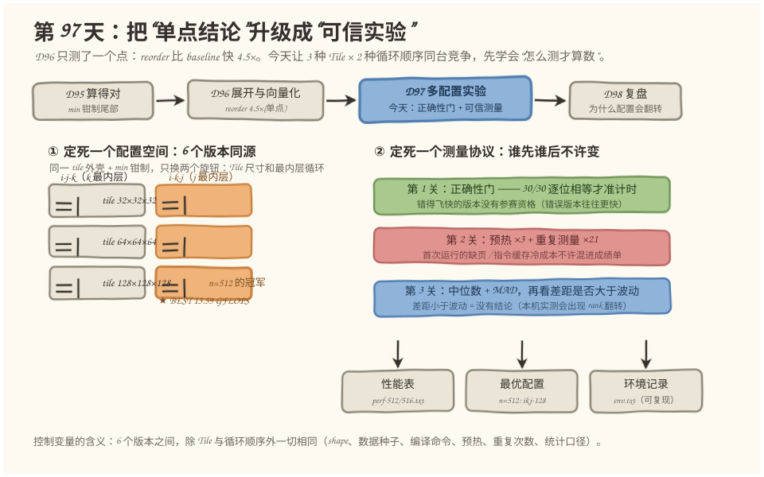
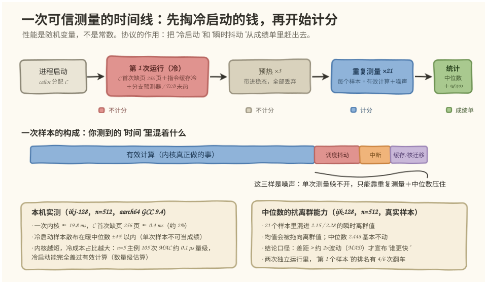
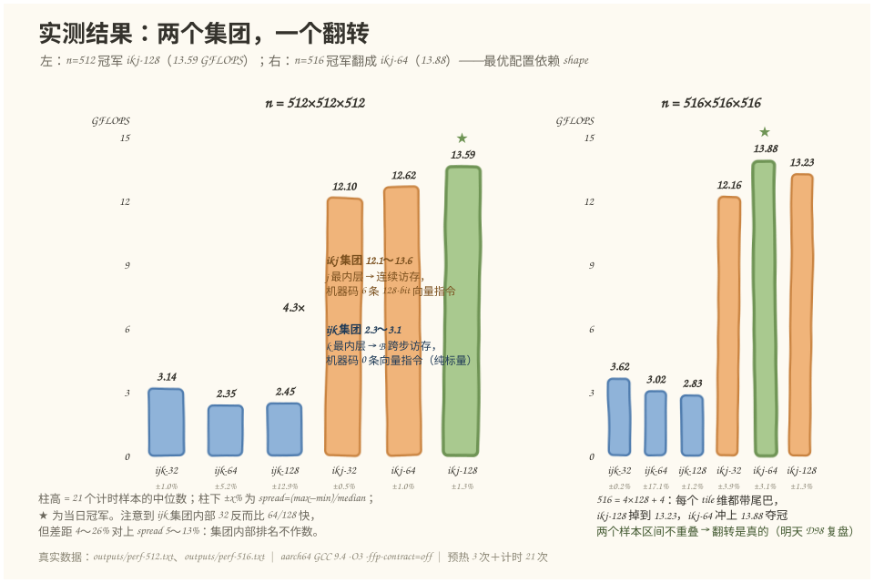
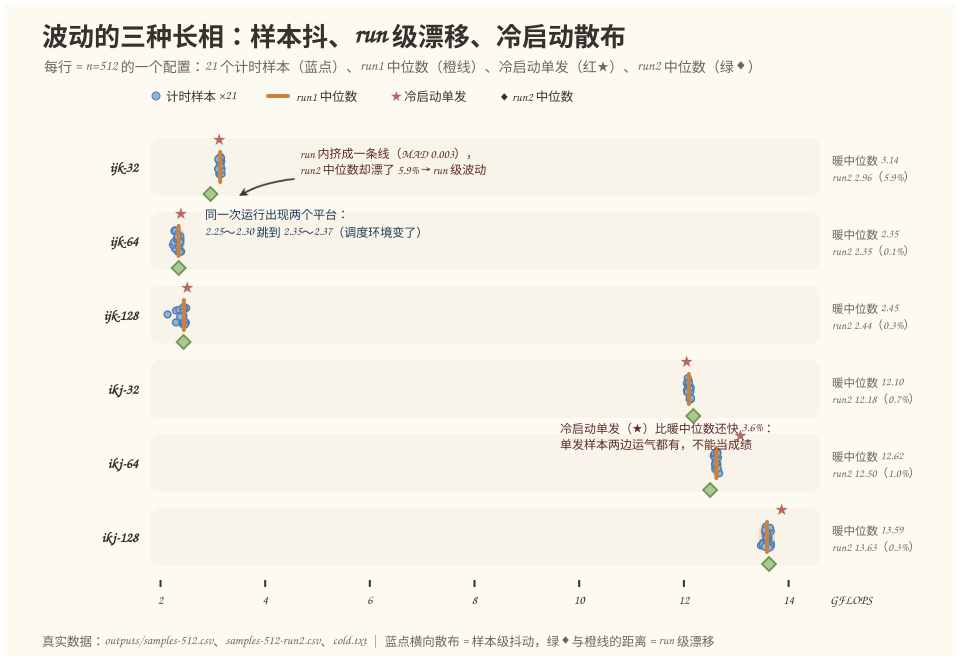

# 第 97 天：多配置正确性与性能实验——别问"哪个快"，先问"怎么测才算数"

> **今日目标**：完成本教程后，你能设计并执行一个控制变量下的配置扫描实验（3 种 Tile × 2 种循环顺序）；能用"正确性门先行"把错误版本挡在计时之外（今天的门是 30/30 逐位相等）；能用"预热＋重复测量×21＋中位数/MAD"把测量压到跨运行可复现（本机 5/6 配置漂移 ≤1%）；能用"差距是否大于波动"判断一条结论是否成立，并看到单次测量排名翻车的真实反例（4/6）；最后产出性能表、最优配置、实验环境记录三件套。
> **预计时间**：学习 35 分钟＋实践 50 分钟
> **前置准备**：第 95 天的 `min` 钳制 tile 外壳（任意 shape 不越界）、第 96 天的结论（j 最内层才喂得饱向量化）。工具只要 `g++`（本文环境：GCC 9.4.0，aarch64 Linux，32 硬件线程，主频锁定 2.9 GHz）——今天不引入新编译器知识，主角是实验方法本身。
> **今日产出**：`code/` 下约 380 行可复现实验（318 行主实验＋64 行一键脚本）＋`outputs/` 下 11 份真实运行记录＋4 张图。最有说服力的一条：**同一实验第二次运行时，"第 1 个计时样本"给出的排名有 4/6 个配置和中位数排名不一致**——单次测量真的不能当结论。

## 1. 今天解决什么问题？

第 96 天结束时我们留了一个尾巴：reorder 比 baseline 快 4.5 倍，这是**一个点对另一个点**的结论。第 97 天的任务是把这种单点比较升级成系统实验——一次性回答"3 种 Tile × 2 种循环顺序，共 6 个版本，哪个最快？"

但真要做，会发现两个比"跑得快"更底层的问题：

- **比较公平吗？** 6 个版本如果数据不一样、编译选项不一样、预热次数不一样，那这张性能表就是废纸。这就是**控制变量**要解决的事。
- **数字可信吗？** 本机主频锁定在 2.9 GHz（`lscpu` 显示 min=max），没有任何动态调频，但同一个配置跑两次，中位数照样会漂——今天实测 `ijk-32` 两次运行的中位数相差 **5.9%**（3.140 → 2.956 GFLOPS，`outputs/repeatability.txt`）。频率没变，数字为什么变？这就是**性能波动**，它来自调度、中断、缓存状态这些你锁不掉的东西。结论：**性能不是常数，是随机变量**——这句话就是今天的地基。

再叠加一个纪律问题：性能实验有个阴险陷阱——**错误版本往往更快**（少算当然快，第 96 天的 no-tail 内核就是"算得飞快、结果全错"）。所以所有版本必须先过正确性验证，再谈性能。今天这条门的实测成绩：5 个 shape × 6 配置 = **30/30 逐位相等**（不是"误差小于阈值"，是一位都不差）。

贯穿全文的例子：`C = A(512×512) · B(512×512)`，配置空间是 6 个版本——Tile 取 `32³/64³/128³`，内层循环序取 `i-j-k`（k 最内层）或 `i-k-j`（j 最内层，即 D96 的 reorder）。所有配置共享 D95 遗产的 tile 外壳和 `min` 钳制，`-ffp-contract=off` 保证 k 升序累加逐位可比。先剧透一个悬念：**512 上最快的是 ikj-128（13.59 GFLOPS），可换到 516 上冠军翻成了 ikj-64（13.88）**——最优配置居然依赖 shape，这个翻转留给明天（D98）解释，今天先把它诚实地测出来。

## 2. 先看全貌：今天的内容位于哪里？



**图 1**：看三个区域——上排是第 14 周的时间线，昨天（D96）给了单点的 4.5×，今天给这个结论办一场"公平的比赛"；左下是今天的配置空间：6 个版本同源，只有 Tile 和最内层两个旋钮可以动；右下是测量协议的三道关，最底下是三个交付物：性能表、最优配置、环境记录。

把主线串成 5 步：

1. **定配置空间**：6 个版本 = 3 种 Tile × 2 种内层循环序，外壳、钳制、编译命令、数据全部共享——这是控制变量的"控制"部分；
2. **正确性门**：5 个 shape（含小 shape、质数 shape、大 shape）× 6 配置逐位比对，30/30 通过才准进计时阶段；
3. **可信测量**：每个配置预热 3 次（丢弃）＋重复计时 21 次，取中位数，附带最小值、MAD、spread%；
4. **读表下结论**：中位数排名、"第 1 个样本"排名、跨运行漂移三个视角交叉验证，判断哪些差距是真的、哪些是噪声；
5. **交付三件套**：性能表（`perf-512.txt`、`perf-516.txt`）、最优配置（512 上 ikj-128）、环境记录（`env.txt`）。

为什么"实验方法"值得单独一天？因为第 96 天的性能表已经暴露了苗头：不同内核的差距有 4.5 倍这种"闭着眼都能测对"的，也有 1.5% 这种"一碰就翻"的。**差距越大越好测，结论越接近噪声越需要方法**。明天 D98 要复盘"为什么大 Tile 在一种 shape 上快、另一种上慢"，那种 shape 间的差距往往只有百分之几——没有今天的测量纪律，明天的复盘就是拿噪声讲故事。

## 3. 核心概念：先用直觉，再给准确定义

### 3.1 控制变量：只允许一个旋钮在转

一句通俗解释：**控制变量（controlled variable）**就是让所有被比较的对象，除了你关心的那个因素外，其他条件严格相同。

类比：百米赛跑要"同一场地、同一风向、同一天气"计时，否则甲跑顺风、乙跑顶风，成绩单毫无意义。对应到技术上是：6 个配置必须吃**同一份数据**（今天用固定种子 42 生成 A、B）、**同一个编译命令**（`g++ -std=c++17 -O3 -ffp-contract=off`）、**同一个测量协议**（预热 3 次＋计时 21 次＋中位数），甚至同一个进程里依次测量——变的只有 `TM/TN/TK` 三个数和最内两层循环的顺序。

今天的冻结清单（写在代码里的部分）：

| 冻结项 | 值 | 为什么冻它 |
|---|---|---|
| Shape | `512×512×512`（另测 516） | 换 shape 换的是问题，不是配置 |
| 数据 | 种子 42 的同一份 A/B | 数据分布不同，分支和缓存行为都不同 |
| 编译 | `-O3 -ffp-contract=off` | 优化等级和 FMA 收缩直接改变机器码 |
| 协议 | warmup=3、repeats=21、中位数 | 预热和样本数不同，可比性就没了 |
| 口径 | GFLOPS = 2·M·N·K / t | 每 MAC 记 2 个 FLOP，全表统一 |

类比的边界：田径场可以做到完全同条件，性能实验做不到"绝对相同"——调度抖动锁不掉（见 3.4）。所以控制变量的完整版是：**能冻的冻住，冻不住的用重复测量压住**。

### 3.2 预热：先掏冷启动的钱，再开始计分

一句通俗解释：**预热（warmup）**就是在正式计时前，把要测的东西先空跑几遍，把"第一次"特有的额外成本花掉。

类比：运动员比赛前热身——肌肉、心率、神经反应都带到比赛状态才发令枪。对应到技术上是：程序第一次跑某个内核时，要额外支付**冷启动成本**：输出矩阵 C 的 256 个页第一次被写入时的缺页（page fault）、指令第一次进 I-cache、分支预测器还没学会这个循环的走向、TLB 还没有缓存地址映射。这些成本和内核本身的快慢无关，混进成绩就是系统性偏差。

今天冷启动对照实验的实测数据（`outputs/cold.txt`，每个配置单独起一个新进程、只跑 1 次、C 用 `calloc` 分配保证首次写入缺页发生在内核里）：

```text
配置        冷启动1次    预热后中位数   偏差
ijk-32       3.122        3.140       -0.6%
ijk-64       2.390        2.347       +1.8%
ijk-128      2.511        2.448       +2.6%
ikj-32      12.052       12.096       -0.4%
ikj-64      13.079       12.621       +3.6%
ikj-128     13.868       13.587       +2.1%
```

读法有两层：① 冷样本和暖中位数的偏差在 ±4% 以内——不是"冷启动很贵"，而是这个内核一次跑约 19.8 ms，256 页缺页（约 0.4 ms，数量级估算）只占 2%；② 但注意，**±4% 已经大于很多配置间的差距**——比如 516 上 ikj-64 和 ikj-128 只差约 5%，冷样本可能直接改变结论。类比的边界：热身消耗体力，预热不消耗内核什么——它唯一的代价是多跑 3 次（约 14% 的额外时间），换来的保险是"成绩里绝对没有冷启动的系统性偏差"。而且**内核越短，冷成本占比越大**：D96 的 5×7×3 主例只有 105 次 MAC（0.1 μs 量级，估算值），冷启动能完全盖过有效计算——小内核实验里预热不是"更严谨"，是必需品。

### 3.3 重复测量与中位数：把噪声压到可复现

一句通俗解释：性能既然是随机变量，就要**多测几次取一个稳健统计量**——今天取**中位数（median）**，并用 **MAD（median absolute deviation，中位绝对偏差）**描述波动：`MAD = median(|每个样本 − 中位数|)`。

类比：游泳比赛预赛游几轮，看的是几轮触壁时间的稳定水平，不是某一轮"超常发挥"。对应到技术上是：预热后重复计时 21 次，把 21 个样本的中位数当成绩，MAD 当误差棒；一个样本哪怕抓到瞬时离群值，中位数也基本不动。

为什么是中位数而不是别的？用今天 `ijk-128` 的 21 个真实样本回答（`outputs/samples-512.csv`）：其中混着 2.15、2.28 这样的瞬时离群值（可能是内核被调度走了几十微秒），中位数稳在 2.448；如果用**均值**，离群值会把成绩往慢的方向拖；如果用**最小值**，你会报一个"运气最好的一次"，系统性地高估典型性能，而且最小值对样本数极其敏感（测 100 次的最小值几乎必然比测 21 次更小）。中位数对离群值不敏感、对样本数稳定，是性能表最诚实的口径。

一个常见误解："取平均最科学"。平均适合无离群的对称分布，而单次性能样本的上界被"只受干扰"封死、下界被干扰大小撑开——分布天然左偏，均值和中位数会差出可见的量。今天的表里凡是 spread% 大的配置，均值都会明显低于中位数。

### 3.4 性能波动与结论有效性：差距要大于天平的精度

一句通俗解释：**性能波动（variance/jitter）**就是同一配置反复测量时数字自己会跳；它给所有结论划了一条有效性红线——**差距小于波动，就没有结论**。

类比：一台精度 5 克的天平，称出两个苹果差 3 克，你不能说"A 苹果更重"——天平自己都不信。对应到技术上是：今天用两个口径量化波动——**样本级**（一次运行里 21 个样本的 spread%，即 (max−min)/median）和**run 级**（两次独立运行的中位数漂移）。两个口径今天都贡献了真实案例：

- **样本级**：`ijk-128` 在 512 上 spread 12.87%（21 个样本在 2.155～2.470 之间跳）；而 `ikj-128` 只有 1.34%。同一台机器、同一个协议，波动大小本身也是配置的属性——访存越"野"的内核，对运行环境越敏感。
- **run 级**：`ijk-32` 更微妙——单次运行内样本极其稳定（MAD 只有 0.003，样本挤在 3.11～3.15），但两次独立运行的中位数漂了 **5.9%**。样本内的密集让你误以为"稳如老狗"，跨运行照样漂——**run 级波动是样本级 MAD 看不见的**，必须把整个实验重跑一遍才能暴露。

判定规则今天就用一版实用的：**配置间差距 > 大约 2×对方的 MAD/spread 才宣布"更快"**；不满足的，要么加样本量，要么老实写"在波动内，无法区分"。明天的复盘要解释的正是 516 上 ikj-64 对 ikj-128 的翻转（差约 5%），我们今天能宣布它"是真的翻转"，依据就是两组样本区间**不重叠**（ikj-64 的最慢样本 13.49，比 ikj-128 的最快样本 13.27 还快）。

## 4. 图解核心机制



**图 2**：输入是一次"裸奔"的测量冲动（跑一次、记个数），输出是一套可信协议。看三个位置——上排时间线：第 1 次运行的冷成本（C 缺页＋指令缓存＋分支预测器）不许计分，预热 ×3 带进稳态后才开始 21 次计时，最后用中位数＋MAD 出成绩单；中部"一次样本的构成"：你测到的时间 = 有效计算＋调度抖动＋中断＋缓存/核迁移，后三样是躲不开的噪声，只能靠重复测量压住；底部两张卡片是今天的实测证据——冷样本散布在暖中位数 ±4% 内、中位数面对 2.15 离群值稳如泰山。

按图把机制串一遍：

1. **为什么第一次不计分**：`calloc` 拿到的 1 MB C 矩阵对应 256 个未触碰的页，内核第一次写入时每页触发一次缺页；加上指令缓存和分支预测器的冷启动，第一次计时会系统性地偏慢。预热 3 次把这些成本全部"烧"掉——协议层面保证计分阶段只剩稳态行为；
2. **为什么计 21 次而不是 1 次**：因为每次样本都是"有效计算＋噪声"的混合物，噪声量级是百分之几（图 2 中部的小色块）。21 个样本的中位数对离群值有免疫力（图 2 右下卡片：2.15 的离群样本进不了中位数的脑子）；
3. **为什么跨运行还要再跑一遍**：因为 run 级波动（进程落在哪个物理核、邻居负载、地址随机化）是样本内 MAD 看不见的。今天的实测：5/6 配置的 run 级漂移 ≤1%，但 `ijk-32` 漂了 5.9%——单次运行内部再稳定，也不构成"可复现"的证明；
4. **结论有效性**：统计出口径之后才轮到比较——`ikj` 集团（12.1～13.6 GFLOPS）和 `ijk` 集团（2.3～3.1）之间隔 4 倍，任何口径都能测对；`ijk-64`（2.347）对 `ijk-128`（2.448）只差 4.3%，而两者 spread 分别是 5.2% 和 12.9%——这种差距按今天的规则**不能下结论**，表里它们的排名（6 和 5）也确实在两次运行间换过位置。

## 5. 动手实践：完成一个最小可运行例子

### 5.1 准备文件

```text
tutorials/day-097/
├── README.md                     ← 本文
├── images/                       ← 4 张图（数据全部来自 outputs/）
└── code/
    ├── config_bench.cpp          ← 主实验：6 配置内核＋正确性门＋bench（318 行）
    ├── run_all.sh                ← 一键复现：8 个步骤，约 40 秒
    └── outputs/                  ← 11 份真实运行记录
        ├── env.txt               实验环境记录（机器/编译器/协议）
        ├── correctness.txt       正确性套件：5 shape × 6 配置 = 30/30
        ├── perf-512.txt          n=512 性能表（run1）＋samples-512.csv（126 个样本）
        ├── cold.txt              冷启动对照：每个配置一个新进程跑 1 次
        ├── perf-512-run2.txt     同一实验第二次运行＋samples-512-run2.csv
        ├── repeatability.txt     两次运行的中位数漂移对照
        ├── perf-516.txt          n=516（D98 预告）＋samples-516.csv
        └── vec-instr.txt         两个内核的机器码向量指令计数
```

运行方式（本文环境：aarch64 Linux，GCC 9.4.0，16 物理核 32 线程，主频锁定 2.9 GHz，L1d 64KB/核，L2 512KB/核，L3 32MiB；无昇腾硬件依赖）：

```bash
cd tutorials/day-097/code
bash run_all.sh                       # 一键复现全部，真实输出落进 outputs/
# 三步法手动复现：
./config_bench suite                  # ① 正确性套件（5 shape × 6 配置）
./config_bench bench 512 512 512 3 21 # ② 性能实验：warmup=3 + repeats=21
./config_bench cold 5 512 512 512     # ③ 冷启动对照：新进程单跑 1 次 5 号配置
```

### 5.2 编写代码：一个内核模板、一道门、一套协议

6 个配置共享同一个内核模板 `tiled_matmul<ORDER>`（`config_bench.cpp:57`）：tile 外壳和 `min` 钳制原样继承 D95，模板参数只切换最内两层循环——`ORDER=0` 是 k 最内层（D96 的 baseline 形状），`ORDER=1` 是 j 最内层（D96 的 reorder 形状）：

```cpp
template <int ORDER>
__attribute__((noinline)) void tiled_matmul(const float* A, const float* B, float* C,
                                            int M, int N, int K, int TM, int TN, int TK) {
    for (int i0 = 0; i0 < M; i0 += TM)
        for (int j0 = 0; j0 < N; j0 += TN)
            for (int k0 = 0; k0 < K; k0 += TK) {
                const int ihi = std::min(i0 + TM, M);   // D95 的 min 钳制：任意 shape 不越界
                const int jhi = std::min(j0 + TN, N);
                const int khi = std::min(k0 + TK, K);
                if (ORDER == 0) {                        // 内层 i→j→k：B[k][j] 沿 k 跨行 = 跨步访存
                    for (int i = i0; i < ihi; i++)
                        for (int j = j0; j < jhi; j++) {
                            float c = C[i * (size_t)N + j];
                            for (int k = k0; k < khi; k++)
                                c += A[i * (size_t)K + k] * B[k * (size_t)N + j];
                            C[i * (size_t)N + j] = c;
                        }
                } else {                                 // 内层 i→k→j：B、C 都沿 j 连续 → 可向量化
                    for (int i = i0; i < ihi; i++)
                        for (int k = k0; k < khi; k++) {
                            const float a = A[i * (size_t)K + k];
                            for (int j = j0; j < jhi; j++)
                                C[i * (size_t)N + j] += a * B[k * (size_t)N + j];
                        }
                }
            }
}
```

两个 order 各实例化一份并 `noinline`，objdump 里就是两个独立符号，向量指令可以分开数。注意两个内核对每个 `C[i][j]` 都保持 **k 升序串行累加**，加上 `-ffp-contract=off` 禁止乘加收缩成 fma——这是"逐位相等"的编译期保证（冷启动模式里 `calloc` 分配的 C 首次写入缺页也发生在这里面，见下）。

**正确性门**是 `check_all`（`config_bench.cpp:115`）：每个配置跑完和参考实现 `memcmp` 逐位比对，任何失败直接打印清单并**拒绝进入计时**：

```cpp
bool exact = (memcmp(C.data(), Cref.data(), C.size() * sizeof(float)) == 0);  // 逐位，不是阈值
```

**测量协议**在 `run_bench`（`config_bench.cpp:147`）里，三件事各占几行：

```cpp
for (int w = 0; w < warm; w++) run_config(c, ...);        // ① 预热 3 次：冷成本烧掉，全部丢弃
for (int r = 0; r < reps; r++) {
    std::fill(C.begin(), C.end(), 0.0f);                  // ② 每个样本同一初始状态（控制变量）
    auto t0 = Clock::now();
    run_config(c, A.data(), B.data(), C.data(), M, N, K);  //    steady_clock 只包住内核本身
    auto t1 = Clock::now();
    samples[c].push_back(gflops_of(std::chrono::duration<double>(t1 - t0).count(), flops));
}
med[c]  = median(samples[c]);                             // ③ nth_element 取中位数
mad[c]  = median(dev);                                     //    MAD = median(|样本−中位数|)
```

统计用的 `median` 用 `std::nth_element`（O(n) 找第 k 大，不打乱外部顺序），MAD 是"绝对偏差的中位数"再求一次中位数。表里最后两列 `rk_med`（中位数排名）和 `rk_1st`（第一个样本排名）是今天最毒的一列——它专门用来演示"单次测量会给出什么答案"。

### 5.3 运行与观察：三份关键记录

以下全部是**真实执行结果**（`bash run_all.sh`，2026-11-13，aarch64 GCC 9.4.0；完整记录在 `outputs/`）。

**记录一：正确性门**（`outputs/correctness.txt`，节选）：

```text
shape   5x  7x  3: ijk-32:PASS ijk-64:PASS ijk-128:PASS ikj-32:PASS ikj-64:PASS ikj-128:PASS
shape  65x 63x 33: ijk-32:PASS ... 全 PASS
shape 127x129x125: ijk-32:PASS ... 全 PASS
== 正确性套件: 30/30 PASS（全部与参考逐位相等）==
```

n=512 的 bench 还会先过一遍同 shape 的门（`正确性门[bench前]: 6/6 全部与参考逐位相等，放行`）——小 shape 套件抓尾部 bug，bench 前的即时门抓"这个 shape 恰好出错"。

**记录二：n=512 性能表**（`outputs/perf-512.txt`，run1 完整表）：

```text
kernel        median        min      MAD  spread%  first_smp rk_med rk_1st
ijk-32         3.140      3.114    0.003     1.03      3.141      4      4
ijk-64         2.347      2.252    0.027     5.21      2.299      6      6
ijk-128        2.448      2.155    0.014    12.87      2.465      5      5
ikj-32        12.096     12.064    0.018     0.52     12.068      3      3
ikj-64        12.621     12.536    0.024     1.01     12.621      2      2
ikj-128       13.587     13.469    0.038     1.34     13.625      1      1
BEST(中位数): ikj-128 = 13.587 GFLOPS
rank_by_median 与 rank_by_first_sample 有分歧的配置数: 0/6
```

**记录三：机器码证据**（`outputs/vec-instr.txt`，objdump 实测）：

```text
    6 条 128-bit 向量指令(.4s 算术 + ldr/str q)  <tiled_matmul<1>  →  i-k-j（j 最内层）
    （未列出的 tiled_matmul<0>/naive_ref 含 0 条向量指令——纯标量）
```

`ORDER=1` 的那 6 条是 `ldr q0`（B 行段）＋`ldr q1`（C 行段）＋`dup v3.4s`（广播 A 元素）＋`fmul v0.4s`＋`fadd v0.4s`＋`str q0`——D96 讲的"广播 load＋向量乘加"在今天的内核里原样兑现；`ORDER=0` 一条都没有。



**图 3**：解释上面三份记录怎么拼成一个故事。左板 n=512：两柱之间的 4.3× 来自内层循环序（机器码 0 条 vs 6 条向量指令），这是"闭着眼都测得对"的大差距；ikj 集团内部 32＜64＜128 递增——更大的 tile 让 j 向量循环更长（32 元素 = 8 条向量指令 vs 128 元素 = 32 条）、tile 外壳迭代从 4096 次降到 64 次，128³ 的工作集（B tile＋C tile = 128KB）虽已超出 64KB 的 L1d，但 L2（512KB/核）接得住，所以 n=512 上"大 tile 反而更快"；而 ijk 集团内部 32 反而领先、且彼此差距 4～26% 对上 spread 5～13%——集团内部排名在噪声里，别解读。右板 n=516：每个 tile 维都带 4 元素的尾巴，冠军从 ikj-128 翻成 ikj-64，且两配置的 21 样本区间**不重叠**（ikj-64 最慢 13.49 仍快过 ikj-128 最快 13.27）——翻转是真的，机制留到明天。

### 5.4 修改一个参数再观察：三组对照，每组只动一个变量

**对照 A：把预热扔掉，看"第一次"有多野**（`outputs/cold.txt` vs `perf-512.txt`，6 个配置各起一个新进程单跑 1 次）：冷样本散布在暖中位数 −0.6%～＋3.6% 之间（见 3.2 节表）。这不是"冷启动无害"的证据——是"单发样本运气太好/太坏都可能"的证据：ikj-64 的冷单发 13.08 比暖中位数 12.62 还快 3.6%，但 ikj-32 的冷单发落在 −0.4%。谁也没法保证你的那一次是哪边。

**对照 B：整个实验原样再跑一遍**（`outputs/repeatability.txt`）：

```text
ijk-32    run1=3.140  run2=2.956  drift=+5.86%
ijk-64    run1=2.347  run2=2.349  drift=-0.05%
ijk-128   run1=2.448  run2=2.442  drift=+0.27%
ikj-32    run1=12.096 run2=12.180  drift=-0.69%
ikj-64    run1=12.621 run2=12.500  drift=+0.96%
ikj-128   run1=13.587 run2=13.625  drift=-0.28%
```

5/6 配置的 run 级漂移 ≤1%——中位数口径下这张表是可复现的；唯一的例外 `ijk-32` 漂了 5.9%，而且它 run 内的样本挤得极紧（MAD 0.003）——**run 内稳定 ≠ 跨 run 稳定**，两种波动要分别量。

**对照 C：把 repeats 从 21 砍到 1，看排名翻车**（`outputs/perf-512-run2.txt` 的 `rk_1st` 列——第二次运行里"第一个样本"给出的排名）：

```text
kernel        median   first_smp rk_med rk_1st      翻车详情
ijk-64         2.348      2.377      6      5      ┐ 5、6 名互换
ijk-128        2.442      2.314      5      6      ┘（中位差 4%，spread 8%/7%）
ikj-32        12.180     12.128      3      2      ┐ 2、3 名互换
ikj-64        12.500     11.990      2      3      ┘（第一个样本还是全场最慢样本）
rank_by_median 与 rank_by_first_sample 有分歧的配置数: 4/6
```

单次测量在第二次运行里让 **4/6 个配置**的排名和中位数排名不一致——包括差距 4.3% 的 ikj-32/ikj-64 这对。更妙的是 run2 里有 3 个配置（ijk-32、ijk-128、ikj-64）的**第一个样本恰好是各自全场最慢样本**：即使预热过，刚进入计分阶段时系统状态仍在"过渡"，第一个样本系统性偏慢的风险真实存在。



**图 4**：把 126 个真实样本画在同一把尺子上，波动的三种长相一次看全。每行的蓝点横向散布是**样本级抖动**（ijk-128 有 2.15 的离群点，中位数纹丝不动）；绿◆和橙线的距离是**run 级漂移**（ijk-32 那行最醒目：run 内挤成一条线，run 间却漂了 5.9%）；红★是**冷启动单发**（ikj-64 行里它落在所有暖样本右边——单发连方向都不保证）。ijk-64 行还能看到同一次运行内的"两个平台"（2.25～2.30 与 2.35～2.37，中途调度环境变了的典型长相）。

**对照 D（留给明天的钩子）：shape 从 512 换成 516**（`outputs/perf-516.txt`）：冠军翻成 ikj-64（13.878 GFLOPS），ikj-128 掉到 13.226，两组样本区间不重叠——翻转不是噪声。只改了 shape 这一个变量，结论就变了：**"最优配置"永远是"某个 shape 下的最优配置"，脱离 shape 报最优没有意义**。为什么带尾巴的 516 会惩罚 128 大 tile？明天（D98）复盘时用今天的性能表当素材。

## 6. 常见错误与排查

**错误一：不预热直接拿第一次计时当成绩**

- **现象**：run2 里 6 个配置有 3 个的"第一个样本"是全场最慢样本（ijk-32 首样本 2.590 = 它的 min；ikj-64 首样本 11.990 = 它的 min）；更狠的版本是完全不预热，把冷启动样本直接进表。
- **原因**：预热只烧掉的是"冷"成本（C 缺页、icache、分支预测器），但刚进入计分阶段系统还在过渡态；至于冷启动本身，首次运行要付 256 页首次写入缺页＋指令缓存冷＋分支预测冷，这些和内核快慢无关。
- **定位**：两个动作——看表里 `first_smp` 是否等于 `min`（首个样本系统性偏慢的指纹）；跑 `./config_bench cold <idx> ...` 和暖中位数对比。
- **修复**：warmup 3 次全部丢弃、计分取中位数。代价只有约 14% 的额外运行时间，保的是成绩单里没有系统性偏差。

**错误二：拿小于波动的差距下结论**

- **现象**：两次运行里 ijk-64/ijk-128 的 5、6 名互换，ikj-32/ikj-64 的 2、3 名互换——单样本口径下 4/6 排名翻车。
- **原因**：中位数只差 4.3%（2.347 vs 2.448），而 spread 是 5.2% 和 12.9%；差距与波动同量级时，排名由运气决定。
- **定位**：把两个配置的 21 个样本放到同一把尺子（图 4 的画法）上看区间是否重叠；重叠就不许宣布"谁更快"。
- **修复**：规则化——**差距 > 约 2×对方的 MAD 才下结论**；不满足就加 repeats 或老实写"波动内无法区分"。今天 512 上能下的硬结论只有三个：ikj 集团整体比 ijk 集团快约 4 倍、ikj-128 是 512 的最优、516 上冠军翻转。

**错误三：先计时、后验证正确性（甚至不验证）**

- **现象**：D96 的 no-tail 内核 `inner_iters=70 < 105`——少干三分之一的活，纯计时口径下它会以虚高的 GFLOPS"夺冠"（同样的墙钟时间只做了 70% 的 FLOP，名义 GFLOPS 却按 105 份算）。今天的套件里所有配置先跑 `suite`，30/30 逐位相等才进 bench。
- **原因**：GFLOPS 的分子是**名义 FLOPs**（2·M·N·K），内核偷工减料只会让分母（时间）变小、分子不变——错误版本在纯性能表里是"黑马"。
- **定位**：正确性门（`memcmp` 逐位比对）；有插桩时再对 `inner_iters == M·N·K` 这类不变量（D96 的做法）。
- **修复**："不正确就没有参赛资格"写进协议——`run_bench` 第一件事是过门，`check_all` 失败直接返回、绝不计时。

**错误四：只交性能表，不交实验环境**

- **现象**：一周后有人问"13.59 GFLOPS 是怎么测的"——没有编译命令、没有样本数、没有机器信息，这行数字既无法复现也无法解释：同一份代码在 `-O2` 下 ikj 集团会掉回 3 GFLOPS 量级（D96 的实测），在 L1d 更小的机器上 128³ 大 tile 的结论也可能反转。
- **原因**：性能数字是"配置 × 环境 × 协议"三者的函数，只记录配置等于只交了三分之一个坐标。
- **定位**：检查 `outputs/env.txt` 是否四要素齐全：机器（arch、核数、缓存、主频）、编译器（版本＋完整 flags）、协议（warmup/repeats/统计口径）、数据（shape、种子）。
- **修复**：环境记录和性能表捆绑交付——今天 `run_all.sh` 第 2 步生成 `env.txt`，随表走。

## 7. 今日练习

### 必做练习

把 `repeats` 从 21 改成 3 再跑一次（`./config_bench bench 512 512 512 3 3`），先预测再验证：

1. **预测**：哪些配置的 `spread%` 会明显变难看？`rk_med` 和 `rk_1st` 的分歧数会变多少？（提示：观察 3 个样本时中位数就是"中间那个样本"，一对配置只要中位差和样本抖动同量级就可能翻转——想想今天表里哪两对中位差只有 4%。）
2. **验证**：跑出来对照，特别看 ijk-64/ijk-128 和 ikj-32/ikj-64 这两对的 `rk_1st` 是否翻转，和你预测的机制是否一致。
3. 把"3 样本版"和"21 样本版"的两张表并排贴出来，用一句话写出结论有效性判据的实操版。

### 选做挑战

在 `kConfigs[]` 里加第 4 种 tile（比如 `16³` 或 `256³`，一行就够），或者把 shape 换成 `520`（520 = 4×128+8 = 8×64+8）再跑 bench：

- 动手前先写预测：`ikj-256` 的工作集（B tile 256KB＋C tile 256KB = 512KB）相对 L2（512KB/核）意味着什么？520 的尾巴和 516 的尾巴（4 vs 8 元素）对 128 tile 的向量尾部处理哪个更痛？
- 跑完只回答一个问题：冠军变了吗？区间是否不重叠？把结果留到明天 D98 复盘用——明天的任务就是解释"为什么大 tile 在一种 shape 上更快、另一种上更慢"。

## 8. 今日验收

- [ ] 我能说清控制变量的冻结清单（shape、数据种子、编译命令、warmup/repeats、统计口径），并在 `config_bench.cpp` 里指出它们各自的落点；
- [ ] 我能独立运行 `bash run_all.sh`，并在 `outputs/` 里找到性能表、最优配置、环境记录三件套；
- [ ] 我能解释正确性门为什么必须在计时之前，并说出"先计时后验证"会放进什么样的黑马版本；
- [ ] 我能把 repeats 在 3/21 之间切换，预测 spread% 和排名稳定性的变化方向，并用真实表验证；
- [ ] 我能用"样本区间是否重叠 + MAD"判断 516 上冠军翻转是真是假，并指出证据文件；
- [ ] 我保存了约 380 行实验代码、11 份真实运行记录和 4 张图（`tutorials/day-097/`）。

## 9. 一句话总结与明天预告

今天把 D96 的单点结论升级成了一场可信的配置竞赛：先用 30/30 的逐位正确性门把"跑得快但算得错"的版本挡在门外，再用"预热 3 次＋计时 21 次＋中位数/MAD"的固定协议让 6 个配置在控制变量下同台——**结果分三层**：内层循环序造成 4.3 倍的集团差距（机器码 0 vs 6 条向量指令，谁都测得对）；512 上 ikj-128 拿走冠军（13.59 GFLOPS）；而所有小于波动的差距（4% 量级 vs 5～13% 的 spread）在两次运行里翻车 4/6 次——**性能是随机变量，中位数是成绩单，环境记录是户口本**。

最有价值的意外是：只把 shape 从 512 换成 516（带尾巴），冠军就翻成了 ikj-64，且两组样本区间不重叠——"最优配置"从"一个名字"变成"一个 shape 的函数"。明天（D98·第 14 周复盘）就要回答这最后一个问题：为什么大 tile 在整除 shape 上是加速器、在带尾 shape 上变成包袱——今天留下的 `perf-512.txt` 和 `perf-516.txt` 正是明天复盘的全部素材。
