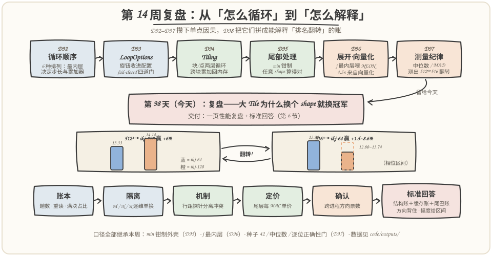
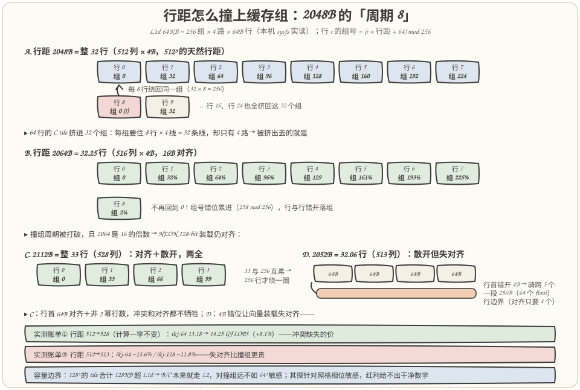
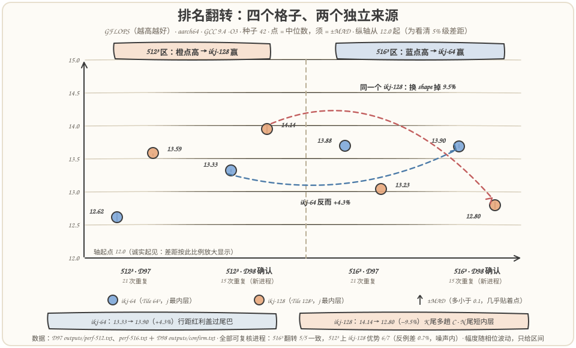
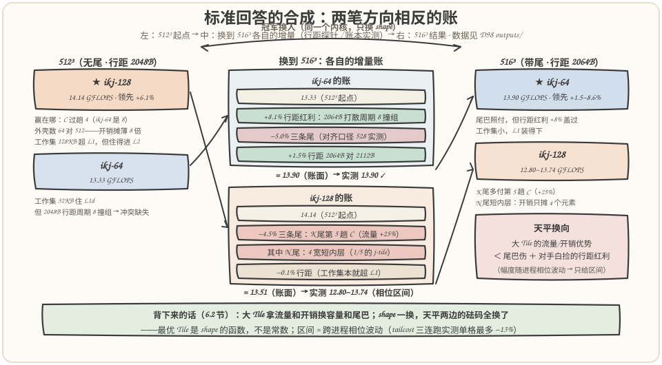

# 第 98 天：第 14 周复盘——大 Tile 的天平，为什么 512³ 上 128 赢、516³ 上 64 赢

> **今日目标**：完成本教程后，你能做到四件事——把第 14 周的四个旋钮（循环顺序、Tile 尺寸、尾部处理、测量纪律）各自的收益与代价拼成一张**权衡总账**；对"同一个 ikj-128，512³ 上比 ikj-64 快 6%、516³ 上反而慢 3%～9.5%"这个翻转给出一份**可背的标准回答**——三个机制各配一个实测数字（C 过趟数 8→4、K 尾多付第 5 趟 C 流量 +25%、行距 2048B 周期 8 撞组被 2064B 打散 +8%）；独立运行 `flip_lab` 的五种模式（账本／隔离／行距探针／尾层单价／确认），说清每个模式回答哪个问题；最后认识性能噪声的第三层——**跨进程的地址布局相位**（单格最多漂 13%，样本中位数和 run 级复跑都看不见它），并学会用"方向票数"代替"单点数值"下结论。
> **预计时间**：学习 35 分钟＋实践 45 分钟
> **前置准备**：第 92 天的局部性与缓存回放、第 94 天的块循环/点循环与 ceil-div、第 95 天的 `min` 钳制尾处理、第 96 天的"j 最内层喂向量化"、第 97 天的中位数/MAD/正确性门。工具只要 `g++`（本文环境：GCC 9.4，aarch64 Linux，16 核，主频锁定 2.9 GHz，L1d 64KB/4 路/64B 行，L2 512KB/8 路）——今天是复盘日，不引入新的编译器构件，主角是把一周的证据链拼成一句能背住的话。
> **今日产出**：`code/flip_lab.cpp`（约 370 行：行距参数化的 ikj tile 内核＋五种实验模式）＋`run_all.sh`（一键复现）＋`outputs/` 下 7 份真实运行记录（账本、隔离、行距、尾层单价 ×3、确认）＋4 张手绘图＋**一页性能复盘和标准回答**（见第 6 节，计划点名的交付物）。

## 1. 今天解决什么问题？

第 97 天结束时报了一个悬念：**同一个实验里，512³ 上最快的是 ikj-128（13.59 GFLOPS），换到 516³ 上冠军翻成了 ikj-64（13.88）**。只差 4 行、4 列、4 层——0.8% 的 shape 差异，让 8 倍体积的 tile（128³ 对 64³）从"更快"变成"更慢"。第 97 天只负责把这件事诚实地测出来；今天的任务是第 14 周的最后一步：**解释它**。

计划里这一天的原文是："总结局部性、并行度、代码体积和尾部处理之间的权衡；解释为什么某个大 Tile 在一种 Shape 上更快、在另一种 Shape 上更慢"。拆开看，"解释"两个字比看上去难：

- **不能用减法**。拿 512 的成绩减 516 的成绩，差值并不是"尾巴的代价"——两个 shape 的行距（每行末尾到下一行开头的字节数）也不同，地址在缓存里的落点整个换了一轮。上次我试图用减法推"尾层有多贵"，推出了"尾层比满层贵 10 倍"的荒谬结论，后来用直接测量（第 5.3 节的尾层单价实验）才发现真实答案只有 12%～15%。**一次只许换一个变量**，这是第 97 天控制变量思想今天的第一次兑现。
- **不能只看结构**。"128³ 的满块占比在 516³ 上只有 51.2%"（账本可数）听着很有杀伤力，但同样的 516³，ikj-64 的成绩反而比 512³ 更好——结构账必须和缓存账、尾巴账合在一起才能解释方向。
- **不能只信一个进程**。今天会看到：同一个"512³、ikj-128"格子，不同进程里测出 14.14 和 13.08 两个相差 7% 的稳定值——这是第 97 天的样本级噪声、run 级漂移之外的**第三层噪声**。

所以今天的写法不是"知识点回顾"，而是把翻转当成一个案件，用第 14 周攒下的全部工具办案：**账本数结构（不计时）→ 隔离实验拆维度 → 行距探针分离机制 → 尾层单价给尾巴定价 → 跨进程确认方向**。贯穿全文的两个当事人：`ikj-64` 和 `ikj-128`（i-k-j 内层序、j 最内层，Tile 分别取 64³ 和 128³），案情是它们在 512³ 与 516³ 上的排名翻转。

## 2. 先看全貌：今天的内容位于哪里？



**图 1**：看两个区域——上排是第 14 周的时间线：D92 循环顺序给出"j 最内层才喂得饱向量"的 4.5 倍，D93 把旋钮收进 LoopOptions，D94 切出块/点两层循环，D95 用 `min` 钳制驯服任意 shape，D96 展开与向量化，D97 建立测量纪律并测出翻转；下排是今天的办案流水线：账本（数出来）→ 隔离（拆出来）→ 机制（对上号）→ 定价（算出来）→ 确认（复现住），最后合成一份标准回答。

把今天的复盘路线串成 5 步：

1. **账本层**：用纯公式数出 tile 网格的结构差异——C 过趟数、A/B 重读倍数、满块占比、向量指令数。零噪声、可手算，是所有解释的骨架；
2. **隔离层**：516 = 512+4，三个维度各长一条 4 宽的尾。逐维单换（M=516 / N=516 / K=516，其余不动），看哪条尾在咬谁；
3. **机制层**：固定计算内容只改行距（512→513→528），把"缓存组冲突"与"对齐"从"尾巴"里分离出来；
4. **定价层**：只扫 M，用 M=4（纯尾层）对 M=512（纯满层）给尾层每 MAC 单价；
5. **确认层**：关键对照换进程复跑、尾层单价连跑 3 个进程——既确认翻转方向，也暴露第三层噪声（地址相位）。

为什么复盘要用"办案"的姿势？因为第 14 周六天攒下的结论都是**单点因果**（"j 内层快 4.5 倍"、"min 钳制算得对"），而翻转是**多因合成**——每个因子只有几个百分点，方向还可能互相抵消。复盘的本质，就是把单点因果组成一张能解释方向翻转的账。

## 3. 核心概念：复盘用的三件工具

### 3.1 结构账本：先把能数出来的数出来

一句通俗解释：**结构账本**就是把 tile 网格里一切"不用跑就能算出来"的量——趟数、重读倍数、满块占比、向量指令数——先列成表，它是性能解释里唯一零噪声的部分。

类比：看两队比赛先看技术统计（投篮数、失误数），不必先看录像。对应到技术上是：内核一确定，`ceil(K/TK)`、`ceil(N/TN)` 这些量就是定理，不随机器状态波动。今天账本里最重要的三行（`outputs/ledger.txt`）：

```text
512^3   tile  64^3 | shells=512(满块 100.0%) C过趟=8(C流量 4.19M elem) A重读=8x B重读=8x
512^3   tile 128^3 | shells=64 (满块 100.0%) C过趟=4(C流量 2.10M elem) A重读=4x B重读=4x
516^3   tile 128^3 | shells=125(满块  51.2%) C过趟=5(C流量 2.66M elem) A重读=5x B重读=5x
```

读法：**C 过趟数 = `ceil(K/TK)`**——k 被切成几段，整个 C 就要被读+写几遍（这是 Day 94 跨块累加的代价）。512³ 上，128³ 把趟数从 8 砍到 4、把循环外壳数从 512 砍到 64；但 516³ 上，多出来的 4 层 k 让 128³ 的趟数从 4 涨到 5（**多付 25% 的 C 读写**），64³ 只从 8 涨到 9（多付 12.5%）。同时满块占比从 100% 掉到 70.2%（64³）/ 51.2%（128³）——**tile 越大，同样的尾巴占的格子比例越高**（每维尾巴槽位 1/9 对 1/5）。

账本还有一行"工作集速查"：64³ 的 B tile＋C tile 合计 32KB，装得进 64KB 的 L1d；128³ 合计 128KB，**注定住不进 L1、只能住 L2**（512KB，装得下）。这一行解释了后面行距探针里两个配置对冲突缺失的敏感度差异。

类比的边界：技术统计不等于胜负——账本说 128³ 在 516³ 上多付 25% C 流量，但实测只慢 3%～9.5%，因为 C 流量只是运行时间的一部分，L2 吸收了大部分代价。**账本给方向和量级，实测给最终裁决**。

### 3.2 单变量探针：一次只许换一个旋钮

一句通俗解释：**单变量探针**就是为"把一个因子从一堆混杂因素里拎出来"专门设计的对照实验——两个版本之间只有一个参数不同，测出来的差值才能归因给这个参数。

类比：药企做临床试验要"试验组 vs 安慰剂组"，两组人只差一片药。对应到技术上是今天的两个设计：**维度隔离**（516³ 对 512³，一次只把 M/N/K 中的一个换成 516）和**行距探针**（计算内容一字不变，只把 `ldA/ldB/ldC` 从 512 改成 513 或 528——行距是 BLAS 里 leading dimension 的思想：矩阵的有效列数和每行实际占据的字节数可以解耦）。

为什么行距探针是今天的关键一招？因为 512³ 和 516³ 之间至少混着三个变量：**计算内容**（尾巴）、**行距**（2048B 对 2064B）、**地址落点**（页对齐相位）。行距探针固定第一和第三个（同进程、同分配序列），只动第二个——513 和 528 这两个"计算上等于 512、行距上像 516"的替身，能把"行距效应"单独拎出来定价。

### 3.3 地址布局相位：性能噪声的第三层

一句通俗解释：**地址布局相位**指同样的代码、同样的数据，仅仅因为矩阵在虚拟地址里落的页偏移不同，性能就长期稳定在两个档位之一——它不是抖动，是"抽签"。

第 97 天认识了噪声的两层：**样本级**（一次运行内的离群，中位数压住）和 **run 级**（两次运行中位数的漂移，复跑暴露）。今天补第三层：**进程级相位**。实测案例（`outputs/tailcost-run1/2/3.txt`，同一命令连跑 3 个进程，每格 15 个样本取中位数）：

```text
ikj-128, M=512:  13.592   14.224   14.261   GFLOPS（三个进程各自的中位数）
ikj-64,  M=516:  12.519   13.377   11.822   GFLOPS（第三个进程内部 MAD 高达 0.31）
```

多数格子进程内的 15 个样本挤得很紧（MAD 中位数约 0.04 GFLOPS，不到 0.4%），但进程之间同一格子的中位数能差 4%～13%；个别格子（第三进程的 M=516）连进程内部的样本都分成两档（MAD 0.31，是别人的 5 倍）——样本自己就跨了相位。机制：Linux 的地址空间随机化让每次进程的堆起始页偏移不同，矩阵首地址相对缓存组（set）和页表的相位随之变化；行距是 2 的幂（2048B = 32 行）时，行与行的组号以固定周期循环，相位好不好直接决定冲突缺失多不多。类比的边界：这不是"机器不稳定"，恰恰相反——每个相位内部都极其稳定，稳定得让你以为没有噪声。**对策不是加样本，是换进程**：让结论按"方向票数"统计——今天全部可复核的进程里，516³ 的翻转 **5/5** 一致，512³ 上 ikj-128 的优势 **6/7**（唯一反例只差 0.7%，在噪声内），而幅度只能给区间。

## 4. 图解核心机制：行距 2048B 的"周期 8 撞组"



**图 2**：输入是三行矩阵（行距 2048B / 2064B / 2112B），输出是它们在 L1d 256 个组里的落点。看三个位置——左侧量尺：L1d 64KB = 256 组 × 4 路 × 64B 行，一个地址的组号 = `(地址/64) mod 256`；中间三种行距的落点带：2048B = 整 32 行，行 r 的组号 = `32r mod 256`，**每 8 行绕一圈回到同一组**——64 行的 C tile 挤在 32 个组里，每组要住 8 行 × 4 线 = 32 条线，但只有 4 路，冲突缺失把多余的全部挤出；2064B = 32.25 行，组号每行错开 0.25，冲突被打散（16B 对齐，NEON 128-bit 装载仍对齐）；2112B = 33 行，33 与 256 互素，行行落不同组；右侧结论：对 L1 装得下 tile 的 ikj-64，打散冲突值 +8%（13.18→14.25 GFLOPS），而 2052B（=32.0625 行，4B 错位）虽然也打散冲突，却让每段行首错开 64B 行边界、向量装载失对齐，两边都掉 12%～16%——**对齐和散开要兼得，528 这种"整行数且非 2 的幂"才是两全解**。

按图把机制串一遍：

1. **为什么 512³ 天生带冲突**：行主序下行距 = N×4B = 2048B，是 64B 的整 32 倍。组号每 8 行重复，C tile（TM 行 × TN 列）和 B tile（TK 行 × TN 列）虽然总量只有 32KB，却集中落在 32 个组——4 路组相联的"4"成为瓶颈。这是 Day 92 纸面直接映射缓存的"组冲突缺失"在真实硬件上的重现；
2. **为什么 516³ 反而送红利**：516×4B = 2064B = 32.25 行，非整数行距让每行的组号错开 0.25，撞组周期被打破；又因为 2064 是 16 的倍数，128-bit 向量装载仍然对齐。**尾巴带来的行距变化，顺手治好了冲突**——这是翻转里最反直觉的一笔；
3. **为什么 128³ 对行距不像 64³ 那样敏感**：它的 B tile＋C tile 合计 128KB，从容量上就装不进 64KB 的 L1，B 流本来就走 L2——组冲突与否只改变"从 L1 拿还是从 L2 拿"里本来就不多的那部分。行距探针里它自己的对照格也相位敏感（3.3 节），给不出 ikj-64 那样干净的数字；账面分解（图 4）里它换到 516³ 的增量主要记在尾巴上；
4. **边界说明**：本环境没有 perf 计数器权限，组映射的算术（256 组、周期 8）是从 sysfs 读出的缓存几何（64KB/4 路/64B 行）推出的模型，落点的定量效果由行距探针的计时差证实——口径与 Day 92 的"模型明示"一致。

## 5. 动手实践：把翻转拆到底

### 5.1 准备文件

```text
tutorials/day-098/
├── README.md                    ← 本文
├── images/                      ← 4 张手绘图（数据全部来自 outputs/）
└── code/
    ├── flip_lab.cpp             ← 主实验：行距参数化内核＋5 种模式（约 370 行）
    ├── run_all.sh               ← 一键复现（tailcost 连跑 3 个进程）
    └── outputs/                 ← 7 份真实运行记录
        ├── ledger.txt  isolate.txt  pitch.txt
        ├── tailcost-run{1,2,3}.txt  confirm.txt  env.txt
```

编译和运行（与第 95～97 天同一台机器、同一条编译命令）：

```bash
cd tutorials/day-098/code
bash run_all.sh          # 一键：编译 + 五种模式全部跑一遍
```

### 5.2 代码的关键设计

内核是第 97 天 `tiled_matmul<1>` 的同构复刻（i-k-j 内层序 + `min` 钳制），只做了一处扩展——把行距变成参数：

```cpp
__attribute__((noinline)) void ikj_tiled(const float* A, const float* B, float* C,
                                         int M, int N, int K, int TM, int TN, int TK,
                                         size_t ldA, size_t ldB, size_t ldC) {
    for (int i0 = 0; i0 < M; i0 += TM)
        for (int j0 = 0; j0 < N; j0 += TN)
            for (int k0 = 0; k0 < K; k0 += TK) {
                const int ihi = std::min(i0 + TM, M);   // D95 的 min 钳制
                const int jhi = std::min(j0 + TN, N);
                const int khi = std::min(k0 + TK, K);
                for (int i = i0; i < ihi; i++)
                    for (int k = k0; k < khi; k++) {
                        const float a = A[(size_t)i * ldA + k];
                        for (int j = j0; j < jhi; j++)   // j 最内层：B、C 沿 j 连续
                            C[(size_t)i * ldC + j] += a * B[(size_t)k * ldB + j];
                    }
            }
}
```

三件事值得指出来：

- **`ldA/ldB/ldC` 与 M/N/K 解耦**：第 r 行首地址 = `base + r*ld`。有效列数是 N，行距可以是 513、528——这就是行距探针的全部机关。BLAS 的 leading dimension 是同一个思想；
- **计时协议原封继承 D97**：固定种子 42 生成数据（所有配置吃同一份）、`-ffp-contract=off`（k 升序累加逐位可比）、先过 `memcmp` 逐位正确性门才准计时、warmup 2 次＋计时 15 次取中位数（多数格子的 MAD 在 0.02～0.08 GFLOPS；例外是相位敏感格——如 K=516 的 ikj-128，MAD 0.88——它们正是 3.3 节的主角）；
- **`noinline`＋每次样本前清零 C**：防止编译器把内核折叠进测量循环、保证每个样本从同一初始状态出发。

### 5.3 运行与观察：五份证据

**证据一（账本）**已在 3.1 引用。**证据二（维度隔离）**——`outputs/isolate.txt` 的真实输出（M/N/K=640 与 576³/640³ 等行也保留在文件里，供练习用；此处摘关键 5 行）：

```text
shape            | ikj-64 中位    MAD    min | ikj-128 中位    MAD    min | gate    
base  512^3      |     13.292  0.029 13.249 |     14.217  0.037 14.098 |
M=516(4+尾4)    |     13.214  0.020 13.088 |     14.081  0.046 13.898 |
N=516(4+尾4)    |     13.637  0.043 13.436 |     13.209  0.081 12.957 |
K=516(4+尾4)    |     12.458  0.082  9.568 |     12.440  0.883 10.835 |
all  516^3       |     13.943  0.012 13.858 |     13.737  0.026 13.651 |
```

四个读数，每个对应一条尾巴的"伤法"：

- **M 尾几乎免费**（−0.6% / −1.0%）：尾层单价贵，但只占 1/9（64³）或 1/5（128³）的层数，混合后摊薄（下面证据四给单价）；
- **N 尾专咬 128**（ikj-128 −7.1%，ikj-64 反而 +2.6%）：尾 j-tile 的内层只剩 4 宽 = 每个 (i,k) 对只剩 1 条向量指令，固定开销（取 a、循环控制、地址计算）从摊 128 个元素变成摊 4 个；(i,k) 对数还多了 25%（j-tile 槽位 4→5）。ikj-64 的 +2.6% 是行距红利盖过了尾巴伤（见证据三）；
- **K 尾两边都咬、128 更痛**（−6.3% / −12.5%，且 ikj-128 的 MAD 高达 0.883，相位极不稳定）：账本说过——K 尾不是"少算点"，是**多付一整趟 C 读写**（趟数 8→9 对 4→5）；
- **合成**：516³ 上 ikj-64 以 13.94 对 13.74（本进程）领先——翻转复现。

**证据三（行距探针）**——`outputs/pitch.txt`，计算内容一字不变，只改行距：

```text
变体                                               |     ikj-64    MAD |    ikj-128    MAD
N=512 pitch=512(行距2048B=32行, 每8行撞同一组) |     13.177  0.062 |     13.079  0.041 |
N=512 pitch=513(行距2052B=32.06行, 组冲突被打散) |     11.119  0.044 |     11.537  0.032 |
N=512 pitch=528(行距2112B=33行, 对齐64B且打散) |     14.250  0.012 |     13.846  0.048 |
N=516 pitch=516(带尾4 + 行距2064B=32.25行, 打散) |     13.748  0.037 |     13.225  0.064 |
N=516 pitch=528(带尾4 + 行距2112B=33行, 对齐且打散) |     13.539  0.020 |     13.226  0.020 |
```

三个数可以直接写进结论：

- **冲突的价**：pitch 512→528（同为 512 列，只是行距变了对齐的 33 行），ikj-64 +8.1%（13.18→14.25）——这就是 2048B 周期 8 撞组的实测账单；
- **失对齐的价**：pitch 513 也打散了冲突，却两边都掉 12%～16%——行首错开 64B 行边界、向量装载失对齐，**散开不能以失对齐为代价**；
- **尾巴的价（对齐口径下）**：同为 528 行距，512 列→516 列（加上三条尾），ikj-64 −5.0%、ikj-128 −4.5%——这是"纯尾巴"效应；516 行距（2064B）对 528 行距（2112B）：ikj-64 +1.5%、ikj-128 −0.1%。

**证据四（尾层单价）**——`outputs/tailcost-run1.txt`（N=K=512 固定，只扫 M；M=4 即纯尾层）：

```text
     M |     ikj-64    MAD   ns/MAC |    ikj-128    MAD   ns/MAC
     4 |     12.040  0.042    0.166 |     12.215  0.170    0.164 |
   512 |     12.382  0.042    0.162 |     13.592  0.100    0.147 |
   516 |     12.519  0.052    0.160 |     13.452  0.027    0.149 |
```

纯尾层（M=4）对满层（M=512）的每 MAC 单价，取三个进程各自中位数再取中位：ikj-64 是 11.85 对 13.42（**贵 11.7%**），ikj-128 是 12.05 对 14.22（**贵 15.3%**）。注意 run1 的 M=512 两格恰好都落在低相位（12.38/13.59，低于另外两个进程的 13.42/14.22~14.26）——若只看 run1，"尾层贵多少"会被抹平：**定价也要用跨进程中位数**。把它按层数混合：ikj-64 在 M=516 上 ≈ (512×0.149＋4×0.166)/516 ≈ 0.1494，按单价只慢不到 0.2%；隔离实验实测 −0.6%，tailcost 两个好相位进程 +1.1%/−0.3%——三个口径都指向**M 尾几乎免费**（真正咬人的是 K 尾和 N 尾）。而 tailcost 第三进程的 M=516 掉到 11.82、进程内 MAD 反常地大到 0.31，那是相位打在这个格子上（样本自己跨了档），不是尾巴突然变贵——**反常的进程内 MAD 就是相位命中的判别标志**。

**证据五（确认）**——`outputs/confirm.txt`，换进程原样复跑关键对照：

```text
shape    |     ikj-64    MAD |    ikj-128    MAD
512^3    |     13.327  0.025 |     14.139  0.083 |
516^3    |     13.895  0.030 |     12.797  0.056 |
```



**图 3**：四个格子两两一组——左组是 512³，右组是 516³；每组里蓝点为 ikj-64、橙点为 ikj-128；每个格子画了两个独立来源（D97 的 21 次重复、D98 确认实验的 15 次重复），须为 ±MAD。看两点：**方向**——512³ 上橙点高（ikj-128 赢 6%～7%），516³ 上蓝点高（ikj-64 赢 1.5%～8.6%）；把全部可复核进程算上，516³ 的翻转 **5/5** 一致，512³ 上 ikj-128 的优势 **6/7**（唯一反例差 0.7%，在噪声内）。**幅度**——516³ 的领先幅度在 1.5% 到 8.6% 之间波动，这正是 3.3 节相位噪声的直观呈现，所以标准回答里只给方向加机制，不背单点幅度。

### 5.4 修改一个参数再观察

成本最低的一刀：把 `flip_lab.cpp` 里 `cmd_pitch` 的变体表加一行 `{520, 528, "..."}`（520 列＋528 行距），重编译后跑 `./flip_lab pitch`。先预测再对账：520 = 4×128＋8 = 8×64＋8，三条尾都还在、行距红利与 528 变体相同，你猜 ikj-64 还能守住对 ikj-128 的领先吗？跑完把预测和实测各写一行——这是把今天方法内化的最小练习（答案方向：尾巴伤恢复为两配置共担，ikj-128 的 C 趟数仍比 ikj-64 少一半，领先大概率换边；以你的实测为准）。

## 6. 一页性能复盘和标准回答（计划点名的交付物）



**图 4**：把 5.3 的证据合成到一张账上——左列是 512³ 的起点（ikj-128 领先 6%：C 趟数减半＋外壳摊薄 8 倍，128KB 工作集住 L2）；中列是换成 516³ 后两配置各自的增量账：ikj-64 拿到 +8% 行距红利（组冲突被打散）、付出 −5% 尾巴伤，净赚约 +4.5%（13.33→13.90，与确认实验一致）；ikj-128 的行距红利小且相位不稳（工作集本就超 L1，探针对照格拿不出干净数字）、尾巴伤 −4.5% 起步（K 尾多付第 5 趟 C、N 尾短内层），净亏到 −3%～−9.5%（14.14→12.80/13.74）。右列是结论：两笔方向相反的账，shape 一换全部换向。

### 6.1 一页性能复盘：四个旋钮的权衡总账

| 旋钮 | 买到的 | 付出的 | 谁在付钱 | 本周实测锚点 |
|---|---|---|---|---|
| 循环顺序（D92/D96） | j 最内层：B/C 沿 j 连续 → 4 lane 向量化 | k 不在内层 → C 走内存读-改-写 | 内存带宽 | 3.2 → 14.3 GFLOPS（4.5×） |
| Tile 尺寸（D94） | C 趟数 ∝ ceil(K/TK)：8→4；外壳数 512→64 | 工作集 4×（32→128KB，L1 装不下）；尾占比升高 | L1/L2 容量、尾部 | 512³：+6%；516³：−3%～−9.5% |
| 尾部处理（D95） | `min` 钳制：任意 shape 算得对 | K 尾多付一整趟 C（+12.5%/+25%）；N 尾内层掉到 4 宽；M 尾尾层单价 +12%～15% | 向量通道、C 流量 | K=516：−6%/−12%；M 尾混合后 −1% |
| 测量纪律（D97/D98） | 结论必须大于噪声才成立 | 三层噪声都要各自压住 | 实验设计 | 516³ 翻转 5/5 进程一致；幅度给区间 |

### 6.2 标准回答（约 150 字，可直接背）

> **问：为什么 128³ 的 Tile 在 512³ 上更快、在 516³ 上反而更慢？**
>
> 512³ 上它赢 6%，赢在两笔结构账：C 的读写趟数从 8 降到 4（`ceil(K/TK)`），循环外壳摊薄 8 倍；128KB 工作集虽超 L1，但住得进 512KB 的 L2，代价被吸收。换到 516³，三笔账同时翻脸：K 尾多付第 5 趟 C 流量（+25%）；N 尾让 1/5 的 j-tile 掉到 4 宽短内层，每个 (i,k) 对的固定开销从摊 128 个元素变成摊 4 个；满块占比从 100% 掉到 51%。而 64³ 那边反而白捡行距红利——516×4B=2064B 的行距恰好打散了 2048B 行距"每 8 行撞同组"的冲突缺失（实测 +8%）。**大 Tile 拿流量和开销换容量和尾巴，shape 一换，天平两边的砝码全换了**——所以最优 Tile 永远是 shape 的函数，编译器要做的是把这套账算快，而不是背一个常数。

### 6.3 支撑数字（背五个就够）

1. 512³：ikj-128 **14.14** 对 ikj-64 13.33 GFLOPS（确认实验，+6.1%）；
2. 516³：ikj-64 **13.90** 对 ikj-128 12.80 GFLOPS（确认实验，+8.6%；另一进程 13.74，幅度给区间）；
3. C 过趟数：512³ 上 8→4；516³ 上 9→5——**K 尾多付 12.5% / 25% 的 C 读写**（账本）；
4. 行距红利：pitch 512→528，ikj-64 **+8.1%**（13.18→14.25，行距探针）；pitch 513 失对齐：两边 −12%～16%；
5. 纯尾层单价：M=4 对 M=512，每 MAC 贵约 **12%（64）/ 15%（128）**（三进程中位数），混合进 1/9～1/5 的层数后 M 尾只值 −1%。

## 7. 常见错误与排查

**错误一：用减法分解尾代价。**
现象：拿"512³ 成绩 − 516³ 成绩"当尾巴代价，推出"尾层比满层贵 10 倍"。原因：两个 shape 不止差尾巴——行距从 2048B 变 2064B、地址相位整个换轮，减法把这些全记在了尾巴头上。定位：跑 `./flip_lab tailcost` 直接给尾层定价——真实答案只有 12%～15%（三进程中位数）。修复：归因必须一次只换一个变量；换不了的（比如行距和尾巴在真实 shape 里总是绑着变），就用探针造一个解耦的对照（528 行距＋512/516 列）。

**错误二：拿单个进程下结论。**
现象：行距探针的进程里，ikj-128 在 512³/pitch 512 测得 13.08，比 ikj-64（13.18）还低——照这个进程，512³ 的"冠军"也该翻案。原因：那一格恰好抽中低相位（3.3 节），而同进程内 15 个样本又稳又齐，MAD 完全看不见它。定位：`tailcost-run{1,2,3}.txt` 同命令三进程，ikj-64 的 M=516 格测得 12.52 / 13.38 / 11.82。修复：方向性结论按"跨进程票数"统计——全部可复核进程里，516³ 的翻转 **5/5** 一致（D97、隔离、确认、行距探针两变体）；512³ 上 ikj-128 的优势 **6/7**（D97、隔离、确认、tailcost 三跑；唯一反例差 0.7%，在噪声内）。方向可信，幅度必须给区间。

**错误三：单位换算错三个数量级。**
现象：第一版尾层单价打印出 `42680263 ns/MAC`——四千万纳秒算一次乘加。原因：把"GFLOPS → 每 MAC 纳秒"写成 `1e9/gf/2`，忘了 GFLOPS 里的 G 已经是 10⁹，重复除了两遍。定位：14 GFLOPS 口算一遍——每秒 7×10⁹ 次 MAC，每次 0.14 ns，不是 4×10⁷。修复：正确公式是 `2/gf`（1e9/(gf×1e9/2)），源码里的换算注释保留了这次修复的痕迹；任何换算写完先做数量级 sanity check。这条错误真实发生在本教程代码的第一版里。

## 8. 今日练习

### 必做练习：预测 640³，再用数据对账

用账本公式（不跑代码）回答三个小题，然后打开 `outputs/ledger.txt` 和 `outputs/isolate.txt` 的 `all 640^3` 行对账：

1. 640 对 TM=64 和 TM=128 各切出几个满块、几条尾？（提示：10×64 = 5×128 = 640）
2. 两个配置的 C 过趟数各是多少？C 流量相差几倍？
3. 隔离实验里 `all 640^3` 的中位数是 14.196 对 14.254（差 0.058 GFLOPS，两边 MAD 为 0.025/0.014）——按第 97 天的判定规则，能不能宣布 ikj-128 是 640³ 的冠军？

预期产出：三行答案＋一行对账结论（第 3 题的预期答案：0.058 只比 2×MAD（0.05）高一点点，样本级口径本就贴着判定线；再叠加 3.3 节的进程级相位（单格能漂 4% 以上），0.4% 的差距**不能宣布**，只能说"在波动内无法区分"——无尾 shape 上两配置的账本差被 L2 吸收了大半，这正是翻转只发生在带尾 shape 上的旁证）。

### 选做挑战：给行距探针再添两个替身

在 `cmd_pitch` 的变体表里加 `{512, 544, ...}`（544×4B = 2176B = 34 行，对齐且散开）和 `{512, 560, ...}`（35 行），重跑 `./flip_lab pitch`。观察"对齐的奇数行数"是否稳定优于 512 行距、与 528 相比如何；再对比三个进程的重复测量，看哪一列对相位最敏感。预期产出：一行结论＋你对"行距该选多少"的一条工程建议（例如：行距取"对齐 64B 的最小非 2 幂行数"）。

## 9. 今日验收

- [ ] 我能不看资料说出大 Tile 的两笔账（C 趟数 ∝ ceil(K/TK)、外壳摊薄）和一笔代价（工作集 4× 超 L1），以及尾巴的三种伤（K 尾多一趟 C、N 尾短内层、M 尾尾层单价）各对应哪个机制；
- [ ] 我能独立运行 `bash run_all.sh`，并说清 `ledger / isolate / pitch / tailcost / confirm` 五个输出各回答哪个问题；
- [ ] 我能解释为什么 pitch 513 比 pitch 512 慢 12%～16%（失对齐），而 528 能两全（对齐＋散开），并算出 2048B 行距的撞组周期是 8（256 组、每行 32 个 64B 行）；
- [ ] 我能说出性能噪声的三层（样本级、run 级、进程级相位）和各自的对策（中位数、复跑、方向票数）；
- [ ] 我保存了 7 份真实输出（`code/outputs/`）和 4 张图，标准回答能脱稿讲 60 秒。

## 10. 一句话总结与明天预告

第 14 周从"怎么循环"走到"怎么测量"，今天收口在"怎么解释"：**翻转不是玄学，是三笔可数的账**——结构账（C 趟数、外壳数、满块占比）、缓存账（工作集住哪、行距撞不撞组）、尾巴账（每条尾各自的伤法）——加上一条测量纪律（方向按进程票数定，幅度只给区间）。明天进入第 15 周"内存规划与硬件映射"：第 99 天讲 Tensor 生命周期（定义点、最后使用点、活跃区间）——tile 里省下的每一字节流量，都要落到"哪个缓冲区在什么时候活着"这张更大的账上。
