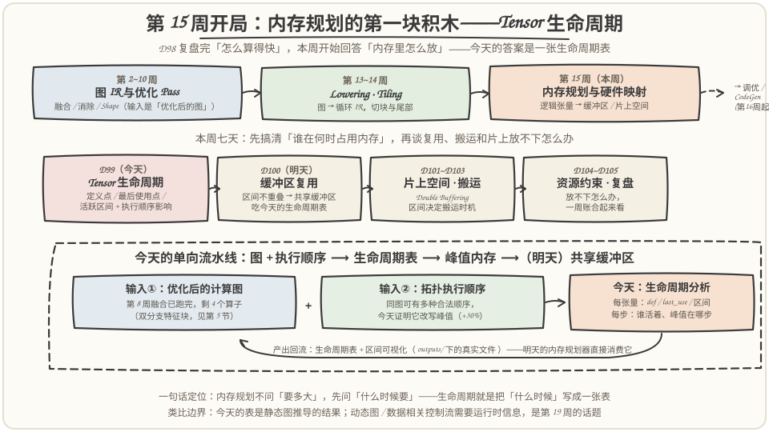
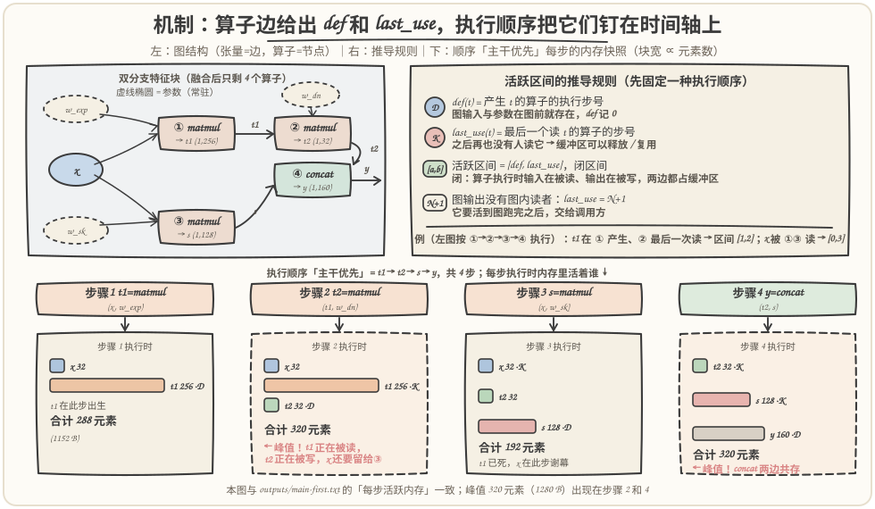
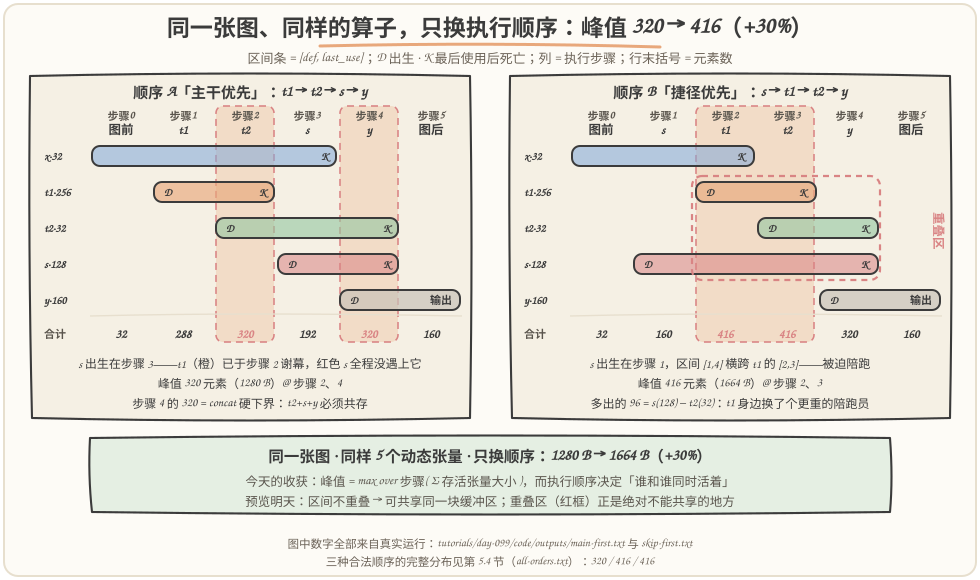
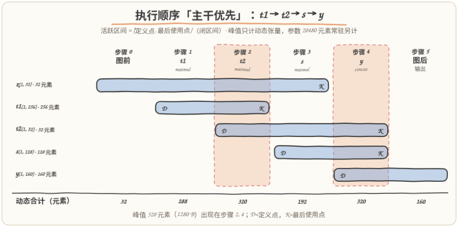
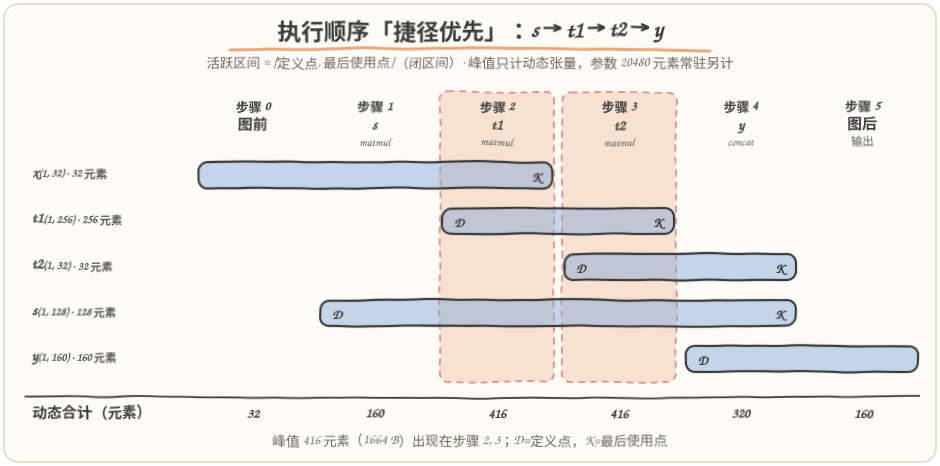

# 第 99 天：Tensor 生命周期——同一张图换个执行顺序，峰值内存差 30%

> **今日目标**：完成本教程后，你能做到四件事——对一张固定的计算图，写出每个 Tensor 的**定义点**、**最后使用点**和**活跃区间**（闭区间），并说清三条推导规则；用一段独立脚本算出每个执行步骤上"谁还活着、一共占多少内存"，并定位峰值步；证明**图执行顺序影响内存规划**：同一个双分支特征块，"主干优先"峰值 320 个 float（1280 B），"捷径优先"416 个（1664 B），+30% 只来自一次排程决定；最后用**双实现交叉验证**（区间法 vs 事件模拟法）守住区间计算的 off-by-one。
> **预计时间**：学习 35 分钟＋实践 45 分钟
> **前置准备**：第 2 周的计算图 IR（节点=算子、边=张量）、第 8 周的算子融合（知道"优化后的图"是什么意思）。工具只要 `python3`（本文环境：Python 3.11.4，aarch64 Linux），零第三方依赖。
> **今日产出**：`code/lifetime.py`（生命周期分析器：区间表＋每步活跃内存＋峰值＋全序枚举＋SVG 时间线，约 440 行）＋`run_all.sh`（一键复现）＋`outputs/` 下 6 份真实运行记录和 2 张程序生成的区间图＋本文 3 张手绘图。

## 1. 今天解决什么问题？

第 14 周我们专心把一个内核**算快**；第 15 周换一个问题：**内存里怎么放**。动机非常现实：把训练好的模型部署到 NPU 或边缘芯片上跑静态图时，通常**没有通用的运行时 malloc**——缓冲区必须在编译期规划好，这叫静态内存规划（MLIR 的 bufferization、TVM 的静态内存规划、XLA 的 buffer assignment 做的都是这件事）。而规划器遇到的第一个问题不是"每个张量多大"，而是"每个张量**什么时候要、什么时候不要**"：决定放不放得下的是**峰值**，不是总量；峰值又取决于"谁和谁同时活着"。

今天用一张贯穿全文的小图把这个"什么时候"变成一张可推导、可验证的表。图是一个**双分支特征块**（教学用缩小版，假设第 8 周的融合已经跑完，逐元素算子都并进了 matmul，只剩 4 个算子）：

```text
x (1,32) ──matmul(w_exp: 32×256)──▶ t1 (1,256) ──matmul(w_dn: 256×32)──▶ t2 (1,32) ──┐
   │                                                                                 ├─ concat ──▶ y (1,160)
   └──────matmul(w_sk: 32×128)─────▶ s (1,128) ──────────────────────────────────────┘
```

- 输入：`x`，形状 `(1, 32)`，float32（4 B/元素）；
- 操作：对这张图选一种**拓扑执行顺序**，计算每个 Tensor 的活跃区间和每一步的存活内存；
- 预期结果（先卖个关子，第 5 节用真实运行验证）：同样 4 个算子、同样 5 个动态张量，只把捷径分支的算子 `s = matmul(x, w_sk)` 从**第 3 步**挪到**第 1 步**执行，峰值内存从 **320 个元素（1280 B）涨到 416 个（1664 B）**，+30%。

为什么值得单独花一天？因为"挪一步、多付 30% 峰值"这件事**在图上看不出来**——图只写了数据依赖，没写执行时刻。把"什么时候活着"变成一张显式的表（定义点 / 最后使用点 / 活跃区间），是明天缓冲区复用、后天片上空间估算的第一块积木。

## 2. 先看全貌：今天的内容位于哪里？



**图 1**：看三个区域——上排是编译主线：本周（第 15 周）之前的图优化与 Lowering/Tiling 都在回答"算什么、怎么算快"，本周开始回答"内存里怎么放"；中排是本周七天的路线：D99 搞清"谁在何时占用内存"，D100 才谈复用，D101~D103 的片上空间、数据搬运全部建立在区间概念上；下排是今天的单向流水线：**优化后的图 ＋ 执行顺序 ⟶ 生命周期表 ⟶ 峰值内存**，产出回流给明天的内存规划器。

把今天的流程串成 5 步：

1. **拿图**：输入是"优化后的计算图"——融合、消除类 Pass 已跑完，算子个数基本不再变化；
2. **选顺序**：在所有合法拓扑序（尊重数据依赖的排列）里选一种执行顺序，这一步有自由度；
3. **推区间**：对每个张量 t 计算 `def(t)`（产生它的算子的步号）和 `last_use(t)`（最后一个读它的算子的步号），得到闭区间 `[def, last_use]`；
4. **算峰值**：逐步累计"该步执行时存活的动态张量"的总大小，取最大值——峰值出现在哪一步、被谁撑起来的，一目了然；
5. **交给明天**：区间表是缓冲区复用的直接输入——**区间不重叠的张量才能共享同一块缓冲区**。

一句话定位：内存规划不问"要多大"，先问"什么时候要"。今天就是把"什么时候"写成一张表。

## 3. 核心概念：先用直觉，再给准确定义

### 3.1 定义点、最后使用点、活跃区间

一句通俗解释：**定义点（def）**是张量第一次获得值的时刻——产生它的那个算子执行的那一步；**最后使用点（last use）**是它最后一次被读的时刻——之后再也没人读它，缓冲区就可以释放（或明天要讲的：被别人复用）；**活跃区间（live interval）**就是这两点之间张量必须待在内存里的时间段。

类比：酒店住客。入住登记 = 定义点，退房 = 最后使用点之后，住店期间 = 活跃区间；酒店想知道**任何时刻最多同时住多少客人**，靠的是登记表，不是客人名单。对应到技术上是：内存规划想知道峰值，靠的是每张量的 `[def, last_use]`，不是张量清单——峰值 = max over 步骤( Σ 该步存活张量的大小 )。类比的边界有两条：客人可以延住或提前退房（动态），而**固定执行顺序下**张量的退房时间由图结构唯一确定，是静态推导出来的；另外"退房当天中午 12 点前房间仍被占用"对应**闭区间**——最后一次使用发生的那个算子执行期间，输入正在被读、输出正在被写（朴素非 in-place 实现），两边的缓冲区都必须在。

沿用第 1 节的图，按声明顺序 `t1 → t2 → s → y` 执行，最小例子：

- `t1`：由步骤 1 的 `matmul(x, w_exp)` 产生，被步骤 2 的 `matmul(t1, w_dn)` 读——区间 `[1, 2]`；
- `x`：图输入，被步骤 1 **和**步骤 3 两个算子读——区间 `[0, 3]`（最后使用点是 3，不是 1）。

两个常见误解先钉在这里：**误解一**，"`x` 第 1 步用完就死了"——错，`last_use` 是**所有**使用步的最大值，两条分支都读它；**误解二**，"`t1` 在步骤 2 被读完，所以步骤 2 不算它"——错，步骤 2 执行时 `t1` 正在被读，缓冲区还被占着，这就是闭区间的含义。

四条约定（今天的脚本严格遵守，也是读真实编译器代码时的通用姿势）：

1. 步骤编号 1..N，按执行顺序给每个算子编号；
2. 图输入与参数（权重）的定义点记 0——图执行前就存在；
3. 活跃区间是**闭区间** `[def, last_use]`；
4. 图输出没有图内读者，`last_use` 记 N+1——它要活到图跑完之后交给调用方；参数常驻整个图，单独统计，不参与动态内存的峰值与复用（本图参数 20480 个元素 = 81920 B ≈ 80 KB，全部一次性放在权重区）。

### 3.2 执行顺序：同一张图的多个"时间表"

**前置补给（第 2 周的概念）**：拓扑序就是尊重数据依赖的执行顺序——每个算子排在它所有输入的生产者之后。本图的约束是 `t1` 先于 `t2`，`t2` 和 `s` 都先于 `y`，满足约束的排列共有 **3 种**（第 5.4 节会全部枚举出来）。真实编译器里，图优化后、代码生成前的"调度（schedule）"就是在合法拓扑序里做选择，今天要证明的是：**这个选择直接改写内存峰值**。

把 3.1 的概念接到顺序上：`def(t)` 和 `last_use(t)` 都是**算子的步号**，而步号来自执行顺序——顺序一换，同一张图里每个张量的区间都会平移或伸缩。峰值公式：

```text
peak = max over k=1..N ( Σ size(t) ，对所有满足 def(t) ≤ k ≤ last_use(t) 的动态张量 t )
```

关键直觉只有一句：**顺序决定"谁和谁同时活着"**。t1（256 个元素，本图最重的张量）活着的步骤里，如果旁边站的是 32 个元素的 `t2`，这一步合计 320；如果站的是 128 个元素的 `s`，合计 416——张量还是那些张量，账单却不一样。

## 4. 图解核心机制



**图 2**：上半部分看两个面板——左：图结构（张量=边，算子=节点，虚线椭圆是常驻参数），`t1` 的身份就是 ①→② 那条边；右：推导规则，`def` 用蓝色 D、`last_use` 用红色 K 标记。下半部分是"主干优先"顺序下 4 个执行步骤各自的**内存快照**（块宽 ∝ 元素数），注意步骤 2：`t1` 正在被读（K）、`t2` 正在被写（D）、`x` 还要留给步骤 3——三者共存，320 个元素，峰值。

按图中编号把机制串一遍：

1. **图结构只给"谁依赖谁"**：`t1` 是 ① 的输出边、② 的输入边；这张图本身不含任何时间信息，步骤编号来自我们选的执行顺序；
2. **固定顺序后，def 和 last_use 被钉在时间轴上**：`t1` 在 ① 产生（def=1）、② 最后一次读（last_use=2）→ 区间 `[1,2]`；`x` 被 ①③ 读 → `[0,3]`；`y` 没有图内读者 → `[4,5]`（5=N+1）；
3. **每个执行步骤拍一张内存快照**：步骤 1 是 `x+t1=288`；步骤 2 是 `x+t1+t2=320`（峰值之一：闭区间让"正在被读的 t1"和"正在被写的 t2"同框）；步骤 3 是 `x+t2+s=192`（t1 已死）；步骤 4 是 `t2+s+y=320`；
4. **concat 是硬下界**：步骤 4 里 `t2`、`s` 正在被读、`y` 正在被写，`32+128+160=320` 个元素必须共存——这不是顺序能省掉的，是算子语义决定的（流式写 concat 可以打破它，但那是后续话题）。

注意峰值 320 出现了**两次**（步骤 2 和步骤 4），且来源不同：一次是"大张量＋它的陪跑者"，一次是"汇聚算子的输入输出共存"。记住这个区分，5.4 节会看到把捷径加宽后，峰值从前者**转移**到后者。

## 5. 动手实践：对优化后的图计算每个 Tensor 的活跃区间

### 5.1 准备文件

```text
tutorials/day-099/
├── README.md                      ← 本文
├── images/                        ← 3 张手绘图（数字与 outputs/ 一致）
└── code/
    ├── lifetime.py                ← 生命周期分析器（约 440 行，零依赖）
    ├── run_all.sh                 ← 一键复现
    └── outputs/                   ← 真实运行记录
        ├── main-first.txt         ← 顺序 A 的完整报告（表＋快照＋校验）
        ├── skip-first.txt         ← 顺序 B 的完整报告
        ├── all-orders.txt         ← 3 种合法拓扑序的峰值分布
        ├── skip-width-256-*.txt   ← 捷径加宽对照实验 ×2
        ├── env.txt                ← Python 3.11.4, aarch64
        └── timeline-*.svg         ← 程序生成的活跃区间时间线 ×2
```

运行方式（本文所有"实际输出"都来自这次运行，环境见 `outputs/env.txt`：Python 3.11.4，aarch64 Linux）：

```bash
cd tutorials/day-099/code
bash run_all.sh                # 一键：两种顺序 → 全序枚举 → 加宽对照
python3 lifetime.py --order main-first            # 也可以单跑任意模式
```

### 5.2 代码的关键设计

图、顺序、区间三层都是纯数据结构（`TensorInfo` / `Op` dataclass），核心推导只有十几行：

```python
def compute_intervals(order: tuple, tensors: dict, ops: dict) -> dict:
    """返回 {tensor: (def, last_use)}，闭区间；输入/参数 def=0；输出 last_use=N+1。"""
    pos = {out: i + 1 for i, out in enumerate(order)}
    n = len(order)
    intervals = {}
    for name, t in tensors.items():
        if t.kind in ("input", "param"):
            d = 0
        else:
            d = pos[name]                                   # 定义点 = 产生它的算子
        uses = [pos[out] for out, op in ops.items() if name in op.inputs]
        if uses:
            last = max(uses)                                # 最后使用点 = 使用步的最大值
        elif t.kind == "output":
            last = n + 1                                    # 图输出活到图结束之后
        else:
            raise ValueError(f"中间张量 {name} 没有任何使用者（死代码）")
        intervals[name] = (d, last)
    return intervals
```

三个设计决定值得说明：**其一**，区间法之外还实现了 `simulate_peak`——事件驱动模拟（定义点出生、最后使用步之后死亡，逐步累计），它和区间法是两套独立实现，最后交叉对比峰值，任何 off-by-one 都会当场暴露（见 `verify`，共 10 项检查：拓扑合法性、每个张量的区间覆盖全部使用步、def/last_use 一致性、峰值交叉验证）；**其二**，`--order all` 用 `itertools.permutations` 枚举全部排列再过滤合法拓扑序，小图上直接穷举比写启发式更诚实；**其三**，`svg_timeline` 把区间渲染成 SVG 时间线（加了 `feTurbulence`＋`feDisplacementMap` 滤镜制造手绘抖动感），让"产出可视化图"成为脚本的可复现输出而不是手工截图。

### 5.3 运行与观察：两种顺序的两张账单

先跑"主干优先"（`t1 → t2 → s → y`，即先算完主干的两个 matmul，再算捷径投影）：

```text
$ python3 lifetime.py --order main-first
========================================================================
执行顺序「主干优先」：t1 → t2 → s → y   （共 4 个算子，步骤 1..4）
========================================================================

-- 生命周期表（活跃区间为闭区间 [def, last_use]）--
张量    类别        形状               元素      字节   def  last_use        活跃区间
x     输入        (1, 32)          32     128     0         3      [0, 3]
w_exp 参数(常驻)    (32, 256)      8192   32768     0         1      [0, 1]
w_dn  参数(常驻)    (256, 32)      8192   32768     0         2      [0, 2]
w_sk  参数(常驻)    (32, 128)      4096   16384     0         3      [0, 3]
t1    中间        (1, 256)        256    1024     1         2      [1, 2]
t2    中间        (1, 32)          32     128     2         4      [2, 4]
s     中间        (1, 128)        128     512     3         4      [3, 4]
y     输出        (1, 160)        160     640     4    5(图结束)      [4, 5]

-- 每步活跃内存（动态张量：输入 + 中间 + 输出）--
步骤   执行的算子                     存活的动态张量                  元素      字节
1    t1 = matmul(x, w_exp)     x, t1                   288    1152
2    t2 = matmul(t1, w_dn)     x, t1, t2               320    1280   ← 峰值
3    s = matmul(x, w_sk)       x, t2, s                192     768
4    y = concat(t2, s)         t2, s, y                320    1280   ← 峰值

-- 活跃区间条（█ 存活；D 在此步定义；K 在此步最后使用后死亡）--
               图前     t1     t2      s      y     图后
x               █      █      █      K      ·      ·
t1              ·      D      K      ·      ·      ·
t2              ·      ·      D      █      K      ·
s               ·      ·      ·      D      K      ·
y               ·      ·      ·      ·      D      █
动态合计           32    288    320    192    320    160   （元素）

峰值内存 = 320 元素（1280 B），出现在步骤 2, 4。
```

（其后紧跟 10 项校验，结果 `10/10 项通过`，包括"峰值交叉验证：区间法 = 事件模拟法 = 320 元素"。完整记录在 `outputs/main-first.txt`。）

这张表就是计划里点名的**生命周期表**。三行值得停下来看：`x` 的区间是 `[0,3]`——它要活到步骤 3（捷径最后一次读它），这就是第 3.1 节误解一的反例；`t1` 是 `[1,2]`——出生即倒计时，只活两步；`s` 是 `[3,4]`——它出生时 `t1` 已经在步骤 2 谢幕，两者从未同时活着。

再跑"捷径优先"（`s → t1 → t2 → y`，只是把 `s` 的生产从第 3 步挪到第 1 步）：

```text
$ python3 lifetime.py --order skip-first
-- 每步活跃内存（动态张量：输入 + 中间 + 输出）--
步骤   执行的算子                     存活的动态张量                  元素      字节
1    s = matmul(x, w_sk)       x, s                    160     640
2    t1 = matmul(x, w_exp)     x, t1, s                416    1664   ← 峰值
3    t2 = matmul(t1, w_dn)     t1, t2, s               416    1664   ← 峰值
4    y = concat(t2, s)         t2, s, y                320    1280

-- 活跃区间条（█ 存活；D 在此步定义；K 在此步最后使用后死亡）--
               图前      s     t1     t2      y     图后
x               █      █      K      ·      ·      ·
t1              ·      ·      D      K      ·      ·
t2              ·      ·      ·      D      K      ·
s               ·      D      █      █      K      ·
y               ·      ·      ·      ·      D      █
动态合计           32    160    416    416    320    160   （元素）

峰值内存 = 416 元素（1664 B），出现在步骤 2, 3。
```

同样的 5 个动态张量、同样的 4 个算子、同样的计算结果——峰值多了 96 个元素（384 B，+30%）。两种顺序的区间并排画在一起就是第 1 节许诺的那张对照图：



**图 3**：左（顺序 A）右（顺序 B）两个网格共享同一套行列，只换了列头的算子顺序。看两处——红框（右图）：`s` 的区间 `[1,4]` 横跨 `t1` 的 `[2,3]`，两个张量被迫同时活着，步骤 2、3 各自多付一份共存费；左图没有这个重叠，`s` 在 `t1` 死后才出生。峰值步（橙色列）的"合计"行给出了最终账单：320 对 416。多出的 96 = s(128) − t2(32)：在 `t1` 活着的步骤里，站在它旁边的"陪跑者"从 32 个元素换成了 128 个。

脚本还把两张账单渲染成了程序生成的区间时间线（手绘风滤镜是脚本自己加的，可直接用浏览器打开）：





**上面两张生成图**：与图 3 的手工版相互印证——蓝条是区间、D/K 是定义与最后使用点、橙色虚线列是峰值步，底部一行是每步的动态合计。它们由 `--svg-prefix outputs/timeline` 参数生成，是 `run_all.sh` 的可复现产物。

### 5.4 修改一个参数再观察：全序枚举与"瓶颈转移"

**对照一：枚举全部合法拓扑序。** 顺序 A 和 B 之外还有第三种（交错），干脆全枚举：

```text
$ python3 lifetime.py --order all
-- 全部合法拓扑序的峰值分布 --
约束：t1 必须先于 t2；t2 和 s 都必须先于 y。共 3 种合法顺序。

#   执行顺序                          峰值(元素)    峰值(字节)       峰值步
1   t1 → t2 → s → y                  320      1280      2, 4   ← 最低
2   t1 → s → t2 → y                  416      1664      2, 3   ← 最高
3   s → t1 → t2 → y                  416      1664      2, 3   ← 最高

最低 320 vs 最高 416 元素：仅调换执行顺序，峰值相差 384 B（+30%）。
```

规律一眼可见：**只有把 `s` 的定义点推迟到 `t1` 死亡（步骤 2）之后**（顺序 1），峰值才是 320；`s` 只要出生在 `t1` 存活期间（顺序 2、3），它的 128 个元素就全程压在 `t1` 身上。换成调度启发式的语言：**可推迟的分支生产者，尽量推迟到"大张量死后"、贴近它的使用点**。

**对照二：把捷径加宽一倍（`--skip-width 256`）。** 捷径投影输出从 `(1,128)` 变 `(1,256)`、`y` 变 `(1,288)`，重跑两种顺序：

```text
$ python3 lifetime.py --order main-first --skip-width 256
步骤   执行的算子                     存活的动态张量                  元素      字节
1    t1 = matmul(x, w_exp)     x, t1                   288    1152
2    t2 = matmul(t1, w_dn)     x, t1, t2               320    1280
3    s = matmul(x, w_sk)       x, t2, s                320    1280
4    y = concat(t2, s)         t2, s, y                576    2304   ← 峰值

$ python3 lifetime.py --order skip-first --skip-width 256
步骤   执行的算子                     存活的动态张量                  元素      字节
1    s = matmul(x, w_sk)       x, s                    288    1152
2    t1 = matmul(x, w_exp)     x, t1, s                544    2176
3    t2 = matmul(t1, w_dn)     t1, t2, s               544    2176
4    y = concat(t2, s)         t2, s, y                576    2304   ← 峰值
```

两种顺序**都**变成 576 元素（2304 B）、都峰值在步骤 4——顺序不再敏感。为什么？concat 的硬下界 `t2+s+y = 32+256+288 = 576` 已经超过了任何"陪跑"时刻：**瓶颈从"谁陪 t1 跑"转移到了"汇聚算子的输入输出共存"**。这条曲线有个可爱的形状（选做挑战里会让你自己扫出来）：顺序之间的差距先随宽度增大而拉大，到某个宽度后又被 concat 下界追平归零——**没有万能的最优顺序，只有和代价模型挂钩的顺序**。

## 6. 常见错误与排查

**错误一：把活跃区间当开区间，峰值被低估。**
现象：静态规划的缓冲区在运行时被提前覆盖，或者峰值报告明显偏小。我们在当天环境上真实复现过这个 off-by-one（对顺序 A 分别用闭区间和开区间算每步合计）：

```text
闭区间 [d, u]（正确）            每步: [288, 320, 192, 320] 峰值: 320
开区间 [d, u)（漏掉执行期共存）  每步: [288,  64, 160, 160] 峰值: 288
```

开区间算法认为 `t1` 在步骤 2"已经死透"，于是这一步只剩 `x+t2=64`——可 `t1` 正在被步骤 2 的 matmul 读！原因：忘了闭区间的语义（算子执行期间输入在被读、输出在被写）。定位：双实现交叉验证——`verify` 里"区间法 = 事件模拟法"一项会直接报出不一致。修复：区间统一取 `[def, last_use]`。

**错误二：以为图输入用一次就死。**
现象：峰值少算 32 个元素；更糟的是复用规划器以为 `x` 在步骤 1 后死亡，把 `t2` 的缓冲区排进 `x` 的位置，步骤 3 的 `s = matmul(x, w_sk)` 读到垃圾数据。原因：`last_use` 取的是**第一次**使用而不是**最大**使用步——本图 `x` 被 ①③ 两次读，区间是 `[0,3]` 不是 `[0,1]`。定位：查生命周期表 `x` 行，或看校验里"区间覆盖全部使用步"一项。修复：`last = max(uses)`（`lifetime.py` 的 `compute_intervals` 就是这么写的）。

**错误三：把权重算进动态复用池。**
现象：峰值虚高——按表推算，步骤 2 会多出常驻的 `w_dn`＋`w_sk` 共 12288 个元素；更严重的失败模式是规划器发现 `s [3,4]` 与 `w_exp [0,1]` "区间不重叠"，让 `s` 复用 `w_exp` 的空间——本 batch 结果是对的，下一个 batch 再读 `w_exp` 时权重已经被中间结果覆盖。原因：权重语义上常驻整个图（还要跨 batch 存活），不是可释放的动态缓冲区。定位：生命周期表里 `类别` 列标着"参数(常驻)"。修复：参数单独统计（本图 20480 个元素 = 81920 B 放权重区），动态峰值只算输入＋中间＋输出。

**错误四：给了非法的拓扑序。**
现象：计算区间时步号错乱、`last_use` 小于 `def`，或像顺序"t2 → t1 → ..."这种排列根本跑不起来。原因：调度表违反了数据依赖（`t2` 的生产者 `t1` 还没执行）。定位：校验第一项"拓扑合法性：每个算子的输入都由更早的算子或图输入提供"。修复：枚举后用 `is_valid_order` 过滤——这也是 `--order all` 的实现方式，小图上穷举比手写调度表更不容易错。

## 7. 今日练习

### 必做练习

把汇聚算子从 `concat` 换成 `add`：在 `build_graph` 里把 `w_sk` 改成 `(32, 32)`、`s` 改成 `(1, 32)`、`y` 改成 `(1, 32)`，并把 `Op("y", "concat", ...)` 的 `"concat"` 改成 `"add"`（形状必须对齐才能逐元素相加）。**先笔算**：三种合法顺序各自的峰值是多少？再运行 `python3 lifetime.py --order all` 对答案。提示：想想 5.4 节的"陪跑者之差"——现在 `s` 和 `t2` 一样大，这笔差还剩多少？预期产出：一张 3 行的峰值表＋一句话解释顺序为什么不再敏感。

### 选做挑战

扫一遍捷径宽度，观察"顺序敏感窗口"的边界：

```bash
for W in 32 64 96 128 160 192 224 256; do
  A=$(python3 lifetime.py --order main-first --skip-width $W | grep -o '峰值内存 = [0-9]*' | head -1)
  B=$(python3 lifetime.py --order skip-first --skip-width $W | grep -o '峰值内存 = [0-9]*' | head -1)
  echo "W=$W  主干优先 $A  捷径优先 $B"
done
```

记下两列峰值的差随 W 的变化，回答两个问题：差在哪个 W 附近最大？为什么 W 足够大之后两种顺序的峰值重新相等（提示：看两种顺序的峰值分别出现在哪一步）？

## 8. 今日验收

- [ ] 我能用自己的话解释定义点、最后使用点、活跃区间，以及为什么区间必须取**闭**区间
- [ ] 我能独立运行 `lifetime.py`，指出顺序 A/B 的峰值各出现在哪一步、分别被哪些张量撑起来
- [ ] 我能修改 `--skip-width` 或汇聚算子，**先预测**峰值变化方向，再用运行结果验证（陪跑共存 vs concat 下界）
- [ ] 我能定位"峰值被低估"这类 off-by-one 错误，并说出用双实现交叉验证抓住它的方法
- [ ] 我保存了生命周期表、程序生成的区间时间线（`outputs/`）和 3 张手绘图——它们是明天缓冲区复用的直接输入

## 9. 一句话总结与明天预告

问题：静态内存规划的第一块积木是知道每个张量"何时生、何时死"，而这件事图本身不说。机制：固定执行顺序后，`def`（产生它的算子步号）和 `last_use`（最后一个读它的算子步号）把每个张量钉成一条闭区间；峰值 = 各步骤上存活张量大小之和的最大值。实践：同一个双分支特征块，3 种合法顺序里只有 1 种让 `s` 推迟到 `t1` 死后出生，峰值 320 对 416（+30%）；把捷径加宽后又看到瓶颈转移——顺序优化撞上 concat 的共存下界就失效。验证：10 项校验全过，其中区间法与事件模拟法双实现交叉验证守住了 off-by-one。

明天（第 100 天·缓冲区复用）：拿今天的区间表实现一个简单内存规划器——**区间不重叠的张量共享同一块缓冲区**，还要处理尺寸、对齐和别名约束。红框里那个 `s` 与 `t1` 的重叠区，正是绝对不能共享的地方。


