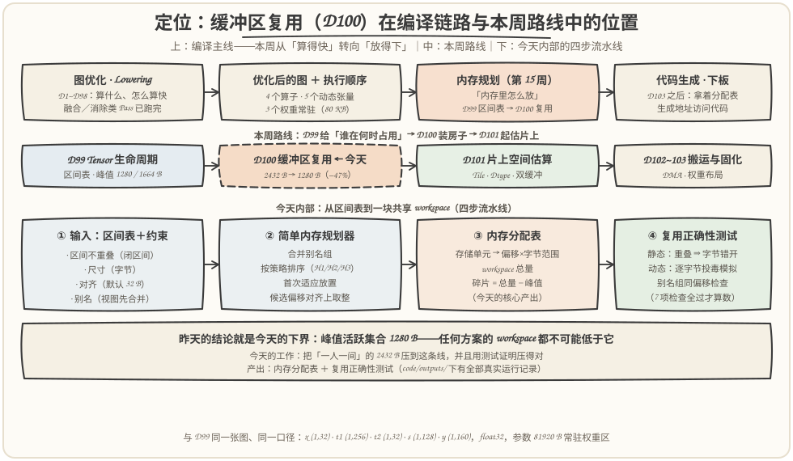
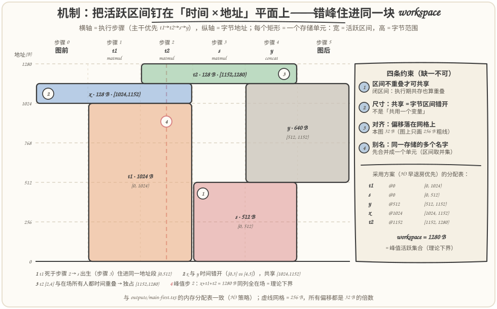
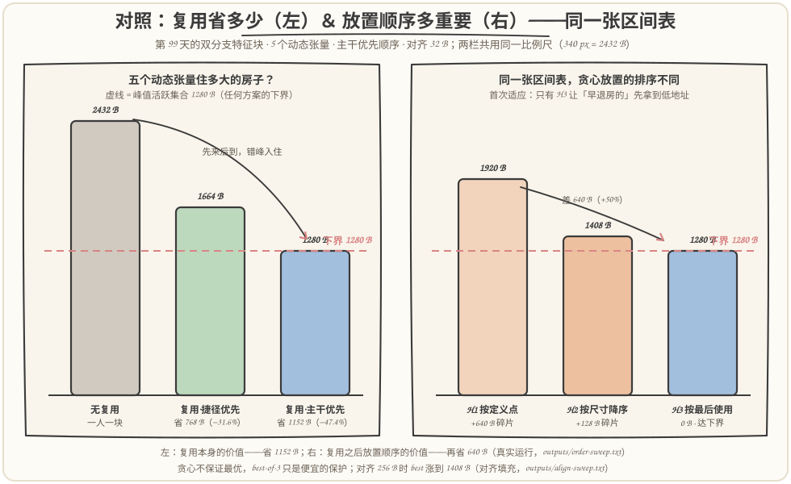
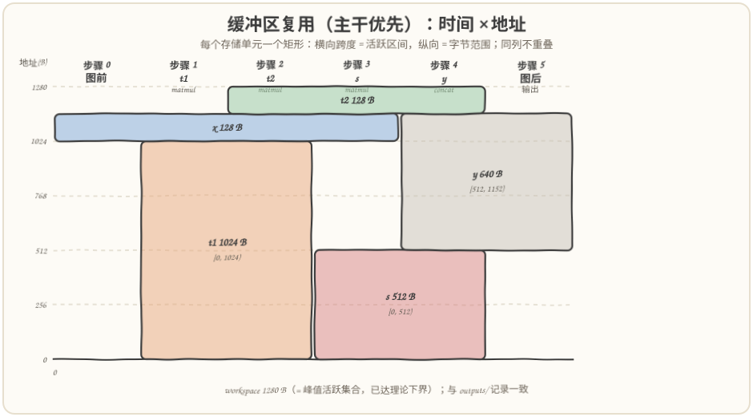
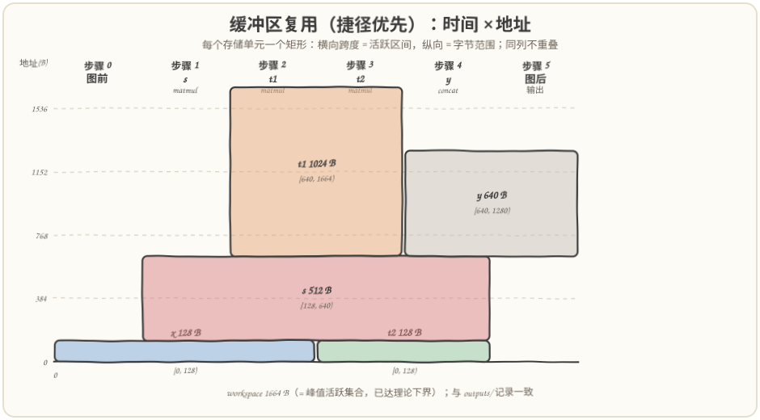

# 第 100 天：缓冲区复用——五个张量排队住进同一块 1280 B

> **今日目标**：完成本教程后，你能做到四件事——说清缓冲区共享的**四条约束**（活跃区间不重叠、尺寸、对齐、别名），并解释为什么闭区间语义决定了"谁和谁绝对不能共享"；实现一个**简单内存规划器**（合并别名组 → 按策略排序 → 首次适应放置），把第 99 天那张区间表变成一张**内存分配表**（每个张量的偏移与字节范围）；用**静态两两检查＋逐字节投毒模拟**证明复用方案的正确性——错误布局会当场暴露，而不是等到真机读出垃圾数据；用真实数字对比**无复用 2432 B → 共享 workspace 1280 B（省 47.4%）**，并亲手复现"同一张区间表，贪心放置顺序不同，workspace 差 640 B"。
> **预计时间**：学习 35 分钟＋实践 45 分钟
> **前置准备**：第 99 天的生命周期表（定义点 def、最后使用点 last_use、闭区间 `[def, last_use]`）；第 2 周的计算图概念。工具只要 `python3`（本文环境：Python 3.11.4，aarch64 Linux），零第三方依赖。
> **今日产出**：`code/planner.py`（内存规划器＋正确性测试＋扫描与危害演示＋SVG 生成，约 740 行）＋`run_all.sh`（一键复现）＋`outputs/` 下 7 份真实运行记录和 2 张程序生成的时间×地址图＋本文 3 张手绘图。

## 1. 今天解决什么问题？

昨天我们算清楚了每个张量"何时生、何时死"：对那张双分支特征块，按主干优先顺序执行时，`t1` 的活跃区间是 `[1,2]`，`s` 是 `[3,4]`，两者从未同时活着。今天的问题是：**既然它们从不同时在场，凭什么各占一块内存？**

这不是一个"锦上添花"的问题。静态图部署到 NPU 或边缘芯片时，通常没有通用运行时 malloc——每个动态张量的缓冲区都要在编译期规划好（MLIR 的 bufferization、XLA 的 buffer assignment、TVM 的静态内存规划做的都是这件事）。最朴素的做法是一人一块：

```text
x (128 B) + t1 (1024 B) + t2 (128 B) + s (512 B) + y (640 B) = 2432 B
```

但内存里真正紧张的是**峰值**，而峰值只取决于"谁和谁同时在场"。昨天已经算出：主干优先顺序下峰值活跃集合只有 1280 B（320 个元素）。今天的任务就一句话：**让"时间上错开"的张量共享同一块字节，把 2432 B 压到接近 1280 B**。

预期结果（第 5 节用真实运行验证）：5 个动态张量、一张共享 workspace，**2432 B → 1280 B，省 1152 B（47.4%）**，而且 1280 B 恰好等于峰值活跃集合——理论下界被精确达到，1 个字节都不浪费。但路上有三个坑等着我们：贪心放置的排序能让 workspace 在 1280～1920 B 之间浮动；对齐要求会引入填充；别名（视图）张量若不先合并，程序会安静地读错数据。这三件事，正是计划里点名的"尺寸、对齐和别名约束"。

## 2. 先看全貌：今天的内容位于哪里？



**图 1**：看三排——上排是编译主线：前 98 天都在回答"算什么、怎么算快"，本周（第 15 周）转入"内存里怎么放"，今天的产出（分配表）最终交给代码生成去生成地址访问；中排是本周路线：D99 给区间表、D100 装房子、D101 起拿同样的思路估片上空间；下排是今天内部的四步流水线：**区间表＋四约束 → 规划器 → 分配表 → 正确性测试**，注意测试和规划器是平级产出，不是附庸。

把今天的流程串成 5 步：

1. **拿区间表**：输入是昨天的产出——每个动态张量的闭区间 `[def, last_use]`（本文环境里 `planner.py` 重新实现了同一套推导，与 D99 的表逐项一致）；
2. **定约束**：四条——区间不重叠才可共享、共享是字节区间错开（尺寸）、偏移必须满足对齐要求、别名（同一物理存储的多个名字）先合并成一个单元；
3. **放置**：简单内存规划器把每个张量安排到共享 workspace 的某个偏移上——按某种顺序逐个放置，每个都找最低的不冲突偏移（首次适应）；
4. **出分配表**：每个张量 → 偏移＋字节范围；workspace 总量＋与峰值下界的差距（碎片）；
5. **测试**：静态两两检查（区间重叠 ⇒ 字节必须错开）＋逐字节投毒模拟，别名组还要检查组内偏移一致。

一句话定位：**昨天把"什么时候要"写成表，今天把"放在哪里"写成表**——明天的片上空间估算用的还是同一套思路，只是场景从整图 workspace 换成 Tile 级的片上缓冲区。

## 3. 核心概念：先用直觉，再给准确定义

### 3.1 复用的唯一安全条件：活跃区间不重叠

一句通俗解释：**两个张量可以共享同一块字节，当且仅当它们的活跃区间（闭区间）不相交**——你活着的时候我不在，我活着的时候你不在。

类比：合租房的上下铺。昨天的酒店今天升级成合租——床位（字节范围）是固定的，住客（张量）按登记表（区间表）错峰入住，房东（规划器）只需要保证**任何时刻同一张床位上只有一个住客**。对应到技术上是：规划器给每个张量分配 `[offset, offset+size)` 的字节范围，然后保证对任意两个区间相交的张量 t1、t2，它们的字节范围不相交——这就是全部的正确性条件。类比边界有两条：其一，合租客退房后床要空一会儿才能消毒换床单，而**编译期复用不需要任何"搬运"或"清理"**——旧张量死后没人再读它，新张量直接覆盖写就行，死数据本来就是要丢的；其二，床位分配是一次性的静态合同，运行时不会改——这既是它的优点（确定性、零运行时开销），也是它的代价（布局错误也会被静态地固定下来，所以今天一半的篇幅在讲怎么测试）。

沿用第 1 节的图（主干优先顺序），最小例子：

- `t1` 区间 `[1,2]`，`s` 区间 `[3,4]`：不相交 → **可以**共享字节（实际方案里它们都住在偏移 0）；
- `t1` 区间 `[1,2]`，`t2` 区间 `[2,4]`：在步骤 2 相交（`t1` 正被读、`t2` 正被写的闭区间语义）→ **绝对不能**共享。

两个常见误解先钉住：**误解一**，"总共 608 个元素、峰值 320，只要 workspace ≥ 320 就行"——错，布局不对照样互相覆盖：比如把 `y`（`[4,5]`）放在 `t2`（`[2,4]`）的字节上，步骤 4 concat 一边读 `t2` 一边写 `y`，同一块字节被两边同时碰，数据立即损坏；**误解二**，"`def` 相等就可以共享"——错，`t1` 和 `x` 的 `def` 一个是 1 一个是 0 看似错开，但区间 `[1,2]` 与 `[0,3]` 相交于步骤 1~2，照样冲突。判定永远以**区间是否相交**为准，不看端点巧合。

### 3.2 尺寸、对齐、别名：另外三条约束

**尺寸**。共享不是"共用一个变量"，而是**字节区间 `[offset, offset+size)` 的错开**。规划器的输出因此叫偏移分配（offset assignment）：一张大 workspace，每人领一段。尺寸约束本身很直白——段必须装得下张量——但它带来一个新概念：**碎片（fragmentation）**。workspace 未必恰好等于峰值活跃集合，两者之差就是浪费的部分（洞没对齐、贪心顺序不巧），它是今天所有实验的核心指标。

**对齐**。真实硬件对缓冲区起始地址有要求：NPU 的 DMA 搬运常要求 32 B 甚至更大对齐，向量指令也有自己的对齐门槛。技术表述：`offset % align == 0`，候选偏移要往上取整到对齐网格（`align_up`）。代价是**对齐填充**——一段字节可能因为对不齐网格而被跳过。今天会实测：本图五个张量的尺寸都是 32 B 的倍数，对齐 ≤128 B 时零代价；对齐 256 B 时 workspace 从 1280 B 涨到 1408 B。

**别名（aliasing）**。`view = reshape(t)` 这类操作让两个名字指向**同一块物理存储**——它们不是"可以共享"，而是"本来就是一回事"。约束：别名组必须先合并成一个存储单元再参与规划——**区间取并集、大小取成员最大值**。反例会在 5.4 节真实运行：不合并时规划器可能给两个名字不同偏移，程序不崩溃、不越界，只是安静地读错数据——这是四条约束里最阴险的一条，也是为什么正确性检查必须包含"组内偏移一致"。

### 3.3 首次适应与"贪心不保证最优"

把张量放进 workspace 的过程本质上是区间装箱。最简单也最常用的贪心是**首次适应（first-fit）**：按某个顺序逐个放置，每个都找**最低的**无冲突偏移。候选偏移从哪里来？从"已放置单元的末端往上取整到对齐网格"——0、每个已放置块的结束位置，都是天然的洞起点。

贪心的命门是**放置顺序**。看真实结果（第 5 节复现）：同一张主干优先的区间表——

- H1（按定义点排序，即按区间起点）：workspace **1920 B**，碎片 640 B；
- H2（按尺寸降序，大块优先）：**1408 B**，碎片 128 B；
- H3（按最后使用点排序，早退房优先）：**1280 B**，恰好达下界。

H1 为什么差？它按"出生顺序"放置，`y`（`[4,5]`，640 B）排在最后，此时低地址被 `s`、`t2` 占住，只能顶到 1280 B 之上；H3 先安排"早退房的"（`t1` 只活两步），让它占低地址，后出生的 `s`、`y` 恰好搬进它腾出的洞。教训值得写进肌肉记忆：**贪心放置对顺序敏感，便宜的保护是多跑几种排序取最优（best-of-3）**。注意它的诚实边界：best-of-3 不等于最优——offset 装箱在一般情况下没有多项式最优算法，真实编译器用的也是启发式（加上更聪明的洞管理），追求的是"接近下界＋有测试兜底"，不是理论最优。

## 4. 图解核心机制



**图 2**：看四个矩形怎么挤进 1280 B——横轴是执行步骤（列头就是昨天的算子顺序），纵轴是字节地址，**每个存储单元一个矩形：宽 = 活跃区间，高 = 字节范围**；右栏是四条约束和真实分配表。这张图就是"内存分配表"的图形化：`t1@0`、`s@0`、`y@512`、`x@1024`、`t2@1152`。

按图中编号把机制串一遍：

1. **① t1 退房，s 入住**：`t1`（1024 B）只活步骤 1~2，矩形又高又窄；它在步骤 2 谢幕后，`s`（512 B）在步骤 3 出生，直接住进同一地址段 `[0,512)`——1280 B 的房子里，这 512 B 被两个人先后用过；
2. **② x 与 y 时间错开**：`x` 区间 `[0,3]`，`y` 区间 `[4,5]`，一步都不重叠，于是共享 `[1024,1152)` 这 128 B——图输入"活到图前"、图输出"活到图后"，边界张量反而最容易复用；
3. **③ t2 谁也碰不得**：`t2` 区间 `[2,4]`，和步骤 2~4 在场的**所有人**都相交（跟 `t1` 共享步骤 2、跟 `s`/`x` 共享步骤 3、跟 `y` 共享步骤 4），只能独占 `[1152,1280)`；
4. **④ 峰值步就是下界**：红色虚线是步骤 2 这一列——`x+t1+t2 = 128+1024+128 = 1280 B` 同列全在场，任何合法布局都不能少于这个数，这就是"峰值活跃集合是理论下界"的图形解释；而本方案恰好把 1280 B 铺满，一点不浪费。

右栏的四条约束别跳过：①②③ 我们刚看过实例，④ 别名今天主图里没有（这张图没有视图），5.4 节单独做实验。

## 5. 动手实践：实现简单内存规划器并证明它正确

### 5.1 准备文件

```text
tutorials/day-100/
├── README.md                       ← 本文
├── images/                          ← 3 张手绘图（数字与 outputs/ 一致）
└── code/
    ├── planner.py                   ← 规划器＋检查器＋投毒模拟＋扫描＋SVG（约 740 行）
    ├── run_all.sh                   ← 一键复现
    └── outputs/                     ← 真实运行记录
        ├── main-first.txt           ← 主干优先完整报告（策略表＋分配表＋7 项检查）
        ├── skip-first.txt           ← 捷径优先完整报告
        ├── order-sweep.txt          ← 3 顺序 × 3 策略扫描
        ├── align-sweep.txt          ← 对齐 4~256 B 扫描
        ├── alias-demo.txt           ← 别名约束：错误示范 vs 正确做法
        ├── hazard-demo.txt          ← off-by-one 危害：两层防线如何报警
        ├── test-all.txt             ← 断言式自检（9/9 组）
        ├── env.txt                  ← Python 3.11.4, aarch64
        └── offset-chart-*.svg       ← 程序生成的时间×地址图 ×2
```

运行方式（本文所有"实际输出"都来自这次运行，环境见 `outputs/env.txt`：Python 3.11.4，aarch64 Linux）：

```bash
cd tutorials/day-100/code
bash run_all.sh                    # 一键：两种顺序 → 顺序扫描 → 对齐扫描 → 别名演示 → 危害演示 → 自检
python3 planner.py --order main-first          # 也可以单跑任意模式
```

### 5.2 代码的关键设计

图、顺序、区间三层沿用 D99（`compute_intervals` 与昨天的语义逐条一致，测试第 1 项专门断言了这一点）。今天的新东西是规划器核心，全部逻辑不到 20 行：

```python
def plan(units, align=DEFAULT_ALIGN, strategy="last-use"):
    """首次适应放置：候选偏移 = 0 与已放置单元末端的对齐上取整，
    从小到大取第一个与所有区间重叠者字节错开的候选。"""
    placed = []
    for u in sorted(units.values(), key=STRATEGY_KEYS[strategy]):
        candidates = sorted({0} | {align_up(off + p.size, align) for p, off in placed})
        for c in candidates:
            ok = True
            for p, off in placed:
                if iv_overlap(u, p) and c < off + p.size and off < c + u.size:
                    ok = False
                    break
            if ok:
                placed.append((u, c))
                break
    offsets = {u.name: off for u, off in placed}
    workspace = max(off + u.size for u, off in placed)
    return offsets, workspace
```

三个设计决定值得说明：**其一**，冲突判定只有一行——`iv_overlap(u, p)`（闭区间相交，与 D99 同一语义）**且**字节区间相交，两个条件同时成立才算撞车；候选偏移只取"已放置单元的对齐末端"，这是首次适应的经典简化，可能错过"洞中间"的位置（贪心的又一个不优来源，但不影响正确性）。**其二**，别名合并在进规划器**之前**完成：`make_units` 把同一 `group` 的张量合并成一个 `Unit`（区间取并集、大小取最大），规划器看到的永远是"物理存储单元"而不是"名字"；错误示范（不合并）由 `verify_group_consistency` 抓。**其三**，正确性靠两层独立防线——静态层对全部 10 对做两两检查（区间重叠 ⇒ 字节不重叠、偏移对齐），动态层是**投毒模拟**：

```python
def simulate_poison(units, offsets, workspace):
    """每步先写入本步定义的单元，再校验所有活跃单元的每个字节
    仍是自己的标记——该错开的没错开，当场暴露。"""
```

投毒模拟的顺序有讲究：每步**先写再验**（写完本步出生的单元后，再校验所有活跃单元），这样闭区间的执行期共存才会被真正检验——如果输出和某个"正在被读的输入"共享了字节，写入会立刻污染输入的标记，下一步校验当场报错。第三层是 `--test`：9 组断言把已知账单（2432/1280/1664、H1~H3 的精确值、别名合并语义、字节复用统计）全部钉死，任何回归都过不了 `run_all.sh`。

### 5.3 运行与观察：一张分配表的诞生

```text
$ python3 planner.py --order main-first
========================================================================
缓冲区复用规划：执行顺序「主干优先」t1 → t2 → s → y   （对齐 32 B）
========================================================================

-- 放置策略对照（首次适应 + 候选偏移对齐）--
策略                            workspace    相对峰值下界
H1 按定义点排序（区间起点）                  1920 B    +640 B（碎片）
H2 按尺寸降序（大块优先）                   1408 B    +128 B（碎片）
H3 按最后使用点排序（早退房优先）               1280 B    0 B（达下界）  ← 采用

-- 内存分配表（采用 H3 按最后使用点排序，按地址排序）--
存储单元   字节    活跃区间     偏移     字节范围           与谁共享（时间错开）
s           512   [3, 4]         0   [0, 512)    t1
t1         1024   [1, 2]         0   [0, 1024)    s、y
y           640   [4, 5]       512   [512, 1152)  x、t1
x           128   [0, 3]      1024   [1024, 1152) y
t2          128   [2, 4]     1152   [1152, 1280) —

-- 汇总 --
无复用（每个动态张量独占一块）      2432 B（608 元素）
共享 workspace（本次采用）          1280 B（320 元素）   省 1152 B（47.4%）
峰值活跃集合（任何方案的理论下界）  1280 B
workspace 已达理论下界：峰值步的活跃张量恰好把内存铺满
字节复用：1280 B 中 1152 B 被两个及以上张量先后占用
```

（其后紧跟 7 项复用正确性检查，结果 `7/7 项通过`，含"投毒模拟（13 次活跃单元逐字节校验，0 处覆盖）"。完整记录在 `outputs/main-first.txt`。）

这张就是计划里点名的**内存分配表**。三行值得停下来看：`s` 和 `t1` 偏移都是 0——`s` 出生那天（步骤 3）正好是 `t1` 死后第一天，512 B 的房子被前后两位房客用足；`y` 与 `t1`、`x` 都有字节交集，但它与 `t1` 只在 `[512,1024)` 相遇、与 `x` 只在 `[1024,1152)` 相遇——一个张量可以同时和多个人共享**不同的**地址段；`t2` 的"与谁共享"是"——"：它的区间 `[2,4]` 与所有人相交，独占是数学上的必然，不是规划器偷懒。

再跑捷径优先（`s → t1 → t2 → y`，区间表换成 D99 顺序 B 的那张）：

```text
$ python3 planner.py --order skip-first
-- 内存分配表（采用 H1 按定义点排序，按地址排序）--
存储单元   字节    活跃区间     偏移     字节范围           与谁共享（时间错开）
t2          128   [3, 4]         0   [0, 128)    x
x           128   [0, 2]         0   [0, 128)    t2
s           512   [1, 4]       128   [128, 640)  —
t1         1024   [2, 3]       640   [640, 1664)  y
y           640   [4, 5]       640   [640, 1280)  t1

-- 汇总 --
无复用（每个动态张量独占一块）      2432 B（608 元素）
共享 workspace（本次采用）          1664 B（416 元素）   省 768 B（31.6%）
```

两个顺序并排就是第 1 节许诺的对照：



**图 3**：两栏同一比例尺。左栏看"复用本身的价值"：无复用 2432 B 是"总量思维"的账单——608 个元素不必同时在场，错峰入住后主干优先只要 1280 B（省 47.4%），红色虚线（峰值活跃集合）标记了任何方案都越不过的下界；右栏看"复用之后放置顺序的价值"：同一张主干优先区间表，H1/H2/H3 三种贪心排序给出 1920/1408/1280 B——**复用省 1152 B 之后，排序又决定再省或再亏 640 B**。右栏还藏着一个 D99 结论的延续：捷径优先无论怎么放都是 1664 B（三种策略并列达它的下界），但它的下界本身就高——昨天"顺序 B 峰值 +30%"的代价，今天原封不动地继承进了 workspace。

脚本还把两个方案渲染成了程序生成的时间×地址图（可直接用浏览器打开）：





**上面两张生成图**：与图 2 的手工版相互印证——看捷径优先那张的左下角：`x` 与 `t2` 叠在同一地址段 `[0,128)`（区间 `[0,2]` 与 `[3,4]` 错开），这是主干优先图里没有的共享对；再看它的 `t1` 与 `y` 共享 `[640,1280)`。同一张图、两种执行顺序，连"谁能和谁共享"都换了名单。

### 5.4 修改一个参数再观察：三个便宜的对照实验

**对照一：扫放置策略（`--order-sweep`）。** 三种顺序 × 三种策略一次跑全：

```text
$ python3 planner.py --order-sweep
-- 顺序 × 放置策略扫描（首次适应，对齐 32 B；单位 B）--
顺序           无复用    峰值下界     H1     H2     H3  best
主干优先        2432    1280   1920   1408   1280   1280
交错          2432    1664   1664   1664   1664   1664
捷径优先        2432    1664   1664   1664   1664   1664
```

最有信息量的一格是主干优先那一行：只有 H3 达到下界，H1 多花 640 B——**复用做到位之后，规划器内部的一次排序决定仍然值 50% 的差距**。而交错、捷径两行三种策略并列，说明"策略敏感"只在特定区间结构（下界低、洞形状刁钻）下才发作——贪心的缺陷不是均匀分布的，这正是它危险的地方。

**对照二：扫对齐（`--align-sweep`）。** 把对齐要求从 4 B 一路加到 256 B：

```text
$ python3 planner.py --align-sweep
-- 对齐扫描（顺序=主干优先，best-of-3；单位 B）--
对齐(B)    H1      H2      H3     best   峰值下界  说明
     4   1920   1408   1280   1280    1280   已达下界
    32   1920   1408   1280   1280    1280   已达下界
    64   1920   1408   1280   1280    1280   已达下界
   128   1920   1408   1280   1280    1280   已达下界
   256   2176   1664   1408   1408    1280   +128 B（对齐填充+碎片）
```

规律：对齐 ≤128 B 时**零代价**——本图五个张量的尺寸都是 32 B 的倍数，偏移天然落在网格上；256 B 起候选偏移被 `align_up` 推高，best 从 1280 B 涨到 1408 B（+128 B，注意 H1 同时从 1920 涨到 2176：对齐惩罚对小洞布局伤害更大）。换算成工程语言：**如果硬件要求 256 B 对齐，要么接受填充，要么让张量尺寸也凑成 256 B 的倍数（padding 到 tile 边界）——后者正是 D101 片上空间估算要接着算的账**。

**对照三：别名约束的真实危害（`--alias-demo`）。** 一个合成用例（Z 长寿命 200 B；A `[1,2]` 100 B；B `[3,4]` 60 B，**B 是 A 的视图**；C `[2,3]` 48 B；D `[3,3]` 80 B）：

```text
[错误示范] 不合并别名组，把 A、B 当两个独立缓冲区规划：
  Z  200 B  [1, 5]  偏移 0
  A  100 B  [1, 2]  偏移 200
  D   80 B  [3, 3]  偏移 200
  C   48 B  [2, 3]  偏移 300
  B   60 B  [3, 4]  偏移 348
  ✗ 校验失败：别名组 {A,B} 偏移不一致：[200, 348]

[正确做法] 先合并别名组，再参与放置：
  存储单元 S{A,B}：区间 = [1,2] ∪ [3,4] = [1, 4]（并集），大小 = max(100, 60) = 100 B
  Z 200 B [1,5] @0   S{A,B} 100 B [1,4] @200   C 48 B [2,3] @300   D 80 B [3,3] @348
  静态检查 通过；别名组偏移一致 通过；投毒模拟（12 次校验）通过
```

注意错误示范最阴险的地方（完整输出在 `outputs/alias-demo.txt`）：**投毒模拟反而通过**——A 和 B 落在不同字节上，谁也没覆盖谁，逐字节校验一片绿灯；真正的错误是语义层：步骤 1 通过名字 A 把数据写进偏移 200，步骤 3~4 却通过名字 B 去读偏移 348，读到的是未初始化的垃圾。这就是为什么"别名组内偏移一致"必须作为独立检查存在——它抓的是**投毒抓不到的错**。合并的代价只有 20 B（408 → 428 B），换来数据通。

## 6. 常见错误与排查

**错误一：把"区间相交"误判成"端点错开就能共享"。**
现象：静态规划通过、运行时数据损坏。当天环境上的真实复现（`python3 planner.py --hazard-demo`，完整记录在 `outputs/hazard-demo.txt`）：把 `t1 [1,2]` 与 `t2 [2,4]` 当作可共享——只看 `last_use(t1)=2` 与 `def(t2)=2` "恰好接上"——让 `t2` 搬进 `t1` 的字节，两层防线同时报警：

```text
静态两两检查（共 10 对）：
  ✗ s 与 t2 区间重叠却共享字节
  ✗ t1 与 t2 区间重叠却共享字节

投毒模拟（13 次活跃单元校验）：
  ✗ 步骤 2：t1 在字节 0 读到别人的标记
  ✗ 步骤 3：t2 在字节 0 读到别人的标记
  ✗ 步骤 4：t2 在字节 0 读到别人的标记
```

原因：闭区间的语义是"算子执行期间输入在被读、输出在被写"（D99 反复强调的同一条），端点相接就是相交——步骤 2 的 matmul 一边读 `t1` 一边写 `t2`，共享字节立即被写穿（步骤 2 的报警），随后 `s` 入住又把 `t2` 冲掉（步骤 3、4 的连锁报警）。定位：静态层第 3 项（区间重叠 ⇒ 字节不重叠）先报"该错开没错开"，投毒层第 5 项再报具体在哪一步哪个字节被谁覆盖。修复：冲突判定用 `max(def_a, def_b) <= min(last_a, last_b)`，永远不看端点巧合。

**错误二：忘了别名，程序安静地读错数据。**
现象：模拟全绿、真机结果随机错——5.4 对照三已完整复现：不合并 `{A,B}` 时规划器给出 200 和 348 两个偏移，没有覆盖、没有越界，唯一知情人是一条静态检查。原因：区间分析只看"名字"，视图的名字和生产者的名字没有数据依赖边，规划器无从知道它们是同一块存储。定位：`verify_group_consistency`（组内偏移必须一致）。修复：规划前合并别名组——区间取并集、大小取最大（`make_units(merge_alias=True)`）。

**错误三：忽略对齐，模拟器上全对，真机 DMA 报错或性能腰斩。**
现象：`--align 4` 的布局在 256 B 对齐的真机上跑挂。原因：软件模拟只按字节算账，感觉不到对齐违规；DMA 引擎或向量加载对未对齐地址直接拒绝或默默降速。定位：回到 `--align 256` 重跑，看 workspace 变化（本图 1280 → 1408 B）确认布局真的换了。修复：把对齐参数当作规划器的一等公民（`plan(units, align, ...)`），并让静态检查第 1 项盯住每个偏移。

**错误四：以为 best-of-3 就是"最优"。**
现象：报告里 workspace 恰好等于峰值下界，于是认定规划器完美——换一张图立刻破防（比如 5.4 对照一里交错顺序下你以为"反正都 1664"，其实只是这张图的下界恰好高）。原因：贪心＋多策略只是**便宜的护栏**：offset 装箱在一般情形没有多项式最优算法，H3 在本图达下界带有运气成分。定位：永远把 `workspace − 峰值活跃集合`（碎片）作为监控指标打出来，而不是只看绝对值。修复：接受"接近下界＋有测试兜底"的工程标准；追求更进一步时，再上更聪明的洞管理（best-fit、延迟放置）——那已经是真实编译器里的研究课题。

## 7. 今日练习

### 必做练习

D99 枚举过第三种合法顺序"交错"（`t1 → s → t2 → y`），今天让它归队：先**笔算**它的区间表（`x` 的 `last_use` 是多少？`t1` 呢？），再笔算峰值活跃集合和 H3 策略下的 workspace；然后运行 `python3 planner.py --order interleaved` 对答案。两个提示：先想 `x` 被哪两步读（它的 `last_use` 比 D99 主干优先里的 3 提前了一步）、`t1` 被谁读（它要活到第 3 步）；再对照图 2——主干优先里 `x` 与 `t2` 在步骤 2~3 相交、绝不能共享，交错之后它们还相交吗？预期产出：一张 5 行的区间表＋一句话回答"x 和 t2 现在能共享吗，为什么"。

### 选做挑战

给 `planner.py` 加第四种放置策略：**按区间长度降序**（`span = last_use − def_step`，`STRATEGY_KEYS` 里加一行 `lambda u: (-(u.last_use - u.def_step), u.def_step, u.name)`），跑 `--order-sweep` 看它在三种顺序上能不能击败 H3；再任选一个顺序，把 `DEFAULT_ALIGN` 改成 128 和 256 各跑一次，验证 5.4 对照二的"对齐零代价窗口"说法。预期产出：一张 4 策略 × 3 顺序的 workspace 表＋一句话结论（长住优先为什么接近/不接近早退房优先）。

## 8. 今日验收

- [ ] 我能用自己的话解释四条约束：区间不重叠（闭区间语义）、尺寸（字节区间错开）、对齐（偏移落网格）、别名（先合并再规划）
- [ ] 我能独立运行 `planner.py`，指出主干优先方案里 `s`/`t1`、`x`/`y`、`y`/`t1` 各共享了哪段字节、为什么合法
- [ ] 我能修改 `--order`、`--strategy`、`--align` 并**先预测** workspace 的变化方向，再用运行结果验证（顺序影响下界、策略影响碎片、对齐引入填充）
- [ ] 我能定位"布局错误"类问题，并说出双层防线（静态两两检查＋投毒模拟）各自能抓什么、抓不到什么（别名靠第三条）
- [ ] 我保存了内存分配表、复用正确性测试记录（`outputs/`）和 3 张手绘图——workspace 思路明天直接搬去片上

## 9. 一句话总结与明天预告

问题：静态内存规划的第二块积木——知道"谁在何时活着"之后，怎么让不同时活着的张量挤进同一块内存，且不互相踩脚。机制：四条约束（区间不重叠、尺寸、对齐、别名合并）加上首次适应放置，把区间表变成偏移分配表；正确性由静态两两检查＋逐字节投毒模拟守住，别名另有一条"组内偏移一致"的专项检查。实践：D99 的双分支特征块从"一人一间"的 2432 B 压进 1280 B 的共享 workspace（省 47.4%，恰好等于峰值活跃集合下界）；同一张区间表上，贪心排序让 workspace 在 1280~1920 B 之间浮动，对齐 256 B 再加 128 B 填充。验证：两种顺序各 7 项检查全过，`--test` 9 组断言（含全部已知账单）全过，别名错误示范被专项检查当场抓获。

明天（第 101 天·片上空间估算）：把"一块 workspace 装所有人"的思路缩小到一级——输入 Tile、输出 Tile、权重 Tile、临时缓冲区和双缓冲，估的是片上 SRAM（比 HBM 小两个数量级）装不装得下一个 Tile 的家当。今天 `align_sweep` 里"张量尺寸凑成对齐倍数"的伏笔，明天会变成 Tile 尺寸选择的一部分。


