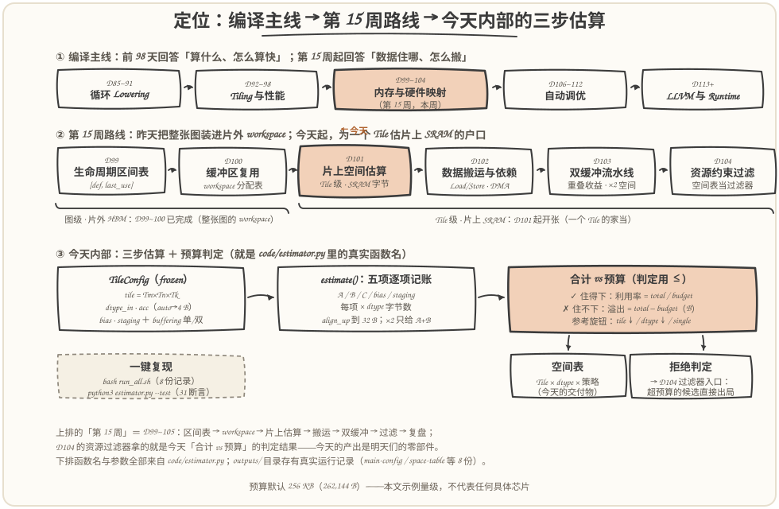
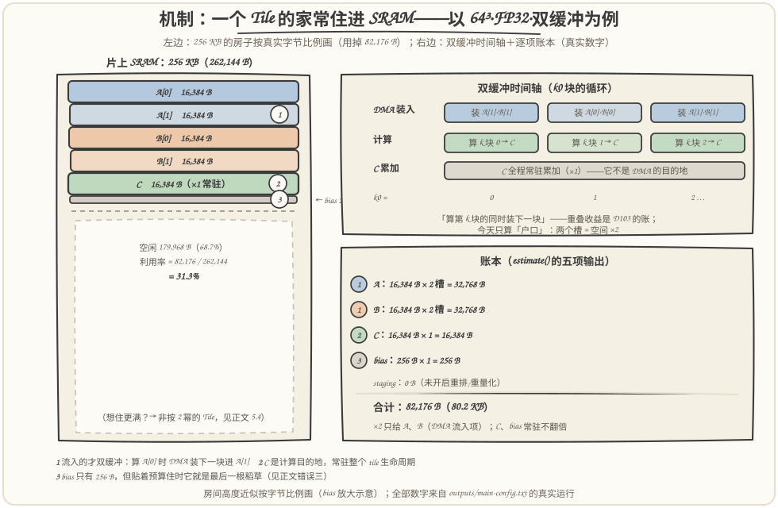
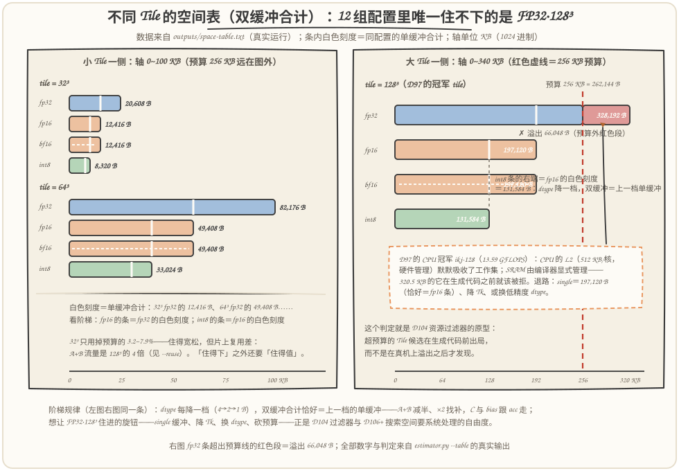
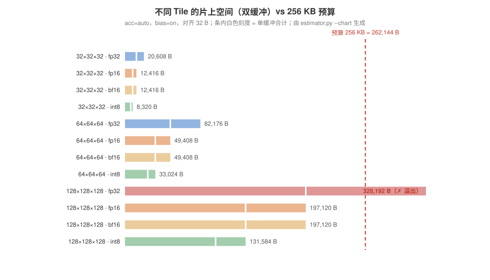

# 第 101 天：片上空间估算——一个 Tile 的家当要住进多大的 SRAM

> **今日目标**：完成本教程后，你能做到四件事——说清**片上／片外两级存储的合同差异**：HBM 是仓库、SRAM（scratchpad）是几百 KB 的台面，且由编译器显式管理，超预算不是"变慢"而是"编不过"；列出一个 Tiled MatMul 在片上的**五项家当**（A 输入 Tile、B 权重 Tile、C 累加 Tile、bias 切片、staging 临时 Tile），并讲透两条记账规则——**累加精度不跟输入走**（D80 的"低精度输入、高精度累加"在空间上塌缩成"C 恒按 4 B 记"）和**×2 只给 DMA 流入项**；实现 `estimate()` 并产出**不同 Tile 的空间表**——12 组配置里唯一被拒的恰好是 D97 的 CPU 冠军（FP32·128³·双缓冲 = 328,192 B > 256 KB）；最后用**预算扫描＋复用对照＋三个错误演示**看懂三件事：2 幂网格只敢用预算的三成、贴线时 512 B 决定生死、dtype 每降一档双缓冲恰好等于上一档的单缓冲。
> **预计时间**：学习 35 分钟＋实践 45 分钟
> **前置准备**：D93~D95 的 tile 三元组语义（`Tm×Tn×Tk` 三维独立取值、整除契约与 `min` 钳制尾部）；D97 的性能表（512³ FP32、冠军 ikj-128＝13.59 GFLOPS、实验机 L2 512 KB/核）；D100 的结尾铺垫（workspace 是图级·片外 HBM 的账，今天转到 Tile 级·片上 SRAM；"张量尺寸凑成对齐倍数"的伏笔今天兑现成记账规则）；D80/D81 的累加精度结论。工具只要 `python3`（本文环境：Python 3.11.4，aarch64 Linux，2026-11-13），零第三方依赖。
> **今日产出**：`code/estimator.py`（估算函数＋空间表＋dtype／预算／复用扫描＋错误演示＋31 项断言自检，约 600 行）＋`code/run_all.sh`（一键复现）＋`outputs/` 下 8 份真实运行记录和 1 张程序生成图＋本文 3 张手绘图。

## 1. 今天解决什么问题？

第 97 天的性能表把 512×512×512 FP32 矩阵乘的冠军颁给了 `ikj-128`（13.59 GFLOPS）。当时我们没问的一个问题是：**这个配置在真实 AI 芯片上住得住吗？**

在 CPU 上没人拦你。那天实验机的 L2 是 512 KB/核，由硬件全权管理——tile 大一点小一点，只是缓存命中率的连续变化，你感觉不到"容量"这个约束的存在。但 NPU／AI 加速器签的是另一份存储合同：片上 SRAM 只有几百 KB 量级，而且**没有硬件帮你决定谁住在里面**——Tiled kernel 的 A 块、B 块、C 块要由编译出来的代码显式读写，放不进去就不是"性能下降"，是**代码生成阶段就该被拒绝**。

所以今天的问题一句话：**给定 Tile 尺寸、Dtype 和缓冲策略，一个 Tile 的家当要占多少片上字节？装不装得下？** 这个判定必须发生在 Lowering 到目标代码之前——第 104 天的资源过滤器吃的正是今天的产出。贯穿全文的例子沿用 D97 的那道题：`C = A(512×512)·B(512×512)`，候选 tile 是 32³／64³／128³，预算取 256 KB（262,144 B，一个常见的边缘 NPU 量级，**本文示例值，不代表任何具体芯片**）。

预期结果（第 5 节用真实运行验证）：**FP32·128³·双缓冲需要 328,192 B（320.5 KB），超出预算 66,048 B，被拒**。出路有三条——退到单缓冲（197,120 B）、降 tile（64³ 只需 82,176 B）、换 dtype（INT8 只需 131,584 B）——每条出路都有代价，账本分别在：放弃计算与搬运的重叠（D103 的时间线）、片上复用变差带来的 HBM 流量（今天 5.4 对照三算）、数值精度风险（D78~81 算过）。今天先把"住不住得下"这一关的判定函数写出来。

昨天结尾留了一句"对齐凑整的伏笔明天会变成 Tile 尺寸选择的一部分"——今天它兑现为记账规则里的 `align_up`（3.4 节）和预算扫描里"INT8 的 128³ 被 bias 的 512 B 挤出 128 KB 预算"的真实案例（5.4 节）。

## 2. 先看全貌：今天的内容位于哪里？



**图 1**：看三排——上排是编译主线：前 98 天都在回答"算什么、怎么算快"，第 15 周（D99~104）转入"数据住哪、怎么搬"，今天的产出（空间估算与预算判定）三天后就是 D104 资源过滤器的零件；中排是本周路线：D99 给区间表、D100 把整张图的动态张量装进片外 workspace，**今天换成 Tile 级的片上 SRAM 账本**——同一套预算思维，从图层级换到 kernel 层级再算一遍；下排是今天内部的三步：`TileConfig` → `estimate()` 五项逐项记账 → 合计与预算判定。

把今天的流程串成 5 步：

1. **拿配置**：`TileConfig`（tile 三元组＋dtype＋累加精度＋bias/staging 开关）加上一个缓冲策略参数（single/double）——配置是数据，D93 定下的原则今天延续；
2. **列家当**：五项——A 输入 Tile、B 权重 Tile、C 累加 Tile、bias 切片、staging 临时 Tile，每项算出"一个槽"的字节数；
3. **记账**：每项 `align_up` 到 DMA 对齐（32 B 起）；缓冲策略的 ×2 **只乘 A、B 两个流入项**；
4. **判定**：合计 ≤ 预算 → ✓ 住得下＋利用率；否则 ✗＋溢出字节数，并打印降级参考（single／换 dtype）；
5. **产出**：不同 Tile 的空间表（今天的交付物）＋拒绝判定（D104 过滤器入口，超预算候选在代码生成前出局）。

一句话定位：**D100 问"整张图的张量怎么挤进一块片外内存"，D101 问"一个 Tile 的家当装不装得进片上 SRAM"**——明天起（D102~103）再把"怎么搬、何时等、×2 买回多少时间"的时间线账算清楚。

## 3. 核心概念：先用直觉，再给准确定义

### 3.1 两级存储：SRAM 是编译器自己管的"台面"

一句通俗解释：AI 芯片的数据住在两个地方——**片外 HBM 是仓库**（容量 GB 级、要跨芯片边界去搬、带宽有限），**片上 SRAM 是台面**（几百 KB、单周期可达、Tile 的所有计算都直接在它上面发生）。

类比：做饭。冰箱再大，炒菜也得把食材拿到台面上切——台面的大小决定了你一次能同时处理多少食材。对应到技术上是：**HBM→SRAM 的搬运（DMA）以 Tile 为单位**，一个 Tiled kernel 的所有 load/store 都发生在 SRAM 里，SRAM 的容量直接限制了 Tile 能开多大、双缓冲能开几槽。类比边界有两条：其一，厨房台面乱了只是碍事，**CPU 缓存则像一张会自己收拾的魔法台面**——硬件按替换策略默默决定谁留下谁出去，你只感觉到快慢、感觉不到管理；**SRAM 没有这层魔法，每个字节住哪个位置都是编译器写好的**——这就是为什么"空间估算"是编译器的活，而不是运行时的活。其二，台面放不下顶多是"分两批做"，而 SRAM 超预算在这个项目里直接 fail-closed：宁可拒绝生成代码，不可生成会互相覆盖的代码（D95 消费门同款原则）。

与昨天的分工一句话：**D100 的 workspace 装的是"整张图里不同时活着的张量"**（图级、片外侧的规划，错峰复用省的是峰值）；**今天的 SRAM 装的是"一个 Tile 同时在场的全部家当"**（kernel 级、片内侧的预算，超了就是硬错误）。同一套"静态、编译期决定、有测试兜底"的思维，换一层再算一遍。

### 3.2 一个 Tile 的家当清单：五项

沿用 D93~D95 的记号，一个 Tiled MatMul 的输出块尺寸是 `Tm×Tn`，归约维切块是 `Tk`。片上要同时供养这五项：

| 家当 | 形状 | 字节 | 缓冲策略 | 来历 |
|---|---|---|---|---|
| A tile（输入激活） | `Tm×Tk` | ×dtype_in | **×2**（DMA 流入） | D94 的块循环每圈换人 |
| B tile（权重） | `Tk×Tn` | ×dtype_in | **×2**（DMA 流入） | 同上 |
| C tile（输出累加） | `Tm×Tn` | ×**acc** | **×1**（常驻） | 累加器，D87 的 iter_args 在硬件世界的化身 |
| bias 切片 | `Tn` | ×acc | ×1（常驻） | D53 的 MatMul+Bias 融合 |
| staging（可选） | `Tm×Tn` | ×dtype_in | ×1 | 量化推理的重量化输出 |

三个值得停下来的点：

**其一，A 和 B 空间上对称，身份上不对称。** 机器学习语境里 A 是激活（每次推理都变）、B 是权重（编译期已知、可以离线量化成 INT8）——这影响谁更值得双缓冲、谁可以离线预处理，是 D102 搬运策略的输入；但**空间记账各记各的**，`Tm×Tk` 和 `Tk×Tn` 谁也不比谁特殊。

**其二，C 的精度不跟输入走。** D80 的实验结论是"低精度输入、高精度累加"：FP16/BF16 输入用 FP32 累加，INT8 输入用 INT32 累加（D81 的反量化路线最终也是 4 B 的 FP32 语义）。D78~81 里那些语义与误差之争，**从空间的视角塌缩成一条记账规则：`acc="auto"` 时 C 恒按 4 B/元素记**——不管输入是 4 B、2 B 还是 1 B。忘了这条规则的后果见第 6 节错误一。

**其三，融合的红利在空间上是"零"。** D51 的 Add+ReLU 融合、D53 的 MatMul+Bias 融合，落到片上就是：ReLU 逐元素**原地**改写 C，一个字节不多占；bias 是长度 `Tn` 的一行，广播着加。所以最终项目算子 `MatMul+Bias+ReLU` 的家当清单里只有 bias 一行，没有 ReLU 的位置——融合省流量（D72 算过）之外，还省地方。

最小例子（全文反复用的那个）：`tile=64³`、FP32、bias 开——A = B = C = 16,384 B，bias = 256 B，**单缓冲合计 49,408 B（48.2 KB）**。

### 3.3 双缓冲的空间账：谁 ×2，谁 ×1

直觉：**算这一块的同时，装下一块**。k0 块循环每圈要用新的 A 块和 B 块——如果只有一个槽，DMA 装数据的时候计算单元只能干等（D103 的单缓冲时间线会画出这条空隙）。开两个槽，算 `A[0]` 的同时 DMA 往 `A[1]` 里装下一块，圈与圈之间无缝交接。

对应到技术上：**×2 只乘"DMA 流入的操作数"——A 和 B 各开两槽**；C 是计算的目的地，从第一个 k 块的部分和一直累到写回，整个输出块生命周期里常驻，**恒 ×1**；bias 每个输出块装一次，×1。类比：流水线备菜——当前锅在炒（`A[0]`），下一锅的菜在案板上备着（`A[1]`）；但炒好的菜只需要端出去，不需要两口锅。类比边界：真实芯片也有"输出乒乓"（算下一个输出块的同时把当前块写出，C 也 ×2）——那是**显式的进阶特性**（D103 之后再说），绝不许当默认值套用；把 ×2 抄给所有缓冲的代价见第 6 节错误二。

空间代价一句话：双缓冲让 A+B 两项翻倍——64³ FP32 从单缓冲 49,408 B 涨到 **82,176 B**（+66%），128³ FP32 从 197,120 B 涨到 **328,192 B**（+66%，涨出了预算线）。买回的时间值不值这个空间，是 D103 的账。

### 3.4 字节怎么算：元素数 × 每元素字节，再对齐

每个缓冲区的字节数 = 行×列×每元素字节。`fp32=4`、`fp16=2`、`bf16=2`、`int8=1`（`int32=4`，给累加器用）。然后每项独立 `align_up` 到 DMA 对齐——昨天 `align_sweep` 的伏笔在这里兑现：DMA 搬运常要求 32 B 甚至更大的对齐，缓冲区起始地址必须落网格上。

两个现象提前看一眼（5.4 和第 6 节展开）：**正常的 2 幂 tile 对齐零代价**——128×128×4 B 天然是 32 B 的倍数；**奇数 tile 三项同时发生 padding**——33³ INT8 单缓冲未对齐 6,666 B，对齐后 6,784 B（+118 B，1.8%）。真正致命的不是这 1.8%，而是**贴着预算住的时候任何零头都变成决定性的**——第 6 节错误三里，512 B 的 bias 就是压垮"恰好住下"方案的最后一根稻草。所以记账规则铁律：**五项全记、逐项对齐、判定用 ≤，绝不用"约等于"**。

## 4. 图解核心机制



**图 2**：左半是 256 KB 的 SRAM 房子，按真实字节比例画——五个房间（`A[0]`/`A[1]`/`B[0]`/`B[1]` 各 16,384 B、C 16,384 B）、一条画粗示意的 bias 窄条（256 B），加上一大片空闲（179,968 B，68.7%）；右上是双缓冲时间轴，右下是 `estimate()` 的逐项账本。全部数字来自 `outputs/main-config.txt` 的真实运行。

按图中编号把机制走一遍：

1. **① 流入的才双缓冲**：时间轴上 k0=0 时计算读 `A[0]`/`B[0]`，DMA 同时把下一块装进 `A[1]`/`B[1]`；k0=1 两者交换角色。所以空间上 A、B 各有两间房——**×2 买的是"圈与圈之间不用干等"**（买回多少时间是 D103 的账）；
2. **② C 常驻 ×1**：C 从第一个 k 块的部分和一直累加到最终写回 HBM——它**不是 DMA 的目的地，是计算的落点**，整个输出块生命周期只住一间房。D94 的 Tiled IR 里 C 走"块间读-改-写"，当时所有内存都是同一个平面；今天有了片上/片外之分，同一条循环嵌套里 C 块的落点应该是 SRAM；
3. **③ bias 窄到画不出来**：256 B 在 262,144 B 的房子里只值 1 像素高——但第 6 节错误三会演示它怎么在贴线时翻盘；
4. **右下账本就是 `estimate()` 的输出**：五项、每项一槽尺寸、×1/×2 明示、合计 82,176 B、利用率 31.3%——这份明细既能被人读，也能被 31 项断言逐个钉死。

注意左图大片空闲的含义：64³"住得下"但只住了三成——**住得下 ≠ 住得值**。5.4 的预算扫描会展示怎么把预算用到 99%（答案不是 2 的幂），复用对照会解释为什么想住更大的 tile。

## 5. 动手实践：空间估算函数与空间表

### 5.1 准备文件

```text
tutorials/day-101/
├── README.md                       ← 本文
├── images/                          ← 3 张手绘图（数字与 outputs/ 一致）
└── code/
    ├── estimator.py                 ← 估算函数＋空间表＋扫描＋错误演示＋自检（约 600 行）
    ├── run_all.sh                   ← 一键复现（8 份记录 + 1 张程序生成图）
    └── outputs/
        ├── main-config.txt          ← 主例判定：128³ FP32 被拒 + 64³ 对照
        ├── space-table.txt          ← 计划点名的交付物：不同 Tile 的空间表
        ├── dtype-sweep.txt          ← 固定 128³ 扫 dtype（累加精度规则）
        ├── budget-sweep.txt         ← 预算 → 最大立方 Tile 扫描
        ├── reuse.txt                ← HBM 流量 vs Tile（为什么想住大 Tile）
        ├── errors.txt               ← 三个常见错误的估算对照
        ├── test-all.txt             ← 断言式自检（31/31）
        ├── env.txt                  ← Python 3.11.4, aarch64, 2026-11-13
        └── space-chart.svg          ← 程序生成：空间条形图
```

运行方式（本文所有"实际输出"都来自这次运行，环境见 `outputs/env.txt`：Python 3.11.4，aarch64 Linux，2026-11-13）：

```bash
cd tutorials/day-101/code
bash run_all.sh                                  # 一键：主例 → 空间表 → 三个扫描 → 错误 → 自检
python3 estimator.py --table                     # 也可以单跑任意模式
python3 estimator.py --config "tile=64x128x128,dtype=fp32,buffer=double"   # 任意自定义配置
```

### 5.2 代码的关键设计

模型核心是 `estimate()`——输入一个 `TileConfig` 和缓冲策略，输出一份**逐项明细**（`Breakdown`）而不是一个光秃秃的总数：

```python
def estimate(cfg: TileConfig, buffering: str = "double", align: int = DEFAULT_ALIGN) -> Breakdown:
    """空间估算主函数：Tile + Dtype + 缓冲策略 → 片上字节明细。"""
    if buffering not in ("single", "double"):
        raise ValueError(f"未知缓冲策略：{buffering}（可选 single/double）")
    d_in = DTYPES[cfg.dtype_in]
    d_acc = DTYPES[cfg.acc_dtype()]                      # acc="auto" → int8→int32，其余→fp32
    a = align_up(cfg.tm * cfg.tk * d_in, align)          # A tile 单槽（Tm×Tk）
    b = align_up(cfg.tk * cfg.tn * d_in, align)          # B tile 单槽（Tk×Tn）
    c = align_up(cfg.tm * cfg.tn * d_acc, align)         # C tile（Tm×Tn × acc，恒 ×1）
    bias = align_up(cfg.tn * d_acc, align) if cfg.bias else 0
    staging = align_up(cfg.tm * cfg.tn * d_in, align) if cfg.staging else 0
    factor = 2 if buffering == "double" else 1          # ×2 只给 A+B 两个流入项
    return Breakdown(a=a, b=b, c=c, bias=bias, staging=staging, factor=factor, cfg=cfg)
```

四个设计决定值得说明。**其一，`Breakdown` 保留每一项**：`total` 是推导属性（`factor*(a+b) + c + bias + staging`），五个数字各自可打印、可断言——这是 `--test` 里 31 项检查能逐个钉死已知账单（12,416／82,176／197,120／328,192……）的原因，也是错误演示能"错误版 vs 正确版"并排对比的原因。**其二，累加精度写成显式映射表**（`ACC_AUTO = {"int8": "int32", "fp16": "fp32", ...}`）而不是藏在 if 里——D80 的语义结论变成一行可查的数据，且 `acc` 允许显式覆盖（错误演示一正是用 `acc="int8"` 制造事故）。**其三，判定只有一行**（`total <= budget`），但拒绝时把降级参考（single 需要多少、还有哪些旋钮）一并打印——D104 的过滤器要的不只是 yes/no，是**可解释的拒绝**。**其四，`TileConfig` 是 frozen dataclass**——D93 的教训：配置是数据、构造时校验（tile 三维正整数、dtype 拼写错当场抛 `ValueError`，自检 E8 组逐个验证过 fail-closed）。

### 5.3 运行与观察：冠军配置被拒的那张表

主例报告（`outputs/main-config.txt`，节选）：

```text
$ python3 estimator.py
========================================================================
主例：D97 的冠军 tile 遇上 256 KB 片上预算：tile=128×128×128  dtype=fp32  acc=fp32  缓冲=double  对齐=32 B
预算：262,144 B（256.0 KB）
========================================================================
-- 家当清单（五项逐项记账）--
A tile（输入激活）  Tm×Tk = 128×128 × 4 B       65,536 B  ×2 双缓冲  = 131,072 B
B tile（权重）      Tk×Tn = 128×128 × 4 B       65,536 B  ×2 双缓冲  = 131,072 B
C tile（输出累加）  Tm×Tn = 128×128 × 4 B       65,536 B  ×1 常驻     = 65,536 B
bias 切片           Tn = 128 × 4 B                    512 B  ×1 常驻     = 512 B
staging（重排）     关闭                0 B
                                      合计  328,192 B（320.5 KB）

-- 预算判定 --
需求 328,192 B > 预算 262,144 B：✗ 住不下，溢出 66,048 B（64.5 KB）
  降级参考：single 缓冲需 197,120 B ✓（放弃计算/搬运重叠，代价见 D103）
```

这就是第 1 节许诺的判定：**D97 的冠军配置在显式 SRAM 的第一关就被拒**。报告同时给出退路的价格——单缓冲 197,120 B 住得下，但"算与装不能重叠"的代价要等 D103 的时间线来量化。

计划点名的交付物——不同 Tile 的空间表（`outputs/space-table.txt`，完整 12 行）：

```text
$ python3 estimator.py --table
-- 空间表：Tile × Dtype × 缓冲策略（acc=auto，bias=on，对齐 32 B；预算 262,144 B，KB 均为 1024 进制）--
Tile          dtype             单缓冲           双缓冲      利用率(双)     256 KB 预算
32×32×32      fp32         12,416 B      20,608 B        7.9%              ✓
32×32×32      fp16          8,320 B      12,416 B        4.7%              ✓
32×32×32      bf16          8,320 B      12,416 B        4.7%              ✓
32×32×32      int8          6,272 B       8,320 B        3.2%              ✓
64×64×64      fp32         49,408 B      82,176 B       31.3%              ✓
64×64×64      fp16         33,024 B      49,408 B       18.8%              ✓
64×64×64      bf16         33,024 B      49,408 B       18.8%              ✓
64×64×64      int8         24,832 B      33,024 B       12.6%              ✓
128×128×128   fp32        197,120 B     328,192 B      125.2%           ✗ 溢出
128×128×128   fp16        131,584 B     197,120 B       75.2%              ✓
128×128×128   bf16        131,584 B     197,120 B       75.2%              ✓
128×128×128   int8         98,816 B     131,584 B       50.2%              ✓
```



**图 3**：左面板是小 tile 一侧（轴只到 100 KB，预算线远在图外）——32³ 全家只占预算的 3.2~7.9%，64³ 最多 31.3%；右面板是 128³ 一侧——**FP32 的条撞穿红色预算虚线，预算外的红色段就是溢出的 66,048 B**。三个看点：**①** 唯一 ✗ 的是 FP32·128³，而它正是 D97 在 CPU 上测出的冠军（13.59 GFLOPS）——CPU 的 L2（512 KB/核，硬件管理）默默吸收了工作集，显式 SRAM 第一关就拒收；**②** 阶梯规律：`int8` 双缓冲的条恰好接到 `fp16` 单缓冲的白色刻度（都是 131,584 B）、`fp16` 双缓冲接到 `fp32` 单缓冲（都是 197,120 B）——dtype 每降一档，A+B 减半、×2 找补，C 与 bias 跟着 acc 走纹丝不动；**③** 右下角的注记框：这个判定就是 D104 资源过滤器的原型。

脚本还把同一张表渲染成程序生成的条形图（`--chart`，干净矢量风，可与手绘图相互印证）：



### 5.4 修改一个参数再观察：三个便宜的对照实验

**对照一：固定 128³ 扫 dtype（`--dtype-sweep`）。** 看清"输入精度只影响 A+B，累加精度独占 C"：

```text
$ python3 estimator.py --dtype-sweep
-- Dtype 扫描：tile=128×128×128，缓冲=double，预算 262,144 B --
dtype           A 槽         B 槽          C（acc）      bias            合计     acc        预算
fp32       65,536 B    65,536 B        65,536 B     512 B     328,192 B    fp32         ✗
fp16       32,768 B    32,768 B        65,536 B     512 B     197,120 B    fp32         ✓
bf16       32,768 B    32,768 B        65,536 B     512 B     197,120 B    fp32         ✓
int8       16,384 B    16,384 B        65,536 B     512 B     131,584 B   int32         ✓
```

最值得盯的是 **C 列一行不动**：四个 dtype 全是 65,536 B——auto 规则下累加器恒 4 B（fp16/bf16→fp32，int8→int32）。于是 INT8 的空间红利只落在 A+B 上：合计从 328,192 直落到 131,584 B。**D80 那句"低精度输入、高精度累加"当时花一整天验证数值误差，今天变成空间表里一行"免费的"4 B 记账规则**——同一个结论在两门账本里都成立。

**对照二：固定预算扫 Tile（`--budget-sweep`）。** 换个问法——预算给定，最大的立方 tile 能开多大？

```text
$ python3 estimator.py --budget-sweep
-- 预算扫描：双缓冲 + acc=auto + bias=on，找最大立方 Tile（对齐 32 B）--
        预算   dtype     最大立方t        t 时的需求      利用率     2幂网格t      网格利用率
64 KB    fp32        57      65,376 B    99.8%        32      31.4%
64 KB    int8        90      65,312 B    99.7%        64      50.4%
128 KB    fp32        80     128,320 B    97.9%        64      62.7%
128 KB    int8       127     129,696 B    99.0%        64      25.2%
256 KB    fp32       114     260,480 B    99.4%        64      31.3%
256 KB    int8       180     260,000 B    99.2%       128      50.2%
512 KB    fp32       161     519,232 B    99.0%       128      62.6%
512 KB    int8       255     521,376 B    99.4%       128      25.1%
1024 KB    fp32       228   1,040,608 B    99.2%       128      31.3%
1024 KB    int8       361   1,044,128 B    99.6%       256      50.1%
```

两个发现。**其一，2 幂网格在浪费预算**：256 KB 上按 2 幂只敢住 64³（利用率 31.3%），而最优的 114³ 能把预算用到 99.4%——**非 2 幂 tile（96／112／114）是真实编译器的常规选择**（D95 的 `min` 钳制外壳早就把不整除的尾部路修好了，代价与收益的权衡属于 D106 的搜索空间）。注意 114³ 的需求 260,480 B 里含了对齐 padding（12996×4=51,984 不是 32 的倍数，三项各自 `align_up`）——3.4 节的规则在真实数字里现身。**其二，INT8 的 128³ 在 128 KB 预算上差 bias 的 512 B 被挤出去**（需求恰 131,584 B > 131,072 B），最大只能 127³——小缓冲在贴线时不是零头，是决定性的（错误三的完整版见第 6 节）。

**对照三：为什么想住大 tile（`--reuse`）。** 前两个对照都在说"住得下"，这个对照解释"为什么要住大"。C 常驻策略下（k0 在最内层），每扫一个输出块要从 HBM 搬入整段 A 面板和 B 面板，总流量 ∝ `1/Tm + 1/Tn`：

```text
$ python3 estimator.py --reuse
-- 大 Tile 的动机：512×512×512 fp32 的 HBM 流量 vs Tile（C 常驻，k0 最内）--
Tile                   A+B 流量        C 写流量        HBM 总流量       算术强度        片上(双缓冲)  256 KB
不切块(整矩阵)          2,097,152 B  1,048,576 B    3,145,728 B      85.3f              —       —
128³               8,388,608 B  1,048,576 B    9,437,184 B      28.4f      328,192 B       ✗
64³              16,777,216 B  1,048,576 B   17,825,792 B      15.1f       82,176 B       ✓
32³              33,554,432 B  1,048,576 B   34,603,008 B       7.8f       20,608 B       ✓
```

tile 每翻一倍，A+B 流量减半、算术强度翻倍（32³ 的流量是 128³ 的 4 倍）；但片上空间按 `t²` 涨——**128³ 的流量收益恰好被 256 KB 的预算线卡死**。"不切块"流量最低（3 MB，理论最优）但要整矩阵同时在场（片上要 3 MB）。这就是今天的核心张力：**省流量的欲望向上、SRAM 容量的墙在上头**，能翻墙的旋钮（dtype、矩形 tile、Tk）正是 D106+ 自动调优的搜索空间。两点诚实备注：这张流量表假设 C 常驻（k0 最内层）；D94 生成的 k0 最外层形态对应 C 流出、HBM 流量更高——**循环顺序 × 搬运方式的相互作用是 D102 的主场，今天只做空间账**。

## 6. 常见错误与排查

三个错误都能用 `python3 estimator.py --errors` 一键复现（完整记录在 `outputs/errors.txt`），方向各不相同：错误一会**真机溢出**，错误二会**误杀合法配置**，错误三两头都能翻车。

**错误一：用输入 dtype 记 C 的账（忘了累加精度）。**
现象：编译期判定"住得下"，生成代码后片上溢出／真机跑挂。当天环境上的真实复现（`tile=224³`，INT8，双缓冲，预算 256 KB）：

```text
正确（acc=int32，D80 规则）：C = 200,704 B，合计 402,304 B  → ✗ 住不下
错误（acc=int8）           ：C = 50,176 B，合计 251,104 B  → ✓ 住得下（假象）
```

原因：C tile 是累加器，精度由 acc 决定而非 dtype_in——INT8 输入按 INT32 累加，`Tm×Tn` 要乘 4 B 而不是 1 B；错把输入的 1 B 抄给 C，C 这一项差了 4 倍（50,176 vs 200,704）。定位：报告第一行就打印 `acc=int32`；对照两个估算的 C 行，差值 = `3×Tm×Tn` 字节。修复：`acc` 默认 `auto`——低精度输入一律按 4 B 累加器记账（D80 的结论今天换成一行映射表）。

**错误二：把 ×2 抄给所有缓冲（C 也双缓冲）。**
现象：程序不崩、真机也不挂，但**搜索空间里合法的配置被误杀**——auto-tuner 只能在次优配置里选，你还以为预算就那么紧。真实复现（`tile=128³`，FP16，双缓冲，预算 256 KB）：

```text
正确：×2 只给 A+B     → 197,120 B   ✓ 住得下
错误：×2(A+B+C)      → 262,656 B   ✗ 被拒（溢出 512 B，恰好是 bias）
```

原因：×2 只对"DMA 流入的操作数"有意义；C 是计算目的地、常驻整个输出块生命周期，给它 ×2 是"输出乒乓"——另一个显式特性（D103+），不是默认。定位：看明细行——正确的账本里 A、B 标着"×2 双缓冲"、C 标着"×1 常驻"；若 C 也带了 ×2，模型就错了。修复：`factor` 只乘 `(a+b)`；想要输出乒乓，加一个显式开关（今日选做练习）。

**错误三：小缓冲当零头扔掉（bias／对齐 padding）。**
现象：两头翻车——少算了会在真机溢出（假阳性"住得下"），多算了会误拒（假阴性"住不下"）。真实复现（`tile=128³`，FP32，单缓冲，预算 192 KB＝A+B+C 的 `3×65,536`）：

```text
正确：A+B+C+bias = 197,120 B → ✗ 溢出 512 B（A+B+C 恰好铺满预算，bias 的 512 B 是最后一根稻草）
错误：忽略 bias    = 196,608 B → ✓「恰好住下」（假象）
对齐同理：tile=33³ int8 单缓冲，未对齐 6,666 B → 对齐后 6,784 B（padding 118 B）
```

原因："512 B 才 0.26%，忽略不计"——但贴线居住时**任何零头都压在预算判定的刀刃上**：A+B+C 恰好等于预算，判定就退化成"bias 挤不挤得进去"。对齐 padding 在奇数 tile 上三项同时发生。定位：明细必须逐项打印到字节，预算判定用 `≤` 而不是"约等于"。修复：五项全记账、每项 `align_up`——对照二里"INT8 128³ 被 bias 挤出 128 KB"就是这条规则的现实版。

## 7. 今日练习

### 必做练习

先**手算**再运行验证：`tile=64×128×128`（矩形 tile——D94 说过三维独立取值）、FP32、双缓冲。逐项写出五项的字节数和合计，预测：住得住 256 KB 吗？利用率多少？然后运行 `python3 estimator.py --config "tile=64x128x128,dtype=fp32,buffer=double"` 对答案。两个提示：C 的形状只跟 `Tm×Tn` 走；bias 跟着 acc 走（Tn×4 B）。再回答一个思考题：**为什么这个矩形 tile 住得下、而 128³ 住不下？流量上它比 128³ 贵多少（用 5.4 对照三的 `1/Tm + 1/Tn` 公式算）？** 预期产出：一张五行的手算账单＋一句话回答（参考值藏在 `--test` 的 E7 里，先别偷看）。

### 选做挑战

给 `estimator.py` 加**输出乒乓**选项（`c_pingpong: bool = False`——C 也 ×2，`Breakdown.total` 里体现）。先笔算：`tile=128³`、FP16、双缓冲＋输出乒乓，预算 256 KB——住得住吗？再实现并验证（预期：恰好超出 512 B，又是 bias）。然后转动一个旋钮让它住进来（提示：Tk 从 128 降到 64，A、B 各减半而 C 不变），把修改前后的两份报告存进 `outputs/`。预期产出：`c_pingpong` 的三行改动＋两份报告＋一句话结论（输出乒乓的空间代价恰好等于一个 C tile，什么时候值得买是 D103 的账）。

## 8. 今日验收

- [ ] 我能用自己的话解释两级存储的合同差异：HBM 是仓库、SRAM 是编译器显式管理的台面，超预算是"编不过"而不是"变慢"（CPU 的 L2 为什么感觉不到这堵墙）
- [ ] 我能列出五项家当并说出每项的形状（`Tm×Tk`／`Tk×Tn`／`Tm×Tn`／`Tn`／`Tm×Tn`）、×1 还是 ×2、以及 acc 为什么不跟输入走
- [ ] 我能独立运行 `estimator.py` 复现空间表，并**先预测**再验证：改 tile／dtype／buffering 任一旋钮后 total 怎么变（阶梯规律：dtype 降一档＝上一档单缓冲）
- [ ] 我能定位三类估算错误并说出它们的翻车方向：acc 弄错→真机溢出；×2 抄给 C→误杀合法候选；零头扔掉→贴线时两头翻车
- [ ] 我保存了空间表、8 份运行记录和 3 张图——拒绝判定这个零件后天（D104）直接装进资源过滤器

## 9. 一句话总结与明天预告

问题：Tiled kernel 的 A 块、B 块、C 块必须同时住在几百 KB 的片上 SRAM 里，而且没有硬件帮你腾挪——放不下就是编译期错误，这个判定必须在代码生成之前做出。机制：五项家当（A／B 输入与权重、C 累加器、bias、staging）逐项记账——元素数 × dtype 字节、每项 `align_up` 对齐、×2 只给 DMA 流入项、acc 恒按 4 B；合计对照预算，`≤` 才放行。实践：12 组配置的空间表里唯一被拒的恰是 D97 的 CPU 冠军（FP32·128³·双缓冲＝328,192 B，溢出 66,048 B）——CPU 上被 L2 默默吸收的工作集，显式 SRAM 第一关就拒收；预算扫描显示 2 幂网格只敢用预算的三成（最优 114³ 用到 99.4%），复用对照解释了想住大 tile 的理由（流量 ∝ `1/Tm+1/Tn`）。验证：31/31 断言钉死全部已知账单，三个错误演示（acc 弄错→溢出、×2 抄给 C→误杀、零头扔掉→贴线翻车）全部真实运行。

明天（第 102 天·数据搬运与依赖）：今天回答了"住不住得下"，明天开始问"**怎么搬、何时等**"——Load／Compute／Store 三件事的依赖关系、DMA 的角色、单缓冲执行时间线上必须同步的位置。今天 ×2 买空间的那笔账，明天画在时间轴上才知道值不值。


