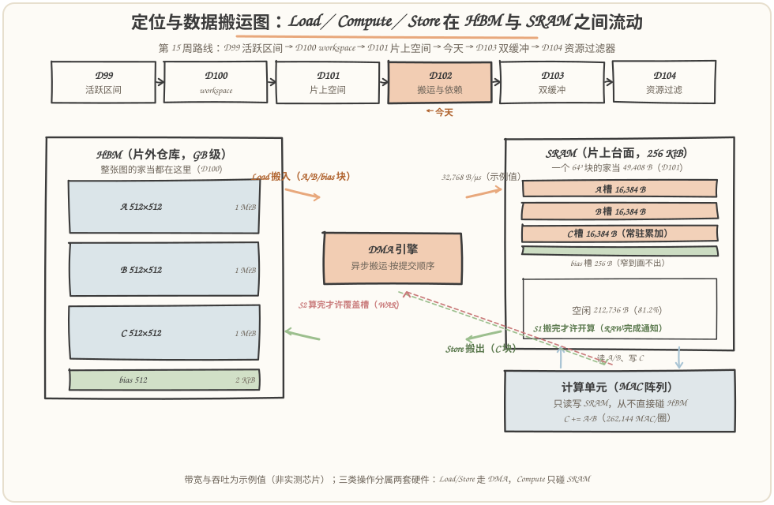
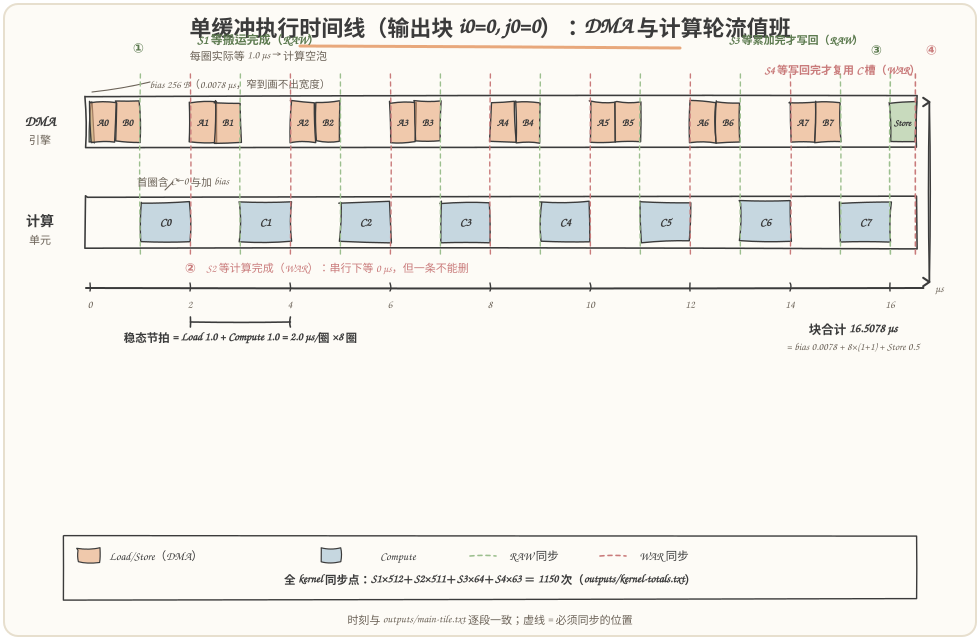
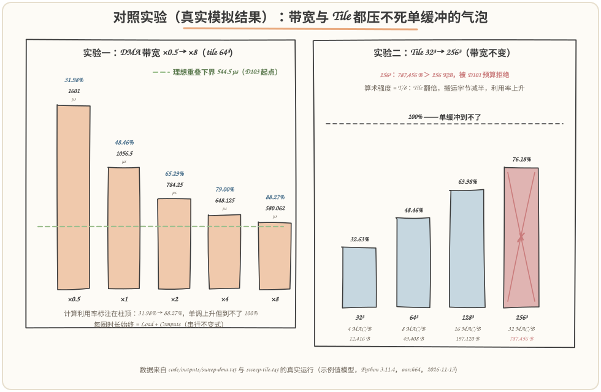

# 第 102 天：数据搬运与依赖——单缓冲时间线上，谁必须等谁？

> **今日目标**：完成本教程后，你能做到四件事——说清 Tiled MatMul 在片上执行的三类操作（**Load／Compute／Store**）各自动的是什么资源、住在哪两级存储之间；用**三种依赖**（RAW 真依赖、WAR 反依赖、WAW 输出依赖）解释"为什么这些等待一个都省不掉"；画出（并让程序替你排出）**单缓冲执行时间线**，标出全部 **1150 个必须同步的位置**（S1×512、S2×511、S3×64、S4×63）；用真实运行数据量出单缓冲的代价——**计算利用率 48.46%，一半时间在干等**，理想重叠下界 544.5 µs、潜在加速比 1.94×——并说清为什么"加带宽"和"换槽位"都救不了它，只有 D103 的双缓冲能。
> **预计时间**：学习 35 分钟＋实践 45 分钟
> **前置准备**：D94 的 Tiled MatMul 块循环语义（`for i0/j0/k0` 三层块循环、`Tm×Tn×Tk` 记号）；D100 的两级存储分工（workspace 在片外 HBM、复用要靠活跃区间）；D101 的 SRAM 空间账本（64³ 单缓冲 49,408 B 住得下 256 KiB、A/B 是 DMA 流入项、C 常驻）；D87 的累加语义（C 逐圈读-改-写）。工具只要 `python3`（本文环境：Python 3.11.4，aarch64 Linux，2026-11-13），零第三方依赖。
> **今日产出**：`code/timeline.py`（单缓冲时间线模拟器＋依赖对照表＋DMA／Tile 两组对照实验＋17 项断言自检）＋`code/run_all.sh`（一键复现）＋`code/outputs/` 下 8 份真实运行记录＋本文 3 张手绘图（数据搬运图、单缓冲时间线同步图、实验结果图）。

## 1. 今天解决什么问题？

昨天（D101）收官时留下一个"能住"的结论：64³ Tile、FP32、单缓冲，五项家当 49,408 B，在 256 KiB 的 SRAM 里绰绰有余。但**住得下 ≠ 跑得顺**。今天要换一根轴看同一个 kernel：不问"空间上住哪"，问"**时间上谁必须等谁**"。

具体问题来自一个朴素的事实：片上没有数据。A、B、C 都在 HBM 里，每算一块都得先把 A 块、B 块搬进 SRAM，算完再写回去。搬运由 **DMA**（Direct Memory Access，直接内存访问——一个独立于计算单元的搬运引擎）干，计算由 MAC 阵列干。于是每个输出块的时间线都是：**搬进来 → 算 → 搬出去**，循环往复。要害在两件事：第一，DMA 是异步的——你"发起"一次搬运后，计算单元并不自动知道搬完了没有；第二，槽位只有一个——第 k 圈还没算完，第 k+1 圈的数据就不能往同一个槽里搬。**谁等谁、在哪等、等多久，就是今天的全部内容。**

贯穿全文的例子沿用 D97/D101 那道题：`C = A·B + bias`，A/B/C 都是 512×512 FP32，tile 取 64³，单缓冲（A、B、C、bias 各一个槽），单 DMA 引擎按提交顺序执行。硬件参数取**示例值**：DMA 带宽 32,768 B/µs（32.768 GB/s）、计算吞吐 262,144 MAC/µs——**不代表任何具体芯片**，但所有数字都是下面这套确定性模型在本次运行中的真实计算结果（环境与口径见 `code/outputs/env.txt`）。

先给结论预览（第 5 节用真实运行验证）：一个输出块的时间线是 **bias 搬入 0.0078 µs ＋ 8 圈 ×（Load 1.0 µs ＋ Compute 1.0 µs）＋ Store 0.5 µs = 16.5078 µs**；整份 kernel 64 个输出块共 **1056.5 µs**，其中计算只忙 512 µs——**利用率 48.46%，一半时间计算单元在干等 DMA**。这些干等不是浪费 bug，明天（D103）会看到其中一半可以用双缓冲买回来；但买回之前，得先像今天这样把**依赖**和**同步点**一枚一枚钉在时间线上。

## 2. 先看全貌：今天的内容位于哪里？



**图 1**：看两块——下半是**数据搬运图**（今天的交付物之一）：左边的仓库是 HBM（A、B、C、bias 四件行李都住这），右边的台面是 SRAM（D101 的五项家当，按 64³ 真实比例画：A/B/C 各 16,384 B、bias 256 B）；中间的 DMA 引擎负责两条箭头——**Load（搬入）和 Store（搬出）**，计算单元只跟 SRAM 打交道、从不直接碰 HBM。上半是本周路线：D99 给活跃区间表、D100 规划片外 workspace、D101 盘点片上空间，**今天转到时间轴——数据搬运与依赖**，D103 讲重叠（双缓冲），D104 把空间＋时间两本账合成资源过滤器。

把今天的流程串成 5 步：

1. **搬入（Load）**：DMA 把 A 块、B 块从 HBM 搬进 SRAM 槽——异步发起，搬完才通知；
2. **同步 S1**：计算前必须等搬完——**RAW 依赖**（算的是刚写进槽里的数据）；
3. **计算（Compute）**：MAC 阵列在 SRAM 上做 `C += A·B`（首圈含 C←0 与加 bias）；
4. **同步 S2**：发起下一圈 Load 前必须等算完——**WAR 依赖**（新数据要覆盖还没读完的槽）；
5. **写回（Store）与同步 S3/S4**：末圈算完写回 C（RAW），写回完成前 C 槽不许交给下一个输出块（WAR）。

一句话定位：**D100 问"数据住在哪"，D101 问"一个块的家当占多大地方"，D102 问"这些家伙在时间线上谁必须等谁"**——空间账和时间账在 D104 会合成一张资源过滤器，缺了谁都编不出能跑的代码。

## 3. 核心概念：先用直觉，再给准确定义

### 3.1 三类操作：Load／Compute／Store 各自动谁的家当

一句通俗解释：Tiled kernel 的每条指令最终落在三类操作上——**Load 把数据从 HBM 搬进 SRAM 槽，Compute 在 SRAM 槽之间做乘加，Store 把结果从 SRAM 搬回 HBM**。三类操作用的是两套硬件：Load/Store 走 DMA 引擎，Compute 走计算单元。

类比：后厨。冰箱（HBM）再大，菜也得让传菜员（DMA）端到台面（SRAM）上，厨师（计算单元）只在台面炒，炒好的菜再由传菜员端回冷柜（Store）。对应到技术上是：**DMA 引擎独立于计算单元异步工作**——你"发起"（issue）一次搬运后它自己去跑，计算单元不被阻塞、也不自动知道进度，必须靠同步原语互通消息；这跟 CPU 语境里"一条 load 指令挡住流水线直到数据回来"是两码事。类比边界：传菜员一个人只能按单子顺序跑（今天假设**单 DMA 引擎、按提交顺序执行**），真实芯片可能有多个 DMA 通道并行——那是把今天的 S1 等待变短的手段之一，但解决不了 S2（3.2 节）。

最小例子（贯穿全文的那个）：64³ 块的 A 槽是 16,384 B，按示例带宽 32,768 B/µs，**一次 Load = 0.5 µs**；一次 Compute 是 64×64×64 = 262,144 MAC，按示例吞吐 262,144 MAC/µs，**恰好 1.0 µs**；Store C 槽 16,384 B，**0.5 µs**。

### 3.2 三种依赖：RAW、WAR、WAW——等待的法律依据

一句通俗解释：两类硬件并行干活时，不能各干各的——**有些先后顺序是程序语义要求的**。编译器把这些"必须保持的先后"叫**依赖（dependency）**，一共三种：

| 依赖 | 全称 | 一句人话 | 今天时间线上的实例 |
|---|---|---|---|
| **RAW** | Read After Write（真依赖） | **写完才许读** | Load A/B(k) → Compute(k)：算的是刚搬进槽的数据 |
| **WAR** | Write After Read（反依赖） | **读完才许覆盖** | Compute(k) → Load A/B(k+1)：新块要写同一个槽 |
| **WAW** | Write After Write（输出依赖） | **两个写要有序** | D100 的 workspace 复用：写完 X 才许写同一段的 Y |

类比：会议室白板。你写完（W）我才能抄（RAW）；我还在抄（R）你就不能擦掉写新的（WAR）；两个人都要写白板，总得排个先后（WAW）。对应到技术上是：RAW 捕捉**数据流**（值的产生到消费），WAR/WAW 捕捉**存储位置的复用冲突**——它们不传数据，只因为两件事碰了同一块地。类比边界：白板擦了还能重写，看起来"谁先谁后无所谓"；但 SRAM 槽被提前覆盖时，计算读到的会是**半新半旧的混合数据**——结果悄悄错掉，这是第 6 节错误二的现场。

关键认知：**WAR/WAW 不是"程序逻辑"要求的，是"槽位复用"人造出来的**。第 k 圈的计算和第 k+1 圈的搬运本来互不相干——只因为它们共用 A 槽，才被迫排先后。解掉人造依赖的办法明天揭晓（给每圈各开一个槽，即双缓冲）；今天先把它钉死在时间线上。

### 3.3 同步：把依赖翻译成时间线上的等待点

一句通俗解释：依赖是"法律"，**同步（synchronization）是执法**——在时间线上具体某个位置插一个"等"字。DMA 和计算单元各跑各的，同步原语只有两个基本角色：

- **完成通知**：DMA 搬完一块，写一个完成标志/信号量（semaphore，一个可以被两边安全读写的内存字）；
- **等待点**：计算（或下一次搬运发起）之前，检查/阻塞直到相应标志置位。

落到今天的四类等待点上：**S1**（等搬运完成，解 RAW）、**S2**（等计算完成才许发起新 Load，解 WAR）、**S3**（等累加完成才许写回，RAW）、**S4**（等写回完成才许复用 C 槽，WAR）。WAW 今天主要靠**单 DMA 引擎按提交顺序执行**兜底（Store X 和写 Y 排同一个队列，天然有序）。

一个容易忽视的事实：在**完全串行**的单缓冲时间线里，S2 的等待时长其实是 **0**——发起下一圈 Load 时，上一圈计算早已结束（程序顺序保证了）。那为什么还要显式记录？因为"程序顺序"只是我们**碰巧**选了这个保守调度；一旦想让 Load 提前跑（明天的事），S2 立刻从"零等待"变成"拦路虎"。**依赖分析记录的是可能性，不是现状**——这正是编译器必须建依赖表、而不能靠"跑一遍没出错"的原因。

## 4. 图解核心机制：单缓冲时间线与四个同步点



**图 2**：这是今天实践的主交付物——**单个输出块（i0=0, j0=0）的单缓冲执行时间线**，所有时刻与 `code/outputs/main-tile.txt` 的真实运行一一对应。上排是 DMA 引擎、下排是计算单元：bias（256 B，窄到画不出宽度）→ L(A₀)/L(B₀) 各 0.5 µs → C₀ 1.0 µs → L(A₁)/L(B₁) → C₁ ……交替到 C₇，最后 Store 0.5 µs 收尾，块合计 **16.5078 µs**。虚线是同步点，颜色区分依赖类型（绿=RAW、红=WAR）。

按图中编号把机制走一遍：

1. **① S1（RAW，512 次）**：每圈计算开跑前等搬运完成。真实等待时长 1.0 µs——这 1.0 µs 里计算单元**干等**，就是时间线上"计算空泡"的直接来源；首圈还要多等 bias 的 0.0078 µs；
2. **② S2（WAR，511 次）**：每圈发起 Load 前等上一圈计算读完 A/B 槽。串行调度下等待时长为 0（虚线画在交界上）——但必须记录，理由见 3.3：**它是明天的拦路虎**；
3. **③ S3（RAW，64 次）**：末圈算完才许写回。Store 读的是 C 槽里**最终累加结果**，早一拍写回就是半成品；
4. **④ S4（WAR，63 次）**：Store 完成前，C 槽不许被下一个输出块的 C←0 覆盖——Store 是 DMA 读 C 槽写 HBM，覆盖发生在"读"完成之前就会写丢数据；
5. **稳态节拍**：8 圈循环每圈严格 **Load 1.0 µs＋Compute 1.0 µs = 2.0 µs**——DMA 忙时计算闲、计算忙时 DMA 闲，**没有任何重叠**。这正是单缓冲的签名波形，也是 5.3 节 48.46% 利用率的来源。

再看一眼这张图的"空"：下排在每个 L 段都是空白（计算干等）。全 kernel 有 512 个这样的空泡（64 块 × 8 圈，每个 1.0 µs），再加上 64 次 Store 期间计算同样闲着的 32 µs 和 bias 搬入的 0.5 µs，合计 544.5 µs——**比计算本身（512 µs）还多**。这不是 bug，是单缓冲把 WAR 依赖坐实后的代价；第 5.4 节会用实验证明：这条空泡带靠加带宽只能压窄、永远消不掉。

## 5. 动手实践：排出你自己的单缓冲时间线

### 5.1 准备文件

```text
tutorials/day-102/
├── README.md                       ← 本文
├── images/                          ← 3 张手绘图（数字与 outputs/ 一致）
└── code/
    ├── timeline.py                 ← 单缓冲时间线模拟器（约 450 行，零依赖）
    ├── run_all.sh                   ← 一键复现（重跑本文全部记录）
    └── outputs/
        ├── main-tile.txt            ← 单块时间线：实践主交付物的数字底稿
        ├── kernel-totals.txt        ← 整份 kernel 统计＋同步点计数＋重叠下界
        ├── deps.txt                  ← 依赖说明（交付物之二，逐条对照）
        ├── ascii-timeline.txt        ← 双泳道 ASCII 时间线（图的草稿底稿）
        ├── sweep-dma.txt             ← 对照实验一：DMA 带宽 ×0.5～×8
        ├── sweep-tile.txt            ← 对照实验二：Tile 32³～256³
        ├── test-all.txt              ← 断言式自检（17/17）
        └── env.txt                   ← 环境：Python 3.11.4，aarch64，2026-11-13
```

### 5.2 编写代码

`timeline.py` 的核心是 `simulate()`：按程序顺序排事件，用两个时钟 `dma_free`/`comp_free` 追踪两个硬件各自的空闲时刻。同步点的插入规则是全文的精华，节选如下（完整实现见 `code/timeline.py`，其余是格式化报告与自检，此处省略）：

```python
for k in range(cfg.tiles_k):
    # S2：发起新的 A/B load 前，等计算读完上一个 A/B 槽（WAR）
    if k > 0 or (k == 0 and (ti, tj) != (0, 0)):
        wait = max(0.0, comp_free - now)
        emit(Op("sync", "S2: 等计算完成，才许覆盖 A/B 槽",
                now, now, sync="S2", deptype="WAR", waits=wait))
        now = max(now, comp_free)
    emit(Op("dma_load", f"A[{ti},{k}]", ...))   # 搬运必须等 comp_free（WAR）
    emit(Op("dma_load", f"B[{k},{tj}]", ...))
    # S1：计算前等本圈两个 load 完成（RAW）
    wait = max(0.0, now - comp_free)
    emit(Op("sync", f"S1: 等搬运完成（k={k}）",
            now, now, sync="S1", deptype="RAW", waits=wait))
    emit(Op("compute", f"compute k={k}", ...))  # 计算必须等 dma_free（RAW）
```

三个值得停下来的设计点：**其一**，A/B 的 Load 起点取 `max(dma_free, comp_free)`——引擎排队与 WAR 等待两者取晚，这正是"程序顺序碰巧满足"与"依赖必须显式记录"在同一行代码里的体现；**其二**，同步点被建成与 Load/Compute 同级的**事件**（有时刻、有类型、有等待时长），而不是散落的注释——这样统计同步次数、在图上画虚线都有数字可查；**其三**，等待时长在串行调度下几乎全为 0（S1 除外），程序照样把它记下来，为的是让明天改调度时这张表仍然成立。

### 5.3 运行与观察

一键复现（本文所有"实际输出"都来自这次运行，环境见 `outputs/env.txt`）：

```bash
cd tutorials/day-102/code && ./run_all.sh
```

真实输出的单块时间线开头（完整 44 个事件见 `outputs/main-tile.txt`，与图 2 逐段对应）：

```text
       0–0.0078   Load   bias[0]                           256 B
  0.0078–0.5078   Load   A[0,0]                            16,384 B
  0.5078–1.0078   Load   B[0,0]                            16,384 B
[ 1.0078]  S1   RAW S1: 等搬运完成（k=0）                      等待 1.0078 µs
  1.0078–2.0078   计算     compute k=0（含 C←0 与加 bias）        262,144 MAC
[ 2.0078]  S2   WAR S2: 等计算完成，才许覆盖 A/B 槽                等待 0 µs
  2.0078–2.5078   Load   A[0,1]                            16,384 B
...
[16.0078]  S3   RAW S3: 等累加完成，才许写回 C                    等待 0 µs
 16.0078–16.5078  Store  C[0,0]                            16,384 B
[16.5078]  S4   WAR S4: 等写回完成，C 槽才许复用                   等待 0 µs
块合计：16.5078 µs = bias 0.0078 + 8×(Load 1 + Compute 1) + Store 0.5
```

整份 kernel 的统计（`outputs/kernel-totals.txt` 的关键行）：

```text
总时长        ：1056.5 µs
DMA 忙        ：544.5 µs（利用率 51.54%）
计算忙        ：512 µs（利用率 48.46%）
计算空等气泡  ：544.5 µs（占总时长 51.54%）
  S1 RAW  搬运→计算 ：  512 次   S2 WAR  计算→搬运 ：  511 次
  S3 RAW  计算→写回 ：   64 次   S4 WAR  写回→复用 ：   63 次
理想重叠下界 = max(DMA忙, 计算忙) = 544.5 µs；潜在加速比 ≈ 1.94×
```



**图 3**：解释两组真实运行结果说明什么。左图（对照实验一）：DMA 带宽 ×0.5→×8，总时长从 1601 µs 压到 580.0625 µs，计算利用率 31.98%→88.27% **单调上升但渐近不到 100%**——搬得再快，只要 Load 和 Compute 共用一个槽，S2 就强迫它们轮流值班。右图（对照实验二）：Tile 32³→256³，算术强度 4→32 MAC/B，利用率 32.63%→76.18% 一路走高，但 256³ 的家当 787,456 B 被 D101 的 256 KiB 预算当场拒绝——**时间和空间在这里握手：想靠大 Tile 省搬运，先问 SRAM 答不答应**。

### 5.4 修改一个参数再观察

两个低成本对照实验（改一个参数、重跑一条命令）：

**实验一：把 DMA 带宽翻倍再翻倍。** 修改 `Config(dma_bw=...)` 依次取 ×0.5～×8，真实结果（`outputs/sweep-dma.txt`）：

```text
×0.5（16384 B/µs）   总时长 1601 µs   计算利用率 31.98%
  ×1（32768 B/µs）   总时长 1056.5    计算利用率 48.46%
  ×2（65536 B/µs）   总时长 784.25    计算利用率 65.29%
 ×4（131072 B/µs）   总时长 648.125   计算利用率 79.00%
 ×8（262144 B/µs）   总时长 580.0625  计算利用率 88.27%
```

观察点：每圈时长**始终**是 Load+Compute 之和（带宽 ×8 时一圈 = 0.125+1 = 1.125 µs），利用率逼近但永远够不到 100%——**单缓冲的天花板是结构性的，不是资源性的**。反直觉的一面：把计算吞吐翻倍（自己试 `mac_rate×2`）利用率反而**掉**——瓶颈换了个位置继续存在。

**实验二：换 Tile 尺寸。** 真实结果（`outputs/sweep-tile.txt`，上文图 3 右）：32³ 时 A/B 块搬运字节合计 32 MiB、利用率 32.63%；128³ 时降到 8 MiB、利用率 63.98%。原因是算术强度（每搬 1 B 能摊多少 MAC）：`T³/(8T²) = T/8`，Tile 翻一倍强度翻一倍。但 256³ 被空间账本拒绝——这行"✗ 被拒绝"就是 D101 的预算判定在今天的出口处站岗。

## 6. 常见错误与排查

**错误一：漏掉 S1（RAW）——"发起搬运后立刻开算"。**
现象：首次运行结果数值乱掉（像是用了上一次的残影数据），程序不崩、不报错。原因：DMA 是异步的，代码里"写在前面"不等于"先执行完"；计算读到的槽还没写完。定位：把算子和 CPU 参考实现对拍（D78~81 用过的验收方法），错误稳定复现；在 compute 前补一个 wait，错误立刻消失。修复：**每个 RAW 边界显式等待对应的 DMA 完成通知**——今天的 S1（512 次）就是这张清单。

**错误二：漏掉 S2（WAR）——"等算完再搬，多此一举吧"。**
现象：结果**时对时错**；加两行打印错误就消失（Heisenbug）。原因：想提速让下一圈 Load 提前发起，正好与上一圈计算竞争同一个 A/B 槽——覆盖发生在读完成之前，数据半新半旧；时序偶然对齐时结果又是对的。定位：这类"概率性"错误几乎总是未记录的 WAR 边界；对照 `outputs/deps.txt` 逐行检查覆盖性写操作。修复：发起覆盖性 Load 前等读方完成——**串行调度下它等 0 µs，但同步语句一个都不能删**（3.3 节的理由）。

**错误三：同步太粗——"保险起见，每步都全局 barrier"。**
现象：结果对，但比今天 48.46% 的利用率还低；profile 显示 DMA 和计算**同时**大量空闲。原因：把每个同步都实现成"全引擎、全队列排空"的全局屏障，两个硬件轮流等对方清场，重叠机会被同步本身吃光。定位：数同步次数和种类，与 `kernel-totals.txt` 的 1150 次对账——多出来的都是全局化溢价。修复：**按依赖边精确同步**（等"这一次搬运完成"，而不是等"所有搬运完成"）——这正是今天把依赖建成逐条记录表的原因。

## 7. 今日练习

### 必做练习

把 `Config` 改成 `K=1024`（A 变成 512×1024，k 块循环变 16 圈），**先手算再运行**：(a) 单块时间线多长？(b) S1 和 S2 各变成多少次？(c) 计算利用率升还是降？运行 `python3 timeline.py` 对照 `outputs/kernel-totals.txt`。预期产出：手算值＋真实运行值＋两者一致（或不一致时找出自己漏记了哪一项——通常是 bias 和 Store）。

### 选做挑战

给 `simulate()` 加第二个 DMA 引擎，让 A、B 两块**并行**搬运（每圈 Load 从 1.0 µs 缩到 0.5 µs）。先估算总时长（提示：串行结构没变，只是 L 段变窄），再实现验证。预期观察：总时长 1056.5 → 800.5 µs（约 −24%），利用率升到 63.96%——但 S2 依旧存在、气泡依旧不为零。结论预告：**加引擎治标，换槽位才治本**——这正是明天双缓冲要做的事，而且不需要任何新硬件。

## 8. 今日验收

- [ ] 我能用自己的话说清三类操作（Load／Compute／Store）各自动什么资源、住哪两级存储之间，以及 DMA"异步发起＋完成通知"与 CPU 同步 load 的区别；
- [ ] 我能独立运行 `./run_all.sh`，指出单块时间线 16.5078 µs 里每一段是什么、四个同步点各解什么依赖；
- [ ] 我能解释为什么 S2 在串行时间线上等待 0 µs 却一个都不能删，以及在什么调度下它会变成真正的等待；
- [ ] 我能对照 `outputs/deps.txt` 定位"漏 S1 读残影"和"漏 S2 覆盖未读"两类错误，并说出各自的典型现象；
- [ ] 我保存了 8 份真实运行记录、1 份 17/17 的自检结果，并能用 5.4 的两组实验解释"为什么单缓冲利用率封顶在 100% 以下"。

## 9. 一句话总结与明天预告

今天把 D101"住得下"的 kernel 拉上时间轴：三类操作（Load／Compute／Store）分属两个硬件（DMA 引擎／计算单元），三种依赖（RAW／WAR／WAW）给出等待的法律依据，四类同步点（S1×512、S2×511、S3×64、S4×63，合计 1150 次）把依赖钉成时间线上的"等"字；真实模拟显示单缓冲稳态节拍是"搬 1.0 µs＋算 1.0 µs"零重叠，计算利用率 48.46%，理想重叠下界 544.5 µs、潜在加速比 1.94×。两组对照实验证明：加带宽（×8 → 88.27%）和换大 Tile（128³ → 63.98%）都只能压窄气泡、到不了 100%，因为真正的病根是**单槽位上的 WAR 依赖**。明天（D103）给 A、B 各开两个槽——双缓冲让 S2 从时间线上消失，代价正是 D101 算过的"×2 只给流入项"：64³ 涨到 82,176 B 还住得起，128³ 的 328,192 B 已经被 256 KiB 预算拒之门外——空间和时间两本账，明天正式合流。
